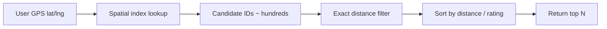
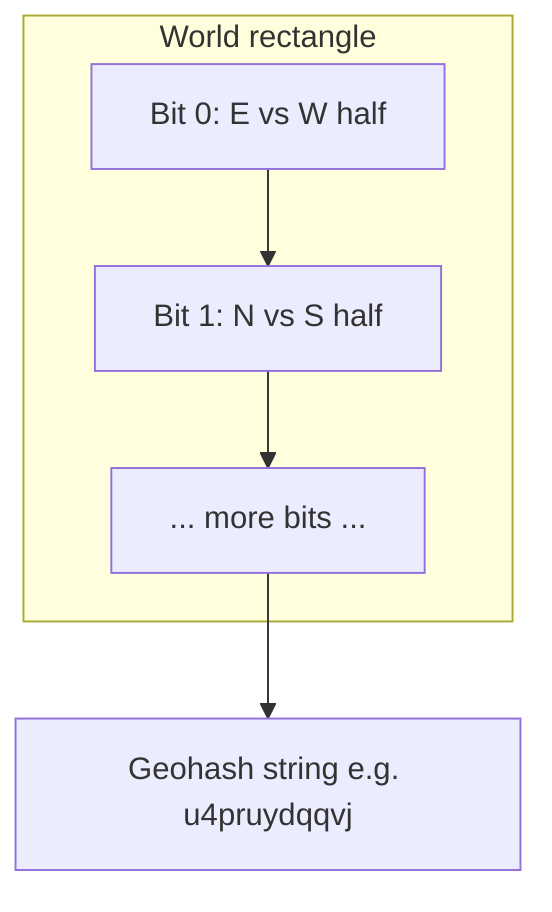
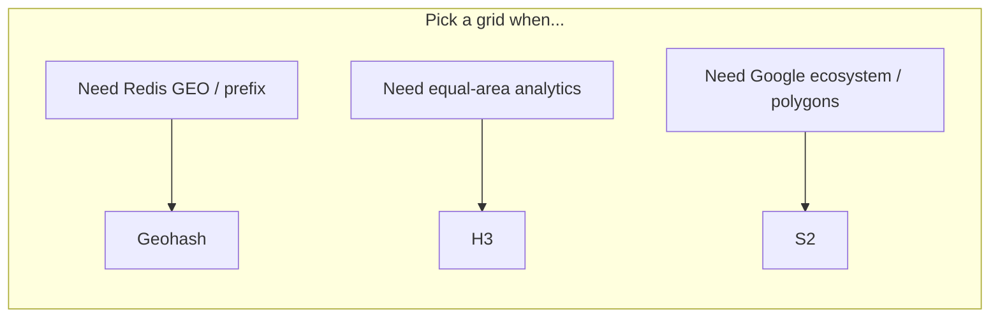
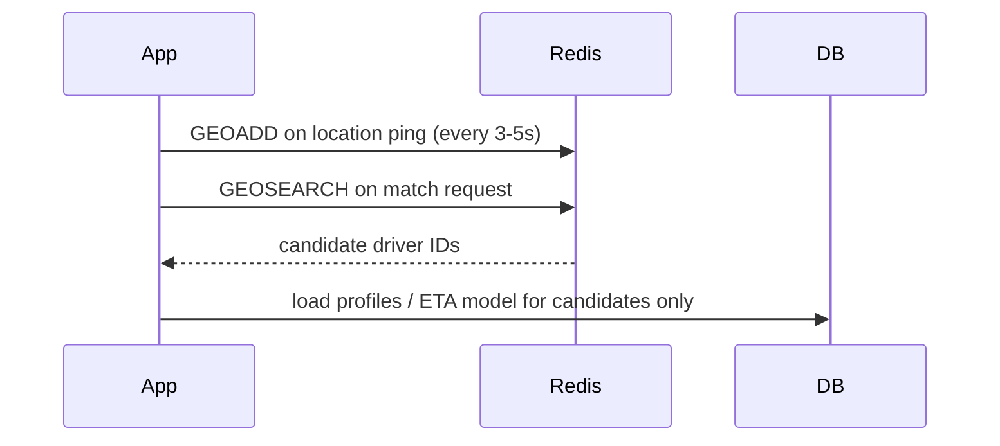
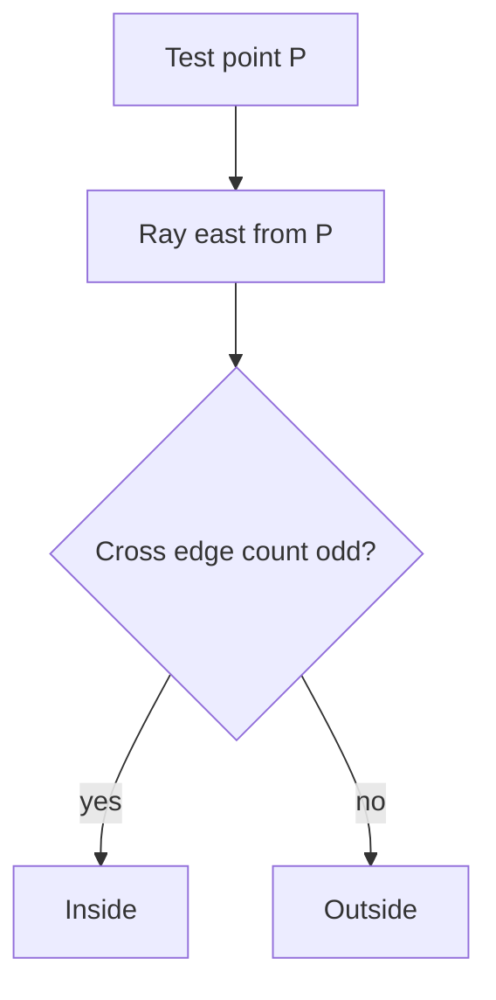
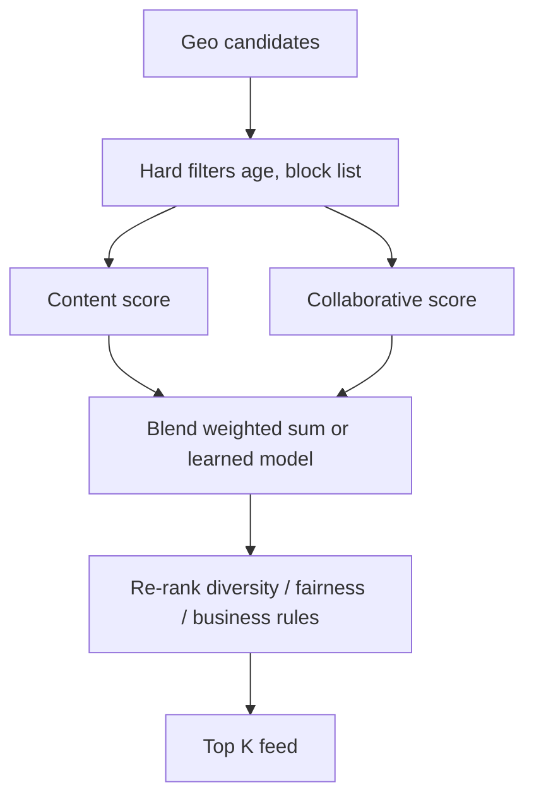
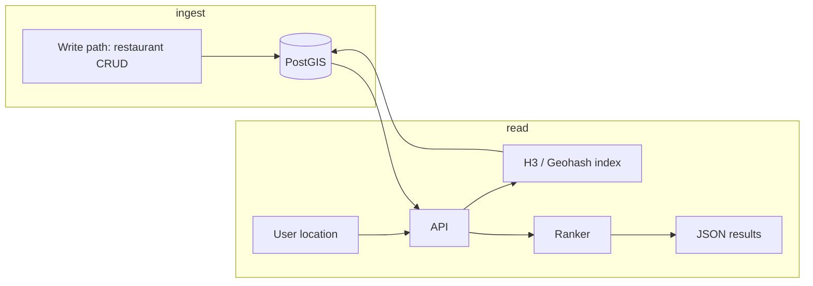

# Geo Matching, Spatial Indexes, and Recommendations

This guide is about building products where **location matters**: food delivery, ride-sharing, dating apps, and local content feeds. You will learn how computers turn latitude and longitude into fast database queries, how to draw invisible boundaries on a map (geofences), how to avoid showing the same profile twice, and how recommendation engines pick what to show next. Everything is explained in plain language with diagrams, Python examples, and interview-ready depth.

---

## The Core Problem: Nearby Search

Imagine you open a food app and ask: “Show me restaurants within 5 km of me.” Your phone gives you a point on Earth: latitude and longitude. The database holds thousands of restaurant points. A naive approach compares your point to **every** restaurant using the haversine formula (distance on a sphere). That works for hundreds of rows and fails at millions.

**What you really need:** a way to quickly discard far-away places and only compute exact distance on a small candidate set.



### Haversine distance in Python

Exact distance belongs on the **second** stage, not the first.

```python
import math

def haversine_km(lat1: float, lon1: float, lat2: float, lon2: float) -> float:
    """Great-circle distance between two WGS84 points, in kilometers."""
    r = 6371.0  # Earth radius in km
    phi1, phi2 = math.radians(lat1), math.radians(lat2)
    dphi = math.radians(lat2 - lat1)
    dlambda = math.radians(lon2 - lon1)
    a = math.sin(dphi / 2) ** 2 + math.cos(phi1) * math.cos(phi2) * math.sin(dlambda / 2) ** 2
    return 2 * r * math.asin(math.sqrt(a))


def nearby_naive(user_lat, user_lon, places, radius_km):
    """places: list of dicts with id, lat, lon"""
    results = []
    for p in places:
        d = haversine_km(user_lat, user_lon, p["lat"], p["lon"])
        if d <= radius_km:
            results.append({**p, "distance_km": d})
    return sorted(results, key=lambda x: x["distance_km"])
```

**Key insight:** Nearby search is a **two-phase** problem: cheap spatial filtering, then expensive precise distance on survivors.

---

## Geohash: Prefix as Proximity

A **geohash** encodes a lat/lng rectangle into a short string (base32). Points that are close on the map often share a **long common prefix** in their geohash. That lets you use a normal string index (B-tree, Redis key prefix scan) for geo.

### How encoding works (conceptually)

1. Start with the whole world as a rectangle.
2. Alternate splitting **longitude** then **latitude** in half (binary refinement).
3. Each bit becomes one character in the geohash string (groups of 5 bits → base32 char).

Longer geohash = smaller cell on the map.



### Visual: shared prefix ≈ nearby

```
User:     u4pruy     (cell ~ 1.2km x 0.6km at this length)
Restaurant A: u4pruyk   ← same prefix → likely within same cell neighbors
Restaurant B: u09tun   ← different early char → far away, skip in index
```

**Caveat:** Geohash cells are **rectangles**, not circles. A 5 km radius query may need **8 neighbor cells** plus edge cases at cell boundaries. Always re-check with haversine.

### Python: geohash encode/decode (educational)

```python
_BASE32 = "0123456789bcdefghjkmnpqrstuvwxyz"

def encode_geohash(lat: float, lon: float, precision: int = 8) -> str:
    lat_range = [-90.0, 90.0]
    lon_range = [-180.0, 180.0]
    bits = []
    ch = 0
    even = True
    while len(bits) < precision * 5:
        if even:
            mid = (lon_range[0] + lon_range[1]) / 2
            if lon >= mid:
                bits.append(1)
                lon_range[0] = mid
            else:
                bits.append(0)
                lon_range[1] = mid
        else:
            mid = (lat_range[0] + lat_range[1]) / 2
            if lat >= mid:
                bits.append(1)
                lat_range[0] = mid
            else:
                bits.append(0)
                lat_range[1] = mid
        even = not even
    out = []
    for i in range(0, len(bits), 5):
        v = 0
        for b in bits[i : i + 5]:
            v = (v << 1) | b
        out.append(_BASE32[v])
    return "".join(out)


def geohash_prefix_query(center_hash: str, radius_km: float) -> list[str]:
    """
    Production systems use libraries + neighbor tables.
    Shorter prefix = bigger cell when radius is large.
    """
    # Rule of thumb: drop 1-2 chars when doubling search radius (tune per dataset)
    if radius_km > 20:
        return [center_hash[:4]]
    if radius_km > 5:
        return [center_hash[:5]]  # plus 8 neighbors in real code
    return [center_hash[:6]]
```

**Key insight:** Geohash turns geo into **string prefix lookup**—powerful and simple, but boundary effects require neighbor expansion and a final distance filter.

---

## Grid Systems: Geohash vs S2 vs H3

All three partition Earth into cells. They differ in shape, hierarchy, and math library support.

| System | Cell shape | Who uses it | Strengths | Weaknesses |
|--------|------------|-------------|-----------|------------|
| Geohash | Rectangle | Redis, many tutorials | Simple prefix search | Distortion at poles, awkward neighbors |
| S2 | Mostly square on sphere | Google (Maps, Earth) | Solid hierarchy, spherical geometry | Steeper learning curve |
| H3 | Hexagon | Uber, many analytics | Uniform neighbors, great for aggregates | Not a string prefix index by default |

### Resolution levels (intuition)

Think of **zoom level**: coarse cells for country-wide stats, fine cells for “drivers within 500 m.”

- **H3:** resolution 0 (huge) → 15 (tiny). Res 7 ≈ 5 km² average hex area (varies by latitude).
- **S2:** levels 0–30; level 13 often used for ~1 km features.
- **Geohash:** length 4–8 chars; each extra char shrinks the box.



```python
# Example with h3-py (pip install h3)
import h3

def h3_cell_for_point(lat: float, lon: float, res: int = 8) -> str:
    return h3.latlng_to_cell(lat, lon, res)

def h3_disk_search(lat: float, lon: float, res: int, ring_k: int) -> set[str]:
    center = h3.latlng_to_cell(lat, lon, res)
    return h3.grid_disk(center, ring_k)  # center + k rings of hexes
```

**Key insight:** Choose the grid based on **query pattern** (radius search vs aggregation vs drawing regions), not hype.

---

## Redis GEO: Hot Path for Real-Time Apps

Ride-sharing and courier apps need **sub-10 ms** “who is near this point?” Redis provides in-memory **GEO** structures backed by a geohash-like encoding.

### Commands you must know

| Command | Purpose |
|---------|---------|
| `GEOADD key lon lat member` | Add/update a point (note: **lon before lat**) |
| `GEOSEARCH key FROMLONLAT lon lat BYRADIUS r km` | Radius search |
| `GEOSEARCH ... BYBOX w h km` | Box search |
| `GEODIST key m1 m2 km` | Distance between members |

```python
import redis

r = redis.Redis(host="localhost", port=6379, decode_responses=True)

def upsert_driver(driver_id: str, lon: float, lat: float):
    r.geoadd("drivers:online", (lon, lat, driver_id))
    r.expire("drivers:online", 120)  # TTL if heartbeat stops

def find_drivers_near(lon: float, lat: float, radius_km: float = 3.0, count: int = 20):
    return r.geosearch(
        "drivers:online",
        longitude=lon,
        latitude=lat,
        radius=radius_km,
        unit="km",
        count=count,
        sort="ASC",
    )
```

### Architecture pattern



**Pitfalls:**

- Redis GEO is **single-shard hot** unless you shard by city/region.
- Stale drivers: use **TTL + heartbeat** or a separate “last_seen” ZSET.
- Always confirm with routing ETA, not straight-line distance alone.

**Key insight:** Redis GEO is a **candidate generator**, not the source of truth for business logic.

---

## Geofencing: Is This Point Inside a Zone?

A **geofence** is a polygon (or circle) on the map: delivery zone, airport pickup lane, “no scooters here.” The question: given GPS `(lat, lon)`, is the point **inside** the polygon?

### Circles vs polygons

- **Circle:** compare haversine distance to center ≤ radius. Fast.
- **Polygon:** arbitrary shape (city boundaries, custom delivery islands).

### Production checklist

1. Store polygon as ordered vertices (lon, lat) or use PostGIS `GEOGRAPHY`.
2. Handle GPS **jitter** (buffer the polygon or require N consecutive samples inside).
3. Version fences; cache hot fences in memory.

**Key insight:** Geofencing is a **boolean membership** test used for pricing, compliance, and dispatch rules—not for ranking.

---

## Ray Casting: Point-in-Polygon Algorithm

**Ray casting** shoots a horizontal ray from the point to infinity and counts how many polygon edges it crosses. **Odd crossings → inside.** Even → outside.



### Python implementation

```python
from typing import Sequence

Point = tuple[float, float]  # (x, lon, y lat) — be consistent!

def point_in_polygon(point: Point, polygon: Sequence[Point]) -> bool:
    """
    polygon: closed or open list of vertices (lon, lat).
    Standard ray-casting; horizontal ray along latitude.
    """
    x, y = point
    inside = False
    n = len(polygon)
    for i in range(n):
        x1, y1 = polygon[i]
        x2, y2 = polygon[(i + 1) % n]
        # Does edge straddle the ray at y?
        if (y1 > y) != (y2 > y):
            x_intersect = (x2 - x1) * (y - y1) / (y2 - y1 + 1e-15) + x1
            if x < x_intersect:
                inside = not inside
    return inside


DELIVERY_ZONE = [
    (-122.42, 37.77),
    (-122.40, 37.77),
    (-122.40, 37.79),
    (-122.42, 37.79),
]

assert point_in_polygon((-122.41, 37.78), DELIVERY_ZONE)
```

**Edge cases:** points on boundary, holes in polygons, polar regions. Libraries (Shapely, GEOS, PostGIS) handle these; interview code often assumes simple polygons.

**Key insight:** Ray casting is O(edges)—fine for small fences; for millions of tests against huge polygons, **pre-index** (grid, R-tree) or use a spatial database.

---

## Seen Filtering: Bloom Filters vs Exact Sets

Dating and content apps must not show the same person or post repeatedly. You need a **membership** structure: “have we already shown this ID to this user?”

| Approach | Memory | False positives? | False negatives? |
|----------|--------|------------------|------------------|
| Exact set (Redis SET, DB table) | High | No | No |
| Bloom filter | Very low | Yes (might hide unseen) | No |
| Count-min sketch / HyperLogLog | Low | Approximate | N/A for exact seen |

### When to use which

- **Exact set:** small catalogs, compliance, paid boosts where mistakes cost money.
- **Bloom:** millions of impressions per user session history; rare false positive = skip one card (acceptable).
- **Hybrid:** Bloom pre-filter + exact set for recent window (last 7 days).

```python
import mmh3
from bitarray import bitarray  # pip install bitarray

class BloomFilter:
    def __init__(self, size: int = 1_000_000, num_hashes: int = 7):
        self.size = size
        self.num_hashes = num_hashes
        self.bits = bitarray(size)
        self.bits.setall(0)

    def _indexes(self, key: str) -> list[int]:
        return [mmh3.hash(key, i) % self.size for i in range(self.num_hashes)]

    def add(self, key: str) -> None:
        for i in self._indexes(key):
            self.bits[i] = 1

    def maybe_contains(self, key: str) -> bool:
        return all(self.bits[i] for i in self._indexes(key))


seen_bloom = BloomFilter()
seen_exact: set[str] = set()

def already_shown(user_id: str, item_id: str) -> bool:
    key = f"{user_id}:{item_id}"
    if key in seen_exact:
        return True
    if seen_bloom.maybe_contains(key):
        return True  # conservative: treat as seen
    return False

def mark_shown(user_id: str, item_id: str) -> None:
    key = f"{user_id}:{item_id}"
    seen_bloom.add(key)
    seen_exact.add(key)
```

**Key insight:** Seen filters trade **memory and write amplification** for correctness; product tolerance for “skipped by mistake” drives the choice.

---

## Matching and Recommendation Algorithms

**Matching** pairs users (dating, marketplace). **Recommendations** rank items (feed, jobs). Often combined: candidates from geo + filters, then rank.

### Content-based filtering

“Users similar to items they liked before.” Build a profile vector from features (cuisine tags, price, distance bucket). Score items by similarity (cosine, dot product).

```python
def cosine(a: dict[str, float], b: dict[str, float]) -> float:
    keys = set(a) & set(b)
    dot = sum(a[k] * b[k] for k in keys)
    na = sum(v * v for v in a.values()) ** 0.5
    nb = sum(v * v for v in b.values()) ** 0.5
    return dot / (na * nb + 1e-9)
```

### Collaborative filtering

“People who liked X also liked Y.” Matrix factorization or nearest-neighbor in user-item interaction space. Cold start: new user has no history → fall back to content-based or popular near you.

### Hybrid (what FAANG-like apps do)



```python
def rank_hybrid(user, candidates, w_dist=0.4, w_cf=0.4, w_pop=0.2):
    scored = []
    for c in candidates:
        s = (
            w_dist * (1.0 / (1.0 + c["distance_km"]))
            + w_cf * c.get("cf_score", 0.0)
            + w_pop * c.get("popularity", 0.0)
        )
        scored.append((c["id"], s))
    return sorted(scored, key=lambda x: x[1], reverse=True)
```

### Two-sided market matching (dating / rides)

- **Supply/demand balance:** show profiles likely to match, not just popular.
- **Exploration vs exploitation:** reserve slots for new users (multi-armed bandits).
- **Constraints:** mutual gender preference, max distance, blocked users (exact set).

**Key insight:** Geo gets you **feasible** candidates; ML gets you **good** candidates; rules keep you **safe and legal**.

---

## End-to-End: Local Discovery Service Sketch



| Layer | Technology example | Responsibility |
|-------|-------------------|----------------|
| Index | PostGIS GIST, Elasticsearch geo | Candidate retrieval |
| Cache | Redis GEO for live entities | Drivers, couriers |
| Rules | App server | Geofence, blocks, seen |
| Rank | ML service | Personalization |

---

## FAANG Interview Deep Dive

### Q1: Design “restaurants within 5 km” at 10M restaurants global scale.

**Answer:** Partition by **region** (city shard). Within a shard, use a spatial index (PostGIS `ST_DWithin`, Elasticsearch `geo_distance`, or geohash/H3 prefix + haversine). Never scan 10M rows per query. Cache popular areas. Return paginated results sorted by distance or blended score. Cross-region search is rare for food; if needed, route query to shard by user H3 cell.

### Q2: Why can geohash prefix search miss nearby restaurants?

**Answer:** Neighbors can sit in **adjacent cells** with different prefixes. A radius circle crosses cell borders. Fix: query center hash **and neighbor cells** (8 for geohash), then apply exact distance filter.

### Q3: Redis GEO vs PostGIS for driver matching?

**Answer:** Redis GEO: in-memory, microsecond reads, great for **frequently moving** entities with simple radius queries. PostGIS: durable, complex polygons, joins, transactional updates. Typical pattern: Redis for live positions, Postgres for accounts and trip state.

### Q4: How do you handle GPS inaccuracy in geofencing?

**Answer:** Require **hysteresis** (2–3 samples inside), inflate polygon slightly, or use uncertainty radius. Log fence events for disputes. For payments, prefer conservative rules (user benefit on ambiguity).

### Q5: Bloom filter false positives in a dating app—acceptable?

**Answer:** A false positive means you **skip** showing someone you have not shown—lost opportunity, not a privacy leak. If product accepts rare misses, Bloom saves RAM. For “never show again” after block/report, use **exact** storage.

### Q6: Explain collaborative filtering cold start.

**Answer:** New user: no clicks → CF vectors empty. Use demographics, onboarding choices (content-based), geo-popular items, and exploration slots. New item: use content features until interactions accumulate (item cold start).

### Q7: How would you prevent ranking from creating filter bubbles?

**Answer:** Inject **diversity** (MMR re-ranking), cap repeated tags, explicit exploration traffic, monitor entropy of served categories, and offline eval with diversity metrics—not just CTR.

### Q8: Design seen-state for 100M users each with 10k impressions.

**Answer:** Do not store one giant SET per user in Redis. Use **time-bucketed** keys (seen:user:2025-10), Bloom per bucket, compaction to cold storage, and exact recent window (7 days). TTL aligns with product memory.

---

## Senior Pitfalls

| Mistake | Impact | Fix |
|---------|--------|-----|
| Single global spatial scan | P99 latency spikes, DB meltdown | Regional sharding + spatial index + two-phase filter |
| Ignoring geohash cell boundaries | Missing nearby results, user trust loss | Neighbor cell expansion + haversine recheck |
| Using straight-line distance for ETA | Bad dispatch, cancellations | Road network ETA model after geo candidates |
| Storing lon/lat swapped | Silent wrong country bugs | Tests, schema validation, Redis GEO argument order |
| Exact seen sets forever | Redis OOM, huge bills | TTL buckets + Bloom for long tail |
| Ranking without hard constraints | Showing blocked users, legal risk | Filter blocks **before** ML rank |
| No geofence versioning | Wrong pricing after zone edit | Version fences, effective dates, audit log |

---

## Production-grade Practice

1. **Build a mini nearby API:** Load 50k synthetic points (city bounding box). Implement geohash prefix + haversine filter vs brute force; benchmark P95 latency and verify recall (neighbors included).

2. **Ray cast + jitter test:** Given one delivery polygon, simulate 1000 random points with Gaussian noise (σ=15 m). Measure false in/out rates; add 20 m buffer and compare.

3. **Redis GEO driver sim:** Script 500 drivers updating every 2 s; run match queries 100 QPS; measure candidate count distribution; add TTL and observe stale driver rate.

4. **Hybrid ranker A/B stub:** Log impressions with `distance_km`, `cf_score`, `clicked`. Offline compute weights via simple logistic regression; compare CTR vs distance-only baseline on held-out week.

---

## Quick Reference Card

| Term | One-line meaning |
|------|------------------|
| Spatial index | Data structure to find points near a point without scanning all |
| Geohash | Lat/lng encoded as string; shared prefix ≈ proximity |
| H3 / S2 | Hex or square cells on the sphere for analytics and indexing |
| Geofence | Polygon/circle test: inside or outside |
| Ray casting | Count ray-edge crossings for point-in-polygon |
| Bloom filter | Compact “maybe seen” with possible false positives |
| CF / CB / Hybrid | Recommend from behavior, features, or both |

---

*You now have the vocabulary and patterns to design location-aware feeds, dispatch systems, and recommendation stacks that survive real traffic.*
