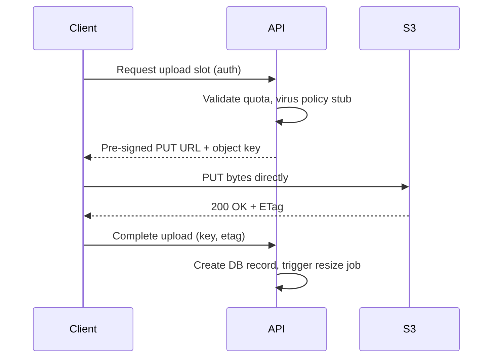
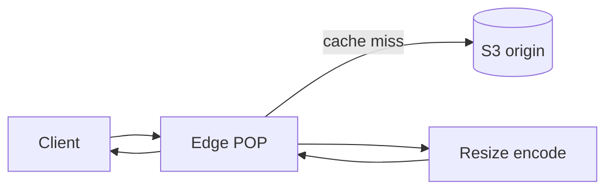
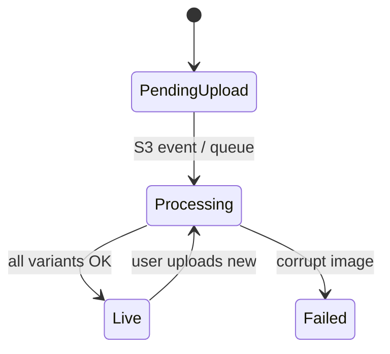
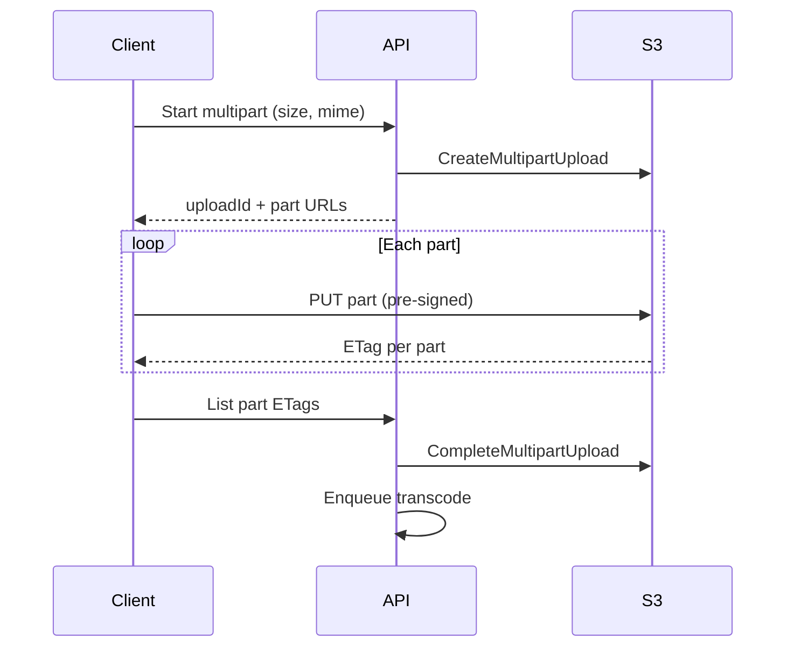
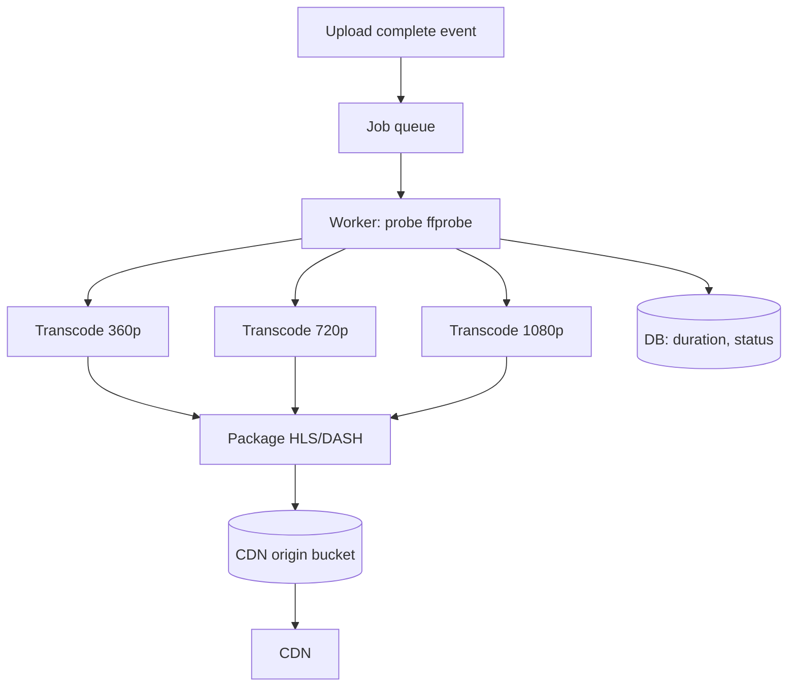
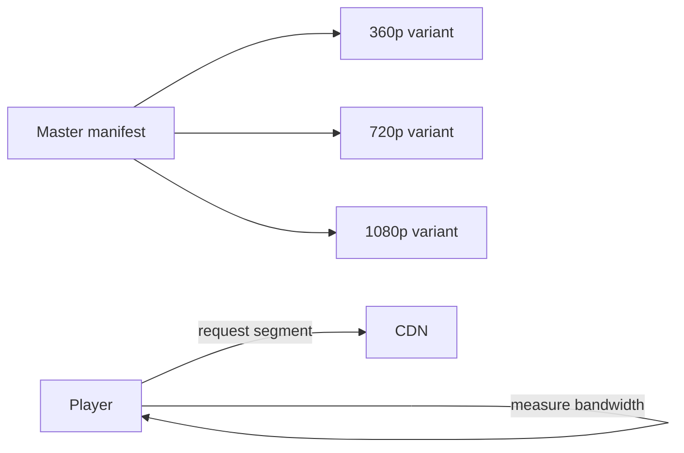
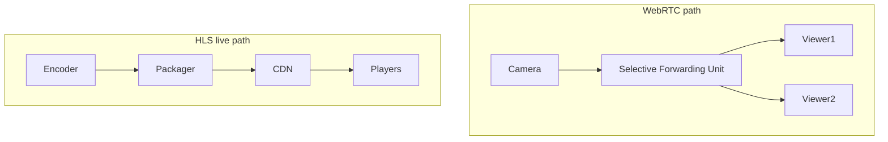
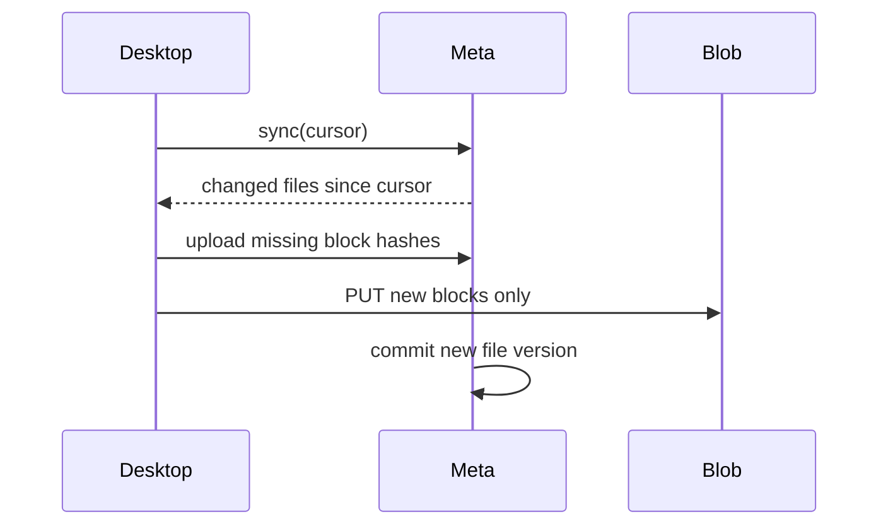
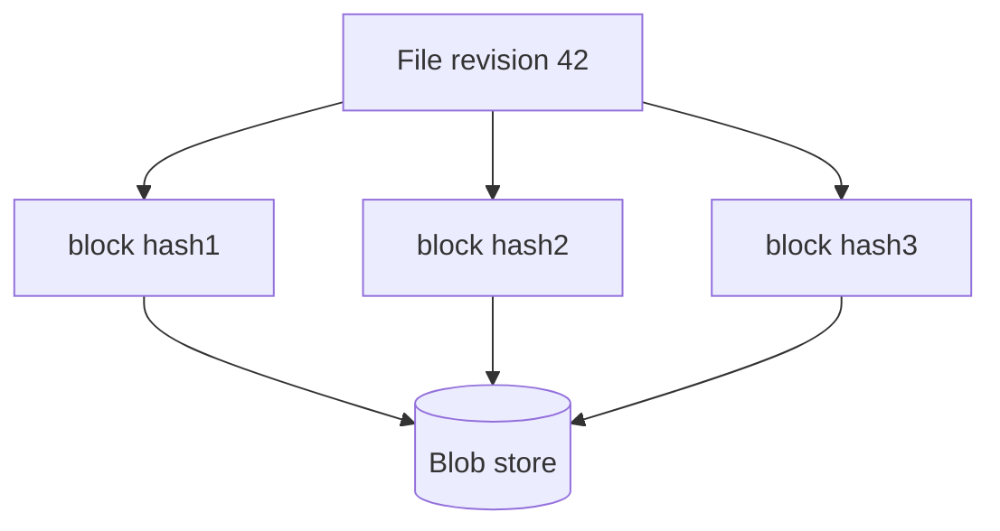
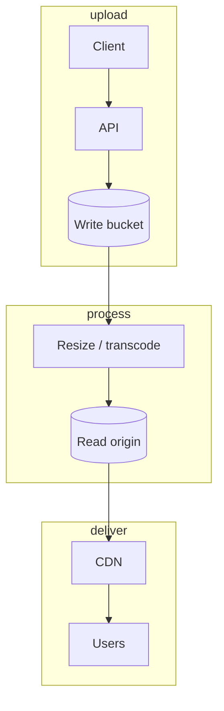

# Media Files, CDN, and Sync at Scale

This guide explains how modern apps handle **photos and videos** without melting your API servers: clients upload straight to object storage, CDNs resize images at the edge, transcoding farms turn one upload into many formats, and sync systems (like Dropbox) move huge files reliably. You will see pre-signed URLs, multipart uploads, HLS adaptive streaming, security tokens, and block-based deduplication—all in plain language with diagrams, Python sketches, and interview depth.

---

## Why Not Upload Through Your Server?

If every 10 MB photo hits your Python app, you pay for **double bandwidth** (client → app → S3) and risk **timeouts** and **memory spikes**. The standard pattern: your server mints a **short-lived permission**, the client uploads **directly** to S3/GCS/Azure Blob.



**Key insight:** Your API orchestrates **trust and metadata**; bytes flow on the **object-store data plane**.

---

## Pre-Signed URLs (Direct-to-Object-Storage Upload)

A **pre-signed URL** is a normal HTTPS URL with query parameters that prove “this request was authorized by someone with the secret key.” It expires in minutes.

### What to put in your API contract

| Field | Purpose |
|-------|---------|
| `upload_url` | Where client PUTs |
| `object_key` | Stable ID in bucket |
| `expires_at` | Limit exposure window |
| `max_size_bytes` | Enforce in policy conditions |
| `content_type` | Lock MIME type |

### Python (AWS S3) example

```python
import boto3
from botocore.config import Config
from datetime import datetime, timedelta, timezone
import uuid

s3 = boto3.client("s3", config=Config(signature_version="s3v4"))

def create_presigned_put(bucket: str, user_id: str, content_type: str, max_mb: int = 10):
    key = f"uploads/{user_id}/{uuid.uuid4().hex}"
    url = s3.generate_presigned_url(
        ClientMethod="put_object",
        Params={
            "Bucket": bucket,
            "Key": key,
            "ContentType": content_type,
        },
        ExpiresIn=900,
    )
    return {"upload_url": url, "object_key": key, "expires_in": 900}


def complete_upload(user_id: str, object_key: str, etag: str):
    # Persist metadata; optionally HEAD object to verify size
    return {"status": "ready", "key": object_key, "etag": etag}
```

### Security notes

- Bind key prefix to `user_id` so users cannot overwrite others’ paths.
- Use **SSE-KMS** or bucket encryption at rest.
- Scan in async pipeline (ClamAV, Macie) after upload completes.
- Never log full pre-signed URLs (they are bearer tokens).

**Key insight:** Pre-signed URLs are **capabilities**—treat leak like credential leak.

---

## Image CDN and On-the-Fly Resizing

Mobile clients need thumbnails, @2x assets, and WebP/AVIF for bandwidth. **Image CDNs** (Cloudinary, Imgix, CloudFront + Lambda@Edge, imgproxy) fetch the **origin** once, transform at the **edge**, cache by URL.

### URL-as-transformation API

```
https://cdn.example.com/w_200,h_200,f_webp,q_80/avatars/user123/original.jpg
```

| Parameter | Effect |
|-----------|--------|
| Width/height | Resize (fit/crop modes) |
| Format | webp, avif, jpeg |
| Quality | Compression |
| DPR | Retina |



### Cache keys

Cache key = full path including transform params. **Immutable URLs** (`/v3/...` or content-hash in path) allow `Cache-Control: immutable, max-age=31536000`.

```python
def avatar_cdn_url(user_id: str, version: int, width: int, format: str = "webp") -> str:
    # version bumps on every avatar change → natural cache bust
    return (
        f"https://img.example.com/"
        f"w_{width},f_{format},q_85/avatars/{user_id}/v{version}/photo.jpg"
    )
```

**Key insight:** Push transformation to the CDN so your app servers never decode JPEGs.

---

## Avatar Service: Simple Surface, Many Moving Parts

An avatar flow touches auth, storage, image processing, CDN, and cache invalidation.

### Lifecycle

1. **Upload** via pre-signed PUT to `avatars/{user_id}/incoming/{uuid}`.
2. **Validate** magic bytes, dimensions, strip EXIF (privacy).
3. **Process** generate 64, 128, 256, 512 squares (face-aware crop optional).
4. **Publish** to versioned prefix `avatars/{user_id}/v{n}/`.
5. **Serve** via CDN; DB stores `current_version`.
6. **Invalidate** only if using non-versioned URLs (prefer versioning).



```python
VARIANTS = [64, 128, 256, 512]

def process_avatar_job(user_id: str, source_key: str, new_version: int):
    # Pseudocode: download, center crop, encode webp/jpeg
    outputs = []
    for size in VARIANTS:
        dest = f"avatars/{user_id}/v{new_version}/{size}.webp"
        # resize_and_upload(source_key, dest, size)
        outputs.append(dest)
    # db.set_avatar_version(user_id, new_version)
    return outputs
```

| Failure | User-visible behavior |
|---------|------------------------|
| Slow processing | Show old avatar + spinner |
| Bad file type | 400 with clear message |
| CDN stale | Version in URL avoids purge |

**Key insight:** **Versioned URLs** beat manual CDN purge for avatars.

---

## Video Upload: Signed URLs and Multipart

Videos are large (100 MB–10 GB). Single PUT fails on flaky mobile networks. **Multipart upload** splits the file into parts; each part uploads independently; S3 assembles at `CompleteMultipartUpload`.



### Python: initiate and complete

```python
def start_multipart(bucket: str, key: str, content_type: str):
    resp = s3.create_multipart_upload(Bucket=bucket, Key=key, ContentType=content_type)
    return resp["UploadId"]


def presign_part(bucket: str, key: str, upload_id: str, part_number: int):
    return s3.generate_presigned_url(
        ClientMethod="upload_part",
        Params={
            "Bucket": bucket,
            "Key": key,
            "UploadId": upload_id,
            "PartNumber": part_number,
        },
        ExpiresIn=3600,
    )


def complete_multipart(bucket: str, key: str, upload_id: str, parts: list[dict]):
    # parts: [{"ETag": "...", "PartNumber": 1}, ...]
    return s3.complete_multipart_upload(
        Bucket=bucket,
        Key=key,
        UploadId=upload_id,
        MultipartUpload={"Parts": sorted(parts, key=lambda p: p["PartNumber"])},
    )
```

### Client best practices

- Part size 8–16 MB (tune for network).
- **Resume:** persist `uploadId` + completed part numbers locally.
- Abort stale multipart uploads (lifecycle rule) to avoid storage leak.

**Key insight:** Multipart turns one fragile upload into **many retryable units**.

---

## Video Transcoding Pipeline

Raw upload is rarely playable everywhere. A **transcode pipeline** produces H.264/H.265/VP9 renditions at 360p, 720p, 1080p, plus audio AAC.



### Job state machine

| State | Meaning |
|-------|---------|
| `uploaded` | Bytes in S3, not processed |
| `processing` | Workers running |
| `ready` | All renditions + manifest |
| `failed` | Retry or alert |

```python
from enum import Enum

class VideoStatus(str, Enum):
    UPLOADED = "uploaded"
    PROCESSING = "processing"
    READY = "ready"
    FAILED = "failed"

def on_upload_complete(video_id: str, source_key: str):
    enqueue({
        "video_id": video_id,
        "source_key": source_key,
        "outputs": [
            {"height": 360, "bitrate_kbps": 800},
            {"height": 720, "bitrate_kbps": 2500},
            {"height": 1080, "bitrate_kbps": 5000},
        ],
    })
    # update_db(video_id, status=PROCESSING)
```

**Key insight:** Transcoding is **async and idempotent**—same `video_id` + rendition key should not duplicate work.

---

## Adaptive Bitrate (ABR) and the CDN “Decider”

**HLS** and **DASH** split video into **small segments** (2–6 s) at multiple bitrates. The player picks the next segment’s quality based on **buffer level** and **throughput**—Netflix’s “decider” is this logic at scale.



### Master playlist (HLS) sketch

```text
#EXTM3U
#EXT-X-STREAM-INF:BANDWIDTH=800000,RESOLUTION=640x360
360p/index.m3u8
#EXT-X-STREAM-INF:BANDWIDTH=2500000,RESOLUTION=1280x720
720p/index.m3u8
```

### What the player optimizes

- Avoid rebuffering (raise buffer target on Wi‑Fi, lower on cellular).
- Cap max resolution to device screen.
- Startup: start low, ramp up quickly (BOLA, throughput-based algorithms).

| Format | Pros | Cons |
|--------|------|------|
| HLS | Apple ecosystem, simple CDN | Higher latency in live |
| DASH | Standards-based, flexible | Player support varies |
| CMAF | Single segment format for both | Infra investment |

**Key insight:** CDN caches **segments**, not whole movies—cache hit ratio drives cost.

---

## Signed URLs, DRM, and Video Security

**Signed URLs** limit who can fetch bytes and for how long. **DRM** (Widevine, FairPlay, PlayReady) encrypts content and licenses keys to approved players—stronger against download tools.

### Layers of protection

| Layer | Stops what |
|-------|------------|
| Auth on API | Anonymous catalog scraping |
| Short-lived signed CDN URL | Link sharing after expiry |
| Referer / token binding | Hotlinking |
| DRM | Persistent piracy rips |

```python
import hmac
import hashlib
import time
from urllib.parse import urlencode

def sign_cdn_url(path: str, secret: bytes, ttl_sec: int = 300) -> str:
    expires = int(time.time()) + ttl_sec
    to_sign = f"{path}?exp={expires}"
    sig = hmac.new(secret, to_sign.encode(), hashlib.sha256).hexdigest()
    return f"https://cdn.example.com{path}?{urlencode({'exp': expires, 'sig': sig})}"
```

### DRM flow (simplified)

1. Transcode produces **encrypted** segments.
2. License server validates user subscription.
3. Player receives key only if device passes attestation (platform-dependent).

**Trade-off:** DRM adds **latency, cost, and support burden**—use for premium studio content; skip for UGC cat videos.

**Key insight:** Security is **economics**—raise attacker cost above content value.

---

## Live Streaming, WebRTC, and Latency

Not all “live” is the same latency bucket.

| Approach | Typical latency | Use case |
|----------|-----------------|----------|
| HLS/DASH live | 10–30 s | Sports, concerts at scale |
| Low-latency HLS (LL-HLS) | 2–5 s | Interactive events |
| WebRTC | Sub-second | Video calls, auctions, gaming |



### WebRTC vs CDN live

- **WebRTC:** UDP, peer/SFU mesh, hard to fan out to 1M viewers without layering (HLS bridge).
- **HLS:** TCP-friendly, CDN cacheable, huge scale, higher delay.

**Key insight:** Pick latency target first—it **determines architecture**, not the reverse.

---

## Remote File Sync Design (Dropbox-Style)

Users expect files to **sync across devices**, survive offline edits, and **not re-upload** unchanged bytes.

### Core components

1. **Change detection** (local fs events + periodic scan).
2. **Metadata service** (path → file id, revision, block list).
3. **Block store** (content-addressed chunks).
4. **Sync protocol** (delta upload, conflict handling).



**Key insight:** Sync is a **metadata problem** with a **bandwidth optimization** story.

---

## Fixed-Block Chunking and Content Addressing

Split files into fixed-size blocks (e.g. 4 MB). Hash each block (SHA-256). The hash is the **block ID**. Identical blocks across files/users **deduplicate**.

```python
import hashlib

BLOCK_SIZE = 4 * 1024 * 1024

def chunk_file(path: str) -> list[str]:
    block_hashes = []
    with open(path, "rb") as f:
        while True:
            data = f.read(BLOCK_SIZE)
            if not data:
                break
            h = hashlib.sha256(data).hexdigest()
            block_hashes.append(h)
            # upload if not exists in blob store
    return block_hashes
```

### Rolling hash (rsync-style) variant

Fixed blocks misalign on **insertions** (whole chain of hashes changes). **Rolling hash** (Rabin fingerprint) finds boundaries and stable chunks after edits—used in advanced sync (LBFS, Dropbox custom).

| Strategy | Dedup on small edits | Complexity |
|----------|----------------------|------------|
| Fixed blocks | Poor | Low |
| Content-defined chunking | Good | Medium |

**Key insight:** Content addressing makes storage **append-only and deduplicated**.

---

## Blocklist and Versioned File Metadata

A **file version** is not “a path on disk” but a record:

```json
{
  "file_id": "f_abc",
  "parent_id": "folder_xyz",
  "revision": 42,
  "size": 10485760,
  "blocklist": ["hash1", "hash2", "hash3"],
  "created_by": "device_7",
  "mtime": "2025-10-26T12:00:00Z"
}
```



### Conflict resolution

When two devices edit offline:

- **Last-writer-wins:** simple, data loss risk.
- **Branch copies:** `report (conflicted copy).doc`—user merges manually.
- **Operational transform (OT)** / CRDTs: for text/docs specialized products.

```python
def commit_version(file_id: str, base_revision: int, blocklist: list[str], client_id: str):
    current = get_metadata(file_id)
    if current.revision != base_revision:
        raise ConflictError(current.revision)
    new_rev = base_revision + 1
    save_metadata(file_id, revision=new_rev, blocklist=blocklist, client_id=client_id)
    return new_rev
```

**Key insight:** Version + blocklist separates **namespace** (path) from **content** (immutable blocks).

---

## CDN Architecture for Media (Putting It Together)



| Concern | Pattern |
|---------|---------|
| Cost | Lifecycle policies, IA for old uploads |
| Integrity | ETag, checksum on complete |
| Abuse | Per-user upload quotas, rate limits |
| Compliance | Regional buckets, data residency |

---

## FAANG Interview Deep Dive

### Q1: Design image upload for 500M users.

**Answer:** Pre-signed PUT to regional bucket, size/MIME enforced in policy, async virus scan, processing queue generating variants, versioned CDN URLs, metadata in sharded DB. Rate limit uploads per user. Monitor failed multipart and retry. Never proxy bytes through stateless API pods.

### Q2: How do you invalidate CDN cache after image edit?

**Answer:** Prefer **immutable versioned URLs** (`v{n}` in path). If legacy paths, use **short TTL** + purge API (rate-limited, regional). For global purge lag, combine version bump with CDN surrogate keys.

### Q3: Explain multipart upload failure modes.

**Answer:** Partial parts without complete → orphan storage (lifecycle abort rule). Client retries individual parts. Complete with wrong ETags → corrupt object (validate ordering). Duplicate complete calls should be idempotent on same uploadId.

### Q4: Why HLS for scale but WebRTC for calls?

**Answer:** HLS segments are **stateless HTTP** on CDN—millions of viewers. WebRTC is **session-oriented** low latency mesh/SFU—expensive per viewer at huge scale. Hybrid: WebRTC upstream, HLS downstream for mega-audience.

### Q5: Design transcoding SLA for 4K uploads.

**Answer:** Priority queues (paid tier), autoscale workers on queue depth, probe step to skip unnecessary renditions, GPU instances for HEVC, store mezzanine once, idempotent job keys, dead-letter for corrupt inputs, progress webhooks to client.

### Q6: How does block-level dedup save money?

**Answer:** Same block hash stored once across users (with reference counting). Popular attachments (PDF template) uploaded once. Watch for **privacy** (hash leakage reveals file existence)—use per-tenant encryption or salting if needed.

### Q7: Signed URL stolen and shared—mitigations?

**Answer:** Short TTL, bind to IP/session cookie (CDN token), single-use nonces for downloads, WAF rate limits, rotate keys, watermark premium video, DRM for high-value content.

### Q8: RPO/RTO for object storage?

**Answer:** Cross-region replication for RPO near-zero; versioning for accidental delete; restore drills for RTO. Metadata DB still needs backups—blob without index is useless.

---

## Senior Pitfalls

| Mistake | Impact | Fix |
|---------|--------|-----|
| Proxying uploads through API | OOM, slow, costly | Pre-signed direct upload |
| No multipart for large video | Failed mobile uploads | Multipart + resume state |
| Mutable CDN URLs without purge plan | Stale avatars for days | Version in path |
| Single rendition | Buffering on slow networks | ABR ladder + CMAF where possible |
| Orphan multipart parts | Silent S3 bill growth | Lifecycle abort incomplete uploads |
| Dedup without refcount GC | Cannot delete blocks safely | Reference counts per hash |
| Ignoring EXIF in avatars | GPS leaks, stalking risk | Strip metadata on ingest |

---

## Production-grade Practice

1. **Pre-signed upload lab:** Implement PUT + HEAD verification script; measure time vs proxied upload for 5 MB file; document policy conditions for `Content-Type`.

2. **Multipart resume:** Simulate failed part 3 of 5; resume with same `uploadId`; verify final ETag matches single-shot upload.

3. **Transcode DAG:** Draw job graph for 1080p source → 3 renditions + thumbnails; write idempotent worker that skips existing S3 keys.

4. **Mini sync client:** Chunk a file with SHA-256 blocks; store blocklist JSON; modify middle 1 MB and show how many hashes change (fixed 4 MB blocks vs content-defined chunking demo if time).

---

*Media systems reward boring data paths (CDN + object store) and strict metadata discipline—master those and the flashy features become schedulable jobs.*
