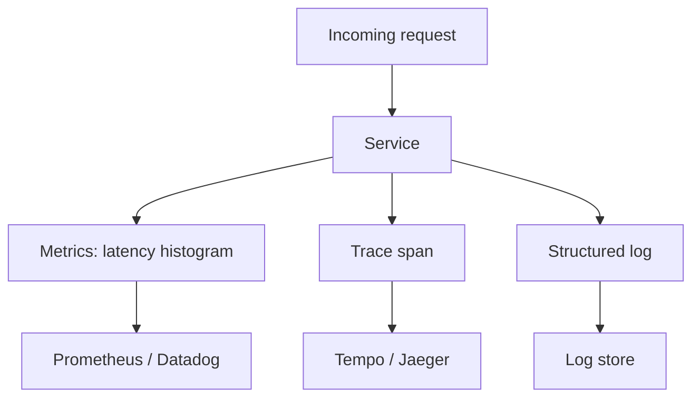
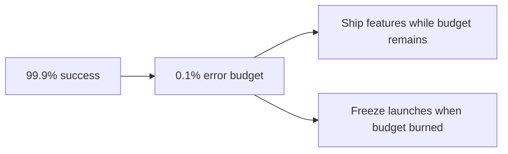
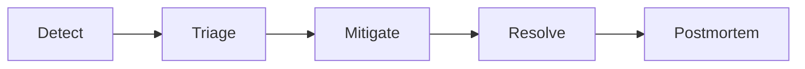
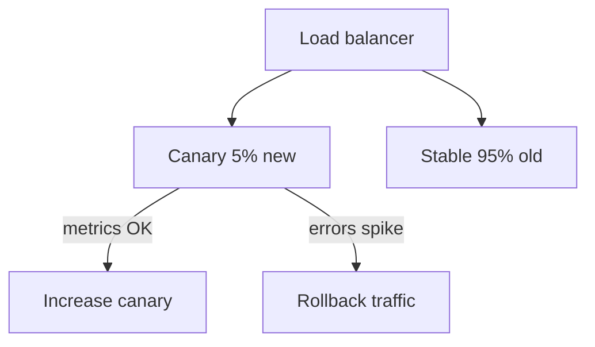
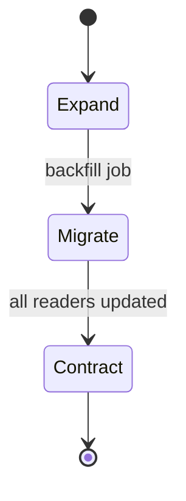
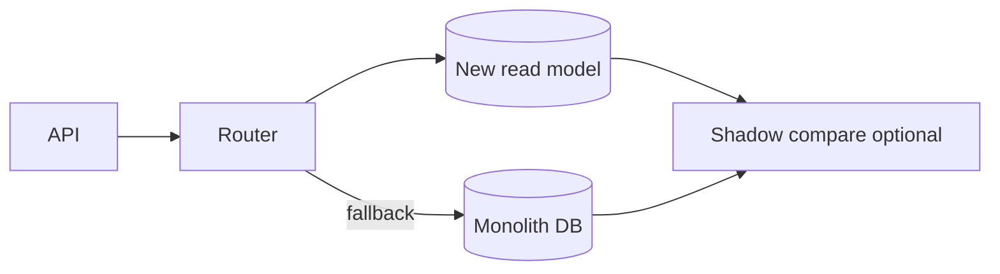
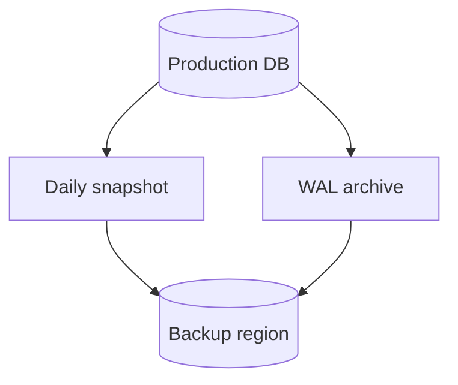
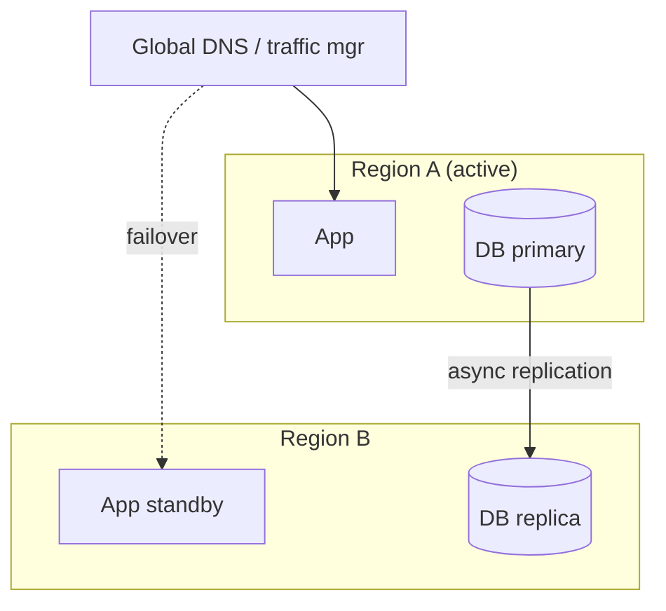
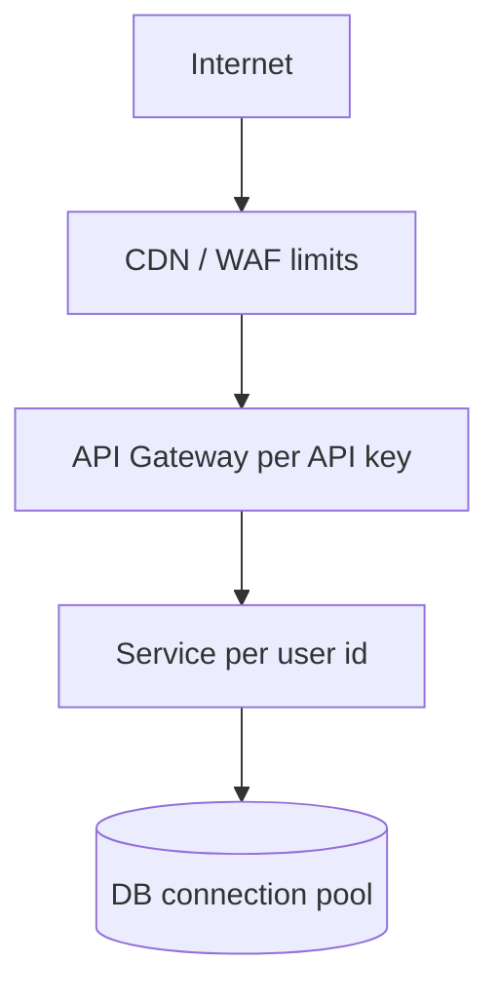

# Reliability, Operations, and Running Systems in Production

This guide is for senior engineers who ship features but also **keep them alive**: measuring whether the service is “good enough,” responding when it is not, deploying without fear, migrating databases without downtime, and surviving disasters and regulators. We cover observability’s three pillars, SLOs and error budgets, incident workflows, safe deploys, backups, DR strategies, privacy deletion, abuse prevention, rate limiting, and multi-tenant isolation—in plain language with tables, Python examples, Mermaid diagrams, and staff-level interview answers.

---

## Observability: Metrics, Traces, and Logs

**Observability** means you can answer novel questions about a running system from the outside—without redeploying printf statements.

### The three pillars

| Pillar | What it is | Best for | Example |
|--------|------------|----------|---------|
| **Metrics** | Numeric time series (counters, gauges, histograms) | Dashboards, alerts, SLOs | `http_requests_total{status="500"}` |
| **Traces** | End-to-end path of one request across services | Latency debugging, dependency map | OpenTelemetry trace id `abc123` |
| **Logs** | Discrete events with context | Forensics, audit, “why this user?” | JSON line with `user_id`, `error` |



### Golden signals (Google SRE)

1. **Latency** — how long requests take (p50, p95, p99).
2. **Traffic** — demand (QPS, bytes).
3. **Errors** — rate of failed requests.
4. **Saturation** — how full CPUs, queues, disks are.

```python
import time
import logging
from contextlib import contextmanager

logger = logging.getLogger("api")

# Pseudocode hooks — wire to prometheus_client or OTel in production
metrics = {"latency_ms": [], "errors": 0, "requests": 0}

@contextmanager
def track_request(route: str):
    start = time.perf_counter()
    metrics["requests"] += 1
    try:
        yield
    except Exception:
        metrics["errors"] += 1
        logger.exception("request_failed", extra={"route": route})
        raise
    finally:
        ms = (time.perf_counter() - start) * 1000
        metrics["latency_ms"].append(ms)
        logger.info("request_complete", extra={"route": route, "latency_ms": ms})
```

### Structured logging rules

- One JSON object per line.
- Include `trace_id`, `span_id`, `service`, `version`.
- Do not log secrets or full PII.

**Key insight:** Metrics tell you **something is wrong**; traces tell you **where**; logs tell you **why**.

---

## SLOs and Error Budgets

An **SLO** (Service Level Objective) is a target for reliability or performance, measured over a window (e.g. 30 days).

**SLI** (indicator): the measured thing — “proportion of successful requests.”

**Error budget:** `1 - SLO` — how much failure you can afford before you must stop shipping risky changes.

Example: **99.9% availability** monthly → ~43 minutes downtime budget.



| Monthly SLO | Max error budget (approx) |
|-------------|---------------------------|
| 99% | 7.2 hours |
| 99.9% | 43 minutes |
| 99.99% | 4.3 minutes |

```python
def error_budget_remaining(success_rate: float, slo: float = 0.999) -> float:
    """Return fraction of budget left (0..1) if success_rate observed."""
    if success_rate >= slo:
        return 1.0
    # simplistic: linear burn — production uses multi-window burn alerts
    allowed_fail = 1.0 - slo
    actual_fail = 1.0 - success_rate
    return max(0.0, 1.0 - actual_fail / allowed_fail)
```

### Policy tied to budget

- Budget healthy → normal deploy cadence.
- Budget low → more canaries, fewer experiments.
- Budget exhausted → incident mode, reliability work only.

**Key insight:** SLOs align product and engineering on **how reliable is good enough**.

---

## Incident Response

An **incident** is unplanned disruption or serious risk. Good response is practiced, not heroic.

### Phases

1. **Detect** — alerts, users, support tickets.
2. **Triage** — severity, customer impact, incident commander (IC).
3. **Mitigate** — restore service (rollback, scale, failover) before root cause.
4. **Resolve** — fix underlying issue.
5. **Postmortem** — blameless learning, action items.



### Severity rubric (example)

| Sev | Definition | Response |
|-----|------------|----------|
| SEV1 | Major outage, data loss risk | All hands, exec comms |
| SEV2 | Partial outage, no workaround | IC + dedicated channel |
| SEV3 | Degraded, workaround exists | Business hours fix |
| SEV4 | Minor, cosmetic | Backlog |

### Timeline template (copy into incident doc)

```text
Incident / SEV | Impact start | Detected | IC | Mitigation | Restored | Root cause | Comms | Postmortem date
(UTC for each milestone; scribe updates live in war room + status page)
```

**Key insight:** Mitigate first, diagnose second—users care about uptime, not your gdb session.

---

## Deployment and Migration Safety

Shipping code is a leading cause of outages. Use mechanical safety nets.

| Strategy | Idea | When |
|----------|------|------|
| **Canary** | 1–5% traffic on new version | Default for risky changes |
| **Blue-green** | Two full stacks; switch router | Fast rollback, double cost |
| **Feature flags** | Code deployed, behavior off | Gradual rollout, kill switch |
| **Rollback** | Revert artifact or traffic shift | First mitigation lever |



### Safe deploy checklist

1. Automated tests green.
2. Database migrations **backward compatible** (see next section).
3. Observability dashboards open (errors, latency, saturation).
4. One-click rollback documented.
5. Change ticket linked to owner.

```python
# Feature flag stub
def checkout_total(user, cart):
    if flags.is_enabled("new_tax_engine", user):
        return new_tax_total(cart)
    return legacy_tax_total(cart)
```

**Key insight:** Deploy **often** with **small blast radius** beats rare big bang releases.

---

## Database Migration Safety (Expand / Migrate / Contract)

Zero-downtime schema change uses **three phases** so old and new code coexist.

1. **Expand** — add new column/table (nullable or dual-write).
2. **Migrate** — backfill data; dual-read or compare.
3. **Contract** — remove old column after all code reads new path.



Example: rename `email` → `primary_email`.

| Phase | Schema | App behavior |
|-------|--------|--------------|
| Expand | Add `primary_email` nullable | Write both fields |
| Migrate | Backfill `primary_email` from `email` | Read prefer `primary_email` |
| Contract | Drop `email` | Read/write `primary_email` only |

**Anti-patterns:** locking `ALTER` on huge table, non-null column before backfill, dropping column while old binaries still run.

**Key insight:** Migrations are **multi-deploy** projects, not one SQL Friday night.

---

## Parallel Monolith Read Drain (Strangler Fig)

Replacing a monolith often uses **strangler fig**: new service handles slice of traffic; old system fades.

**Read drain pattern:**

1. Route reads to **new** store/service.
2. On miss or mismatch, **fallback** to monolith.
3. Compare responses (shadow/diff) in metrics.
4. When match rate > threshold, cut over.
5. Stop dual-read; decommission path.



```python
def get_user_profile(user_id: str):
    try:
        profile = new_service.fetch(user_id)
        if profile:
            return profile
    except TimeoutError:
        metrics.increment("new_read_timeout")
    return monolith.fetch_user(user_id)
```

**Key insight:** Measure **parity** before you delete the old path—assumptions lie.

---

## Backups and Restore

Backups you never restore are **schrodinger’s insurance**.

### Backup types

| Type | Description | RPO typical |
|------|-------------|-------------|
| Full | Entire dataset snapshot | Hours–days |
| Incremental | Changes since last backup | Minutes–hours |
| Continuous (WAL/binlog) | Stream of changes | Seconds |

- **RPO** (Recovery Point Objective): how much data you can lose.
- **RTO** (Recovery Time Objective): how long until service returns.



### Restore drill (quarterly)

1. Pick random backup.
2. Restore to isolated environment.
3. Run smoke tests + checksum row counts.
4. Time the process → validate RTO.
5. Document gaps.

**Key insight:** **Tested restore** is the only backup metric that matters.

---

## Disaster Recovery (DR) Patterns

When a region dies, how do you survive?

| Pattern | Description | Cost | RTO | RPO |
|---------|-------------|------|-----|-----|
| **Backup & restore** | Cold data in other region | $ | Hours–days | Hours |
| **Pilot light** | Minimal core always running (DB replica) | $$ | Hours | Minutes |
| **Warm standby** | Scaled-down full stack | $$$ | Minutes–hours | Minutes |
| **Active-passive** | Full standby, traffic on primary | $$$$ | Minutes | Low |
| **Active-active** | Multi-region live traffic | $$$$$ | Seconds | Near zero |



### DR decision drivers

- Regulatory residency (data must stay in EU).
- Cost of downtime ($ per minute).
- Complexity budget (split-brain, write routing).

**Key insight:** Active-active solves RTO but introduces **consistency and ops** complexity—do not default to it.

---

## Data Retention, Deletion, and Privacy

Laws like **GDPR** grant **right to erasure**. Retention policies limit how long you keep logs and backups.

### Layers to delete

1. Online databases (user row).
2. Search indexes.
3. Object storage (avatars, exports).
4. Caches (Redis keys).
5. Backups (legal hold vs rolling expiry).
6. Analytics warehouses (often hardest).

### Crypto-shredding

Encrypt user data with a **per-user key**. On delete, destroy the key—ciphertext becomes unrecoverable without scanning every backup block.

```python
def delete_user(user_id: str):
    revoke_sessions(user_id)
    delete_primary_row(user_id)
    enqueue_delete_object_prefix(f"uploads/{user_id}/")
    destroy_user_dek(user_id)  # data encryption key
    purge_cdn_cache_surrogate(f"user-{user_id}")
    schedule_analytics_delete(user_id, sla_days=30)
```

| Approach | Pros | Cons |
|----------|------|------|
| Hard delete rows | Clean | Slow in large tables |
| Tombstone + async purge | Fast UX | Temporary inconsistency |
| Crypto-shred | Fast for encrypted blobs | Must design encryption upfront |

**Key insight:** Deletion is a **workflow across systems**, not one SQL `DELETE`.

---

## Security and Abuse Prevention

Production systems face bots, credential stuffing, and scrapers.

### Control stack

| Layer | Tool examples | Purpose |
|-------|---------------|---------|
| Edge | WAF, CDN bot scores | Block obvious attacks |
| API gateway | Rate limits, API keys | Protect origin |
| App | AuthZ, captcha on risk | Fine-grained rules |
| Data | HMAC webhooks, signing | Integrity |

### Account takeover (ATO) signals

- Impossible travel (login US then China 5 min later).
- New device + password change + payout change.
- Velocity on password reset.

**Step-up auth:** require MFA when risk score high.

**Key insight:** Defense in depth—no single fence stops motivated abuse.

---

## Rate Limiter Placement and Keys

**Where** you rate limit changes what you protect.



| Placement | Key examples | Protects |
|-----------|--------------|----------|
| Edge / CDN | IP, ASN, country | DDoS, scraping |
| Gateway | API key, tenant id | Partner quotas |
| Service | `user_id`, session | Fair use per account |
| Dependency | Upstream credential | External API TOS |

### Key design pitfalls

- **NAT IP:** one key blocks a campus.
- **Missing tenant in key:** tenant A starves tenant B on shared endpoint.
- **Only IP:** trivial to rotate IPs; combine with user/auth.

```python
def rate_limit_key(request) -> str:
    if request.api_key:
        return f"rl:apikey:{request.api_key}"
    if request.user_id:
        return f"rl:user:{request.user_id}"
    return f"rl:ip:{request.client_ip}"
```

**Key insight:** The limiter key is a **fairness contract**—choose who shares fate.

---

## Sliding Window Rate Limiter

Algorithms compare **burst tolerance** vs **smoothness**.

| Algorithm | Behavior | Drawback |
|-----------|----------|----------|
| Fixed window | Count per clock minute | Burst at window edges (2x traffic) |
| Sliding window | Rolling time span | More memory |
| Token bucket | Steady refill + burst cap | Tuneful for APIs |
| Leaky bucket | Smooth output rate | Less common at edge |

### Fixed window problem

At 00:59 and 01:01 user sends max requests—double allowed in 2 seconds straddling windows.

### Sliding window log (accurate, memory heavy)

Store timestamps of each request in window; drop expired.

### Sliding window counter (hybrid, common in Redis)

Combine current and previous window counts weighted by time elapsed.

```python
import time
from collections import defaultdict, deque

class SlidingWindowLogLimiter:
    def __init__(self, max_requests: int, window_sec: float):
        self.max_requests = max_requests
        self.window_sec = window_sec
        self.hits: dict[str, deque] = defaultdict(deque)

    def allow(self, key: str) -> bool:
        now = time.time()
        q = self.hits[key]
        while q and now - q[0] > self.window_sec:
            q.popleft()
        if len(q) >= self.max_requests:
            return False
        q.append(now)
        return True


class TokenBucket:
    def __init__(self, rate_per_sec: float, burst: int):
        self.rate = rate_per_sec
        self.burst = burst
        self.tokens = burst
        self.last = time.monotonic()

    def allow(self) -> bool:
        now = time.monotonic()
        self.tokens = min(self.burst, self.tokens + (now - self.last) * self.rate)
        self.last = now
        if self.tokens >= 1:
            self.tokens -= 1
            return True
        return False
```

**Key insight:** Pick algorithm based on **whether bursts are product-friendly** (downloads) or dangerous (login). In Redis, combine weighted current/previous window counters for a cheap sliding approximation.

---

## Multi-Tenant Design

**Multi-tenant** means one deployment serves many customers (tenants). Tension: **cost efficiency** vs **isolation**.

| Model | Isolation | Cost | Example |
|-------|-----------|------|---------|
| Shared everything | Low | Lowest | Row-level `tenant_id` |
| Shared app, silo DB | Medium | Medium | DB per tenant |
| Silo stack | High | High | Enterprise single-tenant |

### Noisy neighbor

One tenant’s heavy query slows others on shared CPU/IO.

**Mitigations:** per-tenant rate limits, query timeouts, resource pools, priority queues, separate read replicas for big tenants.

### Tenant-aware everything

- Auth token carries `tenant_id`.
- Logs/metrics/traces tagged `tenant`.
- Encryption keys per tenant for regulated data.
- Background jobs partitioned by tenant.

```python
def query_orders(db, tenant_id: str, user_id: str):
    # Never trust client tenant_id alone — derive from auth
    return db.execute(
        "SELECT * FROM orders WHERE tenant_id = %s AND user_id = %s",
        (tenant_id, user_id),
    )
```

**Key insight:** Multi-tenant security failures are **cross-customer data leaks**—test authorization harder than features.

---

## FAANG Interview Deep Dive

### Q1: How do you set SLOs for a new API?

**Answer:** Start from user journey (checkout must complete < 3 s p95). Pick SLI (success + latency). Set SLO slightly below historical p99 performance to allow growth. Align with product on error budget policy. Avoid 100%—it blocks change. Review after 30 days of data.

### Q2: Metrics vs logs for debugging 500 errors.

**Answer:** Metrics show spike and scope (`5xx` by route). Traces pinpoint slow/failing downstream (DB timeout). Logs provide exception stack and request id correlation. Use exemplars to jump from metric bucket to trace.

### Q3: Design zero-downtime column type change (INT → BIGINT).

**Answer:** Expand: add `bigint` column. Dual-write both in app. Backfill in batches with throttling. Switch reads to bigint. Contract: drop int column after binary rollout complete. Avoid blocking DDL on huge tables—use online schema tools or shadow table swap.

### Q4: When is blue-green better than canary?

**Answer:** When you need **instant** full cutover/rollback and can afford double infrastructure (e.g. small service, big launch). Canary better for gradual risk exposure on heterogeneous clients.

### Q5: Error budget burned—what changes?

**Answer:** Freeze risky launches, increase test coverage on hot paths, focus on incident fixes and reliability backlog, tighten deploy windows, maybe reduce experiment traffic until budget recovers.

### Q6: Rate limit login endpoint—design.

**Answer:** Layered: CDN IP limit (coarse), gateway per IP + per username (prevent credential stuffing on one account), exponential backoff on failures, CAPTCHA on anomaly, alert on distributed low-and-slow attempts. Never reveal which factor failed enumeration.

### Q7: Active-active pitfalls?

**Answer:** Split-brain writes, clock skew, conflict resolution, sticky sessions, cross-region latency on reads, duplicated background jobs. Need global load balancing, idempotent writes, and often CRDT or last-write-wins with product acceptance.

### Q8: GDPR delete with 7-year backup retention?

**Answer:** Crypto-shred online data; maintain deletion ledger; exclude or re-encrypt backup segments containing user key; legal review on whether backups must be purged or can remain encrypted garbage. Document in DPA.

---

## Senior Pitfalls

| Mistake | Impact | Fix |
|---------|--------|-----|
| Alerting on every blip | On-call burnout, ignored pages | SLO-based alerts, multi-window burn |
| No trace propagation | Useless distributed logs | W3C trace context on all outbound calls |
| Big-bang DB migration | Hours outage | Expand/migrate/contract |
| Untested backups | Data loss event = company event | Quarterly restore drills |
| Rate limit by IP only | Blocks schools, misses bots | Layered keys + auth |
| Shared tenant queries without `tenant_id` | Cross-tenant data leak | Mandatory scoping in ORM/middleware |
| Postmortems without owners | Repeat incidents | RACI action items with due dates |

---

## Production-grade Practice

1. **SLO spreadsheet:** Pick one internal API; define SLI, 30-day SLO, compute error budget minutes; write policy for what happens at 50% and 0% budget.

2. **Incident tabletop:** Run a 45-minute simulated DB failover; fill the timeline template; identify missing runbook steps.

3. **Rate limiter lab:** Implement fixed window vs sliding window in Python; generate edge-burst traffic and plot allowed QPS.

4. **Tenant isolation audit:** Trace one read path in your codebase; list every SQL query and cache key; verify `tenant_id` cannot be overridden by client input.

---

*Reliability is not the absence of failures—it is the presence of **measurement, bounded risk, and practiced recovery**.*
