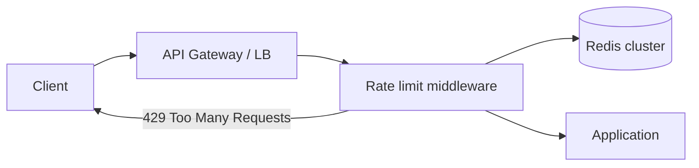
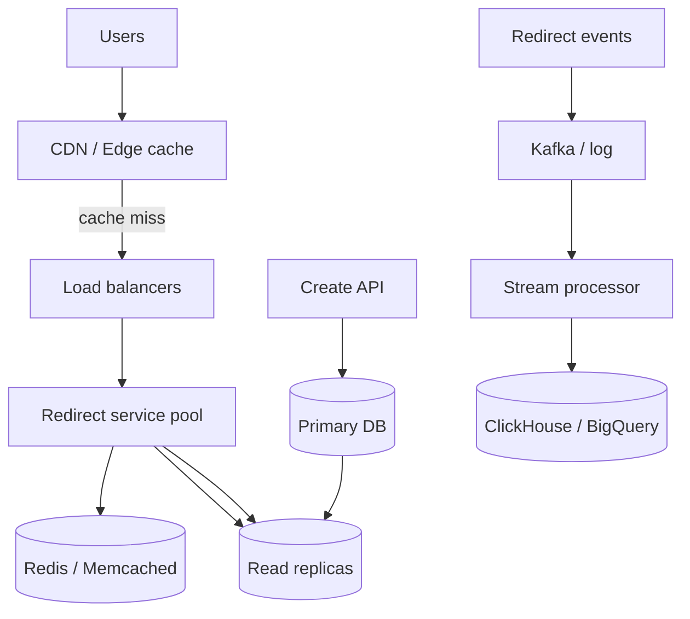
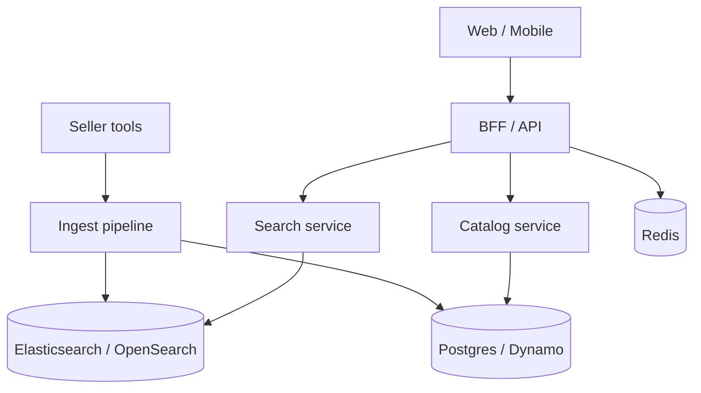
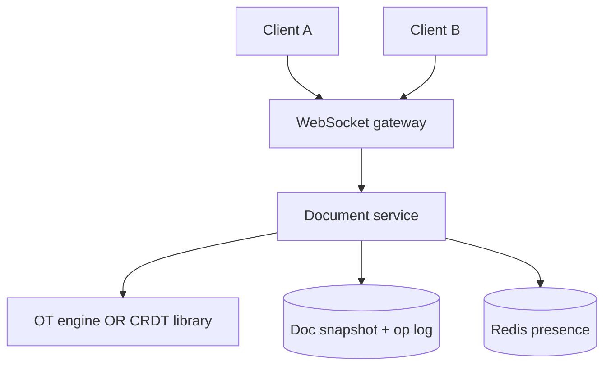
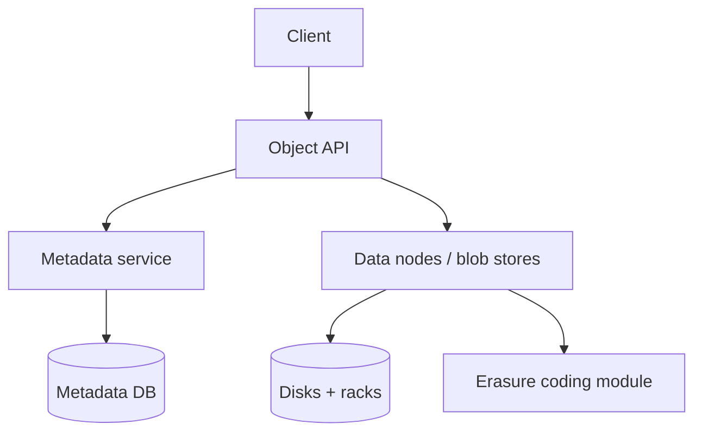
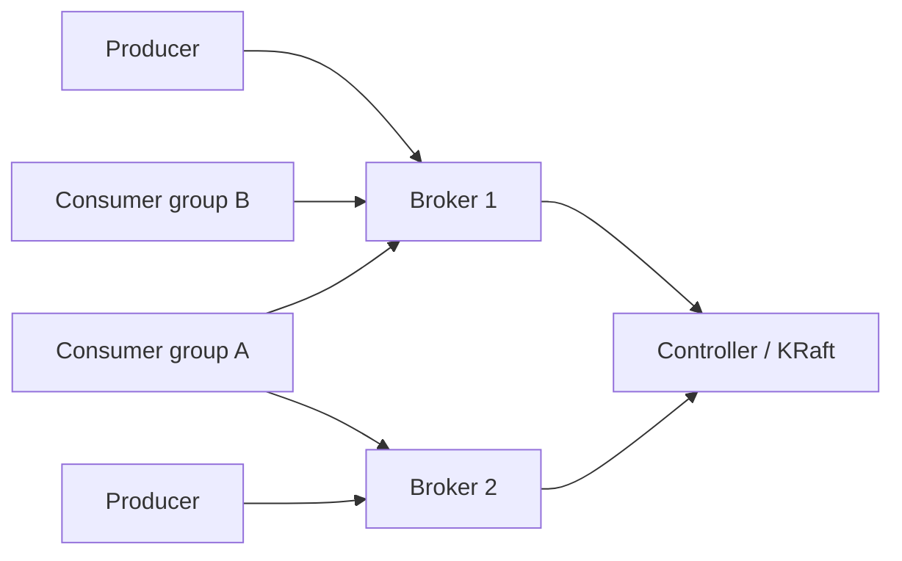

# Service and Data Designs: From One Machine to Distributed Logs

This guide walks through seven classic system designs that show up in interviews and in real products. Each design starts with a plain problem statement, then requirements, architecture, components, data model, and how you scale it. The themes are: short links, abuse control, catalogs, real-time collaboration, blob storage, and append-only logs. You do not need prior exposure to every buzzword—we define terms as we go.

---

## Design: URL Shortener on One Machine

### Problem statement

Users paste long URLs and want a short link that redirects to the original. On a single server, you must generate short codes, store mappings, handle duplicates, and optionally count clicks—all without a distributed stack.

### Requirements

| Type | Requirement |
|------|-------------|
| Functional | Create short URL from long URL; redirect short → long |
| Functional | Optional custom alias (if unused) |
| Non-functional | Low latency redirect (< 50 ms on one box) |
| Non-functional | Durability: survive process restart (disk or DB) |
| Scale (v1) | ~1k creates/sec, ~10k redirects/sec on one strong machine |

### Architecture diagram

```mermaid
flowchart TB
  Client[Browser / API client]
  API[HTTP API + Redirect handler]
  Store[(SQLite or local KV)]
  Analytics[Click counter in memory + flush]

  Client -->|POST /shorten| API
  Client -->|GET /{code}| API
  API --> Store
  API --> Analytics
```

### Key components

1. **Encode path** — Turn an integer ID or hash into a short string (base62: `a-zA-Z0-9`).
2. **Storage** — Map `short_code → long_url`, metadata (owner, created_at).
3. **Redirect handler** — HTTP 301 (permanent) or 302 (temporary); affects caching and SEO.
4. **Collision handling** — If using hash of URL, two URLs might map to same code; if using counters, collisions are avoided by construction.
5. **Analytics** — Increment counter on redirect; batch writes to avoid slowing redirects.

### Data model

```python
# Logical tables (SQLite example)
# urls(id INTEGER PK, short_code TEXT UNIQUE, long_url TEXT, created_at, owner_id)
# clicks(short_code, day, count)  -- aggregated
```

```python
import hashlib
import sqlite3

BASE62 = "0123456789abcdefghijklmnopqrstuvwxyzABCDEFGHIJKLMNOPQRSTUVWXYZ"

def to_base62(n: int) -> str:
    if n == 0:
        return BASE62[0]
    s = []
    while n:
        n, r = divmod(n, 62)
        s.append(BASE62[r])
    return "".join(reversed(s))

def shorten_by_counter(conn, long_url: str) -> str:
    cur = conn.execute("INSERT INTO urls(long_url) VALUES (?)", (long_url,))
    code = to_base62(cur.lastrowid)
    conn.execute("UPDATE urls SET short_code=? WHERE id=?", (code, cur.lastrowid))
    return code

def shorten_by_hash(long_url: str, length: int = 7) -> str:
    h = hashlib.sha256(long_url.encode()).digest()
    num = int.from_bytes(h[:8], "big")
    code = to_base62(num)[:length]
    return code  # on collision: append salt and retry
```

**301 vs 302:** Use **301** when the short link is permanent (browsers and CDNs may cache the target). Use **302** when you may change the destination or need accurate per-click analytics without cache hits skipping your server.

### Scaling considerations (single machine limits)

- **CPU** — Redirects are cheap; creation and analytics writes become the bottleneck.
- **Disk I/O** — SQLite works until concurrent writes contend; then move to Postgres on same host.
- **Memory** — Cache hot `code → url` in an LRU (thousands of viral links dominate traffic).
- **Next step** — Partition key space and add read replicas (see scaled design below).

---

## Design: Rate Limiting and Abuse Prevention

### Problem statement

APIs and websites must limit how many requests one user, IP, or API key can make in a time window. Without limits, scrapers, credential stuffing, and accidental retry storms can take down the service or inflate cost.

### Requirements

| Type | Requirement |
|------|-------------|
| Functional | Reject or delay traffic over policy (e.g. 100 req/min per key) |
| Functional | Different limits per tier (free vs paid) |
| Non-functional | Decision in < 1–2 ms when possible (edge or local memory) |
| Non-functional | Fairness across servers in a cluster |
| Abuse | Detect burst vs sustained abuse; optional blocklists |

### Architecture diagram



### Key components

1. **Token bucket** — Tokens refill at a steady rate; each request spends one token. Allows controlled bursts.
2. **Fixed window** — Count requests per clock minute; simple but boundary spikes (2× limit at window edges).
3. **Sliding window** — Smoother limit using rolling time (log of timestamps or approximate counters).
4. **Distributed store** — Redis `INCR` with TTL, or Lua scripts for atomic check-and-decrement.
5. **Identity** — API key, user id, IP /64, or composite (user + route).

### Data model

Redis keys (examples):

| Key pattern | Meaning |
|-------------|---------|
| `rl:{api_key}:tokens` | Token bucket float or integer |
| `rl:{api_key}:ts` | Last refill timestamp |
| `rl:sw:{api_key}:{minute_bucket}` | Sliding window sub-counter |

```python
import time
import redis

r = redis.Redis()

def token_bucket_allow(key: str, capacity: int, refill_per_sec: float) -> bool:
    now = time.time()
    pipe = r.pipeline()
    pipe.hgetall(key)
    data = pipe.execute()[0] or {}
    tokens = float(data.get(b"tokens", capacity))
    last = float(data.get(b"last", now))
    tokens = min(capacity, tokens + (now - last) * refill_per_sec)
    if tokens < 1:
        r.hset(key, mapping={"tokens": tokens, "last": now})
        return False
    r.hset(key, mapping={"tokens": tokens - 1, "last": now})
    return True

def sliding_window_counter(key: str, window_sec: int, limit: int) -> bool:
    now = int(time.time())
    bucket = now // window_sec
    k = f"{key}:{bucket}"
    count = r.incr(k)
    if count == 1:
        r.expire(k, window_sec * 2)
    return count <= limit
```

### Scaling considerations

- **Local token bucket** per instance is fast but unfair (N machines ⇒ N× limit); use Redis or sync via gossip for strict global limits.
- **Hot keys** — Celebrity API keys hammer one Redis shard; shard by hash of key or use local allowance + global correction.
- **Fail open vs closed** — If Redis is down, allow traffic (availability) or deny (safety); document the business choice.
- **Edge rate limiting** — Cloudflare/AWS WAF reduces origin load; origin still needs app-level limits for authenticated users.

---

## Design: URL Shortener at Scale

### Problem statement

The same short-link product must serve billions of redirects with high availability, geographic latency, and analytics without the write path blocking the read path.

### Requirements

| Type | Requirement |
|------|-------------|
| Functional | Globally unique short codes; redirect with low latency |
| Scale | 100:1 read:write; millions of redirects/sec |
| Availability | 99.99% redirect path |
| Analytics | Async click stream; near-real-time dashboards |
| Consistency | Create is strongly consistent; analytics eventually consistent |

### Architecture diagram



### Key components

1. **Key space partitioning** — Shard by `short_code` hash or by range of numeric id embedded in code.
2. **ID generation** — Snowflake-style IDs or per-shard counters to avoid coordination on every insert.
3. **Read path** — Cache-aside: Redis → replica → primary on miss; CDN for 301 targets (careful with analytics).
4. **Write path** — Insert on primary; invalidate cache entry for that code.
5. **Analytics pipeline** — Fire-and-forget event on redirect (do not block response); aggregate in stream processor.

### Data model

```text
Shard key: hash(short_code) % num_shards

urls (per shard):
  short_code PK
  long_url
  user_id
  created_at
  expires_at

click_events (Kafka):
  short_code, ts, country, referrer, user_agent
```

```python
def shard_id(short_code: str, num_shards: int) -> int:
    return hash(short_code) % num_shards

# Cache-aside read
def resolve(short_code: str) -> str | None:
    url = redis.get(f"u:{short_code}")
    if url:
        return url.decode()
    row = db_for_shard(shard_id(short_code)).get(short_code)
    if row:
        redis.setex(f"u:{short_code}", 3600, row.long_url)
    return row.long_url if row else None
```

### Scaling considerations

- **Partition the key space** before single DB fills disk or write throughput caps.
- **Read replicas** — Scale reads; replication lag means rare stale redirect after update (use cache invalidation on write).
- **Cache stampede** — On expiry, many requests hit DB; use single-flight or probabilistic early refresh.
- **Analytics** — Never synchronous INSERT per click on primary OLTP DB.

---

## Design: Product Listing (E-Commerce Catalog)

### Problem statement

Shoppers browse millions of products with search, filters (category, price, brand), sort, and pagination. The catalog must stay fast while inventory and prices change.

### Requirements

| Type | Requirement |
|------|-------------|
| Functional | Search by text; filter and sort; product detail page |
| Functional | Show in-stock / price for SKU |
| Scale | High read volume; moderate updates from sellers |
| Latency | p99 < 200 ms for listing pages |
| Consistency | Eventual consistency OK for search index lag (seconds) |

### Architecture diagram



### Key components

1. **Search index** — Inverted index for text; denormalized docs per product/SKU.
2. **Catalog service** — Source of truth for attributes, media URLs, variants.
3. **Denormalization** — Listing document embeds `title, brand, price, thumb_url` to avoid joins at query time.
4. **Pagination** — Cursor-based (`search_after`) for deep pages; offset breaks at scale.
5. **Filters** — Faceted aggregation in search engine; precomputed category trees.

### Data model

**Relational (source of truth):**

```text
products(id, title, description, brand_id, ...)
skus(id, product_id, size, color, price_cents, stock)
```

**Search document (denormalized):**

```json
{
  "product_id": "p_1",
  "title": "Running shoe",
  "brand": "Acme",
  "min_price": 79.99,
  "category_path": ["shoes", "running"],
  "in_stock": true
}
```

```python
def build_listing_doc(product, skus):
    prices = [s.price_cents for s in skus if s.stock > 0]
    return {
        "product_id": product.id,
        "title": product.title,
        "min_price": min(prices) / 100 if prices else None,
        "in_stock": any(s.stock > 0 for s in skus),
    }
```

### Scaling considerations

- **Denormalize for read path**; accept dual writes or CDC to sync index.
- **Hot products** — Cache product detail; CDN for images.
- **Reindex** — Blue/green index alias swap for mapping changes.
- **Inventory** — Real-time stock may use separate low-latency store (Redis) with periodic reconciliation.

---

## Design: Collaborative Editor

### Problem statement

Multiple users edit the same document (text, spreadsheet cell) at once. Edits must merge without losing intent; users see each other's cursors and presence.

### Requirements

| Type | Requirement |
|------|-------------|
| Functional | Real-time sync of edits; offline edit then merge |
| Functional | Cursor / selection presence |
| Non-functional | Latency < 100 ms for remote edits to appear |
| Consistency | Convergent state—all clients end on same document |
| Scale | Many small docs; some large docs with long history |

### Architecture diagram



### Key components

1. **Operational Transform (OT)** — Transform concurrent operations against each other so order does not matter; server often serializes ops.
2. **CRDT** — Conflict-free replicated data types; each edit is an op with mathematical merge (e.g. RGA, Yjs, Automerge).
3. **Conflict resolution** — OT: central server assigns total order. CRDT: merge function is commutative/associative.
4. **Cursor presence** — Ephemeral messages (not in durable doc); TTL in Redis pub/sub.
5. **Persistence** — Periodic snapshot + append op log for replay.

### Data model

```text
documents(doc_id, snapshot_blob, version, updated_at)
operations(doc_id, seq, op_json, user_id, ts)   -- OT path
-- OR CRDT: store merged state + optional op log for audit
presence: Redis channel doc:{id} -> {user_id, cursor, color}
```

```python
# Simplified OT idea: two inserts at same index get transformed
def transform_insert(op_a, op_b):
    # If op_a inserts at position i and op_b at j <= i, shift i
    if op_b["pos"] <= op_a["pos"]:
        return {**op_a, "pos": op_a["pos"] + len(op_b["text"])}
    return op_a
```

**OT vs CRDT (plain English):**

| Aspect | OT | CRDT |
|--------|----|------|
| Server role | Often required for ordering | Peer-to-peer friendly |
| Complexity | Transform functions are tricky | Data structure design is tricky |
| Offline | Harder | Natural merge on reconnect |
| Maturity | Google Docs style | Figma, Notion-style stacks |

### Scaling considerations

- **Shard by document id** — All ops for one doc go to one partition (hot doc = hot partition).
- **Large documents** — Snapshot + trim old ops; compress history.
- **WebSocket fanout** — Dedicated connection service; backpressure if client is slow.

---

## Design: Object Store (S3-Like)

### Problem statement

Applications need to store huge files (images, backups) with high durability, cheap storage, and HTTP GET/PUT semantics—not a POSIX filesystem on one disk.

### Requirements

| Type | Requirement |
|------|-------------|
| Functional | PUT object by key; GET by key; list prefix; delete |
| Durability | 11 nines design goal (many copies across failures) |
| Scale | Exabyte scale; unlimited objects |
| Consistency | Read-after-write for new object; list eventual in some designs |

### Architecture diagram



### Key components

1. **Metadata service** — Bucket, key, version, size, checksum, physical location pointers.
2. **Data service** — Stores chunks on commodity disks; replication or erasure coding.
3. **Erasure coding** — Split blob into data + parity shards; survive disk/rack loss with less storage than 3× full copy.
4. **Consistency** — Strong metadata on put; replicas catch up asynchronously for data paths in some systems.
5. **Garbage collection** — Delete marks tombstone; background reclaims chunks.

### Data model

```text
objects(bucket, key, version_id) -> size, etag, storage_class, locations[]
chunks(chunk_id) -> node_ids[], erasure_params
```

```python
# Logical put flow
def put_object(bucket, key, body: bytes):
    chunk_ids = data_plane.write_chunks(erasure_encode(body))
    meta.insert(bucket, key, size=len(body), chunks=chunk_ids, etag=md5(body))
```

### Scaling considerations

- **Partition metadata** by `(bucket, key)` hash; avoid hot buckets with prefix sharding.
- **Large objects** — Multipart upload; parallel chunk uploads.
- **Cross-region** — Async replication; conflict via versioning.
- **List operations** — Expensive at scale; prefer known keys or index service.

---

## Design: Kafka-Style Append-Only Log

### Problem statement

Many services need a durable, ordered stream of events that multiple consumers can read at their own pace—activity feeds, click streams, decoupling microservices.

### Requirements

| Type | Requirement |
|------|-------------|
| Functional | Producers append records; consumers read in order per partition |
| Functional | Consumer groups for parallel processing |
| Retention | Time-based (7 days) or size-based; compaction for keyed changelog |
| Scale | Millions of msgs/sec; horizontal via partitions |
| Durability | Replicated to multiple brokers |

### Architecture diagram



### Key components

1. **Append-only log** — Only adds at end of partition; immutable segments on disk.
2. **Partitions** — Total order within partition; parallel across partitions.
3. **Consumer groups** — Each partition assigned to one consumer in group; rebalance on scale.
4. **Retention** — Delete old segments by time/size.
5. **Compaction** — For keyed topics, keep latest value per key (changelog style).

### Data model

```text
topic: orders
partitions: 0..N-1
offset: monotonic per partition
record: {key, value, timestamp, headers}

consumer_group: inventory-service
  partition 0 -> consumer instance 3
  partition 1 -> consumer instance 1
```

```python
# Pseudo-consumer loop
def consume(consumer, handler):
    for msg in consumer:  # polls broker
        handler(msg.key, msg.value)
        consumer.commit()  # store offset after successful processing
```

### Scaling considerations

- **More partitions** — Higher parallelism; do not over-partition (file handles, rebalance cost).
- **Key choice** — Same key → same partition preserves per-key order.
- **Hot partition** — Skewed keys; salt keys or split topics.
- **Exactly-once** — Idempotent consumer + transactional writes or dedupe store.

---

## FAANG Interview Deep Dive

**Q1: Why would you use 302 instead of 301 for a URL shortener?**

**A:** 302 tells clients the redirect is temporary, so browsers and CDNs are less likely to cache the target URL without hitting your server. That matters when you need to change destinations, run A/B tests on landing pages, or count every click server-side. 301 is appropriate when the mapping is permanent and you want edge caching to offload redirect traffic—but you may lose visibility into some clicks unless you use analytics pixels on the destination.

**Q2: How do you implement a fair distributed rate limiter?**

**A:** Use a central low-latency store (Redis) with an algorithm that matches product policy: token bucket for burst tolerance, sliding window for smooth limits. Make the check atomic (Lua script or Redis Cell module). Include identity (API key + route class). Decide fail-open vs fail-closed. For very high QPS, use a hybrid: local token bucket per instance with a small global budget synchronized periodically to cut Redis round trips, accepting slight fuzziness.

**Q3: How do you partition a URL shortener database?**

**A:** Choose a partition key derived from `short_code` (hash mod N) so redirects are single-shard lookups. Generate IDs per shard or use global IDs embedded in the code. Avoid cross-shard transactions. Replicate each shard for reads. Front with a distributed cache keyed by short code. Analytics go to an async pipeline, not the OLTP shard.

**Q4: OT vs CRDT for Google Docs–style editor—what would you say at staff level?**

**A:** OT historically relied on a central server to order operations; transforms are correct but hard to prove and implement for rich structures. CRDTs give a formal merge semilattice; offline and peer-to-peer are easier but payload size and tombstones need care. Production systems often pick a battle-tested library (Yjs, Automerge) and shard by document, with a single writer sequence per doc for simplicity. Presence is out-of-band ephemeral data.

**Q5: Explain erasure coding vs replication in object storage.**

**A:** 3× replication triples storage cost but is simple: read any copy. Erasure coding (e.g. 10+4) stores parity shards; you rebuild missing data from survivors with lower overhead than full copies. Tradeoff: reconstruction CPU/latency on failure, more complex placement. Metadata service tracks chunk locations; healing runs in background.

**Q6: When does Kafka compaction matter?**

**A:** For changelog topics where consumers only need the latest state per key (e.g. `user_settings`, `product_inventory`). Compaction deletes older records with the same key, keeping the log bounded while preserving latest snapshot. Combined with compaction, consumers can bootstrap state from the topic without a separate DB snapshot—if you design values as full state or apply deltas idempotently.

**Q7: How do you paginate search results at scale?**

**A:** Avoid deep `offset` in Elasticsearch—it sorts and discards prior pages. Use `search_after` with the sort tuple from the last hit (cursor). Stable sort keys include `_shard_doc` or unique id. For infinite scroll, store cursor client-side; for SEO listing pages, cache popular first pages.

**Q8: What is the hottest risk in a collaborative editing service?**

**A:** A single viral document concentrates all ops on one shard and one WebSocket fanout group. Mitigate with document-level routing, op batching, snapshotting to cap replay length, and rate limits per editor. CRDT/OT correctness does not solve hot-partition ops throughput—you still need partitioning and backpressure.

---

## Senior Pitfalls

| Mistake | Impact | Fix |
|---------|--------|-----|
| Using 301 everywhere on short links | CDN/browser cache hides clicks; hard to change targets | Use 302 for mutable/analytics-heavy links; 301 only when permanent |
| Global rate limit counter without atomicity | Race conditions allow 2× traffic | Lua script or dedicated rate-limit library; one round trip |
| Storing every click synchronously in OLTP | Redirect p99 spikes; DB melts | Async event to Kafka; aggregate in OLAP |
| `OFFSET` pagination in catalog search | Slow, inconsistent deep pages | Cursor / `search_after` with stable sort |
| Building OT transforms from scratch | Subtle bugs, divergent clients | Adopt proven CRDT/OT library; formal test harness |
| Treating object store as POSIX filesystem | Millions of small files hurt metadata | Object key design; batch in larger blobs |
| Too few Kafka partitions | Cannot scale consumer parallelism | Size partitions for target throughput; monitor lag |
| Rate limit fail-closed on Redis blip | Total outage during cache failure | Explicit policy: fail-open with alert, or multi-region Redis |

---

## Production-grade Practice

1. **Build a minimal URL shortener** — SQLite + Flask/FastAPI; implement counter-based base62 and hash-with-retry; add 301/302 flag; benchmark redirects with `wrk` and add an LRU cache; measure p99 before and after.

2. **Implement three rate limiters** — Fixed window, token bucket, and sliding window in Python against Redis; write a pytest that fires concurrent threads and proves you never exceed limit by more than agreed slack; document fail-open behavior.

3. **Catalog denormalization exercise** — Take a normalized product/SKU schema; write a script that emits Elasticsearch documents; implement filter query JSON for category + price range; compare query latency with and without denormalized `min_price`.

4. **Kafka consumer lag drill** — Run local Kafka (Docker); produce keyed events; run two consumers in one group and watch partition assignment; kill one consumer and observe rebalance; add a compacted topic and prove old keys disappear while latest remains.

*End of guide: service and data designs from single-host patterns to distributed logs and blob stores.*
