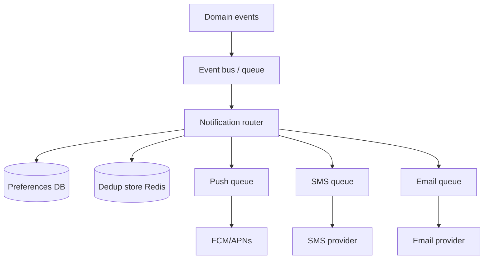
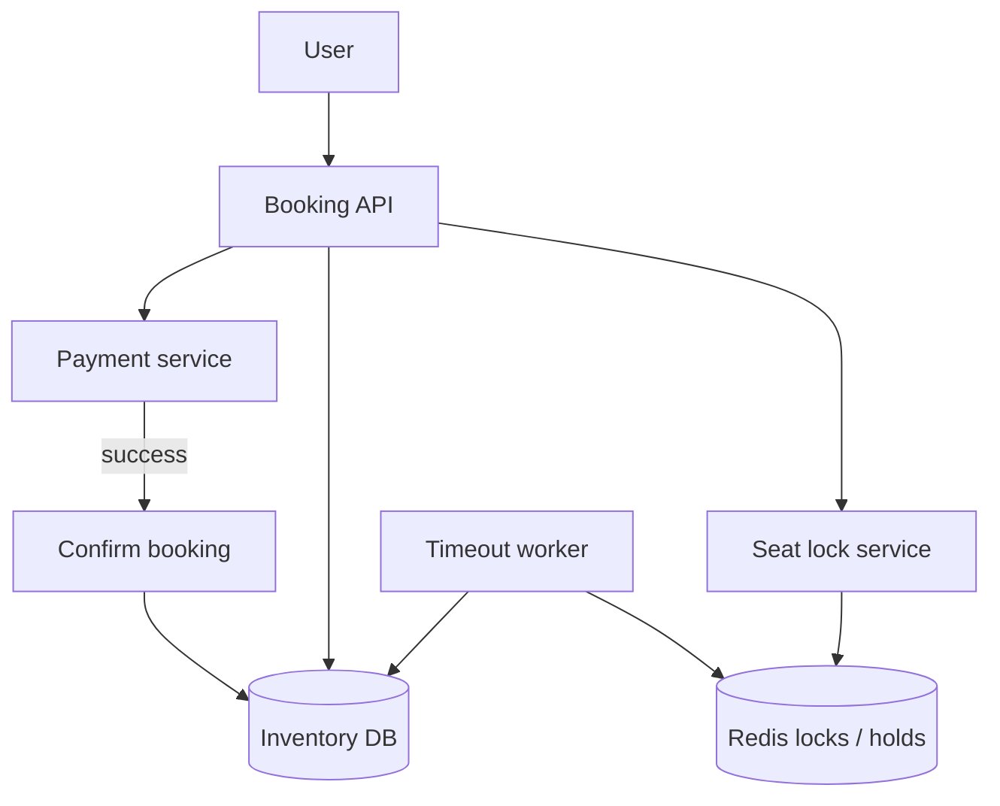
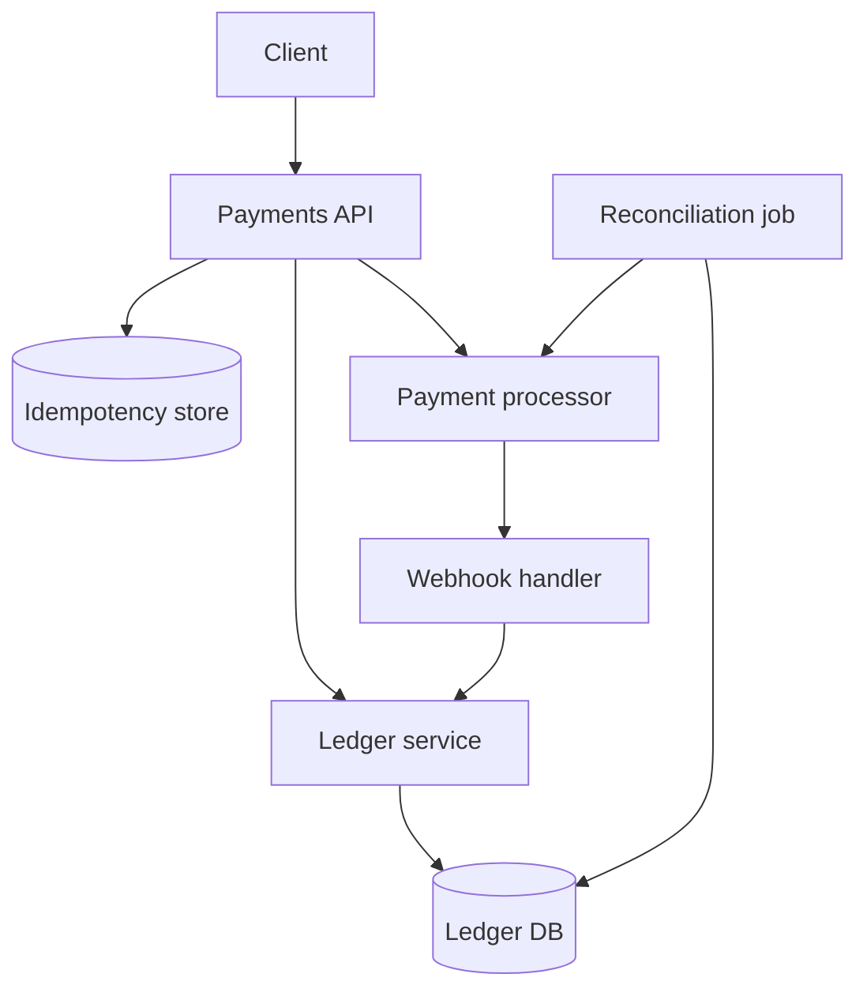
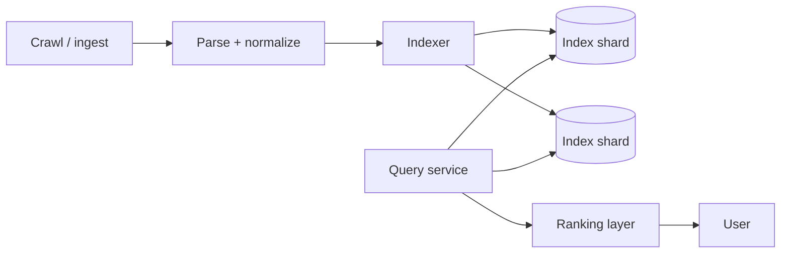
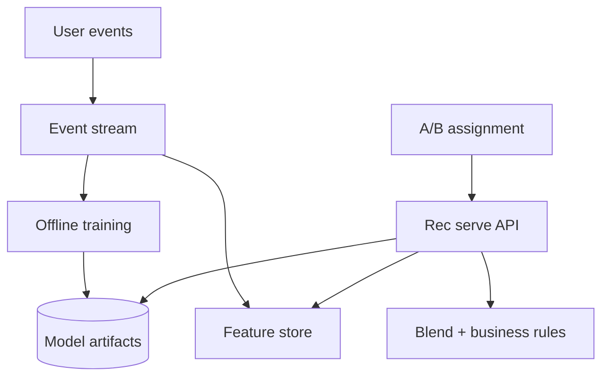
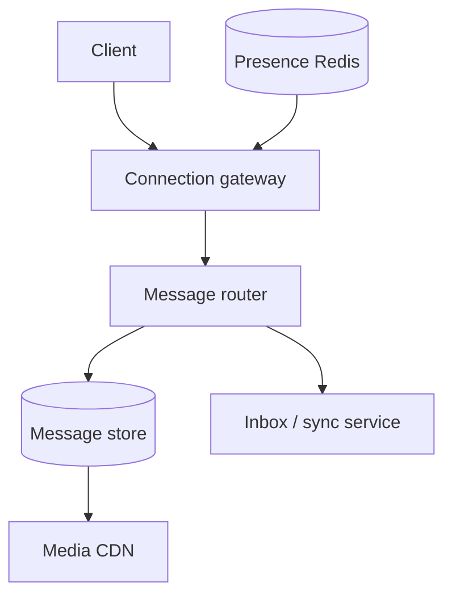
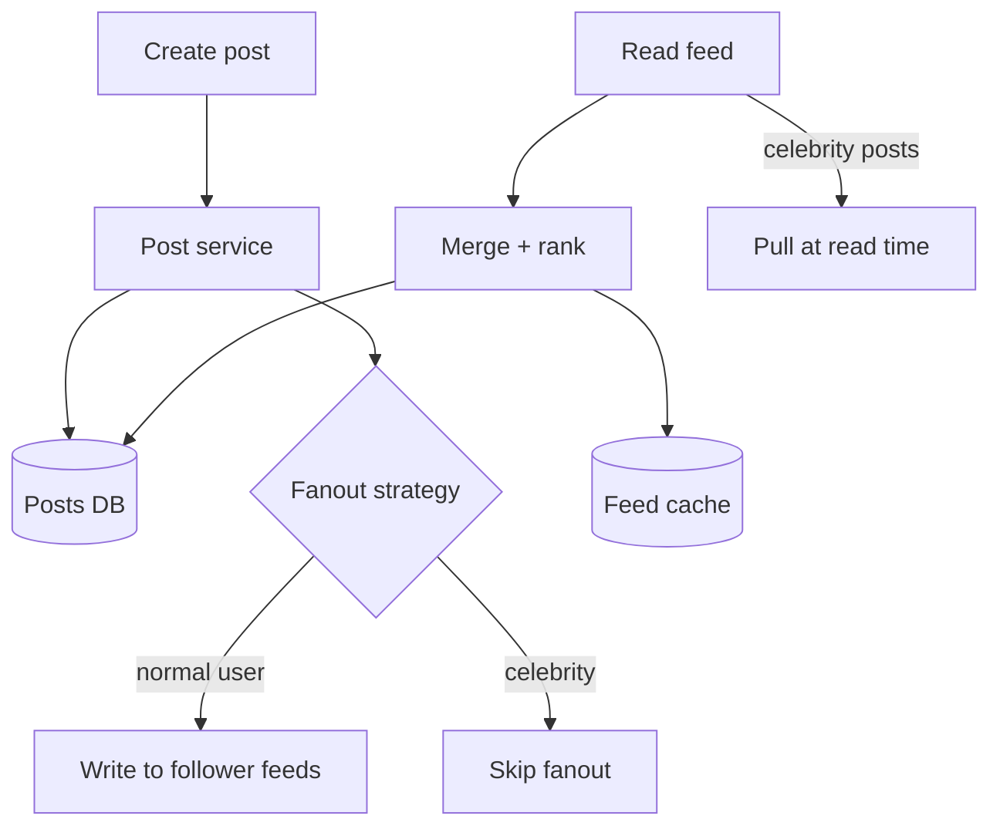
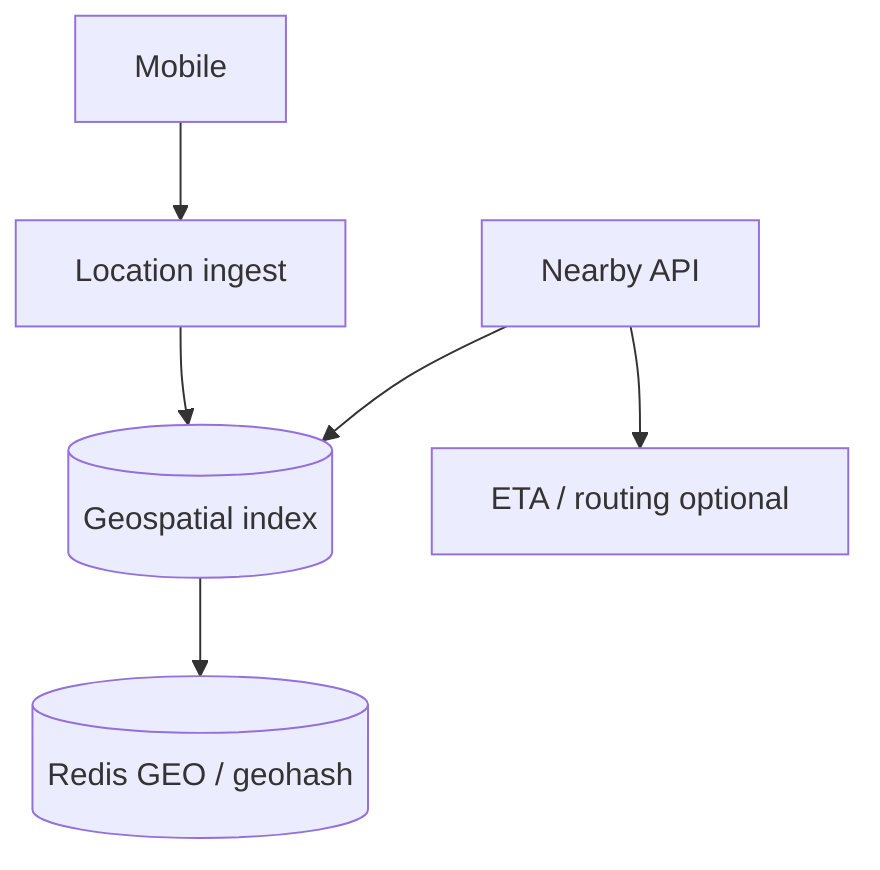

# Product Designs: Notifications, Money, Search, and Social Feeds

This guide covers eight product-shaped system designs: how real apps notify users, sell seats, move money, find information, recommend items, chat, show feeds, and search nearby places. Each section follows the same rhythm—problem, requirements, architecture, components, data model, scaling—so you can reuse the template in interviews. Terms like "fanout" and "idempotency" are explained when they appear.

---

## Design: Notification System

### Problem statement

The product must reach users on push, SMS, and email when something important happens (order shipped, password reset, friend request). Channels differ in cost, speed, and regulations; users have preferences; duplicate or spammy messages destroy trust.

### Requirements

| Type | Requirement |
|------|-------------|
| Functional | Send on multiple channels; respect user preferences |
| Functional | Priority (critical alert vs marketing) |
| Non-functional | Dedup same event within a time window |
| Non-functional | Rate limit per user and per channel |
| Compliance | Opt-out, quiet hours, regional SMS rules |

### Architecture diagram



### Key components

1. **Event ingestion** — Normalized `NotificationIntent(user_id, template, payload, priority)`.
2. **Preference service** — Per-channel on/off, categories, locale, quiet hours.
3. **Router** — Expands template, picks channels, applies priority queue.
4. **Dedup** — Key `user_id + event_type + entity_id` with TTL (e.g. 24h).
5. **Rate limiter** — Per user marketing caps; bypass for security alerts.
6. **Workers** — Retry with backoff; dead-letter for poison messages.

### Data model

```text
user_preferences(user_id, channel, category, enabled)
notification_jobs(id, user_id, channels[], status, idempotency_key)
delivery_log(job_id, channel, provider_id, status, ts)
```

```python
def should_send(user_id, intent, redis, prefs):
    key = f"dedup:{user_id}:{intent.event_type}:{intent.entity_id}"
    if not redis.set(key, "1", nx=True, ex=86400):
        return False
    if intent.priority != "critical" and prefs.in_quiet_hours(user_id):
        return False
    return True
```

### Scaling considerations

- **Shard queues** by priority and channel so SMS slowness does not block push.
- **Template rendering** at scale—cache compiled templates.
- **Provider webhooks** for bounces and failures update user channel health.
- **Fan-in** millions of events/sec—batch low-priority digests.

---

## Design: Ticket Booking System

### Problem statement

Users select seats for a concert or flight. Inventory is finite; two users cannot get the same seat; payment takes time; without careful design, double booking and race conditions occur.

### Requirements

| Type | Requirement |
|------|-------------|
| Functional | Browse seat map; hold seat; pay; confirm ticket |
| Functional | Release hold on timeout |
| Correctness | No double booking |
| Scale | Spike on on-sale; mostly read during browse |
| Payment | 10–15 minute hold while paying |

### Architecture diagram



### Key components

1. **Seat map** — Static layout; availability bitmap or per-seat row.
2. **Distributed lock / hold** — `SET seat:12:45 HOLD user123 NX EX 900`.
3. **State machine** — `available → held → sold` or `held → available` on timeout.
4. **Payment timeout** — Cron or delayed queue releases expired holds.
5. **Double-booking prevention** — Conditional update: `UPDATE seats SET status='sold' WHERE id=? AND status='held' AND holder=?`.

### Data model

```text
events(id, venue_id, on_sale_at)
seats(event_id, seat_id, row, number, status, holder_id, hold_expires_at)
bookings(id, user_id, seat_id, payment_id, status)
```

```python
import redis

def hold_seat(r: redis.Redis, seat_key: str, user_id: str, ttl_sec: int = 900) -> bool:
    return r.set(seat_key, user_id, nx=True, ex=ttl_sec)

def confirm_seat(db, seat_id, user_id):
    rows = db.execute(
        "UPDATE seats SET status='sold', holder_id=NULL "
        "WHERE seat_id=%s AND status='held' AND holder_id=%s",
        (seat_id, user_id),
    )
    return rows.rowcount == 1
```

### Scaling considerations

- **Hot events** — Partition by `event_id`; queue writes for popular on-sales (virtual waiting room).
- **Redis + DB** — Redis for fast hold; DB as source of truth on confirm with transaction.
- **Idempotent confirm** — Safe retries after payment callback.
- **Read scaling** — Cache seat map; only mutating paths hit lock layer.

---

## Design: Payment System

### Problem statement

Merchants charge cards and wallets. Networks fail and clients retry; without idempotency, duplicate charges happen. Finance needs an auditable ledger and reconciliation with processors.

### Requirements

| Type | Requirement |
|------|-------------|
| Functional | Charge, refund, partial refund |
| Correctness | At-most-once charge per business intent |
| Audit | Immutable ledger entries |
| Reconciliation | Match internal state to Stripe/bank files |
| Compliance | PCI—card data never touches your disk raw |

### Architecture diagram



### Key components

1. **Idempotency key** — Client sends `Idempotency-Key`; server returns same response for replays.
2. **Request lifecycle** — `processing → succeeded | failed`; lock key during processing.
3. **Ledger** — Double-entry: debit customer liability, credit merchant payable, fees expense.
4. **Exactly-once semantics** — In practice: idempotent API + unique constraints + outbox for side effects.
5. **Reconciliation** — Nightly batch compares settlement files to ledger sums.

### Data model

```text
idempotency_keys(key, request_hash, response_body, status, expires_at)
payments(id, merchant_id, amount_cents, currency, state, idempotency_key UNIQUE)
ledger_entries(id, account, debit, credit, payment_id, ts)
```

```python
def charge(idempotency_key: str, amount: int, store, psp):
    existing = store.get(idempotency_key)
    if existing and existing.status == "completed":
        return existing.response
    if not store.try_lock(idempotency_key):
        raise Conflict("in flight")
    try:
        result = psp.charge(amount)
        store.complete(idempotency_key, result)
        ledger.post_payment(result)
        return result
    except Exception:
        store.fail(idempotency_key)
        raise
```

### Scaling considerations

- **Strong consistency** on ledger shard per merchant or payment id.
- **Webhook dedup** by processor event id.
- **Partitioning** by `merchant_id` for multi-tenant isolation.
- **Read models** for dashboards via CQRS from ledger stream.

---

## Design: Search Service

### Problem statement

Users type queries and expect relevant results in milliseconds. Behind that is crawling or ingesting documents, building an index, ranking, and serving at scale.

### Requirements

| Type | Requirement |
|------|-------------|
| Functional | Full-text query, filters, snippets |
| Quality | Ranking by relevance and freshness |
| Scale | Billions of documents; thousands of QPS |
| Freshness | New content searchable within minutes |

### Architecture diagram



### Key components

1. **Crawl / ingest** — Fetch URLs or consume change stream; respect robots and rate limits.
2. **Document pipeline** — Extract title, body, anchors; language detect; dedupe near-duplicates.
3. **Inverted index** — Term → posting list (doc id, positions, boosts).
4. **Ranking** — BM25 or learned features (PageRank, clicks, freshness).
5. **Serve** — Scatter-gather across shards; merge top-K; snippet generation.

### Data model

```text
documents(doc_id, url, body, title, updated_at)
postings(term) -> [(doc_id, tf, field_weights)]
click_logs(query, doc_id, position) -- for learning
```

```python
def bm25_score(tf, df, N, dl, avgdl, k1=1.2, b=0.75):
    idf = math.log((N - df + 0.5) / (df + 0.5) + 1)
    norm = tf * (k1 + 1) / (tf + k1 * (1 - b + b * dl / avgdl))
    return idf * norm
```

### Scaling considerations

- **Shard index** by doc id or by term range ( tricky ); often doc-id hash with replicated query fanout.
- **Tiered storage** — Hot shard on SSD; cold on cheaper tiers.
- **Caching** — Popular queries; autocomplete separate smaller index.
- **Freshness** — Incremental index updates vs periodic rebuild.

---

## Design: Recommendation System

### Problem statement

Show users items they are likely to engage with (watch, buy, click). Cold new users and new items lack history; the system must still behave and improve via experiments.

### Requirements

| Type | Requirement |
|------|-------------|
| Functional | Home feed / "recommended for you" |
| Signals | Clicks, purchases, ratings, dwell time |
| Cold start | New user and new item fallbacks |
| Experimentation | A/B test models and rankings |

### Architecture diagram



### Key components

1. **Collaborative filtering** — "Users like you liked X" from interaction matrix.
2. **Content-based** — Item features (genre, tags) match user profile.
3. **Two-tower / embeddings** — User and item vectors; dot product for score.
4. **Cold start** — Popular in region, onboarding quiz, content similarity for new SKUs.
5. **A/B testing** — Consistent hash `user_id → experiment bucket`; log exposures and outcomes.

### Data model

```text
interactions(user_id, item_id, event_type, ts)
item_features(item_id, embedding, category)
user_features(user_id, embedding, segment)
experiments(name, buckets, metrics)
```

```python
def recommend(user_id, k, popular_fallback, model, features):
    if features.interaction_count(user_id) < 5:
        return popular_fallback.top(k)
    scores = model.score_user(user_id)
    return top_k(scores, k)
```

### Scaling considerations

- **Precompute** nightly for stable catalogs; real-time for trending.
- **Feature store** — Low-latency joins at serve time.
- **Filter bubble / diversity** — Re-rank for category spread.
- **Privacy** — Aggregate signals; minimize PII in logs.

---

## Design: Chat and Messaging

### Problem statement

Support 1:1 and group chats with delivery when online, storage when offline, read receipts, and correct message order across devices.

### Requirements

| Type | Requirement |
|------|-------------|
| Functional | Send/receive text and media; group membership |
| Functional | Read receipts; typing indicators |
| Ordering | Per-conversation total order (or per-sender) |
| Offline | Sync on reconnect |
| Scale | Billions of messages; millions concurrent connections |

### Architecture diagram



### Key components

1. **Conversation id** — Shard key for all messages in a thread.
2. **Sequence numbers** — Server assigns monotonic `seq` per conversation for ordering.
3. **Sync protocol** — Client sends `last_seq`; server returns delta since then.
4. **Read receipts** — Update `read_seq` per user per conversation.
5. **Group fanout** — Write once; deliver to online members via connection map.

### Data model

```text
conversations(id, type, members[])
messages(conversation_id, seq, sender_id, body, ts)
user_inbox(user_id, conversation_id, last_read_seq, last_delivered_seq)
```

```python
def append_message(db, conversation_id, sender_id, body):
    with db.transaction():
        seq = db.next_seq(conversation_id)
        db.insert_message(conversation_id, seq, sender_id, body)
    return seq
```

### Scaling considerations

- **Shard by conversation_id** — Hot groups need dedicated handling or message batching.
- **Connection layer** — Separate stateful gateways from stateless API.
- **Media** — Upload to object store; message holds URL + metadata.
- **E2E encryption** — Server stores ciphertext; receipts still metadata-only.

---

## Design: Social Feed

### Problem statement

Users see a timeline of posts from people they follow. Writes are posts; reads are heavy. Naive "query all friends' posts" does not scale for celebrities with millions of followers.

### Requirements

| Type | Requirement |
|------|-------------|
| Functional | Publish post; view home feed; like/comment |
| Latency | Feed load < 300 ms |
| Scale | Many readers; some writers with huge fanout |
| Ranking | Not strictly chronological—engagement signals |

### Architecture diagram



### Key components

1. **Fanout on write** — On post, push post id into each follower's feed cache (Redis list).
2. **Fanout on read** — On read, merge recent posts from followees (better for celebrities).
3. **Hybrid** — Fanout for users with < 10k followers; pull for celebrities.
4. **Ranking** — Score = time decay + engagement + affinity.
5. **Pagination** — Cursor by `(score, post_id)` not offset.

### Data model

```text
posts(post_id, author_id, content, ts)
follows(follower_id, followee_id)
feed_cache(user_id) -> [post_id, ...]   -- capped list
```

```python
def fanout_on_write(post_id, author_id, followers, redis, max_followers=10000):
    if len(followers) > max_followers:
        return "pull_only"
    pipe = redis.pipeline()
    for fid in followers:
        pipe.lpush(f"feed:{fid}", post_id)
        pipe.ltrim(f"feed:{fid}", 0, 999)
    pipe.execute()
```

### Scaling considerations

- **Celebrity problem** — Never fanout millions of writes; merge at read.
- **Hot keys** — Shard feed cache; pipeline fanout asynchronously via queue.
- **Consistency** — Fanout worker lag means slight delay—acceptable for social feeds.
- **Storage** — Trim feed cache; full history in cold storage.

---

## Design: Nearby Search

### Problem statement

Apps show restaurants, drivers, or friends "near me." Locations change in real time; queries are "points within radius of lat/lon."

### Requirements

| Type | Requirement |
|------|-------------|
| Functional | Radius search; sort by distance |
| Functional | Update driver location every few seconds |
| Latency | Sub-100 ms for query |
| Scale | Millions of moving entities in cities |

### Architecture diagram



### Key components

1. **Geohash** — Encode lat/lon into string; nearby points share prefix.
2. **Geospatial index** — Redis `GEOADD`, PostGIS, or specialized grid.
3. **Radius query** — Search cell + neighbors; filter by haversine distance.
4. **Real-time updates** — Upsert entity position with TTL if stale.
5. **ETA** — Optional routing service for ride-hail match quality.

### Data model

```text
entities(entity_id, lat, lon, geohash, type, updated_at)
-- Redis: GEOADD drivers:{city} lon lat driver_id
```

```python
import geohash2

def neighbors(lat, lon, precision=6):
    base = geohash2.encode(lat, lon, precision)
    return geohash2.neighbors(base)  # 8 adjacent cells
```

### Scaling considerations

- **Partition by city/region** — Global grid too large for one index.
- **Write rate** — Batch location updates; subsample for display.
- **Precision** — Higher geohash precision = smaller cells, more index entries.
- **Stale data** — Evict entities not updated in N minutes.

---

## FAANG Interview Deep Dive

**Q1: How do you deduplicate notifications across channels?**

**A:** Define a business-level idempotency key (`user_id`, `event_type`, `entity_id`) before channel expansion. Store it in Redis with SET NX and TTL long enough to cover retry windows. Separate dedup from delivery: one logical notification may still go to push and email if preferences allow, but not twice on the same channel from the same event retry.

**Q2: Prevent double booking without locking the whole venue?**

**A:** Use per-seat atomic holds (Redis SET NX EX) plus a conditional SQL update on confirm. Never rely only on "check then set" in application code. Time out holds with a sweeper. Make payment confirmation idempotent so webhook retries do not create two bookings.

**Q3: Explain idempotency keys for payments like Stripe.**

**A:** Client generates a unique key per payment attempt. Server stores key → response mapping for 24h. First request executes charge; duplicates return the stored response without re-calling the processor. While processing, return 409 or poll endpoint. Keys expire after TTL but payment id in ledger remains forever for audit.

**Q4: Fanout on write vs read for Twitter-style feed?**

**A:** Write fanout gives fast reads (precomputed inbox) but explodes for celebrities. Read fanout is cheap for writers but expensive reads (merge K followees). Hybrid: fanout for normal accounts, pull for high fanout, optionally store celebrity posts in a separate recent pool merged at read. Async workers absorb write spikes.

**Q5: How does collaborative filtering differ from content-based recommendations?**

**A:** CF uses behavior similarity (matrix factorization, item-item co-occurrence); it needs interaction density and suffers cold start. Content-based uses item attributes and user profile tags; works for new items with metadata but can be narrow. Production blends both plus exploration buckets in A/B tests.

**Q6: Message ordering in group chat—what guarantees?**

**A:** Typically total order per conversation via server-assigned sequence numbers. Clients display sorted by seq; temporary out-of-order delivery is fixed on sync. For multi-device, per-user inbox cursor tracks `last_read_seq`. Global ordering across conversations is not required.

**Q7: Geohash nearby search—edge cases?**

**A:** Points near cell borders appear in adjacent cells—query neighbor hashes and filter by true distance. Polar areas distort. Moving users need TTL. Dense downtown may need finer grid or quadtree split. Balance update frequency vs query accuracy for ETA.

**Q8: Search pipeline—where do most failures happen?**

**A:** Crawl lag and parsing quality limit freshness; index skew makes some shards slow; ranking without click feedback feels dumb. Operability: monitor index lag, query p99 per shard, and zero-result rate. Snippet generation and spam filtering are product-critical downstream of raw retrieval.

---

## Senior Pitfalls

| Mistake | Impact | Fix |
|---------|--------|-----|
| Sending marketing push without quiet hours | User churn, app uninstalls | Preference service + critical bypass only |
| Seat hold without TTL | Inventory stuck unsellable | Redis EX + scheduled sweeper |
| No idempotency on payment API | Duplicate charges, chargebacks | Idempotency-Key + unique DB constraint |
| Fanout on write for all users | Celebrity post melts Redis | Hybrid fanout; async queue; pull model |
| OFFSET feed pagination | Duplicates/skips when new posts arrive | Cursor on (rank, id) |
| Stale driver locations in nearby search | Bad matches, angry users | TTL + heartbeat; show "last seen" |
| Single global search shard | Hot terms, RAM exhaustion | Shard + replicate; cache top queries |
| Ignoring SMS cost in notification router | Budget blowups | Per-channel budgets and sampling |

---

## Production-grade Practice

1. **Notification router** — Implement a small service that consumes JSON events, checks Redis dedup and mock preferences, enqueues to three in-memory queues with different worker rates; measure backlog when SMS is slow.

2. **Seat hold simulator** — Python asyncio with 100 clients racing for 10 seats; compare broken check-then-set vs Redis NX vs DB conditional update; plot success vs double-book bugs.

3. **Idempotent charge API** — FastAPI endpoint with SQLite idempotency table; replay same key with curl and prove identical response; simulate in-flight lock.

4. **Feed fanout benchmark** — Generate social graph; implement write fanout to Redis lists and read-time merge for users following a synthetic celebrity; compare p99 read latency for both models at 1M followers.

---

*End of guide: product-facing designs from notifications to geo search.*
