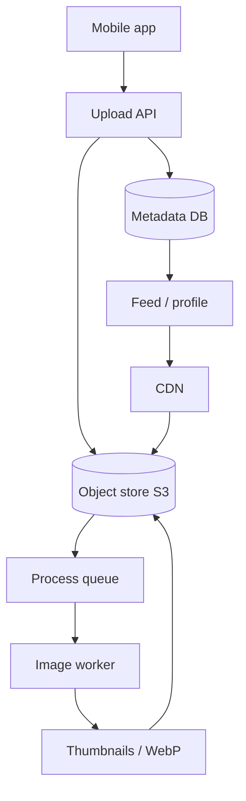
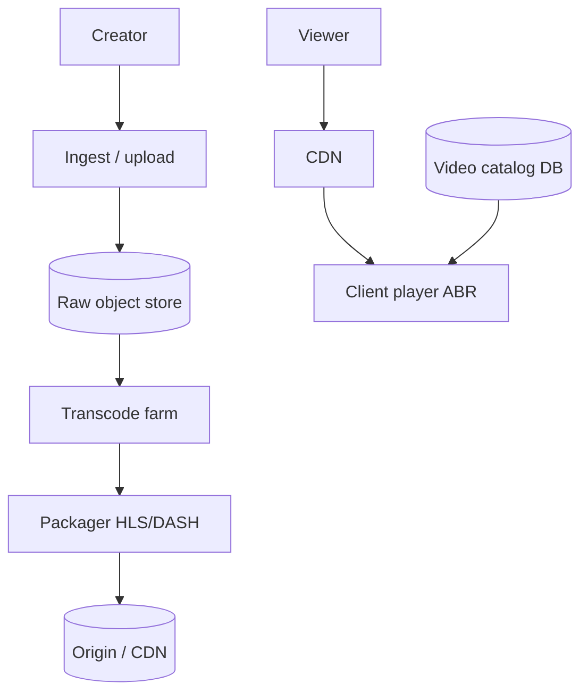
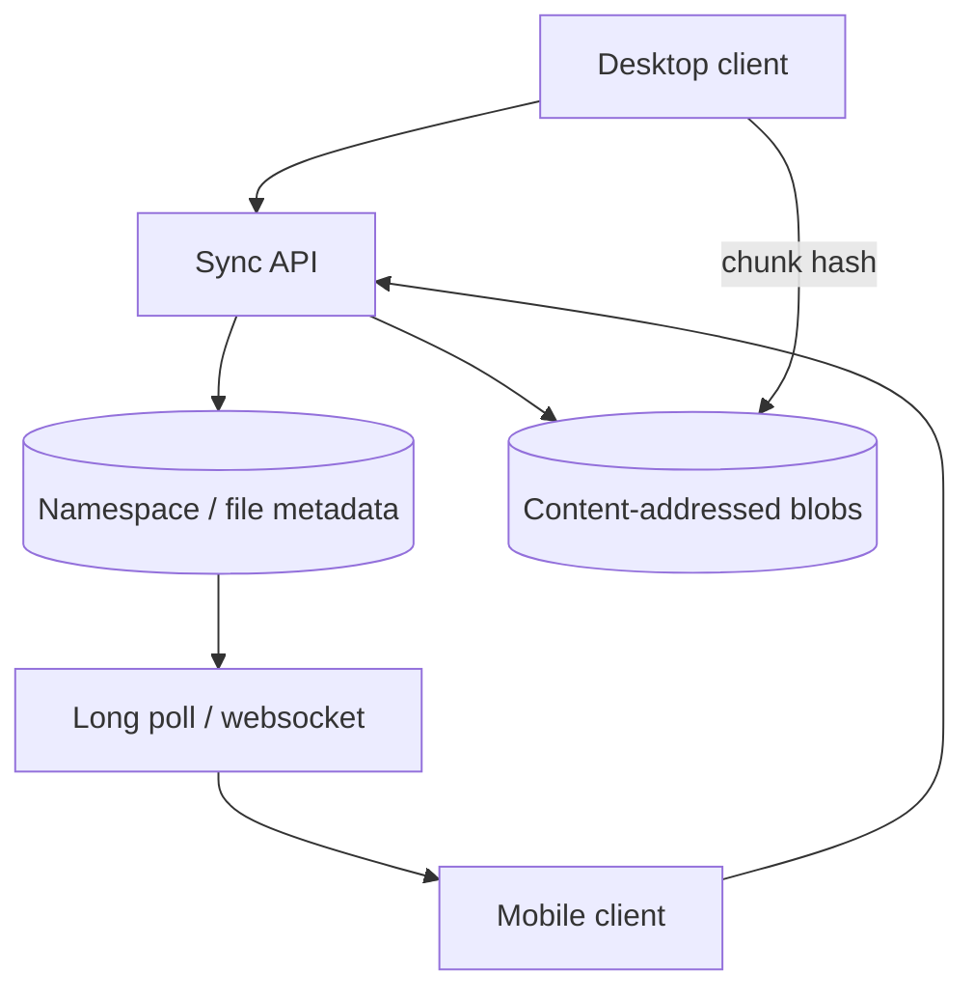
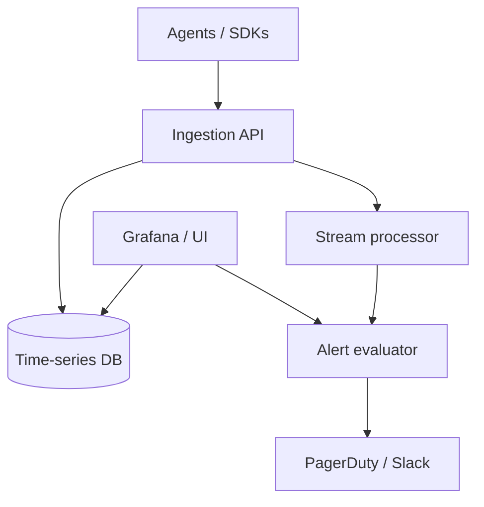
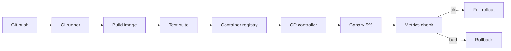
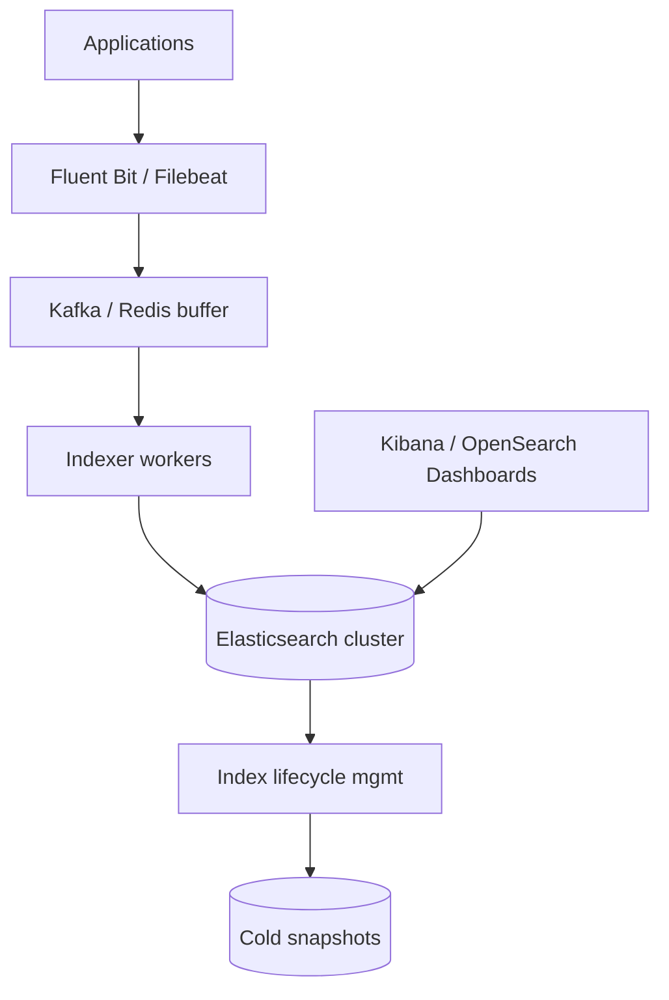
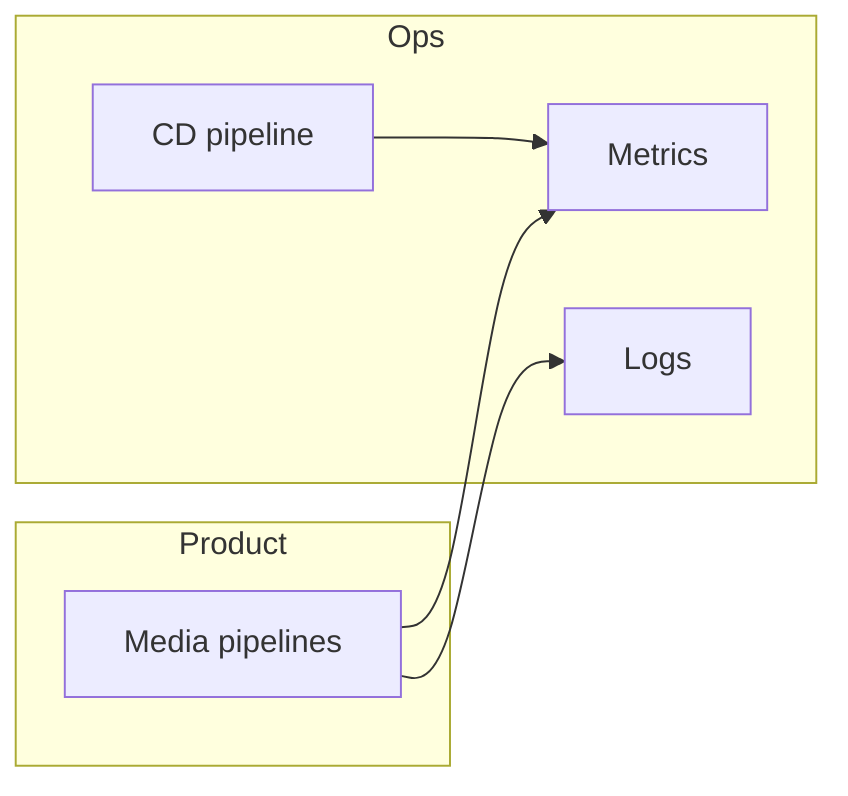

# Media and Operations Designs: Pipelines, Observability, and Delivery

This guide covers six designs common in media-heavy products and platform engineering: photos, video, file sync, monitoring, CI/CD, and log aggregation. Each design explains the problem in plain language, then walks through requirements, architecture, components, data models, and how the system grows under load. You will see how upload paths differ from read paths, and why operations systems look like data pipelines with SLOs.

---

## Design: Photo-Sharing Service

### Problem statement

Users upload photos from phones, expect fast viewing worldwide, and see images in feeds and profiles. Images need resizing, virus scanning, and CDN delivery—not raw disk files on one server.

### Requirements

| Type | Requirement |
|------|-------------|
| Functional | Upload; generate thumbnails; view in feed |
| Non-functional | Durable storage; global low-latency reads |
| Scale | Millions of uploads/day; viral photo read spike |
| Safety | Malware scan; EXIF privacy strip optional |

### Architecture diagram



### Key components

1. **Upload** — Presigned URL direct to object store (offload bandwidth from API).
2. **Metadata** — `photo_id`, owner, album, status `processing|ready`, variant URLs.
3. **Processing pipeline** — Resize 256/1024, strip EXIF, compute perceptual hash for dup detection.
4. **CDN** — Cache immutable variant URLs (`photo_id + size + hash`).
5. **Feed integration** — Feed stores `photo_id`; client resolves CDN URL from metadata or edge dictionary.

### Data model

```text
photos(id, user_id, original_key, status, created_at)
variants(photo_id, size_label, object_key, width, height, format)
```

```python
def on_upload_complete(photo_id, s3_key, queue):
    db.photos.update(photo_id, status="processing")
    queue.publish({"photo_id": photo_id, "key": s3_key, "ops": ["thumb", "medium", "strip_exif"]})
```

### Scaling considerations

- **Async processing** — API returns quickly; UI polls or push when `ready`.
- **Hot photo** — CDN absorbs read; origin only on miss.
- **Upload storms** — Rate limit per user; S3 scales horizontally.
- **Cost** — Lifecycle policy to glacier for old originals; keep CDN sizes hot.

---

## Design: Video Streaming Platform

### Problem statement

Creators upload long videos; viewers watch on variable networks. The platform must transcode to multiple bitrates, package for adaptive streaming (HLS/DASH), and serve through CDNs like YouTube or Netflix-style pipelines.

### Requirements

| Type | Requirement |
|------|-------------|
| Functional | Upload; transcode; play with quality adaptation |
| Non-functional | Start playback in < 2–3 s on good network |
| Scale | Petabytes storage; egress dominates cost |
| Rights | Geo restrictions; takedown |

### Architecture diagram



### Key components

1. **Ingest** — Multipart upload; validate codec and duration limits.
2. **Transcode** — GPU workers produce ladder 360p–4K; parallel per resolution.
3. **Adaptive bitrate (ABR)** — Player switches segments by bandwidth estimate.
4. **CDN** — Edge caches `.ts` or `.m4s` segments; manifest at low TTL.
5. **Catalog** — Title, owner, manifest URL, visibility, ad markers.

### Data model

```text
videos(id, owner_id, state, duration_sec, manifest_url)
transcode_jobs(video_id, profile, status, output_prefix)
```

```python
# Simplified ABR manifest concept
manifest = {
    "variants": [
        {"bitrate": 800_000, "resolution": "640x360", "uri": "360/index.m3u8"},
        {"bitrate": 2_500_000, "resolution": "1280x720", "uri": "720/index.m3u8"},
    ]
}
```

### Scaling considerations

- **Transcode queue** — Priority tiers (live vs VOD backlog).
- **Per-title encoding** — ML-based bitrate ladder saves bandwidth.
- **Origin shield** — Regional shield reduces origin hits.
- **Live vs VOD** — Live uses low-latency HLS; different pipeline.

---

## Design: File Storage and Sync (Dropbox-Like)

### Problem statement

Users store folders across devices. Files change offline; sync must detect changes efficiently, upload only deltas, and resolve conflicts when two devices edit the same file.

### Requirements

| Type | Requirement |
|------|-------------|
| Functional | Sync folders; share links; version history |
| Efficiency | Chunk-level dedup; delta sync |
| Correctness | Conflict markers, not silent data loss |
| Security | Encryption optional per file |

### Architecture diagram



### Key components

1. **Chunking** — Rolling hash (Rabin) splits files; chunks addressed by SHA-256.
2. **Sync protocol** — Client sends manifest of `(path, content_hash, mtime)`; server returns diff.
3. **Metadata tree** — Per-user namespace: files, folders, ACLs, locks.
4. **Conflict resolution** — Last-writer-wins or save both as `file (conflicted copy)`.
5. **Deduplication** — Same chunk hash stored once globally.

### Data model

```text
namespaces(user_id, root_inode)
inodes(id, parent_id, name, type, head_revision)
revisions(inode_id, rev, chunk_list[], client_device, ts)
chunks(hash, size, storage_key)
```

```python
def sync_delta(client_manifest, server_manifest):
    to_upload = [p for p in client_manifest if p not in server_manifest]
    to_download = [p for p in server_manifest if server_manifest[p] != client_manifest.get(p)]
    return to_upload, to_download
```

### Scaling considerations

- **Metadata hot spots** — Shard namespace by user_id.
- **Large files** — Parallel chunk upload; resume tokens.
- **List dir at scale** — Cursor pagination; avoid full tree walks on mobile.
- **Bandwidth** — LAN sync discovery optional for enterprise.

---

## Design: Monitoring and Alerting System

### Problem statement

Engineers need to know when error rates spike, latency degrades, or disks fill. Datadog-style systems collect metrics, aggregate, evaluate rules, and page on-call engineers without alert fatigue.

### Requirements

| Type | Requirement |
|------|-------------|
| Functional | Ingest metrics, logs, traces; dashboards; alerts |
| Non-functional | High cardinality with guardrails; sub-minute detection |
| Reliability | Monitoring must stay up when app is down |
| UX | Routing, silencing, escalation policies |

### Architecture diagram



### Key components

1. **Collect** — Agents scrape Prometheus endpoints; apps push custom metrics.
2. **Aggregate** — Rollups 10s → 1m → 1h; downsampling for retention.
3. **Evaluate** — Alert rule: `error_rate > 1% for 5m`; hysteresis to avoid flapping.
4. **Alert** — Notification policy: severity, on-call rotation, dedup grouping.
5. **Cardinality control** — Limit label combinations; drop high-card tags.

### Data model

```text
series(metric_name, labels_hash, timestamps[], values[])
alert_rules(id, query, threshold, for_duration)
incidents(id, rule_id, state, ack_by)
```

```python
def evaluate(error_count, request_count, window):
    rate = error_count / max(request_count, 1)
    return rate > 0.01  # 1% SLO breach
```

### Scaling considerations

- **Ingestion shards** by tenant or metric prefix.
- **Cold storage** — Long retention in object store; hot in TSDB.
- **Tracing** — Sample 1–5% in prod; always keep errors.
- **Multi-region** — Federated query or global single pane with replication lag noted.

---

## Design: Deployment Pipeline (CI/CD)

### Problem statement

Teams ship code dozens of times per day. The pipeline must build, test, deploy safely with canaries, and roll back quickly when metrics regress—without manual SSH to servers.

### Requirements

| Type | Requirement |
|------|-------------|
| Functional | Build artifact; run tests; deploy to envs |
| Safety | Canary; automated rollback on SLO breach |
| Audit | Who deployed what commit when |
| Speed | Fast feedback on PR; parallel test shards |

### Architecture diagram



### Key components

1. **Build** — Immutable artifact (Docker image) tagged with git SHA.
2. **Test** — Unit, integration, contract tests; block merge on failure.
3. **Canary** — Route small % traffic; compare error/latency to baseline.
4. **Rollout** — Progressive 5% → 25% → 100% with pauses.
5. **Rollback** — Redeploy previous image; feature flags for logic toggles.

### Data model

```text
deployments(env, service, version, status, started_at, ended_at)
pipelines(run_id, commit, stages[], outcome)
```

```python
def canary_decision(baseline_p99, canary_p99, threshold=1.2):
    return canary_p99 <= baseline_p99 * threshold
```

### Scaling considerations

- **Test parallelism** — Shard by package; cache dependencies.
- **Flaky tests** — Quarantine; do not block entire org.
- **Multi-service** — Coordinate versions or use independent deploys with contract tests.
- **Secrets** — Inject at runtime from vault; never bake into image.

---

## Design: Log Aggregation System (ELK-Style)

### Problem statement

Thousands of servers emit logs. Developers need centralized search ("show 500 errors for user X in last hour") without SSHing to each box. ELK = Elasticsearch + Logstash/Fluentd + Kibana pattern.

### Requirements

| Type | Requirement |
|------|-------------|
| Functional | Collect, buffer, index, query logs |
| Scale | Terabytes/day; thousands of queries |
| Retention | Hot 7d, warm 30d, cold 1y |
| Reliability | Backpressure when indexers lag |

### Architecture diagram



### Key components

1. **Collect** — Ship JSON logs with standard fields (`service`, `trace_id`, `level`).
2. **Buffer** — Kafka absorbs bursts; decouples apps from indexing speed.
3. **Index** — Parse timestamp; map to daily index `logs-2026.10.26`.
4. **Query** — Full-text + filters; avoid unbounded `*` scans.
5. **Retention** — ILM: hot SSD → warm → delete or snapshot to S3.

### Data model

```text
log event: { "@timestamp", "message", "level", "service", "host", "trace_id" }
index pattern: logs-{yyyy.MM.dd}
```

```python
# Structured logging at source beats regex parsing later
import json, logging
logging.info(json.dumps({"event": "checkout", "user_id": "u1", "ms": 42}))
```

### Scaling considerations

- **Shard sizing** — Target 20–50 GB per shard; too many small indices hurt cluster.
- **Noisy neighbor** — Rate limit per tenant; dedicated clusters for big customers.
- **Mapping explosions** — Dynamic mapping off for unknown fields in prod.
- **Cost** — Sampling debug logs in prod; keep errors at 100%.

---

## Cross-Cutting: Media + Ops Together

| Concern | Photo/video | Monitoring | Logs |
|---------|-------------|------------|------|
| Dominant cost | Egress + transcode | Cardinality + retention | Index size + storage |
| Burst pattern | Viral asset | Incident spike | Deploy log flood |
| User-facing SLO | TTFB image / startup video | Alert latency | Query p95 |
| Failure mode | Stuck processing queue | False positive pages | Indexer lag → loss if buffer full |



---

## FAANG Interview Deep Dive

**Q1: Why presigned URLs for photo upload?**

**A:** They let the client PUT bytes directly to object storage, so your API servers are not a bandwidth bottleneck and you avoid streaming large bodies through application memory. The API only mints credentials, records metadata, and kicks off async processing. Security: short TTL, content-type constraint, max size, and virus scan on completion event.

**Q2: Explain adaptive bitrate streaming in one minute.**

**A:** Video is encoded into multiple quality levels (bitrates). The player downloads small segments (2–10 s) and measures download speed. If buffer runs low, it requests a lower bitrate segment; if network is fast, it steps up. Manifest files list available variants. CDN caches segments; origin only sees miss traffic.

**Q3: How does Dropbox-style chunking save money?**

**A:** Files are split into content-addressed chunks. Identical chunks (same file re-uploaded, similar files, shared folders) store once. Sync sends hashes first; only missing chunks upload. Metadata tree points to chunk lists per file version.

**Q4: Design an alert that does not page at 3am for noise.**

**A:** Use `for: 5m` duration, hysteresis, and SLO-based alerts (burn rate) instead of raw thresholds on volatile metrics. Group related alerts into one incident. Require multi-window confirmation for sev-1. Runbooks linked in alert. Test alert rules in staging with fault injection.

**Q5: Canary vs blue-green deployment?**

**A:** Blue-green swaps two full environments—fast rollback, double capacity cost. Canary routes a slice of production traffic to new version while comparing metrics—cheaper, catches real-world skew. Many teams combine: canary within same cluster, then progressive rollout; blue-green for databases or stateful cutovers.

**Q6: Why Kafka before Elasticsearch in logging?**

**A:** Elasticsearch indexing can lag during spikes; without a buffer, agents block or drop logs. Kafka absorbs write spikes and lets indexers scale independently. Replay indexers after mapping fixes. Tradeoff: ops complexity and end-to-end latency increase slightly.

**Q7: Photo feed—what do you cache at CDN vs app?**

**A:** CDN caches immutable image variants (URL includes content hash or version). Do not CDN-cache personalized API JSON feeds without careful cache keys. Feed service returns stable photo IDs; client or edge uses known CDN URL pattern. Short TTL only for non-immutable responses.

**Q8: Video transcode backlog during viral upload—what do you do?**

**A:** Queue priority by SLA (paying creators, live events). Scale worker pool horizontally with GPU autoscaling. Show honest processing state in UI. Optionally allow lower-res "preview" transcode first for early viewing while HD finishes. Cap concurrent uploads per account to protect shared queue.

---

## Senior Pitfalls

| Mistake | Impact | Fix |
|---------|--------|-----|
| Processing uploads synchronously in API | Timeouts, OOM, poor UX | Presigned URL + async workers |
| Single bitrate video | Buffering on mobile networks | ABR ladder + CDN |
| Full file upload on every save | Slow sync, high bandwidth | Chunking + hash comparison |
| Alert on raw CPU > 80% | Pages every night | SLO alerts; rate of change; business metrics |
| Deploy without canary | Bad release takes down 100% | Progressive rollout + auto rollback |
| Unbounded log labels (user_id on every metric) | TSDB explosion | Cardinality limits; aggregate at ingest |
| Tiny Elasticsearch indices per hour | Cluster metadata meltdown | Daily indices + ILM |
| No backpressure on log pipeline | Silent log loss | Kafka buffer + monitor consumer lag |

---

## Production-grade Practice

1. **Image pipeline locally** — Upload to MinIO; worker generates WebP thumbnails with Pillow; serve via nginx with cache headers; measure TTFB with and without CDN cache simulation.

2. **ABR manifest generator** — Write a script that given MP4 outputs builds a minimal HLS master playlist; use ffmpeg to produce two renditions; play in VLC or hls.js.

3. **Chunked sync prototype** — Split files with fixed 4MB chunks SHA-256; implement "server manifest diff" API in FastAPI; demonstrate dedup when two files share 50% chunks.

4. **Mini observability stack** — Docker Compose: Prometheus + Alertmanager + sample app; define alert on `http_requests_total{status=500}` rate; trigger load test and receive Slack webhook; add Loki or Elasticsearch single-node for same app's JSON logs and correlate by `trace_id`.

---

## Reference Tables

### Media pipeline stages

| Stage | Photo | Video |
|-------|-------|-------|
| Ingest | Presigned PUT | Multipart + resume |
| Transform | Resize, format | Transcode, package |
| Store | S3 + variants | Segments + manifest |
| Serve | CDN immutable URL | CDN + ABR player |

### CI/CD stage gates

| Stage | Gate | Typical failure action |
|-------|------|------------------------|
| Build | Compile, lint | Block merge |
| Test | Unit + integration | Block deploy |
| Canary | Error rate, p99 | Auto rollback |
| Rollout | Manual approval optional | Pause pipeline |

### Log field standards (recommended)

| Field | Purpose |
|-------|---------|
| `timestamp` | Ordering across hosts |
| `level` | Filter noise |
| `service` | Shard queries |
| `trace_id` | Tie to traces |
| `message` | Human readable |

---

*End of guide: media pipelines and operational systems that keep products running.*
