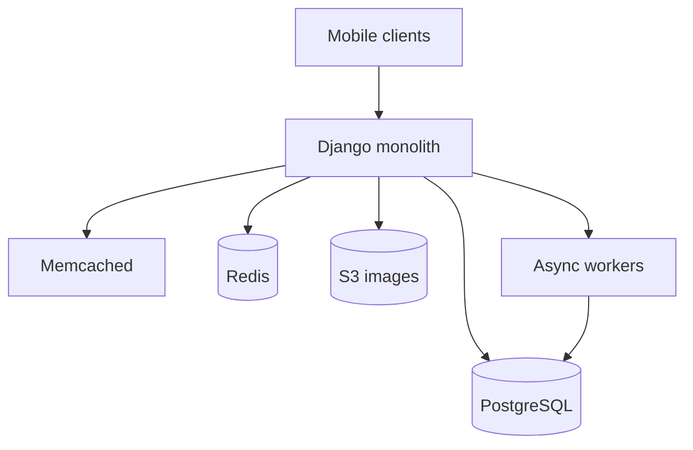
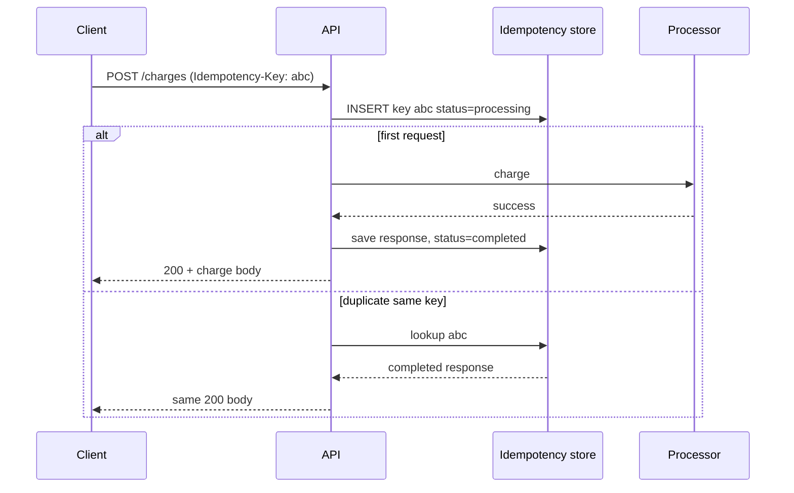
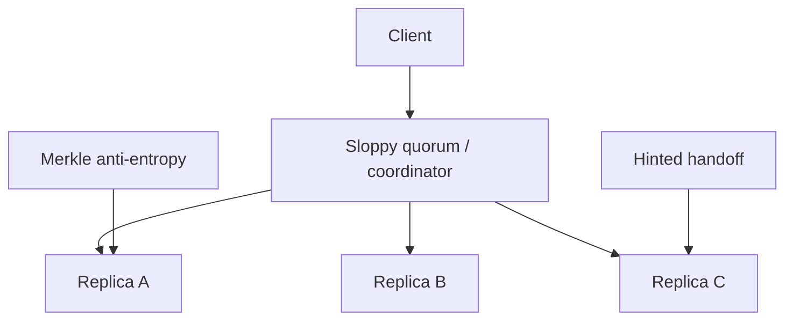
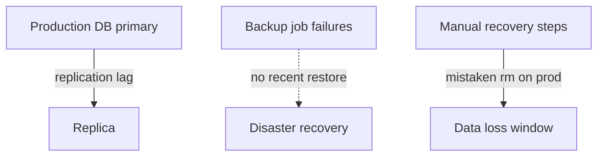

# Engineering Case Studies: Lessons from Production Systems

This guide walks through five real-world stories: early Instagram, Stripe idempotency, Discord message storage, the Amazon Dynamo paper, and GitLab's 2017 database incident. For each case you get context, the problem, what they built, key decisions, lessons, and how to talk about it in a senior interview. The goal is not trivia—it is to extract durable patterns you can reuse when you design your own systems.

---

## Case: Instagram's First Architecture

### Context

Around 2010–2012, Instagram grew from a small photo app to tens of millions of users with a tiny engineering team (on the order of a dozen people). They needed to move fast, keep the product stable, and avoid operational complexity they could not staff.

### Problem

- Photo sharing is **read-heavy** with **spiky writes** when images go viral.
- Mobile clients need **low-latency feeds** and reliable image delivery globally.
- Team size means **every hour spent on infra** is an hour not spent on product.

### Solution (high level)

Instagram's early stack was deliberately boring:

| Layer | Choice | Role |
|-------|--------|------|
| App | Django (Python) | Rapid feature development, monolith |
| Primary DB | PostgreSQL | Users, relationships, metadata |
| Cache | Memcached + Redis | Hot objects, sessions, counters |
| Media | Amazon S3 | Source of truth for image bytes |
| Tasks | Gearman (async jobs) | Feed fanout, image processing |



**Separation of concerns:**

1. **App/data** — Relational data in Postgres; avoid putting images in the database.
2. **Media** — Upload to S3; DB stores URL and metadata only.
3. **Caching** — Aggressive caching of profile, feed fragments, and counts.

### Key decisions

1. **Monolith over microservices** — Fewer moving parts; one deploy unit; easier reasoning for small team.
2. **PostgreSQL as system of record** — Mature tooling; SQL for reporting and ad-hoc fixes.
3. **S3 for blobs** — Offload durability and scale of bytes; CDN in front for reads.
4. **Simplicity until pain is measurable** — Sharding and exotic databases came later when metrics demanded them.

### Lessons learned

- **Optimize for team velocity** when user growth is the existential risk.
- **Cache the read path** early; photo apps die on slow feeds.
- **Keep bytes out of OLTP** — the database is for pointers and relationships.
- **Boring technology** reduces midnight pages when you have no SRE army.

### What to say in an interview

> "Instagram scaled initially by separating metadata in Postgres from media in S3, caching hot reads, and keeping a monolithic Django app until complexity was justified. I'd ask what their read/write ratio is, whether they're bounding team size, and whether image delivery is on CDN—I would not jump to microservices on day one."

---

## Case: Stripe's Idempotency Keys

### Context

Payment APIs sit on unreliable networks. Clients, mobile SDKs, and gateways **retry** on timeouts. Without a guard, retries create **duplicate charges**—a catastrophic failure mode for trust and compliance.

### Problem

- HTTP POST is not naturally idempotent.
- A charge might succeed at the processor while the client sees a timeout.
- Users hammer "pay" button; load balancers replay requests.

### Solution: Idempotency key pattern

Stripe popularized requiring (or strongly encouraging) an **Idempotency-Key** header on POST requests.

**Request lifecycle:**



### Database design (conceptual)

```text
idempotency_keys(
  key TEXT PRIMARY KEY,
  request_fingerprint TEXT,
  response_json JSONB,
  status ENUM('processing','completed','failed'),
  created_at,
  expires_at
)
```

**Rules:**

1. Same key + same parameters → return stored response (including same HTTP status when appropriate).
2. Same key + **different** body → reject with 400 (key reuse abuse).
3. While `processing`, concurrent duplicates get **409** or a retry-after poll pattern.
4. Keys **expire** after 24 hours (typical)—long enough for client retries, not forever bloat.

```python
def handle_charge(idempotency_key: str, body: dict, db, processor):
    row = db.get_key(idempotency_key)
    if row and row.status == "completed":
        return row.response_json
    if row and row.status == "processing":
        raise ConflictError()
    if row and row.request_fingerprint != hash(body):
        raise BadRequest("key reused with different body")
    db.insert_processing(idempotency_key, hash(body))
    try:
        result = processor.charge(body)
        db.complete(idempotency_key, result)
        return result
    except Exception as e:
        db.fail(idempotency_key, str(e))
        raise
```

### Key decisions

1. **Server-side dedup** — Client cannot be trusted to retry safely alone.
2. **Persist full response** — Including error shapes clients already handled.
3. **Fingerprint body** — Prevents key recycling attacks.
4. **TTL on keys** — Storage bound; business still relies on immutable ledger for money truth.

### Lessons learned

- **Exactly-once user experience** is achieved by **idempotent APIs + at-least-once transport**.
- Separate **idempotency record** from **financial ledger**—ledger entries never expire.
- Webhooks need the same dedup (`event_id` unique).

### What to say in an interview

> "I'd require idempotency keys on all mutating payment endpoints, store processing state to handle concurrent retries, fingerprint the request body, and return cached responses for 24h. Long-term correctness lives in an append-only ledger with unique constraints on payment intent id, not just the idempotency cache."

---

## Case: How Discord Stores Trillions of Messages

### Context

Discord is a real-time chat product with **enormous message volume** and **long retention** for many communities. Message storage must support **fast recent history reads**, **sharded writes**, and cost-efficient growth.

### Problem

- Early **MongoDB** deployment hit limits: **hot partitions**, memory pressure, operational pain at scale.
- Message read patterns are **per-channel recent history**—not arbitrary SQL joins.
- JVM GC pauses on large heaps hurt tail latency (in their Cassandra era narrative).

### Solution evolution


| Phase | Store | Why move |
|-------|-------|----------|
| Early | MongoDB | Flexible docs; familiar |
| Growth | Cassandra | Wide-column, partitioned writes |
| Later | ScyllaDB | Cassandra-compatible API, C++ lower latency |

**Data model (conceptual):**

- Partition key: `channel_id` (or bucketed channel id).
- Clustering key: `message_id` or time-ordered snowflake id.
- Query: "last N messages in channel" is one partition scan—not cross-shard join.

```text
messages:
  PK: channel_id (+ optional bucket for very hot channels)
  CK: message_id DESC
  columns: author_id, content, attachments_meta, ...
```

### Hot partition problem

A viral channel receives writes faster than one partition node can absorb. Mitigations Discord and similar systems discuss publicly or by analogy:

1. **Bucket sub-partitions** — `channel_id + bucket` spread writes; merge on read.
2. **Rate limits** on send path for abuse.
3. **Async pipelines** for search index, not inline on write path.

### Why Cassandra's GC "killed them" (interview framing)

On very large JVM heaps, **garbage collection pauses** can stall coordinators, hurting real-time chat. ScyllaDB's per-core architecture and implementation language aimed at **predictable tail latency** under high throughput. Exact numbers vary by workload; the **lesson** is: match storage engine to access pattern **and** latency SLO, not just write scalability on paper.

### Key decisions

1. **Optimize schema for queries** — "Load channel history" not "global SQL."
2. **Accept denormalization** — Duplicate display names in message row if read path needs it.
3. **Migrate with dual-write / backfill** — Years of history cannot flip in one cutover.
4. **Separate concerns** — Hot chat path vs search vs media in object store.

### Lessons learned

- **Document stores** without careful shard keys become painful at chat scale.
- **Wide-column** fits append-heavy, partition-local reads.
- **Tail latency** matters as much as average throughput for UX.
- Plan **partition heat** before launch of features that concentrate traffic (#general in 1M-server guild).

### What to say in an interview

> "I'd partition messages by channel, use time-ordered IDs for clustering, cap hot channels with bucketing, and keep search on a separate index. I'd load-test partition throughput before launch and watch p99—not just writes/sec. Migration story: dual-write, verify parity, cut read path, then retire old store."

---

## Case: Amazon Dynamo (2007 Paper)

### Context

Amazon's shopping cart and session services needed **always-on writes** during node failures and network partitions. The 2007 Dynamo paper described how Amazon built a **highly available key-value store** that influenced DynamoDB, Riak, Cassandra, and later "AP" designs in CAP terms.

### Problem

- **Infrastructure fails constantly**—disks, racks, networks.
- **Strong consistency** across replicas can block availability during partitions.
- Shopping carts must **accept writes** even if some replicas are unreachable (eventual convergence).

### Solution concepts (plain English)



| Concept | What it means |
|---------|----------------|
| **Consistent hashing** | Keys map to a ring; nodes own ranges; add/remove nodes moves minimal keys |
| **Vector clocks** | Track version history per key to detect conflicts (siblings) |
| **Sloppy quorum** | Write to first W reachable nodes, not strict original replicas |
| **Hinted handoff** | Temporarily store writes for down node; deliver when it returns |
| **Merkle trees** | Hash subtrees of key ranges; compare hashes to find divergence cheaply |
| **Anti-entropy** | Background sync repairs drift between replicas |

```python
# Toy consistent hash ring
import hashlib

def ring_position(key: str) -> int:
    return int(hashlib.md5(key.encode()).hexdigest(), 16)

def find_replicas(key: str, nodes: list, n: int = 3):
    start = ring_position(key)
    sorted_nodes = sorted(nodes, key=lambda node: ring_position(node))
    idx = next(i for i, node in enumerate(sorted_nodes) if ring_position(node) >= start)
    return [sorted_nodes[(idx + i) % len(sorted_nodes)] for i in range(n)]
```

**Read/write tuning:**

- **R + W > N** (with strict quorum variants) can yield stronger read-your-writes behavior.
- Dynamo emphasized **configurable** tradeoffs per application (cart vs catalog).

### Key decisions

1. **Availability over strong consistency** for specific use cases.
2. **Push conflict resolution to application** when vector clocks diverge (merge carts).
3. **Gossip** for membership; decentralized operations.
4. **Incremental scalability**—add nodes without full resharding downtime.

### Lessons learned

- **Not one size fits all**—Dynamo's ideas spawned many systems with different defaults.
- **Eventual consistency** requires **product-level merge rules** (carts combine; prices do not).
- **Anti-entropy** is not optional for long-running clusters.
- Papers become interview shorthand—know **which ideas your managed DB actually exposes** (DynamoDB: partitions, eventual consistency option, conditional writes).

### What to say in an interview

> "Dynamo trades strict consistency for availability under partition using consistent hashing, quorums, hinted handoff, and background repair via Merkle trees. I'd map that to today: choose DynamoDB consistency mode, design partition keys to avoid hot keys, and use conditional writes or idempotency where business rules need stronger guarantees than eventual."

---

## Case: GitLab's Database Incident (2017)

### Context

In January 2017, GitLab suffered a **production database outage** that led to **data loss** for some services (issues, merge requests, etc.) during recovery attempts. They publicly documented the incident with unusual transparency.

### Problem (what went wrong)

Multiple failures compounded:

1. **Primary database instability** — Active connections spiked; replication lag grew.
2. **Backup gaps** — Intended backups were not reliably restorable in the crisis window.
3. **Human error during recovery** — Operations on the wrong server/environment removed data that was thought recoverable from replicas.
4. **Replication lag** — Replicas were **behind**; promoting or copying from them lost recent commits.



### Solution (aftermath direction)

GitLab's public response emphasized:

- Fix backup automation and **verify restores regularly**.
- Improve runbooks and **reduce blast radius** of admin commands.
- Separate staging/production access controls.
- Invest in **Patroni**-style HA and clearer failover drills.

### Key decisions (retrospective)

1. **Transparency** — Public live notes increased accountability and industry learning.
2. **Treat backups as product** — Untested backup = no backup.
3. **Replication ≠ backup** — Replicas can lag or propagate mistakes.
4. **Fat-finger protection** — Require confirmation, delays, or break-glass for destructive ops.

### Lessons learned

| Lesson | Practice |
|--------|----------|
| Test restores quarterly | Automated restore to empty cluster; checksum row counts |
| Monitor replication lag | Alert before lag exceeds RPO |
| Immutable backups | WORM or snapshot outside prod account |
| Runbooks | Step-by-step with "stop if" conditions |
| Blast radius | No shared credentials; production DB not reachable from laptop by default |

### What to say in an interview

> "GitLab 2017 is a story of correlated failures: backups weren't trustworthy, replication lag meant replicas weren't a time machine, and manual recovery amplified damage. I'd institute restore drills with measured RTO/RPO, lag alerts, isolated break-glass access, and point-in-time recovery where the business requires it—not just nightly dumps."

---

## Comparative Lens: Five Cases Side by Side

| Case | Primary risk | Core pattern | Interview one-liner |
|------|--------------|--------------|---------------------|
| Instagram | Team + growth | Monolith, S3, cache | Boring stack, separate media |
| Stripe | Duplicate money | Idempotency keys | At-least-once wire, exactly-once API |
| Discord | Data volume + heat | Partition by channel | Schema for query; fight hot keys |
| Dynamo | Partition tolerance | Quorum + repair | AP with app-level merge |
| GitLab | Ops + backups | Human + process | Test restores, limit blast radius |


---

## FAANG Interview Deep Dive

**Q1: Instagram had 30M users with ~13 engineers—how is that possible?**

**A:** Ruthless scope on features that moved growth, monolith to avoid distributed system tax, heavy caching, S3 for media, and Postgres for coherent data model. They accepted technical debt in places but avoided premature sharding. Operational simplicity meant fewer failure modes per engineer on-call.

**Q2: How is idempotency different from a database unique constraint?**

**A:** Idempotency keys handle **in-flight** and **completed** retries at API boundary with stored responses. Unique constraints prevent duplicate rows but may return errors to clients that don't match first success body. You often use **both**: idempotency layer for client experience, unique business id on ledger for eternal truth.

**Q3: Why not store Discord messages in PostgreSQL?**

**A:** Chat write throughput and row count per channel can outgrow comfortable Postgres scaling without sharding discipline anyway. Wide-column stores align with partition-key access. Postgres can still hold billing, guild settings, and relational data where ACID joins matter.

**Q4: Explain sloppy quorum to a PM.**

**A:** When some servers are down, we temporarily write to substitute servers that promise to forward data when the home server returns—so shoppers can still click "add to cart" during a partial outage. We reconcile later. The alternative is erroring every write until all servers are healthy.

**Q5: What is the RPO lesson from GitLab?**

**A:** Recovery Point Objective—how much data you can lose. If backups fail and replicas lag 4 hours, your effective RPO is 4 hours or worse. Measuring lag and proving restore defines real RPO; slides do not.

**Q6: Dynamo vs DynamoDB—what carries over?**

**A:** Partitioned key-value model, preference for horizontal scale, tunable consistency in DynamoDB (strongly consistent read option per call). DynamoDB is managed: no Merkle repair homework for you, but hot partition keys remain your design responsibility.

**Q7: How would you migrate MongoDB → Cassandra for messages?**

**A:** Dual-write new messages to both; backfill historical partitions in batches; compare counts and spot-check reads; shadow read new store; flip read path per cohort; disable Mongo writes; keep Mongo read-only rollback window. Monitor p99 and compaction lag throughout.

**Q8: Name three questions you'd ask before copying Instagram's stack today.**

**A:** (1) What is our team's ops maturity and on-call size? (2) Is our bottleneck actually the monolith or a specific subsystem (feed, media)? (3) Do we need multi-region active-active now or in 18 months? Boring monolith still wins for many startups; the answer is workload-dependent.

---

## Senior Pitfalls

| Mistake | Impact | Fix |
|---------|--------|-----|
| Copying microservices because Instagram eventually split | Complexity bankruptcy early | Monolith until measured pain |
| Idempotency keys without body fingerprint | Security/logic bugs on key reuse | Hash canonical request body |
| Ignoring channel hot partitions in chat | One guild degrades cluster | Bucket keys; rate limits; load test |
| Treating Dynamo as "no consistency ever" | Double charges, bad merges | Conditional writes; business merge rules |
| Assuming replication is backup | Promote stale replica → data loss | PITR + tested backups |
| Skipping restore drills | Discover broken backups in incident | Quarterly automated restore |
| Running destructive SQL on prod from laptop | GitLab-class incident | Bastion, roles, delayed confirmation |
| Public case study trivia without pattern | Weak interview signal | Tie to tradeoffs and your design choices |

---

## Production-grade Practice

1. **Idempotency mini-service** — Implement Stripe-like keys with SQLite; document 24h TTL job; write chaos test that sends 50 parallel identical POSTs and asserts one charge row in ledger mock.

2. **Consistent hash ring** — Code ring with virtual nodes; simulate node add/remove; measure key movement fraction; plot load distribution with and without vnodes.

3. **Backup drill** — Postgres docker: load sample data, take base backup + WAL, drop volume, restore into new container, verify row count hash—write runbook with timestamps you actually achieved (RTO).

4. **Case study brief** — Pick one case; write a 1-page "architecture decision record" as if you were staff engineer recommending the same pattern for a greenfield startup in 2026, including what you would do differently (multi-region, managed DB, feature flags).

---

## Interview Story Template (Reuse)

Use this skeleton in system design or behavioral rounds:

1. **Situation** — Scale, team, constraint in one sentence.
2. **Forces** — Availability, consistency, cost, velocity—pick two winners.
3. **Decision** — What you chose and what you explicitly did not choose.
4. **Mechanism** — One diagram or data model on the whiteboard.
5. **Failure** — How it fails and how you detect it.
6. **Lesson** — Generalize (idempotency, partition keys, restore drills).

Example opener:

> "When clients retry on payment timeouts, the failure mode is duplicate capture—not failed capture—so the API boundary needs idempotency keys and a ledger with unique payment intent, which is the Stripe lesson we applied when we..."

---

*End of guide: five production case studies with patterns for interviews and real design work.*
