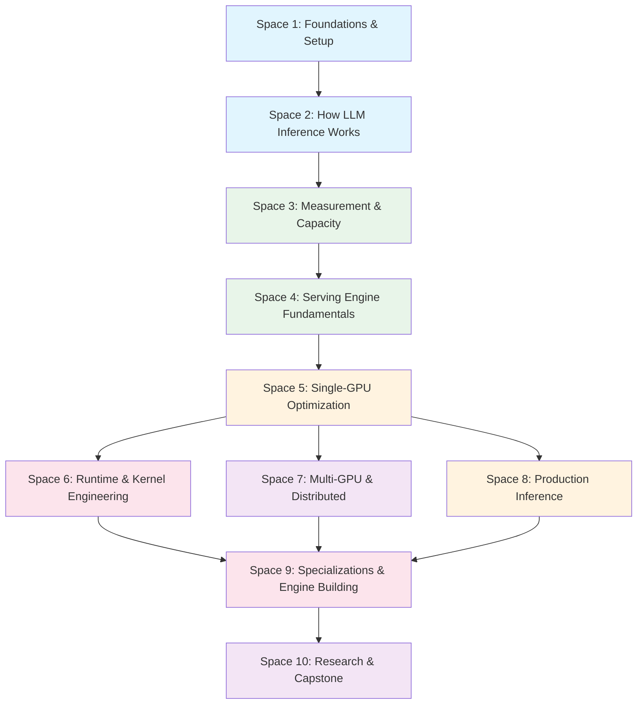

# 🚀 Inference Engineering — Complete Tutorial

> **A structured path from your first GPU inference server to distributed serving, production operations, and a research capstone.**
>
> 10 Spaces · 32 Modules · 226 Lessons

---

## How to Use This Tutorial

Each **Space** is a folder. Each **Module** is a comprehensive markdown file inside that folder.
Every module contains:
- 📖 **Clear explanations** with real-world analogies
- 💻 **Runnable code** (Python / PyTorch / CUDA)
- 📊 **Mermaid diagrams** for visual understanding
- 🏢 **FAANG deep-dives** — how Google, Meta, OpenAI, etc. solve these problems
- 🧪 **Labs & exercises** to cement understanding

---

## Curriculum Map

---

## Spaces & Modules

| Space | Module | Lessons | File |
|-------|--------|---------|------|
| **1 — Foundations** | IN. What Is Inference Engineering? | 3 | [Link](space-01-foundations/IN-what-is-inference-engineering.md) |
| | 00. Prerequisites | 9 | [Link](space-01-foundations/00-prerequisites.md) |
| | 01. Run Your First LLM | 6 | [Link](space-01-foundations/01-run-your-first-llm.md) |
| **2 — How It Works** | 02. Understand One Token | 6 | [Link](space-02-how-llm-inference-works/02-understand-one-token.md) |
| | 03. Prefill, Decode, KV Cache | 7 | [Link](space-02-how-llm-inference-works/03-prefill-decode-kv-cache.md) |
| **3 — Measurement** | 04. Benchmark Inference | 8 | [Link](space-03-measurement-capacity/04-benchmark-inference.md) |
| | 05. Break One GPU | 5 | [Link](space-03-measurement-capacity/05-break-one-gpu.md) |
| **4 — Serving Engines** | 06. Real Inference Engine | 6 | [Link](space-04-serving-engine-fundamentals/06-real-inference-engine.md) |
| | 07. Continuous Batching | 7 | [Link](space-04-serving-engine-fundamentals/07-continuous-batching.md) |
| | 08. PagedAttention | 6 | [Link](space-04-serving-engine-fundamentals/08-paged-attention.md) |
| | 09. Optimize One GPU | 4 | [Link](space-04-serving-engine-fundamentals/09-optimize-one-gpu.md) |
| **5 — Single-GPU Opt** | 10. Prefill & Prefix | 7 | [Link](space-05-single-gpu-optimization/10-prefill-prefix-optimization.md) |
| | 11. Quantization | 8 | [Link](space-05-single-gpu-optimization/11-quantization-kv-compression.md) |
| | 12. Profiling | 8 | [Link](space-05-single-gpu-optimization/12-profiling-gpu-performance.md) |
| **6 — Runtime/Kernel** | 13. Triton & Kernels | 8 | [Link](space-06-runtime-kernel-engineering/13-triton-kernel-engineering.md) |
| | 14. Attention Opt | 6 | [Link](space-06-runtime-kernel-engineering/14-attention-optimization.md) |
| | 15. Compilation & CUDA Graphs | 6 | [Link](space-06-runtime-kernel-engineering/15-compilation-cuda-graphs.md) |
| | 16. Speculative Decoding | 8 | [Link](space-06-runtime-kernel-engineering/16-speculative-decoding.md) |
| | 17. Compare Engines | 6 | [Link](space-06-runtime-kernel-engineering/17-compare-inference-engines.md) |
| **7 — Multi-GPU** | 18. Multi-GPU Parallelism | 9 | [Link](space-07-multi-gpu-distributed/18-multi-gpu-parallelism.md) |
| | 19. MoE Inference | 6 | [Link](space-07-multi-gpu-distributed/19-moe-inference.md) |
| | 20. Long Context | 7 | [Link](space-07-multi-gpu-distributed/20-long-context-tiered-kv.md) |
| | 21. Disaggregation | 7 | [Link](space-07-multi-gpu-distributed/21-prefill-decode-disaggregation.md) |
| **8 — Production** | 22. Production Serving | 8 | [Link](space-08-production-inference/22-production-serving.md) |
| | 23. Routing & Autoscaling | 8 | [Link](space-08-production-inference/23-routing-autoscaling.md) |
| | 24. Observability & Security | 9 | [Link](space-08-production-inference/24-observability-reliability-security.md) |
| | 25. Inference Economics | 6 | [Link](space-08-production-inference/25-inference-economics.md) |
| **9 — Specializations** | 26. Specialized Workloads | 10 | [Link](space-09-specializations-engine-building/26-specialized-workloads.md) |
| | 27. Read an Engine | 6 | [Link](space-09-specializations-engine-building/27-read-inference-engine.md) |
| | 28. Build Mini Engine | 8 | [Link](space-09-specializations-engine-building/28-build-mini-engine.md) |
| **10 — Research** | 29. Reproduce Research | 8 | [Link](space-10-research-capstone/29-reproduce-research.md) |
| | 30. Final Capstone | 10 | [Link](space-10-research-capstone/30-final-capstone.md) |

---

## Learner Paths

### 🔧 Applied Inference Engineer (~144 core lessons)
Setup → Model execution → Benchmarking → vLLM → Single-GPU optimization → Engine comparison → Basic distributed → Production

**Modules:** IN, 00–12, 17–18, 22–25

### ⚡ Inference Runtime / Performance Engineer (Core + Runtime Depth)
The core path plus Triton, attention optimization, compilation, speculative decoding, and engine internals.

**Modules:** Core path + 13–16, 27

### 🌐 Distributed Inference Engineer (Core + Scale)
The core path plus multi-GPU, MoE, long context, disaggregation, routing, and autoscaling.

**Modules:** Core path + 18–21, 23

### 🔬 Inference Research / Engine Engineer (Complete Path)
Everything — through engine internals, the mini engine, paper reproduction, and the research capstone.

**Modules:** All 32 modules

---

## 🎯 Q&A Deep Dive, Production Scenarios & Best Practices

| Section | File | What's Inside |
|---------|------|---------------|
| **Q&A: Foundations** | [Link](qa-deep-dive/01-foundations-and-model-execution-qa.md) | 20 questions on inference basics, transformers, KV cache, memory |
| **Q&A: Engines & Optimization** | [Link](qa-deep-dive/02-serving-engines-optimization-qa.md) | 10 questions on vLLM, batching, quantization, profiling |
| **Q&A: Distributed & Production** | [Link](qa-deep-dive/03-distributed-production-qa.md) | 10 questions on multi-GPU, scaling, costs, monitoring |
| **Scenarios: Incidents** | [Link](production-scenarios/01-incident-response-scenarios.md) | 7 real-world incidents with step-by-step resolution |
| **Scenarios: Scaling** | [Link](production-scenarios/02-performance-scaling-scenarios.md) | 7 scaling scenarios from 4 GPUs to multi-region |
| **Best Practices: Architecture** | [Link](large-scale-best-practices/01-architecture-patterns.md) | 5-level architecture maturity (1 GPU → 10K GPUs) |
| **Best Practices: Tuning** | [Link](large-scale-best-practices/02-optimization-tuning-playbook.md) | 5 playbooks: throughput, latency, concurrency, cost, reliability |

---

## Prerequisites

| Topic | What You Need |
|-------|--------------|
| **Python** | Comfortable with classes, decorators, async |
| **PyTorch** | Can build and train a simple neural net |
| **Linux** | Basic shell, SSH, file management |
| **Math** | Linear algebra basics, probability fundamentals |
| **GPU** | Access to at least one NVIDIA GPU (A100/H100 ideal, T4/RTX OK to start) |

---

*© 2026 — Built for engineers who want to deeply understand how LLM inference actually works.*
