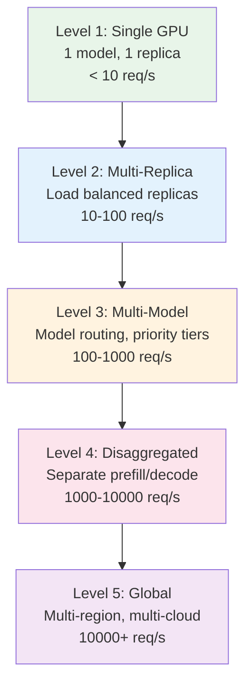
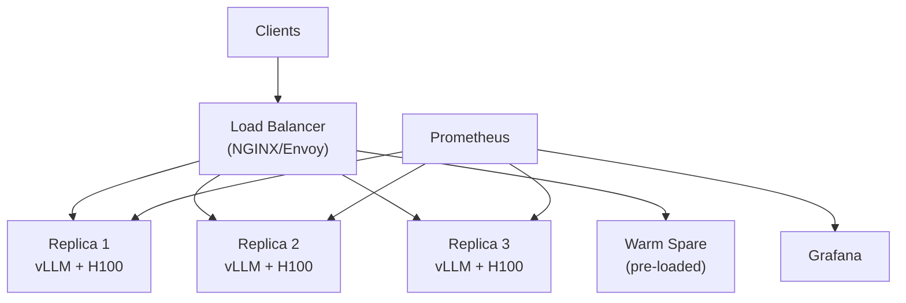
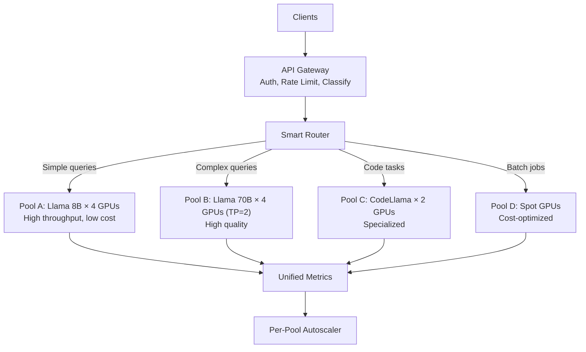
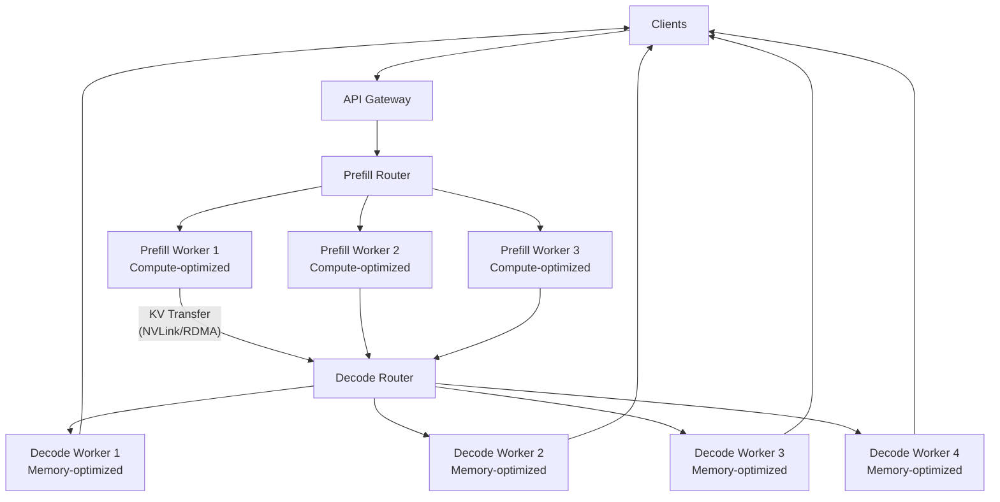
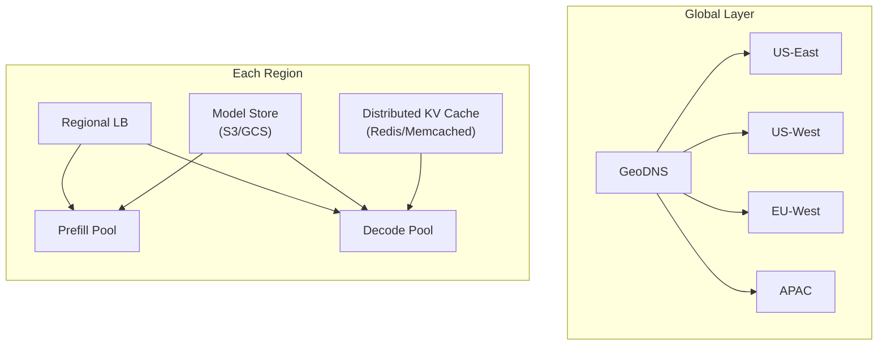

# 🏗️ Large-Scale Best Practices — Architecture Patterns

> **Battle-tested patterns used by OpenAI, Google, Meta, Anthropic**
> From 1 GPU to 10,000 GPUs

---

## Architecture Maturity Levels



---

## Level 1: Single GPU (Prototype)

```yaml
# Good for: Development, small internal tools, < 10 req/s

Architecture:
  Client → [vLLM on 1 GPU] → Response

Best Practices:
  - Use vLLM or SGLang (not raw PyTorch)
  - Enable prefix caching from day 1
  - Set gpu_memory_utilization to 0.90
  - Add /health endpoint
  - Log request metrics (even manually)

Config:
  vllm serve meta-llama/Llama-3-8B-Instruct \
    --gpu-memory-utilization 0.90 \
    --enable-prefix-caching \
    --max-model-len 8192

Estimated Cost: $2.50-3.50/hr (1× H100)
```

---

## Level 2: Multi-Replica (Small Production)



```python
level2_best_practices = {
    "Load Balancing": {
        "DON'T": "Round-robin (ignores request cost)",
        "DO": "Least-connections or queue-aware routing",
        "BEST": "Prefix-aware routing (route same system prompt to same replica)",
    },
    "Health Checks": {
        "Liveness": "/health/live — process alive (always check)",
        "Readiness": "/health/ready — model loaded and warm",
        "Startup": "Allow 5 minutes for model loading",
    },
    "Redundancy": {
        "Rule": "N+1 minimum (if need 3, deploy 4)",
        "Warm spares": "1 pre-loaded replica, not serving traffic",
        "Failover time": "< 30 seconds with warm spare",
    },
    "Monitoring (minimum viable)": [
        "TTFT P50/P95 (user experience)",
        "Throughput tokens/sec (capacity)",
        "Error rate (reliability)",
        "KV cache utilization (memory pressure)",
        "Queue depth (overload indicator)",
    ],
}
```

---

## Level 3: Multi-Model with Routing (Medium Production)



```python
level3_best_practices = {
    "Request Classification": {
        "Method": "Lightweight classifier (regex + token count)",
        "Rules": [
            "If input < 200 tokens AND no code markers → Pool A (8B)",
            "If contains code blocks OR language keywords → Pool C (Code)",
            "If user is premium tier → Pool B (70B)",
            "If batch flag OR no streaming → Pool D (Batch)",
            "Default → Pool A (cheapest)",
        ],
        "Latency": "< 1ms for classification (must not add to TTFT)",
    },
    "Per-Pool Tuning": {
        "Pool A (8B)": "Max batch size, FP8, 0.93 memory util",
        "Pool B (70B)": "TP=2, prefix caching, chunked prefill",
        "Pool C (Code)": "Structured output enabled, higher temperature",
        "Pool D (Batch)": "Max throughput, no streaming, spot instances",
    },
    "Fallback Chain": {
        "If Pool B (70B) overloaded": "Route to Pool A (8B) with quality warning",
        "If Pool C (Code) down": "Route to Pool B (70B) which can also code",
        "If all pools overloaded": "Activate burst capacity (warm spares)",
    },
}
```

---

## Level 4: Disaggregated Architecture (Large Production)



```python
level4_best_practices = {
    "Prefill Workers": {
        "Optimization goal": "Maximize FLOPS utilization",
        "Batch strategy": "Batch multiple prompts together for efficiency",
        "GPU selection": "High-compute GPUs (H100 with Tensor Cores)",
        "Scaling signal": "Prompt arrival rate × avg prompt length",
        "Typical ratio": "1 prefill worker per 2-3 decode workers",
    },
    "Decode Workers": {
        "Optimization goal": "Maximize memory bandwidth utilization",
        "Batch strategy": "Many concurrent sequences (hundreds)",
        "GPU selection": "High-bandwidth GPUs (H200 for more memory)",
        "Scaling signal": "Active sequence count × avg output length",
    },
    "KV Transfer": {
        "Protocol": "RDMA over InfiniBand (lowest latency)",
        "Optimization": "Async transfer (overlap with computation)",
        "Fallback": "TCP over RoCE if no InfiniBand",
        "Critical metric": "Transfer time < prefill time (otherwise not worth disaggregating)",
    },
    "When to Disaggregate": {
        "YES": [
            "Peak traffic > 500 req/s",
            "Mix of short and long prompts",
            "Latency SLOs are tight (P95 TTFT < 300ms)",
            "Cost optimization is critical",
        ],
        "NO": [
            "Traffic < 100 req/s (overhead not worth it)",
            "All prompts are similar length",
            "Team is small (operational complexity is high)",
        ],
    },
}
```

---

## Level 5: Global Multi-Region (FAANG Scale)



```python
level5_best_practices = {
    "Multi-Region Strategy": {
        "Routing": "GeoDNS routes users to nearest region",
        "Consistency": "Each region is fully independent (no cross-region calls)",
        "Model Sync": "Model weights in regional object storage (replicated)",
        "Failover": "Region failure → DNS failover to next closest region",
    },
    "Capacity Distribution": {
        "Principle": "Size each region for peak LOCAL traffic + 20% burst",
        "Avoid": "Cross-region serving (latency penalty is too high)",
        "Exception": "Rare model variants may only deploy in 1 region",
    },
    "Cost Optimization at Scale": {
        "Reserved instances": "60% of base capacity (3-year commit, 60% discount)",
        "On-demand": "20% of capacity (burst, flexibility)",
        "Spot": "20% of capacity (batch jobs, can tolerate interruption)",
        "Savings": "Blended rate 40-50% cheaper than all on-demand",
    },
    "Operational Excellence": {
        "Deployment": "Rolling update: 1 region at a time",
        "Monitoring": "Unified dashboard across all regions",
        "Alerting": "Per-region SLO tracking + global aggregate",
        "Chaos testing": "Monthly: simulate region failure",
        "Capacity review": "Weekly: review utilization, adjust sizing",
    },
}
```

---

## Cross-Cutting Best Practices (All Levels)

### 1. Configuration Management

```python
# NEVER hardcode configuration. Use environment-based config:
inference_config = {
    "model": {
        "name": os.getenv("MODEL_NAME", "meta-llama/Llama-3-8B-Instruct"),
        "quantization": os.getenv("QUANTIZATION", "none"),
        "tensor_parallel_size": int(os.getenv("TP_SIZE", "1")),
    },
    "engine": {
        "gpu_memory_utilization": float(os.getenv("GPU_MEM_UTIL", "0.90")),
        "max_model_len": int(os.getenv("MAX_MODEL_LEN", "8192")),
        "max_num_seqs": int(os.getenv("MAX_NUM_SEQS", "256")),
        "enable_prefix_caching": os.getenv("PREFIX_CACHE", "true").lower() == "true",
        "enable_chunked_prefill": os.getenv("CHUNKED_PREFILL", "true").lower() == "true",
        "kv_cache_dtype": os.getenv("KV_DTYPE", "auto"),
    },
    "serving": {
        "port": int(os.getenv("PORT", "8000")),
        "max_queue_depth": int(os.getenv("MAX_QUEUE", "100")),
        "request_timeout_s": int(os.getenv("TIMEOUT", "60")),
    },
}
```

### 2. Deployment Checklist

```python
deployment_checklist = {
    "Pre-Deploy": [
        "☐ Model weights verified (checksum match)",
        "☐ Config reviewed and tested on staging",
        "☐ Warm-up script prepared (synthetic requests)",
        "☐ Rollback plan documented",
        "☐ On-call engineer notified",
    ],
    "During Deploy": [
        "☐ Deploy to canary first (5% traffic)",
        "☐ Wait for warm-up completion (graphs compiled)",
        "☐ Verify TTFT/TPOT within 10% of baseline",
        "☐ Verify error rate < 0.1%",
        "☐ Gradually increase traffic",
    ],
    "Post-Deploy": [
        "☐ Monitor for 1 hour at full traffic",
        "☐ Check memory trends (no leaks)",
        "☐ Verify goodput > 99%",
        "☐ Update runbook with new config",
        "☐ Close deployment ticket",
    ],
}
```

### 3. Golden Signals for LLM Inference

```python
golden_signals = {
    "Latency": {
        "primary": "TTFT P95, TPOT P95",
        "secondary": "ITL P99, E2E P99",
        "alert": "TTFT P95 > SLO × 0.8 for 5min → WARNING",
    },
    "Traffic": {
        "primary": "Requests/sec, Tokens/sec (input + output)",
        "secondary": "Unique users, Request length distribution",
        "alert": "Traffic > 150% of expected → investigate",
    },
    "Errors": {
        "primary": "HTTP 5xx rate, OOM count, timeout count",
        "secondary": "Preemption rate, cancellation rate",
        "alert": "Error rate > 0.5% → CRITICAL",
    },
    "Saturation": {
        "primary": "KV cache utilization, Queue depth",
        "secondary": "GPU compute utilization, Memory utilization",
        "alert": "KV util > 90% → CRITICAL (OOM imminent)",
    },
}
```

---

*Continue to [02 — Optimization & Tuning Playbook](./02-optimization-tuning-playbook.md) →*
