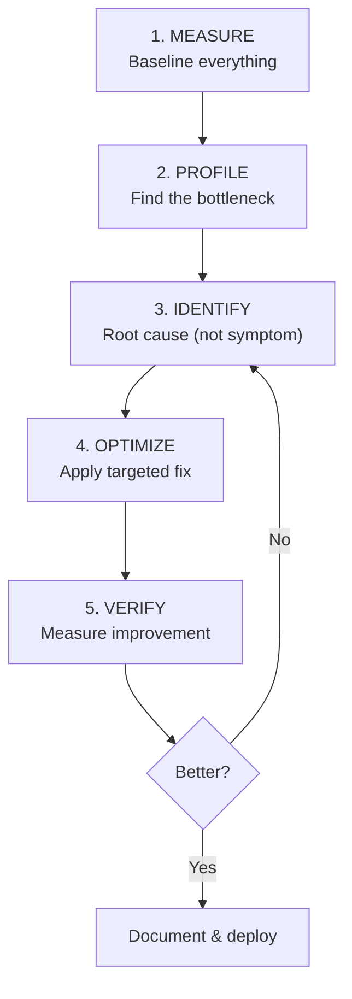
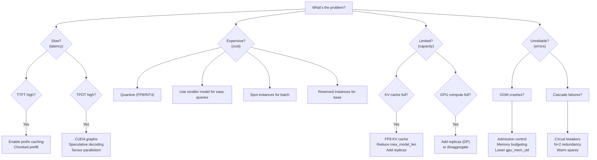

# ⚡ Large-Scale Best Practices — Optimization & Tuning Playbook

> **Step-by-step playbooks for every optimization scenario**

---

## The Universal Optimization Framework



**Rule: Never optimize without measuring first. Never measure without a clear goal.**

---

## Playbook 1: Maximize Throughput (Tokens/Second)

### When: Batch processing, cost optimization, high-volume API

```python
throughput_optimizations = [
    {
        "order": 1,
        "action": "Enable FP8 weights (H100+)",
        "expected_gain": "+30-50%",
        "effort": "Low (config change)",
        "command": "vllm serve model --quantization fp8",
    },
    {
        "order": 2,
        "action": "Enable FP8 KV cache",
        "expected_gain": "+20-40% more concurrent requests",
        "effort": "Low",
        "command": "vllm serve model --kv-cache-dtype fp8",
    },
    {
        "order": 3,
        "action": "Enable prefix caching",
        "expected_gain": "+20-60% for repeated prefixes",
        "effort": "Low",
        "command": "vllm serve model --enable-prefix-caching",
    },
    {
        "order": 4,
        "action": "Tune max_num_seqs and batch size",
        "expected_gain": "+10-30%",
        "effort": "Medium (requires benchmarking)",
        "method": "Binary search: increase until latency SLO violated",
    },
    {
        "order": 5,
        "action": "Increase gpu_memory_utilization",
        "expected_gain": "+5-15% more KV capacity",
        "effort": "Low (but risk of OOM at 0.95+)",
        "command": "vllm serve model --gpu-memory-utilization 0.92",
    },
    {
        "order": 6,
        "action": "Weight quantization (AWQ INT4)",
        "expected_gain": "+100-200% more concurrent (half model size)",
        "effort": "Medium (quality validation required)",
    },
    {
        "order": 7,
        "action": "Add data parallelism (more replicas)",
        "expected_gain": "Linear scaling",
        "effort": "Medium (infrastructure)",
    },
]

# Typical results combining all optimizations:
# Baseline (BF16, no caching): 500 tok/s
# After all optimizations:     3000 tok/s (6× improvement!)
```

---

## Playbook 2: Minimize Latency (TTFT + TPOT)

### When: Interactive chat, real-time applications, user-facing API

```python
latency_optimizations = [
    {
        "order": 1,
        "action": "Enable chunked prefill",
        "target": "TTFT smoothness",
        "expected_gain": "Eliminates TPOT spikes from long prefills",
        "command": "vllm serve model --enable-chunked-prefill",
    },
    {
        "order": 2,
        "action": "Enable CUDA graphs for decode",
        "target": "TPOT",
        "expected_gain": "-20-40% TPOT",
        "note": "vLLM enables this by default",
    },
    {
        "order": 3,
        "action": "Use speculative decoding (low concurrency)",
        "target": "TPOT",
        "expected_gain": "-30-60% TPOT for single-user scenario",
        "when": "< 8 concurrent requests",
    },
    {
        "order": 4,
        "action": "Tensor parallelism (split across GPUs)",
        "target": "TTFT + TPOT",
        "expected_gain": "Near-linear reduction with TP degree",
        "note": "TP=2 → ~1.8× faster per request",
    },
    {
        "order": 5,
        "action": "Prefix caching for repeated system prompts",
        "target": "TTFT",
        "expected_gain": "-50-90% TTFT for cached prefixes",
    },
    {
        "order": 6,
        "action": "Reduce model size (use smaller model)",
        "target": "TTFT + TPOT",
        "expected_gain": "8B is 4-5× faster than 70B",
        "tradeoff": "Quality may decrease",
    },
]
```

---

## Playbook 3: Maximize Concurrent Users

### When: Chat applications, multi-tenant SaaS

```python
concurrency_optimizations = [
    {
        "order": 1,
        "priority": "CRITICAL",
        "action": "FP8 KV cache",
        "effect": "2× more concurrent requests (half KV memory per request)",
        "quality_impact": "< 0.5% (negligible)",
    },
    {
        "order": 2,
        "priority": "CRITICAL",
        "action": "Grouped Query Attention model (use GQA model like Llama 3)",
        "effect": "4× less KV memory vs MHA models",
        "note": "Model architecture choice, not runtime config",
    },
    {
        "order": 3,
        "priority": "HIGH",
        "action": "Weight quantization (INT4)",
        "effect": "Free 50% of GPU memory for KV cache",
        "tradeoff": "1-3% quality loss",
    },
    {
        "order": 4,
        "priority": "HIGH",
        "action": "Limit max_model_len to actual need",
        "effect": "Less pre-allocated memory, more for concurrent users",
        "example": "max_model_len=4096 if you never need > 4K context",
    },
    {
        "order": 5,
        "priority": "MEDIUM",
        "action": "KV offloading to CPU for long-idle sequences",
        "effect": "Older conversation turns offloaded, free GPU memory",
        "when": "Multi-turn chat with long pauses between messages",
    },
]

# Worked example: Llama 3 8B on A100 80GB
# Baseline (BF16 everything): 50 concurrent requests (4K context)
# + FP8 KV: 100 concurrent requests
# + INT4 weights: 180 concurrent requests
# + max_model_len=2048: 250 concurrent requests
# Total: 5× more concurrent users on the SAME GPU!
```

---

## Playbook 4: Cost-per-Token Optimization

```python
cost_optimization_priority = {
    "Tier 1 — Free (config changes)": {
        "Prefix caching": "Saves 20-60% compute for repeated prefixes → FREE",
        "FP8 KV cache": "2× more concurrent → halves cost per request",
        "Chunked prefill": "Better GPU utilization → more throughput per GPU",
        "Tune batch size": "Higher utilization → more throughput per GPU",
    },
    "Tier 2 — Cheap (minor trade-offs)": {
        "FP8 weights (H100)": "30% more throughput, < 0.5% quality loss",
        "AWQ INT4": "Halve GPU count, 1-3% quality loss",
        "Smaller model for simple tasks": "8B for 80% of traffic, 70B for 20%",
    },
    "Tier 3 — Infrastructure (requires engineering)": {
        "Spot instances for batch": "60-70% cost reduction for batch jobs",
        "Reserved instances for base": "30-60% discount with commitment",
        "Disaggregated serving": "20-40% better GPU utilization at scale",
        "Multi-region with right-sizing": "Avoid over-provisioning quiet regions",
    },
    "Tier 4 — Advanced (significant engineering)": {
        "Custom distilled model": "Train smaller model that matches 70B quality for YOUR use case",
        "Dynamic batching tuning": "Maximize throughput within SLO envelope",
        "Hardware selection": "H200 for memory-bound, L40S for cost-sensitive",
    },
}
```

---

## Playbook 5: Production Reliability

```python
reliability_playbook = {
    "SLO Definition": {
        "TTFT": "P95 < 500ms, P99 < 1000ms",
        "TPOT": "P95 < 50ms, P99 < 100ms",
        "Availability": "99.9% (8.7 hours downtime/year)",
        "Error rate": "< 0.1% (1 in 1000 requests)",
    },
    "Redundancy": {
        "Minimum": "N+1 (can lose 1 replica)",
        "Recommended": "N+2 (can lose 1 + handle burst)",
        "Critical services": "Multi-region with auto-failover",
    },
    "Failure Modes & Mitigations": {
        "GPU failure": "Auto-replace, warm spare, health check detection < 30s",
        "OOM crash": "Admission control, memory budgeting, auto-restart",
        "Network partition": "Health checks detect, LB routes around",
        "Model corruption": "Checksum validation, rollback to previous version",
        "Traffic spike": "Autoscaling + admission control + priority queues",
        "Slow dependency": "Timeouts, circuit breakers, fallback responses",
    },
    "Chaos Testing Schedule": {
        "Weekly": "Kill random replica during business hours",
        "Monthly": "Simulate region failure",
        "Quarterly": "Full disaster recovery drill",
    },
    "Incident Response": {
        "Detect": "< 1 minute (automated monitoring)",
        "Respond": "< 5 minutes (on-call paged)",
        "Mitigate": "< 15 minutes (apply fix or rollback)",
        "Resolve": "< 4 hours (permanent fix)",
        "Review": "Within 48 hours (blameless post-mortem)",
    },
}
```

---

## The Optimization Decision Tree



---

## GPU Selection Guide

```python
gpu_selection = {
    "Budget / Development": {
        "GPU": "T4 / L4",
        "Memory": "16-24 GB",
        "Cost": "$0.30-0.70/hr",
        "Best for": "Development, small models (< 7B), testing",
        "NOT for": "Production serving of large models",
    },
    "Cost-Optimized Production": {
        "GPU": "L40S",
        "Memory": "48 GB",
        "Cost": "$1.00-1.50/hr",
        "Best for": "8B-13B models, cost-sensitive deployments",
        "NOT for": "Large models, latency-critical",
    },
    "Standard Production": {
        "GPU": "A100 80GB",
        "Memory": "80 GB",
        "Cost": "$1.50-2.50/hr",
        "Best for": "Most production workloads, 13B-70B with quantization",
        "NOT for": "FP8 (no hardware support), maximum performance",
    },
    "High-Performance Production": {
        "GPU": "H100 80GB",
        "Memory": "80 GB",
        "Cost": "$2.50-4.00/hr",
        "Best for": "Latency-critical, 70B models, FP8 support",
        "Sweet spot": "Best price/performance for most production LLM serving",
    },
    "Maximum Memory / Long Context": {
        "GPU": "H200 141GB",
        "Memory": "141 GB",
        "Cost": "$3.50-5.00/hr",
        "Best for": "Very large models, 128K+ context, maximum decode speed",
        "When": "H100 memory is the binding constraint",
    },
    "AMD Alternative": {
        "GPU": "MI300X 192GB",
        "Memory": "192 GB",
        "Cost": "$2.50-3.50/hr",
        "Best for": "Memory-heavy workloads, if ROCm + vLLM support works",
        "Risk": "Ecosystem less mature than NVIDIA",
    },
}
```

---

## Quick Reference: vLLM Production Settings

```bash
# ═══════════════════════════════════════════════════════
# PRODUCTION vLLM CONFIGURATION — COPY-PASTE READY
# ═══════════════════════════════════════════════════════

# Small model, high concurrency (Llama 8B on H100)
vllm serve meta-llama/Llama-3.1-8B-Instruct \
    --quantization fp8 \
    --kv-cache-dtype fp8 \
    --gpu-memory-utilization 0.92 \
    --max-model-len 8192 \
    --max-num-seqs 512 \
    --enable-prefix-caching \
    --enable-chunked-prefill \
    --port 8000

# Large model, balanced (Llama 70B on 2× H100)
vllm serve meta-llama/Llama-3.1-70B-Instruct \
    --quantization awq \
    --kv-cache-dtype fp8 \
    --tensor-parallel-size 2 \
    --gpu-memory-utilization 0.90 \
    --max-model-len 16384 \
    --max-num-seqs 128 \
    --enable-prefix-caching \
    --enable-chunked-prefill \
    --port 8000

# Maximum quality, latency-optimized (Llama 70B FP8 on 4× H100)
vllm serve meta-llama/Llama-3.1-70B-Instruct \
    --quantization fp8 \
    --kv-cache-dtype fp8 \
    --tensor-parallel-size 4 \
    --gpu-memory-utilization 0.88 \
    --max-model-len 32768 \
    --max-num-seqs 64 \
    --enable-prefix-caching \
    --enable-chunked-prefill \
    --enforce-eager false \
    --port 8000
```

---

*This completes the Large-Scale Best Practices guide. Return to [README](../README.md) for the full curriculum.*
