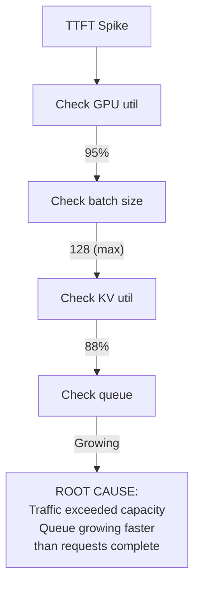
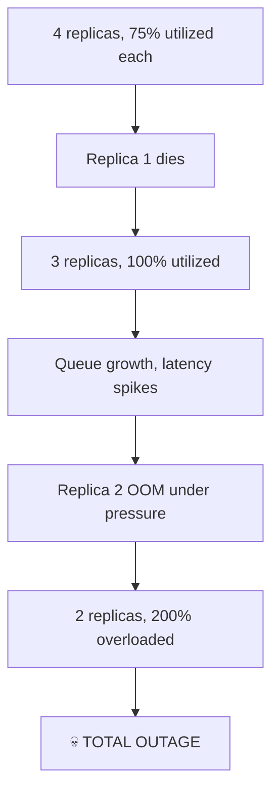

# 🚨 Production Scenarios & Solutions — Incident Response

> **20 Real-World Scenarios with Step-by-Step Resolution**
> Each scenario includes: Symptoms → Root Cause → Immediate Fix → Long-Term Solution

---

## Scenario 1: TTFT Spikes During Peak Traffic

### 🔴 Symptoms
- TTFT P95 jumped from 300ms to 2500ms
- Queue depth growing unboundedly
- GPU utilization at 95%
- No errors, just extreme slowness

### 🔍 Root Cause Analysis



### ⚡ Immediate Fix (< 5 minutes)

```python
# Step 1: Enable admission control to stop queue growth
# Set max_queue_depth to prevent unbounded growth
config_update = {
    'max_queue_depth': 50,         # Reject when queue > 50
    'admission_rate_limit': 100,   # Max 100 req/s
}

# Step 2: Shed low-priority traffic
# Route batch/low-priority to fallback (smaller model or cached responses)

# Step 3: Scale up (if autoscaler not already acting)
# kubectl scale deployment llm-inference --replicas=8
```

### 🏗️ Long-Term Solution

```python
production_fixes = {
    "Autoscaler tuning": {
        "problem": "Autoscaler too slow to react",
        "fix": "Reduce scale-up cooldown from 300s to 60s",
        "metric": "Scale based on queue_depth, not just CPU",
    },
    "Warm spare pool": {
        "problem": "Cold start takes 5+ minutes",
        "fix": "Keep 2 warm spares with model pre-loaded",
        "cost": "+$5K/month for 2 idle H100s",
        "benefit": "Scale-up in 10 seconds instead of 5 minutes",
    },
    "Predictive scaling": {
        "problem": "Reactive scaling is always late",
        "fix": "Use historical traffic patterns to pre-scale",
        "example": "Scale up 30min before daily peak at 2pm",
    },
    "Request prioritization": {
        "problem": "All requests treated equally",
        "fix": "Priority queues: premium > standard > batch",
        "benefit": "Premium users unaffected during overload",
    },
}
```

---

## Scenario 2: Sudden OOM Crashes

### 🔴 Symptoms
- Workers crash with CUDA OOM error
- Restarts take 5 minutes (cold start)
- Cascading failures: surviving replicas get overloaded
- Error rate spikes to 30%

### 🔍 Root Cause

```python
# Three common OOM triggers:

# Trigger 1: Long context request
# A single 128K-token request can consume 40GB of KV cache!
# If gpu_memory_utilization is 0.95, one long request = OOM

# Trigger 2: Burst of concurrent requests
# 100 requests arrive in 1 second, all get scheduled
# Total KV allocation exceeds available memory before any complete

# Trigger 3: Memory fragmentation
# Even with PagedAttention, rapid alloc/dealloc can fragment
# No single contiguous block available for new request
```

### ⚡ Immediate Fix

```bash
# Step 1: Reduce memory utilization (prevents future OOM)
vllm serve model --gpu-memory-utilization 0.88  # Was 0.95

# Step 2: Limit max sequence length
vllm serve model --max-model-len 16384  # Was 128K

# Step 3: Limit concurrent requests
vllm serve model --max-num-seqs 64  # Was 256
```

### 🏗️ Long-Term Solution

```python
oom_prevention = {
    "1. Memory Budget Guard": """
        Before admitting a request, estimate its peak KV memory.
        Reject if estimated total would exceed 85% of available.
        Better to return 503 than crash the entire worker.
    """,
    "2. Request Length Tiers": """
        Short (< 4K tokens):  Serve on standard replicas
        Medium (4K-32K):      Serve on medium-memory replicas
        Long (32K-128K):      Serve on dedicated long-context replicas
        This prevents one long request from starving short requests.
    """,
    "3. OOM Recovery Handler": """
        Instead of crashing, catch OOM:
        1. Cancel the largest running request
        2. Clear CUDA cache
        3. Log the incident
        4. Continue serving
        Worker stays alive, only one request affected.
    """,
    "4. Memory Monitoring Alert": """
        Alert at 80% KV utilization (WARNING)
        Alert at 90% KV utilization (CRITICAL)
        Auto-reject new requests at 92%
    """,
}
```

---

## Scenario 3: Latency Degradation After Model Update

### 🔴 Symptoms
- Deployed new model version (same architecture, updated weights)
- TPOT increased from 30ms to 45ms (50% regression!)
- Throughput dropped 30%
- No errors

### 🔍 Root Cause

```python
root_causes = {
    "Most likely": "CUDA Graph invalidation",
    "Explanation": """
        CUDA Graphs are captured for specific tensor shapes and operations.
        A new model version may have slightly different computation patterns
        (even with same architecture), invalidating cached graphs.
        
        The engine falls back to eager execution → 30-50% slower.
    """,
    "Also possible": [
        "torch.compile cache invalidated (recompilation in progress)",
        "New model has different quantization characteristics",
        "Updated tokenizer produces different token distributions",
    ],
}
```

### ⚡ Immediate Fix

```bash
# Step 1: Verify by checking engine logs for compilation messages
grep "Compiling" /var/log/vllm/engine.log
# "Compiling model... this may take several minutes"
# → Confirmed: graphs being re-compiled

# Step 2: Wait for compilation to complete (5-15 minutes)
# TPOT should return to normal after warm-up

# Step 3: If not, check if model needs different settings
# New model may need different quantization, attention backend, etc.
```

### 🏗️ Long-Term Solution

```yaml
# Pre-warm pipeline: compile graphs BEFORE sending traffic
deployment_pipeline:
  1. Deploy new model to canary (0% traffic)
  2. Send synthetic warm-up requests (100 diverse prompts)
  3. Wait for compilation to complete (~10min)
  4. Verify metrics match baseline (±5%)
  5. Gradually shift traffic: 5% → 25% → 50% → 100%
  6. If metrics regress > 10%, auto-rollback
```

---

## Scenario 4: Cascading Failure Across Replicas

### 🔴 Symptoms
- Replica 1 goes down (hardware fault)
- Traffic redistributes to remaining 3 replicas
- Each replica now at 133% of normal load
- Replicas 2 and 3 start degrading (queue growth)
- Replica 2 OOMs under pressure
- Now 2 replicas serving 4× traffic → total failure

### 🔍 Root Cause: Missing Failure Headroom



### 🏗️ Prevention (N+2 Redundancy)

```python
capacity_planning = {
    "Rule": "N+2 redundancy for critical services",
    "Meaning": "If you need 4 GPUs for peak traffic, deploy 6",
    "Math": """
        Peak traffic: 100 req/s
        Per-GPU capacity: 25 req/s
        GPUs for traffic: 4
        Failure headroom: +1 (handle 1 GPU failure)
        Burst headroom:   +1 (handle 1.25× peak)
        Total GPUs: 6
    """,
    "Cost": "50% more GPUs, but prevents outages worth $$$",
    "Alternative": """
        Use autoscaling with warm spares:
        - 4 active GPUs (serving traffic)
        - 2 warm spares (loaded, not serving)
        - When active GPU fails, spare takes over in <30s
        - New spare provisioned in background
    """,
}

# Circuit breaker pattern
class CircuitBreaker:
    """Prevent cascading failures by shedding load early."""
    def __init__(self, failure_threshold=0.1, recovery_time=60):
        self.failure_rate = 0
        self.is_open = False
        self.threshold = failure_threshold

    def record_result(self, success: bool):
        # Track failure rate over rolling window
        self.failure_rate = self.failure_rate * 0.95 + (0 if success else 0.05)

        if self.failure_rate > self.threshold:
            self.is_open = True  # OPEN: reject all requests
            # Log: "Circuit breaker OPEN - shedding load"

    def should_allow(self) -> bool:
        if self.is_open:
            return False  # Reject immediately (fast 503)
        return True
```

---

## Scenario 5: GPU Memory Leak Over 24 Hours

### 🔴 Symptoms
- GPU memory usage slowly climbs: 70% → 75% → 80% → 85% → OOM
- Takes 24-48 hours to manifest
- Fresh restart fixes it temporarily
- No code changes deployed

### 🔍 Root Cause

```python
common_memory_leaks = {
    "1. KV Cache Not Freed": """
        Requests that timeout or error out may not properly
        free their KV cache blocks. Over time, blocks accumulate.
        Fix: Audit block manager for leak paths
    """,
    "2. CUDA Cache Growth": """
        PyTorch's CUDA memory allocator caches freed tensors
        for reuse. Under varied workloads, the cache grows.
        Fix: Periodic torch.cuda.empty_cache()
    """,
    "3. Python Object Leak": """
        Request objects, tokenizer outputs, or intermediate tensors
        held by lingering references (closures, global lists).
        Fix: Use memory profiler (tracemalloc) to find leaks
    """,
    "4. NCCL Buffer Accumulation": """
        Multi-GPU communication buffers can grow over time.
        Fix: Restart workers periodically (rolling restart)
    """,
}
```

### 🏗️ Long-Term Solution

```python
class MemoryWatchdog:
    """Monitor and prevent memory leaks in production."""

    def __init__(self, check_interval=300, oom_threshold=0.92):
        self.check_interval = check_interval  # 5 minutes
        self.oom_threshold = oom_threshold
        self.history = []

    async def monitor_loop(self):
        while True:
            allocated = torch.cuda.memory_allocated() / torch.cuda.get_device_properties(0).total_mem
            self.history.append(allocated)

            # Check for steady growth (leak indicator)
            if len(self.history) > 12:  # 1 hour of data
                slope = (self.history[-1] - self.history[-12]) / 12
                if slope > 0.005:  # > 0.5% growth per 5min
                    logger.warning(f"Memory leak detected! Growth rate: {slope*100:.2f}%/5min")
                    # Trigger defensive action
                    torch.cuda.empty_cache()

            # Emergency: approaching OOM
            if allocated > self.oom_threshold:
                logger.critical(f"Memory at {allocated*100:.0f}%! Emergency cleanup.")
                await self.emergency_cleanup()

            await asyncio.sleep(self.check_interval)

    async def emergency_cleanup(self):
        """Free memory without crashing."""
        # 1. Clear CUDA cache
        torch.cuda.empty_cache()
        # 2. Cancel oldest non-streaming request
        # 3. If still high, trigger rolling restart
```

---

## Scenario 6: Prefix Cache Not Helping

### 🔴 Symptoms
- Enabled `--enable-prefix-caching`
- Expected 40% TTFT improvement for repeated system prompts
- Actual improvement: 3% (negligible)
- Cache hit rate: 8%

### 🔍 Root Cause

```python
low_cache_hit_causes = {
    "1. Cache too small": """
        Default cache size may not hold enough prefixes.
        If you serve 1000 users with different system prompts,
        the cache evicts entries before they're reused.
    """,
    "2. Prompts not aligned to blocks": """
        APC hashes at block boundaries (16 tokens).
        If system prompts differ by even 1 token,
        different hashes → no sharing.
    """,
    "3. Dynamic content in prefix": """
        If system prompt includes user name, date, or session ID,
        every request has a unique 'prefix' → 0% hit rate.
        Fix: Move dynamic content AFTER the cacheable prefix.
    """,
    "4. Round-robin routing": """
        If you have 4 replicas with round-robin routing,
        each replica only sees 25% of requests.
        The same prefix hits different replicas → cold cache.
        Fix: Use prefix-aware routing.
    """,
}
```

### 🏗️ Solution

```python
# Fix 1: Restructure prompts
# BAD (dynamic content in prefix):
bad_prompt = f"You are a helpful assistant. Today is {date}. User: {user_name}. {query}"

# GOOD (static prefix, dynamic suffix):
good_prompt = f"You are a helpful assistant for our enterprise platform. " \
              f"Always be professional and accurate.\n\n" \
              f"[Context: date={date}, user={user_name}]\n{query}"
# The first 2 lines are identical across ALL requests → cacheable!

# Fix 2: Prefix-aware routing
class PrefixAwareRouter:
    def route(self, request):
        prefix_hash = hash(request.system_prompt[:512])  # First 512 tokens
        target_replica = prefix_hash % len(self.replicas)
        return self.replicas[target_replica]
    # Same system prompt → same replica → cache hit!

# Fix 3: Monitor cache health
# Key metric: prefix_cache_hit_rate
# Target: > 60% for chat workloads with shared system prompts
# If < 30%: investigate routing, prompt structure, or cache size
```

---

## Scenario 7: Model Serving Different Quality After Quantization

### 🔴 Symptoms
- Quantized Llama 70B from BF16 to AWQ INT4
- Saved 3 GPUs ($7K/month) — great!
- But users reporting worse responses
- Quality benchmark dropped 4% on internal eval

### 🔍 Root Cause & Resolution

```python
quantization_quality_checklist = {
    "Step 1: Measure regression precisely": """
        Run full eval suite: perplexity, MMLU, HumanEval, custom evals
        BF16 baseline: perplexity=5.2, MMLU=78.3%, HumanEval=62.1%
        AWQ INT4:      perplexity=5.5, MMLU=76.1%, HumanEval=58.4%
        → 2-4% regression across all benchmarks
    """,
    "Step 2: Identify affected capabilities": """
        Run per-category eval:
        - Simple Q&A: no change ✅
        - Math/reasoning: -5% ⚠️ (quantization hurts precision)
        - Code generation: -6% ⚠️ (sensitive to weight precision)
        - Creative writing: no change ✅
    """,
    "Step 3: Try alternative quantization": """
        Option A: FP8 (H100 only) → 0.5% regression, 2× memory savings
        Option B: GPTQ INT4 → similar to AWQ, sometimes better for code
        Option C: AWQ INT4 + FP8 KV → keeps weight precision, saves KV memory
    """,
    "Step 4: Hybrid approach": """
        Serve INT4 for simple tasks (80% of traffic, cheap)
        Route complex tasks (math, code) to BF16 replicas (20% of traffic)
        Total cost: INT4 savings × 0.8 = still significant savings
    """,
}
```

---

*Continue to [02 — Performance & Scaling Scenarios](./02-performance-scaling-scenarios.md) →*
