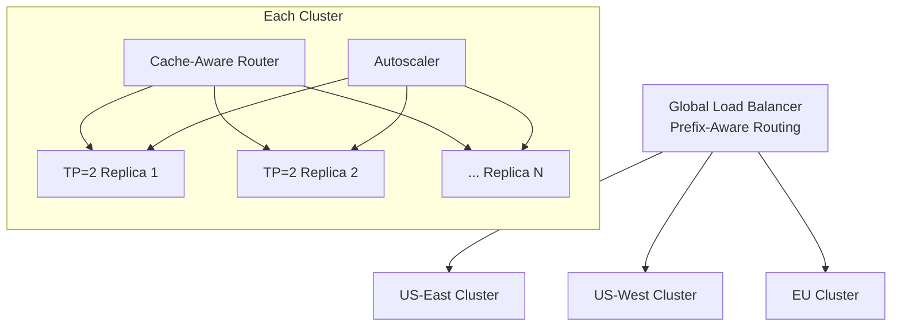
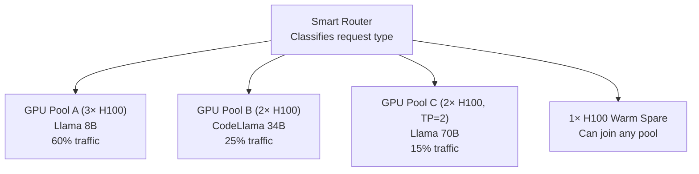
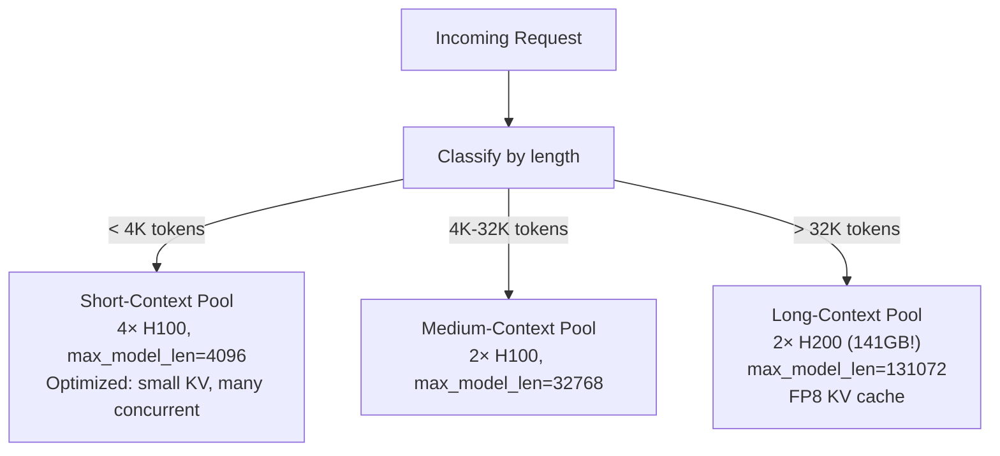

# 🚨 Production Scenarios — Performance & Scaling

> **15 Real-World Scenarios: Scaling from 1 GPU to 1000 GPUs**

---

## Scenario 8: 10× Traffic Growth in 3 Months

### 📋 Situation
- Current: 10M requests/month on 4× H100
- Projected: 100M requests/month in 3 months
- Budget: $500K/month for inference
- SLO: TTFT P95 < 500ms, TPOT P95 < 50ms

### 🏗️ Solution Architecture



```python
scaling_plan = {
    "Month 1 — Optimize (stay at 4 GPUs)": {
        "actions": [
            "Enable FP8 KV cache (2× more concurrent requests)",
            "Enable prefix caching (40% TTFT reduction for chat)",
            "Enable chunked prefill (smoother latency)",
            "Quantize to FP8 weights (30% throughput boost on H100)",
        ],
        "expected_result": "Handle 30M req/month on same 4 GPUs",
        "cost": "$14K/month (same as before)",
    },
    "Month 2 — Scale out (12 GPUs)": {
        "actions": [
            "Add 4 more TP=2 replicas (8 GPUs total for serving)",
            "Add 2 warm spares (4 GPUs)",
            "Deploy cache-aware load balancer",
            "Set up Prometheus + Grafana monitoring",
        ],
        "expected_result": "Handle 70M req/month",
        "cost": "$42K/month",
    },
    "Month 3 — Multi-region (40 GPUs)": {
        "actions": [
            "Deploy to 3 regions (US-East, US-West, EU)",
            "~12 GPUs per region + spares",
            "Predictive autoscaling based on traffic patterns",
            "Consider disaggregated prefill/decode at this scale",
        ],
        "expected_result": "Handle 100M+ req/month",
        "cost": "$140K/month",
    },
    "Cost efficiency check": {
        "cost_per_million_tokens": "$0.40",
        "vs_API_pricing": "OpenAI GPT-4o: $10/M tokens → self-hosted is 25× cheaper",
        "monthly_savings_vs_API": "$500K+ per month",
    },
}
```

---

## Scenario 9: Migrating from API Provider to Self-Hosted

### 📋 Situation
- Currently using OpenAI API: $200K/month
- 50M requests/month, Avg: 1000 input + 500 output tokens
- Want to switch to self-hosted Llama 3 70B
- Cannot afford any quality regression

### 🏗️ Migration Plan

```python
migration_phases = {
    "Phase 1 — Quality Validation (2 weeks)": {
        "actions": [
            "Set up Llama 3 70B on test GPU cluster",
            "Run complete eval suite: 500 test cases",
            "Compare against GPT-4o outputs (quality parity check)",
            "Identify domains where Llama underperforms",
            "Fine-tune or adjust prompts for gap areas",
        ],
        "gate": "Quality within 5% of GPT-4o on core use cases",
    },
    "Phase 2 — Shadow Traffic (2 weeks)": {
        "actions": [
            "Deploy Llama alongside OpenAI (dual-write)",
            "Send ALL requests to BOTH (compare outputs)",
            "Measure latency, quality, error rate",
            "Do NOT serve Llama outputs to users yet",
        ],
        "gate": "Latency SLOs met, quality comparable",
    },
    "Phase 3 — Canary (2 weeks)": {
        "actions": [
            "Route 5% of real traffic to Llama",
            "Monitor user satisfaction metrics",
            "Gradually increase: 5% → 10% → 25% → 50%",
            "Keep OpenAI as instant fallback",
        ],
        "gate": "No user complaints, metrics stable at 50%",
    },
    "Phase 4 — Full Migration (1 week)": {
        "actions": [
            "Route 100% to Llama",
            "Keep OpenAI API key active for 30 days (fallback)",
            "Monitor closely for 1 week",
            "Decommission OpenAI after confidence period",
        ],
        "savings": "$150K/month (from $200K to $50K self-hosted)",
    },
}
```

---

## Scenario 10: Serving Multiple Models on Shared GPUs

### 📋 Situation
- Need to serve: Llama 8B (general), CodeLlama 34B (code), Llama 70B (quality)
- Budget: 8× H100
- Traffic: 60% general, 25% code, 15% quality

### 🏗️ Solution



```python
multi_model_config = {
    "Pool A — Llama 8B (General)": {
        "gpus": 3,
        "model": "Llama-3-8B-Instruct (FP8)",
        "per_gpu_throughput": "4000 tok/s",
        "total_throughput": "12000 tok/s",
        "handles": "60% of traffic (high volume, fast responses)",
    },
    "Pool B — CodeLlama 34B (Code)": {
        "gpus": 2,
        "model": "CodeLlama-34B-Instruct (AWQ INT4)",
        "per_gpu_throughput": "1500 tok/s",
        "total_throughput": "3000 tok/s",
        "handles": "25% of traffic (code generation, structured output)",
    },
    "Pool C — Llama 70B (Quality)": {
        "gpus": "2 (TP=2)",
        "model": "Llama-3-70B-Instruct (FP8)",
        "per_gpu_throughput": "2000 tok/s (combined)",
        "handles": "15% of traffic (complex reasoning, premium users)",
    },
    "Spare Pool": {
        "gpus": 1,
        "purpose": "Failover for any pool, burst capacity",
        "pre_loaded": "Llama 8B (most common, fastest to swap)",
    },
    "Routing Logic": """
        1. Premium users → always Pool C (70B)
        2. Code-related requests → Pool B (CodeLlama)
        3. Simple queries → Pool A (8B)
        4. Complex queries (detected by classifier) → Pool C
        5. Overflow from any pool → Spare
    """,
}
```

---

## Scenario 11: Handling 100K+ Context Requests

### 📋 Situation
- RAG system that sometimes passes 50-100K tokens of context
- Regular requests: 2K tokens (90% of traffic)
- Long requests: 50-100K tokens (10% of traffic)
- Long requests cause latency spikes for all users

### 🏗️ Solution: Request Segregation



```python
context_tier_config = {
    "Short Pool (< 4K)": {
        "gpu": "H100 80GB",
        "count": 4,
        "max_model_len": 4096,
        "max_num_seqs": 512,        # Many concurrent!
        "kv_cache_dtype": "fp8",
        "gpu_memory_utilization": 0.92,
        "handles": "90% of traffic, very efficient",
    },
    "Medium Pool (4K-32K)": {
        "gpu": "H100 80GB",
        "count": 2,
        "max_model_len": 32768,
        "max_num_seqs": 64,
        "kv_cache_dtype": "fp8",
        "handles": "8% of traffic",
    },
    "Long Pool (32K-128K)": {
        "gpu": "H200 141GB",        # Need the extra memory!
        "count": 2,
        "max_model_len": 131072,
        "max_num_seqs": 8,          # Very few concurrent (memory!)
        "kv_cache_dtype": "fp8",    # Critical: halves KV memory
        "enable_chunked_prefill": True,  # Don't block for 10s prefill
        "handles": "2% of traffic, but expensive per-request",
    },
}

# Why segregate?
# Without segregation: one 100K request uses 40GB of KV cache,
# starving 500 short requests of memory. TTFT for short requests
# spikes from 100ms to 5000ms while the long request prefills.
# With segregation: long requests go to dedicated pool,
# short requests are completely unaffected.
```

---

## Scenario 12: Cost-Optimizing a Batch Processing Pipeline

### 📋 Situation
- Need to process 10M documents overnight (batch)
- Each document: 2000 input tokens, 500 output tokens
- Deadline: 8 hours
- Want to minimize cost

### 🏗️ Solution

```python
batch_optimization = {
    "Total tokens": "10M × 2500 = 25 billion tokens",
    "Output tokens": "10M × 500 = 5 billion tokens",
    "Required throughput": "5B / (8×3600) = 174K output tok/s",

    "Strategy 1 — Spot Instances": {
        "gpu": "H100 spot ($1.50/hr vs $3.50 on-demand)",
        "throughput_per_gpu": "3000 tok/s (optimized batch mode)",
        "gpus_needed": "174000 / 3000 = 58 GPUs",
        "cost": "58 × $1.50 × 8 = $696",
        "risk": "Spot interruption (mitigate with checkpointing)",
    },
    "Strategy 2 — On-Demand with Smaller Model": {
        "model": "Llama 8B INT4 (good enough for extraction tasks)",
        "gpu": "L40S ($1.20/hr)",
        "throughput_per_gpu": "8000 tok/s (small model, high batch)",
        "gpus_needed": "174000 / 8000 = 22 GPUs",
        "cost": "22 × $1.20 × 8 = $211",
        "note": "If quality is sufficient, 3× cheaper!",
    },
    "Batch-Specific Optimizations": [
        "Sort requests by length (minimize padding waste)",
        "Maximize batch size (GPU utilization > 90%)",
        "Disable streaming (no SSE overhead)",
        "Use greedy decoding (deterministic, slightly faster)",
        "Pre-tokenize all inputs (tokenization off critical path)",
    ],
}
```

---

## Scenario 13: Deploying in Air-Gapped / On-Premise Environment

### 📋 Situation
- Financial institution, no internet access from inference servers
- Must deploy Llama 70B on-premise
- 4× NVIDIA A100 80GB available
- No cloud, no HuggingFace access at runtime

### 🏗️ Solution

```python
airgapped_deployment = {
    "Step 1 — Prepare Offline (internet machine)": [
        "Download model weights to USB/NFS: huggingface-cli download",
        "Download vLLM Docker image: docker save vllm/vllm-openai > vllm.tar",
        "Download all Python dependencies: pip download -r requirements.txt",
        "Pre-quantize model if needed (AWQ calibration requires GPU)",
        "Create deployment package: weights + image + config",
    ],
    "Step 2 — Transfer to Air-Gapped Network": [
        "Transfer via secure USB, approved file transfer system",
        "Verify checksums (model integrity)",
        "Load Docker image: docker load < vllm.tar",
        "Copy model weights to shared NFS mount",
    ],
    "Step 3 — Deploy": {
        "command": """
docker run --gpus all -v /nfs/models:/models \\
    -p 8000:8000 vllm-offline:latest \\
    python -m vllm.entrypoints.openai.api_server \\
    --model /models/Llama-3-70B-Instruct-AWQ \\
    --quantization awq \\
    --tensor-parallel-size 4 \\
    --trust-remote-code \\
    --disable-log-requests
        """,
    },
    "Step 4 — Monitor": [
        "Deploy Prometheus + Grafana from offline packages",
        "Internal alerting (no PagerDuty, use email/internal chat)",
        "Daily health reports to operations team",
    ],
    "Security Considerations": [
        "No model telemetry (disable all external calls)",
        "Input/output logging for compliance (encrypted at rest)",
        "Network isolation (inference GPU nodes on separate VLAN)",
        "Access control: API keys, mTLS between services",
    ],
}
```

---

## Scenario 14: A/B Testing Two Models in Production

### 📋 Situation
- Running Llama 70B, considering switch to Qwen 72B
- Need to compare quality AND cost in production
- Can't afford to degrade user experience during testing

### 🏗️ Solution

```python
ab_test_framework = {
    "Architecture": """
        Traffic → Router → [Model A (Llama 70B, 80%)]
                        → [Model B (Qwen 72B, 20%)]
        
        Both connected to same evaluation pipeline:
        - Automated quality metrics (response relevance, coherence)
        - User satisfaction signals (thumbs up/down, follow-up questions)
        - Latency metrics (TTFT, TPOT, E2E)
        - Cost metrics (tokens/sec, $/request)
    """,

    "Routing Logic": {
        "method": "Deterministic user hashing",
        "rule": "hash(user_id) % 100 < 20 → Model B",
        "why": "Same user always sees same model (consistent experience)",
    },

    "Metrics to Compare": {
        "Quality": [
            "Task completion rate",
            "User satisfaction (implicit: engagement, explicit: ratings)",
            "Automated eval scores (relevance, coherence, safety)",
        ],
        "Performance": [
            "TTFT P50/P95",
            "TPOT P50/P95",
            "Error rate",
        ],
        "Cost": [
            "GPU utilization",
            "Tokens per second per GPU",
            "Cost per request",
        ],
    },

    "Statistical Rigor": {
        "sample_size": "Minimum 10,000 requests per model",
        "duration": "2 weeks (captures weekly patterns)",
        "significance": "p < 0.05 for quality metrics",
        "power": "80% power to detect 2% quality difference",
    },

    "Decision Framework": """
        If Model B quality ≥ Model A AND cost ≤ Model A → Switch
        If Model B quality > Model A but cost > Model A → Analyze ROI
        If Model B quality < Model A → Stay with Model A
    """,
}
```

---

*Continue to [Large-Scale Best Practices](../large-scale-best-practices/01-architecture-patterns.md) →*
