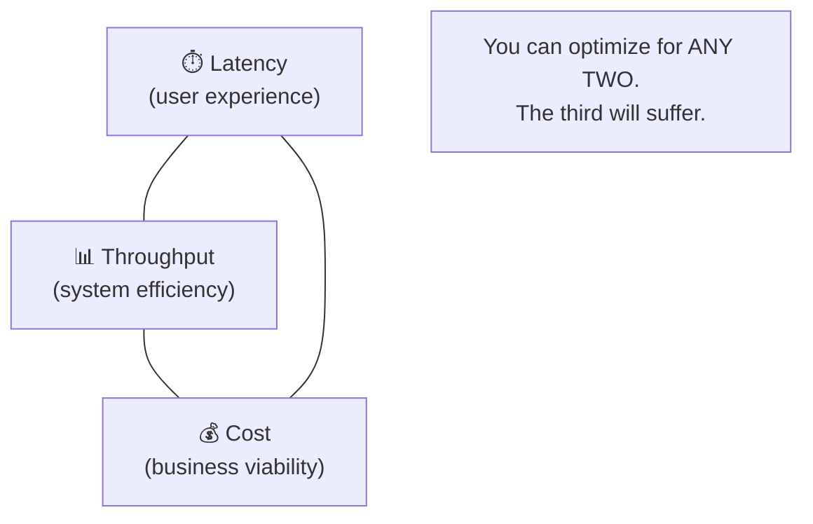
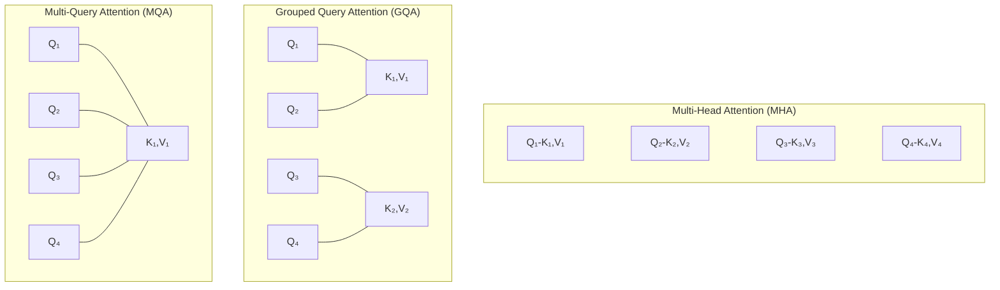
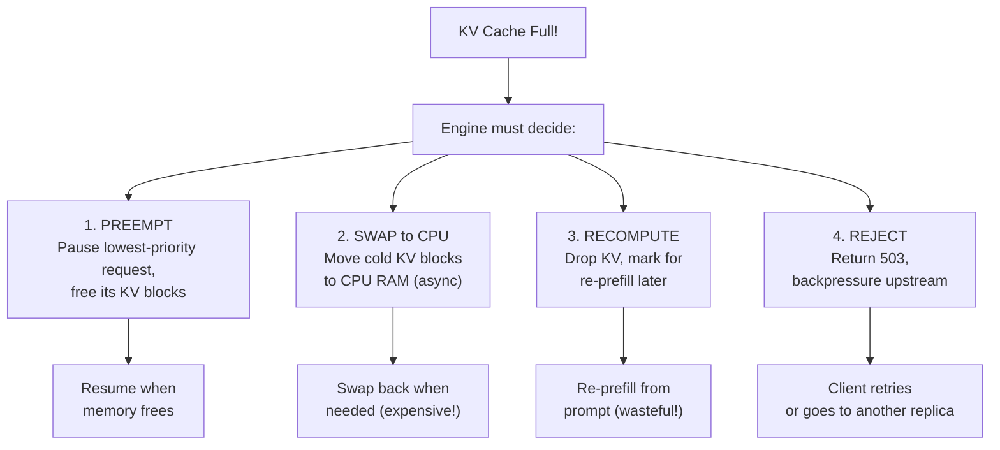
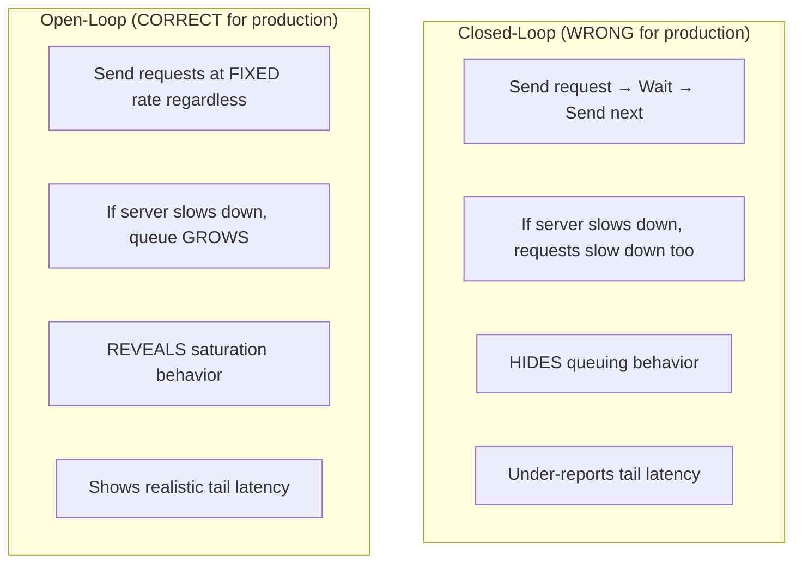

# 🎯 Q&A Deep Dive — Foundations & Model Execution

> **100+ Questions & Answers · FAANG Interview Ready**
> Covers: Inference basics, Transformer internals, Prefill/Decode, KV Cache, Memory

---

## Section 1: What Is Inference Engineering?

### Q1: What's the difference between training and inference?

**Answer:**

| Aspect | Training | Inference |
|--------|----------|-----------|
| **Goal** | Learn weights from data | Generate output from input |
| **Direction** | Forward + backward pass | Forward pass only |
| **Batch size** | Large (thousands) | Small (1–hundreds) |
| **Latency** | Hours–weeks (doesn't matter) | Milliseconds (critical!) |
| **Memory** | Activations + gradients + optimizer | Weights + KV cache |
| **Scaling** | Data parallelism | Tensor/Pipeline parallelism |
| **Cost model** | Fixed (one-time) | Per-request (ongoing) |

```python
# Training mode
model.train()
optimizer.zero_grad()
loss = model(x, labels=y).loss
loss.backward()           # ← Backward pass (not in inference!)
optimizer.step()          # ← Weight update (not in inference!)

# Inference mode
model.eval()
with torch.inference_mode():   # Disables gradient tracking
    output = model.generate(x)  # Forward only, no gradients
```

**Production insight:** At Meta, inference costs exceed training costs by **3–10×** over a model's lifetime. A model trains once but serves billions of requests.

---

### Q2: Why is inference engineering a separate discipline from ML engineering?

**Answer:** Inference engineering requires a unique combination of skills:

1. **GPU architecture knowledge** — understanding memory hierarchy, bandwidth limits
2. **Systems programming** — kernel optimization, memory management, scheduling
3. **Distributed systems** — multi-GPU communication, load balancing, fault tolerance
4. **Performance engineering** — profiling, bottleneck analysis, optimization
5. **Production operations** — SLOs, monitoring, capacity planning

An ML engineer might train a great model. An inference engineer makes it serve 100M users at $0.001 per request.

---

### Q3: What are the three key metrics in inference and how do they trade off?

**Answer:**



| Optimize For | Sacrifice | Example |
|-------------|-----------|---------|
| Low latency + High throughput | High cost | Over-provisioned GPUs |
| Low latency + Low cost | Low throughput | Small batch, fewer GPUs |
| High throughput + Low cost | High latency | Large batches, queuing |

**Production example:** OpenAI offers two tiers:
- **ChatGPT (interactive):** Optimized for latency (TTFT < 1s)
- **Batch API:** Optimized for cost (50% cheaper, higher latency)

---

### Q4: What does "memory-bound vs compute-bound" mean in practice?

**Answer:**

```python
# The simple test:
# If adding more compute (faster GPU) helps → COMPUTE-BOUND
# If adding more memory bandwidth helps → MEMORY-BOUND

# Arithmetic Intensity = FLOPs / Bytes moved
# If intensity > machine's ridge point → compute-bound
# If intensity < machine's ridge point → memory-bound

# H100 ridge point = 990 TFLOPS / 3.35 TB/s ≈ 295 FLOP/byte

# PREFILL example: batch matrix multiply
# (1024, 4096) × (4096, 4096) = ~34 GFLOP, ~42 MB moved
# Intensity = 34e9 / 42e6 ≈ 810 FLOP/byte → COMPUTE-BOUND ✅

# DECODE example: single-token matrix-vector multiply
# (1, 4096) × (4096, 4096) = ~33 MFLOP, ~33 MB moved
# Intensity = 33e6 / 33e6 ≈ 1 FLOP/byte → MEMORY-BOUND ✅
```

**Why this matters:** The optimization strategy is completely different:
- **Compute-bound:** Use Tensor Cores, increase batch size, quantize for speed
- **Memory-bound:** Reduce data movement, fuse kernels, use faster memory

---

## Section 2: Transformer Internals for Inference

### Q5: Walk me through a single token generation step.

**Answer (step by step for Llama 3 8B):**

```
Input: token_id = 15043 ("Hello")

1. EMBEDDING LOOKUP
   token_id → embedding vector (4096 dims)
   Memory: ~0 FLOP, 8 KB read

2. FOR EACH OF 32 LAYERS:
   a) RMSNorm
      Normalize hidden state
      FLOPs: 2 × 4096, Memory: 16 KB

   b) Attention (Q, K, V projections)
      Q = x @ W_q  → (1, 32 heads, 128 dim)    = 33M FLOPs, 32 MB weight read
      K = x @ W_k  → (1, 8 kv_heads, 128 dim)  = 8M FLOPs, 8 MB weight read
      V = x @ W_v  → (1, 8 kv_heads, 128 dim)  = 8M FLOPs, 8 MB weight read

   c) Attention Score Computation
      scores = Q @ K_cache^T    ← Reads ALL past K vectors
      weights = softmax(scores)
      output = weights @ V_cache ← Reads ALL past V vectors

   d) Output Projection
      attn_out = concat(heads) @ W_o  = 33M FLOPs, 32 MB read

   e) Residual Add
      x = x + attn_out

   f) RMSNorm again

   g) MLP (SwiGLU)
      gate = SiLU(x @ W_gate)   = 117M FLOPs, 112 MB read
      up = x @ W_up              = 117M FLOPs, 112 MB read
      down = (gate * up) @ W_down = 117M FLOPs, 112 MB read

   h) Residual Add
      x = x + mlp_out

3. FINAL RMSNorm → LM HEAD
   logits = x @ W_lm_head  → (1, 128256)
   FLOPs: ~1B, Memory: ~1 GB read

4. SAMPLING
   next_token = sample(softmax(logits / temperature))

TOTAL PER TOKEN:
   FLOPs: ~16 billion (but most GPU cycles idle!)
   Memory read: ~16 GB (reading entire model weights)
   Time: ~40ms on H100 (limited by memory bandwidth)
```

---

### Q6: What is Grouped Query Attention (GQA) and why does it matter for inference?

**Answer:**



| Type | Q Heads | KV Heads | KV Cache Size | Quality |
|------|---------|----------|--------------|---------|
| MHA | 32 | 32 | 100% (baseline) | Best |
| GQA (Llama 3) | 32 | 8 | **25%** | ~Same |
| MQA | 32 | 1 | **3%** | Slightly worse |

**Why it matters for inference:**

```python
# Llama 3 70B with 4K context, 100 concurrent requests
# MHA (32 KV heads):
kv_mha = 2 * 80 * 32 * 128 * 4096 * 2 * 100  # 251 GB!
# GQA (8 KV heads):
kv_gqa = 2 * 80 * 8 * 128 * 4096 * 2 * 100    # 62.5 GB (4× less!)

print(f"MHA KV cache: {kv_mha / 1e9:.0f} GB")
print(f"GQA KV cache: {kv_gqa / 1e9:.0f} GB")
print(f"Savings: {(1 - kv_gqa/kv_mha)*100:.0f}%")  # 75% savings!
```

**GQA lets you serve 4× more concurrent users on the same GPU.**

---

### Q7: Why does RMSNorm replace LayerNorm in modern LLMs?

**Answer:**

```python
# LayerNorm: normalize by mean AND variance
def layer_norm(x, weight, bias, eps=1e-5):
    mean = x.mean(dim=-1, keepdim=True)     # Extra computation
    var = x.var(dim=-1, keepdim=True)        # Extra computation
    return (x - mean) / (var + eps).sqrt() * weight + bias  # Extra bias

# RMSNorm: normalize by root-mean-square only
def rms_norm(x, weight, eps=1e-6):
    rms = (x.pow(2).mean(dim=-1, keepdim=True) + eps).sqrt()
    return x / rms * weight  # No mean subtraction, no bias

# Why RMSNorm wins for inference:
# 1. Fewer operations (no mean, no bias) → faster kernel
# 2. Simpler to fuse with other operations
# 3. Quality is equivalent for LLMs
# 4. One fewer parameter per layer (no bias)
```

---

### Q8: Explain the residual stream concept. Why is it critical for deep networks?

**Answer:**

Think of the residual stream as a **highway** running through all layers:

```
Input → [===========================================] → Output
              ↑        ↑        ↑        ↑
            Layer 1  Layer 2  Layer 3  Layer N
            writes   writes   writes   writes
            to       to       to       to
            highway  highway  highway  highway
```

Each layer **reads** from the highway, **processes** information, and **adds** its contribution back:

```python
# Without residuals: x = layer_n(layer_n-1(...layer_1(x)))
# → Gradients vanish, deep networks can't learn

# With residuals: x = x + layer_n(x)  (for each layer)
# → Information flows freely, gradient flows freely
# → 100+ layer networks work!

# For inference, residuals mean:
# 1. Each layer's contribution is ADDITIVE (not destructive)
# 2. You can skip/prune layers and model still works (somewhat)
# 3. Early layers capture syntax, late layers capture semantics
```

---

## Section 3: Prefill, Decode & KV Cache

### Q9: What exactly happens during prefill vs decode?

**Answer:**

```
PREFILL (Time to First Token):
━━━━━━━━━━━━━━━━━━━━━━━━━━━━
Input: "What is the capital of France?" (8 tokens)
Process: ALL 8 tokens in PARALLEL through the model
Output: KV cache (8 entries per layer) + first output token
Nature: Matrix × Matrix multiplication → COMPUTE-BOUND
GPU util: 80-95%
Time: 50-500ms depending on prompt length

DECODE (Token by Token):
━━━━━━━━━━━━━━━━━━━━━━
Input: 1 new token + KV cache from all previous tokens
Process: 1 token through model, attending to cached K,V
Output: 1 new token + updated KV cache
Nature: Vector × Matrix multiplication → MEMORY-BOUND
GPU util: 10-30% (GPU waiting for memory reads)
Time: 20-60ms per token
```

```python
# The key insight: why decode is slow
# During decode, for EACH token, you must:
# 1. Read ALL model weights from HBM (~16 GB for 8B model)
# 2. Compute with just 1 token's worth of data (~8 KB)
# 3. Read KV cache for all past tokens

# Ratio: 16 GB read / 8 KB compute = 2,000,000:1
# The GPU spends 99.9% of time WAITING for memory, not computing
```

---

### Q10: Calculate the KV cache memory for Llama 3 70B with 128K context.

**Answer:**

```python
def kv_cache_memory(
    num_layers: int,
    num_kv_heads: int,
    head_dim: int,
    seq_len: int,
    batch_size: int,
    precision_bytes: int,
) -> dict:
    """
    Formula: 2 × layers × kv_heads × head_dim × seq_len × batch × bytes
             ↑ (K+V)
    """
    # Per token
    per_token_bytes = 2 * num_layers * num_kv_heads * head_dim * precision_bytes
    per_token_kb = per_token_bytes / 1024

    # Per sequence
    per_seq_bytes = per_token_bytes * seq_len
    per_seq_mb = per_seq_bytes / (1024**2)
    per_seq_gb = per_seq_bytes / (1024**3)

    # Total
    total_bytes = per_seq_bytes * batch_size
    total_gb = total_bytes / (1024**3)

    return {
        'per_token': f"{per_token_kb:.1f} KB",
        'per_sequence': f"{per_seq_gb:.2f} GB ({per_seq_mb:.0f} MB)",
        'total': f"{total_gb:.1f} GB",
    }

# Llama 3 70B — 128K context — single request — BF16
result = kv_cache_memory(
    num_layers=80, num_kv_heads=8, head_dim=128,
    seq_len=128_000, batch_size=1, precision_bytes=2
)
print("Llama 3 70B, 128K context, 1 request, BF16:")
for k, v in result.items():
    print(f"  {k}: {v}")
# per_token: 320.0 KB
# per_sequence: 39.06 GB (40000 MB)
# total: 39.1 GB   ← MORE than model weights on one GPU!

# Now with 10 concurrent requests:
result = kv_cache_memory(80, 8, 128, 128_000, 10, 2)
print(f"\nWith 10 concurrent: {result['total']}")
# total: 390.6 GB  ← Impossible without multi-GPU + optimization!

# Solution: FP8 KV cache
result = kv_cache_memory(80, 8, 128, 128_000, 10, 1)
print(f"With FP8 KV: {result['total']}")
# total: 195.3 GB  ← Still huge but 2× improvement
```

---

### Q11: What happens when the KV cache runs out of GPU memory?

**Answer:**



**Production best practice:**
1. **Never reach 100%** — set `gpu_memory_utilization` to 0.90-0.92
2. **Monitor KV utilization** — alert at 80%, act at 90%
3. **Admission control** — reject new requests before OOM
4. **Prioritize** — preempt batch/low-priority before interactive

---

### Q12: Why is the KV cache not shared across requests?

**Answer:**

Each request has a **different conversation history**, so the K and V vectors at each position are different. However, there are cases where sharing IS possible:

```python
# CASE 1: Shared System Prompt (Prefix Caching)
# Request 1: [System Prompt] + [User: "What is AI?"]
# Request 2: [System Prompt] + [User: "Write code"]
# → The KV for [System Prompt] is IDENTICAL → share it!

# CASE 2: Beam Search
# Beam 1: "The cat sat on the"
# Beam 2: "The cat sat on a"
# → KV for "The cat sat on" is shared (copy-on-write)

# CASE 3: Parallel Sampling
# Same prompt, different temperature samples
# → All share the prefill KV cache

# This is why prefix caching + PagedAttention are so important:
# They enable memory SHARING, reducing waste by 30-80%
```

---

## Section 4: Benchmarking & Metrics

### Q13: What's the difference between TTFT, TPOT, ITL, and E2E?

**Answer:**

```
Timeline of a single request:
━━━━━━━━━━━━━━━━━━━━━━━━━━━━━━━━━━━━━━━━━━━

|←─── TTFT ───→|←── TPOT (avg) ──→|
                |←ITL→|←ITL→|←ITL→|
|←──────────────── E2E ──────────────────→|

Request  First   Tok2   Tok3   Tok4  Last
sent     token                        token
```

| Metric | Measures | Typical Target | Who Cares |
|--------|----------|---------------|-----------|
| **TTFT** | Time to First Token | < 500ms P95 | Users (perceived speed) |
| **TPOT** | Time Per Output Token | < 50ms P95 | Users (streaming smoothness) |
| **ITL** | Inter-Token Latency | < 80ms P99 | Users (jitter/stuttering) |
| **E2E** | End-to-End | < 10s P95 | Application SLOs |
| **Throughput** | Tokens/sec (system) | > 2000 tok/s | Infrastructure team |

```python
# Formula:
# E2E = TTFT + (output_tokens - 1) × TPOT

# Example:
ttft = 200       # ms
tpot = 30        # ms
output_tokens = 150

e2e = ttft + (output_tokens - 1) * tpot
print(f"E2E = {ttft} + {output_tokens-1} × {tpot} = {e2e}ms = {e2e/1000:.1f}s")
# E2E = 200 + 149 × 30 = 4670ms = 4.7s
```

---

### Q14: Why should you never report average latency? What to use instead?

**Answer:**

```python
import numpy as np

# Realistic inference latencies (95% fast, 5% slow due to preemption/GC)
np.random.seed(42)
fast = np.random.normal(40, 5, 950)       # 950 fast requests
slow = np.random.normal(500, 100, 50)      # 50 slow requests (preempted!)

latencies = np.concatenate([fast, slow])

print(f"Mean:   {np.mean(latencies):>7.1f} ms  ← LOOKS FINE!")
print(f"P50:    {np.percentile(latencies, 50):>7.1f} ms  ← Most users' experience")
print(f"P90:    {np.percentile(latencies, 90):>7.1f} ms")
print(f"P95:    {np.percentile(latencies, 95):>7.1f} ms  ← SLO target")
print(f"P99:    {np.percentile(latencies, 99):>7.1f} ms  ← Worst 1% of users")
print(f"Max:    {np.max(latencies):>7.1f} ms  ← Worst case")

# Output:
# Mean:     63.4 ms  ← LOOKS FINE!
# P50:      40.2 ms  ← Most users' experience
# P90:      46.1 ms
# P95:     336.2 ms  ← 5% of users wait 8× longer!
# P99:     671.4 ms  ← 1% of users have terrible experience
# Max:     782.1 ms  ← Worst case

# The mean (63ms) HIDES the fact that 50 users had 500ms+ latency!
# Always report P50, P95, P99 — they show the DISTRIBUTION
```

**Rule: SLOs are defined on percentiles, never means.**

---

### Q15: What is "goodput" and why is it more important than throughput?

**Answer:**

```python
def calculate_goodput(total_tokens, slo_meeting_tokens, time_seconds):
    """
    Throughput: ALL generated tokens / time
    Goodput: Only tokens from SLO-MEETING requests / time

    If you generate 10,000 tokens but 2,000 came from requests
    that violated TTFT SLO → those 2,000 tokens are WASTE.
    """
    throughput = total_tokens / time_seconds
    goodput = slo_meeting_tokens / time_seconds
    efficiency = slo_meeting_tokens / total_tokens * 100

    print(f"Throughput: {throughput:.0f} tok/s")
    print(f"Goodput:    {goodput:.0f} tok/s")
    print(f"Efficiency: {efficiency:.1f}%")
    print(f"Wasted:     {throughput - goodput:.0f} tok/s")
    return goodput

# Scenario: overloaded server
calculate_goodput(
    total_tokens=10000,
    slo_meeting_tokens=7500,  # 25% of requests violated SLO!
    time_seconds=10
)
# Throughput: 1000 tok/s
# Goodput:    750 tok/s
# Efficiency: 75.0%
# Wasted:     250 tok/s  ← This is REAL lost revenue!
```

**Production insight:** Many teams optimize for raw throughput and claim "2000 tok/s" — but at what SLO violation rate? A system doing 1500 tok/s with 99.5% SLO compliance is **better** than 2000 tok/s with 80% compliance.

---

### Q16: Explain open-loop vs closed-loop benchmarking. Which is correct?

**Answer:**



```python
# Closed-loop: arrivals depend on completions (unrealistic)
async def closed_loop(num_requests, concurrency):
    semaphore = asyncio.Semaphore(concurrency)
    for i in range(num_requests):
        async with semaphore:   # ← WAIT for slot
            await send_request()

# Open-loop: arrivals are independent (realistic)
async def open_loop(request_rate, duration):
    interval = 1.0 / request_rate
    for _ in range(int(request_rate * duration)):
        asyncio.create_task(send_request())  # ← DON'T wait
        await asyncio.sleep(interval)        # Fixed rate
```

**Always use open-loop for production capacity testing.** Closed-loop makes your system look better than it is.

---

## Section 5: GPU Hardware & Memory

### Q17: Compare A100 vs H100 vs H200 for inference. When to use each?

**Answer:**

| Spec | A100 80GB | H100 80GB | H200 141GB |
|------|----------|----------|-----------|
| **HBM** | 80 GB (HBM2e) | 80 GB (HBM3) | 141 GB (HBM3e) |
| **Bandwidth** | 2.0 TB/s | 3.35 TB/s | 4.8 TB/s |
| **BF16 TFLOPS** | 312 | 990 | 990 |
| **FP8 TFLOPS** | — | 1,979 | 1,979 |
| **NVLink** | 600 GB/s | 900 GB/s | 900 GB/s |
| **Cloud $/hr** | ~$2.00 | ~$3.50 | ~$4.50 |
| **Decode tok/s** | 15 tok/s/req | 26 tok/s/req | 37 tok/s/req |

```python
# When to use each:
recommendations = {
    "A100": [
        "Budget-constrained deployments",
        "Models ≤ 13B (fit in one GPU)",
        "Non-latency-sensitive batch processing",
        "Available in spot instances (cheapest)",
    ],
    "H100": [
        "Production latency-sensitive serving",
        "70B models with TP=4",
        "FP8 quantization support",
        "Best price/performance for most workloads",
    ],
    "H200": [
        "Large models that need max memory (405B)",
        "Long-context (128K+) serving",
        "Maximum decode speed (40% more bandwidth than H100)",
        "When memory is the binding constraint",
    ],
}
```

---

### Q18: What's the GPU memory hierarchy and why does it matter?

**Answer:**

```
┌──────────────────────────────────────────────┐
│             GPU Memory Hierarchy              │
├──────────────────────────────────────────────┤
│                                              │
│  Registers     256 KB/SM    ~0.05ns access   │
│  ████████████████████████████████████████     │
│  Fastest, smallest. Per-thread data.         │
│                                              │
│  Shared/L1     228 KB/SM    ~0.03ns access   │
│  ██████████████████████████████               │
│  Shared within a thread block (tiling!)      │
│                                              │
│  L2 Cache      50 MB total   ~1ns access     │
│  ████████████████                            │
│  Shared across all SMs                       │
│                                              │
│  HBM (Global)  80 GB total   ~100ns access   │
│  █████████                                   │
│  Main memory. Where weights & KV live.       │
│  Bandwidth: 3.35 TB/s (H100)                │
│                                              │
│  CPU RAM       2 TB          ~100μs access   │
│  ███                                         │
│  For offloading (1000× slower than HBM!)     │
│                                              │
└──────────────────────────────────────────────┘

Key insight: HBM access is 2000× slower than registers.
Every optimization in inference = reduce HBM accesses.
FlashAttention = compute attention in shared memory.
Kernel fusion = avoid writing intermediates to HBM.
Quantization = fewer bytes to read from HBM.
```

---

### Q19: How do you calculate whether a model fits on a GPU?

**Answer:**

```python
def will_it_fit(
    params_billion, precision_bytes,
    num_layers, num_kv_heads, head_dim,
    max_seq_len, max_concurrent_requests,
    kv_precision_bytes=None,
    gpu_memory_gb=80,
    memory_utilization=0.90,
):
    """Determine if a model + KV cache fits on a GPU."""
    kv_bytes = kv_precision_bytes or precision_bytes

    # Available memory
    available = gpu_memory_gb * memory_utilization

    # Model weights
    model_gb = params_billion * 1e9 * precision_bytes / (1024**3)

    # KV cache
    kv_per_token = 2 * num_layers * num_kv_heads * head_dim * kv_bytes
    kv_per_request = kv_per_token * max_seq_len / (1024**3)
    kv_total = kv_per_request * max_concurrent_requests

    # Overhead
    overhead = 1.5  # GB (CUDA, activations, etc.)

    total = model_gb + kv_total + overhead

    print(f"{'Available GPU memory:':<35} {available:.1f} GB")
    print(f"{'Model weights:':<35} {model_gb:.1f} GB")
    print(f"{'KV cache ({} reqs × {} tokens):':<35} {kv_total:.1f} GB".format(
        max_concurrent_requests, max_seq_len))
    print(f"{'Overhead:':<35} {overhead:.1f} GB")
    print(f"{'TOTAL NEEDED:':<35} {total:.1f} GB")
    print(f"{'FITS?':<35} {'✅ YES' if total <= available else '❌ NO'}")
    if total > available:
        print(f"{'DEFICIT:':<35} {total - available:.1f} GB over!")
    return total <= available

# Llama 3 8B, BF16, 4K context, 50 concurrent requests, A100 80GB
print("=== Llama 3 8B on A100 80GB ===")
will_it_fit(8, 2, 32, 8, 128, 4096, 50, gpu_memory_gb=80)

print("\n=== Llama 3 70B on A100 80GB (doesn't fit!) ===")
will_it_fit(70, 2, 80, 8, 128, 4096, 10, gpu_memory_gb=80)

print("\n=== Llama 3 70B INT4 on A100 80GB ===")
will_it_fit(70, 0.5, 80, 8, 128, 4096, 10, kv_precision_bytes=1, gpu_memory_gb=80)
```

---

### Q20: What is "arithmetic intensity" and how do you use the roofline model?

**Answer:**

```python
def roofline_analysis(operation_name, flops, bytes_moved, gpu):
    """
    The Roofline Model tells you if an operation is
    compute-bound or memory-bound on a specific GPU.

    Arithmetic Intensity = FLOPs / Bytes
    Ridge Point = Peak FLOPS / Peak Bandwidth

    If AI > ridge → compute-bound (add more compute)
    If AI < ridge → memory-bound (reduce data movement)
    """
    gpu_specs = {
        'A100': {'flops': 312e12, 'bw': 2.0e12},
        'H100': {'flops': 990e12, 'bw': 3.35e12},
    }
    spec = gpu_specs[gpu]
    ridge = spec['flops'] / spec['bw']
    ai = flops / bytes_moved

    achievable_flops = min(spec['flops'], ai * spec['bw'])
    utilization = achievable_flops / spec['flops'] * 100

    bound = "COMPUTE-BOUND ⚡" if ai > ridge else "MEMORY-BOUND 🧠"

    print(f"\n{operation_name} on {gpu}:")
    print(f"  Arithmetic Intensity: {ai:.1f} FLOP/byte")
    print(f"  Ridge Point:          {ridge:.0f} FLOP/byte")
    print(f"  Classification:       {bound}")
    print(f"  GPU Utilization:      {utilization:.1f}%")
    print(f"  Achievable FLOPS:     {achievable_flops/1e12:.1f} TFLOPS")

# Prefill: large GEMM
roofline_analysis(
    "Prefill GEMM (1024×4096)×(4096×4096)",
    flops=2 * 1024 * 4096 * 4096,
    bytes_moved=(1024*4096 + 4096*4096) * 2,
    gpu='H100'
)
# → COMPUTE-BOUND ⚡, ~90% utilization

# Decode: tiny GEMV
roofline_analysis(
    "Decode GEMV (1×4096)×(4096×4096)",
    flops=2 * 1 * 4096 * 4096,
    bytes_moved=(1*4096 + 4096*4096) * 2,
    gpu='H100'
)
# → MEMORY-BOUND 🧠, ~0.3% utilization!
```

---

*Continue to [02 — Serving Engines & Optimization Q&A](./02-serving-engines-optimization-qa.md) →*
