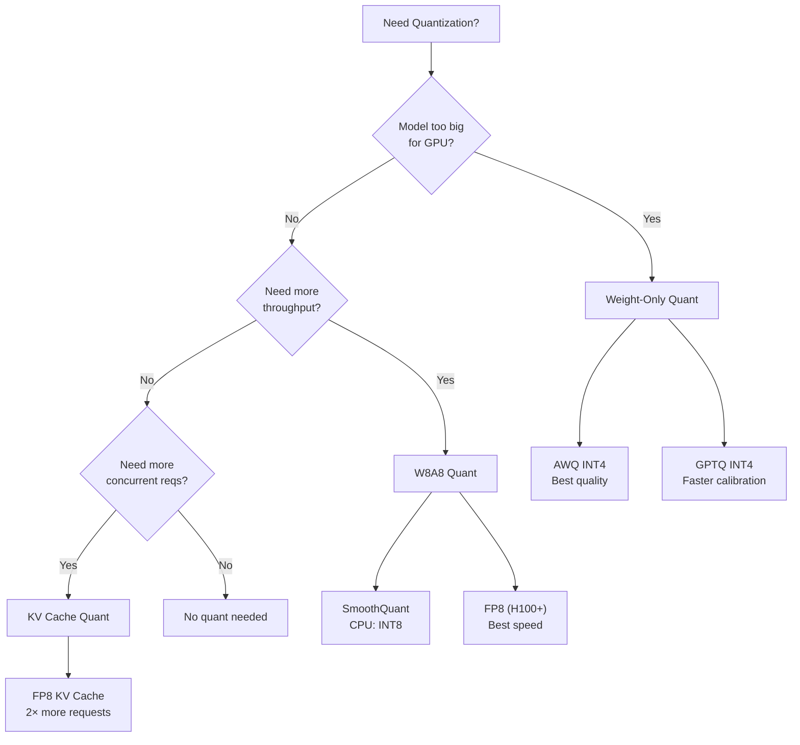
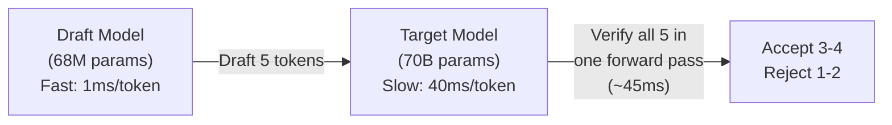

# 🎯 Q&A Deep Dive — Serving Engines & Optimization

> **80+ Questions & Answers · FAANG Interview Ready**
> Covers: vLLM, Continuous Batching, PagedAttention, Quantization, Profiling, Kernels

---

## Section 1: Serving Engines

### Q21: Why does plain PyTorch serving fail at 10+ concurrent requests?

**Answer:**

```python
# Problem 1: NO BATCHING — Sequential processing
async def naive_serve(request):
    # Each request gets exclusive GPU access
    # While processing request 1, requests 2-10 WAIT
    output = model.generate(request.prompt)  # ~3 seconds
    return output
# 10 requests × 3s each = 30 seconds total! (vs ~3.5s with batching)

# Problem 2: NO MEMORY MANAGEMENT
# Each request pre-allocates max_seq_len of KV cache
# 10 requests × 8192 tokens × 128 MB/request = wasted memory
# Actual usage might be 500 tokens average → 94% waste!

# Problem 3: NO STREAMING
# User waits for ALL tokens before seeing anything
# 3 seconds of blank screen → terrible UX

# Problem 4: NO SCHEDULING
# A 10K-token prefill blocks all other requests
# No preemption, no priority, no fairness
```

**The fix:** Use a real inference engine (vLLM, SGLang) that solves all four problems.

---

### Q22: Explain continuous batching step by step.

**Answer:**

```
STATIC BATCHING (old way):
═══════════════════════════
Step 1: Collect 4 requests
Step 2: Pad all to longest sequence
Step 3: Process batch until ALL finish
Step 4: Return results
Problem: Req1 (50 tokens) waits for Req4 (500 tokens) to finish!

CONTINUOUS BATCHING (modern way):
═════════════════════════════════
Iteration 1: [Req1, Req2, Req3, Req4]  ← all running
Iteration 2: [Req1✓, Req2, Req3, Req4]  ← Req1 DONE, leaves immediately
Iteration 3: [Req5, Req2, Req3, Req4]  ← Req5 JOINS mid-generation!
Iteration 4: [Req5, Req2✓, Req3, Req4] ← Req2 done, Req6 could join
...
```

```python
class ContinuousBatchScheduler:
    """The core algorithm every inference engine uses."""

    def schedule_iteration(self):
        """Called every ~10ms (one decode step)."""

        # 1. REMOVE finished requests (free their KV blocks!)
        for req in self.running[:]:
            if req.is_done():
                self.running.remove(req)
                self.block_manager.free(req.id)
                self.completed.append(req)

        # 2. ADMIT new requests (if memory available)
        while self.waiting_queue and len(self.running) < self.max_batch:
            next_req = self.waiting_queue[0]
            tokens_needed = next_req.prompt_length

            if self.block_manager.can_allocate(tokens_needed):
                self.waiting_queue.pop(0)
                self.block_manager.allocate(next_req.id, tokens_needed)
                next_req.state = "prefilling"
                self.running.append(next_req)
            else:
                break  # No memory for more requests

        # 3. EXECUTE one forward pass for the entire batch
        if self.running:
            new_tokens = self.model.forward(self.running)
            for req, token in zip(self.running, new_tokens):
                req.append_token(token)
                self.block_manager.append_slot(req.id)
```

---

### Q23: What is PagedAttention? Explain it like I'm 5, then explain the real algorithm.

**Answer:**

**Like you're 5:**
> Imagine a coloring book where each kid needs pages to draw. Without PagedAttention, each kid gets a WHOLE book even if they only use 2 pages. With PagedAttention, we have a pile of loose pages and give each kid exactly as many pages as they need. When they're done, the pages go back to the pile for the next kid!

**Real algorithm:**

```python
# BEFORE PagedAttention:
# Each request reserves MAX_SEQ_LEN of contiguous memory
# Request 1: [################............] ← uses 30%, wastes 70%
# Request 2: [########....................] ← uses 20%, wastes 80%
# Request 3: CAN'T FIT (not enough contiguous memory)

# AFTER PagedAttention:
# Memory is split into fixed-size blocks (e.g., 16 tokens each)
# Blocks can be ANYWHERE in memory (non-contiguous)
# A block table maps logical position → physical block

# Block Table for Request 1:
#   Logical block 0 → Physical block 7
#   Logical block 1 → Physical block 2
#   Logical block 2 → Physical block 15

# The attention kernel uses the block table to gather K,V:
def paged_attention_kernel(query, key_cache, value_cache, block_table, seq_len):
    output = zeros_like(query)
    for logical_idx in range(num_blocks_used):
        physical_block = block_table[logical_idx]
        k_block = key_cache[physical_block]    # Non-contiguous read!
        v_block = value_cache[physical_block]
        scores = query @ k_block.T
        output += softmax(scores) @ v_block
    return output
```

**Impact:** Reduces KV cache waste from 60-80% to < 4%, enabling 2-4× more concurrent requests.

---

### Q24: How does vLLM decide to preempt a request?

**Answer:**

```python
# vLLM preemption triggers when:
# 1. A new request arrives AND
# 2. No free GPU blocks are available AND
# 3. The new request has higher priority (or FCFS says it should run)

# Preemption strategies:
class PreemptionMode:
    RECOMPUTE = "recompute"  # Drop KV cache, re-prefill later (default)
    SWAP = "swap"             # Move KV to CPU RAM, swap back later

# Decision logic:
def should_preempt(waiting_req, running_reqs, free_blocks):
    if free_blocks >= waiting_req.blocks_needed:
        return None  # No preemption needed

    # Find preemption victim (latest arrival = lowest priority in FCFS)
    victim = running_reqs[-1]  # Last arrived

    if victim.blocks > waiting_req.blocks_needed:
        return PreemptionAction(victim, mode=RECOMPUTE)

    return None  # Can't help, let it wait

# Cost analysis:
# RECOMPUTE: Free immediately, but pay prefill cost again later
#   Good when: prefill is cheap (short prompt), memory pressure is temporary
# SWAP: Keeps KV on CPU, swap back faster than re-prefill
#   Good when: CPU RAM is available, prompt is very long
```

---

## Section 2: Optimization Techniques

### Q25: Compare all quantization methods. When do you use each?

**Answer:**



| Method | Bits | What's Quantized | Memory Saving | Speed Change | Quality Loss |
|--------|------|-----------------|--------------|-------------|-------------|
| **BF16** (baseline) | 16 | Nothing | 0% | 1× | None |
| **FP8 (W8A8)** | 8 | Weights + Activations | 50% | 1.3-1.5× faster | < 0.5% |
| **AWQ (W4)** | 4 | Weights only | 75% | 1.0-1.2× faster | 1-2% |
| **GPTQ (W4)** | 4 | Weights only | 75% | 1.0-1.2× faster | 1-3% |
| **SmoothQuant** | 8 | Weights + Activations | 50% | 1.5-2× faster | < 1% |
| **FP8 KV Cache** | 8 | KV cache only | KV: 50% | Same | < 0.5% |
| **INT4 KV** | 4 | KV cache only | KV: 75% | Same | 1-2% |

```python
# Decision framework:
def recommend_quantization(model_size_gb, gpu_memory_gb, target_concurrent,
                          max_quality_loss_pct, has_fp8_support):
    """Recommend quantization strategy."""

    fits_bf16 = model_size_gb * 1.1 < gpu_memory_gb * 0.5  # Need ~50% for KV

    if fits_bf16 and target_concurrent < 20:
        return "No quantization needed. Use BF16."

    if has_fp8_support and max_quality_loss_pct >= 0.5:
        return "FP8 weights + FP8 KV cache. Best speed with minimal quality loss."

    if model_size_gb > gpu_memory_gb:
        return "AWQ INT4 weights + FP8 KV cache. Must quantize to fit."

    if target_concurrent > 50:
        return "BF16 weights + FP8 KV cache. Maximize concurrent capacity."

    return "BF16 weights. Add FP8 KV if needed later."
```

---

### Q26: What is chunked prefill and when should you enable it?

**Answer:**

```
PROBLEM: A 8K-token prefill takes ~200ms, blocking all decode requests

WITHOUT chunked prefill:
[PPPPPPPPPPPPPPPPPPPPPP]        [DDDDDDDDDDDDDDDDDDDD]
     200ms prefill                    decode resumes
  ↑ All decode requests FROZEN for 200ms!
  Users see: stuttering, pauses in streaming

WITH chunked prefill (chunk_size=1024):
[PPPP][DDD][PPPP][DDD][PPPP][DDD][PPPP][DDD]
 25ms  15ms  25ms  15ms  25ms  15ms  25ms  15ms
  ↑ Decode interleaves every 25ms!
  Users see: smooth streaming (slight TTFT increase)
```

```python
# Trade-off:
# Smaller chunks → smoother decode, but slower TTFT
# Larger chunks → faster TTFT, but more decode disruption

chunk_configs = {
    512:  {"ttft_overhead": "60%", "max_decode_disruption": "5ms", "best_for": "Latency-critical"},
    1024: {"ttft_overhead": "30%", "max_decode_disruption": "10ms", "best_for": "Balanced (recommended)"},
    2048: {"ttft_overhead": "15%", "max_decode_disruption": "20ms", "best_for": "Throughput-first"},
    4096: {"ttft_overhead": "5%",  "max_decode_disruption": "50ms", "best_for": "Long prefills"},
}

# Enable in vLLM:
# vllm serve model --enable-chunked-prefill --max-num-batched-tokens 2048
```

---

### Q27: How does FlashAttention work and why is it 2-4× faster?

**Answer:**

```
STANDARD ATTENTION:
  1. Compute S = Q @ K^T         → Write N×N matrix to HBM (HUGE!)
  2. Compute P = softmax(S)       → Read N×N from HBM, write N×N back
  3. Compute O = P @ V            → Read N×N from HBM again

  Total HBM traffic: 3 × N² × d bytes (for 32K context: ~6 GB per head!)
  Bottleneck: memory bandwidth, not compute

FLASH ATTENTION (tiled + fused):
  For each Q block (that fits in SRAM):
    For each K,V block:
      Load Q,K,V blocks into SRAM (~228 KB)
      Compute attention in SRAM (no HBM access!)
      Use online softmax to accumulate results
    Write final output block to HBM

  Total HBM traffic: O(N² × d / M) where M = SRAM size
  This is much less because we REUSE data in fast SRAM!

KEY INNOVATIONS:
  1. TILING: Process attention in blocks that fit in SRAM
  2. ONLINE SOFTMAX: Compute softmax without full N×N matrix
  3. KERNEL FUSION: Single kernel does QK, softmax, and V multiply
  4. NO MATERIALIZATION: Never write N×N matrix to HBM
```

```python
# IO Complexity comparison:
# Standard: O(N² + Nd)     HBM accesses
# Flash:    O(N²d / M)     HBM accesses (M = SRAM size)

# For N=32768, d=128, M=228KB:
standard_io = 32768**2 + 32768*128  # ~1.07 billion
flash_io = 32768**2 * 128 / 228000  # ~601 million (44% less!)

# But for N=2048 (short):
standard_io_short = 2048**2 + 2048*128  # ~4.5 million
flash_io_short = 2048**2 * 128 / 228000  # ~2.4 million (47% less)

# FlashAttention helps MORE for longer sequences!
```

---

### Q28: Explain speculative decoding. When does it help and when does it hurt?

**Answer:**



```python
# WITHOUT speculation:
# 5 tokens × 40ms/token = 200ms

# WITH speculation:
# Draft: 5 tokens × 1ms = 5ms
# Verify: 1 forward pass = 45ms
# Total: 50ms for ~4 accepted tokens = 12.5ms/token
# Speedup: 40ms/12.5ms = 3.2×

# WHEN IT HELPS (low concurrency):
# ✅ Single user, GPU mostly idle during decode
# ✅ Predictable text (code, structured output)
# ✅ High acceptance rate (>70%)
# ✅ Draft model is >100× smaller than target

# WHEN IT HURTS (high concurrency):
# ❌ GPU already saturated with batched decode
# ❌ Draft model competes for GPU resources
# ❌ Low acceptance rate (creative, random text)
# ❌ Verification overhead > single-token decode
```

| Concurrency | Speculation Value | Reason |
|------------|-------------------|--------|
| 1 request | **Huge win (2-3×)** | GPU was idle during decode |
| 4 requests | **Good win (1.5-2×)** | Still room on GPU |
| 16 requests | **Break-even** | GPU getting busy |
| 64 requests | **May hurt!** | Draft model steals compute |

---

### Q29: What's the difference between torch.compile and CUDA Graphs?

**Answer:**

```python
# torch.compile: Optimizes WHAT the GPU does
# CUDA Graphs: Optimizes HOW the GPU is told to do it

# ┌─────────────────────────────────────────────┐
# │ torch.compile                                │
# │ • Traces Python code → optimized GPU kernels │
# │ • Fuses operations (fewer kernels)           │
# │ • Picks best kernel implementations          │
# │ • Works with dynamic shapes (with cost)      │
# │ • Compile time: 30-120 seconds               │
# │ • Speedup: 1.3-2×                            │
# └─────────────────────────────────────────────┘

# ┌─────────────────────────────────────────────┐
# │ CUDA Graphs                                  │
# │ • Records a sequence of GPU operations        │
# │ • Replays the EXACT sequence with ~0 overhead │
# │ • Eliminates CPU→GPU launch latency           │
# │ • REQUIRES fixed tensor shapes                │
# │ • Capture time: ~1 second                     │
# │ • Speedup: 1.5-3× (for small operations)      │
# └─────────────────────────────────────────────┘

# COMBINED (what vLLM does):
# 1. torch.compile optimizes individual kernels
# 2. CUDA Graphs captures the compiled execution
# Result: 2-4× speedup for decode steps
```

---

### Q30: How do you determine if an inference workload is compute-bound or memory-bound?

**Answer:**

```python
def diagnose_bottleneck(gpu_name, measured_time_ms, operation_flops, data_bytes):
    """
    Three methods to determine the bottleneck:

    Method 1: THEORETICAL — Compare against roofline
    Method 2: EMPIRICAL — Profile with Nsight Compute
    Method 3: EXPERIMENTAL — Change one variable and measure
    """
    gpus = {
        'H100': {'peak_tflops': 990, 'peak_bw_tb': 3.35},
        'A100': {'peak_tflops': 312, 'peak_bw_tb': 2.0},
    }
    gpu = gpus[gpu_name]

    # Method 1: Theoretical
    compute_time = operation_flops / (gpu['peak_tflops'] * 1e12) * 1000  # ms
    memory_time = data_bytes / (gpu['peak_bw_tb'] * 1e12) * 1000        # ms
    theoretical_time = max(compute_time, memory_time)

    print(f"Theoretical analysis for {gpu_name}:")
    print(f"  Compute time: {compute_time:.3f} ms")
    print(f"  Memory time:  {memory_time:.3f} ms")
    print(f"  Measured:     {measured_time_ms:.3f} ms")

    if compute_time > memory_time * 1.5:
        print(f"  → COMPUTE-BOUND (compute {compute_time/memory_time:.1f}× > memory)")
        print(f"  Actions: quantize to FP8, use Tensor Cores, reduce model size")
    elif memory_time > compute_time * 1.5:
        print(f"  → MEMORY-BOUND (memory {memory_time/compute_time:.1f}× > compute)")
        print(f"  Actions: fuse kernels, quantize KV, increase batch size")
    else:
        print(f"  → BALANCED (near the roofline knee)")
        print(f"  Actions: both compute and memory optimizations help")

    # Method 3: Experimental
    print(f"\n  Experimental verification:")
    print(f"  • Double batch size → if speed doubles: was memory-bound")
    print(f"  • Quantize weights → if no speedup: was compute-bound")
```

---

*Continue to [03 — Distributed & Production Q&A](./03-distributed-production-qa.md) →*
