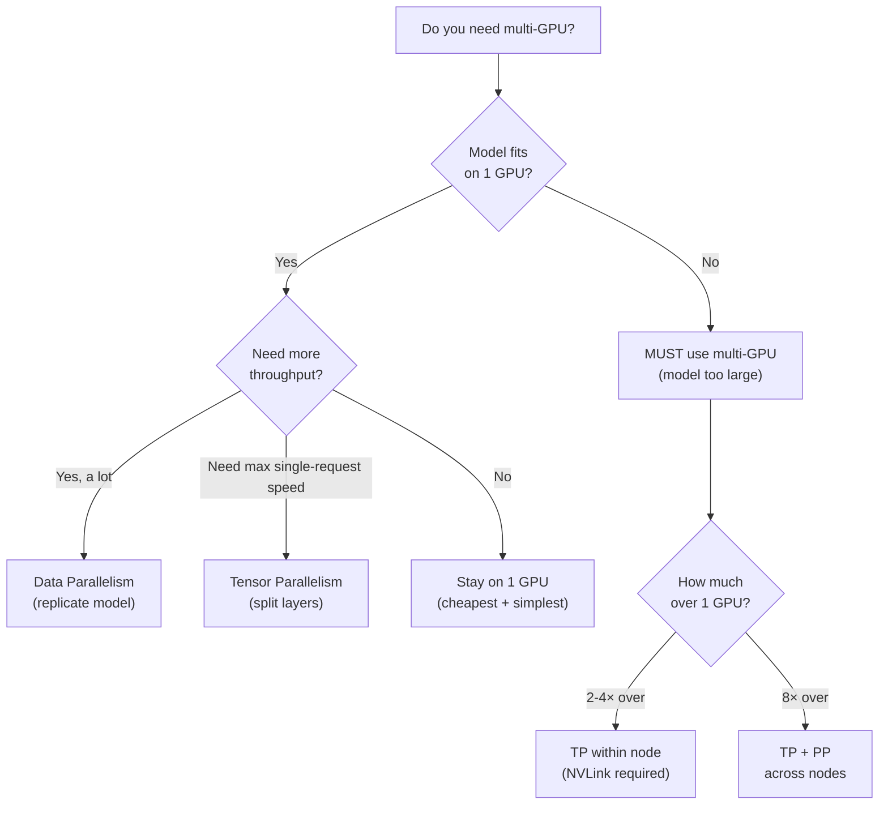
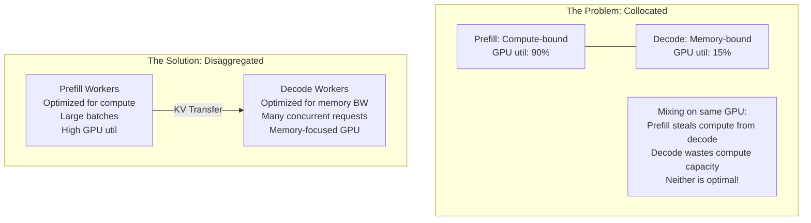

# 🎯 Q&A Deep Dive — Distributed Systems & Production

> **80+ Questions & Answers · FAANG Interview Ready**
> Covers: Multi-GPU, MoE, Disaggregation, Production Ops, Scaling, Economics

---

## Section 1: Multi-GPU & Distributed Inference

### Q31: When do you need multi-GPU inference?

**Answer:**



| Model | BF16 Size | Min GPUs | Recommended Setup |
|-------|-----------|----------|-------------------|
| Llama 8B | 16 GB | 1× A100 | 1 GPU, no parallelism |
| Llama 70B | 140 GB | 2× H100 | TP=2 (NVLink) |
| Llama 405B | 810 GB | 8× H100 | TP=8 (single node) |
| GPT-4 (rumored ~1.8T) | ~3.6 TB | 32+ H100s | TP=8, PP=4+ |

---

### Q32: Compare TP, PP, DP, and CP. When do you use each?

**Answer:**

```
TENSOR PARALLELISM (TP) — Split each LAYER across GPUs
════════════════════════════════════════════════════════
GPU 0: [Heads 0-7  | MLP cols 0-3583]
GPU 1: [Heads 8-15 | MLP cols 3584-7167]
GPU 2: [Heads 16-23| MLP cols 7168-10751]
GPU 3: [Heads 24-31| MLP cols 10752-14335]

Communication: All-reduce EVERY layer (2× per layer)
Requirement: FAST interconnect (NVLink 900 GB/s)
Latency: Reduces (faster single-request inference)
Best for: Intra-node, latency-sensitive


PIPELINE PARALLELISM (PP) — Split LAYERS across GPUs
═══════════════════════════════════════════════════════
GPU 0: [Layers 0-19]   → GPU 1: [Layers 20-39]
GPU 2: [Layers 40-59]  → GPU 3: [Layers 60-79]

Communication: Only between adjacent stages
Problem: Pipeline bubbles (GPUs idle waiting)
Best for: Inter-node (tolerates slow interconnect)


DATA PARALLELISM (DP) — COPY entire model to each GPU
═══════════════════════════════════════════════════════
GPU 0: [Full model] handles requests A, B
GPU 1: [Full model] handles requests C, D
GPU 2: [Full model] handles requests E, F

Communication: None (independent replicas)
Requirement: Model must fit on 1 GPU
Best for: Scaling throughput (linear scaling!)


CONTEXT PARALLELISM (CP) — Split SEQUENCE across GPUs
═══════════════════════════════════════════════════════
GPU 0: [Tokens 0-31K]
GPU 1: [Tokens 32K-63K]
GPU 2: [Tokens 64K-95K]
GPU 3: [Tokens 96K-127K]

Communication: Ring attention (pass KV chunks around)
Best for: Very long sequences (128K+)
```

---

### Q33: What's the communication overhead of tensor parallelism?

**Answer:**

```python
def tp_communication_cost(
    hidden_dim: int,
    num_layers: int,
    tp_degree: int,
    precision_bytes: int,
    interconnect_bw_gb_s: float,
):
    """
    TP requires 2 all-reduce per layer (attention output + MLP output).
    All-reduce with ring algorithm: 2 × (N-1)/N × data_size / bandwidth
    """
    # Data size per all-reduce
    data_size = hidden_dim * precision_bytes  # One hidden vector

    # Time per all-reduce (ring algorithm)
    factor = 2 * (tp_degree - 1) / tp_degree
    time_per_allreduce_us = factor * data_size / (interconnect_bw_gb_s * 1e3)

    # Total per forward pass: 2 all-reduces × num_layers
    total_allreduce = 2 * num_layers
    total_time_ms = total_allreduce * time_per_allreduce_us / 1000

    print(f"TP={tp_degree}, {num_layers} layers:")
    print(f"  All-reduce per layer: {time_per_allreduce_us:.1f} μs × 2 = {2*time_per_allreduce_us:.1f} μs")
    print(f"  Total communication: {total_time_ms:.2f} ms")
    print(f"  All-reduces per step: {total_allreduce}")
    return total_time_ms

# Llama 70B on 4× H100 with NVLink
nvlink = tp_communication_cost(8192, 80, 4, 2, 900)

# Same on PCIe (14× slower interconnect!)
pcie = tp_communication_cost(8192, 80, 4, 2, 64)

print(f"\nNVLink: {nvlink:.2f}ms | PCIe: {pcie:.2f}ms | Ratio: {pcie/nvlink:.0f}×")
# NVLink is ~14× faster → TP REQUIRES NVLink for production
```

---

### Q34: How does MoE inference differ from dense model inference?

**Answer:**

```python
moe_vs_dense = {
    "Parameter Count": {
        "Dense 70B": "70B total, 70B active per token",
        "MoE 8×7B": "47B total, ~14B active per token (2 of 8 experts)",
    },
    "Compute per Token": {
        "Dense 70B": "~140 GFLOP",
        "MoE 8×7B": "~28 GFLOP (5× less!)",
    },
    "Memory Required": {
        "Dense 70B": "140 GB (BF16)",
        "MoE 8×7B": "94 GB (ALL experts must be loaded, BF16)",
    },
    "Throughput": {
        "Dense 70B": "Compute-limited during prefill",
        "MoE 8×7B": "Communication-limited (all-to-all between GPUs)",
    },
    "Key Challenge": {
        "Dense 70B": "Model size, memory bandwidth",
        "MoE 8×7B": "Load imbalance, expert placement, all-to-all comm",
    },
}

# The MoE paradox:
# MORE total parameters (need more memory)
# SAME per-token compute (similar speed to smaller dense model)
# GPT-4 quality at GPT-3.5 serving cost (allegedly)
```

---

### Q35: Explain prefill/decode disaggregation. Why is it the future?

**Answer:**



```python
# Why it works:
# Prefill workers: batch many prompts, maximize compute utilization
# Decode workers: run many concurrent decodes, maximize memory bandwidth
# Each worker type uses its GPU EFFICIENTLY

# Economics:
# Collocated: 1 H100 at 40% average utilization
# Disaggregated:
#   Prefill H100: 85% compute utilization
#   Decode H100: 70% bandwidth utilization
#   Overall: ~77% utilization (nearly 2× better!)

# The crossover point:
def disagg_worth_it(num_requests_per_sec, avg_prefill_ms, kv_transfer_ms):
    # Overhead: KV transfer between workers
    transfer_overhead_per_req = kv_transfer_ms
    # Benefit: no interference between prefill and decode
    interference_cost_saved = avg_prefill_ms * 0.3  # ~30% interference overhead

    if interference_cost_saved > transfer_overhead_per_req:
        return True, f"Saves {interference_cost_saved - transfer_overhead_per_req:.0f}ms per request"
    else:
        return False, f"Transfer overhead too high ({transfer_overhead_per_req:.0f}ms > {interference_cost_saved:.0f}ms)"

worth, reason = disagg_worth_it(
    num_requests_per_sec=100,
    avg_prefill_ms=100,
    kv_transfer_ms=15  # NVLink transfer
)
print(f"Disaggregation worth it? {worth}: {reason}")
```

---

## Section 2: Production Operations

### Q36: Design a complete monitoring dashboard for an LLM inference service.

**Answer:**

```python
dashboard = {
    "Row 1: User-Facing Metrics (SLO Panel)": {
        "TTFT P50/P95/P99": "Line chart, 5min rolling, SLO line at 500ms",
        "TPOT P50/P95/P99": "Line chart, 5min rolling, SLO line at 50ms",
        "Goodput %": "Single stat, target: > 99.5%",
        "Error Rate %": "Single stat, RED alert at > 1%",
    },
    "Row 2: System Throughput": {
        "Tokens/sec": "Line chart, shows overall system throughput",
        "Requests/sec": "Line chart, incoming request rate",
        "Active Requests": "Line chart, currently processing",
        "Queue Depth": "Line chart, waiting requests (RED if growing)",
    },
    "Row 3: GPU Resources": {
        "GPU Memory Used %": "Per-GPU gauge, YELLOW at 85%, RED at 95%",
        "GPU Compute Util %": "Per-GPU gauge",
        "KV Cache Util %": "Per-GPU gauge, RED at 90%",
        "GPU Temperature": "Per-GPU, RED at 85°C",
    },
    "Row 4: Engine Internals": {
        "Batch Size": "Histogram, shows scheduling efficiency",
        "Preemption Rate": "Counter, should be near 0",
        "Prefix Cache Hit Rate": "Gauge, higher = better",
        "Time Per Scheduler Step": "Histogram, should be < 10ms",
    },
    "Row 5: Infrastructure": {
        "Replica Count": "Line chart with autoscaler decisions",
        "Cold Start Events": "Counter",
        "Network Latency": "Between components",
        "Disk I/O": "Model weight loading",
    },
}

# Alert rules:
alerts = [
    ("CRITICAL", "ttft_p95 > slo * 1.5 for 5min",      "SLO breach imminent"),
    ("CRITICAL", "error_rate > 2% for 2min",              "High error rate"),
    ("CRITICAL", "kv_utilization > 95% for 1min",         "OOM risk"),
    ("WARNING",  "ttft_p95 > slo * 0.8 for 10min",       "SLO at risk"),
    ("WARNING",  "queue_depth > 50 for 5min",             "Request buildup"),
    ("WARNING",  "preemption_rate > 5/min for 10min",     "Memory pressure"),
    ("WARNING",  "gpu_temperature > 83°C",                "Thermal risk"),
    ("INFO",     "prefix_cache_hit_rate < 50%",           "Cache underperforming"),
]
```

---

### Q37: How do you handle autoscaling for LLM inference?

**Answer:**

```python
class LLMAutoscaler:
    """
    LLM autoscaling is HARDER than web server autoscaling because:
    1. GPU startup is SLOW (3-10 minutes from cold)
    2. Requests have VARIABLE cost (100 tokens vs 10,000 tokens)
    3. Scaling DOWN risks killing in-flight requests
    4. KV cache state is NOT transferable between replicas
    """

    def __init__(self):
        # Scale UP: aggressive (can't afford SLO violations)
        self.scale_up_threshold = 0.7      # 70% of any metric
        self.scale_up_cooldown = 60         # 1 minute
        self.scale_up_increment = 0.25      # Add 25% more capacity

        # Scale DOWN: conservative (avoid thrashing)
        self.scale_down_threshold = 0.3    # 30% utilization
        self.scale_down_cooldown = 300     # 5 minutes
        self.scale_down_increment = 1      # Remove 1 replica at a time

    def evaluate(self, metrics):
        signals = {
            'kv_utilization': metrics['avg_kv_util'],
            'queue_depth_normalized': metrics['avg_queue'] / 50,  # normalize to [0,1]
            'ttft_vs_slo': metrics['ttft_p95'] / metrics['ttft_slo'],
            'throughput_headroom': 1 - (metrics['current_tps'] / metrics['max_tps']),
        }

        # Weighted score
        score = (
            signals['kv_utilization'] * 0.3 +
            signals['queue_depth_normalized'] * 0.3 +
            signals['ttft_vs_slo'] * 0.3 +
            signals['throughput_headroom'] * 0.1
        )

        if score > self.scale_up_threshold:
            return 'SCALE_UP', f"Score={score:.2f}, add {self.scale_up_increment*100:.0f}% capacity"
        elif score < self.scale_down_threshold:
            return 'SCALE_DOWN', f"Score={score:.2f}, remove 1 replica"
        else:
            return 'NO_CHANGE', f"Score={score:.2f}, stable"

    def pre_warm_strategy(self):
        """Always keep warm spares ready for fast scale-up."""
        return {
            'warm_spare_count': 2,          # 2 replicas loaded but not serving
            'pre_download_weights': True,   # Weights on local NVMe
            'pre_compile_kernels': True,    # CUDA cache populated
            'estimated_cold_to_warm': '8 minutes',
            'estimated_warm_to_serving': '10 seconds',
        }
```

---

### Q38: Design admission control for an LLM inference service.

**Answer:**

```python
class InferenceAdmissionController:
    """
    Reject requests BEFORE they cause problems.
    
    Better to return 429 (Too Many Requests) immediately
    than to accept, queue, and timeout after 30 seconds.
    """

    def __init__(self, config):
        self.max_queue_depth = config.get('max_queue', 100)
        self.max_kv_utilization = config.get('max_kv', 0.90)
        self.max_input_tokens = config.get('max_input', 32768)
        self.max_output_tokens = config.get('max_output', 4096)
        self.rate_limits = {}  # per-user rate limits

    def should_admit(self, request, system_state) -> tuple:
        """Returns (admit: bool, reason: str, priority: int)."""

        # Check 1: Rate limit per user
        user_rate = self.rate_limits.get(request.user_id, 0)
        if user_rate > request.user_tier.max_rps:
            return False, "Rate limit exceeded (429)", 0

        # Check 2: Input validation
        if request.input_tokens > self.max_input_tokens:
            return False, f"Input too long ({request.input_tokens} > {self.max_input_tokens})", 0

        # Check 3: System capacity
        if system_state.queue_depth >= self.max_queue_depth:
            return False, "System overloaded (503)", 0

        # Check 4: KV cache pressure
        estimated_kv = self._estimate_kv_needed(request)
        if system_state.kv_utilization + estimated_kv > self.max_kv_utilization:
            # Try to admit with lower context limit
            if request.priority == "low":
                return False, "KV cache pressure, low-priority rejected (503)", 0
            # High priority: preempt a low-priority request
            return True, "Admitted with preemption", request.priority

        # Check 5: Estimated completion time
        estimated_wait = self._estimate_wait_time(system_state)
        if estimated_wait > request.timeout_ms:
            return False, "Estimated wait exceeds timeout (408)", 0

        return True, "Admitted", request.priority

    def _estimate_kv_needed(self, request):
        """Estimate KV blocks this request will consume."""
        total_tokens = request.input_tokens + request.max_output_tokens
        blocks_needed = (total_tokens + 15) // 16  # 16 tokens per block
        return blocks_needed / self.total_blocks

    def _estimate_wait_time(self, state):
        """Estimate how long until this request starts."""
        return state.queue_depth * state.avg_ttft_ms
```

---

### Q39: How do you handle graceful shutdown without dropping requests?

**Answer:**

```python
import signal
import asyncio
import time

class GracefulShutdownManager:
    """
    Shutdown sequence:
    1. Stop accepting new requests (mark unhealthy)
    2. Wait for in-flight requests to complete (up to timeout)
    3. Cancel any remaining requests gracefully
    4. Release GPU resources
    5. Exit
    """

    def __init__(self, engine, max_drain_seconds=60):
        self.engine = engine
        self.max_drain = max_drain_seconds
        self.is_draining = False
        self.is_healthy = True

        signal.signal(signal.SIGTERM, self._handle_sigterm)
        signal.signal(signal.SIGINT, self._handle_sigterm)

    def _handle_sigterm(self, signum, frame):
        print(f"[{time.strftime('%H:%M:%S')}] Received signal {signum}, starting graceful shutdown")
        asyncio.create_task(self._drain_and_shutdown())

    async def _drain_and_shutdown(self):
        # Phase 1: Mark unhealthy (load balancer stops sending traffic)
        self.is_healthy = False
        self.is_draining = True
        print(f"  Phase 1: Marked unhealthy, no new requests accepted")

        # Phase 2: Wait for in-flight requests
        start = time.time()
        while self.engine.active_requests > 0:
            elapsed = time.time() - start
            if elapsed > self.max_drain:
                print(f"  ⚠️ Drain timeout after {self.max_drain}s, "
                      f"{self.engine.active_requests} requests still active")
                break

            print(f"  Phase 2: Draining... {self.engine.active_requests} requests remaining "
                  f"({elapsed:.0f}/{self.max_drain}s)")
            await asyncio.sleep(1)

        # Phase 3: Cancel remaining (if any)
        remaining = self.engine.active_requests
        if remaining > 0:
            print(f"  Phase 3: Cancelling {remaining} remaining requests")
            await self.engine.cancel_all()

        # Phase 4: Cleanup
        print(f"  Phase 4: Releasing GPU resources")
        await self.engine.shutdown()

        print(f"  ✅ Graceful shutdown complete")
        exit(0)
```

---

### Q40: Calculate the total cost of serving an LLM at different scales.

**Answer:**

```python
def total_cost_analysis(
    model_name: str,
    monthly_requests: int,
    avg_input_tokens: int,
    avg_output_tokens: int,
    gpu_type: str,
    throughput_per_gpu: float,  # output tokens/sec from benchmarks
    gpu_cost_per_hour: float,
    engineering_headcount: int = 1,
    engineer_monthly_cost: float = 25000,
):
    """Complete TCO analysis for self-hosted LLM inference."""

    # Token calculations
    monthly_input_tokens = monthly_requests * avg_input_tokens
    monthly_output_tokens = monthly_requests * avg_output_tokens
    monthly_total_tokens = monthly_input_tokens + monthly_output_tokens

    # GPU calculations
    output_tokens_per_gpu_per_month = throughput_per_gpu * 3600 * 24 * 30 * 0.7  # 70% util
    gpus_for_throughput = monthly_output_tokens / output_tokens_per_gpu_per_month
    gpus_with_redundancy = gpus_for_throughput * 1.3  # 30% headroom
    gpus_needed = max(2, int(gpus_with_redundancy) + 1)  # Min 2 for HA

    # Cost breakdown
    gpu_monthly = gpus_needed * gpu_cost_per_hour * 24 * 30
    engineering_monthly = engineering_headcount * engineer_monthly_cost
    infra_monthly = gpus_needed * 200  # Networking, storage, monitoring
    total_monthly = gpu_monthly + engineering_monthly + infra_monthly

    # Per-token costs
    cost_per_million_output = total_monthly / (monthly_output_tokens / 1e6)
    cost_per_request = total_monthly / monthly_requests

    print(f"{'═' * 60}")
    print(f"TOTAL COST OF OWNERSHIP: {model_name}")
    print(f"{'═' * 60}")
    print(f"\n📊 TRAFFIC:")
    print(f"  Monthly requests:    {monthly_requests:>12,}")
    print(f"  Monthly tokens:      {monthly_total_tokens:>12,}")
    print(f"\n🖥️  INFRASTRUCTURE:")
    print(f"  GPU type:            {gpu_type}")
    print(f"  GPUs needed:         {gpus_needed} (incl. redundancy)")
    print(f"  Throughput/GPU:      {throughput_per_gpu:,.0f} tok/s")
    print(f"\n💰 MONTHLY COSTS:")
    print(f"  GPU compute:         ${gpu_monthly:>12,.0f}")
    print(f"  Engineering ({engineering_headcount} eng):  ${engineering_monthly:>12,.0f}")
    print(f"  Infrastructure:      ${infra_monthly:>12,.0f}")
    print(f"  {'─' * 40}")
    print(f"  TOTAL MONTHLY:       ${total_monthly:>12,.0f}")
    print(f"\n📈 UNIT ECONOMICS:")
    print(f"  $/Million output tokens: ${cost_per_million_output:>8.2f}")
    print(f"  $/Request:               ${cost_per_request:>8.4f}")
    print(f"{'═' * 60}")

    return {
        'gpus_needed': gpus_needed,
        'monthly_cost': total_monthly,
        'cost_per_million': cost_per_million_output,
        'cost_per_request': cost_per_request,
    }

# Small startup
print("\n🏢 SMALL STARTUP:")
small = total_cost_analysis(
    "Llama 3 8B (INT4)", monthly_requests=1_000_000,
    avg_input_tokens=500, avg_output_tokens=300,
    gpu_type="L40S", throughput_per_gpu=3000, gpu_cost_per_hour=1.20,
    engineering_headcount=0,
)

# Medium company
print("\n🏢 MEDIUM COMPANY:")
medium = total_cost_analysis(
    "Llama 3 70B (AWQ)", monthly_requests=50_000_000,
    avg_input_tokens=1000, avg_output_tokens=500,
    gpu_type="H100", throughput_per_gpu=1500, gpu_cost_per_hour=3.50,
    engineering_headcount=2,
)

# Large enterprise
print("\n🏢 LARGE ENTERPRISE:")
large = total_cost_analysis(
    "Llama 3 70B (FP8)", monthly_requests=500_000_000,
    avg_input_tokens=2000, avg_output_tokens=500,
    gpu_type="H100", throughput_per_gpu=2000, gpu_cost_per_hour=3.50,
    engineering_headcount=5,
)
```

---

*Continue to [Production Scenarios & Solutions](../production-scenarios/01-incident-response-scenarios.md) →*
