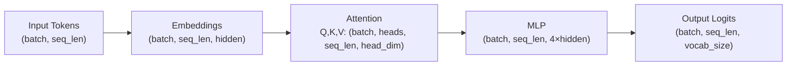
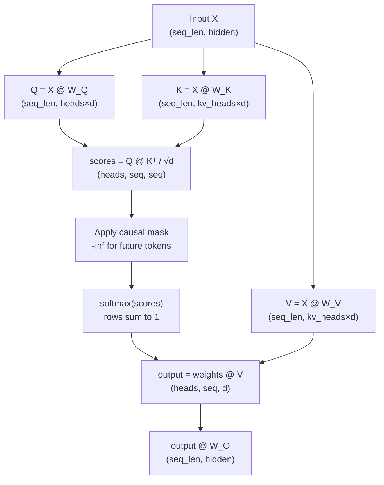
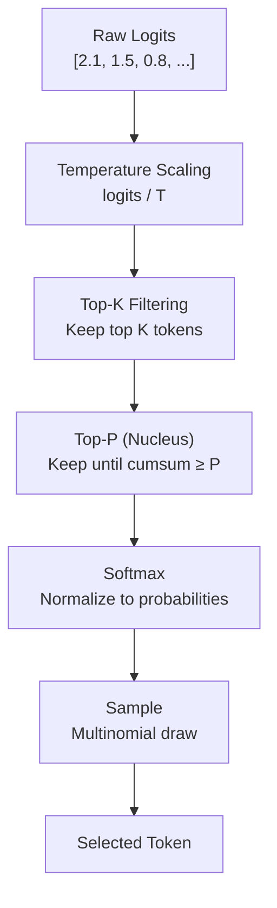
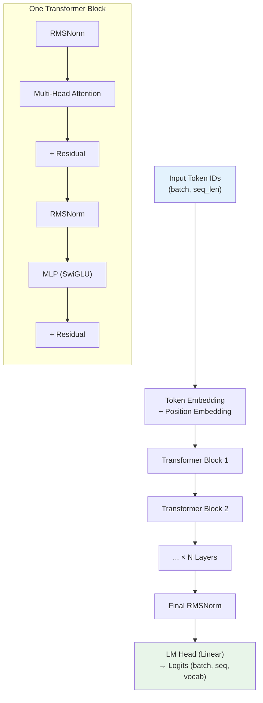
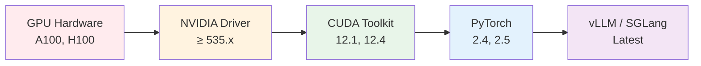

# Module 00 — Inference Engineering Prerequisites

> **9 lessons · Free**
> The math, tools, and concepts you need before touching an inference server.

---

## 00.01 — Math for Memory, Throughput & Speedups

### Bytes Per Parameter

The single most important formula in inference engineering:

```
Memory (bytes) = Parameters × Bytes per Element
```

| Precision | Bytes | 7B Model | 70B Model |
|-----------|-------|----------|-----------|
| FP32 | 4 | 28 GB | 280 GB |
| FP16/BF16 | 2 | 14 GB | 140 GB |
| FP8/INT8 | 1 | 7 GB | 70 GB |
| INT4 | 0.5 | 3.5 GB | 35 GB |

```python
def model_memory_gb(params_billion, bytes_per_param):
    """Calculate model weight memory in GB."""
    return params_billion * 1e9 * bytes_per_param / (1024**3)

# Examples
print(f"Llama 7B FP16:  {model_memory_gb(7, 2):.1f} GB")   # 13.0 GB
print(f"Llama 7B INT4:  {model_memory_gb(7, 0.5):.1f} GB")  # 3.3 GB
print(f"Llama 70B FP16: {model_memory_gb(70, 2):.1f} GB")   # 130.4 GB
print(f"Llama 70B INT4: {model_memory_gb(70, 0.5):.1f} GB") # 32.6 GB
```

### Bandwidth & Throughput

**Memory bandwidth** determines how fast you can read model weights from GPU memory:

```
Time to read model = Model size (bytes) / Memory bandwidth (bytes/sec)
```

| GPU | HBM Bandwidth | Time to read 70B FP16 |
|-----|--------------|----------------------|
| A100 (80GB) | 2.0 TB/s | 65 ms |
| H100 (80GB) | 3.35 TB/s | 39 ms |
| H200 (141GB) | 4.8 TB/s | 27 ms |

**Key insight:** During decode (1 token at a time), you read the entire model for each token. So:

```
Max decode tokens/sec ≈ Memory bandwidth / Model size
```

```python
def max_decode_tps(bandwidth_tb_s, model_gb):
    """Maximum theoretical decode tokens per second (single request)."""
    bandwidth_gb_s = bandwidth_tb_s * 1024
    return bandwidth_gb_s / model_gb

# H100 with Llama 70B BF16
tps = max_decode_tps(3.35, 130)
print(f"Max decode speed: {tps:.0f} tokens/sec")  # ~26 tok/s per request
```

### Amdahl's Law

If you speed up part of the system, the total speedup is limited by the unoptimized part:

```
Speedup = 1 / ((1 - P) + P/S)

P = fraction of time spent on optimized part
S = speedup of that part
```

```python
def amdahls_law(fraction_optimized, speedup_factor):
    """Calculate total speedup using Amdahl's Law."""
    return 1 / ((1 - fraction_optimized) + fraction_optimized / speedup_factor)

# Example: prefill is 30% of time. We make it 10x faster.
total = amdahls_law(0.3, 10)
print(f"Total speedup: {total:.2f}x")  # Only 1.37x!

# Example: decode is 70% of time. We make it 2x faster.
total = amdahls_law(0.7, 2)
print(f"Total speedup: {total:.2f}x")  # 1.54x — better ROI!
```

**Lesson:** Always optimize the biggest bottleneck first.

---

## 00.02 — Vectors, Matrices & Tensor Shapes

### Shapes Through a Transformer

Every tensor in a transformer has a shape. Know them:



### Concrete Example: Llama 3 8B

```python
import torch

# Llama 3 8B architecture
batch_size = 1
seq_len = 2048
hidden_dim = 4096
num_heads = 32
num_kv_heads = 8    # Grouped Query Attention
head_dim = 128      # hidden_dim / num_heads
intermediate_dim = 14336  # MLP intermediate size
vocab_size = 128256

# Token IDs
input_ids = torch.randint(0, vocab_size, (batch_size, seq_len))
print(f"Input IDs:     {input_ids.shape}")  # (1, 2048)

# After embedding
embeddings = torch.randn(batch_size, seq_len, hidden_dim)
print(f"Embeddings:    {embeddings.shape}")  # (1, 2048, 4096)

# Q, K, V projections
Q = torch.randn(batch_size, num_heads, seq_len, head_dim)
K = torch.randn(batch_size, num_kv_heads, seq_len, head_dim)
V = torch.randn(batch_size, num_kv_heads, seq_len, head_dim)
print(f"Q shape:       {Q.shape}")  # (1, 32, 2048, 128)
print(f"K shape:       {K.shape}")  # (1, 8, 2048, 128)  ← fewer heads!
print(f"V shape:       {V.shape}")  # (1, 8, 2048, 128)

# Attention output
attn_out = torch.randn(batch_size, seq_len, hidden_dim)
print(f"Attention out: {attn_out.shape}")  # (1, 2048, 4096)

# MLP
mlp_hidden = torch.randn(batch_size, seq_len, intermediate_dim)
print(f"MLP hidden:    {mlp_hidden.shape}")  # (1, 2048, 14336)

# Logits
logits = torch.randn(batch_size, seq_len, vocab_size)
print(f"Logits:        {logits.shape}")  # (1, 2048, 128256)
```

### Matrix Multiplication Shapes

The core operation in transformers is **GEMM** (General Matrix Multiply):

```python
# The fundamental operations
# Attention: Q @ K^T → (batch, heads, seq, seq)
attn_weights = torch.matmul(Q, K.transpose(-2, -1))  # (1, 32, 2048, 2048)

# MLP: x @ W → (batch, seq, intermediate)
# This is the most compute-heavy operation
x = torch.randn(batch_size, seq_len, hidden_dim)       # (1, 2048, 4096)
W_gate = torch.randn(hidden_dim, intermediate_dim)      # (4096, 14336)
mlp_out = x @ W_gate                                    # (1, 2048, 14336)

print(f"FLOPs for one MLP projection: {2 * seq_len * hidden_dim * intermediate_dim:,}")
# 2 × 2048 × 4096 × 14336 = 240,518,168,576 ≈ 240 GFLOP
```

---

## 00.03 — Dot Products, Softmax & Attention Math

### Attention Step by Step



### Worked Example with Real Numbers

```python
import torch
import torch.nn.functional as F

# Tiny example: 4 tokens, 2 heads, head_dim=3
seq_len, num_heads, head_dim = 4, 2, 3

Q = torch.tensor([[[1.0, 0, 1],
                    [0, 1, 0],
                    [1, 1, 0],
                    [0, 0, 1]]])  # (1, 4, 3) — one head for simplicity

K = torch.tensor([[[1.0, 0, 0],
                    [0, 1, 0],
                    [0, 0, 1],
                    [1, 1, 1]]])  # (1, 4, 3)

V = torch.tensor([[[1.0, 2, 3],
                    [4, 5, 6],
                    [7, 8, 9],
                    [10, 11, 12]]])  # (1, 4, 3)

# Step 1: Q @ K^T
scores = torch.matmul(Q, K.transpose(-2, -1))  # (1, 4, 4)
print("Raw scores:")
print(scores[0])
# tensor([[ 1.,  0.,  1.,  2.],
#         [ 0.,  1.,  0.,  1.],
#         [ 1.,  1.,  0.,  2.],
#         [ 0.,  0.,  1.,  1.]])

# Step 2: Scale by √d
scale = head_dim ** 0.5  # √3 ≈ 1.73
scaled = scores / scale
print(f"\nScaled by √{head_dim} = {scale:.2f}")

# Step 3: Causal mask (can't attend to future)
mask = torch.triu(torch.ones(seq_len, seq_len), diagonal=1).bool()
scaled.masked_fill_(mask.unsqueeze(0), float('-inf'))
print("\nAfter causal mask:")
print(scaled[0])

# Step 4: Softmax (each row sums to 1)
weights = F.softmax(scaled, dim=-1)
print("\nAttention weights:")
print(weights[0])

# Step 5: Weighted sum of Values
output = torch.matmul(weights, V)
print("\nOutput:")
print(output[0])
```

### Softmax Temperature

```python
def softmax_with_temperature(logits, temperature=1.0):
    """
    Temperature controls randomness:
    - T < 1: more confident (peaky distribution)
    - T = 1: standard softmax
    - T > 1: more random (flatter distribution)
    - T → 0: argmax (deterministic)
    - T → ∞: uniform distribution
    """
    scaled = logits / temperature
    return F.softmax(scaled, dim=-1)

logits = torch.tensor([2.0, 1.0, 0.5, 0.1])

for temp in [0.1, 0.5, 1.0, 2.0, 5.0]:
    probs = softmax_with_temperature(logits, temp)
    print(f"T={temp:.1f}: {probs.numpy().round(3)}")

# T=0.1: [1.    0.    0.    0.   ]  ← almost deterministic
# T=0.5: [0.867 0.106 0.022 0.005]  ← confident
# T=1.0: [0.506 0.186 0.113 0.076]  ← standard
# T=2.0: [0.346 0.211 0.164 0.134]  ← more random
# T=5.0: [0.285 0.244 0.225 0.213]  ← nearly uniform
```

---

## 00.04 — Probability, Sampling & Benchmark Statistics

### Token Sampling Strategies



```python
import torch
import torch.nn.functional as F

def sample_token(logits, temperature=1.0, top_k=50, top_p=0.9):
    """
    Complete sampling pipeline used in production.

    Args:
        logits: raw model output (vocab_size,)
        temperature: randomness control
        top_k: keep only top K tokens
        top_p: keep tokens until cumulative probability ≥ P
    """
    # Step 1: Temperature
    logits = logits / temperature

    # Step 2: Top-K — zero out everything below top K
    if top_k > 0:
        top_k_values, _ = torch.topk(logits, top_k)
        threshold = top_k_values[-1]
        logits[logits < threshold] = float('-inf')

    # Step 3: Top-P (nucleus sampling)
    if top_p < 1.0:
        sorted_logits, sorted_indices = torch.sort(logits, descending=True)
        cumulative_probs = torch.cumsum(F.softmax(sorted_logits, dim=-1), dim=-1)

        # Remove tokens with cumulative probability above threshold
        sorted_indices_to_remove = cumulative_probs > top_p
        sorted_indices_to_remove[1:] = sorted_indices_to_remove[:-1].clone()
        sorted_indices_to_remove[0] = False

        indices_to_remove = sorted_indices[sorted_indices_to_remove]
        logits[indices_to_remove] = float('-inf')

    # Step 4: Sample
    probs = F.softmax(logits, dim=-1)
    token_id = torch.multinomial(probs, num_samples=1)

    return token_id.item()

# Example
vocab_size = 32000
logits = torch.randn(vocab_size)
token = sample_token(logits, temperature=0.7, top_k=40, top_p=0.9)
print(f"Sampled token ID: {token}")
```

### Benchmark Statistics

```python
import numpy as np

def compute_latency_stats(latencies_ms):
    """Compute standard inference benchmark statistics."""
    latencies = np.array(latencies_ms)
    return {
        'mean': np.mean(latencies),
        'median': np.median(latencies),
        'p50': np.percentile(latencies, 50),
        'p90': np.percentile(latencies, 90),
        'p95': np.percentile(latencies, 95),
        'p99': np.percentile(latencies, 99),
        'min': np.min(latencies),
        'max': np.max(latencies),
        'std': np.std(latencies),
    }

# Simulated latency data (realistic distribution: mostly fast, some slow)
np.random.seed(42)
normal = np.random.normal(50, 10, 950)     # 950 normal requests (~50ms)
slow = np.random.normal(200, 50, 50)        # 50 slow requests (~200ms)
latencies = np.concatenate([normal, slow])
np.random.shuffle(latencies)

stats = compute_latency_stats(latencies)
for k, v in stats.items():
    print(f"  {k:>8}: {v:.1f} ms")

# Why P99 matters more than mean:
# Mean: ~57ms (looks fine!)
# P99: ~280ms (5% of users have terrible experience!)
```

---

## 00.05 — Python & PyTorch for Inference

### Inference Mode Best Practices

```python
import torch

model = ...  # Your loaded model

# ❌ BAD: Training mode computes gradients (wastes memory + time)
output = model(input_ids)

# ✅ GOOD: Disable gradient computation
with torch.no_grad():
    output = model(input_ids)

# ✅ BETTER: inference_mode is faster than no_grad
with torch.inference_mode():
    output = model(input_ids)

# ✅ ALSO: Set model to eval mode (disables dropout, etc.)
model.eval()

# ✅ ALSO: Use automatic mixed precision
with torch.inference_mode(), torch.autocast("cuda", dtype=torch.bfloat16):
    output = model(input_ids)
```

### Key Differences

| Feature | `torch.no_grad()` | `torch.inference_mode()` |
|---------|-------------------|-------------------------|
| Disables gradients | ✅ | ✅ |
| Disables version counter | ❌ | ✅ |
| Performance | Good | Better (~5-10% faster) |
| Can modify tensors | Yes | Limited |
| Use for | Validation | Production inference |

### Essential PyTorch for Inference

```python
import torch

# Check GPU availability
print(f"CUDA available: {torch.cuda.is_available()}")
print(f"GPU count: {torch.cuda.device_count()}")
print(f"GPU name: {torch.cuda.get_device_name(0)}")
print(f"GPU memory: {torch.cuda.get_device_properties(0).total_mem / 1e9:.1f} GB")

# Memory tracking
def print_gpu_memory():
    allocated = torch.cuda.memory_allocated() / 1e9
    reserved = torch.cuda.memory_reserved() / 1e9
    total = torch.cuda.get_device_properties(0).total_mem / 1e9
    print(f"Allocated: {allocated:.2f} GB | Reserved: {reserved:.2f} GB | Total: {total:.1f} GB")

print_gpu_memory()  # Before loading model

# Device placement
tensor = torch.randn(1000, 1000, device="cuda")    # Directly on GPU
tensor = torch.randn(1000, 1000).to("cuda")        # Move to GPU
tensor = torch.randn(1000, 1000).cuda()             # Shorthand

# Synchronization (important for timing!)
torch.cuda.synchronize()  # Wait for all GPU ops to complete
start = torch.cuda.Event(enable_timing=True)
end = torch.cuda.Event(enable_timing=True)

start.record()
output = model(input_ids)  # GPU operation
end.record()
torch.cuda.synchronize()

print(f"Forward pass: {start.elapsed_time(end):.2f} ms")
```

---

## 00.06 — Transformer Architecture Refresher

### Complete Architecture



### Llama 3 Architecture Specs

| Component | Llama 3 8B | Llama 3 70B | Llama 3 405B |
|-----------|-----------|------------|-------------|
| Layers | 32 | 80 | 126 |
| Hidden dim | 4096 | 8192 | 16384 |
| Attention heads | 32 | 64 | 128 |
| KV heads (GQA) | 8 | 8 | 8 |
| Head dim | 128 | 128 | 128 |
| MLP dim | 14336 | 28672 | 53248 |
| Vocab size | 128,256 | 128,256 | 128,256 |
| Context | 8,192 | 8,192 | 8,192 |
| Parameters | 8.03B | 70.6B | 405B |

### Key Components Explained

```python
import torch
import torch.nn as nn
import torch.nn.functional as F

class RMSNorm(nn.Module):
    """Root Mean Square Normalization — used in Llama instead of LayerNorm.
    Simpler (no mean subtraction), slightly faster, works just as well."""
    def __init__(self, dim, eps=1e-6):
        super().__init__()
        self.eps = eps
        self.weight = nn.Parameter(torch.ones(dim))

    def forward(self, x):
        rms = torch.sqrt(torch.mean(x ** 2, dim=-1, keepdim=True) + self.eps)
        return x / rms * self.weight


class SwiGLU_MLP(nn.Module):
    """SwiGLU MLP — the feed-forward network in modern transformers.
    Uses gated activation: out = down(silu(gate(x)) * up(x))"""
    def __init__(self, hidden_dim, intermediate_dim):
        super().__init__()
        self.gate_proj = nn.Linear(hidden_dim, intermediate_dim, bias=False)
        self.up_proj   = nn.Linear(hidden_dim, intermediate_dim, bias=False)
        self.down_proj = nn.Linear(intermediate_dim, hidden_dim, bias=False)

    def forward(self, x):
        gate = F.silu(self.gate_proj(x))  # SiLU activation
        up = self.up_proj(x)
        return self.down_proj(gate * up)   # Gated output


class GroupedQueryAttention(nn.Module):
    """Grouped Query Attention (GQA) — fewer KV heads than Q heads.
    Saves KV cache memory while maintaining quality."""
    def __init__(self, hidden_dim, num_heads, num_kv_heads):
        super().__init__()
        self.num_heads = num_heads
        self.num_kv_heads = num_kv_heads
        self.head_dim = hidden_dim // num_heads
        self.num_groups = num_heads // num_kv_heads

        self.q_proj = nn.Linear(hidden_dim, num_heads * self.head_dim, bias=False)
        self.k_proj = nn.Linear(hidden_dim, num_kv_heads * self.head_dim, bias=False)
        self.v_proj = nn.Linear(hidden_dim, num_kv_heads * self.head_dim, bias=False)
        self.o_proj = nn.Linear(num_heads * self.head_dim, hidden_dim, bias=False)

    def forward(self, x, mask=None):
        B, S, _ = x.shape

        Q = self.q_proj(x).view(B, S, self.num_heads, self.head_dim).transpose(1, 2)
        K = self.k_proj(x).view(B, S, self.num_kv_heads, self.head_dim).transpose(1, 2)
        V = self.v_proj(x).view(B, S, self.num_kv_heads, self.head_dim).transpose(1, 2)

        # Repeat KV heads to match Q heads (GQA)
        K = K.repeat_interleave(self.num_groups, dim=1)
        V = V.repeat_interleave(self.num_groups, dim=1)

        scores = torch.matmul(Q, K.transpose(-2, -1)) / (self.head_dim ** 0.5)
        if mask is not None:
            scores = scores.masked_fill(mask == 0, float('-inf'))
        weights = F.softmax(scores, dim=-1)
        output = torch.matmul(weights, V)

        output = output.transpose(1, 2).contiguous().view(B, S, -1)
        return self.o_proj(output)
```

---

## 00.07 — Linux, SSH & Remote GPU Machines

### Essential Commands

```bash
# ===== GPU Monitoring =====
nvidia-smi                          # GPU status snapshot
nvidia-smi -l 1                     # Refresh every 1 second
nvidia-smi --query-gpu=memory.used,memory.total,utilization.gpu --format=csv
watch -n 0.5 nvidia-smi             # Live monitoring

# ===== GPU Details =====
nvidia-smi -q -d MEMORY             # Detailed memory info
nvidia-smi topo -m                  # GPU interconnect topology

# ===== Process Management =====
nvidia-smi pmon -s um -d 1          # Per-process GPU monitoring
fuser -v /dev/nvidia*               # Which processes use GPU

# ===== System Resources =====
htop                                # CPU and RAM monitoring
free -h                             # Memory overview
df -h                               # Disk space
lscpu                               # CPU info
lsblk                               # Block devices (NVMe SSDs)

# ===== SSH to GPU Server =====
ssh -L 8000:localhost:8000 user@gpu-server    # Port forward for API
ssh -L 8888:localhost:8888 user@gpu-server    # Port forward for Jupyter

# ===== tmux (Keep Sessions Alive) =====
tmux new -s inference               # New session named "inference"
tmux attach -t inference            # Reattach to session
# Ctrl+B, D to detach               # Session keeps running!
tmux ls                             # List sessions

# ===== Environment Setup =====
conda create -n inference python=3.11
conda activate inference
pip install torch vllm transformers
```

### GPU Server Setup Checklist

```bash
#!/bin/bash
# setup-inference-server.sh

echo "=== Checking GPU ==="
nvidia-smi

echo "=== Checking CUDA ==="
nvcc --version

echo "=== Checking Python ==="
python3 --version

echo "=== Installing Dependencies ==="
pip install torch==2.4.0 --index-url https://download.pytorch.org/whl/cu124
pip install vllm transformers accelerate

echo "=== Verifying PyTorch CUDA ==="
python3 -c "
import torch
print(f'PyTorch: {torch.__version__}')
print(f'CUDA available: {torch.cuda.is_available()}')
print(f'CUDA version: {torch.version.cuda}')
print(f'GPU: {torch.cuda.get_device_name(0)}')
print(f'GPU Memory: {torch.cuda.get_device_properties(0).total_mem/1e9:.1f} GB')
"

echo "=== Setup Complete ==="
```

---

## 00.08 — CUDA, Drivers, PyTorch & GPU Compatibility

### The Compatibility Chain



### Compatibility Matrix

| GPU | Min Driver | CUDA | PyTorch | Notes |
|-----|-----------|------|---------|-------|
| A100 | 450.80+ | 11.0+ | 1.7+ | Most compatible |
| H100 | 525.60+ | 11.8+ | 2.0+ | Needs newer stack |
| H200 | 535.104+ | 12.0+ | 2.1+ | Latest hardware |
| RTX 4090 | 525.60+ | 11.8+ | 2.0+ | Consumer GPU |
| L40S | 525.60+ | 11.8+ | 2.0+ | Inference-optimized |

### Verification Script

```python
import subprocess
import torch

def check_inference_setup():
    """Verify your inference engineering setup."""
    print("=" * 50)
    print("INFERENCE SETUP CHECK")
    print("=" * 50)

    # GPU
    if torch.cuda.is_available():
        for i in range(torch.cuda.device_count()):
            props = torch.cuda.get_device_properties(i)
            print(f"\n GPU {i}: {props.name}")
            print(f"   Memory: {props.total_mem / 1e9:.1f} GB")
            print(f"   Compute Capability: {props.major}.{props.minor}")
            print(f"   SM Count: {props.multi_processor_count}")
    else:
        print("❌ No CUDA GPU detected!")
        return

    # CUDA
    print(f"\n CUDA Version: {torch.version.cuda}")
    print(f" PyTorch Version: {torch.__version__}")
    print(f" cuDNN Version: {torch.backends.cudnn.version()}")

    # BF16 support
    bf16_support = torch.cuda.is_bf16_supported()
    print(f" BF16 Support: {'✅' if bf16_support else '❌'}")

    # Flash Attention
    try:
        from flash_attn import flash_attn_func
        print(f" FlashAttention: ✅")
    except ImportError:
        print(f" FlashAttention: ❌ (pip install flash-attn)")

    # vLLM
    try:
        import vllm
        print(f" vLLM: ✅ ({vllm.__version__})")
    except ImportError:
        print(f" vLLM: ❌ (pip install vllm)")

    print("\n" + "=" * 50)

check_inference_setup()
```

---

## 🧪 Lab — Build Your Inference Engineering Setup

### Complete Setup Script

```bash
#!/bin/bash
set -e

echo "🚀 Building Inference Engineering Environment"

# 1. Create conda environment
conda create -n inference python=3.11 -y
conda activate inference

# 2. Install PyTorch with CUDA 12.4
pip install torch==2.5.0 torchvision torchaudio --index-url https://download.pytorch.org/whl/cu124

# 3. Install inference tools
pip install vllm>=0.6.0
pip install transformers>=4.44.0
pip install accelerate
pip install flash-attn --no-build-isolation

# 4. Install benchmarking tools
pip install aiohttp matplotlib numpy pandas
pip install gpustat  # Better nvidia-smi

# 5. Install profiling tools
pip install tensorboard
pip install nvitop  # Beautiful GPU monitor

# 6. Verify everything
python3 -c "
import torch, transformers, vllm
print('✅ All packages installed successfully!')
print(f'   PyTorch {torch.__version__} with CUDA {torch.version.cuda}')
print(f'   Transformers {transformers.__version__}')
print(f'   vLLM {vllm.__version__}')
print(f'   GPU: {torch.cuda.get_device_name(0)}')
print(f'   GPU Memory: {torch.cuda.get_device_properties(0).total_mem/1e9:.1f} GB')
"

echo "✅ Inference engineering environment ready!"
```

### Verification Exercise

After setup, run this to confirm everything works:

```python
from transformers import AutoModelForCausalLM, AutoTokenizer
import torch
import time

# Load a small model to verify the pipeline
model_name = "TinyLlama/TinyLlama-1.1B-Chat-v1.0"
print(f"Loading {model_name}...")

tokenizer = AutoTokenizer.from_pretrained(model_name)
model = AutoModelForCausalLM.from_pretrained(
    model_name,
    torch_dtype=torch.bfloat16,
    device_map="auto"
)

print(f"Model loaded. GPU memory: {torch.cuda.memory_allocated()/1e9:.2f} GB")

# Generate
prompt = "Explain what inference engineering is in one sentence:"
inputs = tokenizer(prompt, return_tensors="pt").to("cuda")

torch.cuda.synchronize()
start = time.perf_counter()

with torch.inference_mode():
    outputs = model.generate(
        **inputs,
        max_new_tokens=50,
        do_sample=True,
        temperature=0.7
    )

torch.cuda.synchronize()
elapsed = time.perf_counter() - start

response = tokenizer.decode(outputs[0], skip_special_tokens=True)
num_tokens = outputs.shape[1] - inputs['input_ids'].shape[1]

print(f"\nPrompt: {prompt}")
print(f"Response: {response}")
print(f"Generated {num_tokens} tokens in {elapsed:.3f}s ({num_tokens/elapsed:.1f} tok/s)")
print("\n✅ Setup verified! You're ready for inference engineering.")
```

---

**Next Module:** [01 — Run Your First LLM](./01-run-your-first-llm.md) →
