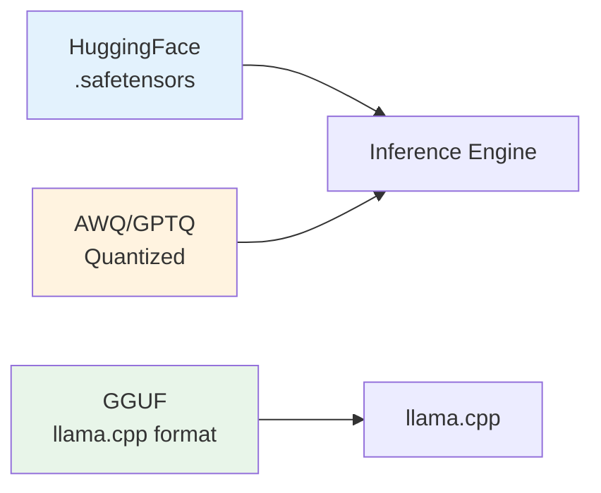

# Module 01 — Run Your First LLM

> **6 lessons · Free**
> Download a model, generate tokens, monitor the GPU, and serve it over HTTP.

---

## 01.01 — Choose & Download an Open Model

### Model Selection Guide

| Model | Params | Memory (BF16) | Quality | Speed | Best For |
|-------|--------|--------------|---------|-------|----------|
| Llama 3.2 1B | 1.2B | 2.4 GB | ★★☆☆☆ | ★★★★★ | Learning, edge |
| Llama 3.2 3B | 3.2B | 6.4 GB | ★★★☆☆ | ★★★★☆ | Development |
| Llama 3.1 8B | 8B | 16 GB | ★★★★☆ | ★★★☆☆ | Production (1 GPU) |
| Mistral 7B | 7.3B | 14.6 GB | ★★★★☆ | ★★★☆☆ | General purpose |
| Qwen 2.5 14B | 14B | 28 GB | ★★★★☆ | ★★★☆☆ | Coding, math |
| Llama 3.1 70B | 70B | 140 GB | ★★★★★ | ★★☆☆☆ | Quality-first |

### Model Formats



| Format | Extension | Used By | Pros |
|--------|-----------|---------|------|
| safetensors | `.safetensors` | HuggingFace, vLLM | Safe, fast loading |
| GGUF | `.gguf` | llama.cpp, Ollama | CPU + GPU, quantized |
| PyTorch | `.bin` | Legacy | Compatible |
| AWQ/GPTQ | `.safetensors` | vLLM, TGI | Pre-quantized |

### Download a Model

```python
from huggingface_hub import snapshot_download
import os

# Method 1: HuggingFace Hub (recommended)
model_path = snapshot_download(
    repo_id="meta-llama/Llama-3.2-1B-Instruct",
    local_dir="./models/llama-3.2-1b",
    # ignore_patterns=["*.bin"],  # Skip PyTorch format if safetensors exists
)
print(f"Downloaded to: {model_path}")

# Method 2: Using transformers (downloads to cache)
from transformers import AutoModelForCausalLM, AutoTokenizer
model_name = "meta-llama/Llama-3.2-1B-Instruct"
tokenizer = AutoTokenizer.from_pretrained(model_name)
model = AutoModelForCausalLM.from_pretrained(model_name)

# Method 3: Command line
# huggingface-cli download meta-llama/Llama-3.2-1B-Instruct --local-dir ./models/llama-3.2-1b
```

### Reading the Model Card

```python
# Inspect model configuration
from transformers import AutoConfig

config = AutoConfig.from_pretrained("meta-llama/Llama-3.2-1B-Instruct")
print(f"Architecture:    {config.architectures}")
print(f"Hidden size:     {config.hidden_size}")
print(f"Layers:          {config.num_hidden_layers}")
print(f"Attention heads: {config.num_attention_heads}")
print(f"KV heads:        {config.num_key_value_heads}")
print(f"Vocab size:      {config.vocab_size}")
print(f"Max position:    {config.max_position_embeddings}")
print(f"Intermediate:    {config.intermediate_size}")

# Calculate memory
params = sum(p.numel() for p in model.parameters())
memory_bf16 = params * 2 / 1e9
print(f"\nTotal parameters: {params:,}")
print(f"Memory (BF16):   {memory_bf16:.2f} GB")
```

---

## 01.02 — Load, Tokenize & Inspect the Model

### Loading with Memory Tracking

```python
import torch
from transformers import AutoModelForCausalLM, AutoTokenizer

def print_memory(label):
    if torch.cuda.is_available():
        alloc = torch.cuda.memory_allocated() / 1e9
        reserved = torch.cuda.memory_reserved() / 1e9
        print(f"[{label}] Allocated: {alloc:.2f} GB | Reserved: {reserved:.2f} GB")

print_memory("Before loading")

model_name = "meta-llama/Llama-3.2-1B-Instruct"

# Load tokenizer (CPU only, very small)
tokenizer = AutoTokenizer.from_pretrained(model_name)
print_memory("After tokenizer")

# Load model to GPU in BF16
model = AutoModelForCausalLM.from_pretrained(
    model_name,
    torch_dtype=torch.bfloat16,
    device_map="auto",       # Automatically place on GPU(s)
    attn_implementation="sdpa",  # Use PyTorch scaled dot product attention
)
model.eval()
print_memory("After model load")

# Output:
# [Before loading]   Allocated: 0.00 GB | Reserved: 0.00 GB
# [After tokenizer]  Allocated: 0.00 GB | Reserved: 0.00 GB
# [After model load] Allocated: 2.35 GB | Reserved: 2.47 GB
```

### Tokenization Deep Dive

```python
# Tokenization: text → token IDs → text
text = "Hello, how are you doing today?"

# Encode
token_ids = tokenizer.encode(text)
print(f"Text:      '{text}'")
print(f"Token IDs: {token_ids}")
print(f"Num tokens: {len(token_ids)}")

# Decode back
decoded = tokenizer.decode(token_ids)
print(f"Decoded:   '{decoded}'")

# See individual tokens
tokens = tokenizer.convert_ids_to_tokens(token_ids)
for i, (tid, tok) in enumerate(zip(token_ids, tokens)):
    print(f"  [{i}] ID={tid:6d} → '{tok}'")

# Special tokens
print(f"\nBOS token: {tokenizer.bos_token} (ID: {tokenizer.bos_token_id})")
print(f"EOS token: {tokenizer.eos_token} (ID: {tokenizer.eos_token_id})")
print(f"Vocab size: {tokenizer.vocab_size}")

# Chat template (for instruct models)
messages = [
    {"role": "system", "content": "You are a helpful assistant."},
    {"role": "user", "content": "What is inference engineering?"}
]
formatted = tokenizer.apply_chat_template(messages, tokenize=False, add_generation_prompt=True)
print(f"\nChat template:\n{formatted}")
```

### Model Inspection

```python
# Count parameters per component
def count_params(model):
    """Break down parameters by component."""
    breakdown = {}
    for name, param in model.named_parameters():
        component = name.split('.')[2] if len(name.split('.')) > 2 else name.split('.')[0]
        if component not in breakdown:
            breakdown[component] = 0
        breakdown[component] += param.numel()

    total = sum(breakdown.values())
    print(f"{'Component':<20} {'Params':>12} {'%':>6} {'Memory (BF16)':>12}")
    print("-" * 55)
    for comp, count in sorted(breakdown.items(), key=lambda x: -x[1]):
        pct = count / total * 100
        mem = count * 2 / 1e9
        print(f"{comp:<20} {count:>12,} {pct:>5.1f}% {mem:>10.3f} GB")
    print("-" * 55)
    print(f"{'TOTAL':<20} {total:>12,} {'100%':>6} {total*2/1e9:>10.3f} GB")

count_params(model)
```

---

## 01.03 — Generate & Stream Your First Tokens

### Basic Generation

```python
import torch
import time

prompt = "Explain what a GPU is in simple terms:"
inputs = tokenizer(prompt, return_tensors="pt").to(model.device)

# Greedy decoding (deterministic, fast)
torch.cuda.synchronize()
start = time.perf_counter()

with torch.inference_mode():
    output = model.generate(
        **inputs,
        max_new_tokens=100,
        do_sample=False,         # Greedy: always pick highest probability token
    )

torch.cuda.synchronize()
elapsed = time.perf_counter() - start

response = tokenizer.decode(output[0][inputs['input_ids'].shape[1]:], skip_special_tokens=True)
num_tokens = output.shape[1] - inputs['input_ids'].shape[1]
print(f"[Greedy] {num_tokens} tokens in {elapsed:.3f}s ({num_tokens/elapsed:.1f} tok/s)")
print(response)
```

### Sampling Strategies Compared

```python
strategies = {
    "Greedy": dict(do_sample=False),
    "Temperature 0.3": dict(do_sample=True, temperature=0.3),
    "Temperature 0.7": dict(do_sample=True, temperature=0.7, top_p=0.9),
    "Temperature 1.0": dict(do_sample=True, temperature=1.0, top_k=50),
    "High Creativity": dict(do_sample=True, temperature=1.2, top_p=0.95),
}

prompt = "The future of AI is"
inputs = tokenizer(prompt, return_tensors="pt").to(model.device)

for name, params in strategies.items():
    with torch.inference_mode():
        output = model.generate(**inputs, max_new_tokens=50, **params)
    text = tokenizer.decode(output[0][inputs['input_ids'].shape[1]:], skip_special_tokens=True)
    print(f"\n[{name}]: {text[:120]}...")
```

### Token-by-Token Streaming

```python
from transformers import TextIteratorStreamer
from threading import Thread

def stream_generate(model, tokenizer, prompt, max_tokens=200):
    """Generate tokens one at a time with streaming."""
    inputs = tokenizer(prompt, return_tensors="pt").to(model.device)
    streamer = TextIteratorStreamer(tokenizer, skip_special_tokens=True, skip_prompt=True)

    generation_kwargs = dict(
        **inputs,
        max_new_tokens=max_tokens,
        do_sample=True,
        temperature=0.7,
        streamer=streamer,
    )

    # Run generation in background thread
    thread = Thread(target=model.generate, kwargs=generation_kwargs)
    thread.start()

    # Stream tokens as they arrive
    print(f"Prompt: {prompt}")
    print("Response: ", end="", flush=True)

    token_count = 0
    start = time.perf_counter()

    for token_text in streamer:
        print(token_text, end="", flush=True)
        token_count += 1

    elapsed = time.perf_counter() - start
    print(f"\n\n[{token_count} tokens in {elapsed:.2f}s = {token_count/elapsed:.1f} tok/s]")

    thread.join()

stream_generate(model, tokenizer, "Write a haiku about GPUs:")
```

---

## 01.04 — Watch GPU Memory, Utilization & Power

### Real-Time GPU Monitoring

```python
import torch
import subprocess
import json

def gpu_snapshot():
    """Get a detailed GPU snapshot."""
    result = subprocess.run(
        ['nvidia-smi', '--query-gpu=index,name,memory.used,memory.total,'
         'utilization.gpu,utilization.memory,temperature.gpu,power.draw,power.limit',
         '--format=csv,noheader,nounits'],
        capture_output=True, text=True
    )

    gpus = []
    for line in result.stdout.strip().split('\n'):
        parts = [x.strip() for x in line.split(',')]
        gpus.append({
            'index': int(parts[0]),
            'name': parts[1],
            'memory_used_mb': int(parts[2]),
            'memory_total_mb': int(parts[3]),
            'gpu_util_%': int(parts[4]),
            'mem_util_%': int(parts[5]),
            'temp_c': int(parts[6]),
            'power_w': float(parts[7]),
            'power_limit_w': float(parts[8]),
        })

    for gpu in gpus:
        mem_pct = gpu['memory_used_mb'] / gpu['memory_total_mb'] * 100
        print(f"GPU {gpu['index']} ({gpu['name']}):")
        print(f"  Memory:      {gpu['memory_used_mb']:,} / {gpu['memory_total_mb']:,} MB ({mem_pct:.0f}%)")
        print(f"  GPU Util:    {gpu['gpu_util_%']}%")
        print(f"  Mem Util:    {gpu['mem_util_%']}%")
        print(f"  Temperature: {gpu['temp_c']}°C")
        print(f"  Power:       {gpu['power_w']:.0f}W / {gpu['power_limit_w']:.0f}W")

    return gpus

# PyTorch memory tracking
def torch_memory_report():
    """Detailed PyTorch CUDA memory report."""
    print("\n=== PyTorch Memory ===")
    print(f"Allocated:     {torch.cuda.memory_allocated()/1e9:.3f} GB")
    print(f"Reserved:      {torch.cuda.memory_reserved()/1e9:.3f} GB")
    print(f"Max Allocated: {torch.cuda.max_memory_allocated()/1e9:.3f} GB")
    print(f"Max Reserved:  {torch.cuda.max_memory_reserved()/1e9:.3f} GB")

# Track memory during generation
torch.cuda.reset_peak_memory_stats()
print("=== Before Generation ===")
gpu_snapshot()
torch_memory_report()

# Generate
with torch.inference_mode():
    output = model.generate(**inputs, max_new_tokens=200)

print("\n=== After Generation ===")
gpu_snapshot()
torch_memory_report()
```

### Continuous Monitoring Script

```bash
# Terminal command: monitor GPU every 0.5 seconds
watch -n 0.5 'nvidia-smi --query-gpu=index,memory.used,memory.total,utilization.gpu,power.draw --format=csv'

# Or use gpustat (prettier output)
gpustat -i 0.5

# Or use nvitop (beautiful TUI)
nvitop
```

---

## 01.05 — Serve the Model Over HTTP

### FastAPI Server with Streaming

```python
# server.py — Complete inference server
import asyncio
import time
import uuid
from contextlib import asynccontextmanager
from typing import Optional

import torch
import uvicorn
from fastapi import FastAPI
from fastapi.responses import StreamingResponse
from pydantic import BaseModel
from transformers import AutoModelForCausalLM, AutoTokenizer, TextIteratorStreamer
from threading import Thread

# Global model storage
model = None
tokenizer = None

@asynccontextmanager
async def lifespan(app: FastAPI):
    """Load model on startup, clean up on shutdown."""
    global model, tokenizer

    model_name = "meta-llama/Llama-3.2-1B-Instruct"
    print(f"Loading {model_name}...")

    tokenizer = AutoTokenizer.from_pretrained(model_name)
    model = AutoModelForCausalLM.from_pretrained(
        model_name,
        torch_dtype=torch.bfloat16,
        device_map="auto",
    )
    model.eval()

    mem = torch.cuda.memory_allocated() / 1e9
    print(f"Model loaded! GPU memory: {mem:.2f} GB")

    yield  # Server is running

    del model, tokenizer
    torch.cuda.empty_cache()
    print("Model unloaded.")

app = FastAPI(title="Inference Server", lifespan=lifespan)

class CompletionRequest(BaseModel):
    prompt: str
    max_tokens: int = 256
    temperature: float = 0.7
    top_p: float = 0.9
    stream: bool = False

class CompletionResponse(BaseModel):
    id: str
    text: str
    tokens_generated: int
    time_seconds: float
    tokens_per_second: float

@app.post("/v1/completions")
async def create_completion(request: CompletionRequest):
    """Generate a completion (non-streaming)."""
    inputs = tokenizer(request.prompt, return_tensors="pt").to(model.device)

    torch.cuda.synchronize()
    start = time.perf_counter()

    with torch.inference_mode():
        output = model.generate(
            **inputs,
            max_new_tokens=request.max_tokens,
            do_sample=request.temperature > 0,
            temperature=max(request.temperature, 0.01),
            top_p=request.top_p,
        )

    torch.cuda.synchronize()
    elapsed = time.perf_counter() - start
    new_tokens = output.shape[1] - inputs['input_ids'].shape[1]
    text = tokenizer.decode(output[0][inputs['input_ids'].shape[1]:], skip_special_tokens=True)

    return CompletionResponse(
        id=f"cmpl-{uuid.uuid4().hex[:8]}",
        text=text,
        tokens_generated=new_tokens,
        time_seconds=round(elapsed, 3),
        tokens_per_second=round(new_tokens / elapsed, 1),
    )

@app.post("/v1/completions/stream")
async def create_streaming_completion(request: CompletionRequest):
    """Generate a completion with Server-Sent Events streaming."""
    async def generate_stream():
        inputs = tokenizer(request.prompt, return_tensors="pt").to(model.device)
        streamer = TextIteratorStreamer(tokenizer, skip_special_tokens=True, skip_prompt=True)

        generation_kwargs = dict(
            **inputs,
            max_new_tokens=request.max_tokens,
            do_sample=request.temperature > 0,
            temperature=max(request.temperature, 0.01),
            top_p=request.top_p,
            streamer=streamer,
        )

        thread = Thread(target=model.generate, kwargs=generation_kwargs)
        thread.start()

        for text_chunk in streamer:
            yield f"data: {text_chunk}\n\n"
            await asyncio.sleep(0)

        yield "data: [DONE]\n\n"
        thread.join()

    return StreamingResponse(generate_stream(), media_type="text/event-stream")

@app.get("/health")
async def health():
    """Health check endpoint."""
    return {
        "status": "healthy",
        "gpu_memory_allocated_gb": round(torch.cuda.memory_allocated() / 1e9, 2),
        "gpu_memory_reserved_gb": round(torch.cuda.memory_reserved() / 1e9, 2),
    }

if __name__ == "__main__":
    uvicorn.run(app, host="0.0.0.0", port=8000)
```

### Client Code

```python
# client.py — Test the server
import requests
import sseclient
import time

BASE_URL = "http://localhost:8000"

# Non-streaming request
def test_completion():
    start = time.perf_counter()
    response = requests.post(f"{BASE_URL}/v1/completions", json={
        "prompt": "Explain inference engineering:",
        "max_tokens": 100,
        "temperature": 0.7
    })
    elapsed = time.perf_counter() - start
    data = response.json()
    print(f"Response ({elapsed:.2f}s): {data['text'][:200]}")
    print(f"Speed: {data['tokens_per_second']} tok/s")

# Streaming request
def test_streaming():
    response = requests.post(f"{BASE_URL}/v1/completions/stream", json={
        "prompt": "Write a poem about GPUs:",
        "max_tokens": 100
    }, stream=True)

    print("Streaming: ", end="", flush=True)
    for line in response.iter_lines():
        if line:
            text = line.decode('utf-8').replace('data: ', '')
            if text != '[DONE]':
                print(text, end="", flush=True)
    print()

test_completion()
test_streaming()
```

---

## 🧪 Lab — Build a Reproducible GPU Inference Server

### Dockerfile

```dockerfile
FROM nvidia/cuda:12.4.0-runtime-ubuntu22.04

# System dependencies
RUN apt-get update && apt-get install -y \
    python3.11 python3-pip git && \
    rm -rf /var/lib/apt/lists/*

WORKDIR /app

# Python dependencies
COPY requirements.txt .
RUN pip install --no-cache-dir -r requirements.txt

# Application code
COPY server.py .

# Pre-download model (bakes it into the image)
RUN python3 -c "
from transformers import AutoModelForCausalLM, AutoTokenizer
model_name = 'meta-llama/Llama-3.2-1B-Instruct'
AutoTokenizer.from_pretrained(model_name)
AutoModelForCausalLM.from_pretrained(model_name)
print('Model downloaded!')
"

EXPOSE 8000

HEALTHCHECK --interval=30s --timeout=10s \
    CMD curl -f http://localhost:8000/health || exit 1

CMD ["python3", "server.py"]
```

```
# requirements.txt
torch==2.5.0
transformers>=4.44.0
fastapi>=0.100.0
uvicorn>=0.20.0
pydantic>=2.0
```

```bash
# Build and run
docker build -t inference-server .
docker run --gpus all -p 8000:8000 inference-server

# Test
curl http://localhost:8000/health
curl -X POST http://localhost:8000/v1/completions \
  -H "Content-Type: application/json" \
  -d '{"prompt": "Hello!", "max_tokens": 50}'
```

> **🏢 FAANG Deep Dive: Model Serving at Scale**
>
> At Meta, model weights are stored in a distributed file system and loaded on-demand.
> Their inference infrastructure:
> - **Model Zoo**: centralized registry of model versions + configs
> - **Warm pools**: pre-loaded GPU instances ready to serve
> - **Rolling deployments**: new model versions deployed across the fleet gradually
> - **Canary testing**: 1% traffic first, automated metrics comparison
>
> The key insight: in production, you're not serving one model on one GPU.
> You're orchestrating hundreds of GPUs, dozens of model versions, and millions of requests.

---

**Next Module:** [02 — Understand One Token](../space-02-how-llm-inference-works/02-understand-one-token.md) →
