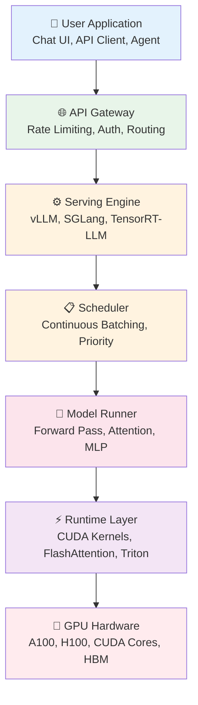
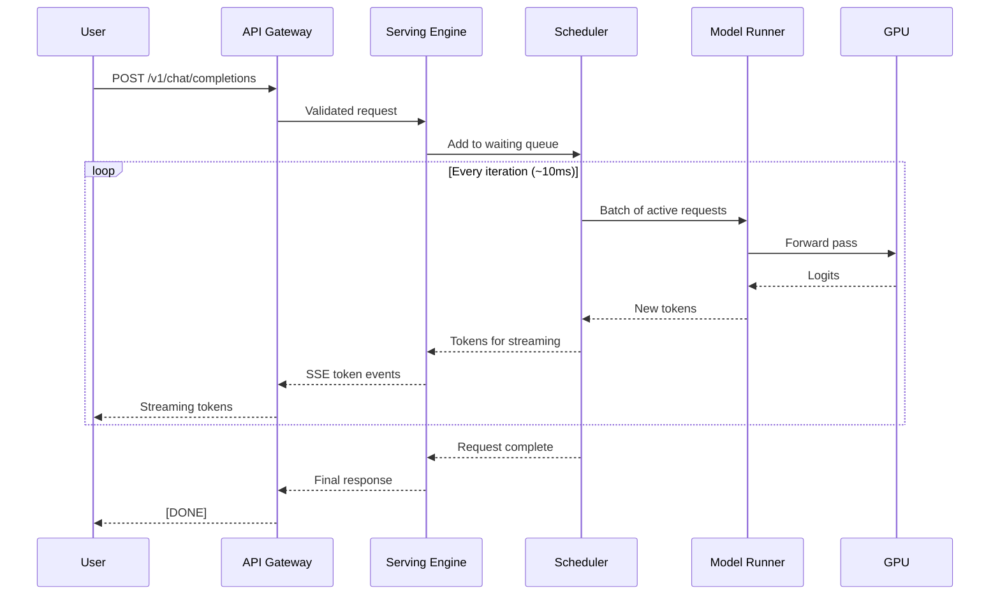
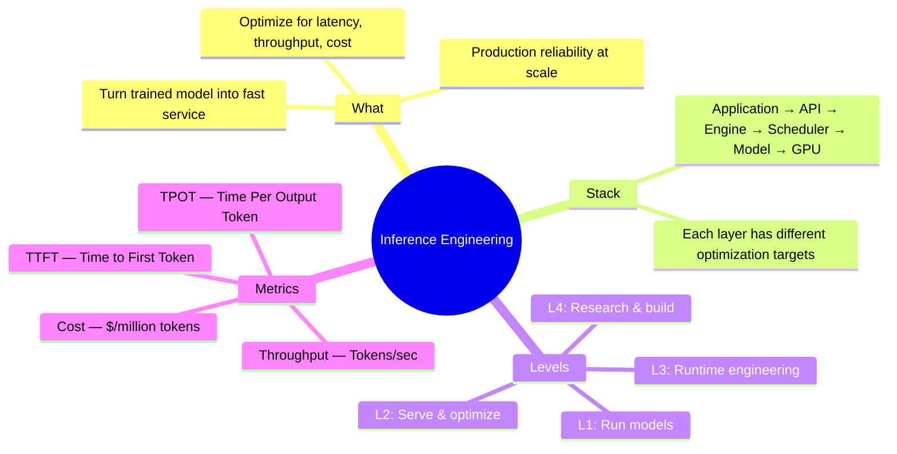

# Module IN — What Is Inference Engineering?

> **3 lessons · Start here**
> This module answers: what is inference, how does the stack work, and where do you fit in?

---

## IN.01 — What Is Inference & Inference Engineering?

### The One-Sentence Version

**Training** teaches a model to think. **Inference** makes it answer your questions — fast, cheap, and at scale.

### The Restaurant Analogy

| Concept | Restaurant | AI |
|---------|-----------|-----|
| **Training** | Writing the recipe book | Teaching the model with data |
| **Inference** | Cooking orders for customers | Generating responses from the model |
| **Inference Engineering** | Designing the kitchen for speed | Optimizing how the model serves responses |
| **Scaling** | Opening more kitchens | Adding more GPUs |
| **SLOs** | "Food in 15 minutes" | "First token in 500ms" |

### What Makes Inference Hard?

```
Training:                          Inference:
┌─────────────────────┐           ┌─────────────────────┐
│ Process all data     │           │ One user request     │
│ in big batches       │           │ at a time, streaming │
│                      │           │                      │
│ Hours to days        │           │ Milliseconds matter  │
│ Offline, scheduled   │           │ Real-time, 24/7      │
│ Cost: fixed          │           │ Cost: per-request    │
│ Throughput-only      │           │ Latency + throughput  │
└─────────────────────┘           └─────────────────────┘
```

**Inference is harder because:**
1. **Latency matters** — users are waiting, every millisecond counts
2. **Cost scales with usage** — 1M users × 1000 tokens = 1B tokens/day
3. **Memory is the bottleneck** — GPU memory is scarce and expensive
4. **Concurrency is complex** — 100s of requests share one GPU

### The Numbers That Matter

```python
# What inference engineers think about every day
model = "Llama-3-70B"
precision = "BF16"  # 2 bytes per parameter

# Model size in memory
model_memory_gb = 70e9 * 2 / (1024**3)  # ≈ 130 GB
print(f"Model weights: {model_memory_gb:.0f} GB")

# A single H100 has 80 GB — this model doesn't fit on one GPU!
# You need at least 2× H100s just for the weights

# KV cache per request (Llama 70B, 4K context)
kv_per_token = 2 * 80 * 8 * 128 * 2  # 2(KV) × layers × kv_heads × head_dim × bytes
kv_4k = kv_per_token * 4096
print(f"KV cache per 4K request: {kv_4k / (1024**2):.0f} MB")

# At 100 concurrent requests:
total_kv = kv_4k * 100
print(f"KV cache for 100 concurrent: {total_kv / (1024**3):.1f} GB")
```

### Real-World Cost

| Scale | Tokens/Day | GPU Hours/Day | Monthly Cost |
|-------|-----------|--------------|-------------|
| Hobby | 1M | 0.5 | ~$50 |
| Startup | 100M | 50 | ~$5,000 |
| Mid-size | 10B | 5,000 | ~$500,000 |
| FAANG | 1T+ | 500,000+ | ~$50M+ |

> **🏢 FAANG Deep Dive: OpenAI's Inference Challenge**
>
> When ChatGPT launched in Nov 2022, OpenAI went from serving researchers to serving 100M users.
> Their inference costs reportedly exceeded $700K/day. This forced rapid innovation in:
> - KV cache management (can't afford to waste GPU memory)
> - Batching strategies (must serve many users per GPU)
> - Quantization (serve larger models on fewer GPUs)
> - Speculative decoding (make generation faster)
>
> **Every dollar saved per million tokens × billions of tokens = millions saved.**

---

## IN.02 — The Inference Stack: Model to GPU to Production

### The Full Stack



### Each Layer Explained

#### Layer 1: User Application
- The chat interface, API client, or autonomous agent
- Sends a prompt, receives a stream of tokens
- Cares about: **responsiveness**, **correctness**, **cost**

#### Layer 2: API Gateway
- Authentication, rate limiting, request validation
- Routes requests to the right model/replica
- Tools: NGINX, Envoy, Kong, custom gateway

#### Layer 3: Serving Engine
- The brain of inference — manages everything below
- Handles request queuing, memory management, batching
- Examples: **vLLM**, **SGLang**, **TensorRT-LLM**, **llama.cpp**

```python
# Starting a vLLM server — this one command sets up the entire serving engine
# vllm serve meta-llama/Llama-3-8B-Instruct \
#   --tensor-parallel-size 1 \
#   --max-model-len 4096 \
#   --gpu-memory-utilization 0.9
```

#### Layer 4: Scheduler
- Decides which requests run on the GPU each iteration
- **Continuous batching**: new requests join mid-generation
- Manages: token budgets, preemption, fairness

#### Layer 5: Model Runner
- Executes the transformer forward pass
- Manages: KV cache, attention computation, sampling
- This is where the math happens

#### Layer 6: Runtime Layer
- Optimized GPU kernels (FlashAttention, PagedAttention)
- Compilation (torch.compile, CUDA Graphs)
- Custom Triton kernels for fused operations

#### Layer 7: GPU Hardware
- CUDA cores for compute, HBM for memory
- Key specs: FLOPS, memory bandwidth, memory capacity

### How a Request Flows Through the Stack



### What Each Layer Optimizes

| Layer | Optimizes | Key Metric |
|-------|----------|-----------|
| Application | User experience | Perceived speed |
| Gateway | Request routing | Load distribution |
| Engine | Resource utilization | Throughput |
| Scheduler | GPU time allocation | Fairness + efficiency |
| Model Runner | Computation | Tokens/second |
| Runtime | Kernel efficiency | FLOPS utilization |
| Hardware | Raw performance | Memory bandwidth |

---

## IN.03 — Levels of Inference Engineering

### The Four Levels


### Level 1: Run Models (Hobbyist → Junior Engineer)

**Skills:**
- Download and load open-source models
- Generate text with basic parameters
- Monitor GPU memory and utilization
- Serve a model over HTTP

**Tools:** HuggingFace Transformers, Ollama, llama.cpp

```python
# Level 1: Load and run a model
from transformers import AutoModelForCausalLM, AutoTokenizer
import torch

model_name = "meta-llama/Llama-3.2-1B-Instruct"
tokenizer = AutoTokenizer.from_pretrained(model_name)
model = AutoModelForCausalLM.from_pretrained(
    model_name,
    torch_dtype=torch.bfloat16,
    device_map="auto"
)

inputs = tokenizer("What is inference?", return_tensors="pt").to("cuda")
outputs = model.generate(**inputs, max_new_tokens=100)
print(tokenizer.decode(outputs[0], skip_special_tokens=True))
```

**Typical Salary Range:** $80K–$130K

### Level 2: Serve & Optimize (Applied Inference Engineer)

**Skills:**
- Deploy production inference servers (vLLM, SGLang)
- Benchmark and tune performance
- Quantize models for speed/memory
- Configure batching, caching, scheduling
- Multi-GPU serving with tensor parallelism
- Production operations: monitoring, autoscaling

**Tools:** vLLM, SGLang, Prometheus, Grafana, Kubernetes

```python
# Level 2: Production-grade serving with vLLM
from vllm import LLM, SamplingParams

llm = LLM(
    model="meta-llama/Llama-3-70B-Instruct",
    tensor_parallel_size=4,          # Spread across 4 GPUs
    max_model_len=8192,
    gpu_memory_utilization=0.92,
    enable_prefix_caching=True,      # Cache repeated prefixes
    quantization="awq",              # 4-bit quantization
)

# Batch many requests efficiently
sampling = SamplingParams(temperature=0.7, max_tokens=512)
prompts = ["Explain inference" for _ in range(100)]
outputs = llm.generate(prompts, sampling)
```

**Typical Salary Range:** $150K–$250K

### Level 3: Runtime & Performance Engineer

**Skills:**
- Write custom CUDA/Triton kernels
- Profile GPU execution (Nsight Systems/Compute)
- Implement attention backends (FlashAttention variants)
- Optimize memory access patterns
- Implement speculative decoding
- Build kernel fusion and compilation pipelines

**Tools:** Triton, CUDA, Nsight, PyTorch Profiler

```python
# Level 3: Custom Triton kernel for fused RMSNorm
import triton
import triton.language as tl

@triton.jit
def rms_norm_kernel(X, W, Y, stride, N, eps,
                    BLOCK_SIZE: tl.constexpr):
    row = tl.program_id(0)
    cols = tl.arange(0, BLOCK_SIZE)
    mask = cols < N

    x = tl.load(X + row * stride + cols, mask=mask, other=0.0)
    variance = tl.sum(x * x, axis=0) / N
    x_norm = x / tl.sqrt(variance + eps)

    w = tl.load(W + cols, mask=mask)
    y = x_norm * w
    tl.store(Y + row * stride + cols, y, mask=mask)
```

**Typical Salary Range:** $200K–$400K

### Level 4: Research & Engine Engineer

**Skills:**
- Design and build inference engines from scratch
- Reproduce and extend inference research papers
- Invent new scheduling, caching, or attention algorithms
- Contribute to vLLM, SGLang, or equivalent projects
- Publish research

**Typical Salary Range:** $250K–$500K+

> **🏢 FAANG Deep Dive: Who Hires Inference Engineers?**
>
> | Company | Team | What They Work On |
> |---------|------|-------------------|
> | **OpenAI** | Inference Team | ChatGPT serving, custom kernels |
> | **Google** | Gemini Serving | TPU/GPU inference, model routing |
> | **Meta** | AI Infra | Llama serving, PyTorch optimization |
> | **Anthropic** | Infrastructure | Claude serving, long-context optimization |
> | **NVIDIA** | TensorRT-LLM | Inference engine, kernel optimization |
> | **Anyscale** | Ray/vLLM | Open-source inference engine |
> | **Together AI** | Serving | Multi-tenant inference platform |
> | **Fireworks AI** | Engine | High-performance inference API |
>
> These roles are among the highest-paid in ML engineering because:
> 1. The impact is enormous (serving billions of requests)
> 2. The skills are rare (GPU + systems + ML knowledge)
> 3. The cost savings are massive (1% optimization = millions saved)

---

## Summary & What's Next



**Next Module:** [00 — Inference Engineering Prerequisites](./00-prerequisites.md) →

---

*Key Takeaway: Inference engineering is the discipline of making LLMs serve users fast, cheap, and reliably. It spans from simple model serving to custom GPU kernels and research.*
