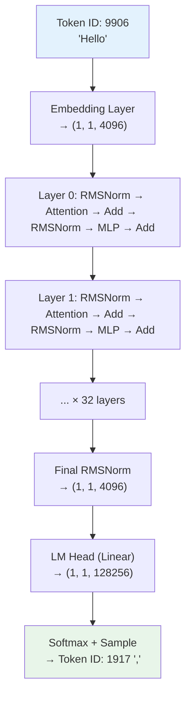
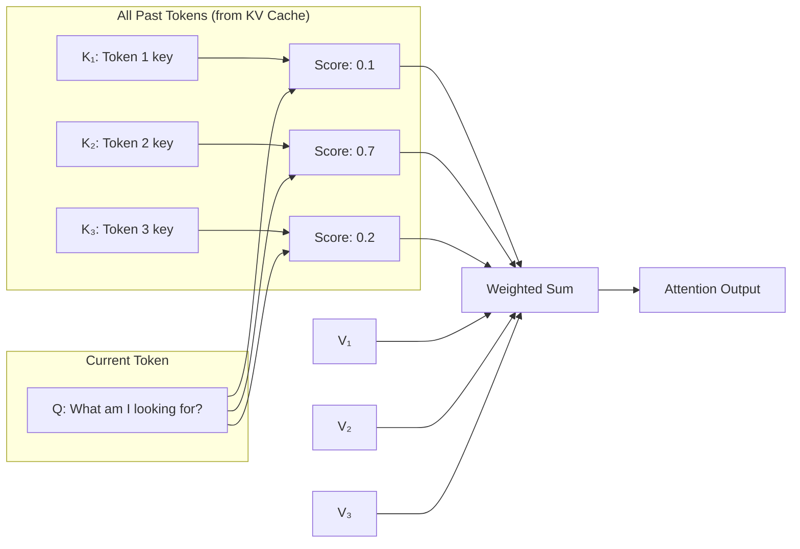
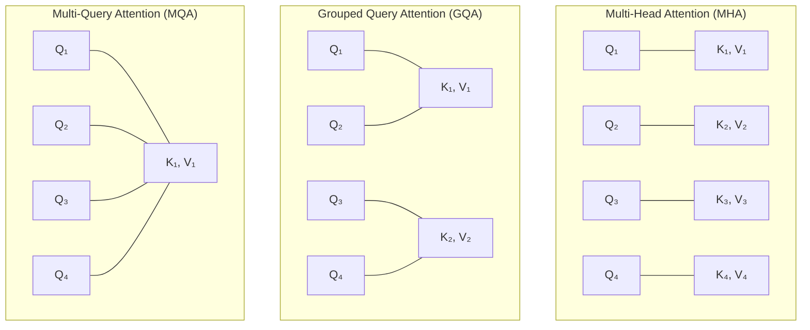
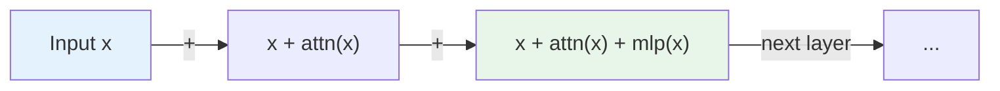
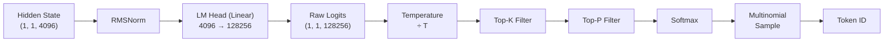

# Module 02 — Understand One Token

> **6 lessons**
> Trace a single token through every layer of a transformer during inference.

---

## 02.01 — Trace the Transformer Forward Pass

### The Big Picture

When you send "Hello" to an LLM, here's what happens for **every single token** generated:



### Shapes at Every Step (Llama 3 8B)

```python
import torch

# Architecture constants
B = 1           # batch size
S = 1           # sequence length (one token during decode)
D = 4096        # hidden dimension
H = 32          # attention heads
KV_H = 8        # KV heads (GQA)
D_H = 128       # head dimension (D / H)
MLP = 14336     # MLP intermediate dimension
V = 128256      # vocabulary size
L = 32          # number of layers

# Step 1: Token embedding
token_id = torch.tensor([[9906]])          # Shape: (1, 1)
hidden = torch.randn(B, S, D)             # Shape: (1, 1, 4096)
print(f"After embedding: {hidden.shape}")

# Step 2: For each of 32 layers...
for layer in range(L):
    # RMSNorm
    normed = hidden  # Same shape: (1, 1, 4096)

    # Q, K, V projections
    Q = torch.randn(B, H, S, D_H)         # (1, 32, 1, 128)
    K = torch.randn(B, KV_H, S, D_H)      # (1, 8, 1, 128)
    V_tensor = torch.randn(B, KV_H, S, D_H)  # (1, 8, 1, 128)

    # Attention output
    attn_out = torch.randn(B, S, D)        # (1, 1, 4096)

    # Residual connection
    hidden = hidden + attn_out             # (1, 1, 4096)

    # RMSNorm
    normed = hidden

    # MLP
    gate = torch.randn(B, S, MLP)         # (1, 1, 14336)
    up = torch.randn(B, S, MLP)           # (1, 1, 14336)
    mlp_out = torch.randn(B, S, D)        # (1, 1, 4096)

    # Residual connection
    hidden = hidden + mlp_out             # (1, 1, 4096)

# Step 3: Final RMSNorm + LM Head
logits = torch.randn(B, S, V)            # (1, 1, 128256)
print(f"Final logits: {logits.shape}")
```

### Where Time Goes (Single Token)

| Operation | FLOPs | Memory Access | Bottleneck |
|-----------|-------|--------------|------------|
| QKV Projection | 3 × D × D = 50M | Read weights (96MB) | **Memory** |
| Attention (decode) | 2 × S × D_H = tiny | Read KV cache | **Memory** |
| Output Projection | D × D = 17M | Read weights (32MB) | **Memory** |
| MLP (3 projections) | 3 × D × MLP = 176M | Read weights (336MB) | **Memory** |

**Key insight for decode:** Every operation reads large weight matrices but does very little compute per element. This is why decode is **memory-bandwidth bound**.

---

## 02.02 — Q, K, V & Causal Attention During Inference

### How Attention Works

Think of attention as a **search engine** inside the model:
- **Q** (Query) = "What am I looking for?"
- **K** (Key) = "What does each past token offer?"
- **V** (Value) = "What information does each past token carry?"



### Grouped Query Attention (GQA)

Modern models use **fewer KV heads than Q heads** to save memory:



```python
# GQA: Q has 32 heads, KV has 8 heads → 4 Q heads share 1 KV head
# Memory savings: 32/8 = 4× less KV cache!

import torch
import torch.nn.functional as F

def grouped_query_attention(Q, K, V, num_heads, num_kv_heads):
    """
    Q: (batch, num_heads, seq_q, head_dim)
    K: (batch, num_kv_heads, seq_kv, head_dim)
    V: (batch, num_kv_heads, seq_kv, head_dim)
    """
    B, _, S_q, D = Q.shape
    S_kv = K.shape[2]

    # Repeat KV heads to match Q heads
    num_groups = num_heads // num_kv_heads  # 32 / 8 = 4
    K = K.repeat_interleave(num_groups, dim=1)  # (B, 32, S_kv, D)
    V = V.repeat_interleave(num_groups, dim=1)  # (B, 32, S_kv, D)

    # Standard attention
    scores = torch.matmul(Q, K.transpose(-2, -1)) / (D ** 0.5)

    # Causal mask: token can only attend to itself and past tokens
    if S_q > 1:  # Only needed during prefill
        mask = torch.triu(torch.ones(S_q, S_kv, device=Q.device), diagonal=1).bool()
        scores.masked_fill_(mask.unsqueeze(0).unsqueeze(0), float('-inf'))

    weights = F.softmax(scores, dim=-1)
    output = torch.matmul(weights, V)
    return output  # (B, num_heads, S_q, D)
```

### Causal Mask Visualized

```
For "The cat sat on"  (4 tokens):

Attention scores BEFORE masking:    AFTER masking (causal):
     The  cat  sat  on               The  cat  sat  on
The [0.5  0.3  0.1  0.1]     The  [0.5   -∞   -∞   -∞ ]
cat [0.2  0.6  0.1  0.1]     cat  [0.2  0.6   -∞   -∞ ]
sat [0.1  0.3  0.5  0.1]     sat  [0.1  0.3  0.5   -∞ ]
on  [0.1  0.2  0.3  0.4]     on   [0.1  0.2  0.3  0.4]

After softmax: each row sums to 1
"on" can see all 4 tokens
"The" can only see itself
```

---

## 02.03 — MLP, RMSNorm & Residual Connections

### RMSNorm

```python
import torch
import torch.nn as nn

class RMSNorm(nn.Module):
    """
    RMSNorm vs LayerNorm:
    - LayerNorm: normalize by mean AND variance → subtract mean, divide by std
    - RMSNorm: normalize by root-mean-square only → just divide by RMS
    - RMSNorm is simpler, faster, and works just as well for LLMs
    """
    def __init__(self, dim, eps=1e-6):
        super().__init__()
        self.eps = eps
        self.weight = nn.Parameter(torch.ones(dim))

    def forward(self, x):
        # x shape: (batch, seq_len, dim)
        rms = torch.sqrt(torch.mean(x ** 2, dim=-1, keepdim=True) + self.eps)
        normalized = x / rms
        return normalized * self.weight  # Learnable scale
```

### SwiGLU MLP

The MLP is the **biggest component** of each layer (~67% of parameters):

```python
class SwiGLU_MLP(nn.Module):
    """
    The "thinking" part of each layer.
    
    Analogy: If attention is "gathering information from context",
    MLP is "processing that information and drawing conclusions".
    
    SwiGLU uses a gating mechanism:
      output = down_proj(SiLU(gate_proj(x)) * up_proj(x))
    """
    def __init__(self, hidden_dim=4096, intermediate_dim=14336):
        super().__init__()
        self.gate_proj = nn.Linear(hidden_dim, intermediate_dim, bias=False)
        self.up_proj   = nn.Linear(hidden_dim, intermediate_dim, bias=False)
        self.down_proj = nn.Linear(intermediate_dim, hidden_dim, bias=False)

    def forward(self, x):
        # x: (batch, seq, 4096)
        gate = torch.nn.functional.silu(self.gate_proj(x))  # (batch, seq, 14336)
        up = self.up_proj(x)                                  # (batch, seq, 14336)
        return self.down_proj(gate * up)                      # (batch, seq, 4096)

    def count_flops(self, batch_size, seq_len):
        """FLOPs for one forward pass."""
        # 3 matrix multiplications
        gate_flops = 2 * batch_size * seq_len * 4096 * 14336
        up_flops = gate_flops
        down_flops = 2 * batch_size * seq_len * 14336 * 4096
        return gate_flops + up_flops + down_flops
```

### The Residual Stream



**Analogy:** The residual stream is like a **highway**. Each layer reads from it, processes information, and adds its contribution back. No information is lost — only added.

```python
class TransformerBlock(nn.Module):
    """One complete transformer layer with residual connections."""
    def __init__(self, hidden_dim, num_heads, num_kv_heads, intermediate_dim):
        super().__init__()
        self.attn_norm = RMSNorm(hidden_dim)
        self.attention = GroupedQueryAttention(hidden_dim, num_heads, num_kv_heads)
        self.mlp_norm = RMSNorm(hidden_dim)
        self.mlp = SwiGLU_MLP(hidden_dim, intermediate_dim)

    def forward(self, x, kv_cache=None):
        # Pre-norm + Attention + Residual
        h = x + self.attention(self.attn_norm(x), kv_cache=kv_cache)

        # Pre-norm + MLP + Residual
        out = h + self.mlp(self.mlp_norm(h))
        return out  # Same shape as input: (batch, seq, hidden_dim)
```

---

## 02.04 — Logits, Sampling & the Next Token

### From Hidden State to Token



```python
def logits_to_token(logits, temperature=0.7, top_k=50, top_p=0.9):
    """
    Convert raw model output logits to a sampled token.
    
    logits: (vocab_size,) — raw scores for each token in vocabulary
    """
    # Step 1: Temperature — controls randomness
    logits = logits / temperature

    # Step 2: Top-K — keep only the K most likely tokens
    if top_k > 0:
        values, indices = torch.topk(logits, top_k)
        logits[logits < values[-1]] = float('-inf')

    # Step 3: Top-P (nucleus) — keep tokens until cumulative prob ≥ P
    sorted_logits, sorted_indices = torch.sort(logits, descending=True)
    cumulative_probs = torch.cumsum(F.softmax(sorted_logits, dim=-1), dim=-1)
    remove_mask = cumulative_probs > top_p
    remove_mask[1:] = remove_mask[:-1].clone()
    remove_mask[0] = False
    logits[sorted_indices[remove_mask]] = float('-inf')

    # Step 4: Softmax → probabilities
    probs = F.softmax(logits, dim=-1)

    # Step 5: Sample from the distribution
    token_id = torch.multinomial(probs, num_samples=1)
    return token_id.item(), probs[token_id].item()
```

---

## 02.05 — Build a Tiny Autoregressive Generation Loop

```python
import torch
import torch.nn.functional as F
from transformers import AutoModelForCausalLM, AutoTokenizer

def generate_tokens(model, tokenizer, prompt, max_new_tokens=50,
                    temperature=0.7, top_k=50, top_p=0.9):
    """
    Minimal autoregressive generation loop.
    This is what happens inside model.generate(), simplified.
    """
    # Tokenize the prompt
    input_ids = tokenizer.encode(prompt, return_tensors="pt").to(model.device)
    generated_ids = input_ids.clone()

    # Track KV cache for efficiency
    past_key_values = None

    print(f"Prompt: {prompt}")
    print(f"Generating: ", end="", flush=True)

    for step in range(max_new_tokens):
        with torch.inference_mode():
            if past_key_values is None:
                # First pass: process entire prompt (PREFILL)
                outputs = model(
                    input_ids=generated_ids,
                    use_cache=True,
                )
            else:
                # Subsequent passes: process only the new token (DECODE)
                outputs = model(
                    input_ids=generated_ids[:, -1:],  # Only last token!
                    past_key_values=past_key_values,
                    use_cache=True,
                )

            # Get logits for the last position
            logits = outputs.logits[:, -1, :]  # (1, vocab_size)
            past_key_values = outputs.past_key_values

            # Sample next token
            logits = logits / temperature
            if top_k > 0:
                v, _ = torch.topk(logits, top_k)
                logits[logits < v[:, -1:]] = float('-inf')

            probs = F.softmax(logits, dim=-1)
            next_token = torch.multinomial(probs, num_samples=1)

            # Append to sequence
            generated_ids = torch.cat([generated_ids, next_token], dim=-1)

            # Print the token
            token_text = tokenizer.decode(next_token[0], skip_special_tokens=True)
            print(token_text, end="", flush=True)

            # Stop if EOS
            if next_token.item() == tokenizer.eos_token_id:
                break

    print(f"\n\nGenerated {generated_ids.shape[1] - input_ids.shape[1]} tokens")
    return tokenizer.decode(generated_ids[0], skip_special_tokens=True)

# Usage
model_name = "meta-llama/Llama-3.2-1B-Instruct"
tokenizer = AutoTokenizer.from_pretrained(model_name)
model = AutoModelForCausalLM.from_pretrained(
    model_name, torch_dtype=torch.bfloat16, device_map="auto"
)
model.eval()

result = generate_tokens(model, tokenizer, "The key to fast inference is")
```

---

## 🧪 Visual Lab — Trace One Token End-to-End

```python
import torch
from transformers import AutoModelForCausalLM, AutoTokenizer

model_name = "meta-llama/Llama-3.2-1B-Instruct"
tokenizer = AutoTokenizer.from_pretrained(model_name)
model = AutoModelForCausalLM.from_pretrained(
    model_name, torch_dtype=torch.bfloat16, device_map="auto"
)
model.eval()

# Hook into every layer to capture intermediate states
activations = {}

def make_hook(name):
    def hook(module, input, output):
        if isinstance(output, tuple):
            activations[name] = output[0].detach()
        else:
            activations[name] = output.detach()
    return hook

# Register hooks
for i, layer in enumerate(model.model.layers):
    layer.register_forward_hook(make_hook(f"layer_{i}"))
model.model.norm.register_forward_hook(make_hook("final_norm"))

# Run one forward pass
input_text = "The meaning of life is"
inputs = tokenizer(input_text, return_tensors="pt").to(model.device)

with torch.inference_mode():
    outputs = model(**inputs)

# Analyze activations
print("=== Activation Shapes Through the Network ===\n")
for name, act in sorted(activations.items()):
    norm = act.float().norm().item()
    mean = act.float().mean().item()
    std = act.float().std().item()
    print(f"{name:>15}: shape={list(act.shape)}, norm={norm:.2f}, mean={mean:.4f}, std={std:.4f}")

# Show top-5 predicted next tokens
logits = outputs.logits[0, -1, :]  # Last position
probs = torch.softmax(logits.float(), dim=-1)
top5 = torch.topk(probs, 5)

print(f"\n=== Top 5 Next Token Predictions ===")
print(f"Prompt: '{input_text}'")
for prob, idx in zip(top5.values, top5.indices):
    token = tokenizer.decode(idx)
    print(f"  {prob.item()*100:5.1f}%  '{token}'")
```

> **🏢 FAANG Deep Dive: Debugging at Meta**
>
> Meta's inference team uses similar tracing to debug production issues:
> - **Activation magnitudes** that grow too large → numerical instability
> - **Attention patterns** that become uniform → the model "forgets" context
> - **Layer contributions** (residual norm) → identify which layers matter most
>
> They discovered that for Llama 3, the MLP contributes ~2x more to the residual
> stream than attention, which informed their quantization strategy (quantize attention
> more aggressively than MLP).

---

**Next Module:** [03 — Prefill, Decode, KV Cache & Memory](./03-prefill-decode-kv-cache.md) →
