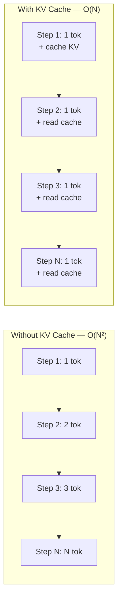
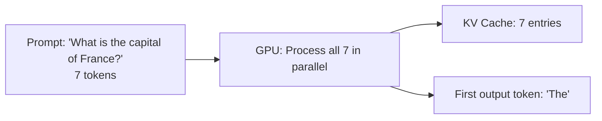
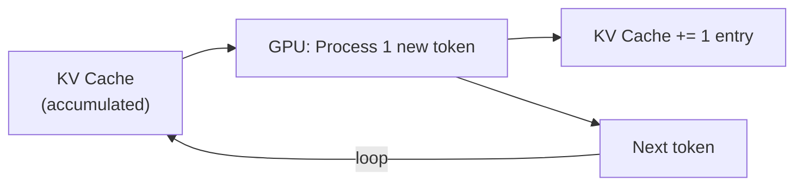
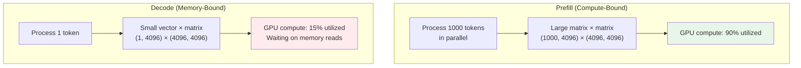

# Module 03 — Prefill, Decode, KV Cache & Memory

> **7 lessons**
> The two phases of inference, why caching is essential, and how to calculate memory.

---

## 03.01 — Why Autoregressive Generation Recomputes Work

### The Problem

Without a KV cache, generating N tokens requires reprocessing **all** previous tokens at each step:

```
Step 1: Process ["The"]                          → 1 token
Step 2: Process ["The", "cat"]                   → 2 tokens
Step 3: Process ["The", "cat", "sat"]            → 3 tokens
Step 4: Process ["The", "cat", "sat", "on"]      → 4 tokens
...
Step N: Process ["The", "cat", "sat", ..., tokN] → N tokens

Total work = 1 + 2 + 3 + ... + N = N(N+1)/2 = O(N²)
```

### With KV Cache

```
Step 1: Process ["The"], SAVE K,V              → 1 token processed
Step 2: Process ["cat"], READ cached K,V       → 1 token processed
Step 3: Process ["sat"], READ cached K,V       → 1 token processed
Step 4: Process ["on"], READ cached K,V        → 1 token processed

Total work = 1 + 1 + 1 + ... + 1 = N = O(N)
```



**Analogy:** Without cache, it's like re-reading an entire book every time you turn a page. With cache, you remember what you've read and only look at the new page.

---

## 03.02 — Understand & Measure the Prefill Phase

### What Is Prefill?

**Prefill** = processing all input tokens at once to build the initial KV cache.



### Characteristics

| Property | Prefill |
|----------|---------|
| **Input** | All prompt tokens at once |
| **Processing** | Parallel (like training) |
| **Bottleneck** | **Compute-bound** (lots of matrix multiplies) |
| **GPU Utilization** | High (80-95%) |
| **Scales as** | O(prompt_length²) for attention, O(prompt_length) for everything else |
| **User experience** | Determines TTFT (Time To First Token) |

```python
import torch
import time

def measure_prefill(model, tokenizer, prompt_lengths=[128, 256, 512, 1024, 2048, 4096]):
    """Measure how prefill time scales with prompt length."""
    results = []

    for length in prompt_lengths:
        # Create a prompt of exactly this length
        dummy_text = "hello " * (length // 2)
        inputs = tokenizer(dummy_text, return_tensors="pt", max_length=length,
                          truncation=True).to(model.device)
        actual_len = inputs['input_ids'].shape[1]

        # Warm up
        with torch.inference_mode():
            _ = model(**inputs)
        torch.cuda.synchronize()

        # Measure
        times = []
        for _ in range(5):
            torch.cuda.synchronize()
            start = time.perf_counter()
            with torch.inference_mode():
                _ = model(**inputs)
            torch.cuda.synchronize()
            times.append(time.perf_counter() - start)

        avg_ms = sum(times) / len(times) * 1000
        results.append((actual_len, avg_ms))
        print(f"  Prefill {actual_len:5d} tokens: {avg_ms:.1f} ms")

    return results
```

---

## 03.03 — Understand & Measure the Decode Phase

### What Is Decode?

**Decode** = generating tokens one at a time using the KV cache.



### Characteristics

| Property | Decode |
|----------|--------|
| **Input** | 1 token at a time |
| **Processing** | Sequential |
| **Bottleneck** | **Memory-bound** (reading model weights for tiny computation) |
| **GPU Utilization** | Low (10-30%) |
| **Scales as** | O(1) compute per token, O(seq_len) memory reads for attention |
| **User experience** | Determines TPOT (Time Per Output Token) |

### Prefill vs Decode Comparison



**Why is decode memory-bound?**
- For each token, you must read ALL model weights from GPU memory
- But you only compute one output row
- The GPU spends most time **waiting for data**, not computing

```python
# The math:
# H100 compute: 990 TFLOPS (BF16)
# H100 bandwidth: 3.35 TB/s
# Llama 70B weights: 140 GB

# Time to read weights: 140 GB / 3350 GB/s = 42ms
# Compute for 1 token: ~500 GFLOP / 990 TFLOPS = 0.5ms
# → 98.8% of time is spent reading memory!
# → This is the definition of memory-bound
```

---

## 03.04 — Build a KV Cache

```python
import torch
import torch.nn as nn

class KVCache:
    """
    Simple KV Cache implementation.
    
    Think of it as a growing notebook:
    - Prefill: write many pages at once
    - Decode: write one page at a time, read all previous pages
    """

    def __init__(self, num_layers, num_kv_heads, head_dim, max_seq_len, dtype=torch.bfloat16):
        self.num_layers = num_layers
        self.num_kv_heads = num_kv_heads
        self.head_dim = head_dim
        self.max_seq_len = max_seq_len
        self.dtype = dtype

        # Pre-allocate tensors for all layers
        # Shape: (num_layers, 2, batch=1, num_kv_heads, max_seq_len, head_dim)
        self.cache_k = [
            torch.zeros(1, num_kv_heads, max_seq_len, head_dim, dtype=dtype, device='cuda')
            for _ in range(num_layers)
        ]
        self.cache_v = [
            torch.zeros(1, num_kv_heads, max_seq_len, head_dim, dtype=dtype, device='cuda')
            for _ in range(num_layers)
        ]
        self.seq_len = 0

    def update(self, layer_idx, new_k, new_v):
        """
        Add new K,V entries to the cache.
        
        new_k, new_v: (batch, num_kv_heads, new_tokens, head_dim)
        """
        new_tokens = new_k.shape[2]

        # Write new entries at the current position
        self.cache_k[layer_idx][:, :, self.seq_len:self.seq_len + new_tokens, :] = new_k
        self.cache_v[layer_idx][:, :, self.seq_len:self.seq_len + new_tokens, :] = new_v

        if layer_idx == self.num_layers - 1:
            self.seq_len += new_tokens

        # Return all cached K,V up to current position
        return (
            self.cache_k[layer_idx][:, :, :self.seq_len + (new_tokens if layer_idx < self.num_layers - 1 else 0), :],
            self.cache_v[layer_idx][:, :, :self.seq_len + (new_tokens if layer_idx < self.num_layers - 1 else 0), :],
        )

    def memory_bytes(self):
        """Calculate total KV cache memory usage."""
        elements = self.num_layers * 2 * self.num_kv_heads * self.seq_len * self.head_dim
        bytes_per_element = 2 if self.dtype == torch.bfloat16 else 4
        return elements * bytes_per_element

    def memory_mb(self):
        return self.memory_bytes() / (1024 ** 2)


# Example: Llama 3 8B KV cache
cache = KVCache(
    num_layers=32,
    num_kv_heads=8,
    head_dim=128,
    max_seq_len=8192,
)

# Simulate prefill: 100 tokens
dummy_k = torch.randn(1, 8, 100, 128, dtype=torch.bfloat16, device='cuda')
dummy_v = torch.randn(1, 8, 100, 128, dtype=torch.bfloat16, device='cuda')
for layer in range(32):
    cache.update(layer, dummy_k, dummy_v)

print(f"After prefill (100 tokens): {cache.memory_mb():.1f} MB")

# Simulate decode: 1 token at a time
for step in range(50):
    new_k = torch.randn(1, 8, 1, 128, dtype=torch.bfloat16, device='cuda')
    new_v = torch.randn(1, 8, 1, 128, dtype=torch.bfloat16, device='cuda')
    for layer in range(32):
        cache.update(layer, new_k, new_v)

print(f"After 50 decode steps (150 tokens): {cache.memory_mb():.1f} MB")
```

---

## 03.05 — Calculate Model & Runtime Memory

### Memory Formula

```
Total GPU Memory = Model Weights + KV Cache + Activations + Overhead
```

```python
def calculate_memory(
    params_billion: float,
    precision_bytes: int,
    num_layers: int,
    num_kv_heads: int,
    head_dim: int,
    seq_len: int,
    batch_size: int,
    kv_precision_bytes: int = None,
):
    """
    Calculate total GPU memory for inference.
    
    Example: Llama 3 8B, BF16, seq_len=4096, batch=1
    """
    kv_precision_bytes = kv_precision_bytes or precision_bytes

    # 1. Model weights
    model_gb = params_billion * 1e9 * precision_bytes / (1024**3)

    # 2. KV cache
    # Per token: 2 (K+V) × num_layers × num_kv_heads × head_dim × bytes
    kv_per_token = 2 * num_layers * num_kv_heads * head_dim * kv_precision_bytes
    kv_total = kv_per_token * seq_len * batch_size
    kv_gb = kv_total / (1024**3)

    # 3. Activations (rough estimate: ~2% of model size during inference)
    activation_gb = model_gb * 0.02

    # 4. CUDA overhead (~500MB - 1GB)
    overhead_gb = 0.75

    total_gb = model_gb + kv_gb + activation_gb + overhead_gb

    print(f"{'='*50}")
    print(f"Memory Breakdown")
    print(f"{'='*50}")
    print(f"Model weights:   {model_gb:>8.2f} GB ({precision_bytes}B per param)")
    print(f"KV cache:        {kv_gb:>8.2f} GB ({batch_size} seqs × {seq_len} tokens)")
    print(f"Activations:     {activation_gb:>8.2f} GB (estimated)")
    print(f"CUDA overhead:   {overhead_gb:>8.2f} GB")
    print(f"{'─'*50}")
    print(f"TOTAL:           {total_gb:>8.2f} GB")
    print(f"{'='*50}")

    return {
        'model_gb': model_gb,
        'kv_gb': kv_gb,
        'activation_gb': activation_gb,
        'overhead_gb': overhead_gb,
        'total_gb': total_gb,
    }

# Llama 3 8B on a single GPU
print("=== Llama 3 8B (BF16, 4K context, 1 request) ===")
mem = calculate_memory(
    params_billion=8, precision_bytes=2,
    num_layers=32, num_kv_heads=8, head_dim=128,
    seq_len=4096, batch_size=1,
)

print("\n=== Llama 3 70B (BF16, 4K context, 10 concurrent) ===")
mem = calculate_memory(
    params_billion=70, precision_bytes=2,
    num_layers=80, num_kv_heads=8, head_dim=128,
    seq_len=4096, batch_size=10,
)
```

---

## 03.06 — Calculate KV Memory, Context & Concurrency Limits

### The Concurrency Formula

```
max_concurrent_requests = (GPU_memory − model_weights − overhead) / kv_per_request
```

```python
def max_concurrency(
    gpu_memory_gb: float,
    model_params_b: float,
    model_precision_bytes: int,
    num_layers: int,
    num_kv_heads: int,
    head_dim: int,
    avg_seq_len: int,
    kv_precision_bytes: int = None,
    memory_utilization: float = 0.90,
):
    """Calculate maximum concurrent requests for a GPU."""
    kv_precision_bytes = kv_precision_bytes or model_precision_bytes

    usable_memory = gpu_memory_gb * memory_utilization
    model_memory = model_params_b * 1e9 * model_precision_bytes / (1024**3)
    overhead = 1.0  # GB

    available_for_kv = usable_memory - model_memory - overhead

    kv_per_request = (2 * num_layers * num_kv_heads * head_dim *
                      kv_precision_bytes * avg_seq_len) / (1024**3)

    max_requests = int(available_for_kv / kv_per_request)

    print(f"GPU Memory:        {gpu_memory_gb:.0f} GB")
    print(f"Usable (×{memory_utilization}):    {usable_memory:.1f} GB")
    print(f"Model weights:     {model_memory:.1f} GB")
    print(f"Available for KV:  {available_for_kv:.1f} GB")
    print(f"KV per request:    {kv_per_request*1024:.1f} MB ({avg_seq_len} tokens)")
    print(f"Max concurrent:    {max_requests} requests")

    return max_requests

print("=== Llama 3 8B on A100 80GB ===")
max_concurrency(
    gpu_memory_gb=80, model_params_b=8, model_precision_bytes=2,
    num_layers=32, num_kv_heads=8, head_dim=128, avg_seq_len=4096,
)

print("\n=== Llama 3 8B on A100 80GB with INT4 quantization ===")
max_concurrency(
    gpu_memory_gb=80, model_params_b=8, model_precision_bytes=1,  # INT4 ≈ 0.5, but with overhead ≈ 1
    num_layers=32, num_kv_heads=8, head_dim=128, avg_seq_len=4096,
)

print("\n=== Llama 3 8B on A100 80GB with FP8 KV cache ===")
max_concurrency(
    gpu_memory_gb=80, model_params_b=8, model_precision_bytes=2,
    num_layers=32, num_kv_heads=8, head_dim=128, avg_seq_len=4096,
    kv_precision_bytes=1,  # FP8 KV cache
)
```

> **🏢 FAANG Deep Dive: KV Cache at OpenAI Scale**
>
> When serving ChatGPT to 100M+ users:
> - Each conversation may have 4K-32K tokens of context
> - Thousands of concurrent conversations per GPU
> - KV cache can consume **more memory than model weights**
>
> This drove OpenAI (and the whole industry) to innovate:
> 1. **PagedAttention** — virtual memory for KV cache (no fragmentation)
> 2. **KV cache quantization** — FP8 cache = 2× more conversations per GPU
> 3. **Prefix caching** — share KV cache across requests with same system prompt
> 4. **KV offloading** — swap cold cache to CPU RAM

---

## 🧪 Lab — Cached vs Uncached Generation & Model Fit

```python
import torch
import time
from transformers import AutoModelForCausalLM, AutoTokenizer

model_name = "meta-llama/Llama-3.2-1B-Instruct"
tokenizer = AutoTokenizer.from_pretrained(model_name)
model = AutoModelForCausalLM.from_pretrained(
    model_name, torch_dtype=torch.bfloat16, device_map="auto"
)
model.eval()

prompt = "Explain the concept of KV caching in LLM inference. "
inputs = tokenizer(prompt, return_tensors="pt").to(model.device)
num_generate = 100

# Method 1: WITHOUT KV cache (recompute everything each step)
def generate_no_cache(model, input_ids, num_tokens):
    generated = input_ids.clone()
    for _ in range(num_tokens):
        with torch.inference_mode():
            outputs = model(generated, use_cache=False)
        next_token = outputs.logits[:, -1:, :].argmax(dim=-1)
        generated = torch.cat([generated, next_token], dim=-1)
    return generated

# Method 2: WITH KV cache
def generate_with_cache(model, input_ids, num_tokens):
    generated = input_ids.clone()
    past = None
    for i in range(num_tokens):
        with torch.inference_mode():
            if past is None:
                outputs = model(generated, use_cache=True)
            else:
                outputs = model(generated[:, -1:], past_key_values=past, use_cache=True)
        past = outputs.past_key_values
        next_token = outputs.logits[:, -1:, :].argmax(dim=-1)
        generated = torch.cat([generated, next_token], dim=-1)
    return generated

# Benchmark both
torch.cuda.synchronize()
start = time.perf_counter()
_ = generate_no_cache(model, inputs['input_ids'], num_generate)
torch.cuda.synchronize()
time_no_cache = time.perf_counter() - start

torch.cuda.synchronize()
start = time.perf_counter()
_ = generate_with_cache(model, inputs['input_ids'], num_generate)
torch.cuda.synchronize()
time_with_cache = time.perf_counter() - start

print(f"\n{'='*50}")
print(f"Generated {num_generate} tokens:")
print(f"  WITHOUT cache: {time_no_cache:.2f}s ({num_generate/time_no_cache:.1f} tok/s)")
print(f"  WITH cache:    {time_with_cache:.2f}s ({num_generate/time_with_cache:.1f} tok/s)")
print(f"  Speedup:       {time_no_cache/time_with_cache:.1f}×")
print(f"{'='*50}")
```

---

**Next Module:** [04 — Benchmark Inference Correctly](../space-03-measurement-capacity/04-benchmark-inference.md) →
