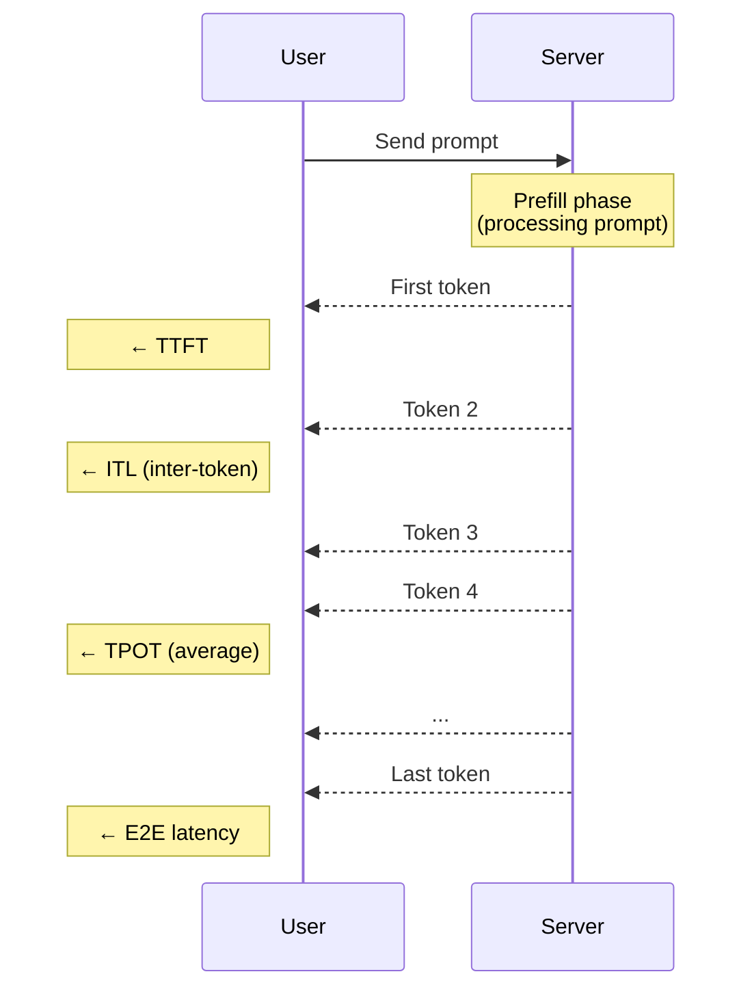
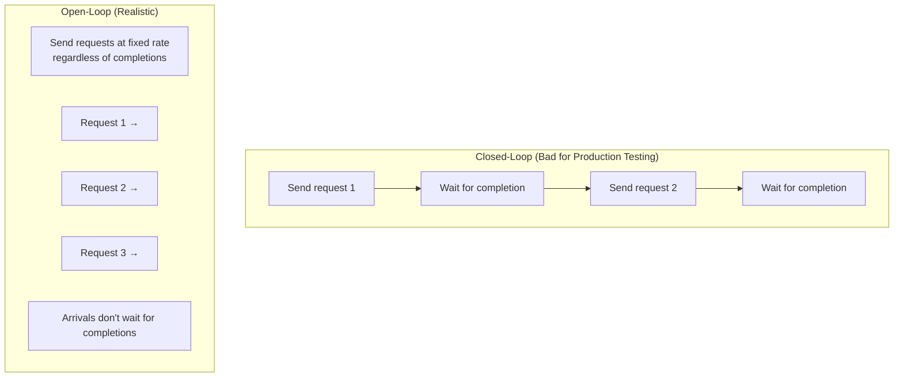

# Module 04 — Benchmark Inference Correctly

> **8 lessons**
> Measure what matters: TTFT, TPOT, throughput, percentiles, and SLOs.

---

## 04.01 — TTFT, TPOT, ITL, E2E & Throughput

### The Core Metrics



| Metric | Full Name | Formula | What It Tells You |
|--------|-----------|---------|-------------------|
| **TTFT** | Time To First Token | Time from request to first token | How responsive the system feels |
| **TPOT** | Time Per Output Token | (E2E - TTFT) / (output_tokens - 1) | How fast tokens stream |
| **ITL** | Inter-Token Latency | Time between consecutive tokens | Smoothness of streaming |
| **E2E** | End-to-End Latency | Total time from request to completion | Total wait time |
| **Throughput** | — | Total tokens generated / time | System efficiency |

```python
import time
import asyncio
import aiohttp
import numpy as np
from dataclasses import dataclass, field
from typing import List

@dataclass
class RequestMetrics:
    """Metrics for a single inference request."""
    ttft_ms: float = 0
    tpot_ms: float = 0
    e2e_ms: float = 0
    itl_ms: List[float] = field(default_factory=list)
    output_tokens: int = 0
    input_tokens: int = 0

    @property
    def throughput_tps(self):
        return self.output_tokens / (self.e2e_ms / 1000) if self.e2e_ms > 0 else 0

async def measure_streaming_request(session, url, prompt, max_tokens=100):
    """Measure all latency metrics for a single streaming request."""
    metrics = RequestMetrics()

    payload = {
        "prompt": prompt,
        "max_tokens": max_tokens,
        "stream": True,
    }

    start = time.perf_counter()
    first_token_time = None
    last_token_time = start
    token_count = 0

    async with session.post(url, json=payload) as response:
        async for line in response.content:
            line = line.decode('utf-8').strip()
            if not line or line == 'data: [DONE]':
                continue

            now = time.perf_counter()

            if first_token_time is None:
                first_token_time = now
                metrics.ttft_ms = (first_token_time - start) * 1000
            else:
                itl = (now - last_token_time) * 1000
                metrics.itl_ms.append(itl)

            last_token_time = now
            token_count += 1

    metrics.e2e_ms = (last_token_time - start) * 1000
    metrics.output_tokens = token_count
    if token_count > 1:
        metrics.tpot_ms = (metrics.e2e_ms - metrics.ttft_ms) / (token_count - 1)

    return metrics
```

### E2E Latency Formula

```
E2E = TTFT + (output_tokens - 1) × TPOT
```

```python
# Example: 
ttft = 200       # ms (prefill time)
tpot = 30        # ms (per-token decode time)  
output_tokens = 100

e2e = ttft + (output_tokens - 1) * tpot
print(f"E2E = {ttft} + {output_tokens - 1} × {tpot} = {e2e} ms = {e2e/1000:.1f}s")
# E2E = 200 + 99 × 30 = 3170 ms = 3.2s
```

---

## 04.02 — Concurrency, Request Rate & Arrival Patterns

### Open-Loop vs Closed-Loop Benchmarking



**Closed-loop:** Send next request only after previous completes. Under-tests the system.
**Open-loop:** Send requests at a fixed rate. Reveals queuing behavior and saturation.

```python
import asyncio
import numpy as np

async def open_loop_benchmark(url, prompts, request_rate, duration_sec=60):
    """
    Open-loop benchmark: send requests at a fixed rate.
    This is how real traffic arrives!
    """
    interval = 1.0 / request_rate
    metrics = []

    async with aiohttp.ClientSession() as session:
        tasks = []
        start_time = time.perf_counter()

        prompt_idx = 0
        while time.perf_counter() - start_time < duration_sec:
            prompt = prompts[prompt_idx % len(prompts)]
            task = asyncio.create_task(
                measure_streaming_request(session, url, prompt)
            )
            tasks.append(task)
            prompt_idx += 1

            # Wait for next arrival (Poisson-like with fixed rate)
            await asyncio.sleep(interval)

        # Collect all results
        metrics = await asyncio.gather(*tasks)

    return metrics

async def closed_loop_benchmark(url, prompts, concurrency, num_requests=100):
    """
    Closed-loop benchmark: maintain N concurrent requests.
    Simpler but doesn't reveal queuing behavior.
    """
    semaphore = asyncio.Semaphore(concurrency)
    metrics = []

    async def bounded_request(session, prompt):
        async with semaphore:
            return await measure_streaming_request(session, url, prompt)

    async with aiohttp.ClientSession() as session:
        tasks = [
            bounded_request(session, prompts[i % len(prompts)])
            for i in range(num_requests)
        ]
        metrics = await asyncio.gather(*tasks)

    return metrics
```

---

## 04.03 — Short, Long, Shared-Prefix & Mixed Workloads

### Workload Profiles

| Workload | Input Length | Output Length | Pattern | Example |
|----------|-------------|--------------|---------|---------|
| **Chatbot** | 50-500 | 100-1000 | Short in, long out | Customer support |
| **RAG** | 2000-8000 | 50-200 | Long in, short out | Document Q&A |
| **Code Gen** | 200-2000 | 100-500 | Medium/medium | Copilot |
| **Summarization** | 4000-32000 | 100-500 | Very long in, short out | Article summaries |
| **Multi-Turn** | Growing | Variable | Accumulating context | Chat history |
| **Shared Prefix** | System prompt repeated | Variable | Cache-friendly | Same system prompt |

```python
import random

def generate_workload(profile, num_requests=100):
    """Generate a realistic workload for benchmarking."""
    workloads = {
        "chatbot": {"input_range": (50, 500), "output_range": (100, 1000)},
        "rag": {"input_range": (2000, 8000), "output_range": (50, 200)},
        "code_gen": {"input_range": (200, 2000), "output_range": (100, 500)},
        "summarize": {"input_range": (4000, 32000), "output_range": (100, 500)},
    }

    config = workloads[profile]
    requests = []
    for _ in range(num_requests):
        input_len = random.randint(*config["input_range"])
        output_len = random.randint(*config["output_range"])
        requests.append({"input_tokens": input_len, "max_tokens": output_len})

    avg_in = sum(r["input_tokens"] for r in requests) / len(requests)
    avg_out = sum(r["max_tokens"] for r in requests) / len(requests)
    print(f"Workload '{profile}': {num_requests} requests")
    print(f"  Avg input:  {avg_in:.0f} tokens")
    print(f"  Avg output: {avg_out:.0f} tokens")

    return requests
```

---

## 04.04 — Warm-Up, Steady State & Reproducible Runs

### Why Warm-Up Matters

```python
def run_benchmark_with_warmup(model, prompts, num_warmup=10, num_measure=100):
    """
    The first N requests are always slower due to:
    1. CUDA kernel compilation (first use of each kernel shape)
    2. CUDA graph capture (if enabled)
    3. Memory pool initialization
    4. Cache cold-start
    5. torch.compile tracing (if enabled)
    """
    all_times = []

    for i in range(num_warmup + num_measure):
        start = time.perf_counter()
        # ... run inference ...
        elapsed = time.perf_counter() - start
        all_times.append(elapsed * 1000)

    warmup_times = all_times[:num_warmup]
    measure_times = all_times[num_warmup:]

    print(f"Warm-up requests (DISCARD): avg={np.mean(warmup_times):.1f}ms")
    print(f"Measured requests:          avg={np.mean(measure_times):.1f}ms")
    print(f"Warm-up overhead:           {np.mean(warmup_times)/np.mean(measure_times):.1f}× slower")

    return measure_times
```

### Reproducibility Checklist

```python
# Always set these for reproducible benchmarks:
import torch
import random
import numpy as np

SEED = 42
torch.manual_seed(SEED)
torch.cuda.manual_seed_all(SEED)
random.seed(SEED)
np.random.seed(SEED)

# Report environment
print(f"PyTorch: {torch.__version__}")
print(f"CUDA: {torch.version.cuda}")
print(f"GPU: {torch.cuda.get_device_name(0)}")
print(f"Driver: {torch.cuda.get_device_properties(0)}")

# Disable non-deterministic operations if needed
torch.backends.cudnn.deterministic = True
torch.backends.cudnn.benchmark = False
```

---

## 04.05 — P50, P95, P99 & Variance

### Why Percentiles, Not Averages

```python
import numpy as np

# Simulated latencies: mostly fast, some slow outliers
np.random.seed(42)
fast = np.random.normal(40, 5, 950)       # 95%: ~40ms
slow = np.random.normal(300, 50, 50)       # 5%: ~300ms (GC, preemption, etc.)
latencies = np.concatenate([fast, slow])
np.random.shuffle(latencies)

stats = {
    'Mean': np.mean(latencies),
    'P50 (Median)': np.percentile(latencies, 50),
    'P90': np.percentile(latencies, 90),
    'P95': np.percentile(latencies, 95),
    'P99': np.percentile(latencies, 99),
    'Max': np.max(latencies),
}

print("Latency Statistics:")
for name, value in stats.items():
    bar = '█' * int(value / 5)
    print(f"  {name:>15}: {value:7.1f} ms {bar}")

# Output:
#            Mean:    53.1 ms ██████████
#   P50 (Median):    40.2 ms ████████
#             P90:    42.3 ms ████████
#             P95:   255.8 ms ███████████████████████████████████████████████████
#             P99:   381.2 ms ████████████████████████████████████████████████████████████████████████████
#             Max:   432.1 ms ██████████████████████████████████████████████████████████████████████████████████████

# The MEAN (53ms) hides the fact that 5% of users wait 300ms+!
# Always report P95 and P99 for production systems.
```

---

## 04.06 — Goodput, SLOs & Failure Rates

### Goodput = Throughput That Meets SLOs

```python
def calculate_goodput(metrics_list, slo_ttft_ms=500, slo_tpot_ms=50):
    """
    Goodput: only count tokens from requests that met ALL SLOs.
    
    SLO = Service Level Objective
    Example: TTFT < 500ms AND TPOT < 50ms
    """
    total_tokens = 0
    good_tokens = 0
    total_requests = len(metrics_list)
    good_requests = 0

    for m in metrics_list:
        total_tokens += m.output_tokens
        meets_slo = (m.ttft_ms <= slo_ttft_ms) and (m.tpot_ms <= slo_tpot_ms)
        if meets_slo:
            good_tokens += m.output_tokens
            good_requests += 1

    goodput_rate = good_requests / total_requests * 100
    token_goodput = good_tokens / total_tokens * 100 if total_tokens > 0 else 0

    print(f"SLO: TTFT < {slo_ttft_ms}ms, TPOT < {slo_tpot_ms}ms")
    print(f"Requests meeting SLO: {good_requests}/{total_requests} ({goodput_rate:.1f}%)")
    print(f"Token goodput: {good_tokens}/{total_tokens} ({token_goodput:.1f}%)")
    print(f"Throughput: {total_tokens} tokens | Goodput: {good_tokens} tokens")

    return goodput_rate, token_goodput
```

---

## 04.07 — Benchmarking With vLLM, SGLang & GuideLLM

### vLLM Benchmark

```bash
# Built-in vLLM benchmark script
python -m vllm.entrypoints.openai.api_server \
    --model meta-llama/Llama-3-8B-Instruct \
    --port 8000

# Run benchmark
python benchmarks/benchmark_serving.py \
    --backend vllm \
    --model meta-llama/Llama-3-8B-Instruct \
    --dataset-name sharegpt \
    --num-prompts 1000 \
    --request-rate 10
```

### Custom Benchmark Harness

```python
import asyncio
import aiohttp
import time
import numpy as np
from dataclasses import dataclass

@dataclass
class BenchmarkConfig:
    url: str = "http://localhost:8000/v1/completions"
    model: str = "meta-llama/Llama-3-8B-Instruct"
    num_requests: int = 200
    concurrency: int = 32
    input_len: int = 512
    output_len: int = 128
    warmup_requests: int = 20

async def run_full_benchmark(config: BenchmarkConfig):
    """Complete inference benchmark with all metrics."""
    print(f"\n{'='*60}")
    print(f"INFERENCE BENCHMARK")
    print(f"{'='*60}")
    print(f"Model: {config.model}")
    print(f"Requests: {config.num_requests} ({config.warmup_requests} warmup)")
    print(f"Concurrency: {config.concurrency}")
    print(f"Input/Output: {config.input_len}/{config.output_len} tokens")
    print(f"{'='*60}\n")

    # Generate prompts
    prompts = [f"Write a detailed explanation about topic number {i}:" for i in range(config.num_requests)]
    metrics = []
    semaphore = asyncio.Semaphore(config.concurrency)

    async def bounded_request(session, prompt, idx):
        async with semaphore:
            m = await measure_streaming_request(session, config.url, prompt, config.output_len)
            if idx >= config.warmup_requests:
                metrics.append(m)
            return m

    start_time = time.perf_counter()

    async with aiohttp.ClientSession() as session:
        tasks = [bounded_request(session, p, i) for i, p in enumerate(prompts)]
        await asyncio.gather(*tasks)

    total_time = time.perf_counter() - start_time

    # Calculate statistics
    ttfts = [m.ttft_ms for m in metrics]
    tpots = [m.tpot_ms for m in metrics if m.tpot_ms > 0]
    e2es = [m.e2e_ms for m in metrics]
    total_tokens = sum(m.output_tokens for m in metrics)

    print(f"\n{'='*60}")
    print(f"RESULTS ({len(metrics)} measured requests)")
    print(f"{'='*60}")
    print(f"\nTTFT (Time To First Token):")
    print(f"  Mean:  {np.mean(ttfts):>8.1f} ms")
    print(f"  P50:   {np.percentile(ttfts, 50):>8.1f} ms")
    print(f"  P95:   {np.percentile(ttfts, 95):>8.1f} ms")
    print(f"  P99:   {np.percentile(ttfts, 99):>8.1f} ms")
    print(f"\nTPOT (Time Per Output Token):")
    print(f"  Mean:  {np.mean(tpots):>8.1f} ms")
    print(f"  P50:   {np.percentile(tpots, 50):>8.1f} ms")
    print(f"  P95:   {np.percentile(tpots, 95):>8.1f} ms")
    print(f"  P99:   {np.percentile(tpots, 99):>8.1f} ms")
    print(f"\nThroughput:")
    print(f"  Total tokens: {total_tokens}")
    print(f"  Tokens/sec:   {total_tokens/total_time:.1f}")
    print(f"  Requests/sec: {len(metrics)/total_time:.1f}")
    print(f"{'='*60}")

# asyncio.run(run_full_benchmark(BenchmarkConfig()))
```

> **🏢 FAANG Deep Dive: Google's SLO Framework**
>
> Google's Gemini API team defines SLOs as:
> - **TTFT P50 < 200ms, P95 < 500ms, P99 < 1000ms**
> - **TPOT P50 < 20ms, P95 < 40ms, P99 < 80ms**
> - **Goodput > 99.5%** (99.5% of requests must meet all SLOs)
>
> They measure these continuously and automatically scale infrastructure
> when SLOs are at risk. The key insight: **measure what users feel, not
> what the system reports.**

---

## 🧪 Project — Build Your Inference Benchmark Harness

Build a complete, reusable benchmark tool that:
1. Supports both open-loop and closed-loop modes
2. Measures TTFT, TPOT, ITL, E2E, and throughput
3. Reports P50/P90/P95/P99 percentiles
4. Calculates goodput against configurable SLOs
5. Generates plots (latency distribution, throughput vs concurrency)
6. Outputs results as JSON for comparison

---

**Next Module:** [05 — Break One GPU](./05-break-one-gpu.md) →
