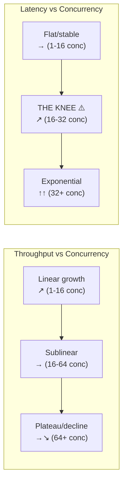
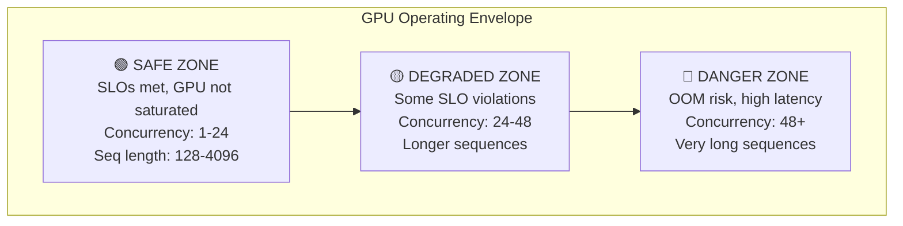

# Module 05 — Break One GPU

> **5 lessons**
> Push one GPU to its limits. Find where latency degrades, throughput saturates, and memory runs out.

---

## 05.01 — Establish the Single-Request Baseline

The baseline is the **best possible performance** — one request, no contention:

```python
import asyncio
import time
import numpy as np

async def establish_baseline(url, prompt, max_tokens=128, num_runs=20):
    """Measure the best-case scenario: single request, no contention."""
    results = []

    for i in range(num_runs + 5):  # 5 warmup
        metrics = await measure_streaming_request(url, prompt, max_tokens)
        if i >= 5:
            results.append(metrics)

    ttfts = [m.ttft_ms for m in results]
    tpots = [m.tpot_ms for m in results]

    print("=== SINGLE-REQUEST BASELINE ===")
    print(f"TTFT:  {np.median(ttfts):.1f}ms (P50)  {np.percentile(ttfts, 99):.1f}ms (P99)")
    print(f"TPOT:  {np.median(tpots):.1f}ms (P50)  {np.percentile(tpots, 99):.1f}ms (P99)")
    print(f"This is the BEST your system can do. Everything else adds latency.")

    return {'ttft_p50': np.median(ttfts), 'tpot_p50': np.median(tpots)}
```

---

## 05.02 — Sweep Concurrency & Request Rate

```python
async def sweep_concurrency(url, prompt, max_tokens=128,
                            concurrency_levels=[1, 2, 4, 8, 16, 32, 64, 128]):
    """
    Increase concurrent requests and watch what happens.
    
    Expected pattern:
    - Low concurrency: latency stable, throughput grows linearly
    - Medium: throughput still growing, latency starting to increase
    - High: throughput plateaus (GPU saturated), latency grows unbounded
    """
    results = []

    for conc in concurrency_levels:
        metrics = await closed_loop_benchmark(
            url, [prompt] * 200, concurrency=conc, num_requests=max(100, conc*5)
        )

        ttfts = [m.ttft_ms for m in metrics]
        tpots = [m.tpot_ms for m in metrics]
        total_tokens = sum(m.output_tokens for m in metrics)
        total_time_s = max(m.e2e_ms for m in metrics) / 1000

        result = {
            'concurrency': conc,
            'ttft_p50': np.percentile(ttfts, 50),
            'ttft_p99': np.percentile(ttfts, 99),
            'tpot_p50': np.percentile(tpots, 50),
            'throughput_tps': total_tokens / total_time_s,
        }
        results.append(result)
        print(f"Conc={conc:3d} | TTFT P50={result['ttft_p50']:>7.1f}ms "
              f"P99={result['ttft_p99']:>7.1f}ms | "
              f"Throughput={result['throughput_tps']:>6.0f} tok/s")

    return results
```

### The Knee of the Curve



---

## 05.03 — Sweep Prompt & Output Length

```python
async def sweep_prompt_length(url, prompt_lengths=[128, 256, 512, 1024, 2048, 4096, 8192]):
    """See how TTFT scales with input length (should be roughly linear to quadratic)."""
    results = []

    for length in prompt_lengths:
        prompt = "word " * (length // 2)  # Approximate token count
        metrics = await run_n_requests(url, prompt, max_tokens=10, n=20)

        ttfts = [m.ttft_ms for m in metrics]
        result = {
            'input_length': length,
            'ttft_p50': np.percentile(ttfts, 50),
            'ttft_p99': np.percentile(ttfts, 99),
        }
        results.append(result)
        print(f"Input={length:5d} tokens | TTFT P50={result['ttft_p50']:>7.1f}ms")

    # Check scaling: is it linear or quadratic?
    if len(results) >= 2:
        ratio = results[-1]['ttft_p50'] / results[0]['ttft_p50']
        length_ratio = results[-1]['input_length'] / results[0]['input_length']
        print(f"\nScaling: {length_ratio:.0f}× longer input → {ratio:.1f}× slower TTFT")
        if ratio > length_ratio * 1.5:
            print("⚠️  Super-linear scaling detected (likely attention quadratic cost)")
        else:
            print("✅ Roughly linear scaling (FlashAttention working)")

    return results

async def sweep_output_length(url, output_lengths=[32, 64, 128, 256, 512, 1024]):
    """See how E2E scales with output length (should be linear)."""
    prompt = "Write a long essay about technology:"
    results = []

    for length in output_lengths:
        metrics = await run_n_requests(url, prompt, max_tokens=length, n=20)
        e2es = [m.e2e_ms for m in metrics]

        result = {
            'output_length': length,
            'e2e_p50': np.percentile(e2es, 50),
        }
        results.append(result)
        print(f"Output={length:5d} tokens | E2E P50={result['e2e_p50']:>8.1f}ms")

    return results
```

---

## 05.04 — Find Saturation, SLO Failure & OOM Boundaries

```python
async def find_boundaries(url, prompt, slo_ttft=500, slo_tpot=50):
    """
    Find three critical points:
    1. SLO violation point: where P95 TTFT exceeds SLO
    2. Saturation point: where adding concurrency doesn't help throughput
    3. OOM boundary: where requests start failing
    """
    print("=== Finding GPU Operating Boundaries ===\n")

    slo_violation_conc = None
    saturation_conc = None
    oom_conc = None
    prev_throughput = 0

    for conc in [1, 2, 4, 8, 16, 24, 32, 48, 64, 96, 128, 192, 256]:
        try:
            metrics = await closed_loop_benchmark(url, [prompt]*100, concurrency=conc)

            ttft_p95 = np.percentile([m.ttft_ms for m in metrics], 95)
            total_tokens = sum(m.output_tokens for m in metrics)
            throughput = total_tokens / (max(m.e2e_ms for m in metrics) / 1000)

            status = "✅"

            # Check SLO violation
            if ttft_p95 > slo_ttft and slo_violation_conc is None:
                slo_violation_conc = conc
                status = "⚠️  SLO"

            # Check saturation (throughput didn't improve by >5%)
            if throughput < prev_throughput * 1.05 and saturation_conc is None and conc > 4:
                saturation_conc = conc
                status = "📊 SAT"

            prev_throughput = max(prev_throughput, throughput)

            print(f"{status} Conc={conc:3d} | TTFT P95={ttft_p95:>7.0f}ms | "
                  f"Throughput={throughput:>6.0f} tok/s")

        except Exception as e:
            oom_conc = conc
            print(f"💥 Conc={conc:3d} | FAILED: {e}")
            break

    print(f"\n{'='*50}")
    print(f"BOUNDARIES:")
    print(f"  SLO violation at:  {slo_violation_conc or 'Not found'} concurrent")
    print(f"  Saturation at:     {saturation_conc or 'Not found'} concurrent")
    print(f"  OOM at:            {oom_conc or 'Not found'} concurrent")
    print(f"  Safe operating range: 1 - {(slo_violation_conc or saturation_conc or 128) - 1} concurrent")
    print(f"{'='*50}")
```

---

## 🧪 Lab — Map the GPU Operating Envelope

### The Operating Envelope



The operating envelope is a 2D map: **concurrency × sequence length**, colored by whether SLOs are met.

```python
import numpy as np

async def map_operating_envelope(url, slo_ttft=500, slo_tpot=50):
    """Create a 2D map of the GPU's safe operating region."""

    concurrency_levels = [1, 4, 8, 16, 32, 64]
    seq_lengths = [256, 512, 1024, 2048, 4096]

    envelope = np.zeros((len(concurrency_levels), len(seq_lengths)))

    for i, conc in enumerate(concurrency_levels):
        for j, seq_len in enumerate(seq_lengths):
            prompt = "word " * (seq_len // 2)
            try:
                metrics = await closed_loop_benchmark(
                    url, [prompt]*50, concurrency=conc, num_requests=50
                )
                ttft_p95 = np.percentile([m.ttft_ms for m in metrics], 95)
                tpot_p95 = np.percentile([m.tpot_ms for m in metrics if m.tpot_ms > 0], 95)

                if ttft_p95 <= slo_ttft and tpot_p95 <= slo_tpot:
                    envelope[i][j] = 1  # Safe
                else:
                    envelope[i][j] = 0.5  # Degraded
            except:
                envelope[i][j] = 0  # Failed

    # Print envelope
    print("\n=== GPU OPERATING ENVELOPE ===")
    print(f"{'Conc':>6}", end="")
    for sl in seq_lengths:
        print(f" {sl:>6}", end="")
    print()

    for i, conc in enumerate(concurrency_levels):
        print(f"{conc:>6}", end="")
        for j in range(len(seq_lengths)):
            symbol = {1: "  🟢", 0.5: "  🟡", 0: "  🔴"}[envelope[i][j]]
            print(symbol, end="")
        print()

# asyncio.run(map_operating_envelope("http://localhost:8000/v1/completions"))
```

> **🏢 FAANG Deep Dive: Meta's GPU Capacity Testing**
>
> Before deploying to production, Meta's inference team runs:
> 1. **Baseline test**: single request latency on the target hardware
> 2. **Ramp test**: gradually increase load from 1% to 150% of expected traffic
> 3. **Spike test**: sudden 10x traffic increase
> 4. **Endurance test**: sustained high load for 24+ hours
> 5. **Chaos test**: kill random workers during load test
>
> Only configs that pass ALL tests get deployed. The operating envelope
> is documented and enforced by the autoscaler (never exceed the safe zone).

---

**Next Module:** [06 — Move to a Real Inference Engine](../space-04-serving-engine-fundamentals/06-real-inference-engine.md) →
