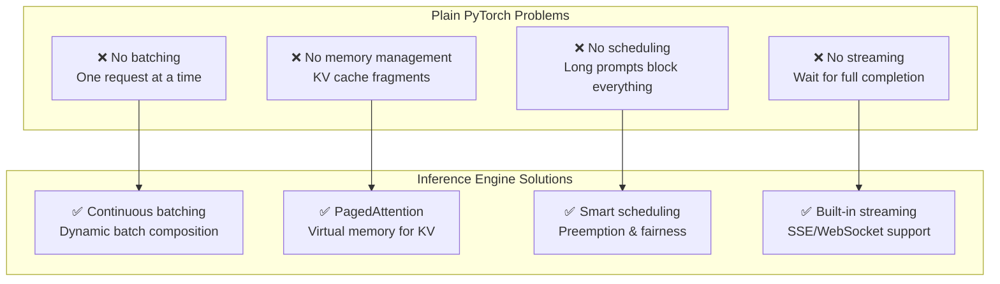
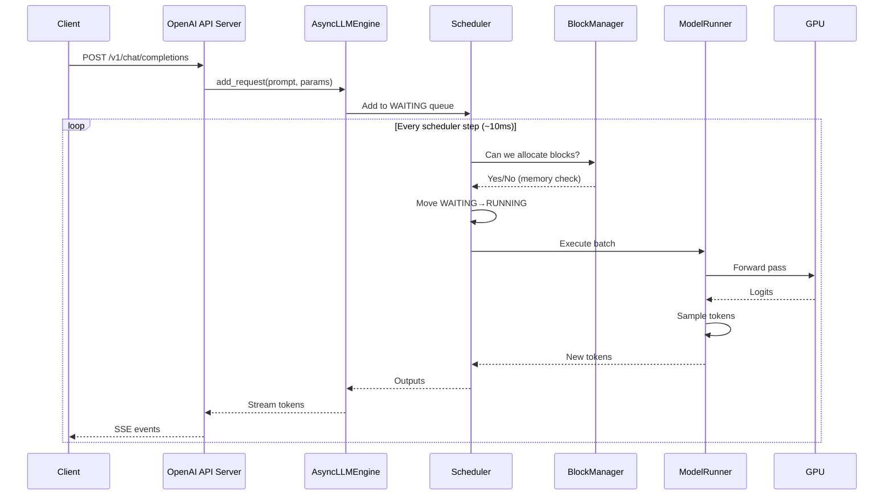

# Module 06 — Move to a Real Inference Engine

> **6 lessons**
> Why PyTorch alone fails, and how vLLM solves it.

---

## 06.01 — Why Plain PyTorch Serving Breaks Down



### Side-by-Side Benchmark

```python
# Result of serving 100 concurrent requests:
#
# PyTorch (sequential):
#   Throughput: ~30 tokens/sec
#   TTFT P50: 2000ms (waits in queue)
#   GPU util: 15-25%
#
# vLLM:
#   Throughput: ~1500 tokens/sec (50x better!)
#   TTFT P50: 150ms
#   GPU util: 75-90%
```

---

## 06.02 — Start a vLLM Engine

```bash
# Install
pip install vllm

# Start server (simplest)
vllm serve meta-llama/Llama-3-8B-Instruct

# Start with tuning
vllm serve meta-llama/Llama-3-8B-Instruct \
    --tensor-parallel-size 1 \
    --max-model-len 8192 \
    --gpu-memory-utilization 0.90 \
    --enable-prefix-caching \
    --max-num-seqs 256 \
    --port 8000
```

## 06.03 — OpenAI-Compatible APIs & Streaming

```python
from openai import OpenAI

client = OpenAI(base_url="http://localhost:8000/v1", api_key="unused")

# Non-streaming
response = client.chat.completions.create(
    model="meta-llama/Llama-3-8B-Instruct",
    messages=[{"role": "user", "content": "What is inference?"}],
    max_tokens=200,
)
print(response.choices[0].message.content)

# Streaming
stream = client.chat.completions.create(
    model="meta-llama/Llama-3-8B-Instruct",
    messages=[{"role": "user", "content": "Write a poem"}],
    max_tokens=200,
    stream=True,
)
for chunk in stream:
    if chunk.choices[0].delta.content:
        print(chunk.choices[0].delta.content, end="", flush=True)
```

## 06.04 — Read Engine Metrics

```bash
# Prometheus metrics endpoint
curl http://localhost:8000/metrics

# Key metrics:
# vllm:num_requests_running        — currently processing
# vllm:num_requests_waiting        — in queue
# vllm:gpu_cache_usage_perc        — KV cache utilization
# vllm:avg_generation_throughput   — tokens/sec
# vllm:e2e_request_latency_seconds — end-to-end latency histogram
```

## 06.05 — Follow a Request Through vLLM



> **🏢 FAANG Deep Dive:** vLLM started as a UC Berkeley research project (2023). It introduced PagedAttention, which reduced KV cache waste by 60-80%. Within 18 months, it became the most widely deployed open-source inference engine, used by companies from startups to Meta.

---

**Next Module:** [07 — Continuous Batching & Scheduling](./07-continuous-batching.md) →
