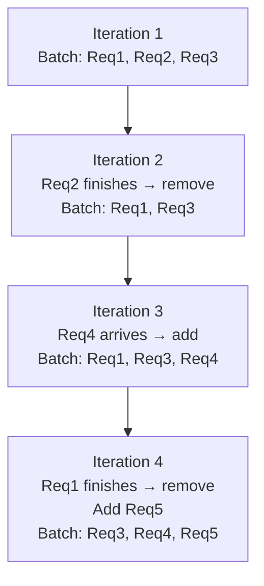

# Module 07 — Continuous Batching & Scheduling

> **7 lessons**
> The algorithm that made LLM serving practical.

---

## 07.01 — One-by-One Serving vs Static Batching

### No Batching (Naive)

```
Time →→→→→→→→→→→→→→→→→→→→→→→
GPU: [===Req1===]              [===Req2===]              [===Req3===]
                 ↑ idle                   ↑ idle
                 waste!                   waste!
```

### Static Batching

```
Wait for 4 requests, then process together:

GPU: [====== Req1+2+3+4 (padded to longest) ======]
           Req1 done ↑  but waits for Req4 to finish!
```

**Problem:** The shortest request is done but can't leave until the longest finishes.

---

## 07.02 — Iteration-Level Scheduling

Instead of deciding the batch once, **re-evaluate every iteration**:



---

## 07.03 — Continuous Batching

```
Time →→→→→→→→→→→→→→→→→→→→→→→→→→→→→→→→→
Req1: [PPPP][DDDDDDDD]
Req2:    [PP][DDDDDDDDDDDD]
Req3:         [PPPP][DDDDDDDDD]
Req4:                  [PP][DDDDDDDDDDD]

P = prefill, D = decode
New requests join mid-generation!
Finished requests leave immediately!
GPU stays busy the whole time!
```

### Build a Tiny Continuous Batching Simulator

```python
import heapq
from enum import Enum
from dataclasses import dataclass, field
from typing import List, Optional

class RequestState(Enum):
    WAITING = "waiting"
    RUNNING = "running"
    FINISHED = "finished"

@dataclass
class Request:
    id: int
    arrival_time: float
    prompt_tokens: int
    max_output_tokens: int
    state: RequestState = RequestState.WAITING
    tokens_generated: int = 0
    prefill_done: bool = False
    start_time: float = 0
    first_token_time: float = 0
    finish_time: float = 0

class ContinuousBatchingScheduler:
    """Simplified continuous batching scheduler."""

    def __init__(self, max_batch_size=32, max_tokens_per_step=4096):
        self.max_batch_size = max_batch_size
        self.max_tokens_per_step = max_tokens_per_step
        self.waiting_queue: List[Request] = []
        self.running_batch: List[Request] = []
        self.finished: List[Request] = []
        self.current_time = 0
        self.step_count = 0

    def add_request(self, request: Request):
        """Add a new request to the waiting queue."""
        self.waiting_queue.append(request)

    def schedule_step(self):
        """Decide what to run this iteration — the core algorithm."""
        self.step_count += 1

        # 1. Remove finished requests from running batch
        still_running = []
        for req in self.running_batch:
            if req.tokens_generated >= req.max_output_tokens:
                req.state = RequestState.FINISHED
                req.finish_time = self.current_time
                self.finished.append(req)
            else:
                still_running.append(req)
        self.running_batch = still_running

        # 2. Calculate token budget
        decode_tokens = len(self.running_batch)  # 1 token per running request
        remaining_budget = self.max_tokens_per_step - decode_tokens
        remaining_slots = self.max_batch_size - len(self.running_batch)

        # 3. Admit waiting requests (FCFS) if budget allows
        newly_admitted = []
        while (self.waiting_queue and remaining_slots > 0 and
               remaining_budget >= self.waiting_queue[0].prompt_tokens):
            req = self.waiting_queue.pop(0)
            req.state = RequestState.RUNNING
            req.start_time = self.current_time
            remaining_budget -= req.prompt_tokens
            remaining_slots -= 1
            newly_admitted.append(req)

        # 4. Execute: prefill new requests, decode running requests
        for req in newly_admitted:
            req.prefill_done = True
            req.first_token_time = self.current_time
            req.tokens_generated = 1
            self.running_batch.append(req)

        for req in self.running_batch:
            if req not in newly_admitted:
                req.tokens_generated += 1

        self.current_time += 0.01  # ~10ms per step

    def run_simulation(self, requests: List[Request], max_steps=10000):
        """Run the scheduler simulation."""
        for req in requests:
            self.add_request(req)

        while (self.running_batch or self.waiting_queue) and self.step_count < max_steps:
            self.schedule_step()

        # Print results
        print(f"\n{'='*60}")
        print(f"CONTINUOUS BATCHING SIMULATION RESULTS")
        print(f"{'='*60}")
        print(f"Total requests: {len(self.finished)}")
        print(f"Total steps: {self.step_count}")

        ttfts = [(r.first_token_time - r.arrival_time) * 1000 for r in self.finished]
        e2es = [(r.finish_time - r.arrival_time) * 1000 for r in self.finished]

        import numpy as np
        print(f"TTFT P50: {np.percentile(ttfts, 50):.0f}ms  P99: {np.percentile(ttfts, 99):.0f}ms")
        print(f"E2E  P50: {np.percentile(e2es, 50):.0f}ms  P99: {np.percentile(e2es, 99):.0f}ms")

# Run simulation
requests = [
    Request(id=i, arrival_time=i*0.005, prompt_tokens=100+i*10, max_output_tokens=50+i*5)
    for i in range(100)
]

scheduler = ContinuousBatchingScheduler(max_batch_size=32, max_tokens_per_step=4096)
scheduler.run_simulation(requests)
```

---

## 07.04 — Token Budgets & Limits

| Parameter | What It Controls | Too Low | Too High |
|-----------|-----------------|---------|----------|
| `max_num_seqs` | Max concurrent sequences | Low throughput | OOM risk |
| `max_num_batched_tokens` | Max tokens per iteration | Slow prefill admission | High latency |
| `max_model_len` | Max sequence length | Can't serve long contexts | More KV memory |

## 07.05 — Queueing, Fairness & Preemption

When GPU is full, the scheduler must choose: who gets preempted?

- **FCFS (First Come First Served):** Fair but not efficient
- **Shortest Job First:** Better throughput but unfair to long requests
- **Priority-based:** Premium users first
- **Preemption:** Pause a running request to admit a higher-priority one

> **🏢 FAANG Deep Dive: Orca Paper** (Yu et al., OSDI 2022)
>
> Orca introduced iteration-level scheduling for LLM serving. Before Orca,
> most systems used static batching. Orca showed that continuous batching
> could improve throughput by **up to 36×** while maintaining latency SLOs.
> This paper directly inspired vLLM's scheduler design.

---

**Next Module:** [08 — PagedAttention & KV Memory Management](./08-paged-attention.md) →
