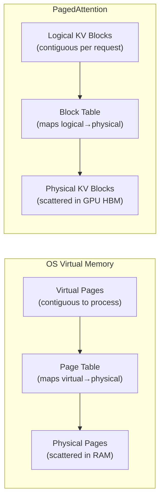
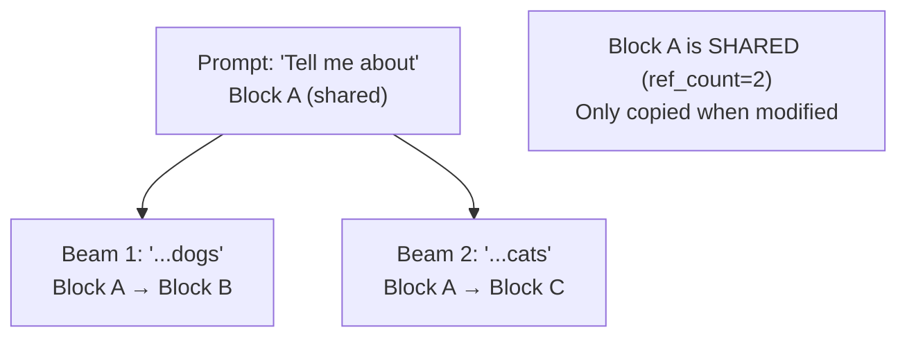
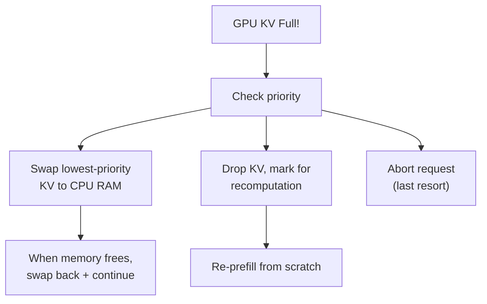

# Module 08 — PagedAttention & KV Memory Management

> **6 lessons**
> The breakthrough that solved GPU memory fragmentation for LLM serving.

---

## 08.01 — Why Contiguous KV Allocation Breaks

### The Fragmentation Problem

```
Before PagedAttention — Contiguous allocation:

GPU Memory: [Model Weights][ Req1 KV (2K)     ][ Req2 KV (1K) ][FREE][Req3 KV (512)]
                                                              ↑
                                                    Can't fit a 2K request here!
                                                    Even though total free = 2.5K

Problem: 60-80% of KV memory is WASTED due to:
1. Internal fragmentation (pre-allocated max length but used less)
2. External fragmentation (free blocks scattered)
```

**Analogy:** It's like reserving an entire row in a movie theater for each person, even if they only need one seat. Most seats are wasted.

---

## 08.02 — KV Blocks, Block Tables & Fragmentation

### The OS Virtual Memory Inspiration



```python
from dataclasses import dataclass
from typing import Dict, List, Optional

@dataclass
class KVBlock:
    """A fixed-size block storing KV cache for a few tokens."""
    block_id: int
    block_size: int = 16  # tokens per block
    num_filled: int = 0
    ref_count: int = 1     # for copy-on-write

    @property
    def is_full(self):
        return self.num_filled >= self.block_size

    @property
    def free_slots(self):
        return self.block_size - self.num_filled


class PagedKVAllocator:
    """
    Manages KV cache as fixed-size blocks, just like an OS page allocator.
    
    Instead of reserving contiguous memory for max_seq_len per request,
    we allocate small blocks (16 tokens each) on demand.
    """

    def __init__(self, total_blocks: int, block_size: int = 16):
        self.block_size = block_size
        self.total_blocks = total_blocks

        # Free block pool
        self.free_blocks: List[int] = list(range(total_blocks))

        # Block table per request: maps logical block index → physical block id
        self.block_tables: Dict[int, List[int]] = {}

        print(f"Initialized with {total_blocks} blocks × {block_size} tokens = "
              f"{total_blocks * block_size} total token capacity")

    def allocate(self, request_id: int, num_tokens: int) -> bool:
        """Allocate blocks for a new request."""
        blocks_needed = (num_tokens + self.block_size - 1) // self.block_size

        if blocks_needed > len(self.free_blocks):
            print(f"❌ Cannot allocate {blocks_needed} blocks for request {request_id} "
                  f"(only {len(self.free_blocks)} free)")
            return False

        allocated = []
        for _ in range(blocks_needed):
            block_id = self.free_blocks.pop()
            allocated.append(block_id)

        self.block_tables[request_id] = allocated
        print(f"✅ Allocated {blocks_needed} blocks for request {request_id}: {allocated}")
        return True

    def append_token(self, request_id: int) -> bool:
        """Append one token to a request's KV cache (called each decode step)."""
        if request_id not in self.block_tables:
            return False

        blocks = self.block_tables[request_id]
        last_block_usage = self._get_token_count(request_id) % self.block_size

        if last_block_usage == 0 and self._get_token_count(request_id) > 0:
            # Need a new block
            if not self.free_blocks:
                return False
            new_block = self.free_blocks.pop()
            blocks.append(new_block)

        return True

    def free(self, request_id: int):
        """Free all blocks for a completed request."""
        if request_id in self.block_tables:
            freed = self.block_tables.pop(request_id)
            self.free_blocks.extend(freed)
            print(f"🗑️  Freed {len(freed)} blocks from request {request_id}")

    def _get_token_count(self, request_id):
        """Estimate token count from block count."""
        return len(self.block_tables.get(request_id, []))

    def utilization(self):
        """Current memory utilization."""
        used = self.total_blocks - len(self.free_blocks)
        return used / self.total_blocks

    def status(self):
        print(f"\n--- Allocator Status ---")
        print(f"Used: {self.total_blocks - len(self.free_blocks)}/{self.total_blocks} "
              f"blocks ({self.utilization()*100:.0f}%)")
        print(f"Free: {len(self.free_blocks)} blocks")
        print(f"Active requests: {len(self.block_tables)}")
        for req_id, blocks in self.block_tables.items():
            print(f"  Request {req_id}: {len(blocks)} blocks = ~{len(blocks)*self.block_size} tokens")


# Demo
allocator = PagedKVAllocator(total_blocks=100, block_size=16)

allocator.allocate(1, 500)   # ~32 blocks for 500 tokens
allocator.allocate(2, 200)   # ~13 blocks
allocator.allocate(3, 1000)  # ~63 blocks
allocator.status()

allocator.free(2)  # Request 2 finishes
allocator.allocate(4, 300)   # Reuse freed blocks!
allocator.status()
```

---

## 08.03 — PagedAttention

The key insight: the attention kernel reads KV cache through the **block table** instead of requiring contiguous memory.

```python
def paged_attention(query, key_cache, value_cache, block_table, context_len):
    """
    Simplified PagedAttention.
    
    Instead of: attention(Q, K[:context_len], V[:context_len])  # contiguous
    We do:     attention(Q, gather(K, block_table), gather(V, block_table))  # paged
    
    query:      (num_heads, head_dim)         — current token's query
    key_cache:  (num_blocks, block_size, num_kv_heads, head_dim) — all KV blocks
    value_cache: same shape
    block_table: (max_blocks_per_seq,)        — maps logical→physical block
    context_len: int                          — how many past tokens
    """
    num_blocks_used = (context_len + block_size - 1) // block_size
    
    # Gather K,V from scattered physical blocks
    keys = []
    values = []
    for logical_idx in range(num_blocks_used):
        physical_block = block_table[logical_idx]
        keys.append(key_cache[physical_block])
        values.append(value_cache[physical_block])

    K = torch.cat(keys, dim=0)[:context_len]    # (context_len, num_kv_heads, head_dim)
    V = torch.cat(values, dim=0)[:context_len]

    # Standard attention with gathered KV
    scores = torch.matmul(query, K.transpose(-2, -1)) / (head_dim ** 0.5)
    weights = F.softmax(scores, dim=-1)
    output = torch.matmul(weights, V)
    return output
```

---

## 08.04 — Share & Reclaim Blocks

### Copy-on-Write for Beam Search



### Prefix Sharing

```
Request 1: [System Prompt | User msg 1 | Response 1]
Request 2: [System Prompt | User msg 2 | Response 2]
                ↑ shared blocks!    ↑ unique blocks
```

---

## 08.05 — Preemption & KV Pressure

When GPU memory is full:

1. **Swap to CPU:** Move KV blocks to CPU RAM, bring back later
2. **Recompute:** Drop KV blocks entirely, recompute when needed
3. **Kill:** Abort lowest-priority request



> **🏢 FAANG Deep Dive: The vLLM Paper**
>
> "Efficient Memory Management for Large Language Model Serving with PagedAttention"
> (Kwon et al., SOSP 2023) showed that PagedAttention:
> - Reduces KV cache waste from **60-80%** to **< 4%**
> - Enables **2-4×** more concurrent requests per GPU
> - Enables memory sharing for parallel sampling and beam search
>
> This paper is one of the most impactful systems papers in AI. It's required reading.

---

## 🧪 Visual Lab — Build a Paged KV Allocator

Build the complete `PagedKVAllocator` from section 08.02 above, then:
1. Simulate 1000 requests with varying lengths
2. Measure utilization vs a contiguous allocator
3. Show that paged allocation wastes < 5% memory vs 60-80% for contiguous

---

**Next Module:** [09 — Optimize One GPU](./09-optimize-one-gpu.md) →
