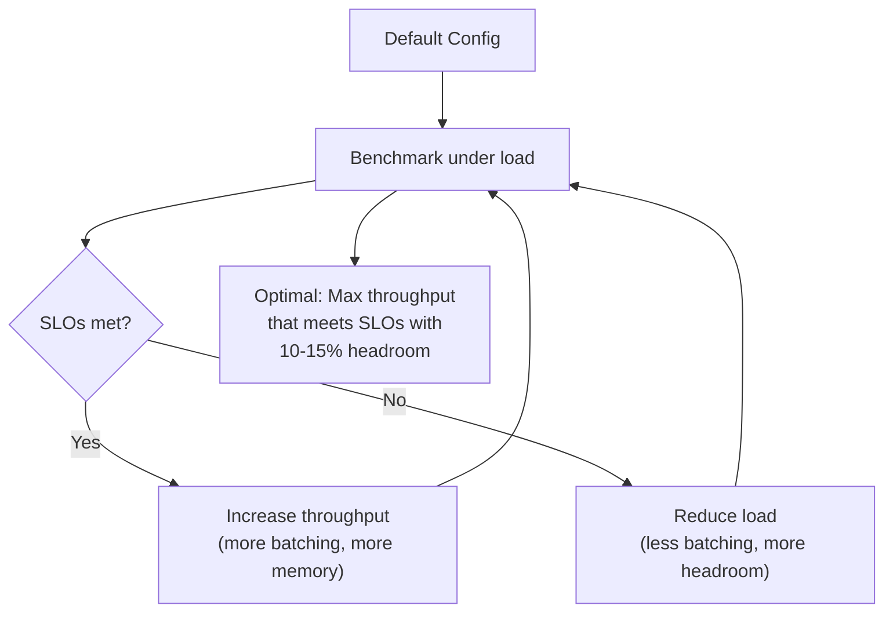

# Module 09 — Optimize One GPU

> **4 lessons**
> Tune vLLM parameters to maximize throughput within your SLO budget.

---

## 09.01 — Establish a Tunable vLLM Baseline

```bash
# Start with default settings — this is your baseline
vllm serve meta-llama/Llama-3-8B-Instruct \
    --gpu-memory-utilization 0.85 \
    --max-model-len 4096 \
    --max-num-seqs 256
```

### Key Tuning Parameters

| Parameter | Default | Range | Effect |
|-----------|---------|-------|--------|
| `gpu-memory-utilization` | 0.90 | 0.80–0.95 | More KV cache capacity |
| `max-model-len` | Auto | 1K–128K | Max context length |
| `max-num-seqs` | 256 | 32–1024 | Max concurrent sequences |
| `max-num-batched-tokens` | Auto | 512–32768 | Tokens per iteration |
| `enable-prefix-caching` | False | True/False | Cache shared prefixes |
| `enable-chunked-prefill` | Auto | True/False | Chunk long prefills |

---

## 09.02 — Tune GPU Memory & KV Capacity

```python
def tune_memory_utilization(base_url, utilization_levels=[0.80, 0.85, 0.90, 0.92, 0.95]):
    """
    Higher utilization = more KV blocks = more concurrent requests.
    But too high = OOM risk under burst traffic.
    """
    results = []
    for util in utilization_levels:
        # Restart vLLM with new setting (in practice)
        # Measure: max concurrent requests, throughput, any OOM errors
        
        # Theoretical calculation:
        gpu_mem_gb = 80  # A100
        model_mem_gb = 16  # Llama 8B BF16
        usable = gpu_mem_gb * util - model_mem_gb
        kv_per_req_gb = 0.125  # ~128 MB per 4K context request
        max_requests = int(usable / kv_per_req_gb)
        
        results.append({
            'utilization': util,
            'available_kv_gb': usable,
            'max_requests': max_requests,
        })
        print(f"Util={util:.0%}: {usable:.1f} GB for KV → ~{max_requests} concurrent requests")
    
    return results
```

---

## 09.03 — Find the SLO-Safe Configuration



### The Optimization Workflow

```python
async def find_optimal_config(url, slo_ttft_ms=500, slo_tpot_ms=50):
    """Binary search for the maximum throughput that meets SLOs."""
    low, high = 1, 256  # concurrency range
    best_config = None
    
    while low <= high:
        mid = (low + high) // 2
        metrics = await run_benchmark(url, concurrency=mid, num_requests=200)
        
        ttft_p95 = np.percentile([m.ttft_ms for m in metrics], 95)
        tpot_p95 = np.percentile([m.tpot_ms for m in metrics if m.tpot_ms > 0], 95)
        throughput = sum(m.output_tokens for m in metrics) / total_time
        
        meets_slo = ttft_p95 <= slo_ttft_ms and tpot_p95 <= slo_tpot_ms
        
        if meets_slo:
            best_config = {'concurrency': mid, 'throughput': throughput}
            low = mid + 1
        else:
            high = mid - 1
    
    if best_config:
        # Apply 15% headroom
        safe_concurrency = int(best_config['concurrency'] * 0.85)
        print(f"Optimal concurrency: {best_config['concurrency']}")
        print(f"Safe concurrency (85%): {safe_concurrency}")
        print(f"Max throughput at SLO: {best_config['throughput']:.0f} tok/s")
    
    return best_config
```

---

## 🧪 Project — Optimize One GPU

**Goal:** Starting from default vLLM settings, achieve maximum throughput that meets:
- TTFT P95 < 500ms
- TPOT P95 < 50ms
- Zero OOM errors over 1 hour

**Steps:**
1. Establish baseline with default settings
2. Tune `gpu-memory-utilization` (0.85 → 0.92)
3. Tune `max-num-seqs` (find the knee)
4. Enable prefix caching (measure improvement)
5. Enable chunked prefill (measure TTFT improvement)
6. Document final config vs baseline improvement

> **🏢 FAANG Deep Dive:** At scale, even 5% throughput improvement on one GPU × 10,000 GPUs = 500 GPUs saved. That's ~$1.5M/month in cloud costs. This is why GPU optimization teams exist at every major AI company.

---

**Next Module:** [10 — Prefill & Prefix Optimization](../space-05-single-gpu-optimization/10-prefill-prefix-optimization.md) →
