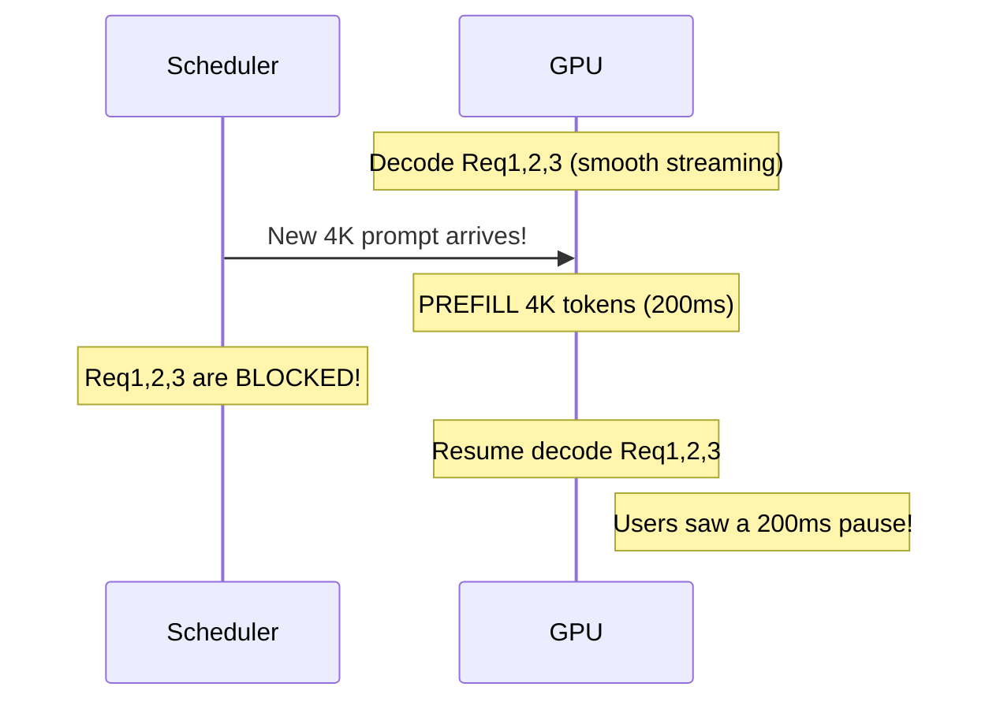
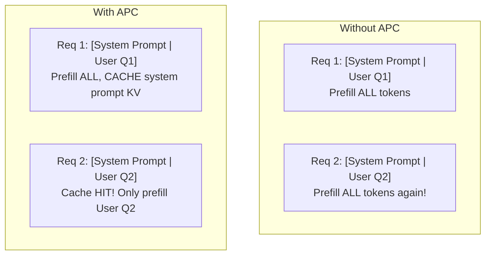
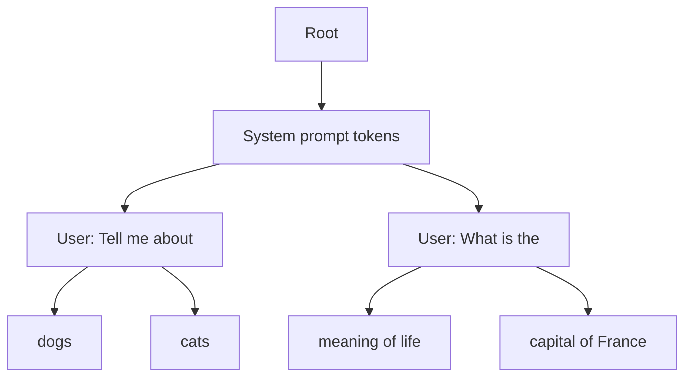

# Module 10 — Prefill & Prefix Optimization

> **7 lessons**
> Solve the long-prompt interference problem and cache repeated work.

---

## 10.01 — The Long-Prompt Interference Problem

A 4K-token prefill blocks all decode requests, causing TPOT spikes:



```python
# Demonstrate the interference
import time
import asyncio

async def demonstrate_interference():
    """Show how a long prefill disrupts ongoing decode."""
    # Start 5 decode requests (simulating active users)
    decode_tasks = [stream_request("Short prompt") for _ in range(5)]

    # After 1 second, send a long prefill request
    await asyncio.sleep(1.0)
    long_task = stream_request("Very long prompt " * 2000)  # ~4K tokens

    all_tasks = decode_tasks + [long_task]
    results = await asyncio.gather(*all_tasks)

    # Check ITL (inter-token latency) spikes in decode requests
    for i, result in enumerate(results[:5]):
        max_itl = max(result.itl_ms)
        print(f"Decode request {i}: max ITL = {max_itl:.0f}ms (normal: ~30ms)")
        # You'll see max ITL spike to 200+ ms during the long prefill!
```

---

## 10.02 — Chunked Prefill

**Solution:** Break long prefills into chunks, interleaving with decode:

```
Without chunked prefill:
  [PPPPPPPPPPPPPP]  [D D D D D D D D]   ← 200ms gap!

With chunked prefill (chunk_size=512):
  [PPP][DDD][PPP][DDD][PPP][DDD][PPP][DDD]  ← smooth!
```

```bash
# Enable in vLLM
vllm serve model --enable-chunked-prefill --max-num-batched-tokens 2048
```

### Chunk Size Tradeoffs

| Chunk Size | Prefill Latency | Decode Disruption | TTFT |
|-----------|----------------|-------------------|------|
| No chunking | Fast prefill | Major disruption | Low |
| 2048 | +10% | Mild disruption | +10% |
| 1024 | +20% | Minimal disruption | +20% |
| 512 | +40% | Almost none | +40% |

---

## 10.03 — Automatic Prefix Caching (APC)

Every ChatGPT request starts with the same system prompt. Why re-process it?



```python
# Hash-based prefix matching
import hashlib

def compute_prefix_hash(token_ids, block_size=16):
    """Hash token blocks to identify shared prefixes."""
    hashes = []
    for i in range(0, len(token_ids), block_size):
        block = tuple(token_ids[i:i+block_size])
        block_hash = hashlib.sha256(str(block).encode()).hexdigest()[:16]
        hashes.append(block_hash)
    return hashes

# Two requests with same system prompt
system_prompt_tokens = [1, 2, 3, 4, 5, 6, 7, 8] * 64  # 512 tokens
user1_tokens = system_prompt_tokens + [100, 101, 102]
user2_tokens = system_prompt_tokens + [200, 201, 202]

hashes1 = compute_prefix_hash(user1_tokens)
hashes2 = compute_prefix_hash(user2_tokens)

# Find shared prefix blocks
shared = 0
for h1, h2 in zip(hashes1, hashes2):
    if h1 == h2:
        shared += 1
    else:
        break

print(f"Shared prefix blocks: {shared}/{len(hashes1)} ({shared*16} tokens)")
# Shared prefix blocks: 32/32 (512 tokens) — cache hit!
```

```bash
# Enable in vLLM
vllm serve model --enable-prefix-caching
```

## 10.04-10.06 — RAG Context, Multi-Turn & RadixAttention

### SGLang's RadixAttention

Instead of hash-based matching, SGLang uses a **radix tree** to manage prefix cache:



Each path in the tree shares the common prefix. LRU eviction removes least-recently-used leaves.

> **🏢 FAANG Deep Dive: OpenAI's System Prompt Caching**
>
> ChatGPT's system prompt is ~1500 tokens. With 100M users, re-processing it
> for every request would waste enormous compute. OpenAI caches the KV for
> system prompts and shares them across requests. This reportedly saves 40-60%
> of prefill compute for their chat workload.

---

**Next Module:** [11 — Quantization & KV Compression](./11-quantization-kv-compression.md) →
