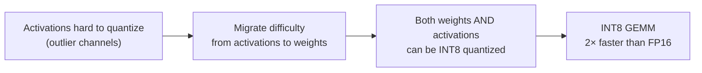

# Module 11 — Quantization & KV Compression

> **8 lessons**
> Fit bigger models on fewer GPUs and serve more users per GPU.

---

## 11.01 — Precision, Memory & Hardware Support

### Number Format Visual

```
FP32 (32 bits):  [S][EEEEEEEE][MMMMMMMMMMMMMMMMMMMMMMM]  — 4 bytes
FP16 (16 bits):  [S][EEEEE][MMMMMMMMMM]                   — 2 bytes
BF16 (16 bits):  [S][EEEEEEEE][MMMMMMM]                   — 2 bytes (more range!)
FP8  (8 bits):   [S][EEEE][MMM]                            — 1 byte
INT8 (8 bits):   [SSSSSSSS]                                — 1 byte (integer)
INT4 (4 bits):   [SSSS]                                    — 0.5 bytes

S=Sign  E=Exponent  M=Mantissa
```

| Format | Bytes | 70B Model | Quality Loss | GPU Support |
|--------|-------|-----------|-------------|-------------|
| FP32 | 4 | 280 GB | None (baseline) | All |
| FP16 | 2 | 140 GB | Negligible | All modern |
| BF16 | 2 | 140 GB | Negligible | A100+ |
| FP8 | 1 | 70 GB | < 1% | H100+ |
| INT8 | 1 | 70 GB | 1-2% | All modern |
| INT4 | 0.5 | 35 GB | 2-5% | All (with dequant) |

**Why BF16 > FP16 for LLMs:**
- BF16 has same exponent range as FP32 (no overflow issues)
- FP16 can overflow for large activation values
- BF16 has less precision but LLMs are robust to this

---

## 11.02 — Weight Quantization Methods

### AWQ (Activation-Aware Weight Quantization)

```python
# AWQ key idea: not all weights are equally important
# Weights connected to large activations matter more → protect them

# Conceptual AWQ process:
# 1. Run calibration data through model
# 2. Find which weights produce the largest activations
# 3. Scale important weights UP before quantizing (preserves them)
# 4. Scale corresponding activations DOWN (compensate)
# 5. Quantize all weights to INT4

# Using AWQ with vLLM:
# vllm serve TheBloke/Llama-2-70B-AWQ --quantization awq
```

### GPTQ (Accurate Post-Training Quantization)

```python
# GPTQ: quantize weights layer-by-layer, minimizing output error
# Uses the inverse Hessian to determine optimal quantization order

# Using GPTQ with vLLM:
# vllm serve TheBloke/Llama-2-70B-GPTQ --quantization gptq
```

### Comparison Table

| Method | Type | Bits | Speed | Quality | GPU Needed |
|--------|------|------|-------|---------|-----------|
| AWQ | Weight-only | 4-bit | ★★★★☆ | ★★★★☆ | Any |
| GPTQ | Weight-only | 4-bit | ★★★★☆ | ★★★★☆ | Any |
| SmoothQuant | W8A8 | 8-bit | ★★★★★ | ★★★★★ | INT8 support |
| FP8 | W8A8 | 8-bit | ★★★★★ | ★★★★★ | H100+ |

---

## 11.03-11.04 — SmoothQuant & Quantized GEMM

### SmoothQuant



---

## 11.05 — KV Cache Quantization

**The game-changer:** Quantize KV cache from FP16 to FP8 = **2× more concurrent requests!**

```python
# KV cache memory comparison for Llama 70B, 4K context, 100 concurrent requests:

def kv_memory(num_layers, num_kv_heads, head_dim, seq_len, batch_size, bytes_per_element):
    total_elements = 2 * num_layers * num_kv_heads * head_dim * seq_len * batch_size
    return total_elements * bytes_per_element / (1024**3)

# FP16 KV cache
kv_fp16 = kv_memory(80, 8, 128, 4096, 100, 2)
print(f"FP16 KV cache: {kv_fp16:.1f} GB")  # ~62.5 GB

# FP8 KV cache
kv_fp8 = kv_memory(80, 8, 128, 4096, 100, 1)
print(f"FP8 KV cache:  {kv_fp8:.1f} GB")   # ~31.2 GB

print(f"Savings: {kv_fp16 - kv_fp8:.1f} GB ({(1 - kv_fp8/kv_fp16)*100:.0f}%)")
# That's 31 GB saved → ~50 more concurrent requests!
```

```bash
# Enable in vLLM
vllm serve model --kv-cache-dtype fp8
```

---

## 11.06-11.07 — Measure Changes & Quality Regression

```python
# Always measure quality AFTER quantization!
def compare_quality(original_model, quantized_model, eval_dataset):
    """Compare model quality before and after quantization."""
    results = {
        'perplexity': {},  # Lower is better
        'mmlu_accuracy': {},  # Higher is better
        'humaneval_pass': {},  # Higher is better
    }

    for name, model in [("Original", original_model), ("Quantized", quantized_model)]:
        results['perplexity'][name] = evaluate_perplexity(model, eval_dataset)
        results['mmlu_accuracy'][name] = evaluate_mmlu(model)

    # Check regression
    ppl_increase = (results['perplexity']['Quantized'] /
                    results['perplexity']['Original'] - 1) * 100
    mmlu_drop = (results['mmlu_accuracy']['Original'] -
                 results['mmlu_accuracy']['Quantized'])

    print(f"Perplexity increase: {ppl_increase:.1f}%")
    print(f"MMLU accuracy drop: {mmlu_drop:.1f}%")

    if ppl_increase < 2 and mmlu_drop < 1:
        print("✅ Quality regression acceptable")
    else:
        print("⚠️  Significant quality regression!")
```

> **🏢 FAANG Deep Dive: Meta's Quantization Strategy for Llama**
>
> Meta publishes Llama models in BF16 but internally serves them quantized:
> - **Llama 8B:** FP8 weights + FP8 KV → fits on a single GPU with 60+ concurrent users
> - **Llama 70B:** AWQ INT4 weights + FP8 KV → fits on 2 GPUs instead of 4
> - **Llama 405B:** FP8 on 8×H100 instead of 16×H100 in BF16
>
> Each quantization level is validated against internal quality benchmarks
> before production deployment. The rule: **< 1% quality drop or don't ship it.**

---

**Next Module:** [12 — Profiling & GPU Performance](./12-profiling-gpu-performance.md) →
