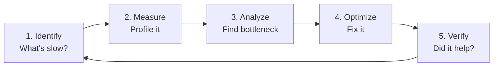
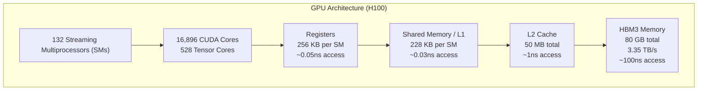

# Module 12 — Profiling & GPU Performance

> **8 lessons**
> Stop guessing, start measuring. Profile GPU execution to find real bottlenecks.

---

## 12.01 — Build a Profiling Workflow



**Rule:** Never optimize without profiling first. Your intuition is often wrong.

---

## 12.02 — PyTorch Profiler

```python
import torch
from torch.profiler import profile, record_function, ProfilerActivity

model = ...  # Your loaded model
inputs = tokenizer("Hello world", return_tensors="pt").to("cuda")

# Profile a forward pass
with profile(
    activities=[ProfilerActivity.CPU, ProfilerActivity.CUDA],
    record_shapes=True,
    profile_memory=True,
    with_stack=True,
) as prof:
    with record_function("inference"):
        with torch.inference_mode():
            output = model(**inputs)

# Print summary
print(prof.key_averages().table(sort_by="cuda_time_total", row_limit=20))

# Export Chrome trace (open in chrome://tracing)
prof.export_chrome_trace("inference_trace.json")

# Memory snapshot
torch.cuda.memory._record_memory_history()
with torch.inference_mode():
    output = model(**inputs)
torch.cuda.memory._dump_snapshot("memory_snapshot.pickle")
torch.cuda.memory._record_memory_history(enabled=None)
```

### Reading the Profile

```
Key columns:
- Self CUDA time: time spent in this kernel only
- CUDA time total: including child operations
- # of Calls: how many times this kernel ran
- CUDA Mem: memory allocated by this operation

Top operations for a 7B model:
1. aten::mm (matrix multiply)     — 65% of time (attention + MLP projections)
2. aten::scaled_dot_product_attention — 15% (attention computation)
3. aten::silu (activation)         — 5% (MLP gating)
4. aten::mul (elementwise)         — 5% (gating, residuals)
5. Other                           — 10%
```

---

## 12.03 — Nsight Systems

```bash
# System-wide timeline: CPU-GPU interaction
nsys profile -o inference_profile python inference.py

# View in Nsight Systems GUI
nsys-ui inference_profile.nsys-rep
```

**What to look for:**
- **CPU-GPU gaps:** CPU is computing while GPU is idle (launch overhead)
- **Small kernels:** Many tiny kernel launches (overhead > compute)
- **Memory transfers:** Unexpected host-device copies

## 12.04 — Nsight Compute

```bash
# Per-kernel analysis
ncu --set full -o kernel_profile python inference.py

# Target specific kernel
ncu --kernel-name "volta_sgemm" python inference.py
```

**What to look for:**
- **Occupancy:** Are we using enough warps? (target: > 50%)
- **Memory throughput:** Are we hitting HBM bandwidth? (A100: 2 TB/s)
- **Compute throughput:** Are we hitting peak FLOPS?

---

## 12.05 — Profile Prefill vs Decode

```python
# Prefill profile: large GEMM operations, high compute utilization
# Decode profile: many small operations, low compute, high memory traffic

def profile_prefill_vs_decode(model, tokenizer):
    """Profile both phases separately to understand the difference."""

    # Prefill: long prompt
    long_prompt = "word " * 1000
    inputs = tokenizer(long_prompt, return_tensors="pt").to("cuda")

    with profile(activities=[ProfilerActivity.CUDA]) as prefill_prof:
        with torch.inference_mode():
            output = model(**inputs, use_cache=True)

    print("=== PREFILL PROFILE (1000 tokens) ===")
    print(prefill_prof.key_averages().table(sort_by="cuda_time_total", row_limit=10))

    # Decode: single token with KV cache
    past = output.past_key_values
    next_token = output.logits[:, -1:, :].argmax(dim=-1)

    with profile(activities=[ProfilerActivity.CUDA]) as decode_prof:
        with torch.inference_mode():
            for _ in range(10):
                output = model(next_token, past_key_values=past, use_cache=True)
                past = output.past_key_values
                next_token = output.logits[:, -1:, :].argmax(dim=-1)

    print("\n=== DECODE PROFILE (10 steps) ===")
    print(decode_prof.key_averages().table(sort_by="cuda_time_total", row_limit=10))
```

---

## 12.06 — GPU Architecture Basics



**Key takeaway:** HBM access is **2000× slower** than registers. Minimizing memory movement is everything.

---

## 12.07 — Compute-Bound vs Memory-Bound & the Roofline Model

### Arithmetic Intensity

```
Arithmetic Intensity = FLOPs / Bytes Moved
```

```python
def classify_operation(flops, bytes_moved, gpu_peak_flops, gpu_bandwidth):
    """Determine if an operation is compute-bound or memory-bound."""
    arithmetic_intensity = flops / bytes_moved
    roofline_knee = gpu_peak_flops / gpu_bandwidth

    if arithmetic_intensity > roofline_knee:
        bound = "COMPUTE-BOUND"
    else:
        bound = "MEMORY-BOUND"

    print(f"  FLOPs: {flops/1e9:.1f} GFLOP")
    print(f"  Bytes: {bytes_moved/1e6:.1f} MB")
    print(f"  Intensity: {arithmetic_intensity:.1f} FLOP/byte")
    print(f"  Roofline knee: {roofline_knee:.0f} FLOP/byte")
    print(f"  → {bound}")
    return bound

# H100 specs
H100_FLOPS = 990e12     # BF16 TFLOPS
H100_BW = 3.35e12       # bytes/sec

# Prefill: matrix × matrix (compute-bound)
print("Prefill GEMM (1024×4096 × 4096×4096):")
classify_operation(
    flops=2 * 1024 * 4096 * 4096,    # 34 GFLOP
    bytes_moved=(1024*4096 + 4096*4096 + 1024*4096) * 2,  # ~42 MB
    gpu_peak_flops=H100_FLOPS,
    gpu_bandwidth=H100_BW
)

print("\nDecode GEMV (1×4096 × 4096×4096):")
classify_operation(
    flops=2 * 1 * 4096 * 4096,        # 33 MFLOP
    bytes_moved=(1*4096 + 4096*4096 + 1*4096) * 2,  # ~33 MB (mostly weights!)
    gpu_peak_flops=H100_FLOPS,
    gpu_bandwidth=H100_BW
)
# Prefill: COMPUTE-BOUND (intensity ~800)
# Decode: MEMORY-BOUND (intensity ~1)
```

> **🏢 FAANG Deep Dive:** NVIDIA provides dedicated solutions engineers who help top AI companies profile their inference workloads. The typical finding: 70%+ of optimization opportunities come from reducing memory movement, not improving compute.

---

**Next Module:** [13 — Triton & Kernel Engineering](../space-06-runtime-kernel-engineering/13-triton-kernel-engineering.md) →
