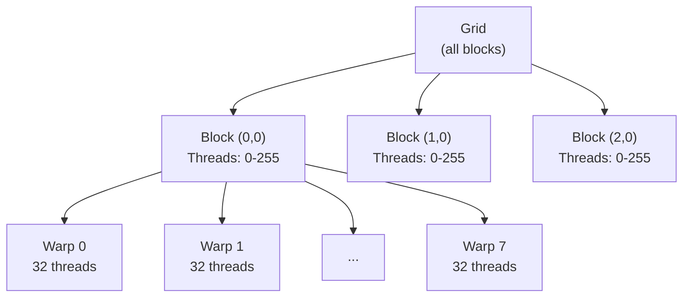

# Module 13 — Triton & Kernel Engineering

> **8 lessons · Advanced**
> Write custom GPU kernels in Python using Triton.

---

## 13.01 — GPU Execution Model



- **Thread:** Smallest execution unit
- **Warp:** 32 threads executing the SAME instruction (SIMT)
- **Block:** Group of warps sharing shared memory (up to 1024 threads)
- **Grid:** All blocks for one kernel launch

## 13.02 — Triton Programming Model

```python
import triton
import triton.language as tl
import torch

@triton.jit
def vector_add_kernel(
    x_ptr, y_ptr, output_ptr,
    n_elements,
    BLOCK_SIZE: tl.constexpr,
):
    """Add two vectors element-wise on the GPU."""
    # Each program instance handles BLOCK_SIZE elements
    pid = tl.program_id(axis=0)
    block_start = pid * BLOCK_SIZE
    offsets = block_start + tl.arange(0, BLOCK_SIZE)
    mask = offsets < n_elements

    # Load from GPU memory
    x = tl.load(x_ptr + offsets, mask=mask)
    y = tl.load(y_ptr + offsets, mask=mask)

    # Compute
    output = x + y

    # Store back to GPU memory
    tl.store(output_ptr + offsets, output, mask=mask)

def vector_add(x: torch.Tensor, y: torch.Tensor) -> torch.Tensor:
    output = torch.empty_like(x)
    n = x.numel()
    BLOCK_SIZE = 1024
    grid = (triton.cdiv(n, BLOCK_SIZE),)
    vector_add_kernel[grid](x, y, output, n, BLOCK_SIZE)
    return output

# Test
x = torch.randn(100000, device='cuda')
y = torch.randn(100000, device='cuda')
result = vector_add(x, y)
assert torch.allclose(result, x + y)
print("✅ Vector add kernel works!")
```

---

## 13.03-13.06 — Key Kernels for Inference

### Softmax Kernel

```python
@triton.jit
def softmax_kernel(
    input_ptr, output_ptr,
    n_cols,
    input_row_stride, output_row_stride,
    BLOCK_SIZE: tl.constexpr,
):
    """Fused softmax: read once from HBM, compute, write once."""
    row_idx = tl.program_id(0)
    row_start = row_idx * input_row_stride
    col_offsets = tl.arange(0, BLOCK_SIZE)
    mask = col_offsets < n_cols

    # Load entire row into SRAM (shared memory)
    row = tl.load(input_ptr + row_start + col_offsets, mask=mask, other=-float('inf'))

    # Compute softmax in SRAM (no extra HBM access!)
    row_max = tl.max(row, axis=0)
    numerator = tl.exp(row - row_max)
    denominator = tl.sum(numerator, axis=0)
    softmax_output = numerator / denominator

    # Write back to HBM (one write)
    tl.store(output_ptr + row_idx * output_row_stride + col_offsets,
             softmax_output, mask=mask)
```

### RMSNorm Kernel

```python
@triton.jit
def rmsnorm_kernel(
    X, Weight, Y,
    stride, N, eps,
    BLOCK_SIZE: tl.constexpr,
):
    """Fused RMSNorm: avoids multiple passes over the data."""
    row = tl.program_id(0)
    cols = tl.arange(0, BLOCK_SIZE)
    mask = cols < N

    x = tl.load(X + row * stride + cols, mask=mask, other=0.0).to(tl.float32)
    w = tl.load(Weight + cols, mask=mask)

    # RMS computation
    mean_sq = tl.sum(x * x, axis=0) / N
    rms = tl.sqrt(mean_sq + eps)

    # Normalize and scale
    y = (x / rms) * w
    tl.store(Y + row * stride + cols, y, mask=mask)
```

### Why Fused Kernels Matter

```
Unfused (3 separate kernels):
  HBM → [Read X] → [Compute norm] → HBM → [Read again] → [Normalize] → HBM → [Read again] → [Scale] → HBM
  = 6 HBM accesses

Fused (1 kernel):
  HBM → [Read X, W] → [Compute everything in SRAM] → HBM
  = 2 HBM accesses → 3× less memory traffic!
```

---

## 13.07 — Benchmark Against PyTorch

```python
import triton

@triton.testing.perf_report(
    triton.testing.Benchmark(
        x_names=['N'],
        x_vals=[2**i for i in range(10, 20)],
        line_arg='provider',
        line_vals=['triton', 'torch'],
        line_names=['Triton', 'PyTorch'],
        ylabel='GB/s',
        plot_name='softmax-performance',
    )
)
def bench_softmax(N, provider):
    x = torch.randn(1024, N, device='cuda', dtype=torch.float32)
    if provider == 'torch':
        ms = triton.testing.do_bench(lambda: torch.softmax(x, dim=-1))
    else:
        ms = triton.testing.do_bench(lambda: triton_softmax(x))
    gbps = 2 * x.numel() * x.element_size() / ms * 1e-6
    return gbps

# bench_softmax.run(print_data=True, save_path='.')
```

> **🏢 FAANG Deep Dive:** OpenAI co-developed Triton with the goal of making GPU programming accessible to ML researchers. Today, Triton kernels are used inside PyTorch (torch.compile backend), vLLM, and most major inference engines. Writing efficient Triton is one of the most valuable skills in inference engineering.

---

**Next Module:** [14 — Attention Optimization](./14-attention-optimization.md) →
