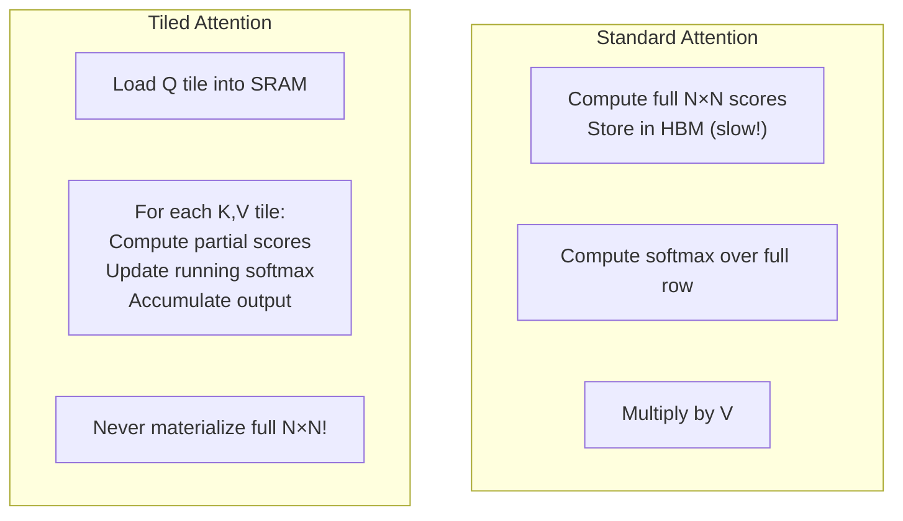
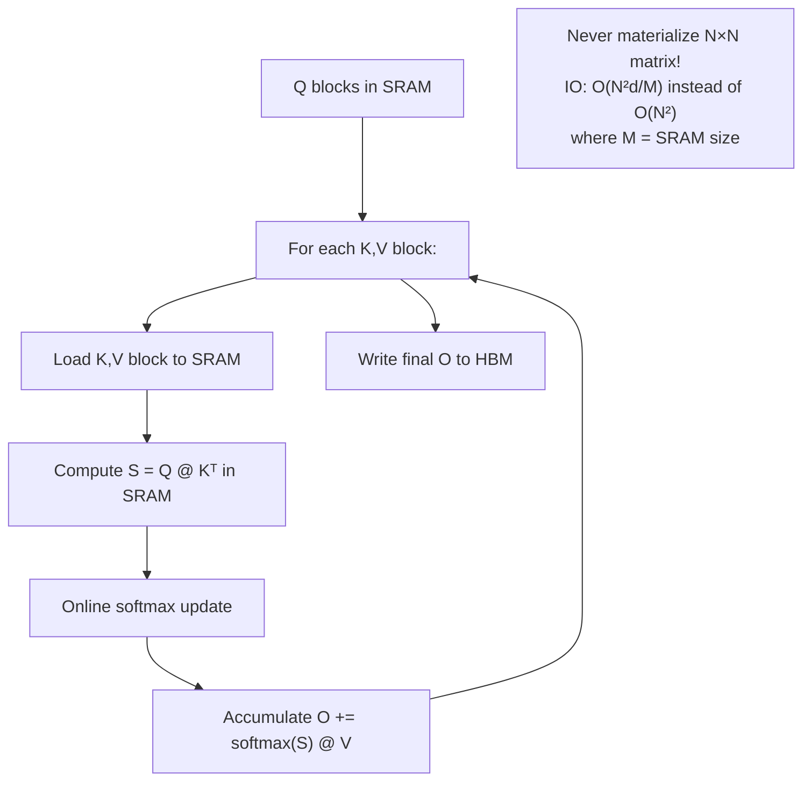

# Module 14 — Attention Optimization

> **6 lessons**
> FlashAttention and its variants — the most important inference kernel.

---

## 14.01 — Standard Attention Is Memory-Bound

```python
# Standard attention materializes the full N×N attention matrix:
# Memory: O(N²) — for 32K context, that's 32K × 32K × 2 bytes = 2 GB per head!

def standard_attention(Q, K, V):
    """O(N²) memory — doesn't scale to long contexts."""
    scores = Q @ K.T / math.sqrt(d)    # (N, N) — HUGE matrix
    weights = softmax(scores)            # (N, N) — stored in HBM
    output = weights @ V                 # (N, d)
    return output
    # Total HBM accesses: 3 reads + 2 writes of O(N²) matrices
```

---

## 14.02 — Tiled Attention & Online Softmax

### The Key Insight

Instead of computing the full N×N matrix, process attention in **tiles** that fit in GPU SRAM:



### Online Softmax (the mathematical trick)

```python
def online_softmax(scores_tiles):
    """
    Compute softmax WITHOUT seeing all values at once.
    Key: maintain running max and sum, correct at each step.
    """
    m = float('-inf')  # running max
    l = 0.0            # running sum of exp
    output = 0.0       # running weighted sum

    for tile in scores_tiles:
        m_new = max(m, tile.max())

        # Correct previous sum for new max
        l = l * math.exp(m - m_new) + tile.exp().sum() * math.exp(tile.max() - m_new)

        # Update output with correction factor
        correction = math.exp(m - m_new)
        output = output * correction + (tile.softmax() @ V_tile)

        m = m_new

    return output / l
```

---

## 14.03 — FlashAttention

### The Algorithm

```
FlashAttention = Tiling + Online Softmax + Kernel Fusion
```



### FlashAttention Versions

| Version | Key Improvement | Speedup |
|---------|----------------|---------|
| FlashAttention v1 | Tiled attention + online softmax | 2-4× vs standard |
| FlashAttention v2 | Better parallelism, reduced shared memory | 2× vs v1 |
| FlashAttention v3 | H100-specific (TMA, warp specialization, FP8) | 1.5-2× vs v2 |

---

## 14.04 — Prefill vs Decode Need Different Kernels

| Phase | Attention Type | Shape | Bottleneck | Best Kernel |
|-------|---------------|-------|-----------|-------------|
| **Prefill** | Q @ Kᵀ: matrix × matrix | (N, d) × (d, N) | Compute | FlashAttention |
| **Decode** | q @ Kᵀ: vector × matrix | (1, d) × (d, N) | Memory bandwidth | Flash-Decode / PagedAttention |

```python
# Prefill: all query tokens attend to all key tokens
# Shape: (batch, heads, seq_len, seq_len) — compute-heavy
# FlashAttention is perfect here

# Decode: ONE query token attends to ALL past keys
# Shape: (batch, heads, 1, context_len) — memory-heavy
# Need a different kernel optimized for single-query attention
```

## 14.05 — FlashInfer & Serving Backends

```python
# FlashInfer: attention kernels designed for serving (paged KV cache)
# pip install flashinfer

# Supports:
# - Paged KV cache (non-contiguous blocks)
# - Variable-length batched attention
# - FP8 KV cache
# - Fused RoPE + attention
# - Prefill and decode kernels
```

### Backend Comparison

| Backend | Prefill | Decode | Paged KV | FP8 KV | Best For |
|---------|---------|--------|----------|--------|----------|
| FlashAttention | ★★★★★ | ★★★☆☆ | ❌ | ❌ | Training, prefill |
| FlashInfer | ★★★★☆ | ★★★★★ | ✅ | ✅ | Serving |
| xformers | ★★★★☆ | ★★★☆☆ | ❌ | ❌ | Research |
| PyTorch SDPA | ★★★☆☆ | ★★★☆☆ | ❌ | ❌ | Compatibility |

> **🏢 FAANG Deep Dive:** Tri Dao (FlashAttention author) showed that attention can be made IO-aware rather than just compute-aware. Every major AI lab now uses FlashAttention variants. The paper has been cited 5000+ times and is considered one of the most impactful ML systems papers of the decade.

---

**Next Module:** [15 — Compilation & CUDA Graphs](./15-compilation-cuda-graphs.md) →
