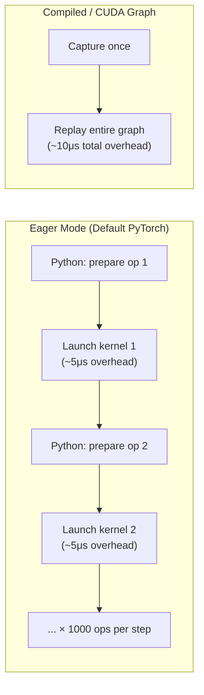

# Module 15 — Compilation & CUDA Graphs

> **6 lessons · Advanced**
> Eliminate Python overhead and kernel launch latency.

---

## 15.01 — Eager Execution Overhead



For a 7B model decode step:
- ~1000 kernel launches per forward pass
- ~5μs overhead per launch = **5ms of pure overhead**
- Actual compute may only be 10ms
- **33% of time is overhead!**

---

## 15.02 — torch.compile

```python
import torch

model = load_model()
model.eval()

# Compile the model
compiled_model = torch.compile(
    model,
    mode="reduce-overhead",  # Best for inference
    # mode="max-autotune",   # Slowest compile, fastest run
    fullgraph=True,          # Fail if graph breaks
)

# First call: slow (compilation)
with torch.inference_mode():
    output = compiled_model(input_ids)  # Takes 30-120 seconds!

# Subsequent calls: fast (compiled)
with torch.inference_mode():
    output = compiled_model(input_ids)  # 1.3-2× faster than eager!
```

---

## 15.03 — CUDA Graphs

```python
import torch

def capture_cuda_graph(model, example_input, num_warmup=3):
    """Capture a sequence of GPU operations as a replayable graph."""
    # Step 1: Warm up (populate CUDA caches)
    for _ in range(num_warmup):
        with torch.inference_mode():
            _ = model(example_input)
    torch.cuda.synchronize()

    # Step 2: Capture
    static_input = example_input.clone()
    graph = torch.cuda.CUDAGraph()

    with torch.cuda.graph(graph):
        with torch.inference_mode():
            static_output = model(static_input)

    # Step 3: Create replay function
    def replay(new_input):
        static_input.copy_(new_input)  # Copy new data into static buffer
        graph.replay()                  # Replay the captured graph (~10μs!)
        return static_output.clone()    # Copy output out

    return replay

# Usage
replay_fn = capture_cuda_graph(model, example_input)
output = replay_fn(new_input)  # Near-zero CPU overhead!
```

### Limitation: Fixed Shapes

CUDA graphs require **fixed tensor shapes**. For variable-length inputs:

```python
# Strategy: capture graphs for common batch sizes
graphs = {}
for batch_size in [1, 2, 4, 8, 16, 32]:
    example = torch.zeros(batch_size, max_seq_len, device='cuda')
    graphs[batch_size] = capture_cuda_graph(model, example)

# Pad actual input to nearest captured size
def run_with_graph(input_tensor):
    actual_batch = input_tensor.shape[0]
    padded_batch = min(b for b in graphs.keys() if b >= actual_batch)
    padded_input = F.pad(input_tensor, (0, 0, 0, padded_batch - actual_batch))
    output = graphs[padded_batch](padded_input)
    return output[:actual_batch]  # Remove padding
```

---

## 15.04-15.05 — Trade-offs

| Technique | Compile Time | Memory | Speedup | Flexibility |
|-----------|-------------|--------|---------|-------------|
| Eager PyTorch | None | Baseline | 1× | Full |
| torch.compile | 30-120s | +10-20% | 1.3-2× | Most ops |
| CUDA Graphs | ~1s per graph | +5-10% | 1.5-3× | Fixed shapes |
| Both | 30-120s + 1s | +20-30% | 2-4× | Limited |

> **🏢 FAANG Deep Dive:** vLLM uses CUDA graphs for decode steps (fixed batch size slots) but not for prefill (variable prompt lengths). This gives the best of both worlds: fast decode with flexible prefill.

---

**Next Module:** [16 — Speculative Decoding](./16-speculative-decoding.md) →
