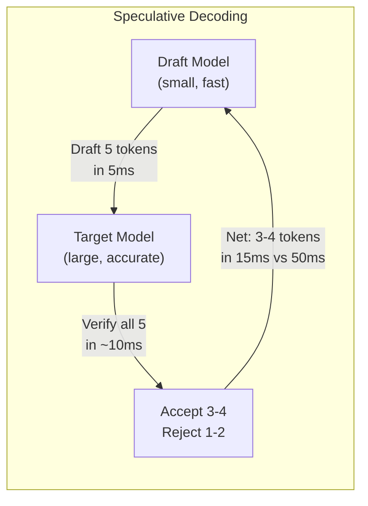
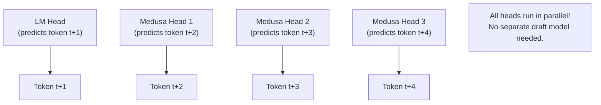

# Module 16 — Speculative Decoding

> **8 lessons**
> Generate multiple tokens per step by drafting and verifying.

---

## 16.01 — Why Decode Is Sequential

Each token depends on the previous → can't parallelize → GPU underutilized during decode.

**Key Insight:** Verifying N tokens costs almost the same as generating 1 token (it's a batch-1 forward pass either way, and the GPU is memory-bound).

---

## 16.02 — Draft-Verify Cycle



```python
import torch
import torch.nn.functional as F

def speculative_decode(
    target_model, draft_model, tokenizer,
    input_ids, max_tokens=100, num_speculative=5,
    temperature=0.0
):
    """
    Speculative decoding: use a small draft model to guess tokens,
    then verify with the large target model in one pass.
    """
    generated = input_ids.clone()
    total_accepted = 0
    total_drafted = 0

    for _ in range(max_tokens // num_speculative):
        # Phase 1: DRAFT — generate K tokens with small model (fast)
        draft_tokens = []
        draft_probs = []
        draft_input = generated.clone()

        for _ in range(num_speculative):
            with torch.inference_mode():
                draft_output = draft_model(draft_input)
            draft_logits = draft_output.logits[:, -1, :]
            draft_p = F.softmax(draft_logits / max(temperature, 0.01), dim=-1)

            if temperature == 0:
                next_token = draft_logits.argmax(dim=-1, keepdim=True)
            else:
                next_token = torch.multinomial(draft_p, 1)

            draft_tokens.append(next_token)
            draft_probs.append(draft_p)
            draft_input = torch.cat([draft_input, next_token], dim=-1)

        # Phase 2: VERIFY — check all K tokens with target model (one pass!)
        verify_input = torch.cat([generated] + draft_tokens, dim=-1)
        with torch.inference_mode():
            target_output = target_model(verify_input)

        target_logits = target_output.logits[:, generated.shape[1]-1:, :]

        # Phase 3: ACCEPT/REJECT — compare probabilities
        accepted = 0
        for i in range(num_speculative):
            target_p = F.softmax(target_logits[:, i, :] / max(temperature, 0.01), dim=-1)
            draft_token = draft_tokens[i]
            draft_prob = draft_probs[i].gather(-1, draft_token)
            target_prob = target_p.gather(-1, draft_token)

            # Acceptance criterion: target agrees with draft
            if temperature == 0:
                if target_logits[:, i, :].argmax() == draft_token.item():
                    accepted += 1
                    generated = torch.cat([generated, draft_token], dim=-1)
                else:
                    # Reject: use target's choice instead
                    correct_token = target_logits[:, i, :].argmax(dim=-1, keepdim=True)
                    generated = torch.cat([generated, correct_token], dim=-1)
                    break
            else:
                # Stochastic acceptance: accept with probability min(1, target/draft)
                ratio = (target_prob / (draft_prob + 1e-10)).item()
                if torch.rand(1).item() < min(1.0, ratio):
                    accepted += 1
                    generated = torch.cat([generated, draft_token], dim=-1)
                else:
                    break

        total_accepted += accepted
        total_drafted += num_speculative

        if generated.shape[1] - input_ids.shape[1] >= max_tokens:
            break

    acceptance_rate = total_accepted / max(total_drafted, 1)
    print(f"Acceptance rate: {acceptance_rate:.1%}")
    print(f"Effective speedup: ~{1 + acceptance_rate * (num_speculative - 1):.1f}×")

    return generated
```

---

## 16.03-16.04 — Acceptance Rate & Concurrency

| Scenario | Draft Length | Accept Rate | Speedup |
|----------|------------|-------------|---------|
| Code completion | 5 | 70-90% | 2-3× |
| Chat (creative) | 5 | 40-60% | 1.5-2× |
| Translation | 5 | 60-80% | 2-2.5× |
| **High concurrency** | 5 | Any | **May not help!** |

**Why speculation hurts at high concurrency:** The GPU is already busy with batched decode. Adding a draft model doesn't help because the bottleneck is memory bandwidth, and verification adds overhead.

---

## 16.05-16.06 — Alternative Speculation Methods

### Prompt-Lookup Decoding (No Draft Model!)

```python
def prompt_lookup_decode(input_ids, model, n_gram_size=3, max_candidates=5):
    """Use n-grams from the input as speculation candidates."""
    generated = input_ids.clone()

    for _ in range(100):
        # Find matching n-grams in the prompt
        last_n = tuple(generated[0, -n_gram_size:].tolist())
        candidates = []

        for i in range(len(input_ids[0]) - n_gram_size):
            window = tuple(input_ids[0, i:i+n_gram_size].tolist())
            if window == last_n:
                # Found a match! Use the tokens that follow
                end = min(i + n_gram_size + max_candidates, len(input_ids[0]))
                candidates = input_ids[0, i+n_gram_size:end].tolist()
                break

        if candidates:
            # Verify candidates with target model (free speculation!)
            pass  # ... verification logic ...
```

### Medusa: Multi-Head Speculation



### EAGLE: Feature-Level Speculation

EAGLE uses the target model's hidden states (not logits) to predict future tokens. Achieves 2-3× speedup with >90% acceptance rate.

> **🏢 FAANG Deep Dive:** Google uses speculative decoding in production for their Gemini API. They found that speculation works best for: (1) low-concurrency, latency-sensitive workloads, (2) predictable text patterns (code, structured output), (3) when the draft model is >100× smaller than target.

---

**Next Module:** [17 — Compare Inference Engines](./17-compare-inference-engines.md) →
