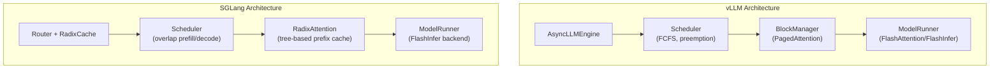
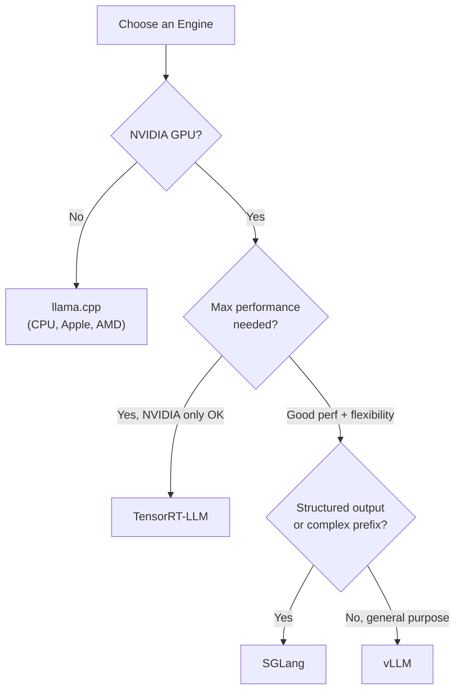

# Module 17 — Compare Inference Engines

> **6 lessons**
> vLLM, SGLang, TensorRT-LLM, llama.cpp — when to use which.

---

## 17.01 — Engine Comparison Matrix

| Feature | vLLM | SGLang | TensorRT-LLM | llama.cpp |
|---------|------|--------|-------------|-----------|
| **Language** | Python | Python | C++/Python | C++ |
| **KV Management** | PagedAttention | RadixAttention | Paged | Contiguous |
| **Batching** | Continuous | Continuous | In-flight | Limited |
| **Prefix Caching** | Hash-based | Radix tree | Manual | N/A |
| **Quantization** | AWQ, GPTQ, FP8 | AWQ, GPTQ, FP8 | INT4/8, FP8, all | GGUF (Q2-Q8) |
| **Multi-GPU** | TP, PP | TP | TP, PP | Limited TP |
| **Structured Output** | Outlines | Native FSM | Limited | Grammar |
| **Model Support** | Wide | Wide | NVIDIA only | GGUF only |
| **Ease of Use** | ★★★★★ | ★★★★☆ | ★★☆☆☆ | ★★★★★ |
| **Performance** | ★★★★☆ | ★★★★★ | ★★★★★ | ★★★☆☆ |
| **Best For** | General serving | High-perf serving | Max NVIDIA perf | CPU/edge |

---

## 17.02 — vLLM vs SGLang Architecture



### Key Differences

- **SGLang's RadixAttention** manages prefix cache as a radix tree — better for complex prefix patterns (multi-turn, branching)
- **SGLang's constrained decoding** is native and fast (FSM-based)
- **vLLM has broader community** and more model support
- **SGLang typically wins** on throughput for high-concurrency workloads

---

## 17.03-17.04 — TensorRT-LLM & llama.cpp

### TensorRT-LLM

```bash
# Maximum performance on NVIDIA GPUs, but harder to set up
# Converts model to optimized TensorRT engine
trtllm-build --model_dir ./model --output_dir ./engine \
    --gemm_plugin auto --gpt_attention_plugin float16
```

### llama.cpp

```bash
# Run anywhere: CPU, Apple Silicon, small NVIDIA GPUs
# Best for: local development, edge devices, CPU inference
./llama-server -m model.gguf -c 4096 -ngl 99 --host 0.0.0.0 --port 8080
```

---

## 17.05 — Decision Flowchart



> **🏢 FAANG Deep Dive:** Most companies don't pick just one engine. A typical setup:
> - **vLLM or SGLang** for general chat/API workloads (flexibility)
> - **TensorRT-LLM** for high-volume batch processing (max throughput)
> - **llama.cpp** for development, testing, and edge deployment

---

**Next Module:** [18 — Multi-GPU & Distributed Parallelism](../space-07-multi-gpu-distributed/18-multi-gpu-parallelism.md) →
