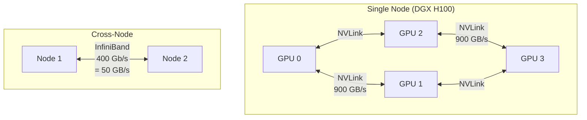
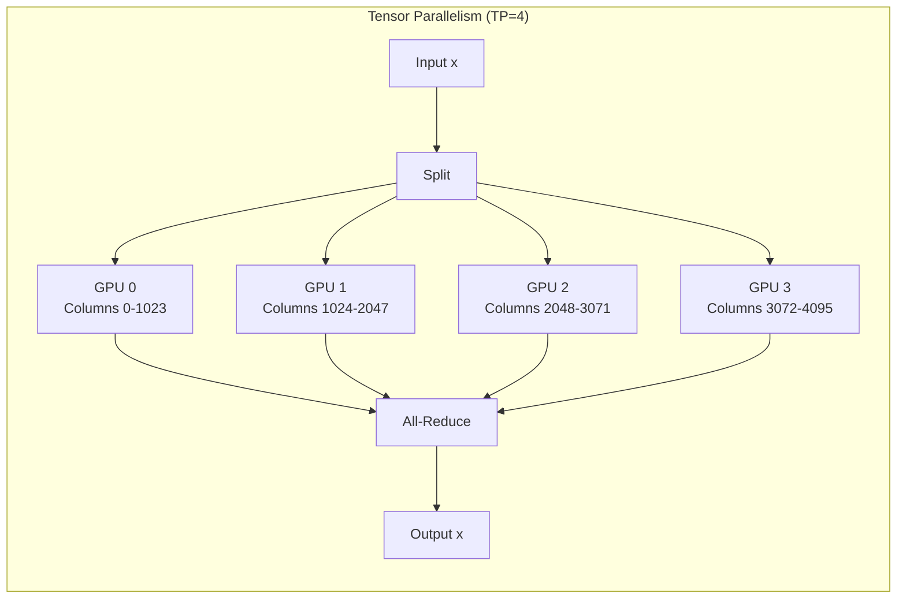
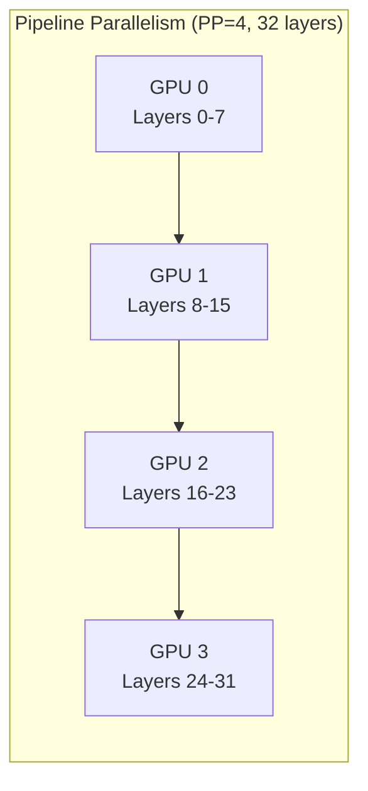
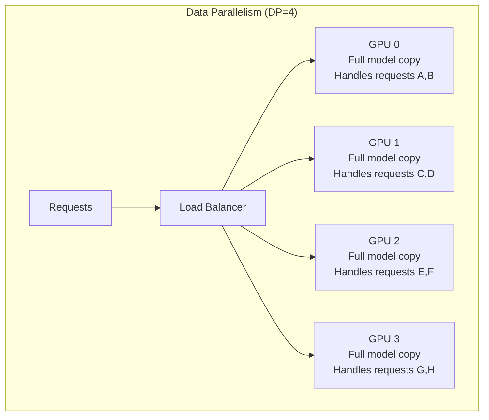
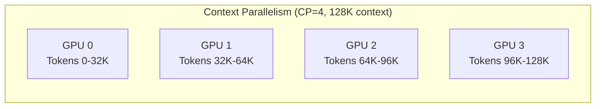

# Module 18 — Multi-GPU & Distributed Parallelism

> **9 lessons**
> Split a model across GPUs: tensor, pipeline, data, and context parallelism.

---

## 18.01 — Why and When to Scale Beyond One GPU

Two reasons:
1. **Model doesn't fit:** Llama 70B BF16 = 140 GB > A100 80 GB
2. **Need more throughput:** One GPU maxes out at ~1500 tok/s

---

## 18.02 — GPU Topology & Interconnects



| Interconnect | Bandwidth | Latency | Use Case |
|-------------|-----------|---------|----------|
| NVLink (H100) | 900 GB/s | ~1μs | Intra-node TP |
| PCIe Gen5 | 64 GB/s | ~5μs | Budget multi-GPU |
| InfiniBand HDR | 50 GB/s | ~2μs | Inter-node |
| Ethernet 100G | 12.5 GB/s | ~10μs | Budget inter-node |

---

## 18.03 — Tensor Parallelism (TP)

Split **each layer** across GPUs. Every GPU has part of every layer.



```python
# How attention heads split across GPUs (TP=4, 32 heads):
# GPU 0: heads 0-7
# GPU 1: heads 8-15
# GPU 2: heads 16-23
# GPU 3: heads 24-31
# After attention: all-reduce to combine results

# How MLP splits:
# Column parallel: gate_proj, up_proj split across GPUs (each gets 1/4 columns)
# Row parallel: down_proj split across GPUs (each gets 1/4 rows)
# After each MLP: all-reduce

# Communication per layer: 2 all-reduces (attention + MLP)
# This is why TP needs FAST interconnect (NVLink)
```

```bash
# Launch vLLM with tensor parallelism
vllm serve meta-llama/Llama-3-70B-Instruct --tensor-parallel-size 4
```

---

## 18.04 — Communication Collectives

```python
# All-Reduce: every GPU contributes, every GPU gets the full result
# Used by TP after each layer

# All-Gather: each GPU has a piece, combine to get the full tensor
# Used by PP between stages

# Reduce-Scatter: like all-reduce but each GPU only keeps 1/N of the result
# More memory-efficient variant of all-reduce

def all_reduce_cost(tensor_size_bytes, num_gpus, bandwidth_gb_s):
    """Time for an all-reduce operation (ring algorithm)."""
    # Ring all-reduce: 2 × (N-1)/N × data_size / bandwidth
    cost_ms = 2 * (num_gpus - 1) / num_gpus * tensor_size_bytes / (bandwidth_gb_s * 1e9) * 1000
    return cost_ms

# Example: all-reduce 4096×4096 BF16 matrix on 4 GPUs with NVLink
size = 4096 * 4096 * 2  # ~32 MB
print(f"NVLink: {all_reduce_cost(size, 4, 900):.3f} ms")    # 0.053 ms
print(f"PCIe:   {all_reduce_cost(size, 4, 64):.3f} ms")     # 0.75 ms (14× slower!)
```

---

## 18.05-18.06 — Pipeline & Data Parallelism

### Pipeline Parallelism (PP)



- Less communication (only between adjacent stages)
- **Pipeline bubbles:** GPU 3 is idle while GPU 0 processes
- Best for inter-node (tolerates higher latency)

### Data Parallelism (DP)



- Simplest: just replicate the model
- Scales throughput linearly
- Only works if model fits on one GPU

---

## 18.07-18.08 — Context Parallelism

For **very long contexts** (100K+ tokens), split the sequence across GPUs:



Uses **ring attention**: each GPU computes attention for its chunk, passing KV cache around in a ring.

### Which Parallelism When?

| Scenario | Parallelism | Why |
|----------|------------|-----|
| Model too big for 1 GPU, same node | **TP** | Fast NVLink communication |
| Model too big, cross-node | **PP** or **TP+PP** | PP tolerates slower interconnect |
| Model fits, need more throughput | **DP** | Simple, linear scaling |
| Very long context (100K+) | **CP** | Split attention computation |
| Large model + high throughput | **TP + DP** | Combine parallelism types |

> **🏢 FAANG Deep Dive: How Meta Serves Llama 405B**
>
> Llama 3.1 405B in BF16 needs ~810 GB. Meta's deployment:
> - **TP=8** within a single DGX H100 node (8 GPUs, NVLink)
> - **PP=2** across 2 nodes for even larger batch sizes
> - Each node handles different pipeline stages
> - Total: 16 GPUs per serving instance
> - Multiple instances behind a load balancer for throughput

---

**Next Module:** [19 — Mixture-of-Experts Inference](./19-moe-inference.md) →
