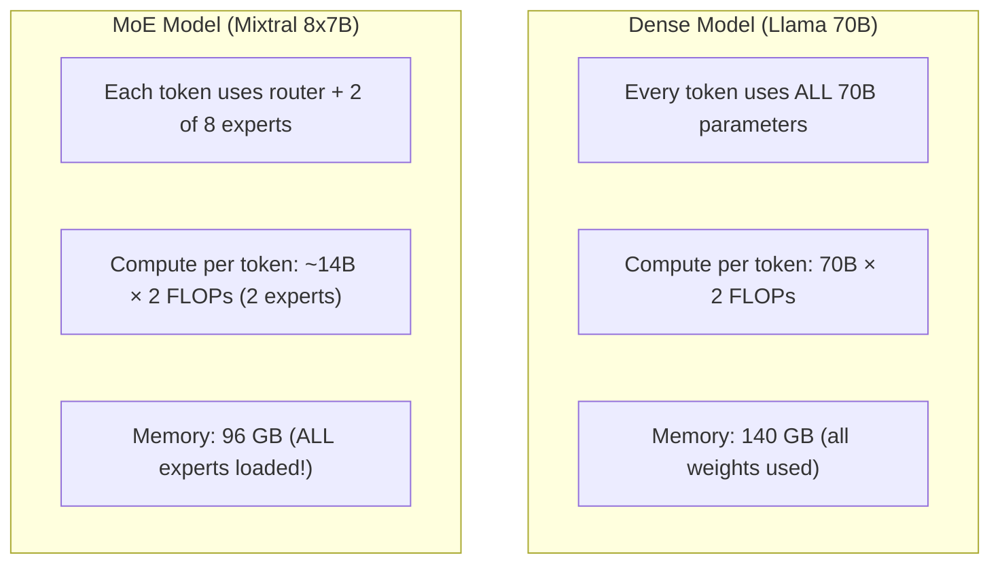
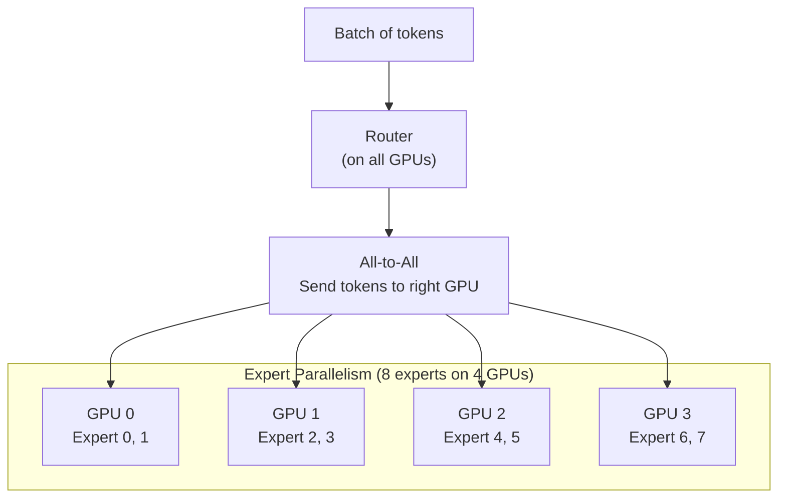

# Module 19 — Mixture-of-Experts Inference

> **6 lessons · Advanced**
> Serve models where only a fraction of parameters activate per token.

---

## 19.01 — How MoE Differs From Dense



**The MoE paradox:** More total parameters, same per-token compute, but **all parameters must be in memory**.

---

## 19.02 — Token Routing

```python
import torch
import torch.nn.functional as F

class MoERouter(torch.nn.Module):
    """Top-K router: select the best K experts for each token."""
    def __init__(self, hidden_dim, num_experts, top_k=2):
        super().__init__()
        self.gate = torch.nn.Linear(hidden_dim, num_experts, bias=False)
        self.top_k = top_k

    def forward(self, x):
        # x: (batch, seq_len, hidden_dim)
        logits = self.gate(x)                        # (batch, seq_len, num_experts)
        weights, indices = torch.topk(logits, self.top_k, dim=-1)
        weights = F.softmax(weights, dim=-1)         # Normalize selected expert weights
        return weights, indices                       # Which experts, how much weight

# Example: 8 experts, top-2 routing
router = MoERouter(hidden_dim=4096, num_experts=8, top_k=2)
x = torch.randn(1, 10, 4096)  # 10 tokens
weights, indices = router(x)
print(f"Token 0 routes to experts {indices[0,0].tolist()} with weights {weights[0,0].tolist()}")
# Token 0 routes to experts [3, 7] with weights [0.62, 0.38]
```

---

## 19.03 — Expert Parallelism



## 19.04 — Load Imbalance & Hot Experts

**Problem:** Some experts get 10× more tokens than others!

```python
# Simulated expert load distribution
import numpy as np
expert_loads = [15, 8, 25, 12, 5, 3, 22, 10]  # tokens per expert
print("Expert Load Distribution:")
for i, load in enumerate(expert_loads):
    bar = '█' * load
    print(f"  Expert {i}: {bar} ({load} tokens)")
# Expert 2 and 6 are "hot" — they bottleneck the system!
```

Solutions:
- **Capacity factor:** Limit tokens per expert, drop excess
- **Auxiliary load balancing loss:** During training, penalize imbalance
- **Expert replication:** Copy hot experts to multiple GPUs

## 19.05 — All-to-All Communication

```
All-to-All: every GPU sends tokens to every other GPU

GPU0 → GPU0: tokens for experts 0,1
GPU0 → GPU1: tokens for experts 2,3
GPU0 → GPU2: tokens for experts 4,5
GPU0 → GPU3: tokens for experts 6,7

GPU1 → GPU0: tokens for experts 0,1
... etc.

This is the MOST communication-heavy collective!
```

> **🏢 FAANG Deep Dive:** Google invented MoE for language models (Switch Transformer, 2021). DeepSeek-V3 (2024) pushed MoE to 671B total parameters with 37B active, using innovative expert placement and load balancing. The key: MoE gives you GPT-4 quality at GPT-3.5 serving costs.

---

**Next Module:** [20 — Long-Context & Tiered KV Systems](./20-long-context-tiered-kv.md) →
