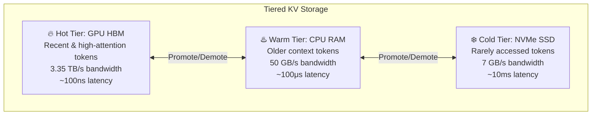

# Module 20 — Long-Context & Tiered KV Systems

> **7 lessons**
> Handle 128K+ contexts when KV cache exceeds GPU memory.

---

## 20.01 — The Long-Context Memory Problem

```python
# Llama 3 70B with 128K context:
# KV per token: 2 × 80 layers × 8 kv_heads × 128 head_dim × 2 bytes = 327,680 bytes = 320 KB
# KV for 128K tokens: 320 KB × 131,072 = 40 GB per request!
# Model weights: 140 GB
# Total for 1 request: 180 GB → doesn't even fit on 2× A100 80GB!

kv_per_token = 2 * 80 * 8 * 128 * 2  # bytes
kv_128k = kv_per_token * 128_000
print(f"KV cache for 128K context: {kv_128k / 1e9:.1f} GB")
# 40 GB — more than most GPU's free memory after loading the model!
```

---

## 20.02 — Tiered KV Storage



### Which Tokens Go Where?

```python
def tiered_kv_policy(attention_scores, token_positions, total_tokens):
    """
    Decide which KV entries stay in GPU vs get offloaded.
    
    Observation: Recent tokens and high-attention tokens are accessed most.
    """
    # Recent tokens: always in GPU (locality principle)
    recent_window = 2048
    recent_mask = token_positions >= (total_tokens - recent_window)

    # High-attention tokens: based on accumulated attention scores
    attention_threshold = attention_scores.quantile(0.9)
    important_mask = attention_scores > attention_threshold

    # GPU: recent OR important
    gpu_mask = recent_mask | important_mask

    # CPU: everything else
    cpu_mask = ~gpu_mask

    gpu_tokens = gpu_mask.sum().item()
    cpu_tokens = cpu_mask.sum().item()
    print(f"GPU: {gpu_tokens} tokens ({gpu_tokens/total_tokens*100:.0f}%)")
    print(f"CPU: {cpu_tokens} tokens ({cpu_tokens/total_tokens*100:.0f}%)")

    return gpu_mask, cpu_mask
```

---

## 20.03-20.04 — KV Quantization & Offloading

### FP8 KV Cache

Halves KV memory with minimal quality loss:

```bash
# vLLM with FP8 KV cache
vllm serve model --kv-cache-dtype fp8
# 128K context: 40 GB → 20 GB — now it fits!
```

### CPU Offload

```python
import torch

class TieredKVCache:
    """KV cache that spans GPU and CPU memory."""
    def __init__(self, gpu_budget_tokens, cpu_budget_tokens):
        self.gpu_cache = {}    # Recent/hot tokens
        self.cpu_cache = {}    # Offloaded tokens
        self.gpu_budget = gpu_budget_tokens
        self.cpu_budget = cpu_budget_tokens

    def access(self, token_positions):
        """Access KV for given positions, promoting from CPU if needed."""
        # Check GPU cache first
        gpu_hits = [p for p in token_positions if p in self.gpu_cache]
        cpu_needed = [p for p in token_positions if p not in self.gpu_cache]

        # Promote from CPU to GPU (async transfer)
        for pos in cpu_needed:
            if pos in self.cpu_cache:
                self.gpu_cache[pos] = self.cpu_cache[pos].cuda(non_blocking=True)
                # Evict LRU from GPU if over budget
                if len(self.gpu_cache) > self.gpu_budget:
                    self._evict_to_cpu()

    def _evict_to_cpu(self):
        """Move least-recently-used GPU KV to CPU."""
        oldest = min(self.gpu_cache.keys())  # Simplified: use position as proxy
        self.cpu_cache[oldest] = self.gpu_cache.pop(oldest).cpu(non_blocking=True)
```

> **🏢 FAANG Deep Dive:** Anthropic's Claude supports 200K context. To serve this efficiently, they use a combination of: (1) KV quantization (FP8), (2) attention-aware eviction (keep tokens the model attends to most), (3) hierarchical caching (GPU → CPU → recompute).

---

**Next Module:** [21 — Prefill/Decode Disaggregation](./21-prefill-decode-disaggregation.md) →
