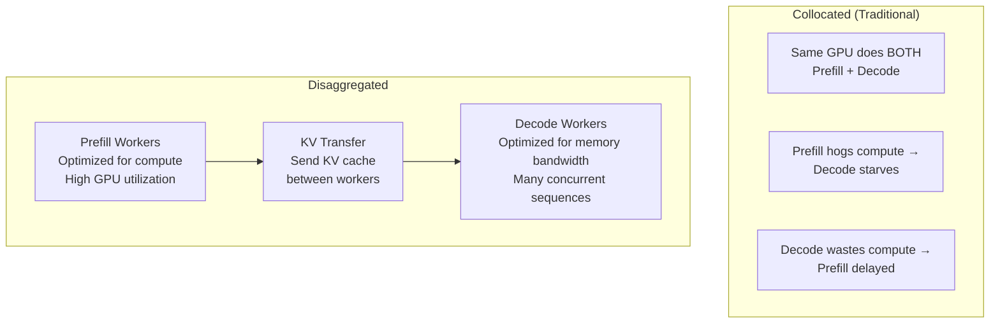
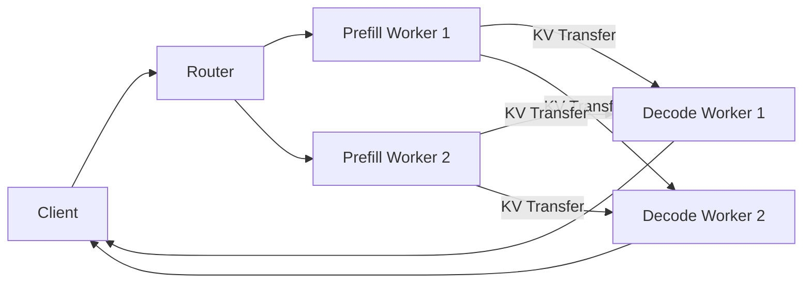

# Module 21 — Prefill/Decode Disaggregation

> **7 lessons · Advanced**
> Separate compute-bound prefill from memory-bound decode for independent scaling.

---

## 21.01 — Why Separate Prefill and Decode



| Property | Prefill | Decode |
|----------|---------|--------|
| Bottleneck | Compute | Memory bandwidth |
| GPU Utilization | 80-95% | 15-30% |
| Scaling signal | Prompt length & rate | Active sequences |
| Optimal batch size | Small (compute-limited) | Large (memory-limited) |
| KV cache need | Creates it | Reads from it |

---

## 21.02 — Architecture



## 21.03-21.04 — KV Transfer

The critical challenge: after prefill, the KV cache must be transferred to the decode worker.

```python
def kv_transfer_time(num_layers, num_kv_heads, head_dim, seq_len, 
                      bytes_per_element, bandwidth_gb_s):
    """Calculate time to transfer KV cache between workers."""
    kv_size = 2 * num_layers * num_kv_heads * head_dim * seq_len * bytes_per_element
    transfer_time_ms = kv_size / (bandwidth_gb_s * 1e9) * 1000
    return transfer_time_ms, kv_size / 1e9

# Llama 70B, 4K context, BF16 KV
time_ms, size_gb = kv_transfer_time(80, 8, 128, 4096, 2, 50)  # InfiniBand
print(f"KV size: {size_gb:.2f} GB, Transfer time: {time_ms:.1f} ms (InfiniBand)")

time_ms, size_gb = kv_transfer_time(80, 8, 128, 4096, 2, 900)  # NVLink
print(f"KV size: {size_gb:.2f} GB, Transfer time: {time_ms:.1f} ms (NVLink)")
```

## 21.05 — The Crossover Point

```python
def disaggregation_benefit(prefill_time_ms, decode_time_ms, transfer_time_ms, 
                           num_requests_per_sec):
    """When does disaggregation outperform collocated?"""
    # Collocated: prefill and decode interfere
    collocated_ttft = prefill_time_ms * 1.3  # 30% interference overhead
    collocated_tpot = decode_time_ms * 1.5   # 50% interference overhead

    # Disaggregated: clean separation but transfer cost
    disagg_ttft = prefill_time_ms + transfer_time_ms
    disagg_tpot = decode_time_ms  # No interference!

    print(f"Collocated:    TTFT={collocated_ttft:.0f}ms  TPOT={collocated_tpot:.0f}ms")
    print(f"Disaggregated: TTFT={disagg_ttft:.0f}ms  TPOT={disagg_tpot:.0f}ms")

    if disagg_tpot < collocated_tpot:
        print("✅ Disaggregation wins on decode quality!")
    else:
        print("❌ Collocated is better for this scenario")

disaggregation_benefit(
    prefill_time_ms=100, decode_time_ms=30, 
    transfer_time_ms=20, num_requests_per_sec=50
)
```

> **🏢 FAANG Deep Dive:** DistServe (2024) and Splitwise (2024) showed that disaggregation can improve goodput by 2-4× at high load. The key insight: prefill and decode have fundamentally different resource needs, so mixing them wastes resources. Large providers like Cloudflare, Together AI, and others are adopting disaggregated architectures.

---

**Next Module:** [22 — Production Serving & Model Lifecycle](../space-08-production-inference/22-production-serving.md) →
