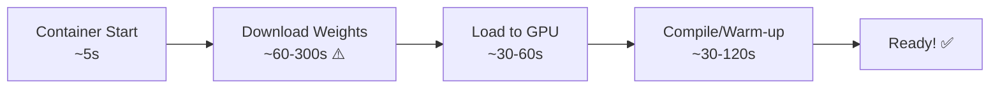
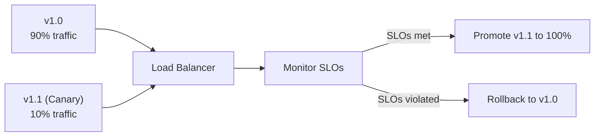

# Module 22 — Production Serving & Model Lifecycle

> **8 lessons**
> Package, deploy, version, and safely update your inference service.

---

## 22.01 — Package the Inference Service

```dockerfile
# Production Dockerfile for vLLM
FROM vllm/vllm-openai:latest

# Copy model weights (baked into image for fast startup)
COPY ./model-weights /models/llama-3-8b/

# Copy configuration
COPY vllm_config.yaml /app/config.yaml

ENV MODEL_PATH=/models/llama-3-8b/
ENV TENSOR_PARALLEL_SIZE=1
ENV GPU_MEMORY_UTILIZATION=0.90

EXPOSE 8000

HEALTHCHECK --interval=30s --timeout=10s --start-period=300s \
    CMD curl -f http://localhost:8000/health || exit 1

CMD ["python", "-m", "vllm.entrypoints.openai.api_server", \
     "--model", "${MODEL_PATH}", \
     "--tensor-parallel-size", "${TENSOR_PARALLEL_SIZE}", \
     "--gpu-memory-utilization", "${GPU_MEMORY_UTILIZATION}", \
     "--port", "8000"]
```

## 22.02 — Cold Starts



**Mitigation strategies:**
- Pre-bake weights into Docker image
- Use shared storage (EFS/NFS) for weights
- Pre-warmed instance pools
- Cache compiled kernels (torch compile cache)

## 22.03 — Health Checks & Graceful Shutdown

```python
from fastapi import FastAPI
import signal
import asyncio

app = FastAPI()
is_draining = False

@app.get("/health/live")
async def liveness():
    """Process is alive."""
    return {"status": "alive"}

@app.get("/health/ready")
async def readiness():
    """Ready to accept traffic."""
    if is_draining:
        return {"status": "draining"}, 503
    if not model_loaded:
        return {"status": "loading"}, 503
    return {"status": "ready"}

def graceful_shutdown(signum, frame):
    """Drain in-flight requests before shutting down."""
    global is_draining
    is_draining = True  # Stop accepting new requests
    # Wait for in-flight requests to complete (up to 60s)
    # Then exit
```

## 22.04-22.06 — Versioning, Canary & Rollback



```yaml
# Canary deployment configuration
canary:
  initial_weight: 5           # Start with 5% traffic
  step_weight: 10             # Increase by 10% every step
  step_interval: 300          # Every 5 minutes
  max_weight: 100

  # Automatic rollback conditions
  rollback_if:
    ttft_p95_increase: 20%    # TTFT P95 increases by >20%
    tpot_p95_increase: 15%    # TPOT P95 increases by >15%
    error_rate_increase: 1%   # Error rate increases by >1%
```

## 22.07 — Multi-Model Serving

```bash
# Serve multiple LoRA adapters on the same base model
vllm serve meta-llama/Llama-3-8B-Instruct \
    --enable-lora \
    --lora-modules customer-support=./loras/cs code-assist=./loras/code
```

> **🏢 FAANG Deep Dive:** OpenAI deploys model updates to ChatGPT using shadow traffic + canary releases. New model versions receive duplicated production traffic (shadow), and outputs are compared for quality regression before any real users see the new model.

---

**Next Module:** [23 — Routing, Autoscaling & Orchestration](./23-routing-autoscaling.md) →
