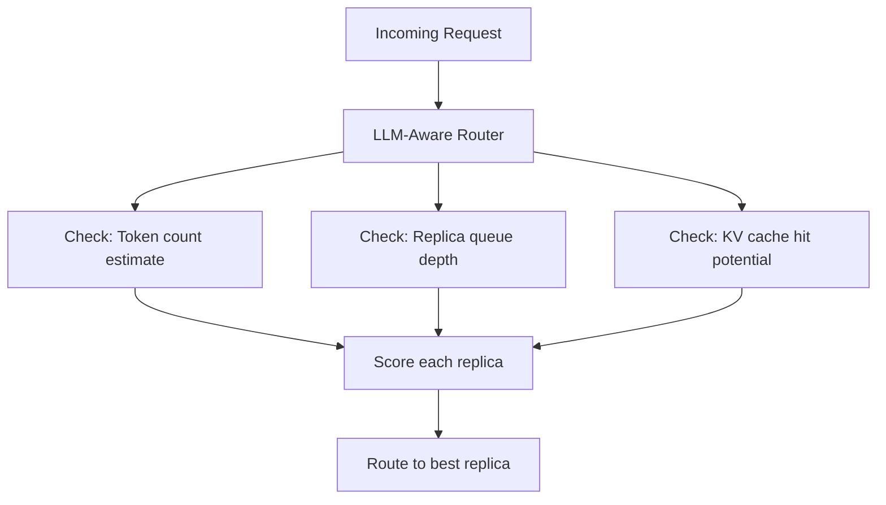

# Module 23 — Routing, Autoscaling & Orchestration

> **8 lessons**
> Route requests intelligently, scale GPU instances, maintain SLOs under changing traffic.

---

## 23.01 — Why Round-Robin Fails for LLMs

```
Round-robin: Req1→GPU0, Req2→GPU1, Req3→GPU2, Req4→GPU0...

Problem: Req1 has 10K prompt (heavy), Req2 has 50 tokens (light)
GPU 0 is overloaded while GPU 1 is idle!

LLM requests have VARIABLE cost — you can't treat them equally.
```

## 23.02 — LLM-Aware Routing



```python
class LLMRouter:
    """Route requests considering LLM-specific factors."""

    def __init__(self, replicas):
        self.replicas = replicas

    def route(self, request):
        best_replica = None
        best_score = float('inf')

        for replica in self.replicas:
            score = self._score_replica(replica, request)
            if score < best_score:
                best_score = score
                best_replica = replica

        return best_replica

    def _score_replica(self, replica, request):
        """Lower score = better choice."""
        # Factor 1: Queue depth (fewer waiting requests = better)
        queue_score = replica.queue_depth * 10

        # Factor 2: KV cache utilization (don't send to nearly-full replicas)
        kv_score = replica.kv_utilization * 100
        if replica.kv_utilization > 0.9:
            kv_score += 1000  # Strongly avoid

        # Factor 3: Prefix cache hit (route to replica with cached prefix)
        prefix_score = 0
        if request.system_prompt_hash in replica.cached_prefixes:
            prefix_score = -50  # Bonus for cache hit!

        # Factor 4: Estimated tokens in progress
        tokens_score = replica.tokens_in_progress * 0.01

        return queue_score + kv_score + prefix_score + tokens_score
```

## 23.03-23.04 — Autoscaling

### Scaling Signals

| Signal | Scale Up When | Scale Down When |
|--------|--------------|----------------|
| Request rate | > target req/s per replica | < 50% target |
| Queue depth | > 10 waiting requests | 0 waiting for 5min |
| KV utilization | > 80% | < 30% |
| GPU utilization | > 85% | < 20% |
| TTFT P95 | > SLO threshold | < 50% of SLO |

```python
class LLMAutoscaler:
    """Autoscale GPU inference replicas based on LLM-specific signals."""

    def __init__(self, min_replicas=1, max_replicas=100,
                 target_queue_depth=5, target_kv_util=0.7,
                 scale_up_cooldown=60, scale_down_cooldown=300):
        self.min_replicas = min_replicas
        self.max_replicas = max_replicas
        self.target_queue = target_queue_depth
        self.target_kv = target_kv_util
        self.current_replicas = min_replicas
        self.last_scale_up = 0
        self.last_scale_down = 0

    def evaluate(self, metrics):
        """Decide scaling action based on current metrics."""
        avg_queue = metrics['avg_queue_depth']
        avg_kv = metrics['avg_kv_utilization']
        ttft_p95 = metrics['ttft_p95_ms']
        ttft_slo = metrics['ttft_slo_ms']

        # Scale UP: aggressive (react in 1 minute)
        if avg_queue > self.target_queue * 2 or avg_kv > 0.9 or ttft_p95 > ttft_slo:
            new_count = min(self.current_replicas + max(1, self.current_replicas // 4),
                          self.max_replicas)
            return 'scale_up', new_count

        # Scale DOWN: conservative (wait 5 minutes)
        if avg_queue < 1 and avg_kv < 0.3 and ttft_p95 < ttft_slo * 0.5:
            new_count = max(self.current_replicas - 1, self.min_replicas)
            return 'scale_down', new_count

        return 'no_change', self.current_replicas
```

## 23.05-23.07 — GPU Startup & Kubernetes

### Warm Capacity

```
Cold start timeline:
  Container pull:    30s
  Weight loading:    60s
  GPU warm-up:      60s
  Total:           ~2.5 minutes!

Strategy: Keep N warm spares ready
  Warm spare pool: pre-loaded, not serving
  When scale-up: promote warm spare → serving (instant!)
  Background: replenish warm spare pool
```

### Kubernetes Configuration

```yaml
apiVersion: apps/v1
kind: Deployment
metadata:
  name: llm-inference
spec:
  replicas: 4
  template:
    spec:
      containers:
      - name: vllm
        image: vllm-server:latest
        resources:
          limits:
            nvidia.com/gpu: 1
            memory: "64Gi"
          requests:
            nvidia.com/gpu: 1
            memory: "32Gi"
        ports:
        - containerPort: 8000
        readinessProbe:
          httpGet:
            path: /health/ready
            port: 8000
          initialDelaySeconds: 180
          periodSeconds: 10
        livenessProbe:
          httpGet:
            path: /health/live
            port: 8000
          periodSeconds: 30
```

> **🏢 FAANG Deep Dive:** Anthropic uses prefix-aware routing: multi-turn conversations are routed to the replica that has the conversation's KV cache. This avoids re-prefilling the entire conversation history on a different replica, saving 50-80% prefill compute for returning users.

---

**Next Module:** [24 — Observability, Reliability & Security](./24-observability-reliability-security.md) →
