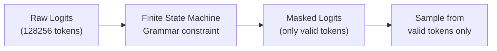
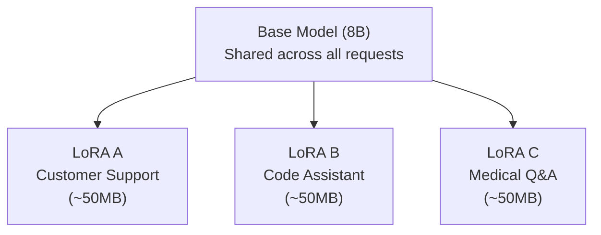
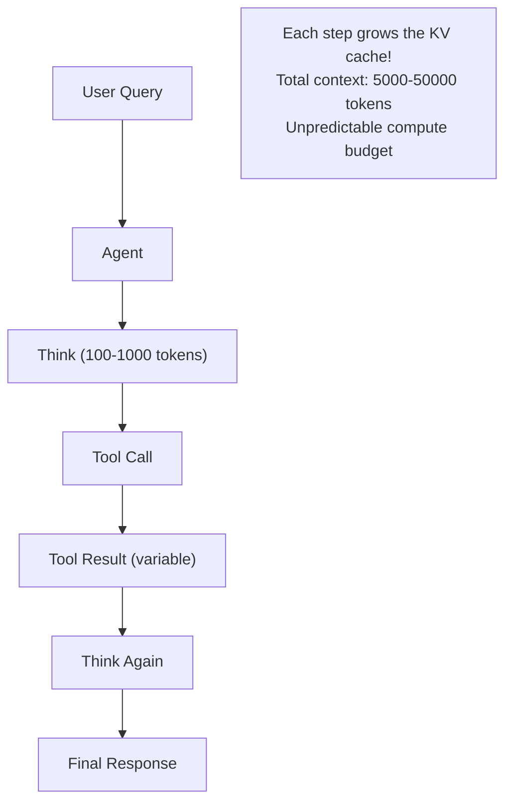

# Module 26 — Specialized Inference Workloads

> **10 lessons · Elective**
> Structured output, multi-LoRA, vision, agentic, reasoning, batch, diffusion.

---

## 26.01 — Structured Output & Tool-Calling

### Constrained Decoding



```python
# Example: Force JSON output
# At each decode step, the FSM knows which tokens are valid:
# After '{"name": '  → only '"' is valid (start string)
# After '"John'       → '"' or more characters
# After '}'           → only EOS (end of JSON)

# vLLM structured output
from openai import OpenAI
client = OpenAI(base_url="http://localhost:8000/v1", api_key="unused")

response = client.chat.completions.create(
    model="meta-llama/Llama-3-8B-Instruct",
    messages=[{"role": "user", "content": "Extract name and age from: John is 30"}],
    response_format={
        "type": "json_schema",
        "json_schema": {
            "name": "person",
            "schema": {
                "type": "object",
                "properties": {
                    "name": {"type": "string"},
                    "age": {"type": "integer"}
                },
                "required": ["name", "age"]
            }
        }
    }
)
# Always returns valid JSON: {"name": "John", "age": 30}
```

---

## 26.02 — Multi-LoRA Serving



```python
# LoRA math: ΔW = B × A
# B: (hidden_dim, rank) — e.g., (4096, 16)
# A: (rank, hidden_dim) — e.g., (16, 4096)
# Full weight: W + ΔW = W + B × A

# Memory: base model (16 GB) + each LoRA (~50 MB) = serve 100 LoRAs on same GPU!

# vLLM multi-LoRA
# vllm serve base-model --enable-lora \
#   --lora-modules support=./support code=./code medical=./medical \
#   --max-loras 10 --max-lora-rank 64
```

---

## 26.03 — Vision-Language Inference

```python
# VLM processing pipeline:
# Image → Vision Encoder → Projection → [Visual Tokens] + [Text Tokens] → LLM

# Key challenge: one image = 576-2048 visual tokens!
# That's equivalent to a 2000-token text prompt in KV cache cost

# Memory impact:
image_tokens = 576
kv_per_token_bytes = 2 * 32 * 8 * 128 * 2  # Llama 8B
image_kv_mb = image_tokens * kv_per_token_bytes / 1e6
print(f"KV cache per image: {image_kv_mb:.1f} MB")
# ~37 MB per image in the conversation!
```

---

## 26.04 — Agentic & Multi-Turn Inference

**Challenge:** Agentic workflows generate unpredictable amounts of text across multiple turns.



## 26.05 — Reasoning Model Inference

```python
# Reasoning models (o1, o3 style) generate LONG chains of thought
# before the final answer

# Cost structure:
# Normal model: 200 input + 300 output = 500 tokens
# Reasoning model: 200 input + 3000 thinking + 300 output = 3500 tokens (7× more!)

# Optimization strategies:
# 1. Thinking budget: cap thinking tokens
# 2. Early stopping: stop thinking when confident
# 3. Thinking compression: don't return thinking tokens to user (save streaming)
```

## 26.06-26.09 — Batch, RL Rollout & Diffusion

### Batch Inference

```python
# Offline processing: maximize throughput, ignore latency
# Key optimizations:
# 1. Sort requests by length (minimize padding waste)
# 2. Large batch sizes (fill GPU compute)
# 3. No streaming needed
# 4. Can use lower-priority GPU scheduling

# vLLM offline batch:
from vllm import LLM, SamplingParams
llm = LLM(model="meta-llama/Llama-3-8B-Instruct", max_num_seqs=512)
prompts = load_prompts("prompts.jsonl")  # 10K prompts
results = llm.generate(prompts, SamplingParams(max_tokens=256))
```

### Diffusion Inference

```
Stable Diffusion Pipeline:
  1. Encode text prompt (CLIP)           — ~10ms
  2. Denoise latent (U-Net × 20-50 steps) — ~500-2000ms
  3. Decode latent to image (VAE)        — ~50ms

Key trade-off: more steps = higher quality but slower
  20 steps: fast, good for previews
  50 steps: best quality, 2.5× slower
```

> **🏢 FAANG Deep Dive:** OpenAI serves different workloads on shared GPU infrastructure using priority-based scheduling. Batch inference (API tier "batch") gets lower priority and lower pricing. Interactive requests (ChatGPT) get highest priority. This amortizes GPU costs across workload types.

---

**Next Module:** [27 — Read an Inference Engine](./27-read-inference-engine.md) →
