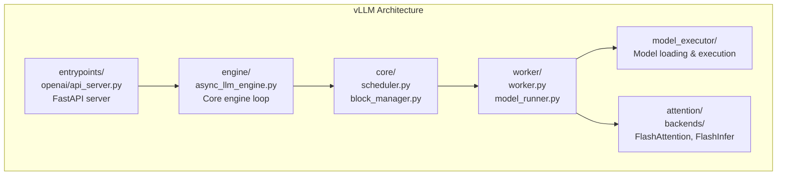
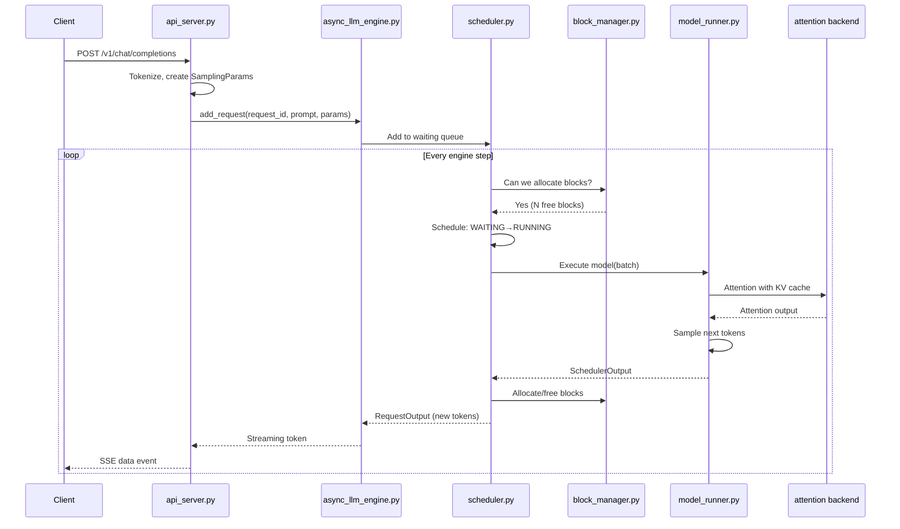

# Module 27 — Read an Inference Engine

> **6 lessons · Advanced**
> Map the vLLM codebase and understand how a production engine works.

---

## 27.01 — Map the vLLM Codebase



### Key Files

```
vllm/
├── entrypoints/
│   ├── openai/
│   │   └── api_server.py          # FastAPI OpenAI-compatible API
│   └── llm.py                     # Python LLM class (offline)
├── engine/
│   ├── async_llm_engine.py        # Async engine (production)
│   └── llm_engine.py              # Sync engine (offline)
├── core/
│   ├── scheduler.py               # ★ Request scheduling logic
│   └── block_manager.py           # ★ Paged KV block management
├── worker/
│   ├── worker.py                  # GPU worker process
│   └── model_runner.py            # ★ Runs model forward pass
├── attention/
│   ├── backends/
│   │   ├── flash_attn.py          # FlashAttention backend
│   │   └── flashinfer.py          # FlashInfer backend
│   └── layer.py                   # Attention layer abstraction
├── model_executor/
│   └── models/                    # Model implementations (Llama, etc.)
└── config.py                      # All configuration
```

---

## 27.02 — Follow One Request End-to-End



---

## 27.03 — The Scheduler

```python
# Simplified scheduler logic (from vllm/core/scheduler.py):

class Scheduler:
    def schedule(self):
        # 1. Check running requests — any finished?
        for req in self.running:
            if req.is_finished():
                self.running.remove(req)
                self.block_manager.free(req)

        # 2. Can we admit waiting requests?
        while self.waiting:
            req = self.waiting[0]
            if self.block_manager.can_allocate(req):
                self.waiting.pop(0)
                self.block_manager.allocate(req)
                self.running.append(req)
            else:
                break  # No more memory

        # 3. If still no memory, preempt lowest-priority running request
        if self.waiting and not self.block_manager.can_allocate(self.waiting[0]):
            victim = self.running[-1]  # FCFS: preempt newest
            self.block_manager.swap_out(victim)
            self.running.remove(victim)
            self.swapped.append(victim)
```

## 27.04 — Block Manager

```python
# Simplified block manager (from vllm/core/block_manager.py):

class BlockManager:
    def __init__(self, num_gpu_blocks, num_cpu_blocks, block_size):
        self.gpu_free = list(range(num_gpu_blocks))
        self.cpu_free = list(range(num_cpu_blocks))
        self.block_tables = {}  # request_id → [physical_block_ids]

    def can_allocate(self, request):
        needed = (request.num_tokens + self.block_size - 1) // self.block_size
        return needed <= len(self.gpu_free)

    def allocate(self, request):
        needed = (request.num_tokens + self.block_size - 1) // self.block_size
        blocks = [self.gpu_free.pop() for _ in range(needed)]
        self.block_tables[request.id] = blocks

    def free(self, request):
        blocks = self.block_tables.pop(request.id)
        self.gpu_free.extend(blocks)
```

## 27.05 — Model Execution & Attention

```python
# Simplified model runner (from vllm/worker/model_runner.py):

class ModelRunner:
    def execute_model(self, batch):
        # 1. Prepare inputs (token IDs, positions, block tables)
        input_ids = batch.input_tokens
        positions = batch.positions
        block_tables = batch.block_tables

        # 2. Run model forward pass
        hidden_states = self.model(
            input_ids=input_ids,
            positions=positions,
            kv_caches=self.kv_caches,
            attn_metadata=AttentionMetadata(
                block_tables=block_tables,
                context_lens=batch.context_lens,
            ),
        )

        # 3. Sample next tokens
        logits = self.model.lm_head(hidden_states)
        next_tokens = self.sampler(logits, batch.sampling_params)

        return next_tokens
```

> **🏢 FAANG Deep Dive:** vLLM started as a research project at UC Berkeley (SOSP 2023). It's now maintained by a full team at Anyscale/vLLM Inc., with contributions from Meta, NVIDIA, and dozens of companies. Understanding vLLM's architecture is the fastest path to understanding production inference.

---

**Next Module:** [28 — Build a Mini Inference Engine](./28-build-mini-engine.md) →
