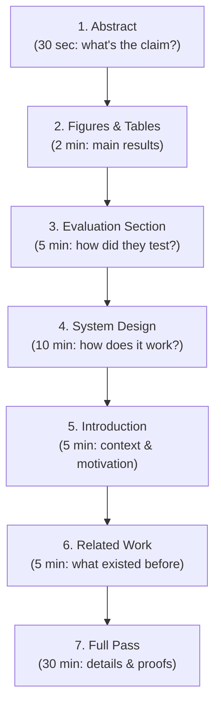
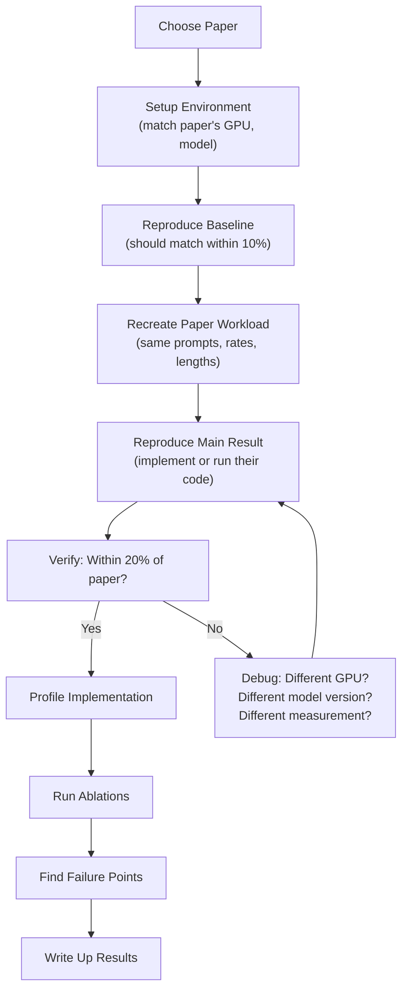

# Module 29 — Reproduce Inference Research

> **8 lessons · Advanced**
> Read, understand, and reproduce a key inference systems paper.

---

## 29.01 — How to Read an Inference Systems Paper

### Reading Order (NOT front-to-back!)



### Key Questions to Ask

```python
paper_analysis = {
    "What problem does it solve?": "e.g., KV cache fragmentation wastes 60-80% of memory",
    "What's the key insight?": "e.g., Use virtual memory paging for KV cache",
    "What's the baseline?": "e.g., ORCA, FasterTransformer with contiguous allocation",
    "What's the main result?": "e.g., 2-4× more concurrent requests",
    "What are the assumptions?": "e.g., NVIDIA GPU, autoregressive models",
    "Where might it NOT work?": "e.g., Very short sequences (overhead > benefit)",
    "Is it deployed?": "e.g., Yes, vLLM is used in production by 100+ companies",
}
```

---

## 29.02 — Recommended Papers

| Paper | Year | Contribution | Difficulty |
|-------|------|-------------|------------|
| **Orca** | OSDI 2022 | Continuous batching | ★★★☆☆ |
| **vLLM/PagedAttention** | SOSP 2023 | Paged KV cache | ★★★☆☆ |
| **FlashAttention** | NeurIPS 2022 | IO-aware attention | ★★★★☆ |
| **FlashAttention-2** | 2023 | Better parallelism | ★★★★☆ |
| **SGLang** | 2024 | RadixAttention + structured | ★★★☆☆ |
| **DistServe** | OSDI 2024 | Prefill/decode disaggregation | ★★★★☆ |
| **Splitwise** | ISCA 2024 | Disaggregation | ★★★★☆ |
| **Medusa** | 2024 | Multi-head speculation | ★★★☆☆ |
| **EAGLE** | 2024 | Feature-level speculation | ★★★★☆ |

---

## 29.03-29.04 — Reproduction Workflow



## 29.05-29.07 — Profiling, Ablations & Failure Points

```python
class ReproductionExperiment:
    """Framework for reproducing inference research papers."""

    def __init__(self, paper_name, baseline_system, proposed_system):
        self.paper_name = paper_name
        self.baseline = baseline_system
        self.proposed = proposed_system
        self.results = {}

    def run_ablation(self, components_to_disable):
        """Disable components one at a time to measure contribution."""
        for component in components_to_disable:
            config = self.proposed.disable(component)
            metrics = self.benchmark(config)
            improvement_over_baseline = (
                metrics['throughput'] / self.results['baseline']['throughput'] - 1
            ) * 100
            print(f"Without {component}: {improvement_over_baseline:.1f}% improvement "
                  f"(vs full system: {self.results['proposed_improvement']:.1f}%)")

    def find_crossover(self, parameter, values):
        """Find where the proposed system stops winning."""
        for val in values:
            baseline_metrics = self.benchmark(self.baseline, **{parameter: val})
            proposed_metrics = self.benchmark(self.proposed, **{parameter: val})

            ratio = proposed_metrics['throughput'] / baseline_metrics['throughput']
            status = "✅ wins" if ratio > 1 else "❌ loses"
            print(f"{parameter}={val}: proposed/baseline = {ratio:.2f}× {status}")
```

> **🏢 FAANG Deep Dive:** DeepSeek's research team reproduced and improved upon many inference techniques to build their serving infrastructure. Their MoE innovations came from careful reproduction and analysis of Google's Switch Transformer and Meta's MoE work. The ability to reproduce papers is a core skill for inference research roles.

---

**Next Module:** [30 — Final Inference Engineering Capstone](./30-final-capstone.md) →
