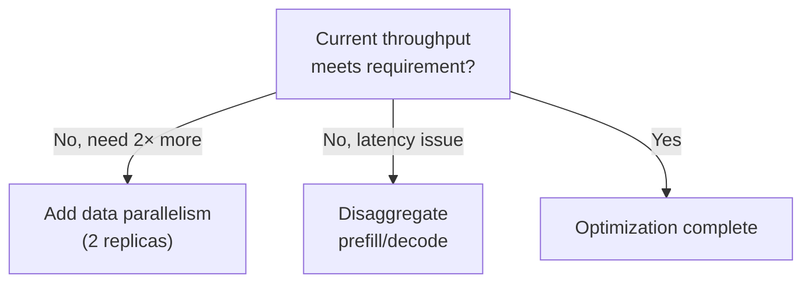
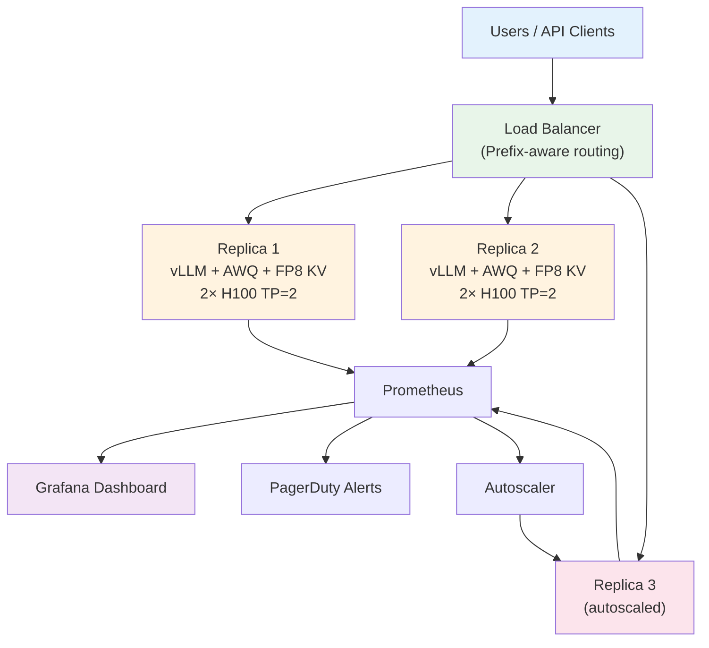

# Module 30 — Final Inference Engineering Capstone

> **10 project phases**
> Design, build, optimize, and defend a complete production inference system.

---

## Overview

```mermaid
graph LR
    P1["P1: Define<br/>Workload & SLO"] --> P2["P2: Choose<br/>Model & Hardware"]
    P2 --> P3["P3: Baseline"]
    P3 --> P4["P4: Profile"]
    P4 --> P5["P5: Optimize<br/>Memory & Scheduling"]
    P5 --> P6["P6: Optimize<br/>Precision & Runtime"]
    P6 --> P7["P7: Scale<br/>Multi-GPU"]
    P7 --> P8["P8: Production<br/>Routing & Monitoring"]
    P8 --> P9["P9: Test<br/>Reliability & Cost"]
    P9 --> P10["P10: Publish<br/>& Defend"]
```



---

## P1 — Define the Workload, Quality Target & SLO

```python
capstone_config = {
    # Choose ONE workload:
    "workload": "RAG-powered enterprise chatbot",

    # Traffic profile
    "peak_requests_per_sec": 50,
    "avg_input_tokens": 3000,      # RAG context + query
    "avg_output_tokens": 300,
    "p99_input_tokens": 8000,

    # Quality targets
    "quality_benchmark": "Custom eval set (500 Q&A pairs)",
    "min_accuracy": 0.85,
    "safety": "No PII in outputs, content filter enabled",

    # SLOs
    "slo_ttft_p95_ms": 500,
    "slo_tpot_p95_ms": 50,
    "slo_e2e_p99_ms": 15000,
    "slo_availability": 0.999,     # 99.9% uptime
    "slo_goodput": 0.995,          # 99.5% requests meet latency SLOs
}
```

---

## P2 — Choose the Model, Hardware & Engine

```python
model_selection = {
    "candidates": [
        {"model": "Llama-3-8B-Instruct", "quality": "Good", "memory": "16 GB", "cost": "Low"},
        {"model": "Llama-3-70B-Instruct", "quality": "Great", "memory": "140 GB", "cost": "High"},
        {"model": "Qwen-2.5-32B-Instruct", "quality": "Great", "memory": "64 GB", "cost": "Medium"},
    ],
    "selected": "Llama-3-70B-Instruct + AWQ INT4 (35 GB)",

    "hardware": "2× H100 80GB (TP=2)",
    "engine": "vLLM (best for RAG workloads with prefix caching)",

    "estimated_cost_per_million_tokens": "$0.45",
}
```

---

## P3 — Establish a Reproducible Baseline

```bash
# Default configuration — no optimization
vllm serve meta-llama/Llama-3-70B-Instruct \
    --quantization awq \
    --tensor-parallel-size 2 \
    --port 8000

# Run benchmark with your workload
python benchmark.py \
    --url http://localhost:8000/v1/completions \
    --workload rag \
    --num-requests 1000 \
    --concurrency 32 \
    --output baseline_results.json
```

Document: TTFT, TPOT, throughput, GPU util, KV util, memory.

---

## P4 — Profile and Identify the Bottleneck

```python
# Profiling checklist:
profiling = {
    "PyTorch Profiler": "Identify top CUDA operations",
    "Nsight Systems": "Find CPU-GPU gaps, kernel launch overhead",
    "vLLM metrics": "Queue depth, batch size, preemption rate",
    "GPU monitoring": "Utilization, memory, temperature during load",
}

# Expected findings for RAG workload:
# - Long prefills (3K tokens) blocking decode → need chunked prefill
# - Same RAG context repeated → need prefix caching
# - KV cache filling up fast → need KV quantization or more memory
```

---

## P5 — Optimize Memory, Scheduling & Caching

```bash
# Optimized configuration
vllm serve meta-llama/Llama-3-70B-Instruct \
    --quantization awq \
    --tensor-parallel-size 2 \
    --gpu-memory-utilization 0.92 \
    --enable-prefix-caching \
    --enable-chunked-prefill \
    --max-num-batched-tokens 4096 \
    --kv-cache-dtype fp8 \
    --max-num-seqs 128
```

## P6 — Optimize Precision, Kernels & Runtime

Evaluate: FP8 weights, CUDA graphs, speculative decoding.

## P7 — Multi-GPU or Disaggregation Decision



## P8 — Production Hardening

```yaml
# Production deployment
components:
  load_balancer:
    type: "prefix-aware"
    health_check: "/health/ready"
  autoscaler:
    min_replicas: 2
    max_replicas: 8
    target_kv_utilization: 0.7
    scale_up_cooldown: 60s
    scale_down_cooldown: 300s
  monitoring:
    prometheus: true
    grafana_dashboard: true
    alerts:
      - ttft_p95 > 600ms → PagerDuty
      - error_rate > 0.5% → PagerDuty
      - kv_utilization > 90% → Warning
```

## P9 — Failure Testing & Cost

```python
chaos_tests = {
    "Kill one replica": "Expect: other replicas absorb traffic, no errors",
    "Spike to 5× traffic": "Expect: autoscaler adds replicas, queue grows temporarily",
    "Send 32K prompts": "Expect: admission control rejects if KV full",
    "Memory exhaustion": "Expect: preemption, no OOM crash",
}

cost_analysis = {
    "hardware": "2× H100 = $7.00/hr = $5,040/month",
    "throughput": "3,000 tok/s sustained",
    "cost_per_million_tokens": "$0.35 (output)",
    "vs_api_pricing": "10× cheaper than GPT-4o",
    "monthly_savings": "$45,000 vs API at our volume",
}
```

## P10 — Publish and Defend

### Final Report Structure

```
1. Problem Statement & Workload Definition
2. Model, Hardware & Engine Selection (with justification)
3. Baseline Measurements
4. Profiling Results & Bottleneck Analysis
5. Optimization Journey (what worked, what didn't)
6. Final System Architecture (Mermaid diagram)
7. Performance Results (tables, charts)
8. Reliability Testing Results
9. Cost Analysis & ROI
10. Lessons Learned & Future Work
```

### Final Architecture Diagram



---

## Capstone Rubric

| Criterion | Weight | Excellent | Good | Needs Work |
|-----------|--------|-----------|------|-----------|
| Workload definition | 10% | Realistic, well-documented | Reasonable | Vague |
| Baseline quality | 10% | Reproducible, well-measured | Measured | Incomplete |
| Profiling depth | 15% | Root cause identified | Surface-level | No profiling |
| Optimization impact | 20% | >2× improvement, well-justified | >1.5× | Minimal |
| Production readiness | 15% | Monitoring, autoscaling, HA | Basic monitoring | No ops |
| Reliability testing | 10% | Chaos tests, recovery proof | Basic tests | None |
| Cost analysis | 10% | Full TCO, API comparison | Basic costs | Missing |
| Presentation | 10% | Clear, well-structured | Readable | Disorganized |

> **🏢 FAANG Deep Dive: Your Portfolio**
>
> This capstone, if well-executed, demonstrates:
> - **System design skills** (architecture, tradeoffs)
> - **Performance engineering** (profiling, optimization)
> - **Production operations** (monitoring, reliability)
> - **Business acumen** (cost analysis, ROI)
>
> This is exactly what companies like OpenAI, Anthropic, Google, and Meta
> look for in inference engineering candidates. The complete system shows
> you can go from problem definition to production deployment.
>
> **Congratulations on completing the Inference Engineering curriculum!** 🎉

---

*You've gone from "what is inference?" to building and deploying production inference systems.
The field is moving fast — stay curious, keep profiling, and always measure before optimizing.*
