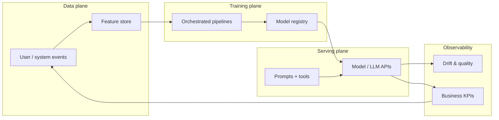
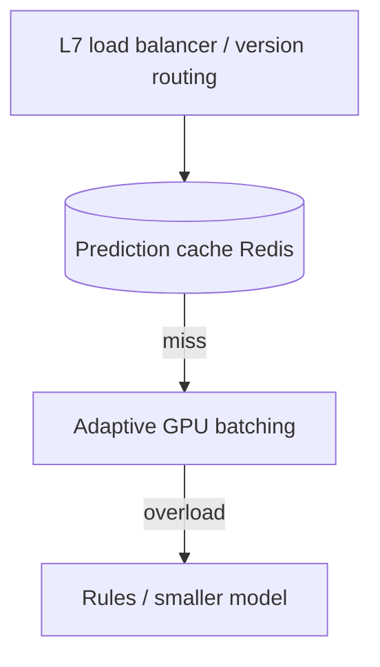
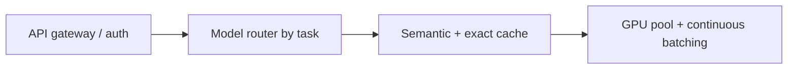
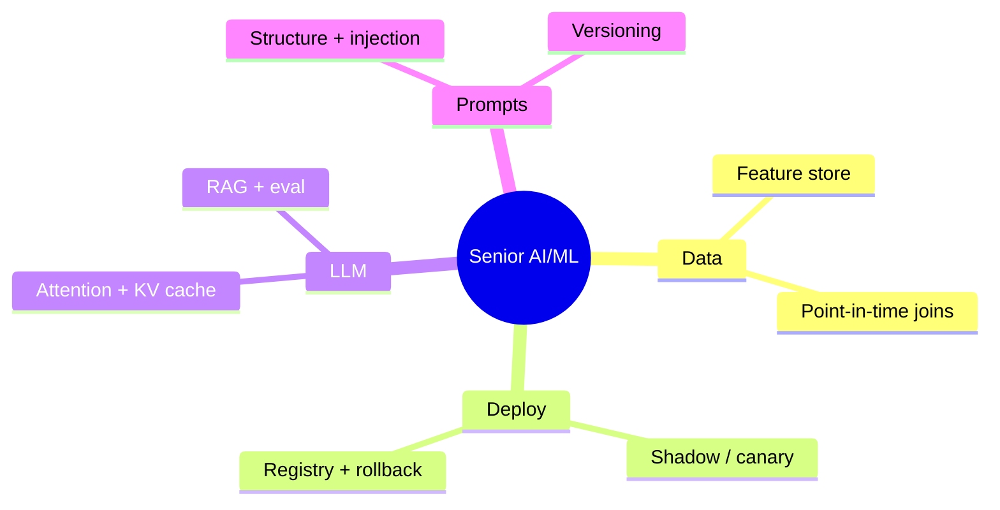

# AI/ML System Design, LLMs & Prompt Engineering

A senior-engineer study guide synthesizing production ML lifecycle design, transformer-based LLMs, and prompt engineering—how models become reliable products, not notebook experiments.

> **Interview lens:** Separators are not “can you train a model?” but “can you operate the full loop from raw events → features → training → safe deploy → monitoring → iteration?”

---

## How the three topics connect



| Layer | Classic ML | LLM products |
|-------|------------|--------------|
| Knowledge | Features in a store | Parametric weights + optional RAG |
| Consistency risk | Training–serving skew | Prompt/version drift |
| Deploy risk | Bad ranking model | Hallucination, injection, cost blowups |
| Feedback | Labels from clicks | RLHF, eval harnesses, user thumbs |

---

## Part 1 — AI/ML system design

### 1.1 End-to-end recommendation (or any ML) pipeline

**Clarify the domain first:** e-commerce SKUs, social feed, or ads change latency, freshness, and blast radius of a bad model.

**Stages:**

1. **Ingestion** — Stream events (Kafka) into an immutable data lake; schema registry from day one so you can reprocess when feature logic changes.
2. **Features** — Split **batch** (lifetime purchase count, daily Spark job) vs **real-time** (current session views, per-request + cache).
3. **Training** — Airflow / Kubeflow Pipelines; pin deps, snapshot data, log hyperparameters; register artifacts in a **model registry**.
4. **Validation** — Shadow scoring on live traffic → canary % → gradual ramp. Never ship on offline metrics alone.
5. **Monitoring** — Prediction distributions, feature distributions, business KPIs; PSI / KS on inputs.

```python
# Kubeflow-style pipeline sketch (conceptual)
from kfp import dsl

@dsl.pipeline(name="recommendation-pipeline")
def recommendation_pipeline(training_date: str, model_version: str):
    features = extract_features_op(
        date=training_date,
        feature_store_uri="gs://features/recommendation",
    )
    model = train_model_op(
        features=features.output,
        hyperparams={"learning_rate": 0.001, "epochs": 50},
    )
    evaluation = evaluate_model_op(
        model=model.output,
        test_data=features.outputs["test_split"],
        baseline_model="gs://models/production/latest",
    )
    with dsl.Condition(evaluation.outputs["auc_improvement"] > 0.005):
        deploy = deploy_canary_op(
            model=model.output,
            canary_percentage=5,
            version=model_version,
        )
        monitor_and_promote_op(
            deployment=deploy.output,
            monitoring_window_hours=24,
            rollback_threshold_p50_latency_ms=50,
        )
```

| Trade-off | Tighter validation | Looser validation |
|-----------|-------------------|-------------------|
| Bad model escape rate | Lower | Higher |
| Iteration velocity | Slower | Faster |
| When to prefer | High blast radius (ads, payments) | Early product, small traffic |

---

### 1.2 Feature stores — killing training–serving skew

> **Core problem:** Training uses batch SQL over history; serving uses app code on the fly. Same feature name, different values → silent production bugs.

| Component | Role | Typical tech |
|-----------|------|--------------|
| Offline store | Point-in-time correct joins for training | Parquet / BigQuery / Snowflake |
| Online store | Low-latency latest values by entity ID | Redis, DynamoDB, Bigtable |
| Registry | Schema, owner, SLA, lineage | Feast, Tecton, internal catalog |

```python
# Feast-style feature view (illustrative)
from datetime import timedelta
from feast import Entity, Feature, FeatureView, FileSource, ValueType

user = Entity(name="user_id", value_type=ValueType.INT64)

user_activity_source = FileSource(
    path="s3://data-lake/user_activity_features/",
    event_timestamp_column="event_timestamp",
    created_timestamp_column="created_at",
)

user_activity_features = FeatureView(
    name="user_activity",
    entities=["user_id"],
    ttl=timedelta(days=1),
    features=[
        Feature(name="purchase_count_30d", dtype=ValueType.INT64),
        Feature(name="avg_session_duration_7d", dtype=ValueType.FLOAT),
        Feature(name="cart_abandonment_rate_90d", dtype=ValueType.FLOAT),
    ],
    online=True,
    batch_source=user_activity_source,
)
```

**Design questions to voice in interviews:** streaming vs batch materialization, late-arriving data, full history vs sliding window cost, **feature versioning** when computation changes.

---

### 1.3 Model serving at 100K+ RPS



- **Adaptive batching:** GPUs want batches; batching adds latency. Dynamic window (~5 ms) trades utilization vs p99.
- **Caching:** Power-law queries → 30–50% hits on popular entities.
- **Graceful degradation:** Never fail the user experience because ML is down.

```python
import asyncio
from collections import deque

class AdaptiveBatcher:
    def __init__(self, model, max_batch_size: int = 64, max_wait_ms: float = 5.0):
        self.model = model
        self.max_batch_size = max_batch_size
        self.max_wait_ms = max_wait_ms
        self.queue: deque = deque()
        self.lock = asyncio.Lock()

    async def predict(self, input_data):
        loop = asyncio.get_event_loop()
        future = loop.create_future()
        async with self.lock:
            self.queue.append((input_data, future))
            if len(self.queue) >= self.max_batch_size:
                await self._flush_batch()
            elif len(self.queue) == 1:
                loop.call_later(
                    self.max_wait_ms / 1000.0,
                    lambda: asyncio.ensure_future(self._try_flush()),
                )
        return await future

    async def _flush_batch(self):
        batch, futures = [], []
        while self.queue and len(batch) < self.max_batch_size:
            data, fut = self.queue.popleft()
            batch.append(data)
            futures.append(fut)
        results = await asyncio.to_thread(self.model.predict_batch, batch)
        for fut, res in zip(futures, results):
            fut.set_result(res)
```

---

### 1.4 A/B testing ML models

ML experiments differ from UI flags: **smaller effects (0.5–2%)**, **user-level randomization**, **network effects**, **novelty**, and **feedback loops** (treatment changes clicks → training data).

```python
import hashlib
import numpy as np
from scipy import stats

def get_experiment_assignment(user_id: str, experiment_id: str, treatment_pct: float = 10.0) -> str:
    h = int(hashlib.sha256(f"{user_id}:{experiment_id}".encode()).hexdigest(), 16)
    return "treatment" if (h % 10000) < treatment_pct * 100 else "control"

def analyze_experiment(control: list[float], treatment: list[float], alpha: float = 0.05) -> dict:
    rel_lift = (np.mean(treatment) - np.mean(control)) / np.mean(control) * 100
    _, p_value = stats.ttest_ind(treatment, control)
    return {"relative_lift_pct": round(rel_lift, 3), "p_value": round(p_value, 4), "significant": p_value < alpha}
```

| Pitfall | Mitigation |
|---------|------------|
| Request-level assignment | Hash `user_id` |
| Social interference | Cluster randomization |
| Novelty bias | Run 2–4 weeks; compare week 1 vs later |
| Self-training loop | Held-out exploration traffic |

---

### 1.5 Data flywheel

> Better model → more usage → more labeled signal → better model.

Engineer each stage: rich event context (position, timestamp), **active learning** for uncertain examples, automated retrain cadence matched to domain drift, **exploration budget** (5–10%) to avoid bias amplification.

---

### 1.6 Batch vs real-time inference

| Use batch | Use real-time |
|-----------|---------------|
| Enumerable entities (all users) | Query/session-dependent input |
| Hours/days freshness OK | Fraud, moderation, search |
| Heavy model | Huge input space |

**Hybrid pattern:** Precompute top-1000 candidates per user (batch), re-rank with session features (real-time).

---

### 1.7 ML monitoring (four layers)

| Layer | Catches |
|-------|---------|
| Infrastructure | OOM, GPU, timeouts |
| Input / data quality | Broken pipelines, drift |
| Output | Collapsed predictions, miscalibration |
| Business | Revenue, CTR—with delayed labels |

```python
import numpy as np

def calculate_psi(reference: np.ndarray, current: np.ndarray, buckets: int = 10) -> float:
    breakpoints = np.percentile(reference, np.linspace(0, 100, buckets + 1))
    breakpoints[0], breakpoints[-1] = -np.inf, np.inf
    ref_pct = (np.histogram(reference, breakpoints)[0] + 1) / (len(reference) + buckets)
    cur_pct = (np.histogram(current, breakpoints)[0] + 1) / (len(current) + buckets)
    return float(np.sum((cur_pct - ref_pct) * np.log(cur_pct / ref_pct)))
```

**PSI rule of thumb:** &lt; 0.1 stable; 0.1–0.2 investigate; ≥ 0.2 alert.

---

### 1.8–1.15 Quick reference (interview bullets)

| Topic | What strong answers include |
|-------|----------------------------|
| Feature engineering at scale | Idempotent batch jobs, Flink checkpoints, declarative transforms, backfill by time range |
| Model versioning | Artifact + code commit + training data snapshot; pointer-based deploy; auto-rollback on latency / distribution |
| Class imbalance | Stratified sampling, class weights, threshold tuning, proper metrics (PR-AUC) |
| Online learning | Delayed labels, exploration, stability vs batch retrain |
| ML platform | Self-serve training, guardrails, cost attribution per team |
| Data labeling | Active learning, consensus, gold sets, inter-annotator agreement |
| Model compression | Quantization, distillation—when latency/$ matter |
| Feature flags for ML | Decouple model pointer from app release; same infra as product experiments |

---

## Part 2 — Large language models

### 2.1 Why transformers replaced RNNs

| RNN limitation | Transformer response |
|----------------|---------------------|
| Sequential → slow training | Parallel self-attention |
| Long-range gradient decay | Direct token-to-token attention |
| Hard to scale depth | Residual + layer norm stacks (80–120+ layers) |

**Building blocks:** token embeddings + positional encoding (sinusoidal, learned, **RoPE**), multi-head self-attention, position-wise FFN (much factual knowledge), residuals + LayerNorm.

**Scaling caveat:** naive attention is **O(n²)** in sequence length → GQA, sliding windows, sparse patterns, **FlashAttention** (IO-aware exact attention).

```python
import math
import torch
import torch.nn as nn
import torch.nn.functional as F

class MultiHeadSelfAttention(nn.Module):
    def __init__(self, d_model: int, n_heads: int):
        super().__init__()
        assert d_model % n_heads == 0
        self.n_heads = n_heads
        self.d_k = d_model // n_heads
        self.W_q = nn.Linear(d_model, d_model)
        self.W_k = nn.Linear(d_model, d_model)
        self.W_v = nn.Linear(d_model, d_model)
        self.W_o = nn.Linear(d_model, d_model)

    def forward(self, x, mask=None):
        B, T, _ = x.shape
        Q = self.W_q(x).view(B, T, self.n_heads, self.d_k).transpose(1, 2)
        K = self.W_k(x).view(B, T, self.n_heads, self.d_k).transpose(1, 2)
        V = self.W_v(x).view(B, T, self.n_heads, self.d_k).transpose(1, 2)
        scores = torch.matmul(Q, K.transpose(-2, -1)) / math.sqrt(self.d_k)
        if mask is not None:
            scores = scores.masked_fill(mask == 0, float("-inf"))
        weights = F.softmax(scores, dim=-1)
        context = torch.matmul(weights, V)
        context = context.transpose(1, 2).contiguous().view(B, T, -1)
        return self.W_o(context)
```

---

### 2.2 Attention variants (production)

| Variant | Idea | Why it matters at inference |
|---------|------|-----------------------------|
| MHA | Independent Q,K,V per head | Quality baseline |
| MQA | Shared K,V across heads | Smaller KV cache (PaLM, Falcon) |
| GQA | Groups of Q share KV | Llama 2/3, Mistral balance |
| Sliding window | Local attention only | Long context with bounded memory |
| FlashAttention | Tiled HBM access | 2–4× faster exact attention |

**KV cache:** During autoregressive decode, store past K/V; memory grows with context—often the bottleneck for long contexts.

---

### 2.3 Tokenization

**BPE:** merge frequent byte pairs until vocabulary size (32K–128K). Affects cost (tokens billed), multilingual quality, and failure modes (numbers, code, rare strings split oddly).

---

### 2.4 Context windows

Techniques: **RoPE scaling**, YaRN, sliding-window + global tokens, retrieval to shrink effective context. Interview tip: tie window size to product (legal doc QA vs chat).

---

### 2.5 Fine-tuning spectrum

| Method | Updates | Typical use |
|--------|---------|-------------|
| Full fine-tune | All weights | Domain shift, lots of data |
| LoRA / QLoRA | Low-rank adapters | Cost-efficient specialization |
| Instruction tuning | Behavior / format | Assistants |
| RLHF / DPO | Preference alignment | Safety, helpfulness |

> **RAG vs fine-tune:** RAG for fresh facts + citations; fine-tune for style, format, and task-specific reasoning. Hybrid is common.

---

### 2.6 Hallucination mitigation

**What is hallucination?** The model generates information that sounds confident but is **not in the source documents and may be factually wrong**. Unlike a database query that returns empty, an LLM never says "I don't know" — it invents an answer.

**What is retrieval grounding?** Checking that every claim in the model's answer is actually supported by the RAG-retrieved documents. If the model says "the return policy is 90 days" but no source doc says that — it's ungrounded (hallucinating).

Mitigation layers:
- **Retrieval grounding** — compare answer claims against source chunks (faithfulness metric)
- **Citation requirements** — force the model to cite `[Source: doc_id, chunk_id]` for each claim; verify citations exist
- **Confidence calibration** — model outputs a confidence score; low-confidence answers get human review
- **Tool use** for verifiable facts — instead of relying on model knowledge, call a calculator, database, or API
- **Eval suites** with golden Q&A — test set of questions with known correct answers; run nightly
- **Human review** for high-risk paths — medical, legal, financial answers get HITL review before delivery

---

### 2.7 RLHF (high level)

1. SFT on demonstrations  
2. Reward model from human preferences  
3. PPO (or similar) to optimize reward without collapsing fluency  

Alternatives: **DPO**, constitutional AI, rejection sampling.

---

### 2.8 Production LLM serving



Topics: **continuous batching**, speculative decoding, model routing (small vs large), rate limits, cost per token, fallbacks.

---

### 2.9 Evaluation & optimization

- **Eval:** LLM-as-judge (with bias caveats), human rubrics, task-specific golden sets, regression on prior failures.  
- **Optimize:** quantization (INT8/INT4), distillation, prompt compression, smaller models for easy queries.

---

### 2.10 Guardrails

**What are guardrails?** Programmable checks that run **before** (input rail) and **after** (output rail) every LLM call — like request/response middleware in a web framework, but for LLM pipelines. They catch problems the model itself cannot reliably prevent.

| Check | What it does | Where it runs |
|-------|-------------|---------------|
| **PII redaction** | Detects Personally Identifiable Information (SSNs, emails, credit cards) and masks/removes it | Input (prevent model seeing PII) + Output (prevent model leaking PII) |
| **Injection scan** | Detects prompt injection attempts — "ignore all instructions" (same idea as SQL injection but for LLMs) | Input |
| **Topic allowlist** | Blocks off-topic queries (e.g., HR bot refuses to discuss politics) | Input |
| **Schema validation** | Ensures model output is valid JSON matching expected structure (like REST response validation) | Output |
| **Grounding check** | Verifies model's claims are supported by retrieved source documents (ungrounded = hallucination) | Output |
| **Tool permission** | Allow-lists which tools/APIs the model can call — even if jailbroken, it can only call permitted tools | Output |
| **Structured refusal** | Returns a safe canned answer instead of letting a blocked request through | Input + Output |

Logging for audit — every block/pass decision is logged with reason, timestamp, and request ID for incident review.

---

## Part 3 — Prompt engineering

### 3.1 Prompting paradigms

| Style | When to use |
|-------|-------------|
| Zero-shot | Strong base model, clear task |
| One/few-shot | Format examples, edge cases |
| Chain-of-thought | Multi-step reasoning (show steps in prompt) |
| Self-consistency | Sample multiple CoT paths, majority vote |

**CoT example pattern:**

```text
Question: A store has 45 apples, sells 12, receives 30. How many now?
Let's think step by step:
1. Start with 45
2. After selling 12: 45 - 12 = 33
3. After receiving 30: 33 + 30 = 63
Answer: 63
```

---

### 3.2 System prompts (customer support sketch)

Structure: role, constraints, tone, escalation rules, step-by-step workflow (acknowledge → clarify → policy → next steps → follow-up).

---

### 3.3 Structured outputs

1. **Prompt-level:** JSON schema in instructions (fragile).  
2. **API constrained decoding** (preferred when available).  
3. **Parse + retry** with validation errors fed back.

```python
from pydantic import BaseModel, ValidationError

class TicketSummary(BaseModel):
    category: str
    priority: int
    summary: str

def parse_with_retry(llm_call, raw: str, max_retries: int = 2) -> TicketSummary:
    for attempt in range(max_retries + 1):
        try:
            return TicketSummary.model_validate_json(raw)
        except ValidationError as e:
            raw = llm_call(f"Fix JSON errors: {e}\nPrevious: {raw}")
    raise ValueError("structured output failed")
```

---

### 3.4 Prompt injection & defense

| Attack | Defense |
|--------|---------|
| “Ignore previous instructions” | Separate system vs user channels; never execute user content as instructions |
| Data exfiltration via tools | Least-privilege tools, output filters |
| Indirect injection in RAG | Sanitize retrieved docs; metadata trust tiers |

> Treat **untrusted text** (user input, web pages, emails) as data, not instructions.

---

### 3.5 Prompt evaluation

Golden datasets, A/B on downstream metrics (resolution time, not just “sounds good”), regression when changing models, versioning prompts like code (git + tags).

---

### 3.6 Multi-turn memory

| Strategy | Pros | Cons |
|----------|------|------|
| Full history | Simple | Cost, context limit |
| Sliding window | Bounded cost | Loses early facts |
| Summarization | Long sessions | Summary drift |
| Semantic retrieval over past turns | Relevant context | Extra embedding calls |

---

### 3.7 Tool-use / agent prompts

Clear tool descriptions (JSON schema), when-not-to-use rules, plan-then-act for complex flows, explicit error handling for timeouts and empty results.

---

### 3.8 Sampling parameters

| Parameter | Effect |
|-----------|--------|
| `temperature` | Higher → more random |
| `top_p` | Nucleus sampling; 0.9 ≈ smallest set covering 90% mass |
| `max_tokens` | Hard cap on cost/latency |

---

## Interview synthesis checklist



**Closing blockquote:**

> Production ML is distributed systems plus statistics. Production LLMs add probabilistic UX, safety, and unit economics. Prompt engineering is the API surface your users and attackers both see—design it with the same rigor as a public REST contract.

---

*Sources consolidated from Algoroq interview guides: AI/ML System Design, LLM, and Prompt Engineering (2026).*

---

## Senior Pitfalls

| Mistake | Impact | Fix |
|---------|--------|-----|
| Training-serving skew (different preprocessing or feature logic) | Silent accuracy collapse after deploy | Shared feature pipelines, contract tests, shadow scoring on prod traffic |
| No point-in-time joins in offline training | Leaky labels inflate offline metrics | Feature store with event-time joins; block future timestamps in SQL |
| Deploying LLMs without token/cost budgets | Runaway bills and latency spikes | Per-tenant quotas, max tokens, caching, smaller models for routing |
| Treating prompt changes as “config,” not releases | Regressions with no rollback | Version prompts in git, golden eval sets, canary traffic |
| Skipping drift monitoring on tabular models | Stale models on shifting data | PSI/KS monitors, automated retrain triggers, human review gates |
| Logging full prompts with PII in production | Compliance breach and retention cost | Redact fields, sample logs, separate audit store with retention policy |

---

## Production-grade Practice

1. Build a minimal **batch + online** scoring path for one tabular model: train with point-in-time features, expose REST inference with schema validation, and prove train/serve parity with 1k golden rows.
2. Instrument an LLM endpoint with **latency, tokens in/out, error rate, and $/1k requests** dashboards; set an SLO and alert on burn rate, not raw error counts.
3. Run a **prompt injection** red-team pass on a RAG bot (direct + retrieved-doc attacks); document mitigations (tool ACLs, citation-only answers, output filters) and re-run eval.
4. Design a **model rollback** drill: bad champion in production → flip registry alias → drain in-flight → verify shadow metrics recover within 15 minutes.
