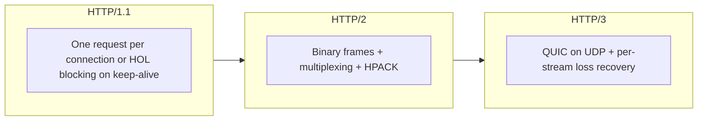
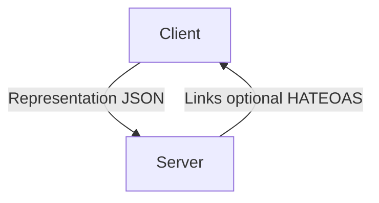
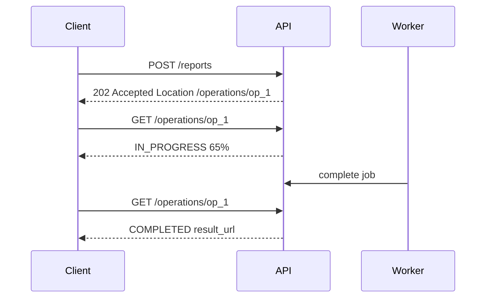
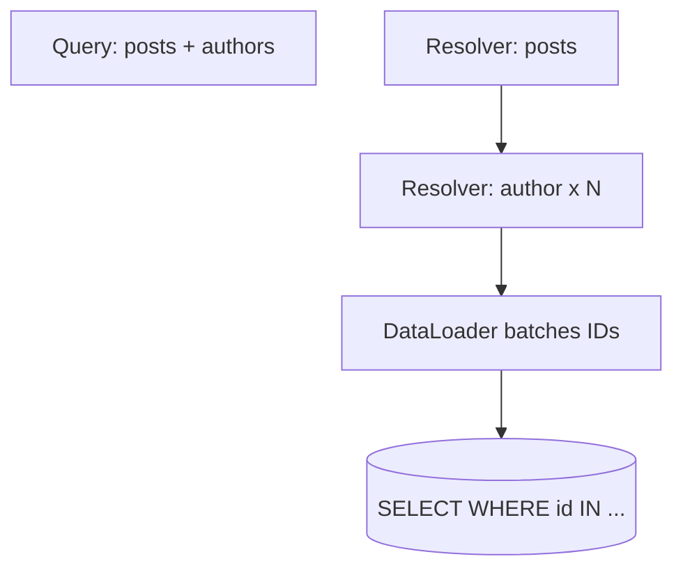
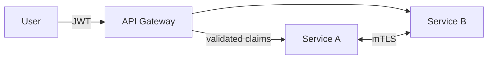
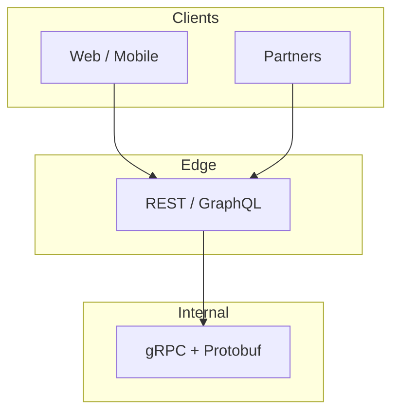

# APIs and Protocols: Senior Engineer Study Guide

A practical guide to **REST**, **GraphQL**, **gRPC**, **HTTP/HTTPS**, and **API design**—how they work, when to use each, and how to build production-grade interfaces.

---

## How to use this guide

Read top to bottom for foundations (HTTP → REST → design), then compare paradigms. Each section includes **mental models**, **diagrams**, **tables**, and **code** you can adapt in interviews or real systems.

> **Core idea:** An API is a **contract**. Good contracts are predictable, evolvable, secure, and optimized for the **consumer’s** workflows—not your database schema.

---

## Part 1: HTTP and HTTPS (the transport layer)

Almost every public API and most internal ones still ride on HTTP semantics, even when the payload is GraphQL or gRPC-over-HTTP/2.

### HTTP/1.1 → HTTP/2 → HTTP/3



| Version | Main win | Remaining pain |
|--------|----------|----------------|
| **HTTP/1.1** | Keep-alive, familiar tooling | Head-of-line blocking; chatty connections |
| **HTTP/2** | Multiplexing, compressed headers | **TCP** HOL: one lost packet stalls all streams |
| **HTTP/3** | QUIC streams independent; faster handshake; connection migration (mobile) | UDP blocked in some networks; higher CPU today |

**Teaching point:** gRPC’s performance story is inseparable from **HTTP/2** (multiplexing, binary framing, trailers for status).

### Methods, idempotency, and safe retries

| Method | Typical use | Idempotent? | Cacheable? |
|--------|-------------|-------------|------------|
| `GET` | Read | Yes | Yes |
| `POST` | Create / actions | **No** | No |
| `PUT` | Full replace | Yes | No |
| `PATCH` | Partial update | Depends on patch format | No |
| `DELETE` | Remove | Yes | No |

```http
PATCH /users/123
Content-Type: application/merge-patch+json

{"email": "new@example.com"}
```

- **JSON Merge Patch (RFC 7396):** simple; `null` removes a field.
- **JSON Patch (RFC 6902):** `op: test` enables optimistic concurrency with `ETag` / version fields.

### Status codes (use them, don’t fake them with `200`)

| Code | Meaning | Client action |
|------|---------|---------------|
| `201` | Created | Follow `Location` |
| `202` | Accepted (async job) | Poll status URL |
| `304` | Not modified | Use cache |
| `401` | Not authenticated | Login / refresh token |
| `403` | Authenticated, not allowed | Don’t retry blindly |
| `409` | Conflict | Resolve state |
| `422` | Valid JSON, invalid business rules | Fix validation |
| `429` | Rate limited | Honor `Retry-After` |

### Caching headers (CDN + browser)

```http
Cache-Control: public, max-age=31536000, immutable
ETag: "abc123"
Vary: Accept-Encoding
```

| Directive | Plain English |
|-----------|----------------|
| `no-store` | Never cache (sensitive data) |
| `no-cache` | May store but must revalidate |
| `max-age` | Fresh for N seconds |
| `stale-while-revalidate` | Serve stale while refreshing in background |

### CORS (browser security, not server-to-server)

1. Browser may send **OPTIONS preflight** for non-simple requests.
2. Server must return matching `Access-Control-Allow-Origin` (not `*` with credentials).
3. **Never** reflect arbitrary `Origin` without validation.

### HTTPS / TLS essentials

TLS gives **confidentiality**, **integrity**, and **server authentication** via the PKI chain (leaf → intermediate → trusted root). Operational must-haves:

- TLS **1.3**, strong AEAD ciphers
- **HSTS** on public sites
- Automated rotation (ACME / Let’s Encrypt)
- Monitor **Certificate Transparency** for mis-issuance

### HTTP streaming vs WebSockets (preview)

| Mechanism | Direction | Best for |
|-----------|-----------|----------|
| Chunked HTTP / SSE | Server → client | Feeds, notifications, LLM token streams |
| WebSocket | Bidirectional | Chat, games, collaborative UI |
| gRPC streaming | Service-to-service | Typed, high-throughput pipelines |

---

## Part 2: REST API design

### What “RESTful” really means

REST is **six constraints** (Fielding), not “JSON over HTTP.” Most production APIs are **Richardson Level 2**: resources + HTTP verbs, without full **HATEOAS**.



**Uniform interface sub-constraints:** URI identity, manipulation via representations, self-descriptive messages, hypermedia as engine of application state (optional in practice).

### URL design

```text
GET    /v1/customers/123/orders?status=open&sort=-created_at
POST   /v1/orders
PATCH  /v1/orders/456
POST   /v1/orders/456/cancellation    # action as sub-resource
GET    /v1/me/orders                  # convenience alias
```

Rules of thumb:

- Plural nouns, lowercase, hyphens
- Nest **one level** when the child rarely exists without parent
- Prefer top-level resources over deep trees (`/order-items/789` not `/customers/.../items/.../reviews/...`)

### Pagination at scale

| Strategy | Pros | Cons |
|----------|------|------|
| **Offset** `?offset=40&limit=20` | Jump to page | Slow at large offsets; inconsistent under writes |
| **Cursor** `?after=opaque` | Stable, O(1) seek | No arbitrary page numbers |
| **Keyset** | Uses indexed sort key + tiebreaker ID | Requires deterministic sort |

```json
{
  "data": [/* ... */],
  "pagination": {
    "next_cursor": "eyJpZCI6MTAwfQ",
    "has_more": true
  }
}
```

### Errors (consistent envelope)

```json
{
  "error": {
    "code": "VALIDATION_ERROR",
    "message": "Human-readable summary",
    "details": [
      {"field": "email", "code": "INVALID_FORMAT", "message": "Must be a valid email"}
    ],
    "request_id": "req_abc123",
    "documentation_url": "https://docs.example.com/errors/VALIDATION_ERROR"
  }
}
```

### Idempotency for `POST` (Stripe pattern)

```http
POST /v1/payments
Idempotency-Key: 550e8400-e29b-41d4-a716-446655440000
```

Server stores `(key → response)` in Redis with TTL (24–48h); concurrent duplicates use a lock on the key.

### Long-running work (async REST)



Alternatives: **webhooks**, **SSE** for progress.

### Rate limiting

- **Token bucket** (bursts + average rate)—industry default
- Headers: `X-RateLimit-Limit`, `Remaining`, `Reset`; `429` + `Retry-After`
- **Redis** + Lua for atomic distributed counters

### Security layers

1. **AuthN:** OAuth2 + PKCE (users), client credentials / mTLS (services)
2. **AuthZ:** RBAC at gateway; ABAC/ReBAC in services
3. **Input validation**, size limits, HTTPS everywhere
4. **Webhooks:** HMAC signature + event `id` for deduplication

### Bulk operations

- `POST /products/batch` homogeneous creates
- `POST /batch` heterogeneous (Google-style)
- Prefer **partial success** + `207 Multi-Status` or `200` with per-item status
- Huge batches → **202** + async processing

---

## Part 3: GraphQL

GraphQL shines when **many clients need different shapes** of the same graph of data—one endpoint, typed schema, client-driven selection.

### Execution model and the N+1 problem



**DataLoader** batches per-request loads within one tick. Without it, 50 posts → 51 queries.

### Schema design

- **Schema-first** for public contracts; **code-first** for type-safe TS backends (hybrid: generate SDL in CI)
- **Relay connections** for pagination: `edges { node cursor }`, `pageInfo`
- Mutations: single `input` + `payload` union (`CreateUserSuccess | ValidationError`)

### Federation vs stitching

| Approach | Idea | When |
|----------|------|------|
| **Stitching** | Gateway merges schemas | Legacy; central bottleneck |
| **Federation** | Subgraphs own types; `@key`, `@requires` | 3+ teams, clear domain boundaries |

Cross-subgraph entity resolution adds latency—optimize query plans (e.g. Apollo Router).

### Protecting the server

1. **Depth** limit (e.g. 10–15)
2. **Complexity** scoring (field costs × list sizes)
3. **Timeouts** during execution
4. **Cost-based rate limits** (GitHub-style)
5. **Persisted queries / APQ** for first-party clients

### Caching (GraphQL’s trade-off)

| Layer | Technique |
|-------|-----------|
| Client | Normalized cache (Apollo, urql) |
| CDN | GET + persisted query id |
| Server | Response cache tagged by entity IDs |
| Resolver | Redis per-field; DataLoader per-request |

> GraphQL often returns **HTTP 200 with partial errors**—monitor `errors[]`, not status codes alone.

### Subscriptions

- Transport: **WebSocket** (`graphql-ws`)
- Scale: gateway fleet + **pub/sub** (Redis, Kafka, NATS)
- Server-side filters so subscribers only get relevant events

### When GraphQL vs REST

| Choose GraphQL | Choose REST |
|----------------|-------------|
| Mobile + web + partners need different fields | Simple CRUD, public HTTP caching |
| Rapid frontend iteration | Broad tooling, WAF, CDN defaults |
| BFF aggregation | Internal high-QPS service mesh → **gRPC** |

---

## Part 4: gRPC

gRPC is built for **typed, fast service-to-service** RPC: Protobuf on the wire, HTTP/2 transport, codegen in many languages.

### Why HTTP/2 matters for gRPC

- **Multiplexing:** many RPCs on one connection
- **HPACK** header compression
- **Flow control** per stream (backpressure)
- **Trailers** carry final `status` after body

### Protobuf evolution rules

| Safe | Unsafe |
|------|--------|
| Add fields | Reuse field numbers |
| Add enum values (mind clients) | Change wire types |
| `reserved` removed fields | Change semantics silently |

Use **package versioning**: `company.api.v1`, `v2` for breaking changes; **buf breaking** in CI.

### Four RPC styles

```protobuf
service MarketData {
  rpc GetQuote(QuoteRequest) returns (Quote);                    // Unary
  rpc ListTrades(TradeRequest) returns (stream Trade);           // Server stream
  rpc Upload(stream Chunk) returns (UploadResult);                 // Client stream
  rpc Chat(stream Message) returns (stream Message);               // Bidirectional
}
```

### Load balancing trap

**L4** LB + one HTTP/2 connection = all RPCs stick to one backend. Fixes:

- **L7** proxy (Envoy, cloud gRPC LB)
- **Client-side** LB with xDS / service discovery
- **Service mesh** sidecars (Istio, Linkerd)

### Errors and retries

- Rich details: `google.rpc.Status`, `BadRequest`, `RetryInfo`
- Retry only **idempotent** RPCs or use idempotency keys
- **Deadlines** propagate as absolute timestamps—set at the edge, inherit downstream

```go
ctx, cancel := context.WithTimeout(ctx, 5*time.Second)
defer cancel()
resp, err := client.GetUser(ctx, req)
```

### Security

- **TLS** + **mTLS** between services
- JWT in metadata for user context
- Interceptors: auth, validation, metrics, recovery

### gRPC vs REST vs GraphQL (decision table)

| Need | Pick |
|------|------|
| Browser-native public API | REST (+ optional grpc-web proxy) |
| Flexible client queries | GraphQL at gateway |
| Internal microservices, streaming, strict contracts | gRPC |
| Hybrid production pattern | **GraphQL/REST edge → gRPC inside** |

---

## Part 5: API design (cross-cutting craft)

### Versioning strategies

| Style | Example | Trade-off |
|-------|---------|-----------|
| URL path | `/v2/users` | Obvious; routing easy |
| Header | `Accept: application/vnd.api.v2+json` | REST-pure; harder to test |
| Date-based (Stripe) | `Stripe-Version: 2026-04-19` | Fine-grained transformers |
| Additive only | No version bump | Needs discipline |

Breaking changes: remove/rename fields, change types/meaning, new required params. Use **Sunset** headers and migration guides.

### Auth architecture



- Gateway: authenticate, coarse RBAC, rate limits
- Services: fine-grained authorization (OPA, Cedar, Zanzibar-style ReBAC)

### Webhooks (event delivery)

```json
{
  "id": "evt_abc",
  "type": "order.created",
  "created_at": "2026-04-20T10:00:00Z",
  "data": { "order_id": "ord_789", "total": 99.99 }
}
```

- Sign with **HMAC-SHA256**; include timestamp anti-replay
- Exponential backoff retries; delivery log + replay API
- Consumers **must** dedupe on `id`

### Multi-tenant APIs

- Tenant from subdomain, JWT claim, or header
- Enforce isolation at **data layer** (RLS), not only API
- Per-tenant rate limits and quotas

### Observability

- **RED** metrics: rate, errors, duration per operation (GraphQL: per operation signature)
- Structured logs with `request_id` / trace id
- OpenTelemetry across gateway → gRPC → DB

---

## Interview cheat sheet

### Common mistakes

1. Using `POST` for everything (breaks caching, semantics, retries)
2. Offset pagination on huge tables
3. `200 OK` with `{ "error": "not found" }`
4. Picking GraphQL/gRPC without naming **who the client is**
5. Ignoring idempotency on payments and creates

### Whiteboard flow (30 min API design)

1. Resources and relationships
2. Methods + status codes + error envelope
3. Pagination, filtering, versioning
4. AuthN/Z + rate limits
5. Async, webhooks, or streams if needed
6. One paragraph on observability and compatibility

---

## Quick reference diagram



> Study real APIs: **Stripe** (errors, idempotency), **GitHub** (GraphQL mutations), **Google Cloud** (long-running operations, gRPC). Read HTTP caching and TLS deployment guides from major cloud providers.

*Synthesized from senior-level interview frameworks on REST, GraphQL, gRPC, HTTP/HTTPS, and API design.*

---

## Senior Pitfalls

| Mistake | Impact | Fix |
|---------|--------|-----|
| `POST` for idempotent creates (payments, orders) | Duplicate charges on retries | `Idempotency-Key` + server-side dedupe store with TTL |
| Offset pagination on large tables | Timeouts and inconsistent pages under writes | Keyset/cursor pagination on indexed sort key |
| `200 OK` with error JSON body | Clients and caches mis-handle failures | Correct HTTP status + stable error envelope (`type`, `code`, `request_id`) |
| Breaking changes without versioning | Partner outages during deploy | URL or header versioning, deprecation windows, contract tests |
| GraphQL N+1 without DataLoader/batching | DB meltdown on list queries | Batching, query cost limits, persisted queries for mobile |
| Webhooks without signing or replay protection | Forged events, duplicate processing | HMAC + timestamp skew check; consumers dedupe on `event.id` |

---

## Production-grade Practice

1. Design and implement a **REST resource** with cursor pagination, filtering, and RFC 7807-style errors; load-test list endpoints and document p99 under 200ms at 500 RPS.
2. Add **gRPC** between two internal services with deadlines, retries (only on idempotent RPCs), and OpenTelemetry propagation; trace one failing call end-to-end.
3. Ship a **webhook delivery** worker with exponential backoff, dead-letter queue, and signed payloads; prove consumer dedupe with a chaos test (duplicate deliveries).
4. Write an **API compatibility** checklist for one breaking change: migration path, sunset date, client SDK bump, and metrics proving old-version traffic hits zero.
