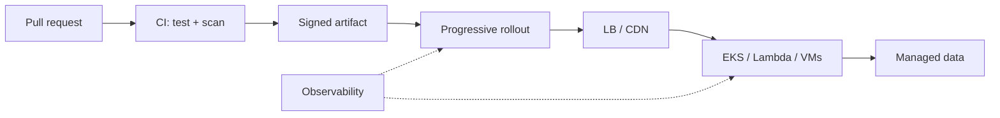

# Cloud Architecture, CI/CD & Serverless

> Release engineering, multi-region design, and when functions beat containers
>
> Teaching-style study guide from Algoroq senior interview PDFs. Practice each answer aloud with a diagram and one production anecdote.

---

## Why this matters

Connect **how you ship** (CI/CD), **where workloads live** (cloud architecture), and **which compute model fits** (serverless vs containers). Staff answers mention blast radius, cost, and operability—not only tool names.



## Reference patterns

```yaml
# GitHub Actions — build, scan, canary gate (sketch)
jobs:
  deploy:
    steps:
      - run: kubectl set image deploy/api api=ghcr.io/org/app:${{ github.sha }}
      - run: ./scripts/check-slo.sh --window 10m --error-budget 99.9
```

| Strategy | Blast radius | Rollback | Best when |
|----------|--------------|----------|-----------|
| Rolling | Medium | Minutes | Stateless APIs |
| Blue-green | Low after cutover | Seconds | Breaking migrations |
| Canary | Very low | Seconds | High traffic / risky change |
| Feature flags | Config-level | Instant | Decouple deploy vs release |

---

## Interview Q&A

## CI/CD

*15 questions from the Algoroq guide.*

### Q1. How would you design a CI/CD pipeline for a large monorepo with hundreds of microservices?

> **What they're really asking:** Can you handle the unique build and deployment challenges of monorepos at scale, including selective builds, dependency tracking, and parallelization?

**Answer framework**

Start by clarifying the monorepo context: how many services, what languages, shared libraries, team structure, and current deployment frequency. A monorepo with 300 microservices and 500 engineers has fundamentally different pipeline needs than a monorepo with 20 services. The core challenge is selective building. When a pull request modifies 3 files, you should only build and test the services affected by those changes, not all 300.

Implement a dependency graph that maps source files to build targets. Tools like Bazel, Pants, or Nx provide this natively through their build graph. When a commit lands, query the dependency graph to determine affected targets and only trigger those builds. For the pipeline architecture, use a multi-stage approach. Stage one is static analysis and linting, which runs in seconds.

Stage two is unit tests for affected services, which runs in parallel across a build cluster. Stage three is integration tests that verify service interactions. Stage four is deployment to a staging environment. Stage five is progressive production rollout. Discuss build caching aggressively. Remote build caches (like those provided by Bazel Remote Execution) store build artifacts keyed by input hash.

If another engineer already built the same code, reuse their artifacts. This can reduce build times by 80 percent or more. Discuss how Kubernetes enables elastic build infrastructure that scales with demand. For deployment ordering, when shared libraries change, dependent services must be deployed in topological order. Build a deployment orchestrator that respects these dependencies and supports parallel deployment of independent services.

Address the testing challenge: with hundreds of services, end-to-end tests become a bottleneck. Implement contract testing where each service verifies its API contracts independently, reducing the need for full integration environments.

### Q2. Explain the trade-offs between blue-green deployments and canary releases. When would you choose each?

> **What they're really asking:** Do you understand deployment strategies at a deep level and can you match the right strategy to the right situation?

**Answer framework**

Blue-green deployments maintain two identical production environments. The current version runs on blue, the new version is deployed to green. After validation, traffic is switched entirely from blue to green. Rollback is instant since you simply switch traffic back to blue. The trade-off is cost: you need double the infrastructure. It is also all-or-nothing, meaning every user gets the new version simultaneously, so any issues affect 100 percent of traffic.

Canary releases route a small percentage of traffic (typically 1 to 5 percent) to the new version while the rest continues on the old version. You monitor error rates, latency, and business metrics on the canary. If everything looks good, gradually increase traffic: 5 percent, 25 percent, 50 percent, 100 percent. If metrics degrade, route all traffic back to the old version. The trade-off is complexity: you need sophisticated traffic routing and monitoring, and both versions must be compatible simultaneously.

For a comprehensive comparison, see blue-green vs canary deployments. Choose blue-green when: the change involves database migrations that make old and new versions incompatible, the service has low traffic where canary percentages are meaningless (1 percent of 100 requests per hour is 1 request), or you need instant and complete cutover such as during compliance deadlines. Choose canary when: the service handles high traffic and you want to limit blast radius, the change is risky and you want to validate on real traffic before full rollout, or you need to compare performance metrics between versions.

Netflix popularized canary deployments with their sophisticated release engineering practices. Advanced approaches combine both: deploy the new version to a blue-green environment, then use canary routing to gradually shift traffic from old-green to new-blue. This gives you both instant rollback capability and progressive rollout safety. Discuss how feature flags complement both strategies by decoupling deployment from release, allowing you to deploy code that is hidden behind a flag and enable it independently of the deployment mechanism.

### Q3. How do you ensure pipeline reliability when your CI/CD system itself becomes a critical bottleneck?

> **What they're really asking:** Can you think about CI/CD infrastructure as a production system that needs its own reliability engineering?

**Answer framework**

The CI/CD pipeline is the factory that produces your software. When the factory stops, no code ships. Treat the pipeline as a Tier-0 production service with its own SLOs, monitoring, and incident response. Define pipeline SLOs: build start latency (time from commit to build start) should be under 2 minutes, build duration for the 95th percentile should be under 15 minutes, and pipeline availability should be 99.9 percent.

Monitor these metrics and alert when SLOs are breached. For availability, eliminate single points of failure. If you use Jenkins, run multiple controller nodes behind a load balancer with shared state in an external database. If you use GitHub Actions vs GitLab CI, understand the availability guarantees of your chosen platform and build resilience around them. For self-hosted runners, auto-scale the runner pool based on queue depth.

Address flaky tests systematically. Flaky tests are the number one pipeline reliability killer. Implement a quarantine system: when a test flakes (passes on retry without code changes), automatically move it to a quarantine suite that runs separately and does not block deployments. Track flake rates per test and escalate to owning teams. For build cache reliability, if the remote cache is unavailable, builds should still succeed, just slower.

Implement cache fallback strategies: remote cache, then local cache, then full rebuild. Monitor cache hit rates since a sudden drop indicates a problem. Discuss pipeline-as-code versioning: store pipeline definitions in the same repository as the application code. This ensures pipeline changes go through the same review process and are versioned alongside the code they build. Test pipeline changes in isolated environments before merging.

Implement pipeline observability: distributed tracing for builds (each stage is a span), centralized logging, and dashboards showing build success rates, duration trends, and queue wait times.

### Q4. Design an automated rollback system that detects and responds to bad deployments within minutes.

> **What they're really asking:** Can you build closed-loop deployment automation that integrates monitoring, decision-making, and actuation?

**Answer framework**

An automated rollback system has three components: metric collection, anomaly detection, and rollback actuation. For metric collection, instrument every deployment with pre-defined health signals. These include error rate (5xx responses divided by total responses), latency percentiles (p50, p95, p99), business metrics (checkout completion rate, login success rate), and infrastructure metrics (CPU, memory, restart count).

Collect these from your observability stack and compute them per deployment version using deployment metadata tags. For anomaly detection, compare the new version's metrics against a baseline. The baseline can be the previous version's steady-state metrics or the same time period from the previous week (accounts for cyclical patterns). Use statistical methods: if the new version's error rate is more than 3 standard deviations above the baseline for 2 consecutive minutes, flag it as anomalous.

Avoid simple thresholds since they do not account for natural variance. For rollback actuation, when an anomaly is confirmed: immediately halt the progressive rollout (stop increasing canary traffic), route all traffic to the known-good version, page the on-call engineer, and create an incident ticket. The rollback should be fully automated for clear-cut cases (error rate spike above 5 percent) and semi-automated for ambiguous cases (latency increase of 10 percent, which may or may not be concerning).

Discuss the bake time concept: even if metrics look healthy during the canary phase, hold the deployment at 100 percent for a configurable period (30 to 60 minutes) before declaring success. This catches slow-building issues like memory leaks or gradual performance degradation. Address the challenge of distinguishing deployment-caused issues from environmental issues. If a database slows down during your deployment, you do not want to roll back the deployment.

Use control groups: compare the canary with the baseline simultaneously. If both degrade, the issue is environmental. Discuss integration with chaos engineering practices to proactively test that rollback mechanisms work correctly.

### Q5. How would you implement trunk-based development for a team of 200 engineers shipping to production daily?

> **What they're really asking:** Do you understand modern branching strategies and how to maintain a releasable main branch at scale?

**Answer framework**

Trunk-based development means all engineers commit to a single main branch (trunk) with short-lived feature branches (less than 24 hours). This contrasts with GitFlow where long-lived feature branches diverge for weeks, creating painful merge conflicts and integration delays. The prerequisite for trunk-based development at scale is a comprehensive, fast automated test suite. Every commit to trunk must pass all tests before merging.

Use a merge queue that serializes merges and ensures each commit is tested against the latest trunk state. This prevents the scenario where two pull requests pass tests individually but break when combined. Feature flags are essential. With 200 engineers, multiple incomplete features are in-progress simultaneously. Engineers merge incomplete work behind feature flags, keeping trunk deployable at all times.

Use a feature flag service that supports gradual rollout, user targeting, and kill switches. The flag lifecycle is: create flag, develop behind flag, enable for internal users, enable for canary percentage, enable for all users, remove flag and dead code. For code review velocity, establish team agreements: pull requests should be reviewed within 4 hours, and PRs should be small (under 400 lines of changed code).

Large changes should be split into a stack of dependent PRs. Automated checks (linting, type checking, test coverage) should complete before human review to avoid wasting reviewer time. Discuss the release process: since trunk is always deployable, releases are a matter of cutting a release from trunk at any point. Some teams deploy every commit to production (continuous deployment).

Others batch commits and deploy multiple times per day. The key is that the decision of when to release is decoupled from the development workflow. Address the challenge of database changes: use forward-compatible migrations that work with both old and new code versions. Deploy the migration first, then deploy the code that uses it. Never deploy code that requires a schema change that has not been applied.

### Q6. Describe how you would set up CI/CD for a system that deploys across multiple cloud regions simultaneously.

> **What they're really asking:** Can you handle the complexity of multi-region deployments including sequencing, consistency, data migration, and regional failure handling?

**Answer framework**

Multi-region deployment adds three layers of complexity: deployment sequencing across regions, configuration differences per region, and handling partial deployment failures. For deployment sequencing, never deploy to all regions simultaneously. Use a progressive regional rollout: deploy to a canary region first (typically the region with the lowest traffic), monitor for 15 to 30 minutes, then deploy to the next region.

Group regions into waves: wave 1 is the canary region, wave 2 is two additional regions, wave 3 is the remaining regions. If any wave fails, halt the rollout. For region-specific configuration, use a configuration management system that overlays region- specific values on top of global defaults. The deployment pipeline resolves the final configuration for each region at deploy time.

Store region configs in the same repository as the application code for auditability. For infrastructure, use Kubernetes clusters in each region with a centralized deployment controller. The controller orchestrates deployments across clusters, tracks progress, and manages rollbacks. Use GitOps (ArgoCD or Flux) where the desired state is declared in Git and the controller in each region converges to that state.

Address data consistency: when deploying a new version that changes data formats, ensure all regions can handle both old and new formats during the rollout window. Use the expand- contract pattern: first deploy code that writes both formats (expand), wait for all regions to run the new version, then deploy code that only writes the new format (contract). Discuss handling partial failures: if deployment succeeds in 3 of 5 regions and fails in 2, you have a split-version state.

The system should support this gracefully since regional load balancers route users to their nearest healthy region regardless of version. However, establish a maximum duration for split-version state and either complete the rollout or roll back all regions if the issue is not resolved within that window. Monitor global health dashboards that show deployment status, version distribution, and health metrics per region.

Alert when regions diverge beyond the expected rollout window.

### Q7. How do you handle secrets management in CI/CD pipelines?

> **What they're really asking:** Do you understand the security implications of CI/CD and can you design a secure secrets management strategy?

**Answer framework**

Secrets in CI/CD include API keys, database credentials, signing certificates, cloud provider credentials, and deployment tokens. Mismanaging these leads to security breaches, the most common being secrets committed to version control or leaked through build logs. The fundamental principle is that secrets should never exist in code, configuration files, or build logs. Use a secrets manager (HashiCorp Vault, AWS Secrets Manager, or your CI platform's built- in secrets) as the single source of truth.

Pipelines fetch secrets at runtime, use them, and never persist them to disk or logs. For pipeline architecture, implement a secrets injection pattern. The CI system authenticates to the secrets manager using a platform identity (not a static credential). For GitHub Actions, use OIDC federation with your cloud provider so that the CI job receives a short-lived token without any stored credentials.

The pipeline requests only the specific secrets it needs (principle of least privilege), and those secrets are available only as environment variables during the specific step that needs them. For secret rotation, automate it. Secrets should rotate on a schedule (every 90 days for most, every 24 hours for high-sensitivity). The pipeline should always fetch the current secret at runtime, so rotation does not require pipeline changes.

Implement dual-secret patterns where both old and new secrets are valid during a rotation window to avoid downtime. For audit and detection, log every secret access (who, when, which secret, from which pipeline). Implement secret scanning in the CI pipeline: tools like truffleHog or GitLeaks scan every commit for patterns that look like secrets and block the pipeline if found. Scan build logs for accidentally leaked secrets and redact them.

Discuss signing and verification: sign build artifacts with a private key stored in the secrets manager. Downstream stages verify the signature before deploying, ensuring the artifact was produced by the legitimate pipeline and not tampered with.

### Q8. What is your approach to testing database migrations in a CI/CD pipeline?

> **What they're really asking:** Can you handle one of the most dangerous operations in deployment, schema changes, safely and automatically?

**Answer framework**

Database migrations are the highest-risk step in most deployments because they are often irreversible, can lock tables and cause downtime, and affect data integrity. A mature CI/CD pipeline treats migrations as first-class citizens with their own testing and safety mechanisms. In the CI pipeline, run migrations against a test database that mirrors production schema. The migration should be tested in three phases.

Phase one is syntax and compatibility: apply the migration to a clean database and verify it succeeds. Phase two is backward compatibility: apply the migration and then run the old application version's tests against the migrated schema. This verifies that the migration does not break the currently deployed code. Phase three is forward compatibility: run the new application version's tests against both the old and new schema to verify the code handles both states.

For production safety, categorize migrations by risk level. Low risk includes adding nullable columns, adding indexes concurrently, and adding new tables. These can be applied automatically. High risk includes dropping columns, changing column types, and adding NOT NULL constraints. These require manual approval and may need a multi-step migration strategy. Discuss the expand-contract pattern in detail.

Example: renaming a column from user_name to username. Step 1 (expand): add the new column username, deploy code that writes to both columns. Step 2 (migrate): backfill existing rows. Step 3 (contract): deploy code that only reads from username, then drop user_name. Each step is a separate deployment, allowing rollback at any point. For large table migrations, discuss online schema change tools (gh-ost for MySQL, pg_repack for PostgreSQL) that create a shadow table, apply the migration to the shadow, replicate changes, and swap tables with minimal locking.

Address migration ordering in a monorepo: when multiple services share a database, migration ordering matters. Use a centralized migration registry that enforces ordering and prevents conflicts.

### Q9. How would you design a CI/CD pipeline that supports both containerized microservices and serverless functions?

> **What they're really asking:** Can you build a unified deployment platform that handles heterogeneous workloads with different deployment models?

**Answer framework**

The key insight is that the CI portion (build, test, package) can be unified, while the CD portion (deploy, verify, rollback) must be specialized per deployment target. For the unified CI layer, define a standard pipeline interface that every service implements regardless of deployment target. Every service has: a build step (compile, bundle, or package), a test step (unit tests, integration tests), an artifact step (produce a deployable artifact), and a metadata step (record version, commit hash, test results).

Use pipeline templates that services extend, ensuring consistency without rigidity. For containerized microservices, the artifact is a Docker image pushed to a container registry. The CD pipeline deploys to Kubernetes using a rolling update or canary strategy. Health checks verify the new pods are serving traffic correctly. Rollback means updating the Kubernetes deployment to the previous image tag.

For serverless functions, the artifact is a deployment package (zip file or container image for Lambda). The CD pipeline uses the cloud provider's deployment API. Implement canary deployments using weighted aliases (AWS Lambda aliases with traffic shifting). Rollback means updating the alias to point to the previous version. The abstraction layer is critical. Define a deployment manifest per service that specifies: deployment target (kubernetes, lambda, ecs), deployment strategy (rolling, canary, blue-green), health check configuration, and rollback criteria.

A deployment orchestrator reads the manifest and delegates to the appropriate deployment driver. Discuss environment parity: both containerized and serverless workloads should deploy through the same progression (dev, staging, production) with the same promotion criteria. Use infrastructure as code (Terraform, Pulumi) to ensure environments are consistent. Address the observability gap: serverless functions have different monitoring patterns than containers.

Normalize metrics and logs into a common format so dashboards and alerts work across both deployment models. Leverage distributed tracing to track requests that span both containerized and serverless components.

### Q10. Explain how you would implement progressive delivery with feature flags integrated into the CI/CD pipeline.

> **What they're really asking:** Can you decouple deployment from release and build sophisticated delivery controls that go beyond basic deployments?

**Answer framework**

Progressive delivery extends continuous delivery by adding fine-grained controls over how features reach users. The core idea: deploy code to production frequently (multiple times per day) but control feature visibility independently through feature flags. The integration between CI/CD and feature flags happens at three points. First, during the build phase, the pipeline validates feature flag references in the code.

Ensure that flags referenced in code actually exist in the flag management system and that removed flags have had their code paths cleaned up. This prevents dead flag references and reduces technical debt. Second, during the deployment phase, the pipeline creates or updates feature flags as part of the deployment. When deploying a new feature, the pipeline ensures the flag exists and is set to off by default.

This is infrastructure-as-code for feature flags, with flag definitions stored alongside application code. Third, during the release phase (post-deployment), the pipeline orchestrates the progressive rollout through the flag system. A release pipeline might follow this sequence: enable for internal employees (dogfooding), enable for 1 percent of users, monitor metrics for 1 hour, enable for 10 percent, monitor for 4 hours, enable for 50 percent, monitor for 24 hours, enable for 100 percent.

Discuss targeting rules: feature flags should support user segmentation (enable for premium users first), geographic targeting (enable in one country first), and device targeting (enable on iOS before Android). These rules allow you to test features with specific user cohorts before broad rollout. Address the automated decision loop: integrate the flag rollout with your monitoring system.

If error rates spike after increasing flag exposure from 10 percent to 50 percent, automatically roll the flag back to 10 percent and alert the team. This creates a closed-loop system similar to automated deployment rollbacks but at the feature level. Discuss flag lifecycle management: flags accumulate over time and become technical debt. Implement automated cleanup: when a flag has been at 100 percent for 30 days, create a ticket to remove the flag code.

Track flag age and usage in a dashboard.

### Q11. How do you handle CI/CD for machine learning models where the artifact is not just code but also trained model weights?

> **What they're really asking:** Can you extend CI/CD principles to ML workloads, which have fundamentally different artifacts, testing requirements, and deployment patterns?

**Answer framework**

ML CI/CD (often called MLOps) adds three dimensions to traditional CI/CD: data validation, model validation, and model serving. For the CI pipeline, there are two triggering events: code changes (same as traditional CI) and data changes (new training data arrives). Both should trigger a pipeline run. The pipeline stages are: data validation (check schema, distributions, missing values against expectations), feature engineering and preprocessing, model training, model evaluation, and model packaging.

For model evaluation, define quantitative gates: the new model must exceed the current production model on key metrics (accuracy, precision, recall, latency) by a statistically significant margin. Use a holdout test set that is never used during training. Run A/B tests on shadow traffic where the new model scores requests alongside the production model but does not serve results.

For artifacts, the deployable unit includes the model weights (which can be gigabytes), the preprocessing pipeline, the serving configuration, and the model metadata (training data version, hyperparameters, evaluation metrics). Store these in a model registry (MLflow, Vertex AI Model Registry) that provides versioning, lineage tracking, and promotion between environments. For deployment, models are typically served behind an inference API.

Use canary deployments to gradually shift traffic to the new model. Monitor not just technical metrics (latency, error rate) but also business metrics (click-through rate, conversion) because a model can be technically healthy but produce poor predictions. Address the challenge of model rollback: unlike code rollback, model rollback may not be straightforward if the new model was trained on updated data that reflects a genuine distribution shift.

Sometimes the old model is objectively worse for current traffic. Maintain multiple model versions in the serving infrastructure and support instant version switching. Discuss data pipeline reliability: if the training data pipeline produces corrupted data, the model may degrade silently. Implement data quality checks at every stage of the pipeline.

### Q12. Describe your approach to managing CI/CD pipelines for infrastructure-as-code deployments.

> **What they're really asking:** Can you apply CI/CD principles to infrastructure changes, which have unique risks around state management, blast radius, and irreversibility?

**Answer framework**

Infrastructure-as-code (IaC) deployments through CI/CD follow the same principles as application deployments but with amplified risks. A bad application deployment might return errors for some requests. A bad infrastructure deployment might delete a production database. For the pipeline structure, implement a plan-review-apply workflow. The CI stage runs terraform plan (or equivalent) on every pull request and posts the plan output as a PR comment.

Engineers review both the code change and the planned infrastructure changes. This catches surprises like unexpected resource deletions. The CD stage runs terraform apply only after PR approval and merge. For state management, Terraform state is the source of truth for what infrastructure exists. Store state in a remote backend (S3, GCS) with locking (DynamoDB, GCS locking) to prevent concurrent modifications.

Never store state locally or in version control. Back up state files automatically. For blast radius control, structure infrastructure code into small, independent modules. A change to the networking module should not affect the database module. Use workspace or directory- based separation so that a single pipeline run only modifies a bounded set of resources. Implement policy-as-code (Open Policy Agent, Sentinel) that prevents dangerous operations like deleting databases, opening security groups to 0.0.0.0/0, or modifying production IAM policies.

For testing, implement three levels. Static analysis: validate syntax, lint for best practices, check for security misconfigurations (tfsec, checkov). Integration testing: apply infrastructure to an ephemeral test environment, run automated tests against it (can I connect to the database? Does the load balancer route correctly?), then tear it down. Drift detection: periodically compare actual infrastructure state with the declared state and alert on drift.

Discuss the challenge of infrastructure rollback: unlike application deployments, you cannot simply revert a Terraform change because the state has already been modified. Instead, apply the reverse change (re-apply the previous code version), but be aware of resources that cannot be easily recreated (databases with data, DNS records with propagation delay).

### Q13. How would you design a CI/CD pipeline that achieves sub-10-minute deploy times for a large application?

> **What they're really asking:** Can you identify and eliminate bottlenecks in the deployment pipeline through parallelization, caching, and architectural optimizations?

**Answer framework**

First, measure and profile the current pipeline to identify the bottleneck. A typical slow pipeline breakdown: checkout (30 seconds), dependency installation (3 minutes), compilation (4 minutes), unit tests (5 minutes), integration tests (8 minutes), Docker build (3 minutes), deployment (5 minutes). Total: 28.5 minutes. Attack each bottleneck systematically. For dependency installation, use lockfile-based caching.

Cache the entire node_modules or pip virtualenv keyed on the lockfile hash. When dependencies have not changed (most builds), this step takes 5 seconds instead of 3 minutes. For compilation, use incremental builds that only recompile changed files. With remote build caching (Turborepo, Bazel), share compilation results across all engineers. If another engineer already compiled the same file, reuse their artifact.

For testing, parallelize aggressively. Split unit tests across multiple runners based on historical timing data (each runner gets an equal slice of test execution time). Use test impact analysis to only run tests affected by the changed code. For integration tests, run them in parallel using isolated test environments. For Docker builds, use multi-stage builds with aggressive layer caching.

Order Dockerfile instructions so that frequently changing layers (application code) are last. Use BuildKit for parallel stage execution. Consider using distroless or slim base images to reduce build and push time. For deployment, use immutable infrastructure with pre-baked images. Instead of deploying code to existing servers, deploy new servers with the code already installed. Use rolling deployments with a high parallelism factor (deploy to 25 percent of instances simultaneously instead of one at a time).

The architectural optimization: split the monolith pipeline into parallel streams. Linting, unit tests, and security scanning can all run simultaneously since they do not depend on each other. Only merge into a sequential flow for integration tests and deployment. With these optimizations: checkout (10 seconds), cached dependencies (5 seconds), incremental compilation (30 seconds), parallel unit tests (1.5 minutes), parallel integration tests (3 minutes), cached Docker build (30 seconds), rolling deployment (3 minutes).

Total: under 9 minutes.

### Q14. How do you approach CI/CD security, specifically preventing supply chain attacks in build pipelines?

> **What they're really asking:** Do you understand the threat model for CI/CD pipelines and can you design defenses against modern supply chain attacks?

**Answer framework**

Supply chain attacks target the software delivery pipeline itself rather than the application. The SolarWinds attack demonstrated that compromising a build pipeline can give attackers access to thousands of downstream organizations. CI/CD security is now a first-class concern. For dependency security, pin all dependencies to exact versions (not ranges). Use lockfiles and verify their integrity.

Run dependency vulnerability scanning (Dependabot, Snyk) in every pipeline run. Implement a private dependency mirror or proxy (Artifactory, Nexus) that caches approved versions and blocks known-vulnerable packages. For critical applications, review new dependency versions before allowing them. For build integrity, implement SLSA (Supply-chain Levels for Software Artifacts) framework principles.

Level 1: document the build process. Level 2: use a hosted build service with authenticated provenance. Level 3: use a hardened build platform with non-falsifiable provenance. Specifically: build in ephemeral, hermetic environments (each build gets a fresh container), sign build artifacts with a key stored in a hardware security module, and generate and store provenance records (what was built, from which source, by which pipeline).

For pipeline access control, apply the principle of least privilege. Pipeline service accounts should have the minimum permissions needed. Separate CI (read-only, runs tests) from CD (write access, deploys) permissions. Require approval gates before production deployments. Audit all pipeline configuration changes. For code integrity, require signed commits. Protect the main branch with branch protection rules.

Use merge queues that prevent direct pushes. Implement code review requirements with a minimum number of approvals from code owners. Discuss runtime protection: container image scanning (Trivy, Grype) that checks for OS and application vulnerabilities in the final image. Implement admission controllers in Kubernetes that reject images that have not been scanned or signed. Use read-only file systems in containers to prevent runtime modification.

### Q15. Describe how you would migrate a legacy deployment process (manual, SSH-based) to a modern CI/CD pipeline with zero downtime.

> **What they're really asking:** Can you execute a complex migration incrementally, managing risk while making measurable progress?

**Answer framework**

The key principle is incremental migration. Do not attempt a big-bang replacement of the deployment process. Run old and new systems in parallel and gradually shift confidence to the new system. Phase 1 (weeks 1-3): Document and automate the existing process. Before building anything new, codify the current manual steps into scripts. This creates a baseline, reduces immediate risk (scripts are more reliable than manual steps), and reveals undocumented dependencies.

Use these scripts as the first version of the automated pipeline. Phase 2 (weeks 4-6): Implement CI. Set up automated builds and tests triggered by code changes. This does not change how code is deployed, only adds visibility into code quality. Engineers see test results on every pull request. This phase has near-zero risk since it does not affect production. Phase 3 (weeks 7-10): Implement CD for non-production environments.

Automate deployment to dev and staging environments using the new pipeline. Engineers still deploy to production manually, but they gain confidence in the automated deployment process by seeing it work in lower environments. Phase 4 (weeks 11-14): Shadow deployments to production. The new pipeline deploys to a parallel production environment (shadow) that receives mirrored traffic but does not serve real users.

Compare the shadow environment's behavior with the real production environment. This validates the deployment process end-to-end without risk. Phase 5 (weeks 15-18): Gradual production migration. Enable automated deployment for one low-risk service first. Monitor closely. Expand to more services over subsequent weeks. Keep the manual deployment process available as a fallback. Phase 6 (weeks 19-20): Complete migration.

Decommission the manual process. Document the new pipeline. Train all engineers. Address cultural challenges: some engineers will resist the change due to comfort with the existing process. Demonstrate clear benefits (faster deploys, fewer incidents, less weekend work). Get buy-in from senior leadership. Celebrate early wins publicly. For the system design of the new pipeline, use a tool that the team can maintain and extend.

Consider the trade-offs between managed CI/CD services (less operational burden, less customization) and self-hosted solutions (more control, more maintenance).

## Serverless

*15 questions from the Algoroq guide.*

### Q1. Explain the serverless execution model and how it differs fundamentally from container-based deployments.

> **What they're really asking:** Do you understand serverless beyond the marketing pitch? Can you reason about the actual execution lifecycle, resource allocation, and the implications for application design?

**Answer framework**

Start with the core abstraction: in serverless computing, the cloud provider manages server provisioning, scaling, and maintenance. The developer deploys a function or application unit, and the provider executes it in response to events. The fundamental difference from containers is the granularity of resource allocation and the lifecycle model. In a container-based deployment using Kubernetes or ECS, you provision compute capacity that runs continuously.

You pay for uptime regardless of whether requests are being processed. You control the operating system, runtime, and scaling configuration. The container starts once and handles many requests over its lifetime. In serverless, the execution environment is ephemeral. Each function invocation gets an isolated execution context. The provider creates execution environments on demand, routes events to them, and reclaims resources when idle.

AWS Lambda, for example, provisions a microVM using Firecracker, loads your code package, initializes the runtime, and then invokes your handler. The key insight is that the provider may reuse a warm execution environment for subsequent invocations, but your code must never depend on this behavior. The implications for application design are significant. Statelessness is enforced rather than suggested.

Any state must live in external services like DynamoDB, S3, or ElastiCache. Connection pooling behaves differently because environments are recycled. Cold starts introduce variable latency that does not exist in always-on containers. The concurrency model is fundamentally different: instead of a thread pool handling requests within a single process, each concurrent request gets its own execution environment.

Discuss the economic model: serverless pricing is per-invocation and per-millisecond of compute. For sporadic workloads, this is dramatically cheaper than provisioned containers. For sustained high-throughput workloads, containers often win on cost. The crossover point depends on request patterns, memory requirements, and execution duration. Understanding serverless architecture at this level separates senior candidates from those with surface-level knowledge.

### Q2. How do you diagnose and mitigate cold start latency in production serverless applications?

> **What they're really asking:** Can you go beyond knowing that cold starts exist and demonstrate a systematic approach to measuring, understanding, and reducing their impact on real users?

**Answer framework**

Begin by explaining what causes cold starts. When no warm execution environment is available, the provider must create one. This involves allocating compute resources, downloading the deployment package, starting the runtime, and running initialization code. On AWS Lambda, cold starts typically add 100ms to 1 second for lightweight runtimes like Node.js or Python, and 2 to 10 seconds for JVM-based runtimes without optimization.

The first step is measurement, not mitigation. Instrument your functions to distinguish cold invocations from warm ones. In AWS Lambda, check whether the execution environment is being reused by setting a global variable during initialization and checking it during invocation. Track cold start percentage and latency separately in your metrics. A function with 2 percent cold starts and a p99 latency of 3 seconds might be acceptable for an async processing pipeline but unacceptable for a synchronous API endpoint.

For mitigation, discuss a layered approach. First, reduce package size: smaller deployment packages download faster. Use tree-shaking, exclude dev dependencies, and for JVM applications use GraalVM native images or AWS SnapStart which snapshots the initialized JVM state. Second, increase memory allocation. On Lambda, more memory means more CPU, and the initialization phase runs faster.

A function at 1792MB gets a full vCPU and initializes significantly faster than at 128MB. Third, use provisioned concurrency for latency-sensitive paths. This keeps a specified number of execution environments warm and initialized, eliminating cold starts entirely for those instances. The trade-off is cost since you pay for provisioned concurrency whether it is used or not. Discuss architectural mitigations.

For API Gateway backed Lambda functions, implement a tiered architecture where the API Gateway returns a cached response from a CDN or caching layer for read requests, bypassing Lambda entirely. For the write path, consider whether the client can tolerate async processing via an SQS queue, which eliminates the cold start from the user-facing latency. Address the initialization code pattern: move heavy initialization (database connections, SDK clients, ML model loading) outside the handler function to the module scope.

This code runs once during cold start and is reused across warm invocations. But be careful with connection limits since each execution environment opens its own connection.

### Q3. Design an event-driven order processing pipeline using serverless components.

> **What they're really asking:** Can you architect a production-grade event- driven system using serverless primitives, handling ordering, idempotency, error handling, and observability?

**Answer framework**

Start with the business flow: a customer places an order, which triggers payment processing, inventory reservation, notification, and fulfillment. Each step may fail independently and must be handled gracefully. The architecture uses an event-driven approach with serverless components. When an order is placed, the API Gateway invokes a Lambda function that validates the order and publishes an OrderPlaced event to an SNS topic or EventBridge event bus.

Downstream consumers subscribe to this event: a payment processing Lambda, an inventory Lambda, and a notification Lambda. For ordering and coordination, use AWS Step Functions as an orchestrator rather than relying on choreography alone. Step Functions provide a state machine that coordinates the saga pattern: try payment, then reserve inventory, then send confirmation. If payment fails, the state machine invokes compensating actions (release inventory reservation).

Step Functions handle retries, timeouts, and error states declaratively. For idempotency, every Lambda function must be idempotent because events can be delivered more than once. Use DynamoDB conditional writes with an idempotency key (the order ID plus the processing step). Before processing, check if the idempotency record exists. If it does, return the cached result. If not, process the event and atomically write the result and idempotency record.

For error handling, configure dead letter queues (DLQ) on every SQS queue and Lambda event source mapping. When a message fails all retry attempts, it moves to the DLQ for manual investigation. Set up CloudWatch alarms on DLQ depth. For transient failures (downstream service unavailable), use exponential backoff with jitter in the retry configuration. For observability, propagate a correlation ID through every event and function invocation.

Use structured logging with the correlation ID, step name, and outcome. Push metrics to CloudWatch or a third-party monitoring system. Enable X-Ray tracing for distributed trace visualization across the entire pipeline. This is essential for debugging issues in production, similar to the monitoring approaches used in Netflix's architecture. Discuss throughput: SQS provides virtually unlimited throughput, but downstream services (payment gateway, inventory database) have finite capacity.

Use SQS reserved concurrency to limit the rate at which Lambda processes messages, preventing downstream overload.

### Q4. How do you handle database connections in a serverless environment where thousands of concurrent Lambda functions may be running?

> **What they're really asking:** Do you understand the connection exhaustion problem that is unique to serverless, and can you design solutions that balance performance with resource constraints?

**Answer framework**

Explain the core problem: traditional connection pooling assumes a long-lived application process that opens N connections and reuses them across requests. In serverless, each execution environment maintains its own connection, and with thousands of concurrent Lambda invocations, you can exhaust database connection limits. A PostgreSQL instance typically supports 100 to 500 connections.

If each Lambda invocation opens a connection, 500 concurrent invocations saturate the database. The primary solution is a connection proxy. AWS RDS Proxy sits between Lambda and the database, maintaining a pool of connections to the database and multiplexing Lambda connections through this pool. Lambda functions connect to the proxy (which supports thousands of client connections) rather than directly to the database.

The proxy holds a much smaller number of actual database connections (matching the database limit) and queues requests when all connections are in use. Discuss how RDS Proxy works internally: it uses connection pinning to associate a client session with a backend connection for the duration of a transaction. Between transactions, the backend connection returns to the pool. This means your Lambda code should use short transactions and avoid session-level state (temporary tables, SET commands) that would force prolonged pinning.

For DynamoDB and other serverless-native databases, connection management is handled by the SDK using HTTP connections rather than persistent TCP sockets. This eliminates the connection pooling problem entirely, which is one reason serverless architectures often pair Lambda with DynamoDB. Discuss alternatives for non-AWS databases: use connection pooling services like PgBouncer deployed on a small EC2 instance or Fargate container.

For Redis, use ElastiCache Serverless which handles connection management automatically. Address the initialization pattern: open the database connection outside the handler function. This way, warm invocations reuse the existing connection. Implement connection health checks that verify the connection is still valid before use, since long-idle connections may be terminated by the database or network infrastructure.

### Q5. Compare the serverless offerings across AWS, GCP, and Azure for a multi-cloud strategy.

> **What they're really asking:** Do you have breadth of knowledge across cloud providers, and can you reason about vendor lock-in, portability, and the practical differences that affect architectural decisions?

**Answer framework**

Structure the comparison across several dimensions: compute, event sources, orchestration, observability, and ecosystem maturity. This directly relates to the broader AWS vs GCP vs Azure comparison. For compute, AWS Lambda supports up to 10GB memory and 15-minute execution timeout. Google Cloud Functions (2nd gen, built on Cloud Run) supports up to 32GB memory and 60- minute timeout.

Azure Functions supports up to 14GB memory and unbounded execution time for premium plans. Lambda has the most mature cold start optimization (SnapStart, provisioned concurrency). Cloud Functions 2nd gen leverages Cloud Run's container infrastructure, offering more flexibility but slightly different cold start characteristics. Azure Functions offers a unique Durable Functions framework for stateful orchestration.

For event sources, AWS has the deepest integration: over 200 event sources including S3, DynamoDB Streams, Kinesis, SQS, SNS, EventBridge, API Gateway, ALB, IoT Core, and Cognito. GCP integrates with Cloud Storage, Pub/Sub, Firestore, and Eventarc. Azure integrates with Blob Storage, Event Grid, Service Bus, Cosmos DB, and Event Hubs. AWS's breadth of event sources is a significant advantage for complex event-driven architectures.

For orchestration, AWS Step Functions provides visual state machines with built-in retry and error handling. GCP Cloud Workflows offers similar functionality with YAML-based workflow definitions. Azure Durable Functions uses a code-first approach where the orchestration logic is written in the same language as the functions. For portability, discuss the Serverless Framework and similar tools that abstract provider differences.

In practice, true portability is difficult because the value of serverless comes from deep integration with provider-specific services. A Lambda function triggered by DynamoDB Streams processing events into Kinesis cannot be trivially ported to GCP. For organizations requiring multi-cloud, consider using containers on Kubernetes with Knative as a serverless abstraction layer that runs on any Kubernetes cluster.

Discuss pricing models: Lambda charges per request and per GB-second. Cloud Functions charges similarly but with a free tier that is slightly different. Azure Functions consumption plan charges per execution and per GB-second with a generous free monthly grant.

### Q6. How do you design a serverless application for cost optimization at scale?

> **What they're really asking:** Can you think beyond the simplistic pay-per-use narrative and understand the nuanced cost dynamics of serverless at high volume, including hidden costs that can dwarf compute charges?

**Answer framework**

Start by identifying the actual cost components. Compute cost (Lambda GB-seconds) is often the most visible but not always the largest. API Gateway costs $3.50 per million requests. Data transfer costs accumulate when functions communicate with services across availability zones or regions. CloudWatch Logs costs $0.50 per GB ingested, and verbose logging from thousands of concurrent functions generates significant volume.

DynamoDB read/write capacity, S3 request costs, and SNS/SQS per-message charges all add up. For compute optimization, right-size memory allocation. Use AWS Lambda Power Tuning (an open-source tool) to find the optimal memory setting for each function. Often, increasing memory reduces execution time proportionally, resulting in the same or lower cost with better performance. For example, a function at 128MB running for 1000ms costs the same as the same function at 256MB running for 500ms, but the 256MB version provides better user experience.

For invocation optimization, reduce unnecessary invocations. Batch processing with SQS allows a single Lambda invocation to process up to 10,000 messages. Use EventBridge content- based filtering to route only relevant events to each function rather than filtering inside the function. Implement caching at the API Gateway level to avoid invoking Lambda for repeated identical requests.

For architecture-level optimization, evaluate whether high-throughput steady-state workloads should run on Fargate instead of Lambda. A function processing 100M requests per month at 200ms average duration might cost significantly more on Lambda than on a small Fargate service. Use Lambda for spiky, unpredictable workloads and Fargate for sustained baseline load. Discuss logging costs: implement structured logging with configurable log levels.

In production, log at WARN or ERROR level by default and enable DEBUG dynamically when investigating issues. Use CloudWatch Logs subscription filters to extract metrics rather than retaining all log data. Set retention policies to delete old logs automatically. Address the cost of idle provisioned concurrency. If you provision 100 instances at 512MB, you pay approximately $4.50 per hour regardless of utilization.

Use scheduled scaling to reduce provisioned concurrency during off-peak hours. Monitor the ratio of provisioned to on-demand invocations to ensure you are not over-provisioning.

### Q7. How do you implement authentication and authorization in a serverless API?

> **What they're really asking:** Do you understand the security model specific to serverless APIs, including the various authorizer types, token validation strategies, and the principle of least privilege for function execution roles?

**Answer framework**

For API Gateway-backed Lambda functions, discuss the three authorizer types. Lambda authorizers (formerly custom authorizers): a dedicated Lambda function receives the request token, validates it (verifying JWT signature, checking expiration, looking up permissions), and returns an IAM policy document that API Gateway caches for a configurable TTL. This is the most flexible approach and supports any token format.

Cognito authorizers: API Gateway natively validates JWT tokens issued by Amazon Cognito user pools. No custom code needed for basic authentication. However, authorization logic (role-based access) still requires implementation in the downstream Lambda function or a Lambda authorizer. IAM authorization: the client signs requests using AWS SigV4. Best for service-to- service communication where both sides have AWS credentials.

Used heavily in internal microservices architectures. For JWT validation in a Lambda authorizer, use the provider's JWKS (JSON Web Key Set) endpoint to fetch public keys. Cache the JWKS in the execution environment (module- level variable) to avoid fetching on every invocation. Validate the token signature, issuer, audience, and expiration. Extract claims (user ID, roles, permissions) and construct the authorization policy.

For fine-grained authorization, discuss the difference between authentication (who is the user) and authorization (what can they do). Implement RBAC (Role-Based Access Control) or ABAC (Attribute-Based Access Control) in the Lambda function. For complex authorization logic, consider a dedicated authorization service (like OPA or Cedar) that the Lambda function queries. For IAM execution roles, apply the principle of least privilege.

Each Lambda function should have its own IAM role with only the permissions it needs. A function that reads from DynamoDB and writes to S3 should not have permissions to invoke other Lambda functions or access unrelated resources. Use IAM condition keys to restrict access to specific DynamoDB tables and S3 prefixes. Discuss secrets management: never embed API keys or database credentials in Lambda code or environment variables in plaintext.

Use AWS Secrets Manager or SSM Parameter Store. Cache secrets in the execution environment with a TTL to reduce API calls.

### Q8. Design a serverless data processing pipeline that ingests, transforms, and loads terabytes of data daily.

> **What they're really asking:** Can you apply serverless to data engineering at scale, understanding the boundaries of Lambda's execution model and when to combine serverless with other compute models?

**Answer framework**

Define the pipeline stages: ingestion, transformation, enrichment, and loading. The key constraint is Lambda's 15-minute timeout and 10GB memory limit, which means individual files larger than what can be processed in that time and memory must be split. For ingestion, files land in S3 (via direct upload, Kinesis Firehose, or partner data feeds). S3 event notifications trigger a Lambda function for each new object.

For high-volume ingestion (thousands of files per second), use S3 event notifications to SQS rather than direct Lambda invocation. SQS provides buffering and allows you to control the processing rate with reserved concurrency. For transformation, the Lambda function reads the file from S3, applies transformations (parsing, validation, schema normalization, PII redaction), and writes the result to a staging location in S3.

For files that exceed Lambda's capacity, use a fan-out pattern: a coordinator Lambda splits the file into chunks and triggers a worker Lambda per chunk. Use Step Functions to coordinate the fan-out and fan-in, waiting for all workers to complete before triggering the load step. For enrichment (joining with reference data, geocoding, entity resolution), the Lambda function queries DynamoDB or an API for enrichment data.

Cache frequently accessed reference data in the execution environment. For expensive enrichment operations, batch requests to downstream services. For loading, write transformed data in Parquet format to an S3-based data lake partitioned by date. Trigger a Glue Crawler or directly update Athena table partitions. For loading into a data warehouse like Redshift, use the COPY command via a Lambda function or Redshift Data API.

Discuss error handling at each stage. Use SQS DLQ for failed records. Implement circuit breakers for downstream service failures. For partial failures (some records in a batch fail), separate successful records from failures rather than retrying the entire batch. For monitoring, track pipeline throughput (records per second), latency (time from ingestion to availability), error rate, and data quality metrics.

Alert on pipeline anomalies like sudden drops in throughput or spikes in error rate. Address cost comparison: for a pipeline processing 1TB daily with average file size of 10MB, estimate the number of Lambda invocations, execution time, and compare with a Fargate or EMR Serverless alternative. Serverless excels when the ingestion pattern is bursty, but a steady stream might be cheaper on containers.

### Q9. How do you implement observability in a serverless application where you have no access to the underlying infrastructure?

> **What they're really asking:** Can you build comprehensive observability without traditional infrastructure metrics, using the three pillars of metrics, logs, and traces in a serverless context?

**Answer framework**

The observability challenge in serverless is unique: you cannot install agents on servers, you cannot access system-level metrics like CPU or memory utilization at the OS level, and the ephemeral nature of execution environments makes traditional APM approaches difficult. For metrics, use CloudWatch embedded metrics format (EMF) to publish custom metrics directly from Lambda function logs.

This is more cost-effective than calling the CloudWatch PutMetricData API. Track business metrics (orders processed, payments completed), technical metrics (function duration by percentile, cold start ratio, error rate by error type), and integration metrics (downstream service latency, connection pool utilization). Use CloudWatch Contributor Insights to identify the top-N most invoked functions, slowest functions, and most error-prone functions.

For structured logging, adopt a consistent JSON log format across all functions including timestamp, request ID, correlation ID, function name, log level, and the message. Use Lambda Powertools (available for Python, TypeScript, Java, and .NET) which provides structured logging, custom metrics, and tracing out of the box. Include the AWS X-Ray trace ID in every log entry for correlation.

Forward logs to a centralized log aggregation service using CloudWatch Logs subscription filters to Kinesis Firehose to S3 or a SIEM. For distributed tracing, enable AWS X-Ray on all Lambda functions and API Gateway. X-Ray traces a request across API Gateway, Lambda, DynamoDB, SQS, SNS, and other AWS services, showing the latency contribution of each component. Annotate traces with business context (order ID, customer tier, operation type) so you can search for traces by business attributes.

For functions that call external services, use the X-Ray SDK to instrument outbound HTTP calls. Discuss the correlation ID pattern in depth. Generate a unique correlation ID at the entry point (API Gateway or the first Lambda in a chain). Propagate it through all events, messages, and function invocations. When investigating an issue, search logs by correlation ID to reconstruct the entire request flow across all services.

This is analogous to how Uber's architecture traces ride requests across dozens of microservices. For alerting, create CloudWatch alarms on error rates, duration anomalies, throttling, and DLQ depth. Use composite alarms to reduce noise. Set up a dashboard that shows the health of the entire serverless application at a glance.

### Q10. How do you handle long-running workflows in a serverless architecture that exceed Lambda's execution timeout?

> **What they're really asking:** Do you understand the boundaries of serverless compute and can you design patterns that work within those constraints for complex business processes?

**Answer framework**

Lambda's maximum execution time is 15 minutes. Many real-world workflows take longer: video transcoding, large data migrations, ML model training, multi-step approval processes that wait for human input, and batch processing jobs that span hours. The primary solution for orchestrated workflows is AWS Step Functions. Step Functions support workflows that run for up to one year. The state machine coordinates multiple Lambda invocations, waits for callbacks, handles retries, and maintains workflow state durably.

Standard Workflows are priced per state transition (suitable for long-running, low-volume workflows). Express Workflows are priced per invocation and duration (suitable for high-volume, short- duration workflows). Design patterns for long-running processes. The continuation pattern: a Lambda function processes a batch of records, checkpoints its progress to DynamoDB, and if time is running out (check context.getRemainingTimeInMillis()), it invokes itself asynchronously with the checkpoint position.

The next invocation resumes from where the previous one stopped. This is simple but has drawbacks: it is harder to monitor and debug than Step Functions. For human-in-the-loop workflows (approval processes, manual review steps), use Step Functions with task tokens. The state machine pauses at an activity or callback state, generating a task token. A notification is sent to the human reviewer.

When they approve or reject, an API call sends the result with the task token, and the state machine resumes. The workflow can wait for days or weeks. For compute-intensive long-running jobs that need more than 15 minutes of continuous compute (video processing, ML training), serverless may not be the right compute model. Use Fargate for tasks up to hours or EC2 for even longer.

But orchestrate these tasks using Step Functions. The state machine invokes a Fargate task, waits for completion using a callback pattern, and then continues with Lambda functions for subsequent steps. Discuss the scatter-gather pattern for parallelizable work: a coordinator Lambda splits the work into chunks and uses Step Functions Map state to process chunks in parallel (up to 10,000 concurrent branches).

Each branch runs a Lambda function. The Map state waits for all branches to complete before proceeding. For periodic long-running processes (nightly batch jobs), use EventBridge Scheduler to trigger a Step Functions execution at a scheduled time. The state machine orchestrates the entire batch job with proper error handling, retries, and notifications.

### Q11. How do you design serverless applications for multi-region active-active deployment?

> **What they're really asking:** Can you extend serverless architecture beyond a single region, handling data replication, request routing, and consistency challenges in a globally distributed serverless application?

**Answer framework**

Multi-region serverless deployment requires addressing three challenges: compute deployment, data replication, and traffic routing. For compute, deploy the same Lambda functions to multiple regions using infrastructure as code (CloudFormation StackSets, Terraform, or CDK Pipelines with cross-region deployment stages). Use a CI/CD pipeline that deploys to a primary region first, runs integration tests, and then deploys to secondary regions.

API Gateway endpoints are regional by default. Create a regional API in each target region. For traffic routing, use Route 53 with latency-based routing or geolocation routing. Latency- based routing directs users to the region with the lowest network latency. Geolocation routing directs users based on their geographic location. Use health checks to automatically failover traffic away from an unhealthy region.

For data replication, this is the hardest challenge. DynamoDB Global Tables provide fully managed multi-region, multi-active replication with last-writer-wins conflict resolution. Writes in any region are replicated to all other regions within seconds. For use cases requiring stronger consistency, you need application-level conflict resolution. S3 Cross-Region Replication handles file data.

For relational databases, Aurora Global Database provides cross-region read replicas with promotion capability for failover. Discuss consistency trade-offs using the CAP theorem perspective. In an active-active configuration with DynamoDB Global Tables, you get eventual consistency between regions. A user who writes in us-east-1 and immediately reads in eu-west-1 might see stale data.

For most applications this is acceptable if the replication lag is under one second. For applications requiring strict consistency (financial transactions), designate a primary region for writes and route all writes there, while serving reads from the nearest region. For event-driven architectures, EventBridge Global Endpoints provide automatic failover for event buses. SQS does not natively replicate across regions, so if you need cross-region message processing, publish to SNS which can fan out to SQS queues in multiple regions.

Address operational concerns: centralize logging and metrics from all regions into a single observability platform. Use a global dashboard showing health and performance per region. Implement automated failover runbooks that can redirect traffic within seconds of detecting a regional outage.

### Q12. Explain the security model for serverless applications and how it differs from traditional application security.

> **What they're really asking:** Do you understand that serverless shifts but does not eliminate security responsibilities, and can you articulate the shared responsibility model, common attack vectors, and defense strategies specific to serverless?

**Answer framework**

In serverless, the shared responsibility model shifts significantly. The provider handles OS patching, runtime updates, network security of the execution environment, and physical security. You are responsible for application code security, IAM permissions, data encryption, input validation, dependency management, and configuration. The biggest serverless-specific attack vector is event injection.

In traditional applications, input comes through well-defined HTTP endpoints with standard input validation middleware. In serverless, functions are triggered by diverse event sources: S3 object keys (which can contain malicious content in the filename), SQS message bodies, DynamoDB stream records, and API Gateway requests. Each event source has a different payload format. Every event source is an attack surface that needs input validation.

A common vulnerability is using S3 object keys directly in SQL queries or shell commands without sanitization. For IAM security, each Lambda function should have a dedicated IAM role with minimal permissions. Avoid using a shared role across functions. Use IAM policy conditions to restrict access to specific resources (specific DynamoDB tables, specific S3 prefixes). Enable resource- based policies on Lambda functions to control which services and accounts can invoke them.

Audit permissions regularly using IAM Access Analyzer. For dependency security, serverless applications rely heavily on third-party packages. A compromised npm or PyPI package in your Lambda function can exfiltrate environment variables (which may contain secrets), make outbound API calls, or access any AWS service that the function's IAM role allows. Use tools like Snyk, Dependabot, or AWS Inspector to scan dependencies for known vulnerabilities.

Pin dependency versions and use lock files. For data security, encrypt all data at rest (S3 SSE, DynamoDB encryption, Secrets Manager encryption) and in transit (enforce TLS). Use VPC-attached Lambda functions when accessing resources in a private VPC, but understand the cold start penalty this historically imposed (largely mitigated since 2019 with Hyperplane ENI improvements).

For runtime security, consider using Lambda extensions for real-time security monitoring. These run as separate processes in the execution environment and can monitor function behavior, detect anomalies, and enforce security policies without modifying function code. Companies like Amazon and Google invest heavily in these runtime protections for their own serverless platforms.

### Q13. How do you test serverless applications, from unit tests to integration tests to end-to-end tests?

> **What they're really asking:** Can you implement a comprehensive testing strategy that accounts for the unique challenges of testing event-driven, cloud-integrated serverless applications?

**Answer framework**

Serverless testing is challenging because functions are deeply integrated with cloud services. You cannot fully test a Lambda function that reads from DynamoDB, writes to S3, and publishes to SNS without either using real AWS services or creating convincing mocks. For unit testing, isolate your business logic from the Lambda handler and AWS SDK calls. Structure your code so the handler function parses the event, calls a pure business logic function, and then interacts with AWS services.

Test the business logic function with standard unit testing frameworks (Jest, pytest, JUnit). Mock AWS SDK calls using libraries like aws-sdk-mock (Node.js), moto (Python), or localstack. For integration testing, use real AWS services in a dedicated test environment. Deploy the serverless application to a test stage and run tests that invoke actual Lambda functions, write to actual DynamoDB tables, and verify end-to-end behavior.

Use tools like SST (Serverless Stack) which provides a live development mode that runs Lambda functions locally but connects to real AWS resources. This gives fast iteration cycles while testing against real infrastructure. For contract testing, when your Lambda function is part of a microservices architecture, use Pact or similar tools to verify that the event schemas between services are compatible.

Define the expected event format at each boundary and verify that producers and consumers agree. For load testing, use tools like Artillery or k6 to generate realistic traffic patterns against your serverless API. Measure cold start ratio under load, observe how concurrency scaling behaves, and verify that downstream services (databases, external APIs) handle the concurrent load.

Pay attention to Lambda throttling: the default regional concurrency limit is 1000. Request a limit increase before load testing. For chaos testing, use AWS Fault Injection Simulator to inject failures into your serverless infrastructure: increase Lambda function latency, throttle DynamoDB reads, or disrupt SQS message delivery. Verify that your application degrades gracefully. Discuss the testing pyramid for serverless: the base should be unit tests of business logic (fast, many).

The middle layer is integration tests with real AWS services (slower, focused on critical paths). The top is end-to-end tests (slowest, fewest, covering user journeys). As described in our distributed systems guide, testing distributed architectures requires deliberate investment in infrastructure.

### Q14. When should you NOT use serverless? What are the anti-patterns?

> **What they're really asking:** Can you demonstrate the maturity to recognize when serverless is the wrong tool, showing that your recommendations are driven by requirements rather than technology preference?

**Answer framework**

Serverless is not universally optimal. Understanding its limitations is as important as understanding its strengths, and this is what separates senior engineers from enthusiasts. Anti-pattern one: sustained high-throughput workloads. A service handling 10,000 requests per second consistently, 24/7, will almost certainly be cheaper on containers. Serverless pricing is linear with invocations.

Containers have a fixed base cost that is amortized across requests. At high, steady utilization, the per-request cost on Fargate or ECS can be 3 to 5 times lower than Lambda. Use Lambda vs Fargate analysis to make data-driven decisions. Anti-pattern two: latency-sensitive applications requiring sub-10ms response times. Even warm Lambda invocations add 1 to 5ms of overhead from the Lambda service routing layer.

For ultra- low-latency use cases (real-time bidding, high-frequency trading, game servers), the overhead is unacceptable. Use dedicated instances or containers. Anti-pattern three: long-running compute tasks. Video transcoding, ML model training, and large batch processing jobs that need continuous compute for hours do not fit Lambda's 15- minute timeout. You can work around this with Step Functions, but the complexity may not be worth it compared to running a Fargate task.

Anti-pattern four: workloads requiring significant local state. If your application needs to maintain a large in-memory cache, a persistent connection pool, or GPU access, serverless is not appropriate. Lambda execution environments are ephemeral and limited in memory (10GB max). Anti-pattern five: applications with heavy binary dependencies. If your function requires a large runtime (custom ML frameworks, video processing libraries), the deployment package size limit (250MB unzipped, or 10GB with container image deployment) and the cold start latency of loading these dependencies become problematic.

Anti-pattern six: vendor lock-in sensitivity. Serverless applications are deeply integrated with provider-specific services. If your organization requires cloud portability, a container-based approach with Kubernetes provides better portability. Discuss the hybrid approach: use serverless for event-driven glue logic, API handlers, and scheduled tasks while using containers for sustained compute, stateful services, and latency-critical paths.

Most production architectures at companies like Amazon use both models together.

### Q15. Design a serverless architecture for a real-time event processing system handling 1 million events per second.

> **What they're really asking:** Can you push serverless to its limits, understand where those limits are, and design a hybrid architecture that leverages serverless strengths while compensating for its weaknesses at extreme scale?

**Answer framework**

At 1 million events per second, you are operating at a scale where naive serverless design breaks down. This requires careful architectural decisions at every layer. For ingestion, Amazon Kinesis Data Streams can handle millions of records per second across multiple shards. Each shard supports 1,000 records per second for writes and 2MB per second. For 1M events per second, provision 1,000 or more shards.

Alternatively, use Amazon MSK (Managed Streaming for Apache Kafka) which provides higher per-partition throughput. The choice between Kinesis and Kafka depends on existing team expertise and the broader ecosystem requirements. For processing, Lambda can consume from Kinesis using the event source mapping with parallelization factor up to 10 per shard. With 1,000 shards and parallelization factor 10, you get 10,000 concurrent Lambda invocations processing the stream.

Each invocation receives a batch of records (configurable batch size and batch window). The Lambda function processes the batch, performs transformations, enrichment, and routing. However, at this scale, Lambda's regional concurrency limit (default 1,000, can be increased to tens of thousands) becomes a constraint. Request a limit increase well in advance. Also consider the cost: 10,000 concurrent Lambda invocations each running continuously will be expensive.

For the stream processing layer, Fargate or a dedicated Flink cluster on EMR Serverless might be more cost-effective for the sustained compute portion. The recommended hybrid architecture: use Kinesis or MSK for ingestion, Apache Flink on Amazon Managed Service for Apache Flink (formerly Kinesis Data Analytics) for the high- throughput stream processing (windowed aggregations, complex event processing, stateful transformations), and Lambda for the event-driven downstream actions (sending notifications, updating DynamoDB, triggering workflows).

For the storage layer, write processed events to S3 in Parquet format for the data lake, DynamoDB for real-time lookups, and ElastiCache for hot data. Use Kinesis Firehose for the S3 delivery with automatic batching, compression, and partitioning. For fault tolerance, handle poison pills (malformed events that cause processing failures) by routing them to a DLQ after configurable retry attempts.

Implement checkpointing so that if a processor fails, it resumes from the last checkpoint rather than reprocessing the entire stream. Monitor iterator age (the age of the oldest unprocessed record) as the primary health metric. Alert if it exceeds your latency SLA, which might indicate that processing is falling behind ingestion. Address back-pressure: if downstream services (DynamoDB, external APIs) cannot keep up with the processing rate, buffer writes in SQS and process them at a controlled rate using Lambda reserved concurrency.

This prevents cascade failures and is similar to how Netflix handles traffic spikes in their event pipeline.

## Cloud architecture

*15 questions from the Algoroq guide.*

### Q1. Design a multi-region active-active architecture for a latency-sensitive global application.

> **What they're really asking:** Can you design beyond a single region, handling data replication, conflict resolution, traffic routing, and the operational complexity of running in multiple regions simultaneously?

**Answer framework**

Start by clarifying requirements: which regions, latency targets (under 100ms for API responses), consistency requirements (eventual vs strong), data residency regulations, and RPO/RTO targets. For compute, deploy identical application stacks in each target region. Use infrastructure as code (Terraform or CDK) with a single codebase that parameterizes region-specific values. Deploy the same container image or Lambda function package to all regions.

Use a CI/CD pipeline that deploys sequentially with automated health checks between regions. For traffic routing, use Route 53 with latency-based routing. Each region has its own Application Load Balancer with a health check endpoint. Route 53 continuously measures latency from its global network of health checkers and routes each user to the lowest-latency region. If a region fails its health check, Route 53 automatically routes traffic to the next-best region.

For finer- grained control, use CloudFront with origin failover or a global load balancer like AWS Global Accelerator which uses Anycast IP addresses. For data replication, this is the critical architectural decision. For user session data and frequently accessed operational data, use DynamoDB Global Tables which provide sub-second replication across regions with last-writer-wins conflict resolution.

For relational data, use Aurora Global Database which maintains a primary writer region and read-only replicas in secondary regions with replication lag typically under one second. For the data layer, you must decide: fully active-active (writes in all regions) or active-passive with read replicas? Fully active-active writes require conflict resolution. DynamoDB Global Tables handle this automatically but with last-writer-wins semantics.

For application-level conflict resolution, implement version vectors or application-specific merge logic. For financial data or other domains where conflicts are unacceptable, route all writes to a single primary region and serve reads from local replicas. For caching, deploy ElastiCache clusters in each region. Cache warming is critical after a failover: pre-warm caches by replaying recent requests or using a cache replication mechanism.

Without warm caches, a failover can cause a thundering herd on the database. Discuss operational concerns: centralized monitoring using CloudWatch cross-account observability or a third-party tool, deployment coordination across regions, and disaster recovery testing. Run regular game days where you simulate regional failures. This pattern is similar to how Netflix designs for resilience across AWS regions.

### Q2. How do you design a cloud cost optimization strategy for an organization spending $10M per month on AWS?

> **What they're really asking:** Can you think about cloud costs systematically, going beyond basic right-sizing to address organizational, architectural, and financial optimization strategies?

**Answer framework**

At $10M per month, cost optimization is a strategic initiative, not a tactical task. Structure the approach across four dimensions: visibility, right-sizing, pricing optimization, and architectural optimization. For visibility, implement comprehensive cost allocation tagging. Every resource must be tagged with business unit, team, environment, service, and cost center. Use AWS Cost Explorer and Cost and Usage Reports for analysis.

Deploy a FinOps platform (CloudHealth, Spot.io, or native AWS tools) that provides dashboards per team with trend analysis and anomaly detection. Establish showback or chargeback where each team sees their cloud spend and is accountable for it. For right-sizing, analyze resource utilization using CloudWatch metrics and AWS Compute Optimizer. Identify instances running below 20 percent CPU utilization and recommend downsizing.

For databases, check RDS instances with low connection counts and IOPS utilization. This typically yields 20 to 30 percent savings on compute costs. Automate right- sizing recommendations using Lambda functions that analyze metrics and create Jira tickets for each recommendation. For pricing optimization, use Reserved Instances or Savings Plans for stable baseline workloads. Compute Savings Plans provide the most flexibility (apply across EC2, Fargate, and Lambda).

Reserve 60 to 70 percent of your steady-state compute. Use Spot Instances for fault- tolerant workloads (batch processing, CI/CD build agents, development environments) at 60 to 90 percent discount. Implement Spot interruption handling with proper draining and state checkpointing. For architectural optimization, this yields the largest savings. Identify services that can move from EC2 to serverless: low-traffic APIs, scheduled jobs, and event processing.

Move from provisioned DynamoDB to on-demand mode for tables with unpredictable traffic. Use S3 Intelligent-Tiering to automatically move infrequently accessed data to lower-cost storage tiers. Implement data lifecycle policies to delete or archive old data. Use Graviton instances (ARM- based) for 20 percent better price-performance. Establish a cost optimization governance process: weekly cost review meetings, automated alerts for spending anomalies (sudden spikes), pre-deployment cost estimates for new services, and a cloud economics review as part of the architecture review process.

Teams at Amazon and Google have dedicated FinOps practices embedded in engineering.

### Q3. Design the networking architecture for a large- scale cloud deployment with hundreds of microservices.

> **What they're really asking:** Do you understand VPC design, subnet strategy, service mesh, DNS, and the networking decisions that underpin a production cloud environment?

**Answer framework**

For a large microservices deployment, networking architecture must balance isolation, connectivity, operability, and security. For VPC design, use a hub-and-spoke model. A central networking account (the hub) contains shared services: Transit Gateway, DNS resolvers, VPN/Direct Connect endpoints, and centralized egress. Each workload account has its own VPC (the spokes) connected to the hub via Transit Gateway.

This provides network isolation between teams and services while enabling controlled connectivity. For CIDR planning, allocate non-overlapping IP ranges across all VPCs. Use a central IPAM (IP Address Management) system. For each VPC, allocate subnets across three availability zones with separate public, private, and isolated (no internet access) subnet tiers. Public subnets host load balancers and NAT gateways.

Private subnets host application containers and databases. Isolated subnets host sensitive data stores. For service-to-service communication, discuss three approaches. VPC-to-VPC via Transit Gateway: flat networking where services communicate using private IP addresses. Simple but requires careful security group management. Service mesh (Istio, App Mesh, or Consul Connect): adds a sidecar proxy to each service for mutual TLS, traffic management, and observability.

Adds latency and operational complexity but provides powerful traffic control. AWS PrivateLink: exposes a service as a VPC endpoint, allowing consumers in other VPCs to access it without Transit Gateway. Best for high-security scenarios where you want to control which consumers can access which services. For DNS, use Route 53 private hosted zones associated with each VPC. Implement a naming convention like service-name.environment.internal.

Use Route 53 Resolver for hybrid DNS resolution between cloud and on-premises. For egress, centralize internet-bound traffic through NAT gateways in the hub VPC. This provides a single point for egress inspection (using a firewall appliance or AWS Network Firewall), IP whitelisting by external partners, and cost optimization (fewer NAT gateways). Alternatively, use VPC endpoints for AWS service access (S3, DynamoDB, SQS) to avoid NAT gateway charges and improve security.

For security, implement defense in depth: security groups at the instance level (stateful, allow-list model), NACLs at the subnet level (stateless, additional layer), and AWS Network Firewall or third-party firewalls for north-south traffic inspection. Enable VPC Flow Logs for network forensics and anomaly detection.

### Q4. How do you design a disaster recovery strategy for a cloud- native application with an RPO of 1 minute and RTO of 5 minutes?

> **What they're really asking:** Can you translate business continuity requirements into specific technical architecture, and do you understand the cost and complexity trade-offs of different DR strategies?

**Answer framework**

An RPO (Recovery Point Objective) of 1 minute means you can lose at most 1 minute of data. An RTO (Recovery Time Objective) of 5 minutes means the application must be fully operational within 5 minutes of a disaster. These are aggressive targets that eliminate passive backup approaches and require active replication. First, categorize the four DR strategies by cost and recovery speed.

Backup and restore (cheapest, slowest): periodic backups to another region, restore on demand. Suitable for RPO of hours and RTO of hours. Pilot light: core infrastructure (database replicas) running in the DR region, compute scaled to zero. On failure, scale up compute. RPO of minutes, RTO of 10 to 30 minutes. Warm standby: a scaled-down copy of the full production environment running in the DR region.

On failure, scale up. RPO of seconds, RTO of minutes. Multi-site active-active: full production capacity in multiple regions, as discussed in question 1. RPO of near-zero, RTO of near-zero. For RPO of 1 minute and RTO of 5 minutes, you need warm standby at minimum, or preferably active-active. The warm standby approach: maintain database replicas in the DR region with continuous replication.

Aurora Global Database provides replication lag under 1 second, well within the 1-minute RPO. DynamoDB Global Tables provide similar guarantees. Run the application stack in the DR region but at reduced capacity (20 to 30 percent of production). On failover, scale up using auto-scaling or pre-provisioned but stopped instances. For the failover mechanism, use automated health checks that detect the failure condition (database unreachable, elevated error rates, health check failures).

Trigger failover automatically: update Route 53 DNS records to point to the DR region (DNS TTL should be 60 seconds or less), promote the Aurora read replica to primary, and scale up compute capacity. The total failover time should be under 5 minutes: DNS propagation (60 seconds), database promotion (30 seconds), compute scaling (2 to 3 minutes). Discuss what you test: run DR drills quarterly.

Use chaos engineering tools (AWS Fault Injection Simulator) to simulate AZ failures and regional failures. Measure actual RTO and RPO during drills. This is critical because theoretical DR plans often fail in practice due to dependencies that were not accounted for. Address the cost: warm standby costs roughly 20 to 30 percent of production for the idle capacity plus data replication costs.

Active-active costs approximately 200 percent but provides the best recovery characteristics. Present this trade-off to stakeholders clearly. Similar to how Uber's ride-sharing platform cannot afford downtime, your DR strategy should match the business criticality.

### Q5. Compare the managed Kubernetes offerings across AWS, GCP, and Azure and recommend one for a specific use case.

> **What they're really asking:** Do you have hands-on experience with Kubernetes on public clouds, and can you make reasoned recommendations based on specific requirements rather than personal preference?

**Answer framework**

Compare EKS (AWS), GKE (GCP), and AKS (Azure) across several dimensions relevant to a production deployment. This builds on the broader AWS vs GCP vs Azure comparison. For control plane management, GKE is the most mature. It offers automatic control plane upgrades, integrated node auto-repair, and Autopilot mode where Google manages the entire node pool. EKS requires you to initiate control plane upgrades explicitly and manage node groups separately.

AKS falls between the two, with automatic upgrades available but requiring configuration. For networking, GKE uses a VPC-native networking model by default where pods get IP addresses from the VPC subnet. This simplifies integration with other GCP services and firewall rules. EKS supports VPC-native networking via the VPC CNI plugin, which assigns VPC IP addresses to pods but can lead to IP address exhaustion in large clusters.

AKS uses Azure CNI or kubenet, with Azure CNI providing similar VPC-native behavior. For node management, all three support managed node groups. GKE Autopilot is unique: you pay per pod rather than per node, and Google handles all node management. This eliminates node-level operational burden but reduces flexibility. EKS supports Fargate for serverless pod execution, where each pod runs in its own Firecracker microVM without managing nodes at all.

AKS supports virtual nodes powered by Azure Container Instances. For ecosystem integration, EKS integrates deeply with AWS services: IAM Roles for Service Accounts (IRSA), ALB Ingress Controller, App Mesh, CloudWatch Container Insights, and ECR. GKE integrates with Cloud IAM, Cloud Logging, Cloud Monitoring, Artifact Registry, and Anthos for multi-cluster management. AKS integrates with Azure Active Directory, Azure Monitor, Azure Container Registry, and Azure Policy.

For security, GKE leads with Binary Authorization (only deploy verified container images), Workload Identity (maps Kubernetes service accounts to GCP service accounts), and GKE Sandbox (gVisor-based pod isolation). EKS offers similar capabilities through Pod Identity, GuardDuty EKS protection, and third-party tools. For the recommendation, match the use case. A GCP-native organization or one prioritizing operational simplicity should choose GKE Autopilot.

An AWS-heavy organization that needs deep integration with AWS services should choose EKS. An enterprise with Azure Active Directory and Microsoft ecosystem investments should choose AKS. For multi-cloud Kubernetes, consider Anthos (Google) or Rancher.

### Q6. How do you implement Infrastructure as Code for a large organization with multiple teams and environments?

> **What they're really asking:** Can you design an IaC strategy that scales beyond a single team, handling state management, modularity, security, and the organizational challenges of shared infrastructure?

**Answer framework**

For a large organization, IaC must address four concerns: code organization, state management, collaboration, and governance. For code organization, use a modular approach. Create a library of reusable modules for common infrastructure patterns: VPC, EKS cluster, RDS instance, Lambda function, S3 bucket with standard encryption and policies. Each module encapsulates best practices, security baselines, and tagging standards.

Teams compose their infrastructure from these modules rather than writing raw resource definitions. Store modules in a versioned registry (Terraform Registry, CodeArtifact, or a Git repository with semantic versioning). For repository structure, the choice between monorepo and polyrepo depends on team structure. A monorepo works well when a central platform team manages shared infrastructure and application teams manage their own stacks within the same repo.

A polyrepo approach works when teams are autonomous and want independent deployment cadences. In either case, separate state files by environment and service to limit blast radius. For state management with Terraform, use remote state in S3 with DynamoDB locking. Each environment and service has its own state file. Never share state files across independent services. Use state file encryption (S3 SSE-KMS) and restrict access using IAM policies.

Implement state backup and recovery procedures. For collaboration, enforce code review for all infrastructure changes. Use Terraform plan output as part of the pull request process: a CI job runs terraform plan and posts the output as a PR comment so reviewers can see exactly what will change. Implement Atlantis or Spacelift for automated plan and apply workflows that run in a consistent environment rather than from developer laptops.

For governance, implement policy as code using Sentinel (HashiCorp), OPA (Open Policy Agent), or AWS CloudFormation Guard. Policies enforce standards: all S3 buckets must have encryption enabled, all RDS instances must be in private subnets, all resources must have required tags, no security group rule allows 0.0.0.0/0 ingress. Run policy checks in CI before terraform apply. For multi-account strategy, use AWS Organizations with a landing zone.

Separate accounts for networking, security/audit, shared services, and workloads (per team or per environment). Use Terraform workspaces or directory-based separation to manage infrastructure across accounts. Use IAM roles with cross-account assume-role for deployment. Organizations like Amazon use this pattern to isolate blast radius while enabling central governance.

### Q7. Design a zero-trust security architecture for a cloud-native application.

> **What they're really asking:** Do you understand modern security principles beyond perimeter-based security, and can you implement defense in depth across identity, network, data, and application layers?

**Answer framework**

Zero trust operates on the principle of never trust, always verify. Every request is authenticated, authorized, and encrypted regardless of whether it originates from inside or outside the network perimeter. This is essential because cloud environments have no meaningful perimeter: services communicate across VPCs, accounts, and regions. For identity and access management, implement the principle of least privilege everywhere.

Use short-lived credentials: IAM Roles instead of access keys, OIDC federation for CI/CD pipelines, and temporary session tokens. For human access, enforce MFA and use AWS SSO (IAM Identity Center) with SAML federation to your corporate identity provider. No one should have long-lived AWS credentials. For service-to-service authentication, implement mutual TLS (mTLS) using a service mesh like Istio or App Mesh.

Each service has a certificate that proves its identity. The sidecar proxy handles TLS termination and certificate rotation automatically. For microservices that communicate via APIs, use short-lived JWT tokens with scoped permissions. For network security, remove the assumption that internal network traffic is safe. Implement micro-segmentation: each service can only communicate with the specific services it needs.

Use security groups with references to other security groups rather than CIDR blocks. In Kubernetes, use NetworkPolicies to enforce pod-to-pod communication rules. Default deny all traffic and explicitly allow only necessary paths. For data security, encrypt everything at rest and in transit. Use KMS customer-managed keys for encryption at rest. Implement key rotation policies. Use S3 bucket policies and DynamoDB fine- grained access control to restrict data access per service.

Classify data (PII, financial, public) and apply appropriate controls per classification. For application security, implement input validation at every service boundary (not just the API Gateway). Use parameterized queries to prevent SQL injection. Implement Content Security Policy headers. Scan container images for vulnerabilities in the CI/CD pipeline using ECR image scanning or Trivy.

Run SAST (static analysis) and DAST (dynamic analysis) tools as part of the deployment pipeline. For monitoring and detection, enable AWS CloudTrail for API audit logging across all accounts. Use GuardDuty for threat detection. Implement SIEM (Security Information and Event Management) for correlating events across services. Alert on anomalous behavior: unexpected API calls, unusual network traffic patterns, privilege escalation attempts.

For incident response, define runbooks for common security incidents (compromised credentials, data exfiltration, DDoS). Implement automated remediation: if GuardDuty detects compromised credentials, automatically revoke the credentials and quarantine the affected resource.

### Q8. How do you design a cloud-native CI/CD pipeline for hundreds of microservices?

> **What they're really asking:** Can you design a deployment system that scales to a large engineering organization, supporting independent deployments, safety mechanisms, and operational efficiency?

**Answer framework**

At scale, CI/CD is not just a pipeline but a platform that must handle hundreds of services with different technology stacks, deployment targets, and team ownership. For the build phase, use a centralized CI system (GitHub Actions, GitLab CI, or Jenkins) with standardized build templates. Create reusable workflow templates per language and deployment target: a Node.js Lambda template, a Java container template, a Python package template.

Teams override specific steps but inherit the standard stages: lint, unit test, security scan, build artifact, integration test. For artifact management, build container images and push to ECR (or Artifact Registry on GCP). Tag images with the Git commit SHA for traceability. Implement image scanning in the registry. Use a promotion model: images are built once and promoted through environments (dev, staging, production) rather than rebuilt for each environment.

For the deployment phase, implement progressive delivery. Start with a canary deployment: route 5 percent of traffic to the new version. Monitor error rates, latency percentiles, and business metrics for 5 to 10 minutes. If metrics are healthy, increase to 25 percent, then 50 percent, then 100 percent. If any metric degrades, automatically roll back. Use AWS CodeDeploy, Argo Rollouts (for Kubernetes), or custom tooling with Lambda and CloudWatch for automated canary analysis.

For safety mechanisms, implement deployment gates. A gate is a condition that must be true before deployment proceeds: all tests pass, security scan clean, change has been reviewed and approved, deployment window is open (not during an incident or freeze). Implement blast radius controls: limit the number of services that can deploy simultaneously to prevent cascading failures from correlated bad deployments.

For environment management, use ephemeral preview environments. For each pull request, spin up a temporary environment with the changed service and its dependencies using infrastructure as code. Run integration tests against the preview environment. Tear it down when the PR is merged or closed. This gives developers confidence before merging without requiring a shared staging environment.

For observability of the pipeline itself, track deployment frequency per service, lead time (commit to production), change failure rate, and mean time to recovery. These are the DORA metrics that correlate with engineering team performance. Dashboard these metrics per team and for the organization. For multi-service deployments that require coordination (database schema changes, API version bumps), implement a deployment orchestrator that coordinates the ordering.

But minimize these coordinated deployments by using backward-compatible changes, feature flags, and API versioning. Teams at companies like Google deploy thousands of times per day using these principles.

### Q9. Design a data lake architecture on cloud infrastructure.

> **What they're really asking:** Can you design a scalable, cost-effective data platform that handles ingestion from diverse sources, supports both batch and real-time analytics, and maintains data quality and governance?

**Answer framework**

A modern data lake architecture follows the medallion architecture pattern with bronze (raw), silver (cleaned), and gold (business-ready) layers, all stored in S3. For the storage layer, use S3 as the primary store. Organize data by layer/source/table/year/month/day partition scheme. Use Parquet or ORC format for analytical data (columnar, compressed, schema-embedded) and JSON for semi-structured data.

Implement S3 Lifecycle policies: keep recent data in S3 Standard, move 90-day-old data to S3 Infrequent Access, and archive data older than 1 year to Glacier. For ingestion, handle multiple source types. Database change data capture (CDC): use Debezium or AWS DMS to stream changes from operational databases (PostgreSQL, MySQL) to the data lake. Events and logs: use Kinesis Firehose to batch and deliver event streams to S3.

Third-party APIs: use Lambda functions triggered by EventBridge Scheduler to periodically pull data from external sources. File-based ingestion: partners drop files in S3 via SFTP (AWS Transfer Family). For the processing layer, use a lakehouse architecture with Apache Spark on EMR Serverless for heavy transformations and dbt for SQL-based transformations. The bronze-to-silver transformation handles deduplication, schema validation, data type casting, and null handling.

The silver-to-gold transformation implements business logic: aggregations, joins, metric calculations, and denormalization for consumption. For the compute layer, support multiple query engines. Use Athena for ad-hoc SQL queries directly on S3 (serverless, pay per query). Use Redshift Spectrum for complex analytical queries that join data lake data with Redshift-resident data. Use EMR for Spark-based data science workloads.

The key principle is separating storage from compute so each workload uses the most cost-effective compute engine. For metadata and governance, implement a data catalog using AWS Glue Data Catalog (Hive Metastore compatible). Register all tables with schemas, partitions, and data quality statistics. Implement data lineage tracking: trace each dataset back to its source through all transformation steps.

Use Lake Formation for fine-grained access control: column-level and row-level security on data lake tables. For data quality, implement automated checks at each layer transition. Validate row counts, null percentages, value distributions, and referential integrity. Use Great Expectations or dbt tests. Alert on quality violations and halt the pipeline to prevent bad data from propagating to the gold layer.

For real-time analytics, maintain a speed layer alongside the batch layer. Stream events through Kinesis to a Lambda function or Flink application that writes to DynamoDB or ElastiCache for real-time dashboards, while the same events are also delivered to S3 for the batch pipeline. This is the Lambda architecture pattern applied in the context of a cloud data lake.

### Q10. How do you design a cloud architecture that meets regulatory compliance requirements like SOC 2, HIPAA, or PCI DSS?

> **What they're really asking:** Can you translate compliance requirements into specific technical controls, and do you understand the shared responsibility model deeply enough to identify what the cloud provider handles versus what you must implement?

**Answer framework**

Compliance is not a checklist but a continuous posture. Start with the shared responsibility model: the cloud provider (AWS, GCP, Azure) is responsible for security of the cloud (physical security, hypervisor, managed service infrastructure). You are responsible for security in the cloud (IAM configuration, data encryption, network configuration, application security, logging). For SOC 2, the key controls are access management, change management, monitoring, and incident response.

Implement centralized identity management with SSO and MFA enforcement. Use AWS Organizations with Service Control Policies to enforce guardrails: prevent disabling CloudTrail, prevent creating unencrypted resources, restrict which regions can be used. Implement automated change management through infrastructure as code with mandatory peer review. Enable CloudTrail in all accounts and regions, shipping logs to a tamper-proof S3 bucket in a security account.

For HIPAA (healthcare data), implement additional controls for Protected Health Information (PHI). Encrypt all PHI at rest using KMS with customer-managed keys. Encrypt in transit using TLS 1.2 or higher. Implement audit logging of all access to PHI. Use VPC endpoints to keep PHI data within the AWS network. Implement access controls so only authorized roles can access PHI. Sign a Business Associate Agreement (BAA) with AWS for all services that process PHI.

AWS publishes a list of HIPAA-eligible services; do not use non-eligible services for PHI workloads. For PCI DSS (payment card data), isolate the Cardholder Data Environment (CDE) in a dedicated VPC with strict security group rules. Implement network segmentation between the CDE and other environments. Use tokenization so card numbers never enter your system (let the payment gateway handle raw card data).

Implement file integrity monitoring. Run quarterly vulnerability scans and annual penetration tests. Enable AWS Config Rules to continuously monitor compliance: ensure encryption is enabled, ensure security groups do not allow unrestricted access, ensure logging is enabled. For continuous compliance monitoring, use AWS Config with managed rules and custom rules that check resource configurations against your compliance requirements.

Use AWS Security Hub to aggregate findings from Config, GuardDuty, Inspector, and third-party tools into a single compliance dashboard. Implement automated remediation: when a non-compliant resource is detected, a Lambda function automatically remediates (enable encryption, restrict security group) or creates a ticket for manual review. For audit readiness, maintain an evidence repository that automatically collects compliance evidence: CloudTrail logs, Config snapshots, IAM credential reports, and vulnerability scan results.

Generate compliance reports automatically rather than manually gathering evidence before audits.

### Q11. Design a platform engineering solution that provides self-service infrastructure to development teams.

> **What they're really asking:** Can you design an Internal Developer Platform (IDP) that abstracts cloud complexity while maintaining security and governance, enabling teams to move fast without breaking things?

**Answer framework**

The goal of platform engineering is to provide development teams with a paved path: a self- service interface for provisioning infrastructure that embeds organizational standards for security, cost, and operational readiness. For the developer interface, build an Internal Developer Portal (Backstage, Port, or custom) where developers can create new services, provision databases, set up CI/CD pipelines, and view their service health.

The portal presents a simplified abstraction: a developer requests a new API service and specifies the language, required databases, and expected traffic. The platform translates this into the appropriate cloud resources with all organizational standards applied. For the infrastructure abstraction, use Crossplane, Pulumi Automation API, or Terraform modules behind an API. When a developer requests a new PostgreSQL database through the portal, the platform creates an RDS instance in a private subnet, configures encryption, sets up automated backups, creates monitoring dashboards, configures alerting, and provisions least- privilege IAM roles.

The developer does not need to know any of these details. For the compute platform, standardize on Kubernetes with a GitOps deployment model using ArgoCD or Flux. Developers push code, the CI pipeline builds a container image, and ArgoCD deploys it to the cluster. The platform team manages the Kubernetes clusters, networking, and shared infrastructure. For serverless workloads, provide templates that set up Lambda functions with the organizational standard configuration (VPC, IAM roles, logging, monitoring).

For guardrails, implement policy enforcement at multiple levels. Admission controllers in Kubernetes (OPA Gatekeeper) prevent deploying containers without resource limits, without health checks, or with privileged access. IaC policy checks prevent provisioning resources without encryption or tagging. Cost policies prevent creating expensive resource types without approval. Security policies enforce the zero-trust principles from question 7.

For observability, provide a standard observability stack: Prometheus and Grafana for metrics, Loki or CloudWatch for logs, Jaeger or X-Ray for tracing. The platform configures default dashboards and alerts for every service. Developers can customize but start with sensible defaults. For service catalog, maintain a registry of all services with ownership, dependencies, SLOs, documentation, and operational runbooks.

Use this for dependency mapping, incident response (who owns this service?), and architecture governance. Address the organizational model: the platform team builds and maintains the platform. They are measured by developer satisfaction, time-to-production for new services, and platform reliability. They do not deploy application code. They provide the tools and paved paths that application teams use.

### Q12. How do you design a cloud architecture for a machine learning platform that supports training and inference at scale?

> **What they're really asking:** Do you understand the infrastructure requirements of ML workloads, including GPU management, data pipelines, model serving, and the operational differences between training and inference?

**Answer framework**

ML infrastructure has two distinct workload types with different requirements: training (batch, GPU-intensive, fault-tolerant) and inference (latency-sensitive, auto-scaling, high-availability). For training infrastructure, use GPU instances (P4d, P5 on AWS with NVIDIA A100 or H100 GPUs). For large-scale distributed training, use SageMaker Training or a self-managed Kubernetes cluster with the NVIDIA GPU operator.

Training jobs are batch workloads: they run for hours or days, need access to large datasets, and can checkpoint and resume after failures. For data management, training data lives in S3. Use FSx for Lustre as a high-performance file system that provides a POSIX-compatible interface backed by S3. This gives training jobs the high-throughput random access they need without copying data to local storage.

For feature stores, use SageMaker Feature Store or a custom implementation on DynamoDB (online features for low-latency serving) and S3 (offline features for training). For experiment tracking, use MLflow, Weights and Biases, or SageMaker Experiments to track hyperparameters, metrics, artifacts, and lineage for every training run. Store trained model artifacts in a model registry (SageMaker Model Registry, MLflow Model Registry) with versioning, metadata, and approval workflows.

For inference infrastructure, the choice depends on latency and throughput requirements. Real- time inference: deploy models behind an endpoint using SageMaker Endpoints, KServe on Kubernetes, or a custom Lambda-based inference setup for lightweight models. Use auto- scaling based on request rate and latency. For models that fit in Lambda's memory limit, serverless inference eliminates cold start concerns with provisioned concurrency.

Batch inference: run predictions on large datasets using SageMaker Batch Transform or Spark on EMR. For model serving optimization, use model compilation (SageMaker Neo, TensorRT) to optimize models for the target hardware. Implement model caching: keep the most recent model version in memory and load new versions without downtime using blue-green deployment or canary rollout. For large language models, use model parallelism across multiple GPUs.

For cost optimization, use Spot Instances for training (60-90 percent cheaper) with checkpointing every 15 minutes so interrupted jobs can resume. Use Savings Plans for baseline inference capacity. Use inference instance auto-scaling to scale down during off-peak hours. Consider Graviton (Inf2) instances with AWS Inferentia chips for inference at lower cost per prediction. For the ML pipeline, use an orchestrator (Step Functions, Airflow, or Kubeflow Pipelines) to automate the end-to-end workflow: data preparation, feature engineering, training, evaluation, model registration, and deployment.

Implement automated model retraining triggered by data drift detection or scheduled intervals.

### Q13. How do you migrate a monolithic application to a cloud-native microservices architecture?

> **What they're really asking:** Can you plan and execute a large-scale migration without disrupting the business, using proven patterns and managing the organizational change alongside the technical change?

**Answer framework**

Migration from monolith to microservices is a multi-year journey. The key principle is the Strangler Fig pattern: incrementally extract functionality from the monolith into new services while the monolith continues to operate. Never attempt a big-bang rewrite. Phase 1: Lift and shift (weeks 1-8). Move the monolith to the cloud without modification. Containerize it (Docker) and deploy on ECS or EKS.

This gives you cloud infrastructure benefits (scaling, managed databases, monitoring) without the risk of code changes. Migrate the database using AWS DMS for minimal downtime. This is not the end goal but a necessary first step that reduces risk. Phase 2: Establish the platform (weeks 4-16, overlapping). Build the microservices platform: CI/CD pipelines, container orchestration, service mesh, observability stack, and API Gateway.

Define service boundaries based on domain-driven design: identify bounded contexts in the monolith that map to independent services. Phase 3: Extract services (ongoing, 6-18 months). Prioritize extraction by business value and technical feasibility. Start with services that are least coupled to the rest of the monolith: authentication, notification, search, or a specific business domain.

For each extraction, use the Branch by Abstraction pattern: create an interface in the monolith for the functionality being extracted, implement the interface with a new microservice, route traffic to the new service via feature flags, and remove the old implementation once the new service is proven. For data migration, this is the hardest part. The monolith typically uses a shared database.

Each new microservice needs its own data store. Use the database-per-service pattern. During migration, implement dual writes (the monolith writes to both the old and new databases) or change data capture (replicate changes from the shared database to the microservice database). Once all reads and writes are routed to the new service, decommission the old database tables. For communication between the monolith and new services, use an API Gateway or event bus.

Synchronous communication for real-time requests, asynchronous events for eventual consistency. The monolith publishes domain events that microservices consume, and vice versa. Address organizational change: microservices require team restructuring. Follow Conway's Law: align team boundaries with service boundaries. Each team owns one or more services end-to-end. Invest in team training on cloud-native patterns, distributed systems, and operational ownership.

For risk management, run the monolith and new services in parallel. Use feature flags to gradually shift traffic. Monitor key business metrics (conversion rate, latency, error rate) during each migration step. Roll back immediately if metrics degrade.

### Q14. Design an observability platform for a cloud- native application with hundreds of services.

> **What they're really asking:** Can you build a comprehensive observability strategy that goes beyond basic monitoring, providing the tools and practices needed to understand complex distributed systems in production?

**Answer framework**

Observability is built on three pillars: metrics, logs, and traces. At the scale of hundreds of services, each pillar requires deliberate design to remain useful and cost-effective. For metrics, use Prometheus as the collection and query engine with Thanos or Cortex for long- term storage and multi-cluster federation. Define a standard set of RED metrics (Rate, Errors, Duration) for every service, exposed via a metrics library included in the service template.

Use Grafana for dashboarding with a hierarchy: a top-level dashboard showing overall system health, per-service dashboards with RED metrics, and detailed dashboards for specific components. Implement SLO-based alerting: define an SLO (99.9 percent availability, p99 latency under 200ms) and alert on error budget burn rate rather than individual metric thresholds. This reduces alert noise significantly.

For logs, use structured JSON logging with a standard schema across all services: timestamp, trace_id, span_id, service, level, message, and custom fields. Ship logs via Fluent Bit sidecar (in Kubernetes) to a centralized log aggregation system: Elasticsearch/OpenSearch for search capability, or Loki for cost-effective log aggregation. Implement log sampling for high-volume services: log 100 percent of errors and a configurable percentage (1-10 percent) of successful requests.

Set retention policies: keep detailed logs for 30 days, aggregated metrics for 1 year. For distributed tracing, instrument all services with OpenTelemetry (the industry standard). Use context propagation (W3C Trace Context headers) to correlate traces across service boundaries. Send traces to Jaeger, Zipkin, or a managed service like AWS X-Ray. Implement sampling: tail-based sampling that captures 100 percent of error traces and slow traces, and a random sample (1-5 percent) of successful traces.

At hundreds of services with thousands of requests per second, full trace capture is prohibitively expensive. For correlation, the trace ID is the key. Include the trace ID in every log entry. When investigating an issue, start with a metric alert, find a relevant trace, then drill into the logs for the affected spans. This metrics-to-traces-to-logs workflow is the standard debugging process for distributed systems, similar to what engineers use at Uber and Netflix.

For alerting, implement a tiered alerting strategy. Page-worthy alerts (P1): service SLO violation, error budget exhausted. Ticket-worthy alerts (P2): elevated error rate not yet violating SLO, resource utilization approaching limits. Informational alerts: deployment completions, configuration changes. Route alerts to the owning team using a service ownership registry. For cost management, observability at scale is expensive.

Metrics storage, log ingestion, and trace storage can cost hundreds of thousands of dollars per month. Implement cardinality controls for metrics (limit label values), log level policies (no DEBUG in production), and aggressive trace sampling. Regularly review the cost of each observability signal and eliminate unused dashboards, alerts, and retained data.

### Q15. How do you evaluate and decide between building on managed cloud services versus self-managed open-source alternatives?

> **What they're really asking:** Can you make build-versus-buy decisions that account for total cost of ownership, operational burden, team capabilities, and strategic alignment rather than just comparing sticker prices?

**Answer framework**

This is one of the most consequential architectural decisions and interviewers use it to test strategic thinking. The answer is never universally build or buy; it depends on several factors. For total cost of ownership (TCO), managed services have higher direct costs but lower operational costs. Running self-managed Kafka on EC2 is cheaper in compute costs than Amazon MSK, but requires a team to manage broker configuration, partition rebalancing, upgrades, monitoring, and incident response.

Calculate the fully-loaded cost including engineer time for operations. If one senior engineer spends 20 percent of their time managing a self- hosted database, that is roughly $50K to $70K per year in engineering cost, likely exceeding the price premium of a managed service. For evaluation criteria, assess five dimensions. Operational maturity: does your team have the expertise to operate this technology in production?

If not, the managed service lets you benefit from the provider's operational expertise. Feature parity: does the managed service support the configuration and features you need? Some managed services lag behind the open-source version or restrict certain configurations. Portability: how important is cloud portability? Managed services create lock-in. If multi-cloud is a requirement, self-managed open-source on Kubernetes provides portability.

Scale requirements: at extreme scale, managed services may have limitations (throughput caps, partition limits) that self-managed deployments can work around. Compliance: some managed services have certifications (HIPAA, PCI, FedRAMP) that would be expensive to achieve for a self-managed deployment. For the decision framework, create a scoring matrix. Score each option on: operational burden (who wakes up at 3 AM?), direct cost, flexibility and control, team expertise, time to production, and strategic alignment.

Weight each criterion based on your organization's priorities. A startup should weight time-to-production and operational burden heavily (use managed services). A large enterprise with a dedicated platform team might weight flexibility and cost more heavily. Discuss specific examples. RDS versus self-managed PostgreSQL: use RDS unless you need extensions or configurations that RDS does not support.

Amazon MSK versus self-managed Kafka: use MSK unless you need the latest Kafka features that MSK lags behind on, or unless the MSK per-broker pricing is prohibitive at your scale. ElastiCache versus self-managed Redis: use ElastiCache unless you need Redis modules or Cluster mode customization that ElastiCache restricts. Provide the meta-principle: use managed services by default for supporting infrastructure (databases, queues, caches) that are not your core competency.

Self-manage only the technologies that are central to your competitive advantage. As explored in the AWS vs GCP vs Azure comparison, the managed service landscape differs significantly across providers, and understanding these differences is essential.


---

## Practice loop

1. One question per day — 8 minutes, no notes.
2. Redraw the mermaid from memory.
3. End with **metrics** that prove health or failure.
4. Keep one war story per section (incident, migration, or perf win).

*Sources: Algoroq interview PDFs (2026). 45 questions in this guide.*

---

## Senior Pitfalls

| Mistake | Impact | Fix |
|---------|--------|-----|
| Lift-and-shift without fixing deploy/rollback | Long outages during “cloud migration” | CI/CD, blue/green or canary, automated rollback on SLO breach |
| Shared credentials on CI runners | Full account compromise | OIDC federation to cloud roles, short-lived tokens, least privilege |
| No infrastructure drift detection | Snowflake envs, mystery outages | Terraform/Pulumi in PRs, policy-as-code, scheduled drift scans |
| Autoscaling on CPU only for JVM/Node | Laggy scale-out during traffic spikes | Custom metrics (queue depth, RPS, p99); pre-warm before known events |
| Observability without cardinality controls | Six-figure metrics bills | Label budgets, drop high-cardinality tags, aggregate at ingest |
| “We'll fix security after launch” on public buckets | Data leaks and audit failures | Deny-by-default IAM, SCPs, automated public exposure scanners |

---

## Production-grade Practice

1. Stand up a **three-environment** pipeline (dev/stage/prod) with promoted artifacts only—no rebuild per env—and document who can approve prod deploys.
2. Implement **SLO-based alerting** for one service (availability + latency); tune burn-rate alerts until on-call gets &lt;2 pages/week for healthy traffic.
3. Run a **game day**: kill a region or AZ dependency, measure RTO/RPO, and file tickets for gaps (runbooks, multi-AZ, backup restore test).
4. Produce a **TCO sheet** for one managed vs self-hosted component (e.g. MSK vs Kafka on K8s) including on-call hours and include it in an ADR.
