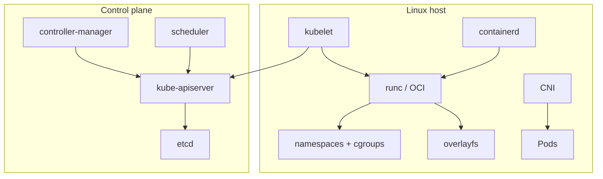

# Containers & Orchestration

> Docker internals, image supply chain, networking, and Kubernetes production patterns
>
> Teaching-style study guide from Algoroq senior interview PDFs. Practice each answer aloud with a diagram and one production anecdote.

---

## Why this matters

Senior interviews treat containers as **kernel primitives plus operational discipline**, not `docker run` trivia. You should trace a request from Ingress to cgroup limits and explain what breaks when etcd loses quorum.



## Reference patterns

### Multi-stage Dockerfile (Go → distroless)

```dockerfile
# syntax=docker/dockerfile:1
FROM golang:1.22 AS builder
WORKDIR /src
COPY go.mod go.sum ./
RUN go mod download
COPY . .
RUN CGO_ENABLED=0 go build -ldflags="-s -w" -o /out/server ./cmd/server

FROM gcr.io/distroless/static-debian12:nonroot
COPY --from=builder /out/server /server
USER nonroot:nonroot
ENTRYPOINT ["/server"]
```

### Deployment with probes

```yaml
apiVersion: apps/v1
kind: Deployment
metadata:
  name: api
spec:
  replicas: 3
  strategy:
    type: RollingUpdate
    rollingUpdate: { maxUnavailable: 0, maxSurge: 1 }
  template:
    spec:
      containers:
        - name: api
          image: registry.example.com/api@sha256:deadbeef...
          resources:
            requests: { cpu: "500m", memory: 512Mi }
            limits: { cpu: "500m", memory: 512Mi }
          readinessProbe:
            httpGet: { path: /readyz, port: 8080 }
          livenessProbe:
            httpGet: { path: /healthz, port: 8080 }
```

| Concern | Docker / containerd | Kubernetes |
|--------|------------------------|------------|
| Isolation | namespaces, cgroups, seccomp | Pod Security, admission webhooks |
| Networking | bridge, iptables NAT | CNI, Services, NetworkPolicy |
| Storage | volumes | PV/PVC, CSI |
| Rollouts | recreate container | Deployment strategies, PDB |

---

## Interview Q&A

## Docker

*15 questions from the Algoroq guide.*

### Q1. Explain how Linux containers work under the hood — namespaces, cgroups, and union filesystems.

> **What they're really asking:** Do you understand the kernel primitives that make containers possible, or do you just use Docker as a black box?

**Answer framework**

Start by establishing that containers are not virtual machines. A container is a regular Linux process (or group of processes) that has a restricted view of the system. This restriction comes from three kernel features working together: namespaces, cgroups, and union filesystems. Namespaces provide isolation. Each namespace type isolates a different aspect of the system. PID namespace gives the container its own process tree — PID 1 inside the container is just a regular process on the host with a different PID.

Network namespace gives the container its own network stack — its own interfaces, routing table, iptables rules, and port space. Mount namespace gives the container its own filesystem view. UTS namespace isolates hostname and domain name. IPC namespace isolates System V IPC and POSIX message queues. User namespace maps UIDs inside the container to different UIDs on the host — root (UID 0) inside the container can map to an unprivileged user (say UID 100000) on the host, which is the foundation of rootless containers.

Cgroups (control groups) provide resource management. Cgroups v2 (the current standard, unified hierarchy) organizes processes into a tree of groups and applies resource controllers. The CPU controller limits CPU time using CFS bandwidth throttling (cpu.max sets the quota within a period) or CPU weight for proportional sharing (cpu.weight). The memory controller limits memory usage (memory.max) and tracks current consumption (memory.current).

When a process exceeds its memory limit, the kernel OOM-kills it. The I/O controller limits block device throughput and IOPS. The PID controller limits the number of processes, preventing fork bombs. Union filesystems provide efficient image layering. OverlayFS (the default storage driver) combines multiple directory layers into a single merged view. The image layers are read-only (the lowerdir).

A thin writable layer (the upperdir) captures all filesystem changes made by the running container. Copy-on-write means that reading a file in a lower layer is zero-cost (it is accessed directly), but modifying a file first copies it to the upper layer. This is why large file modifications inside containers are expensive — the entire file is copied even if you change one byte. Connect this to Docker specifically.

When you run docker run, the Docker daemon calls containerd, which calls runc (the OCI runtime). Runc is a small binary that creates the namespaces, configures the cgroups, sets up the root filesystem using the union mount, and exec's the container entrypoint process. Once the container is running, runc exits — containerd and its shim process manage the container lifecycle from that point.

This understanding is critical for debugging. If a container behaves differently than expected, knowing whether it is a namespace issue (the container can see something it should not), a cgroup issue (the container is being throttled or killed), or a filesystem issue (copy-on-write overhead) directly informs your investigation.

### Q2. How do you design a multi-stage Dockerfile for a production application?

> **What they're really asking:** Can you build optimized, secure, and reproducible container images that follow production best practices?

**Answer framework**

Start with the problem multi-stage builds solve. A single-stage build includes build tools, compilers, development dependencies, and source code in the final image. This bloats the image size (Go build images can be over 1GB versus 10MB for the final binary) and expands the attack surface (every package in the image is a potential vulnerability). A multi-stage build separates build-time and runtime concerns.

The first stage (the builder) has everything needed to compile the application: the compiler, build tools, test frameworks, and all dependencies. The final stage starts from a minimal base and copies only the compiled artifacts. Nothing from the builder stage appears in the final image unless explicitly copied. Walk through a concrete example for a Go application. The builder stage uses the official Go image, copies go.mod and go.sum first (to cache dependency downloads), runs go mod download, then copies the source code and runs go build with appropriate flags (-ldflags to strip debug symbols, CGO_ENABLED=0 for static linking).

The final stage uses distroless/static or scratch, copies the binary from the builder, sets a non-root USER, and defines the ENTRYPOINT. For interpreted languages like Python or Node.js, the pattern differs. The builder stage installs dependencies, runs any build steps (webpack, compilation of native extensions), and produces a virtual environment or node_modules directory. The final stage uses a slim runtime image, copies the installed dependencies and application code, but excludes build tools (gcc, make, python3-dev).

Discuss layer caching strategy. Docker caches each layer based on the instruction and the files involved. Order your Dockerfile instructions from least-frequently-changing to most-frequently- changing. Copy dependency manifests and install dependencies before copying source code. This way, changing application code does not invalidate the dependency installation cache. Address security hardening in the final image.

Run as a non-root user: create a user in the Dockerfile and use the USER directive. Use a read-only filesystem in production. Do not install a shell unless absolutely necessary (distroless images have no shell). Set HEALTHCHECK to define a health check within the image specification. Use .dockerignore to exclude git directories, test files, documentation, and secrets from the build context.

Discuss reproducibility. Pin base image versions using SHA256 digests rather than tags (tags are mutable). Pin dependency versions in lock files. Use BuildKit's --mount=type=cache for persistent build caches that survive image rebuilds. Use --mount=type=secret to pass secrets during build without embedding them in any layer. For more on container technology decisions, see Docker vs Podman and how Docker works.

### Q3. How does Docker networking work, and what are the trade-offs between network modes?

> **What they're really asking:** Can you reason about container networking from first principles and troubleshoot connectivity issues?

**Answer framework**

Start with the default bridge network. When Docker starts, it creates a Linux bridge (docker0) on the host. Each container gets a veth pair: one end in the container's network namespace, the other attached to the docker0 bridge. Containers on the same bridge can communicate via IP address. The Docker daemon runs an embedded DNS server that resolves container names to IP addresses, but only for user-defined bridge networks — the default bridge network does not support DNS resolution by container name.

Explain user-defined bridge networks, which are the recommended approach. They provide automatic DNS resolution between containers by name, better isolation (containers on different networks cannot communicate), and configurable subnets, gateways, and IP ranges. Containers can be attached to multiple user-defined networks, enabling controlled connectivity between services. Host network mode eliminates the network namespace entirely.

The container shares the host's network stack, using the host's IP address and port space directly. This removes the overhead of the veth pair, NAT, and bridge forwarding. The performance benefit is measurable: reduced latency (typically 5-20 microseconds less per packet) and higher throughput. Use host networking for latency-sensitive applications or when the container needs to bind to many ports.

The trade-off is lost isolation — port conflicts are possible, and the container can see all host network traffic. None network mode creates a container with a loopback interface only. Use this for batch jobs that do not need network access, reducing the attack surface. Macvlan network mode assigns a MAC address to the container, making it appear as a physical device on the network.

The container gets an IP address from the physical network's DHCP server or a static assignment. This is useful for legacy applications that expect to be directly addressable on the LAN or for workloads that need to be reachable from outside without port mapping. Overlay networks span multiple Docker hosts. They use VXLAN encapsulation to create a virtual L2 network across hosts.

Each packet is encapsulated with an outer UDP header containing the VXLAN Network Identifier (VNI). This is the networking model used by Docker Swarm for multi-host communication. The overhead is approximately 50 bytes per packet for the encapsulation header. Discuss port mapping. The -p flag creates iptables DNAT rules that translate connections to the host port into connections to the container IP and port.

Docker adds these rules to the DOCKER chain in the nat table. Understanding this is critical for debugging — if iptables is flushed or another tool conflicts with Docker's rules, port mapping breaks silently. Address DNS resolution in detail. Docker's embedded DNS server (at 127.0.0.11 inside the container) resolves container names and service names. It forwards unknown queries to the host's configured DNS servers.

In complex environments, DNS resolution issues are a common source of container connectivity problems.

### Q4. How do you optimize Docker image size and build time for a CI/CD pipeline?

> **What they're really asking:** Can you reduce feedback loop time and infrastructure cost through systematic build optimization?

**Answer framework**

Start with why image size and build time matter. Large images increase pull time (critical in autoscaling scenarios where new instances must start quickly), consume more registry storage, and contain more packages that could harbor vulnerabilities. Slow builds reduce developer productivity and increase CI/CD costs. For image size optimization, work from the bottom up. Choose the right base image: alpine (5MB) versus debian-slim (80MB) versus ubuntu (77MB) versus distroless (2-20MB depending on variant) versus scratch (0MB).

Each choice has trade-offs — Alpine uses musl libc instead of glibc, which can cause subtle compatibility issues with some applications. Distroless images have no package manager or shell, which improves security but complicates debugging. Minimize layers. Each RUN, COPY, and ADD instruction creates a layer. Combine related commands in a single RUN instruction using && to chain them.

Clean up in the same layer — removing temporary files in a separate RUN instruction does not reduce image size because the files still exist in the previous layer. For example: RUN apt-get update && apt-get install -y --no- install-recommends package && rm -rf /var/lib/apt/lists/. Use multi-stage builds (as discussed in question 2) to exclude build tools from the final image. Use .dockerignore to prevent large or unnecessary files from entering the build context — this also speeds up the context transfer to the daemon.

For build time optimization, focus on layer caching. Structure the Dockerfile so that frequently changing content appears later. Copy dependency manifests first, install dependencies, then copy source code. This way, source code changes do not invalidate the expensive dependency installation cache. Use BuildKit's cache mounts for package managers. -- mount=type=cache,target=/root/.cache/pip persists the pip cache across builds, so unchanged packages are not re-downloaded.

Similarly for npm (--mount=type=cache,target=/root/.npm), Maven (--mount=type=cache,target=/root/.m2), and Go modules (-- mount=type=cache,target=/root/go/pkg/mod). Implement remote caching for CI environments. BuildKit can push cache layers to a registry and pull them in subsequent builds using --cache-from and --cache-to. This means CI runners that start with empty caches can still benefit from layer caching.

Use inline cache mode (-- cache-to type=inline) for simple cases or registry cache mode (--cache-to type=registry) for more control. Parallelize multi-stage builds. BuildKit automatically parallelizes stages that do not depend on each other. Structure your Dockerfile with independent stages (frontend build, backend build, test runner) that run concurrently. Consider buildx bake for complex build pipelines.

It defines build targets in an HCL or JSON file, specifying dependencies and parallelism explicitly. This is useful when building multiple images from the same repository.

### Q5. What is the difference between CMD, ENTRYPOINT, and how does the interaction between them affect container behavior?

> **What they're really asking:** Do you understand the subtleties of container startup configuration that affect operational behavior?

**Answer framework**

Start with the fundamental distinction. ENTRYPOINT defines the executable that runs when the container starts. CMD provides default arguments to the ENTRYPOINT. When a user passes arguments to docker run, those arguments replace CMD but not ENTRYPOINT. This design enables containers that behave like executables (with configurable arguments) versus containers that behave like environments (with a default command).

Explain the two forms. Shell form (CMD command arg1 arg2) wraps the command in /bin/sh -c, which means the command runs as a child process of the shell. This has implications: the shell process is PID 1, not your application, so SIGTERM is sent to the shell, which may not forward it to the application. Exec form (CMD ["command", "arg1", "arg2"]) runs the command directly as PID 1.

Always use exec form for ENTRYPOINT so your application receives signals directly. Walk through the interaction matrix. If only CMD is set: the CMD command runs, and docker run arguments replace it entirely. If only ENTRYPOINT is set: the ENTRYPOINT runs with docker run arguments appended. If both are set: ENTRYPOINT is the executable, CMD provides default arguments, and docker run arguments replace CMD.

This is the recommended pattern for production images. Provide a concrete example. For an HTTP server image: ENTRYPOINT ["./server"] and CMD ["-- port", "8080", "--workers", "4"]. Running docker run myimage starts the server with default configuration. Running docker run myimage --port 9090 overrides only the port. Running docker run --entrypoint /bin/sh myimage gives a shell for debugging, overriding the entrypoint entirely.

Discuss the PID 1 problem in depth. In Linux, PID 1 has special responsibilities: it must reap zombie processes (orphaned child processes whose parent has exited). If your application is PID 1 and it does not handle SIGCHLD, zombie processes accumulate. If you use shell form and /bin/sh is PID 1, the shell typically does reap zombies, but it may not forward signals properly. Solutions to the PID 1 problem: use exec form so your application is PID 1 and handles signals properly, use tini (a tiny init system designed for containers) as the ENTRYPOINT that forwards signals and reaps zombies, or use Docker's --init flag which injects tini automatically.

In Kubernetes, the pause container in each pod handles this role. Discuss how ENTRYPOINT scripts work in practice. Many production images use an entrypoint.sh script that performs initialization (waiting for database availability, running migrations, generating configuration from environment variables) and then exec's the main process. The exec replaces the shell process with the application process, ensuring the application becomes PID 1 and receives signals directly.

### Q6. How does Docker handle storage, and what are the performance implications of different storage drivers?

> **What they're really asking:** Do you understand the I/O performance characteristics that affect containerized workloads, especially databases and high-throughput applications?

**Answer framework**

Start with the layered storage model. A Docker image consists of read-only layers stacked on top of each other. When a container is created, a thin read-write layer is added on top. All filesystem writes go to this writable layer using copy-on-write (COW) semantics. Reading a file traverses layers from top to bottom until the file is found. Explain the primary storage driver: overlay2.

OverlayFS uses two directories: lowerdir (read- only image layers, merged into a single view) and upperdir (writable container layer). When a container modifies a file from a lower layer, the file is first copied to the upper layer (copy-up), then modified. This copy-up operation is the main performance cost of overlay2. It is a one- time cost per file — subsequent modifications to the same file are direct writes to the upper layer.

However, for large files (database data files, log files), this copy-up can cause significant latency spikes. Discuss performance implications. Sequential reads from lower layers are fast because OverlayFS reads directly from the underlying filesystem. Random reads across many small files may be slower due to directory lookup overhead across layers. Writes to new files (not from lower layers) go directly to the upper layer with no copy-up cost.

Write-heavy workloads on existing files from lower layers suffer from copy-up overhead. For high-performance storage needs, Docker volumes bypass the storage driver entirely. A volume is a directory on the host filesystem (or a network-attached storage device) that is bind- mounted into the container. Reads and writes go directly to the underlying filesystem with no overlay or copy-on-write overhead.

This is why databases, message queues, and any write- heavy workload must use volumes rather than writing to the container's writable layer. Explain volume types. Named volumes are managed by Docker and stored in /var/lib/docker/volumes/. Bind mounts map a specific host directory into the container. tmpfs mounts store data in memory, useful for sensitive data that should not persist to disk (application secrets, session files).

Volume drivers enable network-attached storage: NFS, Amazon EBS, Azure Disk, and proprietary storage systems. Discuss the writable layer and its limitations. The writable layer grows with every write and is deleted when the container is removed. Docker does not support layer-level quotas with overlay2 (unlike devicemapper which supported per-container storage limits). A runaway container writing to its writable layer can fill the host disk.

Use --storage-opt size=10G (available with some storage drivers) or monitor container disk usage with docker system df. Address build cache storage. BuildKit stores build caches separately from image layers. The build cache can grow large over time. Use docker builder prune to clean it. In CI environments, configure garbage collection policies to prevent disk exhaustion. For understanding how storage decisions affect container orchestration, CSI (Container Storage Interface) drivers in Kubernetes provide the abstraction layer between storage vendors and the orchestrator.

### Q7. Explain Docker security — what attack vectors exist and how do you mitigate them?

> **What they're really asking:** Can you reason about container security holistically, from image to runtime to host?

**Answer framework**

Start with the threat model. Container security operates at four layers: the image (what code and dependencies are packaged), the runtime (how the container process is isolated), the host (the kernel and system services shared by all containers), and the network (how containers communicate). Image security: supply chain attacks. Base images from public registries may contain malware or known vulnerabilities.

Pin base images by digest. Scan images with Trivy, Grype, or Snyk. Sign images with Cosign and verify signatures before deployment. Generate SBOMs to track all components. Use minimal base images (distroless, Alpine, scratch) to reduce the vulnerability surface. Never include secrets, credentials, or private keys in image layers — they persist in the layer history even if deleted in a later layer.

Use BuildKit's --mount=type=secret for build- time secrets. Runtime security: container escape. By default, Docker containers run as root inside the container, and this maps to root on the host (unless user namespace remapping is enabled). A container escape vulnerability (like CVE-2019-5736 in runc) allows root-in-container to become root-on-host. Mitigations: run containers as non-root users (USER directive in Dockerfile), enable user namespace remapping (--userns-remap), drop all Linux capabilities and add back only what is needed (--cap-drop=ALL --cap-add=NET_BIND_SERVICE), apply seccomp profiles that restrict system calls, use AppArmor or SELinux for mandatory access control, set --security- opt=no-new-privileges to prevent privilege escalation via setuid binaries.

Host security: kernel sharing. All containers share the host kernel. A kernel vulnerability affects every container. Keep the host kernel updated. Use a minimal host OS designed for containers (Flatcar Container Linux, Bottlerocket, Talos). Do not run unnecessary services on the host. Restrict access to the Docker socket (/var/run/docker.sock) — mounting it into a container gives that container full control over the Docker daemon, which is equivalent to root access on the host.

Network security: lateral movement. By default, all containers on the same Docker network can communicate. Use user-defined bridge networks to segment containers. Apply iptables rules or Docker network policies to restrict traffic. For sensitive workloads, use encrypted overlay networks (--opt encrypted for Docker Swarm overlay networks). Never expose the Docker daemon API (port 2375/2376) to the network without TLS and certificate authentication.

Discuss rootless Docker. Running the Docker daemon as a non-root user eliminates the largest class of container escape attacks. Rootless Docker uses user namespaces, unprivileged overlayfs, and slirp4netns for networking. Trade-offs: slightly reduced networking performance, inability to bind to privileged ports (below 1024), and some storage driver limitations. Address Docker vs Podman from a security perspective.

Podman is daemonless — there is no long-running root process. Each container runs as a direct child of the user's session. This eliminates the Docker daemon as a single point of compromise. Podman also defaults to rootless mode, making it inherently more secure for many use cases.

### Q8. How do you handle logging in containerized applications?

> **What they're really asking:** Can you design a logging architecture that works with the ephemeral nature of containers and scales to production requirements?

**Answer framework**

Start with the fundamental principle: containers should write logs to stdout and stderr. The container runtime (containerd, CRI-O) captures these streams and writes them to files on the host. This decouples the application from the logging infrastructure — the application does not need to know where logs are stored or how they are shipped. Explain the Docker logging driver architecture.

Docker supports pluggable logging drivers that determine how container logs are processed. The json-file driver (default) writes JSON- formatted log entries to /var/lib/docker/containers//-json.log. The local driver is more efficient (compressed, with rotation built in). The journald driver sends logs to systemd journal. The syslog driver sends logs via syslog protocol. The fluentd driver sends logs to a Fluentd collector.

The awslogs, gcplogs, and splunk drivers send logs directly to cloud services. Discuss the critical trade-off: blocking versus non-blocking log delivery. By default, logging drivers are blocking — if the logging destination is slow or unavailable, the application process blocks on stdout writes. This can cause your application to hang because of a logging infrastructure problem.

Set the log driver to non-blocking mode (--log-opt mode=non-blocking --log-opt max-buffer-size=4m), which buffers log entries in a ring buffer and drops the oldest entries when the buffer is full. This trades log completeness for application availability — the correct trade-off for most production services. For production logging architecture, describe the DaemonSet pattern used in Kubernetes (but applicable to any container platform).

A log collection agent (Fluent Bit, the OpenTelemetry Collector, or Vector) runs on every host, reads log files from all containers, enriches them with metadata (container name, image, labels), and ships them to a centralized store. Fluent Bit is preferred over Fluentd for the collection tier because it uses significantly less memory (typically 15MB versus 60MB per node). Discuss structured logging.

Applications should emit structured logs (JSON) rather than unstructured text. Structured logs enable efficient parsing, filtering, and querying without regex- based extraction. Include correlation IDs (trace IDs from distributed tracing), timestamps in RFC 3339 format, log levels, and relevant context fields. At scale, structured logging reduces storage costs by enabling column-oriented compression and targeted queries.

Address log storage trade-offs. Elasticsearch provides full-text search and complex aggregations but is expensive to operate at scale (memory-intensive JVM, disk-heavy indexing). Grafana Loki indexes only labels (namespace, pod, container, level) and stores log content in object storage, making it 10-100x cheaper for log storage but slower for full-text searches. Cloud logging services (CloudWatch Logs, Google Cloud Logging, Azure Monitor) eliminate operational overhead but introduce vendor lock-in and can become expensive at high volume.

Cover log rotation. Without rotation, container logs can fill the host disk. Configure max- size and max-file for the json-file driver (--log-opt max-size=10m --log-opt max-file=3). In Kubernetes, the kubelet manages log rotation based on containerLogMaxSize and containerLogMaxFiles configuration.

### Q9. How does Docker Compose work and when is it appropriate for production use?

> **What they're really asking:** Can you distinguish between development tooling and production infrastructure, and do you understand the limitations of simpler orchestration?

**Answer framework**

Start with what Docker Compose is: a tool for defining and running multi-container applications using a declarative YAML file. You define services (containers), networks, volumes, and their relationships in a docker-compose.yml (or compose.yaml) file. The docker compose up command creates all defined resources and starts the containers. Explain the runtime behavior. Compose creates a dedicated Docker network for the project (named after the directory by default).

All services are attached to this network and can resolve each other by service name via Docker's embedded DNS. Compose manages the lifecycle: starting, stopping, rebuilding, and scaling services as a group. It tracks state using container labels that associate containers with the Compose project. Discuss Compose's strengths. For local development, it is unmatched. A single file defines the entire application stack: the application, database, cache, message queue, and any supporting services.

New developers clone the repo, run docker compose up, and have a working environment in minutes. Environment variable substitution (${VAR:-default}) and profiles (--profile debug) allow customization without modifying the file. The watch feature (docker compose watch) enables live code reloading by syncing source code changes into running containers. For testing and CI/CD, Compose excels at creating isolated, reproducible environments.

Run integration tests against a Compose stack that mirrors production topology. Use depends_on with condition: service_healthy to ensure services start in the correct order and are ready before tests begin. Now discuss the limitations that make Compose inappropriate for most production use cases. Single-host only: Compose does not distribute containers across multiple machines, so there is no resilience to host failure.

No rolling updates: docker compose up --detach recreates containers, causing brief downtime for each service. No health-based traffic management: Compose does not remove unhealthy containers from load balancing. No autoscaling: Compose does not dynamically adjust replica counts. Limited secrets management: Compose supports Docker secrets but the implementation is basic compared to production solutions.

However, be nuanced. Compose is appropriate for production in specific scenarios: single-server applications where the traffic and availability requirements are modest, internal tools that do not require high availability, and small projects where Kubernetes or Docker Swarm would be overengineering. The key question is: can you tolerate the downtime of a single-host failure and manual recovery?

For production workloads that need orchestration, discuss the graduation path. Compose defines the application topology. That same understanding of services, dependencies, and configuration translates directly to Kubernetes manifests or Helm charts. Some tools (Kompose) even convert docker-compose.yml files to Kubernetes resources, though the output usually requires significant refinement.

For understanding the full orchestration landscape, see how container orchestration works and Kubernetes vs Docker Swarm.

### Q10. How do you debug a containerized application that works locally but fails in production?

> **What they're really asking:** Can you systematically troubleshoot containers in environments where you may have limited access and cannot simply attach a debugger?

**Answer framework**

Start with a systematic debugging methodology. Container behavior differences between environments are caused by a finite set of factors: different base images or dependencies, different configuration (environment variables, config files, mounted secrets), different resource constraints (CPU limits, memory limits), different network topology (DNS resolution, service discovery, firewall rules), and different storage (volume mounts, filesystem permissions).

Step one: reproduce the failure. Get the exact image digest running in production (not just the tag, which may have been overwritten). Pull that specific image. Gather the runtime configuration: environment variables, volume mounts, resource limits, network settings. Reconstruct the production environment as closely as possible locally. If the failure reproduces, you have a local debugging target.

Step two: examine container state. docker inspect reveals the full container configuration: mounts, network settings, environment variables, resource constraints, health check status, and restart count. docker logs shows stdout and stderr output — check for error messages, stack traces, and unexpected behavior during startup. docker stats shows real-time CPU, memory, network, and block I/O usage — compare against resource limits to identify throttling or OOM conditions.

Step three: get inside the container. docker exec -it /bin/sh (or /bin/bash) gives you a shell inside the running container. From there, inspect the filesystem (are config files correct?), check network connectivity (can the container reach its dependencies?), examine processes (is the application running as expected?), and review resource usage (top, free -h, df -h). If the image has no shell (distroless), use docker debug (introduced in Docker Desktop 4.27) or build an ephemeral debug image that shares the same namespaces.

Step four: check the platform layer. In Kubernetes, kubectl describe pod reveals events (scheduling failures, image pull errors, probe failures, OOM kills). kubectl logs --previous shows logs from the previous container instance (useful for CrashLoopBackOff). kubectl top pod shows actual resource usage. kubectl get events --field-selector involvedObject.name= shows the full event history.

Step five: compare configurations. Use docker diff to see filesystem changes in a running container. Compare environment variables between local and production. Check for differences in mounted volumes and secrets. Verify DNS resolution: nslookup or dig from inside the container to confirm service discovery is working correctly. Discuss the most common root causes. Configuration drift: environment variables or config files differ between environments.

Resource constraints: the application works without CPU or memory limits locally but gets throttled or OOM-killed in production. DNS resolution: service names that resolve locally do not resolve in the production network. Filesystem permissions: the application runs as root locally but as a non-root user in production, and file permissions prevent access. Time zone differences: the container uses UTC but the application expects local time.

Share a war story pattern. At Spotify, engineers have developed internal debugging toolkits that include ephemeral debug containers, preconfigured with diagnostic tools, that can be attached to any running pod without modifying the original container image.

### Q11. How does Docker handle image layer caching, and how does it affect reproducibility?

> **What they're really asking:** Do you understand the caching semantics well enough to optimize builds without sacrificing correctness?

**Answer framework**

Start with the caching rules. The legacy builder uses a straightforward algorithm: for each instruction, Docker checks if an existing layer was produced by the same instruction with the same inputs. For RUN instructions, the cache key is the instruction string itself — Docker does not execute the command to check if the output has changed. This means RUN apt-get update && apt-get install -y curl produces a cached layer even if new package versions are available.

For COPY and ADD, Docker checksums the source files and invalidates the cache if any file has changed. Once a cache miss occurs, all subsequent instructions are rebuilt. This is why instruction ordering matters so much: putting frequently-changing instructions (like COPY . .) early in the Dockerfile invalidates the cache for all following layers, including expensive operations like dependency installation.

Explain BuildKit's improvements. BuildKit uses a content-based cache rather than instruction- based. It builds a dependency graph of all instructions and only rebuilds what is actually affected by changes. BuildKit can also skip building stages that are not needed for the final output, and it parallelizes independent stages automatically. BuildKit introduces cache mounts (--mount=type=cache) that persist across builds.

Unlike layer caching, which stores the entire layer state, cache mounts persist a specific directory. This is ideal for package manager caches: the pip download cache, the npm cache, the Maven local repository. Cache mounts are not included in the final image, so they do not affect image size. Discuss the reproducibility tension. Layer caching improves build speed but can mask reproducibility issues.

A cached RUN apt-get install might produce a different result if re-run from scratch (different package versions). Strategies for reproducibility: pin package versions explicitly (apt-get install -y curl=7.88.1-10), use lock files for language-specific dependencies (package-lock.json, poetry.lock, go.sum), pin base images by digest rather than tag, and run periodic cache-busted builds in CI to verify that a clean build still works.

Cover remote caching for CI/CD environments. CI runners typically start with empty caches. BuildKit can export cache to a registry (--cache-to type=registry,ref=registry.example.com/myimage:cache) and import it in subsequent builds (-- cache-from type=registry,ref=registry.example.com/myimage:cache). This makes CI builds almost as fast as local builds with warm caches. The trade-off is the time spent pushing and pulling cache layers, which is justified only when the cached layers are expensive to rebuild.

Discuss cache invalidation strategies. Use ARG instructions to create cache-busting keys when needed (ARG CACHEBUST=1, then reference it before a RUN instruction). Use --no-cache to rebuild from scratch. Use --build-arg to inject build-time variables that naturally change (commit SHA, build number) without invalidating unrelated layers — place the ARG that references them after the expensive layers.

### Q12. How do you implement health checks in Docker, and how do they interact with orchestrators?

> **What they're really asking:** Can you design health checking strategies that enable self-healing infrastructure without causing cascading failures?

**Answer framework**

Start with Docker's HEALTHCHECK instruction. It defines a command that Docker runs periodically to determine if a container is healthy. The command returns 0 for healthy, 1 for unhealthy. Docker tracks three states: starting (within the start-period), healthy (health check passing), and unhealthy (health check failing for the configured retries). Configuration parameters: --interval (time between checks, default 30s), --timeout (maximum time for a check to complete, default 30s), --start-period (grace period for startup, default 0s), --retries (consecutive failures before marking unhealthy, default 3).

Design effective health checks. A good health check verifies that the application can serve its purpose, not just that the process is running. For a web server: HEALTHCHECK CMD curl -f http://localhost:8080/health || exit 1. But this requires curl to be installed in the image. For minimal images: write a dedicated health check binary or use the application's built-in health endpoint with wget or a language-specific HTTP client.

The health check should verify downstream dependencies conditionally. An HTTP health endpoint should return 200 if the application can serve requests. It should report dependency status (database connectivity, cache availability) in the response body for observability but should not fail the health check for non-critical dependency failures. If the database is down and the application cannot serve any requests, then yes, the health check should fail.

But if a non- essential cache is temporarily unavailable and the application can serve requests (just more slowly), the health check should still pass. Explain the interaction with orchestrators. In Docker Compose, depends_on with condition: service_healthy ensures a dependent service does not start until the dependency is healthy. In Docker Swarm, unhealthy containers are stopped and replaced.

In Kubernetes, health checks are implemented differently: liveness probes determine if the container should be restarted, readiness probes determine if the container should receive traffic, and startup probes give slow- starting applications time to initialize. Discuss the danger of health checks that are too aggressive. Setting a short interval and timeout with few retries can cause healthy containers to be killed during transient load spikes (when the health check endpoint is slow to respond).

This leads to cascading failures: containers are killed, traffic is redistributed to fewer containers, those containers become overloaded, their health checks fail, and more containers are killed. Configure intervals and timeouts based on your application's actual performance characteristics under load. Address health check design patterns. The graduated health check: a lightweight check runs frequently (is the process listening on the port?) while a deeper check runs less frequently (can the application execute a test query against the database?).

The dependency-aware health check: report overall health as a composite of component health checks, with clear degraded states between fully healthy and unhealthy. The startup-aware health check: use a startup probe or start-period that accommodates the slowest reasonable startup time, including initial cache warming, migration checks, and leader election. For understanding how health checks drive orchestration behavior at scale, see how Kubernetes works and explore Netflix's architecture for health checking patterns at massive scale.

### Q13. Explain Docker content trust and image signing — how do you verify image integrity?

> **What they're really asking:** Do you understand software supply chain security and can you implement image verification in a CI/CD pipeline?

**Answer framework**

Start with the problem. When you pull an image from a registry, how do you know it has not been tampered with? The registry could be compromised. The network could be intercepted (even with TLS, a compromised CA is possible). The tag could have been overwritten with a different image. Without verification, you are trusting the registry to serve the correct image — and in a defense-in-depth security model, you should not trust any single component.

Explain Docker Content Trust (DCT), which is based on The Update Framework (TUF) and Notary. When DCT is enabled (DOCKER_CONTENT_TRUST=1), Docker signs images during push and verifies signatures during pull. The publisher generates a signing key, signs the image manifest, and uploads the signature to a Notary server. When a consumer pulls the image, Docker verifies the signature against the publisher's public key before proceeding.

DCT uses two types of keys. The root key (offline key) is the ultimate trust anchor. It should be stored in a hardware security module (HSM) or air-gapped machine. The repository key (signing key) is used for day-to-day signing. It can be delegated to CI/CD systems for automated signing. Key rotation is supported: if a signing key is compromised, the root key can revoke it and issue a new one.

Discuss the modern alternative: Sigstore and Cosign. Cosign is simpler than DCT, supports keyless signing (using OIDC identity providers for ephemeral keys), and stores signatures as OCI artifacts alongside the image in the registry (no separate Notary server needed). Keyless signing works by: the signer authenticates with an OIDC provider (Google, GitHub, Microsoft), Sigstore's Fulcio CA issues a short-lived certificate binding the OIDC identity to a signing key, the image is signed with this ephemeral key, and the signing event is recorded in Rekor (a transparency log).

For production implementation, describe an end-to-end pipeline. CI/CD builds the image. Vulnerability scanning runs (Trivy, Grype). If the scan passes policy, the image is signed with Cosign using the CI system's OIDC identity (GitHub Actions workload identity, GitLab CI OIDC token). The signature is pushed to the registry. An admission controller in the Kubernetes cluster (Sigstore Policy Controller, Kyverno with Cosign verification, or OPA Gatekeeper with a Cosign plugin) verifies the signature before allowing the pod to run.

Unsigned or incorrectly signed images are rejected. Address SBOM attestations. Beyond signing, Cosign supports attaching attestations to images: SBOM attestations (what components are in the image), SLSA provenance attestations (where and how the image was built), and vulnerability scan attestations (the scan results at build time). These attestations are signed with the same key, providing a verified chain of evidence about the image's origin and contents.

Discuss the organizational challenges. Key management is the hardest part. Who controls the root key? How are signing keys distributed to CI/CD systems? What is the process when a key is compromised? Keyless signing with Sigstore eliminates most key management complexity, which is why it is becoming the industry standard. Companies like Google use binary authorization (based on similar principles) to ensure only verified images run in production.

### Q14. How do you manage Docker in production — daemon configuration, resource management, and garbage collection?

> **What they're really asking:** Have you operated Docker at scale and dealt with the operational challenges that come with long-running Docker hosts?

**Answer framework**

Start with daemon configuration. The Docker daemon is configured via /etc/docker/daemon.json. Critical production settings: log-driver and log-opts to configure log rotation (prevent disk exhaustion from container logs), storage-driver (overlay2 is the standard), default-address-pools to control the IP ranges assigned to Docker networks (prevent conflicts with corporate VPN or infrastructure subnets), live-restore: true to keep containers running during daemon restarts (critical for minimizing disruption during Docker upgrades), and default- ulimits to set process, file descriptor, and memory lock limits for all containers.

Discuss resource management at the daemon level. Configure default CPU and memory limits using default-runtime options or runtime-specific configuration. Set container storage quotas to prevent individual containers from consuming all available disk. Configure the OOM score adjustment to control which processes the kernel kills first during memory pressure — Docker containers should generally be killed before critical system services.

Address garbage collection, which is the most common operational issue with Docker hosts. Docker accumulates unused data over time: stopped containers, unused images, dangling images (layers not referenced by any tagged image), unused volumes, and build cache. Without cleanup, Docker can consume all available disk space. Automate garbage collection with docker system prune. Run docker system prune --filter until=24h daily via cron or systemd timer to remove containers, networks, and images not used in the last 24 hours.

For build cache, run docker builder prune --keep-storage=5GB to cap build cache size. For volumes, docker volume prune removes only anonymous volumes — named volumes are never automatically removed to prevent data loss. For orchestrated environments, discuss image garbage collection policy. The kubelet has built-in image garbage collection: imageGCHighThresholdPercent (default 85%) triggers cleanup, and imageGCLowThresholdPercent (default 80%) is the target after cleanup.

It removes the least recently used images first. For Docker hosts not managed by Kubernetes, implement a similar policy using a scheduled script that identifies images not referenced by any running container and older than a configurable retention period. Cover monitoring and alerting. Monitor disk usage on /var/lib/docker/ (or wherever Docker stores its data). Alert when usage exceeds 70% to allow proactive cleanup.

Monitor Docker daemon health: docker info shows storage driver status, number of containers and images, and logging driver. Monitor container restart counts — a high restart count indicates crashlooping containers that may consume excessive resources through rapid image pulls and container creation. Discuss security configuration. Enable user namespace remapping for defense-in-depth.

Configure TLS for remote Docker API access. Use authorization plugins to control who can perform which Docker operations. Enable audit logging to track Docker API calls. For production Docker infrastructure that feeds into container orchestration, these daemon- level concerns multiply across every node in the cluster.

### Q15. How does Docker compare to alternative container runtimes, and when would you choose something other than Docker?

> **What they're really asking:** Do you understand the container ecosystem beyond Docker, and can you make informed technology choices?

**Answer framework**

Start with the current container runtime landscape. Docker is a complete platform: it includes image building (BuildKit), image distribution (registry interaction), container runtime (containerd plus runc), networking (libnetwork), and orchestration (Docker Compose, formerly Swarm). However, each of these functions has specialized alternatives that may be better suited for specific use cases.

Podman is the most prominent Docker alternative. It is daemonless (no long-running root process), rootless by default, and CLI-compatible with Docker (alias docker=podman works for most commands). Podman uses the same OCI standards, so images built with Docker run identically on Podman and vice versa. Podman's pod concept (grouping containers that share namespaces, inspired by Kubernetes pods) makes it natural to develop for Kubernetes locally.

For a detailed comparison, see Docker vs Podman. Containerd is the container runtime that Docker uses internally, but it can be used directly without Docker. Kubernetes migrated from Docker (dockershim) to containerd as the default runtime. Using containerd directly reduces the runtime stack by removing the Docker daemon layer. For Kubernetes nodes, this means lower memory usage and fewer components to maintain.

The trade-off is that containerd does not provide build tooling or the developer- friendly CLI that Docker offers. CRI-O is a lightweight container runtime designed specifically for Kubernetes. It implements the Container Runtime Interface (CRI) with minimal additional functionality. CRI-O uses runc (or alternative OCI runtimes) for container execution and supports the same images as Docker and Podman.

Red Hat OpenShift uses CRI-O as its default runtime. For image building, discuss alternatives to Docker build. Kaniko builds images inside containers without requiring a Docker daemon or privileged access — ideal for CI/CD systems where mounting the Docker socket is a security concern. Buildah is the build component from the Podman ecosystem — it builds OCI-compliant images using Dockerfiles or a scriptable API, without a daemon.

Both Kaniko and Buildah produce images identical to those built by Docker. Discuss specialized runtimes for enhanced security. gVisor (by Google) interposes a user-space kernel between the container and the host kernel, intercepting system calls and reducing the attack surface. It introduces performance overhead (especially for I/O-heavy workloads) but provides much stronger isolation than standard containers.

Kata Containers run each container inside a lightweight VM, providing hardware-level isolation comparable to virtual machines with container-like density and speed. Firecracker (by Amazon) is a micro-VM hypervisor designed for serverless and container workloads, providing VM-level isolation with millisecond startup times. Provide decision guidance. For local development: Docker Desktop or Podman Desktop — familiarity and tooling ecosystem matter most.

For Kubernetes nodes: containerd or CRI-O — lighter, purpose-built, and sufficient. For CI/CD image building: Kaniko (in Kubernetes), Buildah (on Linux hosts), or BuildKit with remote caching. For multi-tenant environments requiring strong isolation: gVisor or Kata Containers. For serverless platforms: Firecracker. The key insight: the OCI (Open Container Initiative) standards — image format, runtime specification, distribution specification — mean that the ecosystem is interoperable.

Images built with Docker run on Podman. Images built with Buildah run on containerd. The choice of runtime is an operational decision, not an application design decision.

## Kubernetes

*15 questions from the Algoroq guide.*

### Q1. Explain the Kubernetes control plane architecture and what happens when a component fails.

> **What they're really asking:** Do you understand the internals of Kubernetes beyond surface-level usage, and can you reason about failure modes in distributed systems?

**Answer framework**

Begin by describing the control plane components and their specific responsibilities. The API server (kube-apiserver) is the front door to the cluster. Every interaction — whether from kubectl, controllers, or the kubelet — goes through the API server. It validates requests, performs authentication and authorization, and persists state to etcd. The API server is stateless and horizontally scalable, which is why production clusters run multiple replicas behind a load balancer.

Etcd is the single source of truth for all cluster state. It stores the desired state of every resource: pods, services, config maps, secrets, custom resources. Etcd uses the Raft consensus protocol, which means it requires a quorum (a majority of nodes) to accept writes. In a three-node etcd cluster, you can tolerate one node failure. In a five-node cluster, you can tolerate two.

This is why production clusters never run an even number of etcd nodes. The controller manager runs a collection of control loops. Each controller watches a specific resource type through the API server and reconciles actual state with desired state. The ReplicaSet controller ensures the right number of pod replicas exist. The Node controller monitors node health and evicts pods from unhealthy nodes.

The Endpoint controller populates endpoint objects that link services to pods. If the controller manager goes down, existing workloads continue running but no reconciliation occurs — new deployments stall, failed pods are not replaced, and node failures go unhandled. The scheduler assigns pods to nodes. It filters nodes that cannot run the pod (insufficient resources, taints, affinity rules) and then scores the remaining candidates based on resource balance, data locality, and spreading constraints.

If the scheduler fails, pending pods remain in the Pending state indefinitely but running pods are unaffected. Explain the failure impact clearly. If the API server goes down, no new operations are possible but existing workloads continue. Kubelets continue running their assigned pods using cached state. If etcd goes down, the API server cannot read or write state. If a single etcd node in a three-node cluster fails, the remaining two maintain quorum and the cluster continues operating normally.

### Q2. How does the Kubernetes scheduler make placement decisions, and how would you influence scheduling for a latency-sensitive workload?

> **What they're really asking:** Can you go beyond default scheduling and design placement strategies for real production requirements?

**Answer framework**

Start with the two-phase scheduling process. In the filtering phase, the scheduler eliminates nodes that cannot run the pod. Filters check resource requests (CPU, memory, ephemeral storage), node selectors, taints and tolerations, pod affinity and anti-affinity rules, and volume topology constraints. In the scoring phase, the scheduler ranks remaining nodes using priority functions: LeastRequestedPriority spreads load across nodes, BalancedResourceAllocation prefers nodes where CPU and memory usage ratios are similar, and ImageLocalityPriority favors nodes that already have the container image cached.

For a latency-sensitive workload, walk through several mechanisms. Node affinity lets you target specific hardware — for example, scheduling on nodes with NVMe SSDs or specific CPU architectures. Use requiredDuringSchedulingIgnoredDuringExecution for hard constraints and preferredDuringSchedulingIgnoredDuringExecution for soft preferences. Pod anti-affinity ensures replicas of the same service land on different nodes or availability zones.

This is critical for high-availability deployments. For a latency-sensitive service, you might require anti-affinity across zones to survive zone failures while using preferred anti-affinity across nodes within a zone. Topology spread constraints (introduced in Kubernetes 1.19 and stable since 1.24) give you fine- grained control over how pods distribute across topology domains.

You can specify maxSkew (the maximum allowed difference in pod count between domains), topologyKey (zone, node, or custom label), and whenUnsatisfiable (DoNotSchedule or ScheduleAnyway). For truly latency-critical workloads, discuss Guaranteed QoS class (requests equal limits for both CPU and memory), static CPU manager policy for exclusive CPU core assignment, and topology manager for NUMA-aware scheduling.

These features prevent CPU throttling, cache contention, and cross-NUMA memory access that can add microseconds of latency. Connect this to a real scenario. At Google, latency-sensitive serving infrastructure uses a combination of node pools with dedicated hardware, pod anti-affinity across failure domains, and Guaranteed QoS with static CPU pinning to achieve sub-millisecond tail latency for services like Search and Ads.

### Q3. Walk through the complete lifecycle of a pod from creation to running.

> **What they're really asking:** Do you understand the end-to-end flow across control plane and node components, and can you identify where things can go wrong?

**Answer framework**

Begin when a user submits a pod specification. The kubectl client sends an HTTP POST to the API server. The API server authenticates the request (client certificates, bearer tokens, or webhook authentication), authorizes it (RBAC policies), and passes it through admission controllers. Admission controllers can mutate the request (MutatingAdmissionWebhook adds sidecar containers, LimitRanger sets default resource requests) or validate it (ValidatingAdmissionWebhook rejects non-compliant specs, PodSecurityAdmission enforces security standards).

Once admitted, the API server persists the pod object to etcd with status phase set to Pending. The scheduler watches for pods with no assigned node. It runs the filtering and scoring pipeline, selects a node, and writes the nodeName binding back to the API server. The kubelet on the selected node detects the assignment via its watch on the API server. It begins the pod startup sequence.

First, it pulls the pod sandbox — a pause container that holds the network namespace and cgroup parent. Then it calls the Container Runtime Interface (CRI) to create each container. For each container, the kubelet resolves the image tag to a digest, pulls the image (respecting imagePullPolicy: Always, IfNotPresent, or Never), creates the container, and starts it. If init containers are defined, they run sequentially before any regular containers start.

Each init container must exit successfully before the next one begins. The Container Network Interface (CNI) plugin configures networking. It assigns an IP address from the pod CIDR, creates a veth pair connecting the pod namespace to the host bridge, and programs routes so the pod can communicate with other pods across the cluster. The Container Storage Interface (CSI) plugin handles volume attachment and mounting.

For persistent volumes, the external attacher ensures the volume is attached to the node, and the kubelet mounts it into the container filesystem. Once the container is running, the kubelet begins health checking. Startup probes run first, giving slow-starting applications time to initialize. Once the startup probe succeeds, liveness probes and readiness probes begin. Liveness probe failures trigger container restart.

Readiness probe failures remove the pod from service endpoints, stopping traffic routing. The kubelet reports pod status back to the API server: conditions (PodScheduled, Initialized, ContainersReady, Ready), container states (Waiting, Running, Terminated), and resource usage metrics.

### Q4. How does Kubernetes networking work, and how do pods communicate across nodes?

> **What they're really asking:** Can you explain the networking model from first principles, including the implications for security, performance, and troubleshooting?

**Answer framework**

Start with the Kubernetes networking model and its three fundamental guarantees. Every pod gets its own IP address. Pods can communicate with any other pod without NAT. Agents on a node (kubelet, kube-proxy) can communicate with all pods on that node. These guarantees create a flat network where every pod is routable, which simplifies application design but requires a capable network fabric.

Explain the CNI plugin landscape. Flannel is the simplest — it creates a VXLAN overlay network where pod traffic is encapsulated in UDP packets traversing the underlay. Calico uses BGP to advertise pod routes directly, avoiding encapsulation overhead. In cloud environments, the AWS VPC CNI assigns actual VPC IP addresses to pods, eliminating overlay networking entirely and enabling native VPC security groups.

Walk through pod-to-pod communication on the same node. The CNI plugin creates a veth pair for each pod. One end sits in the pod network namespace, the other connects to a bridge (cbr0) or is directly routed. Traffic between pods on the same node stays local — it crosses the bridge without leaving the host. For cross-node communication, the mechanism depends on the CNI plugin. With an overlay network (Flannel VXLAN), the pod packet is encapsulated: the inner header has pod-to-pod IPs, the outer header has node-to-node IPs.

The receiving node decapsulates and delivers to the destination pod. With direct routing (Calico BGP), each node advertises its pod CIDR via BGP, and routers in the network fabric forward pod traffic directly. Explain Service networking. A ClusterIP service gets a virtual IP from the service CIDR. Kube- proxy programs iptables rules (or IPVS rules in IPVS mode) that DNAT traffic destined for the service IP to a randomly selected backend pod.

In IPVS mode, kube-proxy uses Linux IPVS kernel module for load balancing, which is more performant at scale (O(1) versus O(n) rule matching). Discuss the trade-offs: iptables is simpler and well-understood; IPVS supports more load balancing algorithms (round-robin, least connections, destination hashing). For external traffic, cover NodePort (opens a port on every node), LoadBalancer (provisions a cloud load balancer that targets NodePorts), and Ingress (L7 routing using an ingress controller like NGINX or Envoy).

Modern clusters increasingly use the Gateway API as a more expressive and portable alternative to Ingress. This networking model is what makes microservices communication seamless in Kubernetes. For a deeper comparison of orchestration approaches, see Kubernetes vs Docker Swarm.

### Q5. Describe Kubernetes RBAC and how you would design an access control strategy for a multi-team organization.

> **What they're really asking:** Can you design security boundaries that balance developer productivity with least-privilege access in a shared cluster?

**Answer framework**

Start with RBAC primitives. Roles define a set of permissions (verbs on resources) within a namespace. ClusterRoles define permissions cluster-wide. RoleBindings grant a Role to a subject (user, group, or service account) within a namespace. ClusterRoleBindings grant a ClusterRole cluster-wide. A well-designed access control strategy starts with namespace isolation. Each team or application gets its own namespace.

Create a base Role that allows developers to manage common resources: create, update, and delete Deployments, Services, ConfigMaps, and Pods. Restrict dangerous operations: only SRE teams should delete PersistentVolumeClaims or exec into pods in production namespaces. Layer in resource quotas and limit ranges at the namespace level. Resource quotas cap the total CPU, memory, and object count a namespace can consume.

Limit ranges set default and maximum resource requests for individual pods. This prevents one team from monopolizing cluster resources. For service accounts, follow the principle of least privilege. The default service account in each namespace should have no additional permissions — do not bind ClusterRoles to default service accounts. Create dedicated service accounts for each application with only the permissions it needs.

If a pod does not need to call the Kubernetes API, set automountServiceAccountToken to false. Discuss Pod Security Admission (the replacement for PodSecurityPolicy). The Restricted profile enforces best practices: no privilege escalation, no host namespaces, non-root containers, read- only root filesystem. Apply it in enforce mode for production namespaces and warn mode for development namespaces.

For a real organization, describe a tiered model. Platform engineers get cluster-admin for infrastructure namespaces. SRE teams get broad read access cluster-wide plus write access to monitoring and operations namespaces. Development teams get full access within their own namespaces but no cross-namespace access. Auditors get read-only ClusterRole bindings. Integrate with external identity providers.

Use OIDC to connect Kubernetes authentication to your corporate identity provider (Okta, Azure AD, Google Workspace). Map IdP groups to Kubernetes groups, then bind roles to groups rather than individual users. This ensures access follows your organization's existing joiner-mover-leaver processes.

### Q6. How do you handle stateful workloads in Kubernetes using StatefulSets?

> **What they're really asking:** Do you understand the challenges of running databases and stateful systems on Kubernetes, and can you articulate when it is and is not appropriate?

**Answer framework**

Start with what makes stateful workloads different. Stateless pods are interchangeable — any replica can handle any request. Stateful pods have identity. A database replica needs a stable hostname, persistent storage that follows it across rescheduling, and ordered startup and shutdown sequences. StatefulSets provide these guarantees. Explain the three key properties. Stable network identity: each pod gets a predictable DNS name (podname-0, podname-1, and so on) via a headless service.

Pods can discover each other by name, which is essential for forming database clusters where replicas need to find the primary. Ordered deployment and scaling: pods are created sequentially (pod-0 before pod-1 before pod-2) and terminated in reverse order. This supports initialization patterns where the first replica bootstraps the cluster and subsequent replicas join as followers.

Persistent storage: each pod gets its own PersistentVolumeClaim via a volumeClaimTemplate. The PVC is not deleted when the pod is rescheduled, so the new pod reattaches to the same volume. Walk through a practical example. Running a PostgreSQL cluster with a primary and two read replicas. Pod-0 is the primary. An init container on pod-0 runs initdb. Pods 1 and 2 are replicas. Their init containers run pg_basebackup to clone from pod-0.

A sidecar container on each replica runs pg_receivewal to stream write-ahead logs from the primary. A readiness probe checks pg_isready. A headless service provides DNS entries so the application can connect to the primary (postgres-0.postgres.namespace.svc.cluster.local) or any replica. Discuss the limitations honestly. StatefulSets handle identity and storage, but they do not handle application-level clustering.

You still need operator logic for failover, backup, and recovery. This is why the Kubernetes ecosystem has developed operators for every major database: the PostgreSQL Operator (by Zalando or CrunchyData), the MySQL Operator, the MongoDB Community Operator. These operators encode operational knowledge into custom controllers. Address the philosophical question. Should you run databases on Kubernetes?

The answer is nuanced. For development and staging: absolutely, it simplifies environment provisioning. For production: it depends on your team's operational maturity. If you have a platform team that understands both Kubernetes and database operations, running databases on Kubernetes can reduce infrastructure fragmentation. If not, managed database services (RDS, Cloud SQL) remove operational burden at the cost of vendor lock-in and less flexibility.

### Q7. Explain how Horizontal Pod Autoscaler works and how you would configure autoscaling for a production service.

> **What they're really asking:** Can you design autoscaling strategies that balance cost, performance, and reliability for real-world traffic patterns?

**Answer framework**

Start with HPA mechanics. The HPA controller queries the metrics API every 15 seconds (configurable via --horizontal-pod-autoscaler-sync-period). It calculates the desired replica count using the formula: desiredReplicas = ceil(currentReplicas * (currentMetricValue / desiredMetricValue)). For example, if you have 4 replicas averaging 80% CPU and the target is 50%, the desired count is ceil(4 * 80/50) = ceil(6.4) = 7.

Explain the metrics sources. Resource metrics (CPU, memory) come from the metrics-server via the metrics.k8s.io API. Custom metrics (requests per second, queue depth) come from a custom metrics adapter (like Prometheus Adapter) via the custom.metrics.k8s.io API. External metrics (SQS queue length, Pub/Sub backlog) come via the external.metrics.k8s.io API. For a production service, walk through a multi-metric configuration.

Use CPU utilization as the baseline metric with a target of 60-70% — this leaves headroom for traffic spikes. Add a custom metric like requests-per-second with a target based on your load testing results. When multiple metrics are specified, the HPA calculates the desired replica count for each metric and takes the maximum. Discuss stabilization and behavior tuning (HPA v2). The scaleDown stabilization window (default 300 seconds) prevents flapping during brief traffic dips — the HPA takes the maximum recommendation over the window period.

Configure scaleUp with a policy that limits growth rate: for example, allow adding at most 4 pods or 100% more pods per 60 seconds, whichever is greater. This prevents runaway scaling from metric spikes. Cover the interaction with Cluster Autoscaler. When HPA scales up pods but nodes lack capacity, pods go Pending. The Cluster Autoscaler detects Pending pods and provisions new nodes.

The combined scale-up time is node provisioning (60-120 seconds on most clouds) plus pod startup (image pull plus initialization). For latency-sensitive services, pre-provision spare capacity using pause pods or overprovisioning. Discuss advanced patterns. Vertical Pod Autoscaler (VPA) adjusts resource requests based on observed usage — useful for right-sizing but conflicts with HPA on CPU metrics.

KEDA (Kubernetes Event-Driven Autoscaling) extends HPA with event sources like Kafka consumer lag, Azure Queue depth, and cron schedules. For predictive scaling, some organizations combine HPA with external forecasting systems that pre-scale based on historical traffic patterns. For context on how Netflix handles autoscaling at massive scale across Kubernetes clusters, explore our system design case study.

### Q8. How would you implement a zero- downtime deployment strategy in Kubernetes?

> **What they're really asking:** Can you design deployment pipelines that protect production availability while enabling rapid iteration?

**Answer framework**

Start with the built-in rolling update strategy. Deployments default to RollingUpdate with maxUnavailable=25% and maxSurge=25%. During an update, Kubernetes creates new pods before terminating old ones, maintaining capacity throughout. However, a rolling update alone does not guarantee zero downtime — you need to address several additional concerns. First, readiness probes. The new pod version must pass its readiness probe before receiving traffic.

Configure an appropriate initialDelaySeconds and periodSeconds. Use an HTTP endpoint that verifies the application can serve requests: check database connectivity, cache warmth, and dependency availability. The readiness probe prevents traffic from routing to pods that are still initializing. Second, graceful shutdown. When a pod is terminated, Kubernetes sends SIGTERM and starts the terminationGracePeriodSeconds countdown (default 30 seconds).

Simultaneously, the pod is removed from endpoint objects. There is a race condition: traffic may still arrive after SIGTERM because endpoint propagation is not instantaneous. Handle this with a preStop hook that sleeps for a few seconds (preStop: exec: command: ["sleep", "5"]), giving time for kube-proxy to update iptables rules. Your application should also handle SIGTERM by stopping new request acceptance but completing in-flight requests.

Third, pod disruption budgets (PDBs). Create a PDB with minAvailable or maxUnavailable to prevent the deployment from removing too many pods simultaneously. This is especially important when combined with node drains or cluster autoscaler scale-downs that can conflict with your deployment rollout. For more sophisticated strategies, discuss blue-green and canary deployments. Blue-green maintains two full environments and switches traffic atomically by updating the service selector.

This provides instant rollback but doubles resource cost during deployment. Canary deploys the new version to a small subset of pods and gradually shifts traffic. Tools like Argo Rollouts and Flagger automate canary analysis — they monitor error rates, latency percentiles, and custom metrics, automatically promoting or rolling back based on thresholds. Discuss progressive delivery with service mesh integration.

Istio or Linkerd can split traffic by percentage without changing replica counts. You can route 5% of traffic to the canary, analyze metrics, increase to 25%, then 50%, then 100%. This decouples traffic management from pod scaling. The microservices communication patterns enabled by service meshes make this approach practical at scale. Address database schema migrations, which are often the hardest part of zero-downtime deployment.

Use expand-and-contract migrations: first deploy a version that writes to both old and new schema, migrate data, then deploy a version that uses only the new schema. Never make backward-incompatible schema changes in a single deployment step.

### Q9. How does Kubernetes handle resource management, and what are Quality of Service classes?

> **What they're really asking:** Can you prevent resource contention issues and design workload configurations that behave predictably under pressure?

**Answer framework**

Start with the resource model. Every container specifies resource requests (the guaranteed minimum) and limits (the enforced maximum) for CPU and memory. Requests are used by the scheduler to find a node with enough capacity. Limits are enforced by the Linux kernel at runtime. CPU is a compressible resource. When a container exceeds its CPU limit, it is throttled (given fewer CPU cycles) but not killed.

CPU is measured in millicores: 1000m equals one full CPU core. CFS (Completely Fair Scheduler) throttling can cause significant latency spikes even when average CPU usage appears low, because throttling happens at the CFS period boundary (typically 100ms). This is a common source of mysterious P99 latency degradation in production. Memory is an incompressible resource. When a container exceeds its memory limit, the OOM killer terminates it.

When a node runs out of memory, the kubelet begins evicting pods based on their QoS class and actual memory usage. Explain the three QoS classes. Guaranteed: every container in the pod has CPU and memory requests equal to their limits. These pods get the highest priority during eviction — they are killed last. They also get exclusive CPU cores when the static CPU manager policy is enabled.

Burstable: at least one container has a request set but it does not equal the limit. These pods can use resources above their request when available but may be throttled or evicted when the node is under pressure. BestEffort: no container has any requests or limits set. These pods are evicted first during memory pressure. Walk through the eviction process. When node memory usage exceeds the eviction threshold (configurable via --eviction-hard, default memory.available < 100Mi), the kubelet evicts pods in order: BestEffort pods exceeding no requests (they have none), then Burstable pods using the most memory relative to their request, then Guaranteed pods only as a last resort.

The kubelet also uses eviction soft thresholds with grace periods for less aggressive reclamation. Discuss practical resource management. For production workloads, always set both requests and limits. Use VPA recommendations to right-size requests based on actual usage. Set memory limits close to requests (within 1.5x) to avoid OOM kills while still allowing burst. Set CPU limits carefully — many teams are removing CPU limits entirely and relying only on requests, because CFS throttling causes more problems than it solves for latency-sensitive workloads.

Google internally does not use CPU limits for most workloads, relying on requests for scheduling and proportional sharing for runtime allocation. Cover LimitRange and ResourceQuota as cluster-level controls. LimitRange sets default requests and limits for pods that do not specify them, preventing BestEffort pods from being created accidentally. ResourceQuota caps total resource consumption per namespace.

### Q10. How do you manage configuration and secrets in Kubernetes?

> **What they're really asking:** Can you design a secure, maintainable configuration management strategy that handles sensitive data properly?

**Answer framework**

Start with ConfigMaps for non-sensitive configuration. ConfigMaps store key-value pairs or entire configuration files. They can be consumed as environment variables or mounted as volumes. Volume-mounted ConfigMaps can be updated without restarting the pod — the kubelet syncs the mount within one minute. However, environment variables from ConfigMaps require a pod restart to pick up changes.

For secrets, understand the default security model and its limitations. Kubernetes Secrets are base64-encoded, not encrypted, in etcd by default. Anyone with etcd access can read all secrets. Enable encryption at rest by configuring the EncryptionConfiguration resource. Use the aescbc or secretbox provider with a key managed outside the cluster, or use a KMS provider that delegates encryption to an external key management service (AWS KMS, Google Cloud KMS, HashiCorp Vault).

Discuss the external secrets pattern, which is the industry standard for production. Tools like External Secrets Operator, Secrets Store CSI Driver, and HashiCorp Vault Agent Injector synchronize secrets from external vaults into Kubernetes. This approach keeps the source of truth for secrets outside the cluster, provides audit logging, supports secret rotation, and enables access policies that span multiple clusters and environments.

Walk through a production-grade architecture. Secrets are stored in HashiCorp Vault or AWS Secrets Manager. The External Secrets Operator runs in the cluster and watches ExternalSecret custom resources. When an ExternalSecret is created, the operator fetches the secret from Vault and creates a Kubernetes Secret. A refresh interval (say, every five minutes) ensures rotated secrets propagate automatically.

Applications mount the Secret as a volume and watch for file changes to reload configuration without restart. Address secret rotation explicitly. For database credentials, use a pattern where the vault creates short-lived, dynamically generated credentials. Each pod gets unique credentials that expire after a TTL. This eliminates shared long-lived passwords and provides per-pod audit trails.

For TLS certificates, cert-manager automates certificate issuance and renewal from Let's Encrypt or internal CAs. Discuss GitOps implications. Secrets should never appear in Git repositories, even encrypted. Use sealed-secrets (which encrypts secrets that can only be decrypted by the controller in the target cluster) or reference external secrets by path or ARN. This allows the full desired state of the cluster to be stored in Git without exposing sensitive data.

For more about how these patterns apply in distributed systems at scale, see our distributed systems guide.

### Q11. Explain Kubernetes Operators and when you would build a custom one.

> **What they're really asking:** Do you understand the operator pattern well enough to decide between building custom automation and using existing tools?

**Answer framework**

Start with the conceptual foundation. An operator extends Kubernetes by encoding domain- specific operational knowledge into software. It combines a Custom Resource Definition (CRD) with a custom controller. The CRD defines a new API resource type — for example, a PostgresCluster resource. The controller watches these custom resources and reconciles actual state with desired state, just like the built-in controllers do for Deployments and Services.

The key insight is the reconciliation loop. The controller's Reconcile function is called whenever the custom resource changes or at a periodic interval. It reads the current state, compares it to the desired state defined in the CR spec, and takes actions to converge. The reconciliation must be idempotent — running it multiple times produces the same result. This is what makes operators resilient to failures: if the controller crashes mid-reconciliation, it simply resumes from the current state when it restarts.

Explain the operator capability model. Level 1 (Basic Install): the operator can deploy and configure the application. Level 2 (Seamless Upgrades): the operator handles version upgrades with zero downtime. Level 3 (Full Lifecycle): the operator manages backup, restore, and failure recovery. Level 4 (Deep Insights): the operator exposes metrics, creates alerts, and integrates with monitoring.

Level 5 (Auto Pilot): the operator autoscales, auto-heals, and auto-tunes based on observed behavior. Discuss when to build a custom operator versus alternatives. Build an operator when: you have a complex stateful application with operational procedures that are well-defined but tedious (database failover, certificate rotation, backup scheduling), when you need to manage multiple instances of a complex system across many teams (a platform team providing self-service databases), or when existing Helm charts or scripts cannot handle the lifecycle complexity.

Do not build an operator when: a Helm chart or Kustomize configuration is sufficient, when the application is stateless and the built-in Deployment controller handles everything, or when the operational complexity does not justify the development and maintenance cost. Operators are software that requires testing, versioning, and on-call support. For implementation, cover the major frameworks.

Operator SDK (built on controller-runtime) supports Go, Ansible, and Helm-based operators. Kubebuilder provides scaffolding for Go- based operators with a focus on testing and API design. Metacontroller takes a different approach, letting you write webhooks in any language that respond to resource changes. Provide a concrete example. A CertificateAuthority operator manages an internal PKI.

The CRD defines root CA configuration, intermediate CA policies, and certificate templates. The controller provisions CA infrastructure, rotates intermediate certificates before expiry, issues leaf certificates via CertificateRequest resources, and publishes CRL distribution points. Without the operator, these operations require manual intervention and are error-prone.

### Q12. How would you design a multi-cluster Kubernetes strategy?

> **What they're really asking:** Can you architect beyond a single cluster and reason about the trade-offs of multi-cluster topologies?

**Answer framework**

Start with why organizations run multiple clusters. Blast radius reduction: a control plane failure or misconfiguration affects only one cluster. Regulatory compliance: data residency requirements may mandate separate clusters in specific regions. Tenant isolation: different security or compliance requirements for different teams. Scalability: single clusters have practical limits (around 5,000 nodes and 150,000 pods, depending on workload patterns and API server capacity).

Describe the common topologies. Hub-and-spoke: a management cluster (hub) orchestrates workload clusters (spokes). The hub runs fleet-wide tooling — policy engines, GitOps controllers, monitoring aggregation. Workload clusters are relatively simple and interchangeable. Federated: clusters are peers, and a federation control plane distributes workloads across them. Active-active across regions: the same application runs in multiple clusters with global load balancing directing traffic to the nearest healthy cluster.

For workload distribution, discuss GitOps-based multi-cluster management. ArgoCD's ApplicationSet controller can template applications across clusters based on cluster labels — for example, deploy version A to canary clusters and version B to production clusters. Flux's multi- tenancy model lets each team manage their own namespaces across multiple clusters from a single Git repository.

Address cross-cluster networking. Service mesh federation (Istio multi-cluster, Linkerd multi- cluster) enables transparent service-to-service communication across clusters. Submariner provides cross-cluster pod-to-pod networking using encrypted tunnels. For simpler cases, DNS- based routing with ExternalDNS and global load balancers can direct traffic across clusters without a service mesh.

Discuss cross-cluster service discovery. CoreDNS with multicluster plugin, Consul service mesh, or cloud-native solutions like AWS Cloud Map. The key challenge is keeping service endpoints synchronized across clusters with minimal latency. Cover policy consistency. OPA Gatekeeper or Kyverno policies must be consistent across clusters. Store policies in Git and deploy them via the same GitOps pipeline as workloads.

Use policy bundles that are versioned and tested before rollout. Address the operational overhead honestly. Multi-cluster adds complexity to upgrades (rolling cluster upgrades), monitoring (aggregating metrics and logs across clusters), and incident response (determining which cluster is affected). The value of multi-cluster must exceed this cost. Companies like Spotify manage hundreds of clusters using platform engineering teams that abstract the multi-cluster complexity from application developers.

### Q13. How do you implement observability in Kubernetes — logging, metrics, and tracing?

> **What they're really asking:** Can you design an observability stack that enables rapid incident response and proactive performance management?

**Answer framework**

Start with the three pillars and how they work in Kubernetes. Metrics provide quantitative time- series data. Logs provide qualitative event records. Traces provide request-level flow across services. Each requires different collection, storage, and querying infrastructure. For metrics, describe the Prometheus ecosystem. Prometheus scrapes metrics endpoints exposed by applications, the kubelet, kube-state-metrics, and node-exporter.

Kube-state- metrics exposes the desired state of Kubernetes objects (deployment replicas desired versus available, pod status phase). Node-exporter exposes node-level metrics (CPU, memory, disk, network). Application metrics follow the Prometheus exposition format (counters, gauges, histograms, summaries). In production, use Prometheus with long-term storage: Thanos or Cortex for multi-cluster metric aggregation and indefinite retention.

For logging, the standard Kubernetes approach is that containers write to stdout and stderr. The container runtime captures these streams and writes them to files on the node. A log collection agent (Fluentd, Fluent Bit, or the OpenTelemetry Collector) runs as a DaemonSet, reads log files from every node, enriches them with Kubernetes metadata (pod name, namespace, labels), and ships them to a centralized store (Elasticsearch, Loki, or a cloud logging service).

Fluent Bit is preferred over Fluentd for resource efficiency. Loki is gaining adoption because it indexes only labels rather than full-text indexing, making it significantly cheaper to operate at scale. For tracing, describe distributed tracing with OpenTelemetry. Applications instrument requests with trace context (trace ID, span ID, baggage). The OpenTelemetry SDK creates spans at meaningful boundaries: incoming HTTP requests, outgoing RPC calls, database queries.

The OTel Collector runs as a DaemonSet or sidecar, receives spans, batches them, and exports to a tracing backend (Jaeger, Tempo, or a cloud tracing service). In a Kubernetes environment, automatic instrumentation through service mesh sidecars (Istio, Linkerd) can add tracing without application code changes. Discuss alerting strategy. Define SLOs (Service Level Objectives) for your services: availability (99.9%), latency (P99 under 200ms), error rate (under 0.1%).

Create alerts based on SLO burn rate — this reduces alert noise compared to static thresholds. A burn-rate alert fires when you are consuming your error budget faster than expected, giving you time to react before the SLO is breached. Cover Kubernetes-specific observability concerns. Monitor the control plane itself: API server request latency, etcd leader changes and WAL fsync duration, scheduler queue depth and latency, controller work queue depth.

Monitor cluster capacity: allocatable versus allocated resources, node conditions, pending pod count. These metrics predict problems before they affect workloads. For a production example of observability at scale, see how Netflix approaches monitoring across thousands of microservices.

### Q14. How do you secure container images and the Kubernetes supply chain?

> **What they're really asking:** Do you understand modern software supply chain security practices and can you implement defense-in-depth for container workloads?

**Answer framework**

Start with the container image lifecycle and where vulnerabilities enter. Base images from public registries may contain known CVEs. Application dependencies introduce transitive vulnerabilities. Build processes can be compromised (supply chain attacks like SolarWinds or the xz-utils backdoor). Image registries can serve tampered images. Design a secure image pipeline. Start with minimal base images — distroless images from Google or scratch-based images contain only your application binary and its runtime dependencies, eliminating hundreds of unnecessary packages and their vulnerabilities.

Alpine- based images are a reasonable middle ground when you need a shell for debugging. Integrate vulnerability scanning at multiple points. Scan during CI/CD: tools like Trivy, Grype, or Snyk analyze image layers for known CVEs and report severity. Set policy gates: fail the build if critical or high-severity vulnerabilities are found. Scan images in the registry continuously — new CVEs are published daily, and an image that was clean last week may have new vulnerabilities today.

Scan running workloads: tools like Falco detect anomalous runtime behavior (unexpected process execution, file access outside normal patterns, network connections to unusual destinations). Implement image signing and verification. Sign images using Cosign (part of the Sigstore project). Store signatures in the OCI registry alongside the image. Configure an admission controller (Kyverno or OPA Gatekeeper with Cosign verification, or the Sigstore Policy Controller) to reject pods that reference unsigned images.

This ensures only images built by your CI/CD pipeline can run in the cluster. Discuss Software Bill of Materials (SBOM). Generate SBOMs during build using Syft or Trivy. An SBOM lists every component in the image — OS packages, language libraries, and their versions. When a new CVE is published, you can instantly determine which images and deployments are affected by querying the SBOM database, rather than re-scanning every image.

Cover runtime security. Pod Security Admission enforces security contexts: run as non-root, drop all capabilities, read-only root filesystem, no privilege escalation. Seccomp profiles restrict the system calls a container can make — the RuntimeDefault profile blocks dangerous syscalls like ptrace and mount. AppArmor or SELinux profiles provide mandatory access control at the kernel level.

Address the Kubernetes-specific attack surface. Restrict access to the kubelet API (port 10250). Disable anonymous authentication to the API server. Rotate service account tokens regularly (BoundServiceAccountTokenVolume feature). Scan Kubernetes manifests for misconfigurations using tools like Kubesec, Checkov, or Datree. For a deeper understanding of containerization security fundamentals, see how Docker works and Docker vs Podman.

### Q15. How would you migrate a large monolithic application to Kubernetes?

> **What they're really asking:** Can you plan and execute a complex migration with minimal risk, balancing technical ideals with organizational constraints?

**Answer framework**

Start with the assessment phase. Evaluate the monolith's dependencies: databases, message queues, file systems, external APIs, cron jobs, and batch processes. Map network dependencies — what communicates with what, on which ports, using which protocols. Identify state: where does the application store session data, uploaded files, cached computations? Catalog configuration: environment variables, config files, feature flags, secrets.

Phase one is containerization without Kubernetes. Create a Dockerfile for the monolith as-is. The goal is to prove the application runs correctly in a container, not to refactor it. Use a multi- stage build to keep the image small. Run integration tests against the containerized application. Fix any assumptions about the runtime environment: hard-coded file paths, reliance on specific hostnames, expectation of a persistent filesystem.

Phase two is deploying to Kubernetes alongside the existing infrastructure. Run the containerized monolith in Kubernetes but keep the existing deployment as the primary. Use a traffic splitting mechanism (DNS-weighted routing, load balancer rules, or a reverse proxy) to send a small percentage of traffic to the Kubernetes deployment. Compare behavior: response codes, latency percentiles, error rates.

This is the strangler fig pattern applied to infrastructure. Phase three is extracting services incrementally. Identify bounded contexts within the monolith that have high change velocity, independent scaling requirements, or different technology needs. Extract these as microservices one at a time. Each extraction follows a pattern: create the new service, deploy it to Kubernetes, implement an adapter in the monolith that routes requests to the new service, migrate data, and remove the old code.

Address database migration, which is usually the hardest part. Start with the shared database pattern — the monolith and new services both access the same database. This is not ideal but reduces risk during migration. Gradually introduce database-per-service by creating new tables for new services, then migrating data from shared tables using change data capture (Debezium) or dual-write patterns.

Discuss organizational change. Migration is not just a technical project. Teams need training on Kubernetes operations, CI/CD pipeline changes, monitoring and incident response procedures, and new debugging workflows. Build platform team capability before expecting application teams to self-service their Kubernetes deployments. Share a realistic timeline. For a large monolith, expect the containerization phase to take 2-4 weeks, the parallel deployment phase 4-8 weeks, and service extraction to be an ongoing effort over 6-18 months.

The migration is successful when the monolith is either fully decomposed or reduced to a stable core that handles only the functionality that does not benefit from service extraction. For architectural patterns that guide this kind of migration at scale, explore our distributed systems guide and learning paths.


---

## Practice loop

1. One question per day — 8 minutes, no notes.
2. Redraw the mermaid from memory.
3. End with **metrics** that prove health or failure.
4. Keep one war story per section (incident, migration, or perf win).

*Sources: Algoroq interview PDFs (2026). 30 questions in this guide.*

---

## Senior Pitfalls

| Mistake | Impact | Fix |
|---------|--------|-----|
| Running containers as root | Container escape → host compromise | Non-root USER, read-only root FS, drop capabilities |
| No CPU/memory limits | Noisy neighbor OOM kills whole node | Requests/limits, VPA/HPA on custom metrics, PDBs |
| `latest` image tags in prod | Unreproducible deploys and surprise breaks | Immutable tags/digests, promoted artifacts only |
| Ignoring graceful shutdown | 502s and duplicate work on rollouts | `preStop` sleep, drain connections, SIGTERM handlers |
| Cluster-admin for app teams | Blast radius of one bad manifest | RBAC namespaces, OPA/Gatekeeper policies |
| Stateful workloads without storage class strategy | Data loss on reschedule | CSI snapshots, zone-aware PVCs, backup/restore drills |

---

## Production-grade Practice

1. Harden one service image: multi-stage build, non-root, distroless or minimal base, and scan with Trivy/Grype in CI with fail-on-critical.
2. Configure a **rolling deployment** with maxUnavailable=0, readiness vs liveness probes, and measure error rate during rollout; document rollback steps.
3. Run a **resource stress test** on a staging cluster until the HPA scales; verify PDB prevents full drain and cluster autoscaler adds nodes within SLO.
4. Document **multi-tenant K8s** boundaries: network policies between namespaces, quota objects, and who can `kubectl exec` into prod pods.
