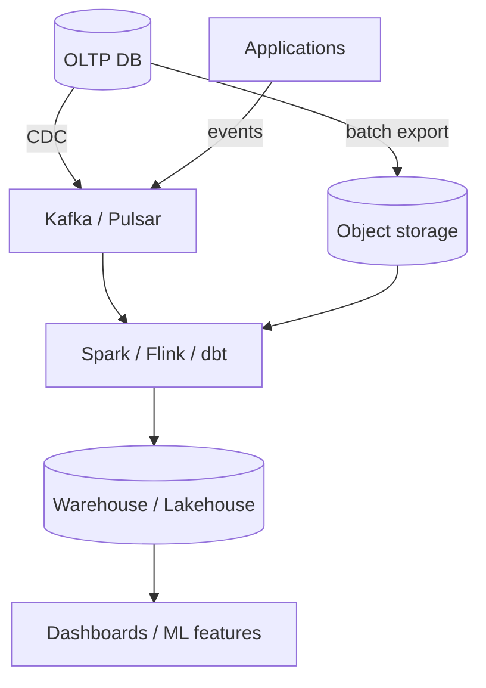
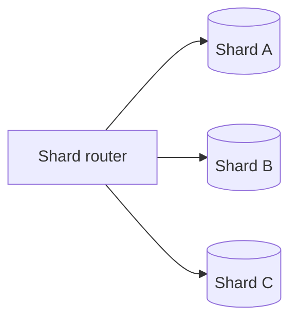

# Data Storage & Pipelines — Senior Interview Study Guide

> **Scope:** Relational/NoSQL design, sharding, data engineering platforms, and ETL/ELT pipelines. Synthesized from Algoroq (2026) interview question banks.

---

## The data plane mental model



**OLTP** optimizes for correct, low-latency transactions. **Analytics** optimizes for scans and aggregations. Mixing both in one schema without discipline is a common senior-level failure mode.

---

## SQL vs NoSQL (when interviewers push you)

| Dimension | Relational (Postgres, MySQL) | Document (MongoDB) | Wide-column (Cassandra) | Key-value (DynamoDB, Redis) |
|-----------|------------------------------|--------------------|-------------------------|------------------------------|
| **Schema** | Strict, migrations | Flexible | Flexible per row | Opaque values |
| **Joins** | Native | Application-side | Limited | None |
| **Consistency** | Strong default | Configurable | Tunable per query | Often eventual |
| **Scale-out** | Sharding harder | Sharding | Built for scale-out | Built for scale-out |
| **Best fit** | ACID, complex relations | Content catalogs | Time-series @ scale | Sessions, counters |

---

## Indexing intuition

```sql
-- B-tree: equality + range on leading columns
CREATE INDEX idx_orders_user_created ON orders (user_id, created_at DESC);

-- Covering index avoids heap lookups
CREATE INDEX idx_orders_cover ON orders (user_id) INCLUDE (total_cents, status);

-- Partial index for hot subset
CREATE INDEX idx_orders_open ON orders (created_at) WHERE status = 'OPEN';
```

> **Interview tip:** Always tie indexes to **query patterns**, not tables in isolation. Mention write amplification and vacuum/maintenance on Postgres.

---

## Sharding essentials



| Strategy | Shard key example | Pros | Cons |
|----------|-------------------|------|------|
| **Hash** | `hash(user_id) % N` | Even spread | Resharding painful without consistent hashing |
| **Range** | `user_id` ranges | Range queries local | Hot ranges |
| **Geo** | `region` | Data residency | Cross-region queries |
| **Directory** | Lookup table | Flexible moves | Extra hop, metadata service |

---

## ETL vs ELT

| | **ETL** | **ELT** |
|---|---------|---------|
| Transform where | Before load (specialized engine) | After load (in warehouse) |
| Typical stack | Informatica, Spark → warehouse | Fivetran/Airbyte → Snowflake + dbt |
| Flexibility | Schema fixed early | Analysts iterate in SQL |
| Risk | Brittle pipelines | Warehouse cost if raw is huge |

**Idempotency** is non-negotiable in production pipelines:

```python
def upsert_batch(rows, run_id: str):
    # Deterministic merge: same input + run_id => same outcome
    for chunk in chunks(rows, 1000):
        sql = (
            "MERGE INTO fact_events t "
            "USING staging s ON t.event_id = s.event_id "
            "WHEN MATCHED AND s.run_id = :run_id THEN UPDATE SET ... "
            "WHEN NOT MATCHED THEN INSERT ..."
        )
        warehouse.execute(sql, chunk, run_id=run_id)
```

---

## Database Design

*Source: Algoroq senior interview guide — 15 core questions.*

### 1. How do you choose between a relational

> **What they're really asking:** Can you articulate the trade-offs beyond the surface level and match database characteristics to specific requirements?

**Deep answer:**

Avoid the trap of listing generic pros and cons. Instead, reason from requirements.
Choose relational (PostgreSQL, MySQL) when: you need ACID transactions across multiple
tables, your data has complex relationships with many joins, your query patterns are diverse
and unpredictable (ad hoc queries), you need strong consistency guarantees, or your data
model is well-defined and relatively stable. Relational databases are the right default choice for
most applications.
Choose a document store (MongoDB, DynamoDB) when: your data is naturally hierarchical
(documents with nested objects), you need flexible schemas that evolve frequently, your access
pattern is primarily key-value or document retrieval, and you need horizontal scalability with
predictable latency at any scale.
Choose a wide-column store (Cassandra, HBase) when: you have massive write throughput
requirements, your data has a natural time-series component, you need multi-region replication
with tunable consistency, and your query patterns are known in advance (Cassandra requires you
to model your tables around your queries).
Choose a graph database (Neo4j, Amazon Neptune) when: your core queries involve traversing
relationships (social networks, recommendation engines, fraud detection), the relationships
themselves have properties, and you need queries like "find all friends of friends who bought
product X."
Discuss the CAP theorem implications: most relational databases are CP (consistent but
unavailable during partitions), while many NoSQL databases are AP (available but eventually
consistent). DynamoDB offers both through its consistency parameter.
Common mistake: choosing NoSQL for scalability alone. Modern relational databases like
CockroachDB, Spanner, and Aurora can scale horizontally while providing SQL semantics and
ACID transactions. The scalability gap between SQL and NoSQL has narrowed significantly. See
our database comparison guide for detailed benchmarks.

**Follow-up questions:**
- When would you use both a relational and a NoSQL database in the same system?
- How does NewSQL (CockroachDB, Spanner) change this decision?
- What database would you choose for an e-commerce platform and why?

---

### 2. Explain database indexing strategies and their trade-offs

> **What they're really asking:** Do you understand indexes beyond "they make queries faster" and can you reason about when indexes help, when they hurt, and which type to use?

**Deep answer:**

B-tree indexes (the default in most databases): balanced tree structure that keeps data sorted.
O(log n) for point lookups and range queries. Every SQL database supports these. The trade-off:
each index adds overhead to write operations (the index must be updated on every insert,
update, and delete). A table with 10 indexes will have significantly slower writes than one with 2.
Hash indexes: O(1) for point lookups but cannot support range queries or sorting. Use when you
only need exact-match lookups (e.g., looking up a user by session token). Memory-mapped hash
indexes (like in Bitcask) provide extremely fast reads.
Composite indexes: an index on multiple columns (e.g., (country, city, name)). The column order
matters critically: the index can be used for queries that filter on country, or country+city, or
country+city+name, but NOT for queries that filter only on city or name (the leftmost prefix rule).
Design composite indexes based on your most common query patterns.
Covering indexes: an index that includes all columns needed by a query, so the database can
answer the query from the index alone without reading the table (an index-only scan). This
eliminates the random I/O of going from the index to the table rows, dramatically improving
performance for read-heavy queries.
Partial indexes: an index on a subset of rows (e.g., CREATE INDEX ON orders(user_id) WHERE
status = 'active'). Smaller than a full index, faster to maintain, and useful when you only query a
specific subset of data frequently.
Full-text indexes: inverted indexes for text search (GIN indexes in PostgreSQL, FULLTEXT
indexes in MySQL). These tokenize text content and support keyword search with relevance
ranking. For more advanced search, consider a dedicated search engine like Elasticsearch.
Discuss index monitoring: look at slow query logs to identify missing indexes, use EXPLAIN
ANALYZE to verify the query planner uses your indexes, monitor index size and bloat, and
periodically review unused indexes (they cost write performance without benefiting reads).

**Follow-up questions:**
- How do you decide which columns to index?
- What is index bloat and how do you handle it in PostgreSQL?
- How do indexes interact with database caching?

---

### 3. Design a schema for a social media platform

> **What they're really asking:** Can you make practical schema design decisions that balance normalization, query performance, and scalability?

**Deep answer:**

Start with the core entities: users, posts, comments, likes, follows, and messages. Identify the key
relationships: users create posts (one-to-many), users follow users (many-to-many), posts have
comments (one-to-many), users like posts (many-to-many).
For the users table: id (primary key), username (unique index), email (unique index),
display_name, bio, avatar_url, created_at. Keep the user profile lean. Store extended profile
data in a separate user_profiles table to keep the frequently-accessed users table small.
For the follows table (social graph): follower_id, following_id, created_at. Primary key on
(follower_id, following_id). Add a secondary index on (following_id, follower_id) for "who follows
me" queries. This is a many-to-many relationship and will be one of the largest tables.
For posts: id, user_id (indexed), content, media_urls (JSON array), created_at (indexed),
like_count (denormalized counter), comment_count (denormalized counter). Discuss the
denormalization decision: keeping counters on the post avoids expensive COUNT queries but
introduces the challenge of keeping counters accurate.
For the timeline (the most interesting design challenge): discuss fan-out on write vs fan-out on
read as covered in our news feed system design. For the database layer, a materialized timeline
table (user_id, post_id, created_at) with a compound index on (user_id, created_at DESC)
enables fast timeline retrieval.
Discuss database sharding: shard users and their posts by user_id. This co-locates a user's data
for efficient single-shard queries. Cross-shard queries (e.g., a post's comments from many
users) require scatter-gather. Consider denormalization to avoid cross-shard joins.

Discuss eventual consistency trade-offs: like counts can be slightly stale (update asynchronously).
Follow counts can lag. But user authentication data must be strongly consistent.
For scalability: separate read and write paths. Write to the primary, read from replicas. Use
caching for hot data (popular posts, user profiles). Store media in object storage, only URLs in
the database.

**Follow-up questions:**
- How would you handle the migration when adding a new feature like Stories?
- How do you shard the follows table when both follower and following queries are common?
- What changes when the platform grows from 1M to 1B users?

---

### 4. How does database sharding work and when should you shard?

> **What they're really asking:** Do you understand the operational complexity of sharding and can you evaluate it against alternatives?

**Deep answer:**

Sharding is horizontal partitioning: distributing rows across multiple database instances based
on a shard key. Each shard holds a subset of the data and can be on a separate server.
When to shard: NOT as a first resort. Before sharding, exhaust other options: read replicas (scale
reads), caching (reduce database load), query optimization (indexes, query rewriting), vertical
scaling (bigger machine), and table partitioning within a single instance. Shard when your write
volume exceeds what a single machine can handle, or your data size exceeds what fits on a single
machine's storage.
Shard key selection is the most critical decision. A good shard key has high cardinality (many
distinct values for even distribution), is present in most queries (avoids cross-shard queries),
distributes writes evenly (no hot shards), and does not change frequently (resharding is
expensive). Example: user_id is often a good shard key for user-centric applications.
Sharding strategies: hash-based (hash(shard_key) mod N, even distribution but no range queries
across shards), range-based (key ranges assigned to shards, supports range queries but can
have hot spots), and directory-based (a lookup table maps keys to shards, most flexible but the
directory is a single point of failure).

Cross-shard challenges: joins across shards are not supported by the database, you must do
them in the application layer. Global unique constraints require coordination across shards.
Transactions spanning multiple shards require distributed transactions (2PC) or the saga
pattern. Aggregation queries (COUNT, SUM across all data) require scatter-gather from
all shards.
Resharding (adding or removing shards): this is operationally painful. Use consistent hashing to
minimize data movement. Tools like Vitess (for MySQL) and Citus (for PostgreSQL) help manage
sharding transparently.
Discuss alternatives to manual sharding: managed databases that handle sharding
automatically (DynamoDB, Spanner, CockroachDB). These provide the scalability of sharding
with a simpler operational model. The trade-off is less control and higher cost.

**Follow-up questions:**
- How would you reshard a production database without downtime?
- What happens when one shard becomes much larger than others?
- How do you handle reporting queries that need data from all shards?

---

### 5. Explain transaction isolation levels and when to use each

> **What they're really asking:** Do you understand the practical implications of isolation levels on data correctness and performance?

**Deep answer:**

Transaction isolation levels control what data a transaction can see from concurrent
transactions. From weakest to strongest:
Read Uncommitted: a transaction can read data written by other uncommitted transactions
(dirty reads). Almost never used in practice. One scenario: real-time analytics where
approximate results are acceptable and performance is critical.
Read Committed (default in PostgreSQL, Oracle): a transaction only sees data committed before
the current statement (no dirty reads). But if the same query runs twice within a transaction, it
might return different results (non-repeatable reads) because another transaction committed
between the two queries. Use for: most OLTP workloads where perfect consistency within a
transaction is not required.

Repeatable Read (default in MySQL InnoDB): a transaction sees a snapshot of the database as
of the transaction start. The same query always returns the same results within a transaction.
Prevents dirty reads and non-repeatable reads. But phantom reads can still occur (new rows
matching a query condition appear between queries). In practice, MySQL's implementation
prevents phantoms too (using gap locks).
Serializable (strongest): transactions execute as if they were serial (one at a time). Prevents all
anomalies. Implementations use either two-phase locking (pessimistic, blocks concurrent access)
or Serializable Snapshot Isolation (SSI, optimistic, detects conflicts and aborts). SSI is used by
PostgreSQL and CockroachDB. Trade-off: highest correctness but highest abort rate and
potential for deadlocks.
Practical guidance: use Read Committed for most operations. Use Serializable for financial
transactions, inventory management, and any operation where inconsistency causes real harm.
The performance difference is often smaller than expected, especially with SSI, because the
common case (no conflicts) is fast.
Discuss the write skew anomaly (only prevented by Serializable): two transactions read the same
data, make decisions based on it, and write non-conflicting rows. Each transaction individually is
correct, but together they violate an invariant. Example: two doctors check that at least one is
on call, both see the other is on call, and both go off call.

**Follow-up questions:**
- How does MVCC relate to isolation levels?
- What is the performance impact of Serializable isolation in practice?
- How do isolation levels interact with database replication?

---

### 6. How do you design for high write throughput?

> **What they're really asking:** Do you know techniques beyond basic optimization for handling write-intensive workloads?

**Deep answer:**

Write amplification is the enemy. Every write to a B-tree database can cause multiple disk
I/O operations (update the data page, update each index, write to the WAL). Strategies to
reduce this.

Batch writes: instead of inserting rows one at a time, batch them (INSERT INTO table VALUES
(v1), (v2), ..., (v1000)). This amortizes the transaction overhead. Most databases see 10-100x
throughput improvement with batching.
Use an LSM-tree based storage engine: LSM trees (used by Cassandra, RocksDB, LevelDB)
buffer writes in memory (memtable) and flush to disk as sorted files (SSTables). Writes are
sequential (fast) rather than random (slow). Trade-off: reads require checking multiple levels, so
read performance is lower than B-trees.
Write-behind with a message queue: decouple the API response from the database write.
Accept the write into Kafka or a similar queue, respond to the client immediately, and write to
the database asynchronously. This trades strong consistency for throughput. Use for: analytics
events, logs, non-critical data.
Partitioning writes: split a high-contention resource across multiple rows. A single counter row
that all writes contend on is a bottleneck. Split it into 100 counter rows and sum them on read.
This trades read complexity for write throughput.
Minimize indexes: each index adds write overhead. Audit your indexes and remove unused ones.
Consider different index strategies for write-heavy tables (fewer, more targeted indexes).
Use append-only data models: instead of updating rows in place, append new versions. The
latest version is the current state. This eliminates update contention and enables time-travel
queries. Compact old versions in the background. Event sourcing takes this to the extreme by
storing every state change as an immutable event.
Discuss database design patterns for write-heavy systems: CQRS (Command Query
Responsibility Segregation) separates write-optimized storage from read-optimized storage,
connected by event-driven synchronization.

**Follow-up questions:**
- How does PostgreSQL's HOT (Heap Only Tuple) optimization help with updates?
- When would you choose an LSM-tree over a B-tree storage engine?
- How do you monitor and diagnose write bottlenecks?

---

### 7. Design a database schema for a multi-tenant SaaS application

> **What they're really asking:** Can you balance tenant isolation, operational simplicity, and cost efficiency in a multi-tenant database design?

**Deep answer:**

Three isolation models, from strongest to weakest:
Database-per-tenant: each tenant gets their own database instance. Strongest isolation
(security, performance, compliance). Simplest schema (no tenant_id everywhere). But highest
cost (one instance per tenant) and hardest to manage operationally (schema migrations must be
applied to every database). Use for: enterprise SaaS with strict compliance requirements,
tenants with very different data volumes.
Schema-per-tenant: shared database instance, but each tenant has their own schema
(namespace). Good isolation (queries cannot accidentally cross schemas). Moderate cost.
Schema migrations still must be applied per schema. Use for: moderate number of tenants
(hundreds, not thousands) with different customization needs.
Shared tables with tenant_id: all tenants share the same tables, with a tenant_id column on
every table. Most cost-efficient. Simplest to manage (one schema, one migration). But weakest
isolation: a missing WHERE tenant_id = ? clause leaks data between tenants. Use Row-Level
Security (PostgreSQL) to enforce tenant isolation at the database level as a safety net. Use for:
high-volume SaaS (thousands of tenants), tenants with similar and small data volumes.
For the shared-table approach, design considerations: add tenant_id to every primary key and
index. For composite indexes, always lead with tenant_id (this ensures each tenant's queries only
scan their own data). Use connection pooling with tenant-aware routing.
Discuss noisy neighbor problems: one tenant running expensive queries can affect all other
tenants. Solutions: query timeout limits, per-tenant connection limits, resource quotas
(PostgreSQL resource groups), or workload isolation (route large tenants to dedicated
read replicas).
For scalability: when the shared database becomes a bottleneck, shard by tenant_id. Large
tenants get dedicated shards. Small tenants share shards. This hybrid approach optimizes cost
while providing isolation where needed.
For data retention: support per-tenant data retention policies and deletion. GDPR requires the
ability to delete all of a tenant's data on request. With database-per-tenant, this is a simple
DROP DATABASE. With shared tables, it requires carefully deleting rows while holding
appropriate locks.

**Follow-up questions:**
- How would you migrate from shared tables to database-per-tenant for a large customer?
- How do you handle cross-tenant analytics and reporting?
- How do you manage schema migrations across thousands of tenant databases?

---

### 8. How do you design for database high availability?

> **What they're really asking:** Do you understand replication topologies, failover mechanisms, and the operational practices needed for database reliability?

**Deep answer:**

The foundation is replication: maintain multiple copies of the database so that if one node fails,
another can take over.
Synchronous replication: the primary waits for at least one replica to confirm the write before
acknowledging the client. Guarantees no data loss on failover (zero RPO). Trade-off: every write
has the latency of the slowest required replica. PostgreSQL synchronous_standby_names
configures this.
Asynchronous replication: the primary acknowledges writes immediately and replicates in the
background. Lower write latency. But failover can lose recent writes (non-zero RPO). The
replication lag is the window of potential data loss. Monitor replication lag continuously.
Semi-synchronous: wait for one replica (out of several) to confirm. Balances durability and
latency. If the synchronous replica is slow, promote another replica to synchronous.
Automatic failover: use a consensus-based system (etcd, ZooKeeper, Patroni for PostgreSQL) to
detect primary failure and promote a replica. The key challenge is avoiding split-brain: two
nodes both believing they are primary. Fencing mechanisms (cutting off the old primary's access
to storage or the network) prevent this.
For high availability targets: 99.9% (8.7 hours downtime per year), 99.99% (52 minutes per year),
99.999% (5 minutes per year). Each nine requires significantly more investment. For 99.99%+ you
need multi-region deployment.
Multi-region database deployment: active-passive (one region handles writes, the other is a
warm standby), active-active with conflict resolution (both regions accept writes, conflicts
resolved via CRDTs or last-writer-wins), and globally distributed databases like Spanner that use
synchronized clocks for consistent cross-region transactions.

Backup strategy (defense in depth): continuous WAL archiving (point-in-time recovery to any
second), daily full backups to a separate storage system, cross-region backup replication, and
regular restore testing. A backup that has never been tested is not a backup.
Discuss disaster recovery planning: define RTO (Recovery Time Objective: how quickly you need
to recover) and RPO (Recovery Point Objective: how much data loss is acceptable). These drive
your replication and backup strategy.

**Follow-up questions:**
- How do you handle failover without losing in-flight transactions?
- What is the impact of replication lag on read consistency?
- How would you test your disaster recovery plan?

---

### 9. Explain database connection pooling and why it matters at scale

> **What they're really asking:** Do you understand the operational bottleneck that database connections create and how to manage them?

**Deep answer:**

Database connections are expensive: each connection consumes memory (5-10MB in
PostgreSQL for work_mem, temp buffers, etc.), a process or thread, and file descriptors. A
PostgreSQL server with 16GB of RAM can typically handle 200-500 connections. If you have 50
application servers each opening 20 connections, you need 1,000 connections, which can
overwhelm the database.
Application-level pooling (HikariCP, SQLAlchemy pool): each application instance maintains a
pool of reusable connections. A request checks out a connection, uses it, and returns it. Pool sizes
of 10-20 per instance are typical. Advantages: simple, no additional infrastructure. Limitations:
total connections = pool_size x number_of_instances, which still grows with horizontal scaling.
External connection pooler (PgBouncer, ProxySQL): sits between applications and the database.
All application connections go to the pooler, which maintains a smaller pool of actual database
connections. Multiplexes many client connections onto few database connections. This
decouples application scaling from database connection scaling.
PgBouncer modes: session pooling (connection assigned for the session duration, least
aggressive), transaction pooling (connection assigned for the transaction duration, returned

between transactions, most common), and statement pooling (connection assigned per
statement, most aggressive but breaks multi-statement transactions).
Sizing the pool: too small and requests queue waiting for connections (latency spikes). Too large
and you overwhelm the database (context switching, memory pressure). A good starting point
for the database-side pool: 2 x CPU cores + disk spindles. Monitor queue wait time and adjust.
Discuss connection management in microservices: each service has its own connection pool.
With dozens of services, total connections multiply quickly. An external pooler or a shared
database proxy becomes essential. Consider whether each service needs its own database
(microservice pattern) or shares a database (reduces total connections but increases coupling).
Discuss serverless challenges: serverless functions (Lambda) can spin up thousands of instances
simultaneously, each opening database connections. Solutions: Amazon RDS Proxy (connection
pooling for Lambda), using DynamoDB instead (HTTP-based, no persistent connections), or
implementing connection limits at the application layer.

**Follow-up questions:**
- What happens when the connection pool is exhausted?
- How do you diagnose connection leaks?
- How does connection pooling interact with load balancing across read replicas?

---

### 10. How do you approach database migration and schema evolution?

> **What they're really asking:** Can you evolve a production database schema safely without causing downtime or data loss?

**Deep answer:**

The golden rule: every migration must be backward compatible with the currently running
application code. This enables zero-downtime deployments where the migration and code
deployment are separate steps.
Safe operations: adding a nullable column (instant in PostgreSQL 11+, MySQL 8.0+), adding an
index concurrently (CREATE INDEX CONCURRENTLY in PostgreSQL, no table lock), adding a
new table, and adding a column with a default (instant in PostgreSQL 11+).
Dangerous operations: dropping a column (the running code might still reference it), renaming a
column (breaks existing queries), changing a column type (requires rewriting the table), and

adding a NOT NULL constraint (needs to validate all existing rows).
Safe pattern for dropping a column: (1) deploy new code that stops reading or writing the
column, (2) wait for all old instances to be replaced, (3) run the migration to drop the column.
This two-phase approach ensures the column is no longer in use before it is removed.
Safe pattern for renaming a column: (1) add the new column, (2) deploy code that writes to both
old and new columns, (3) backfill the new column from the old column, (4) deploy code that reads
from the new column, (5) deploy code that stops writing to the old column, (6) drop the old
column. This is a multi-step process spanning multiple deployments.
For large table migrations: ALTER TABLE on a table with billions of rows can lock the table for
hours. Tools like gh-ost (GitHub) and pt-online-schema-change (Percona) create a copy of the
table, apply the migration to the copy, sync ongoing writes, and swap the tables atomically. This
keeps the original table available throughout.
Discuss migration testing: always test migrations on a copy of production data (anonymized if
needed). Measure how long the migration takes. Ensure the rollback migration works. Include
both up and down migrations.
For distributed systems: schema migrations across a sharded database must be coordinated
carefully. Apply the migration to all shards. If one shard fails, you must be able to roll back all
shards. Tools like Vitess handle this orchestration.

**Follow-up questions:**
- How do you handle a migration that fails halfway through?
- How would you migrate a column from one type to another on a table with 10 billion rows?
- How do you coordinate schema changes across microservices with shared databases?

---

### 11. Design a time-series data storage system

> **What they're really asking:** Do you understand the unique access patterns and optimization opportunities for time-series data?

**Deep answer:**

Time-series data has unique characteristics: writes are append-only (no updates), queries are
almost always time-range based, recent data is accessed far more frequently than old data,
and data can be downsampled (aggregated) for older time ranges.

Storage engine considerations: LSM-tree based engines are ideal for time-series because writes
are sequential (appending to the current time). B-tree engines are less efficient because they
require random I/O to insert into the sorted tree.
Compression is critical for time-series: timestamps are highly compressible (delta-of-delta
encoding, since timestamps arrive at regular intervals, reduces each timestamp to 1-2 bits),
values use XOR encoding (consecutive values are often similar, XOR produces many leading
zeros), and dictionary encoding for tag values (status=ok appears millions of times, store it once
and reference by ID). These techniques achieve 10-15x compression.
Partitioning strategy: time-based partitioning (each partition covers a time range, e.g., one
day). This enables efficient range queries (only scan relevant partitions) and efficient deletion of
old data (drop an entire partition instead of deleting rows). Add tag-based sub-partitioning for
queries that filter by specific tags.
Downsampling and retention: store raw data for the recent window (e.g., 30 days at 1-second
resolution), downsample to 1-minute resolution for the last year, 1-hour resolution for the last 5
years. Run downsampling jobs in the background. This dramatically reduces storage costs while
preserving long-term trends.
Query optimization: pre-compute common aggregations (rollups) at multiple time resolutions. A
query for "average CPU over the last year" should read pre-computed hourly rollups, not scan
billions of raw data points.
Discuss purpose-built time-series databases: InfluxDB, TimescaleDB (PostgreSQL
extension), and Prometheus. Compare with using a general-purpose database: PostgreSQL
with TimescaleDB is a good middle ground that gives you SQL compatibility with time-
series optimizations.

**Follow-up questions:**
- How would you handle out-of-order data arriving late?
- How do you query across multiple time partitions efficiently?
- When would you use Prometheus vs InfluxDB vs TimescaleDB?

---

### 12. How do you design for data consistency

> **What they're really asking:** Do you understand the challenges of maintaining data consistency when each service owns its own database?

**Deep answer:**

In a microservices architecture, each service owns its data. There is no shared database and no
distributed transactions (in practice). Yet many business operations span multiple services. How
do you maintain consistency?
The saga pattern: decompose a distributed transaction into a sequence of local transactions.
Each service performs its local transaction and publishes an event. The next service reacts
to the event. If any step fails, compensating transactions undo previous steps. Orchestration
sagas (a central coordinator) are easier to reason about than choreography sagas (each service
reacts independently).
Event sourcing: store the sequence of events that led to the current state, not just the current
state. The event log is the source of truth. Any service can rebuild its state by replaying events.
This naturally provides an audit trail and enables temporal queries. Store events in an append-
only event store and use projections to build materialized views for queries.
CQRS: separate the write model (optimized for validation and business rules) from the read
model (optimized for queries). Update the read model asynchronously from the write model
using events. This accepts eventual consistency between writes and reads but enables each to be
optimized independently.
Outbox pattern: when a service needs to update its database AND publish an event atomically
(to avoid the dual-write problem where one succeeds and the other fails), write the event to an
outbox table in the same database transaction as the business data. A separate process
(Debezium CDC, polling publisher) reads the outbox and publishes to Kafka.
Discuss the practical implications of eventual consistency: users might see stale data for a few
seconds after a write. Design the UI to account for this. After a user creates an order, show the
order from the local cache rather than querying the read model that might not have been
updated yet. This is read-your-own-writes consistency at the application level.

**Follow-up questions:**
- How do you handle a compensating transaction that fails?
- How does event sourcing handle schema evolution of events?
- What is the dual-write problem and how does the outbox pattern solve it?

---

### 13. Explain query optimization strategies for complex queries

> **What they're really asking:** Can you go beyond adding indexes and reason about query execution at a deeper level?

**Deep answer:**

Start with EXPLAIN ANALYZE: this shows the actual execution plan, not just the estimated one.
Look for sequential scans on large tables (often means a missing index), nested loop joins on
large tables (consider hash join or merge join), high row estimates vs actual (statistics might be
stale, run ANALYZE), and sort operations that spill to disk (increase work_mem or add an index
that provides the ordering).
Query rewriting techniques: replace correlated subqueries with JOINs (subqueries execute once
per row, JOINs execute once), use CTEs wisely (in PostgreSQL pre-12, CTEs were optimization
fences, in 12+ they can be inlined), replace IN (SELECT ...) with EXISTS for large subquery results,
and use window functions instead of self-joins for running totals and ranking.
Join optimization: understand the three join algorithms. Nested loop join: for each row in table A,
scan table B. O(nm) but fast when the inner table has an index. Hash join: build a hash table of
the smaller table, probe with the larger table. O(n+m) but requires memory for the hash table.
Merge join: sort both tables and merge. O(n log n + m log m) but efficient when data is already
sorted (from an index).
Partition pruning: if tables are partitioned (by date, tenant, region), ensure queries include the
partition key so the database only scans relevant partitions. Without the partition key, the
database scans all partitions.
Materialized views: pre-compute expensive queries and store the results. Refresh periodically or
on demand. Useful for dashboards, reports, and aggregations. Trade-off: storage space and
refresh latency vs query speed.
Denormalization for performance: join-heavy queries on normalized schemas can be slow.
Selectively denormalize by adding redundant columns or pre-joined tables. Trade-off: faster
reads but complex write logic (must update all copies). Use triggers or application-level logic to
maintain consistency.
Discuss caching: for queries that do not need real-time data, cache the results in Redis. Cache
invalidation is the challenge: use TTL-based expiration for approximate freshness, or event-
based invalidation for stronger freshness guarantees.

**Follow-up questions:**
- How do you optimize a query that must scan a billion-row table?
- How do you handle slow queries in a production environment without affecting users?
- What is the difference between query optimization in OLTP vs OLAP databases?

---

### 14. When and how would you use a graph database?

> **What they're really asking:** Do you understand when the relational model breaks down and graph databases provide genuine advantages?

**Deep answer:**

Graph databases shine when the core queries involve traversing relationships of variable depth.
In a relational database, each level of traversal requires an additional JOIN, and the query
complexity grows exponentially. In a graph database, traversal is a constant-time operation
per hop.
Use cases where graph databases excel: social networks (find friends of friends, degrees of
separation), fraud detection (find circular payment patterns, connected suspicious accounts),
recommendation engines (users who liked similar items), knowledge graphs (entity relationships
with properties), and access control (can user X access resource Y through any chain
of permissions?).
The two main graph models: property graphs (nodes and edges have properties, used by Neo4j)
and RDF/triple stores (subject-predicate-object triples, used by Amazon Neptune, Stardog).
Property graphs are more intuitive for application developers. RDF is more suited for semantic
web and knowledge management.
Query languages: Cypher (Neo4j, intuitive, SQL-like), Gremlin (Apache TinkerPop, imperative
traversal), and SPARQL (RDF stores, pattern matching). Cypher is the most developer-friendly.
When NOT to use a graph database: simple CRUD operations with well-defined schemas (use
relational), write-heavy workloads (graph databases are typically optimized for reads), tabular
or document data without complex relationships, or when you need strong ACID transactions
across the entire graph (though Neo4j supports ACID).
Performance characteristics: graph traversal is O(k^d) where k is the average degree and d is
the depth. For shallow traversals (2-3 hops), graph databases are dramatically faster than
relational databases. For deep traversals (6+ hops), even graph databases can be slow.

Hybrid approaches: use a relational database as the primary data store and sync a subset of the
data (entities and relationships) to a graph database for graph-specific queries. Use event-
driven architecture to keep them in sync.

**Follow-up questions:**
- How would you model a social network graph for efficient "mutual friends" queries?
- How do graph databases handle horizontal scaling?
- When would you use a graph database vs a recursive CTE in PostgreSQL?

---

### 15. Design a database archival and data lifecycle management strategy

> **What they're really asking:** Can you think about the long-term operational aspects of database management, including cost, compliance, and performance?

**Deep answer:**

Data lifecycle management addresses the fact that not all data is equally valuable or equally
accessed over time. Recent data is hot (frequently accessed, needs fast storage). Older data is
warm (occasionally accessed) or cold (rarely accessed, kept for compliance).
Tiered storage: keep hot data in the primary database (fast SSD, fully indexed). Move warm
data to a read-optimized store (columnar format, compressed, cheaper storage). Move cold
data to archive storage (S3, Glacier, tape). Define retention policies per data type: transactional
data might be hot for 90 days, warm for 1 year, cold for 7 years.
Archival strategies: partition tables by date and detach old partitions (PostgreSQL detach
partition). This is fast (metadata operation) and does not disrupt the active table. Export
detached partitions to compressed storage (Parquet format on S3). Maintain a metadata
catalog so queries can find archived data if needed.
For compliance: GDPR requires data deletion on request. If data is archived, you must be able to
find and delete specific records in archives. Use a deletion log: when a deletion request comes in,
check if the user's data has been archived, mark it for deletion in the archive, and process during
the next archive maintenance window.
For database design: plan for archival from the start. Use partition-friendly schemas (include a
date column in every table that generates high-volume data). Avoid foreign keys that reference
archived tables (use logical references instead).

Cost optimization: hot storage (SSD) costs roughly 10x more per GB than warm storage (HDD)
and 100x more than cold storage (S3 Glacier). For a database with 10TB of data where only 1TB
is actively used, proper tiering can reduce storage costs by 80% or more.
Discuss the operational aspect: automate the lifecycle management. Schedule archival jobs
during low-traffic periods. Monitor that archival is keeping pace with data growth. Alert if the
primary database grows beyond expected thresholds.

**Follow-up questions:**
- How do you handle queries that span hot and archived data?
- How do you test that archived data can be successfully restored?
- How would you handle GDPR deletion requests for data that has been archived to immutable
- storage?

---

## Database Sharding

*Source: Algoroq senior interview guide — 15 core questions.*

### 1. What is database sharding and why

> **What they're really asking:** Do you understand when sharding is genuinely necessary versus when simpler scaling approaches suffice? Can you articulate the cost of introducing sharding?

**Deep answer:**

Database sharding is a horizontal partitioning strategy where a single logical database is split
into multiple smaller databases called shards, each residing on a separate server. Every shard
holds a subset of the total data and can handle read and write operations independently. The
fundamental motivation is to overcome the limitations of vertical scaling: a single machine, no
matter how powerful, has finite CPU, memory, disk I/O, and network bandwidth. When a
database reaches hundreds of millions of rows or thousands of transactions per second, vertical
scaling becomes prohibitively expensive or physically impossible.
However, sharding is not a free lunch. It introduces significant complexity across multiple
dimensions. Application logic must be aware of the sharding scheme to route queries to the
correct shard. Cross-shard joins become expensive or impossible, requiring denormalization or
application-level joins. Transactions that span multiple shards require distributed transaction
protocols like two-phase commit, which are slower and more failure-prone. Schema changes
must be coordinated across all shards. Operational tasks like backups, monitoring, and failover
multiply in complexity.
Before choosing sharding, exhaust simpler approaches first: read replicas for read-heavy
workloads, caching strategies for frequently accessed data, query optimization and proper
indexing, connection pooling, and vertical scaling to larger instances. Only when these
approaches are insufficient should you introduce sharding. In practice, many systems operate
successfully without sharding until they reach significant scale. A well-optimized PostgreSQL or
MySQL instance can handle millions of rows and thousands of queries per second.
The decision to shard should be driven by specific bottlenecks: write throughput exceeding what
a single node can handle, dataset size exceeding available memory causing excessive disk I/O, or

regulatory requirements mandating data residency in specific geographic regions.

**Follow-up questions:**
- At what data volume or query volume would you start considering sharding?
- How would you evaluate whether read replicas are sufficient before resorting to sharding?
- What are the operational costs of running a sharded database in production?

---

### 2. How do you choose a shard key, and what

> **What they're really asking:** Can you think systematically about data distribution, query patterns, and long-term growth when making a foundational architectural decision?

**Deep answer:**

The shard key is the single most consequential decision in a sharding strategy because it
determines how data is distributed across shards and which queries can be efficiently served. A
good shard key satisfies four properties simultaneously.
First, high cardinality: the shard key should have enough distinct values to distribute data evenly
across all current and future shards. A boolean field is a terrible shard key because it only has
two values. A user ID with millions of distinct values is much better. Second, even distribution: the
values of the shard key should produce a roughly uniform distribution of data and load across
shards. If 80 percent of queries target shard keys in a narrow range, that shard becomes a
hotspot. Third, query isolation: the most common and most latency-sensitive queries should be
satisfiable by a single shard. If your application primarily queries by user ID, sharding by user ID
ensures that each user's data lives on one shard. Fourth, growth stability: the shard key should
remain effective as data grows. Sharding by date means that only the current shard receives
writes, creating a write hotspot.
Consider an e-commerce platform like Amazon. If you shard by customer_id, all of a customer's
orders, addresses, and preferences live on one shard, enabling efficient lookups. But a query like
"find all orders for product X" now requires a scatter-gather across all shards. If you shard by
product_id instead, product queries are efficient but customer profile lookups scatter. The right
choice depends on which access pattern dominates.
Compound shard keys can address multiple requirements. For a multi-tenant SaaS application, a
shard key of (tenant_id, entity_id) keeps all tenant data together while distributing across

tenants. For time-series data, a compound key of (sensor_id, time_bucket) distributes writes
across sensors while keeping temporal data for each sensor co-located.
Avoid these common mistakes: using auto-incrementing IDs that create hotspots on the latest
shard, using low-cardinality fields, choosing a key that does not align with query patterns, and
selecting a key that cannot be changed later without a full data migration.

**Follow-up questions:**
- How would you handle a scenario where no single field satisfies all shard key requirements?
- What would you do if your shard key creates a hotspot in production?
- How does shard key selection differ between relational and NoSQL databases?

---

### 3. Explain the difference between hash-based sharding

> **What they're really asking:** Do you understand the trade-offs between data distribution uniformity and the ability to perform range queries efficiently?

**Deep answer:**

Hash-based sharding applies a hash function to the shard key and uses the hash value to
determine the target shard, typically via modulo or consistent hashing. For example,
shard_number = hash(user_id) mod N. This produces a near-uniform distribution regardless of
the key distribution. The primary advantage is even data distribution with no hotspots. The
primary disadvantage is that range queries become scatter-gather operations because
adjacent key values map to different shards. Hash-based sharding is ideal when your primary
access pattern is point lookups by the shard key.
Range-based sharding assigns contiguous ranges of the shard key to each shard. For example,
shard 1 holds user IDs 1 to 1,000,000, shard 2 holds 1,000,001 to 2,000,000, and so on. The
primary advantage is that range queries on the shard key can be directed to a small number of
shards. The primary disadvantage is potential for uneven distribution and hotspots. If new users
get sequentially increasing IDs, all writes hit the last shard.
The choice depends on your workload pattern. For a social media application where you
primarily look up user profiles and activity by user ID, hash-based sharding provides even
distribution and efficient lookups. For a time-series analytics platform where queries commonly

request data for a date range, range-based sharding by time allows those queries to target a
small number of shards.
Directory-based sharding uses a lookup table that maps each shard key value to a specific
shard. This provides maximum flexibility since you can move individual keys between shards, but
the directory becomes a single point of failure and a potential bottleneck.
In practice, many production systems use a hybrid approach. For example, MongoDB uses
range-based sharding by default but supports hash-based sharding. CockroachDB uses range-
based sharding with automatic range splitting. Google's Spanner uses a hierarchical approach
where tables are interleaved for locality.

**Follow-up questions:**
- How does consistent hashing improve upon simple modulo-based hash sharding?
- What happens with range-based sharding when one range grows much faster than others?
- Can you combine hash-based and range-based sharding in the same system?

---

### 4. How does consistent hashing work and

> **What they're really asking:** Can you explain a fundamental distributed systems primitive in depth, including virtual nodes and the practical impact on shard rebalancing?

**Deep answer:**

Consistent hashing solves the critical problem of shard rebalancing when nodes are added or
removed. With simple modulo hashing (hash(key) mod N), changing N remaps nearly every key
to a different shard, requiring a massive data migration. Consistent hashing limits the
remapping to approximately K/N keys on average, where K is the total number of keys and N is
the number of nodes.
The mechanism works by placing both nodes and keys on a virtual ring using the same hash
function. Each key is assigned to the first node encountered when moving clockwise around the
ring from the key's position. When a new node joins, it takes responsibility for a portion of its
clockwise neighbor's key range. When a node leaves, its keys are reassigned to its clockwise
neighbor. In both cases, only the keys in the affected range move.
The naive implementation has a problem: with few physical nodes, the distribution is uneven
because nodes may cluster on one part of the ring. Virtual nodes solve this by mapping each

physical node to many positions on the ring, typically 100 to 200 per physical node. This
produces a statistically uniform distribution. When a physical node is added, its virtual nodes are
spread across the ring, and it absorbs a small fraction of keys from many other nodes rather
than a large fraction from one.
In practice, consistent hashing is the foundation of many distributed databases. Amazon
DynamoDB uses consistent hashing for partition assignment. Apache Cassandra uses a token
ring based on consistent hashing. Redis Cluster uses hash slots, which is conceptually similar.
When implementing consistent hashing, consider these details: the choice of hash function
affects distribution uniformity. MurmurHash3 and xxHash are popular choices for their speed
and distribution quality. The number of virtual nodes is a tuning parameter that balances
distribution uniformity against memory overhead for the ring metadata. Weighted consistent
hashing allows heterogeneous nodes where nodes with more capacity are assigned more
virtual nodes.

**Follow-up questions:**
- How would you handle a scenario where one physical node has twice the capacity of others?
- What is the impact of consistent hashing on data locality and cache efficiency?
- How do you implement consistent hashing in a system that also needs range queries?

---

### 5. How would you handle cross-shard queries and transactions?

> **What they're really asking:** Do you understand the fundamental tension between data distribution and query flexibility, and can you propose practical solutions that balance consistency, performance, and complexity?

**Deep answer:**

Cross-shard operations are the most significant cost of sharding. A query that touches a single
shard completes in milliseconds with simple routing. A query that must touch all shards requires a
scatter-gather pattern: the query is broadcast to every shard, each shard executes its portion,
and results are aggregated at a coordinator node. This is orders of magnitude slower and
introduces failure modes where a single slow shard delays the entire query.
For cross-shard queries, several strategies exist depending on the use case. First,
denormalization: duplicate data across shards to avoid joins. If you frequently need user data
alongside order data and they live on different shards, store a copy of the relevant user fields in

the order table. This trades storage for query performance. Second, application-level joins:
fetch data from multiple shards in parallel and join in the application layer. This gives you control
over timeout and retry logic. Third, materialized views: pre-compute and store the results of
common cross-shard queries in a separate read-optimized store. Fourth, CQRS (Command
Query Responsibility Segregation): write to sharded stores for transactional integrity but
replicate to an aggregated read store for analytics queries.
For cross-shard transactions, the standard approach is two-phase commit (2PC): a coordinator
asks all participating shards to prepare (acquire locks and verify constraints), then sends a
commit or abort to all. 2PC guarantees atomicity but is slow (two network round trips), blocking
(participants hold locks during the protocol), and vulnerable to coordinator failure. In practice,
many systems avoid 2PC entirely by designing the data model so that transactions stay within a
single shard.
Alternatives to 2PC include the saga pattern where a sequence of local transactions on each
shard is coordinated, with compensating transactions for rollback. This provides eventual
consistency rather than strong consistency. Another approach is Google Spanner's TrueTime-
based protocol, which achieves externally consistent distributed transactions using synchronized
atomic clocks, but this requires specialized hardware infrastructure. Understanding the CAP
theorem trade-offs is essential when reasoning about these approaches.

**Follow-up questions:**
- How do you handle a cross-shard query that must complete within 100ms?
- What monitoring would you put in place to detect cross-shard query performance degradation?
- When would you accept eventual consistency for cross-shard operations versus requiring strong
- consistency?

---

### 6. What is a hotspot in a sharded database

> **What they're really asking:** Can you identify operational problems that emerge in sharded systems and apply systematic approaches to diagnose and resolve them without downtime?

**Deep answer:**

A hotspot occurs when one shard receives a disproportionate share of traffic or stores a
disproportionate amount of data compared to other shards. Hotspots negate the primary

benefit of sharding by concentrating load on a single node while other nodes sit idle. They
manifest in three forms: write hotspots (one shard receives most writes), read hotspots (one
shard serves most reads), and storage hotspots (one shard holds significantly more data).
Common causes include a shard key with skewed distribution, celebrity accounts in social media
where a single user generates massive traffic, temporal patterns where all current writes go to
one shard, and organic data growth that concentrates in one key range.
Detection requires comprehensive monitoring: track per-shard metrics including query rate,
latency percentiles (p50, p95, p99), CPU utilization, disk I/O, and storage size. Set alerts when
any shard deviates significantly from the median. Monitor the standard deviation of query rates
across shards. Use slow query logs to identify specific queries or keys causing hotspots.
Mitigation strategies depend on the hotspot type. For key-based hotspots (celebrity problem),
add a random suffix to the shard key for hot keys, distributing their data across multiple shards.
This is called key salting. Reads for hot keys now scatter across shards, but that trade-off is
acceptable because the alternative is a single overloaded shard. For range-based hotspots, split
the hot shard into two smaller shards by dividing its key range. Systems like HBase and
CockroachDB do this automatically. For read hotspots, add read replicas specifically for the hot
shard. Use a caching layer in front of the hot shard to absorb repeated reads.
Prevention is better than mitigation. During shard key selection, analyze the distribution of
candidate keys against production data. Load test with realistic traffic patterns before
launching. Build automated shard-splitting capabilities so that hotspots can be resolved without
manual intervention.

**Follow-up questions:**
- How would you handle a flash sale event that you know will create a temporary hotspot?
- What is the operational procedure for splitting a hot shard in a live production system?
- How do you distinguish between a hotspot caused by key distribution versus a hotspot caused by
- a specific expensive query?

---

### 7. Describe the process of resharding or rebalancing a sharded database.

> **What they're really asking:** Have you dealt with the operational complexity of changing a sharding scheme in a live production system? Do you understand the risks and can you plan a safe migration?

**Deep answer:**

Resharding is necessary when the current shard count is insufficient for the data volume or
traffic, when hotspots require redistributing data, or when the shard key itself needs to change.
It is one of the most complex and risky operations in database management.
The safest approach is online resharding, which maintains full service availability throughout the
process. The general strategy involves five phases. Phase one, preparation: provision new
shards, set up replication from old shards, and deploy the new shard routing logic behind a
feature flag. Phase two, dual-write: the application writes to both the old and new shard
configurations. Reads still go to the old shards. This ensures no writes are lost during migration.
Phase three, backfill: copy historical data from old shards to new shards. This is the longest
phase and must handle the fact that data is actively being modified. Use a consistent snapshot
plus change data capture to replay writes that occurred during the copy. Phase four, verification:
compare data between old and new shards to ensure consistency. Run checksums on random
samples. Verify row counts. Phase five, cutover: switch reads to the new shards, verify
correctness, then stop dual-writes and decommission old shards.
Tools like Vitess (used at YouTube), gh-ost (GitHub's online schema change tool), and pt-online-
schema-change (Percona) automate portions of this process. For systems built on consistent
hashing, adding a new node automatically triggers rebalancing of only the affected key ranges.
Critical considerations during resharding include maintaining application performance during
backfill by throttling the copy rate. Test rollback procedures before starting because if anything
goes wrong during cutover, you need to revert quickly. Coordinate with dependent services that
may cache shard routing information. Plan for the resharding to take days or weeks for large
datasets, not hours.

**Follow-up questions:**
- How would you handle resharding a database with 10TB of data while maintaining sub-100ms
- query latency?
- What happens if the application crashes during the dual-write phase?
- How do you verify data consistency between old and new shards when the data is constantly
- changing?

---

### 8. How do you handle schema migrations across a sharded database?

> **What they're really asking:** Do you understand the operational challenges that multiply with sharding and can you plan migrations that do not cause downtime?

**Deep answer:**

Schema migrations on a sharded database are dramatically more complex than on a single
database because the migration must be executed on every shard, failures on individual shards
must be handled independently, and the application must be compatible with both the old and
new schema during the rollout.
The safest approach is the expand-contract pattern, executed in three phases. Phase one,
expand: add the new column, table, or index without removing anything. The application code
still uses the old schema. This is backward compatible. Phase two, migrate: update the
application to write to both old and new schema elements. Backfill existing data into the new
schema elements. Phase three, contract: once all data is migrated and the application fully uses
the new schema, remove the old schema elements.
For a sharded environment, execute each phase across all shards using a rolling approach.
Migrate shards one at a time or in small batches. If a migration fails on one shard, you can fix it
without affecting other shards. Monitor each shard's performance during and after migration.
For adding an index on a large sharded table, build the index concurrently on each shard using
CREATE INDEX CONCURRENTLY in PostgreSQL or similar non-blocking DDL in MySQL.
Stagger the index builds across shards to avoid overwhelming the cluster.
For column type changes, never alter the column in place. Instead, add a new column with the
desired type, dual-write to both columns, backfill existing rows, switch reads to the new column,
then drop the old column. This avoids table locks on large tables.
Automation is essential at scale. Build a migration orchestrator that tracks migration state per
shard, handles retries, and provides visibility into progress. Companies like Stripe and Amazon
have dedicated infrastructure teams that build and maintain these migration frameworks.

**Follow-up questions:**
- How do you roll back a schema migration that has been partially applied across shards?
- What if a migration takes 2 hours per shard and you have 500 shards?
- How do you ensure the application code handles both old and new schemas simultaneously?

---

### 9. What are the different sharding strategies

> **What they're really asking:** Can you reason about the trade-offs between tenant isolation, resource efficiency, and operational complexity in a real-world business context?

**Deep answer:**

Multi-tenant sharding strategies exist on a spectrum from full sharing to full isolation. The right
choice depends on the number of tenants, their size distribution, compliance requirements, and
performance isolation needs.
Shared database, shared schema: all tenants live in the same tables with a tenant_id column.
This is the most resource-efficient but provides no isolation. A poorly performing query from one
tenant can affect all others. This works for applications with many small tenants of similar size.
Shared database, separate schemas: each tenant gets its own schema (set of tables) within a
single database. This provides logical isolation and makes per-tenant operations like backup and
restore easier. However, the database server is still shared, so resource contention is possible.
Connection pooling is more complex because connections must be routed to the correct schema.
Shard per tenant (dedicated database per tenant): each tenant gets its own database on a
potentially shared server. This provides strong isolation. Per-tenant performance monitoring,
backup, and compliance are straightforward. This is the preferred approach for enterprise SaaS
with strict compliance requirements. The downside is operational overhead of managing
hundreds or thousands of databases.
The hybrid approach is most common in practice: small tenants share shards using a shared-
schema approach with tenant_id, while large enterprise tenants get dedicated shards. Route
queries based on a tenant directory that maps tenant_id to shard. This combines resource
efficiency for the long tail of small tenants with isolation guarantees for large tenants.
Consider noisy neighbor mitigation regardless of strategy: implement per-tenant rate limiting,
query timeout enforcement, and resource quotas. Monitor per-tenant query patterns and move
problematic tenants to isolated shards proactively. Build the tenant routing layer with the ability
to migrate individual tenants between shards without downtime.

**Follow-up questions:**
- How would you handle a tenant that suddenly grows from small to large?
- What compliance considerations affect sharding strategy for tenants in different countries?
- How do you implement cross-tenant analytics when tenants live on different shards?

---

### 10. How do you implement distributed

> **What they're really asking:** Do you understand why auto-increment breaks with sharding and can you evaluate alternatives based on their properties: uniqueness, ordering, size, and generation speed?

**Deep answer:**

Auto-increment IDs are local to a single database. With multiple shards, two shards can
independently generate the same ID, causing collisions. Several strategies address this.
UUID v4: randomly generated 128-bit identifiers. Collision probability is astronomically low. No
coordination between shards is needed. However, UUIDs are large (16 bytes vs 8 bytes for a 64-
bit integer), poor for indexing (random values cause B-tree fragmentation and scattered I/O),
and not sortable by creation time.
Snowflake IDs (originally from Twitter): 64-bit integers composed of a timestamp (41 bits,
millisecond precision, 69 years of range), a machine ID (10 bits, 1024 machines), and a sequence
number (12 bits, 4096 IDs per millisecond per machine). These are time-sortable (IDs generated
later are larger), unique across machines without coordination, compact (8 bytes), and index-
friendly. The trade-off is that machine IDs must be assigned centrally, and clock skew between
machines can cause out-of-order IDs.
ULID (Universally Unique Lexicographically Sortable Identifier): similar to Snowflake but encoded
as a 128-bit string that is lexicographically sortable. Uses 48 bits for timestamp and 80 bits for
randomness. Compatible with UUID storage formats while being sortable.
Database sequence ranges: allocate ranges to each shard. Shard 1 gets IDs 1 to 1,000,000,
shard 2 gets 1,000,001 to 2,000,000. Simple but requires a central allocator and creates
ordering that leaks information about insert volume.
For most sharded systems, Snowflake-style IDs are the best default choice because they are
compact, sortable, unique without coordination, and compatible with SQL and NoSQL
databases. The implementation is simple enough that you do not need a separate service:
embed the ID generation logic in the application layer.

**Follow-up questions:**
- How do Snowflake IDs handle clock skew between machines?
- What problems does UUID v4 cause for database index performance and how would you
- mitigate them?
- How would you migrate from auto-increment IDs to a distributed ID scheme in a running system?

---

### 11. How do you implement global

> **What they're really asking:** Can you solve the problem of querying sharded data by attributes other than the shard key without resorting to full scatter-gather on every query?

**Deep answer:**

When data is sharded by user_id but you need to look up records by email address, you face the
global secondary index problem. The email could be on any shard, so a naive approach
broadcasts the query to every shard and merges results. This does not scale.
There are two categories of global secondary indexes: local indexes and global indexes. A local
secondary index is built per shard, covering only the data on that shard. Queries by the
secondary index still require scatter-gather, but the index makes each shard's portion faster.
This is what MongoDB calls a non-shard-key index.
A global secondary index is a separate data structure that maps secondary key values to shard
locations. For example, a global index on email maps each email to the (shard, primary_key)
where the record lives. Queries first consult the global index to find the target shard, then fetch
the record directly. This converts scatter-gather into a two-hop lookup.
Implementing a global secondary index requires careful consideration of consistency. The index
must be updated atomically with the base data. If the index is on a different shard than the data,
this requires a distributed transaction or an eventually consistent approach where the index is
updated asynchronously via change data capture. Stale indexes can return incorrect locations,
so include a fallback to check other shards if the pointed-to shard does not have the record.
For high-throughput systems, consider a dedicated index service backed by Elasticsearch or
similar technology. The index service consumes change events from all shards and maintains a
global search index. This decouples the index from the sharding scheme entirely.

Google Spanner takes another approach: it supports global indexes natively by treating the
index as a separate table that is itself sharded by the indexed column. Writes to the base table
and index table are coordinated using Spanner's distributed transaction protocol.

**Follow-up questions:**
- How do you handle unique constraints across shards when the unique field is not the shard key?
- What is the latency impact of a global secondary index lookup versus a direct shard key lookup?
- How do you rebuild a corrupted global secondary index without downtime?

---

### 12. How would you shard a social graph database?

> **What they're really asking:** Can you handle graph-structured data that inherently resists partitioning because any edge can cross a partition boundary?

**Deep answer:**

Social graph sharding is one of the hardest sharding problems because graphs have high
connectivity: any user can be friends with any other user, and common operations like friend-of-
friend queries can span many shards.
The simplest approach is to shard by user_id. Each shard stores a user's profile and their
outgoing edges (follow/friend relationships). Looking up who a user follows is efficient because it
hits one shard. But looking up who follows a user (incoming edges) requires scatter-gather unless
you duplicate edges: store both the forward edge on the source shard and the reverse edge on
the destination shard. This doubles edge storage but makes both directions efficient.
For friend-of-friend queries (two hops), the naive approach hits the user's shard to get friends,
then fans out to every shard containing those friends. For a user with 500 friends spread across
100 shards, this generates 100 parallel queries. Mitigation strategies include caching popular
users' friend lists in a distributed cache, pre-computing friend-of-friend lists for common
recommendations, and limiting query depth and result count.
Graph partitioning algorithms like METIS can minimize cross-shard edges by placing densely
connected subgraphs on the same shard. In a social network, friend groups tend to cluster
geographically and socially, so community-aware partitioning reduces cross-shard traffic.
However, the partition must be recomputed periodically as the graph evolves.
Facebook's TAO is the canonical example of a sharded social graph. It uses a two-level caching
architecture in front of a sharded MySQL backend. Objects and associations are cached at the

edge, with a leader-follower cache hierarchy that provides read-after-write consistency. The
key insight is that most social graph queries are simple traversals (fetch friends, fetch timeline)
that can be served from cache without touching the database.
For systems requiring more complex graph queries like shortest path or community detection,
consider a dedicated graph database like Neo4j for the analytical workload while keeping the
transactional social graph in a sharded relational store.

**Follow-up questions:**
- How do you handle the case where one user has 10 million followers and their data becomes a
- hotspot?
- How would you implement mutual friend computation efficiently across shards?
- What consistency model would you use for the social graph and why?

---

### 13. What are the consistency challenges introduced

> **What they're really asking:** Do you have a deep understanding of distributed consistency models and can you apply the CAP theorem to practical sharding decisions?

**Deep answer:**

Sharding introduces several consistency challenges that do not exist in a single-node database.
The most fundamental is that ACID transactions are local to a shard. A transaction that reads
from shard A and writes to shard B requires coordination that introduces latency, reduces
availability, and increases complexity.
Distributed transaction consistency: as discussed earlier, two-phase commit provides strong
consistency across shards but at the cost of availability and performance. In many systems, this
is an acceptable trade-off for financial transactions but not for social media feeds. The saga
pattern provides eventual consistency with explicit compensation logic. Choose the consistency
model based on the business requirements of each operation, not a blanket rule.
Read-your-writes consistency: after a user writes data to shard A, subsequent reads must see
that write. If reads can be routed to a different replica of shard A, stale data might be returned.
Solutions include session stickiness (route all requests from a session to the same replica),
reading from the leader replica for the shard, or including a write timestamp in the session and
only reading from replicas that have caught up to that timestamp.

Cross-shard referential integrity: if user data is on shard A and order data is on shard B, a
foreign key constraint from orders to users cannot be enforced by the database. Options include
enforcing referential integrity in the application layer, using soft deletes instead of hard deletes
to avoid dangling references, and accepting eventual consistency with periodic reconciliation
jobs that detect and fix inconsistencies.
Monotonic reads: a client should not see a value go backward in time. If read requests are load-
balanced across replicas with different replication lag, this can happen. Ensure that within a
session, reads for the same shard key go to the same replica.
For systems where strong cross-shard consistency is essential, consider databases that provide
it natively like Google Spanner or CockroachDB. These databases shard data automatically and
use distributed consensus to maintain strong consistency across shards, abstracting away much
of the complexity discussed above.

**Follow-up questions:**
- How do you implement causal consistency across shards?
- What monitoring would you set up to detect consistency violations in a sharded system?
- When is eventual consistency acceptable and how do you communicate this to product
- stakeholders?

---

### 14. How do you design a sharding strategy for a system like Uber or Lyft?

> **What they're really asking:** Can you apply sharding concepts to a geospatial, real- time system with complex access patterns and stringent latency requirements?

**Deep answer:**

A ride-sharing system like Uber or Lyft has multiple data domains that require different sharding
strategies. The key insight is that no single sharding scheme works for all data types.
For rider and driver profiles, shard by user_id using hash-based sharding. Access patterns
are dominated by point lookups on user_id, and the data distributes evenly. These are
relatively straightforward.
For trip data, shard by trip_id (hash-based). Each trip is an independent entity accessed by its
ID. For rider trip history, maintain a secondary index from rider_id to trip_ids, co-located on the
rider's shard. Similarly for driver trip history.

For real-time driver locations, geographic sharding is essential. Divide the service area into
geospatial cells using a system like geohashing or S2 cells. Each cell maps to a shard. When a
rider requests a ride, the system queries the shard for the rider's cell and adjacent cells to find
nearby available drivers. This keeps geospatial queries local. The challenge is that cell
boundaries can split dense areas like downtown, and drivers constantly move between cells. Use
overlapping cells or query adjacent cells to handle boundary effects.
For the supply-demand matching engine, shard by geographic region. Each region runs an
independent matching service that pairs riders with drivers. This reduces contention and keeps
matching latency low. Cross-region trips where pickup and dropoff are in different regions are
handled by the pickup region's matcher.
For pricing and surge data, shard by geographic zone. Surge pricing is computed per zone based
on local supply-demand ratios. Sharding by zone keeps the pricing computation local.
The overall architecture uses distributed systems principles: each data domain has its own
sharded store optimized for its access patterns. A service mesh routes requests to the correct
shard. Geographic sharding requires special handling for rebalancing because city populations
shift and new cities are added regularly.

**Follow-up questions:**
- How do you handle a new city launch where you need to rapidly provision sharding
- infrastructure?
- What happens when a driver crosses a geoshard boundary during a trip?
- How do you ensure consistent pricing when surge calculations happen on different shards?

---

### 15. What are the alternatives to traditional

> **What they're really asking:** Is your toolkit broader than just sharding? Do you evaluate multiple approaches and choose the one that best fits the constraints?

**Deep answer:**

Sharding is a powerful technique, but it is not the only way to scale a database. Understanding
the alternatives helps you make better decisions and sometimes avoid the complexity of
sharding entirely.

Read replicas: for read-heavy workloads, adding replicas that serve read traffic can scale reads
horizontally without sharding. The primary handles all writes, and replicas asynchronously
replicate. This works well when the write volume fits on a single node and the read-to-write ratio
is high (10:1 or more). The limitation is replication lag, which means reads may be stale. This
approach is deeply related to how database replication works.
Partitioned tables (single-node partitioning): PostgreSQL and MySQL both support table
partitioning where a table is divided into partitions stored on the same server. This improves
query performance for range queries and makes maintenance operations (like dropping old
data) faster. It does not provide horizontal scaling but can delay the need for sharding by
improving single-node efficiency.
NewSQL databases: CockroachDB, Google Spanner, TiDB, and YugabyteDB provide automatic
sharding with distributed ACID transactions. They abstract away shard key selection,
rebalancing, and cross-shard transactions. The trade-off is higher per-query latency compared
to a well-optimized single-shard query, operational complexity of running a distributed
database, and potential vendor lock-in.
CQRS with event sourcing: separate the write path and read path entirely. Writes go to an event
log, and read-optimized projections are built from the event stream. The write store and read
store can use completely different technologies and scaling strategies. This is especially powerful
when combined with a message queue like Kafka for the event stream.
Application-level sharding versus middleware: you can implement sharding logic in the
application code, use a proxy like ProxySQL or Vitess, or use a database that shards natively.
Application-level gives the most control, middleware reduces application complexity, and native
sharding provides the most seamless experience.
The decision tree: start with a single database with proper indexing and query optimization. Add
caching. Add read replicas. Only then consider sharding if write throughput or storage exceeds
single-node capacity. If you need distributed transactions, evaluate NewSQL before building
custom sharding.

**Follow-up questions:**
- When would you choose CockroachDB over manually sharding PostgreSQL?
- How does CQRS interact with sharding if you need both?
- What are the cost implications of these different approaches at scale?

---

## Data Engineering

*Source: Algoroq senior interview guide — 15 core questions.*

### 1. Design a data pipeline architecture for a

> **What they're really asking:** Can you think end-to-end about data flow, from ingestion to analytics, with appropriate technology choices at each layer?

**Deep answer:**

10 billion events/day = ~115K events/second average, with peaks potentially 3-5x higher (350-
575K events/sec). At an average event size of 500 bytes, that's ~5TB/day of raw data.
Architecture layers:
Ingestion layer: Use Apache Kafka as the central event bus. Events arrive from application
servers, mobile SDKs, and third-party integrations via HTTP endpoints. An API gateway
validates and routes events to Kafka topics. Kafka handles the peak throughput with horizontal
partitioning — 100+ partitions per topic for high-throughput topics.
Stream processing layer: Apache Flink or Kafka Streams processes events in real-time for use
cases requiring low latency: fraud detection, real-time dashboards, alerting. Flink provides
exactly-once semantics, event-time processing, and windowed aggregations. Output goes to
operational stores (Redis for real-time metrics, Elasticsearch for real-time search).
Batch processing layer: Events are also written from Kafka to object storage (S3/GCS) in
Parquet format using a connector like Kafka Connect with the S3 Sink connector. A batch
processing engine (Spark or dbt on a warehouse) runs scheduled transformations — hourly, daily
aggregations, ML feature computation, and data quality checks.
Storage layer: Raw events in object storage (data lake), processed data in a data warehouse
(BigQuery, Snowflake, or Redshift) for analytics, and derived datasets in serving stores (Redis,
PostgreSQL) for application consumption.
Orchestration: Apache Airflow schedules and monitors batch pipelines. DAGs define
dependencies between tasks with retry logic, alerting, and SLA monitoring.
Data quality: Implement schema validation at ingestion (schema registry for Kafka), data
quality checks between pipeline stages (Great Expectations or dbt tests), and end-to-end data
reconciliation (compare event counts between source, Kafka, and warehouse).
This architecture implements the Lambda pattern (parallel batch and stream paths) or can be
simplified to a Kappa architecture (stream-only) if batch reprocessing requirements are minimal.

See our Kafka deep dive and Kafka vs RabbitMQ comparison for technology selection context.

**Follow-up questions:**
- How would you handle schema evolution as event formats change over time?
- What happens when a Kafka consumer falls behind? How do you handle backpressure?
- How would you ensure exactly-once delivery from source to warehouse?

---

### 2. Explain the difference between a data

> **What they're really asking:** Do you understand the evolution of data architecture and can you choose the right approach for different requirements?

**Deep answer:**

Data warehouse (Snowflake, BigQuery, Redshift): Structured, schema-on-write storage
optimized for analytical queries. Data is cleaned, transformed, and loaded into a predefined
schema (star or snowflake schema). Strengths: fast query performance (columnar storage,
query optimization), strong governance (schema enforcement, access control), excellent for
BI/reporting. Weaknesses: expensive for large data volumes, requires upfront schema design,
limited support for unstructured data.
Data lake (S3/GCS + Spark/Presto): Raw data stored in open formats (Parquet, ORC, JSON) on
object storage. Schema-on-read — schema is applied when data is queried, not when stored.
Strengths: cheap storage, handles any data format (structured, semi-structured, unstructured),
supports ML workloads on raw data. Weaknesses: no query optimization (query performance
depends on file organization), easy to become a "data swamp" without governance, limited
ACID transactions.
Data lakehouse (Databricks/Delta Lake, Apache Iceberg, Apache Hudi): Combines data lake
economics with warehouse capabilities. Uses open table formats (Delta, Iceberg, Hudi) that add
ACID transactions, schema evolution, time travel, and efficient query planning on top of object
storage. Strengths: single copy of data for both analytics and ML, warehouse-grade
performance with data lake economics, open formats prevent vendor lock-in. Weaknesses:
newer technology (less mature tooling), requires expertise to tune performance.

Decision framework: If your primary workload is BI/reporting and team prefers SQL, start with a
warehouse. If you have diverse data types and ML workloads, consider a lakehouse. Pure data
lakes are increasingly rare as lakehouse formats provide better governance at minimal
additional cost.
See our how data warehouses work and distributed systems guide.

**Follow-up questions:**
- How does Apache Iceberg solve the metadata management problem of data lakes?
- When would you use both a data lake and a data warehouse in the same architecture?
- What is the query performance difference between Iceberg tables and native warehouse tables?

---

### 3. How do you design a dimensional model for an analytics warehouse?

> **What they're really asking:** Do you understand star schemas, slowly changing dimensions, and the modeling decisions that determine query performance and analyst productivity?

**Deep answer:**

Dimensional modeling (Kimball methodology) organizes data into fact tables
(measurements/events) and dimension tables (descriptive context). This structure optimizes for
analytical queries by minimizing joins and enabling intuitive exploration.
Fact tables contain quantitative measurements — revenue, click counts, order amounts, page
views. Each row represents an event or measurement at the lowest grain (individual
transactions, hourly metrics). Fact tables have foreign keys to dimension tables and numeric
measure columns. Types: transaction facts (one row per event), periodic snapshot facts (one row
per entity per period), and accumulating snapshot facts (one row per process lifecycle).
Dimension tables contain descriptive attributes — customer demographics, product categories,
store locations, time hierarchies. They are wide (many columns) and relatively small. They
enable slicing and dicing facts by different perspectives.
Star schema: Fact table in the center with foreign keys to denormalized dimension tables.
Simple, fast queries, and easy for analysts to understand. This is the standard approach.
Slowly Changing Dimensions (SCD): How to handle dimension attributes that change over time.

Type 1: Overwrite the old value. Simple, but loses history.
Type 2: Add a new row with effective dates and a current flag. Preserves history, allows point-in-
time analysis. Most common for important dimensions.
Type 3: Add a "previous" column. Limited history (only one change).
Example for an e-commerce company: a fact table fct_orders  (order_id, customer_key,
product_key, date_key, quantity, revenue, discount) with dimensions dim_customer
(customer_key, name, segment, city, state), dim_product  (product_key, name, category,
subcategory, brand), dim_date  (date_key, date, day_of_week, month, quarter,
year, is_holiday).
Modern approaches: the dbt community has popularized a layered approach — staging
(rename/type-cast), intermediate (business logic), and mart (final dimensional model) layers,
enabling testing and version control for data transformations.
See our how data warehouses work and system design interview guide.

**Follow-up questions:**
- When would you use a snowflake schema instead of a star schema?
- How would you handle a fact table with billions of rows in terms of partitioning and clustering?
- What is the One Big Table (OBT) pattern and when is it appropriate?

---

### 4. How do you ensure data quality in production data pipelines?

> **What they're really asking:** Do you treat data quality as a first-class concern with systematic validation, or just hope the data is correct?

**Deep answer:**

Data quality encompasses six dimensions: accuracy, completeness, consistency, timeliness,
uniqueness, and validity. A production data quality strategy addresses all of these.
Prevention (schema-level): Enforce schemas at ingestion using a schema registry (Confluent
Schema Registry for Kafka). Reject invalid events at the API gateway. Use strict typing in
pipeline code.
Detection (testing):

Schema tests: Column types, not-null constraints, unique constraints, referential integrity
(foreign keys exist in dimension tables).
Volume tests: Row count within expected range (±20% of yesterday), no empty tables after
pipeline runs.
Freshness tests: Data arrived within expected time window. The latest timestamp is within the
last hour.
Distribution tests: Column value distributions haven't shifted dramatically (detecting data drift).
Percentile values are within expected ranges.
Custom business rules: Revenue is never negative, order dates are not in the future, customer
age is between 0 and 150.
Tools: dbt tests (built-in and custom), Great Expectations (Python-based data validation), Monte
Carlo / Bigeye (data observability platforms), and Soda Core (open-source data quality).
Response (alerting and recovery): When data quality checks fail, alert the data team
(PagerDuty, Slack), halt downstream pipelines to prevent bad data propagation, and provide
clear information about which check failed and the impact.
Data contracts: Formal agreements between data producers and consumers defining schema,
SLAs (freshness, completeness), and ownership. When a producer changes their schema, the
contract ensures consumers are notified and migration is coordinated.
Lineage tracking: Know where data comes from and where it goes. When a quality issue is
detected, lineage helps identify the root cause and all affected downstream assets. Tools: dbt
docs, OpenLineage, DataHub, Apache Atlas.
See our monitoring system design and backend development crash course for related
observability patterns.

**Follow-up questions:**
- How would you implement data quality checks without slowing down pipeline execution?
- What is a data contract, and how do you enforce it across teams?
- How would you handle a scenario where 5% of events have corrupted data?

---

### 5. Compare batch processing frameworks: Spark, Flink, and dbt.

> **What they're really asking:** Can you choose the right processing framework based on requirements rather than defaulting to Spark for everything?

**Deep answer:**

Apache Spark: General-purpose distributed processing engine. Strengths: massive ecosystem,
handles batch and micro-batch streaming, supports SQL (Spark SQL), Python (PySpark), Scala,
and Java. ML libraries (MLlib). Best for: large-scale data transformations requiring custom
code, ML feature engineering, processing diverse data formats. Weaknesses: complex
cluster management, high latency for streaming (micro-batch), expensive for simple
SQL transformations.
Apache Flink: Stream-first processing engine that also handles batch. Strengths: true streaming
with exactly-once semantics, event-time processing with watermarks, low latency (milliseconds).
Best for: real-time analytics, CEP (complex event processing), streaming ETL. Weaknesses:
smaller ecosystem than Spark, steeper learning curve, fewer SQL users.
dbt (data build tool): SQL-based transformation framework that runs inside the warehouse.
Strengths: pure SQL (accessible to analysts), version-controlled transformations, built-in testing
and documentation, incremental models. Best for: warehouse-centric transformations,
analytics engineering, when the team is SQL-proficient. Weaknesses: limited to what SQL can
express (no ML, complex algorithms), depends on warehouse compute (can be expensive at
scale), no streaming support.
Decision framework:
Need real-time processing? →  Flink
Need complex transformations on diverse data formats with custom code? →  Spark
Need SQL transformations within a warehouse for analytics? →  dbt
Need both batch and simple streaming? →  Spark Structured Streaming
Building an analytics engineering practice? →  dbt
Many organizations use multiple tools: dbt for warehouse transformations, Spark for data lake
processing, and Flink for real-time streams. The key is matching the tool to the use case rather
than standardizing on one.
See our how Spark works, Kafka vs Flink comparison, and guides for distributed systems.

**Follow-up questions:**
- How would you decide between running Spark on your own cluster vs using a managed service?
- What are dbt's incremental models and when would you use them?
- How does Flink achieve exactly-once semantics in streaming?

---

### 6. How would you design a data platform for a company

> **What they're really asking:** Do you understand the data challenges of microservices — specifically, how to aggregate data from distributed services for analytics?

**Deep answer:**

In a monolith, analytics queries join tables directly. In microservices, each service
owns its database, and direct cross-service joins are impossible. This requires a data
integration strategy.
Event-driven data integration: Each service publishes domain events to Kafka (OrderCreated,
PaymentProcessed, UserRegistered). A data platform team consumes these events and
integrates them in a central data store.
Change Data Capture (CDC): Use Debezium to capture changes from each service's database
and publish to Kafka. This is less invasive than requiring services to publish events — the data
platform taps into the database changelog directly.
Central data store: Events and CDC data flow into a data lake (object storage) and/or data
warehouse. The data platform team builds integrated models that join data across service
boundaries — something individual services cannot do.
Data mesh consideration: For large organizations, a centralized data platform becomes a
bottleneck. The data mesh pattern decentralizes data ownership — each domain team owns
their data products (well-defined, quality-assured datasets) while a central team provides the
platform infrastructure (storage, processing, governance tools).
Key challenges:
Schema evolution: Services evolve independently. Use a schema registry to manage
compatibility. Choose backward-compatible evolution (new fields are optional, old fields are
deprecated not removed).
Data consistency: Eventual consistency between services means the central store may
temporarily have inconsistent cross-service data. Build reconciliation processes.
Data ownership: Define clear ownership for each dataset. The data platform team integrates

but doesn't own domain data.
PII and compliance: Centralized data stores must respect per-service access controls.
Implement column-level encryption and access policies.
See our how Kafka works, microservices architecture, and backend development crash course.

**Follow-up questions:**
- How would you handle a service that changes its database schema without notifying the data
- team?
- What is the difference between the data mesh and the traditional centralized data platform?
- How do you handle PII from multiple services in a central data store?

---

### 7. Explain partitioning and clustering strategies for data warehouses.

> **What they're really asking:** Do you understand how physical data organization affects query performance and cost in modern data warehouses?

**Deep answer:**

Partitioning divides a table into segments based on a column value (usually a date). Queries that
filter on the partition column only scan relevant partitions, dramatically reducing data processed
and cost.
BigQuery: partition by date column (daily partitions), integer range, or ingestion time. Partitions
can be required in queries ( require_partition_filter = true ) to prevent expensive full-
table scans.
Snowflake: uses micro-partitions (automatically partitioned into 50-500MB compressed
chunks). Snowflake's pruning automatically skips micro-partitions based on metadata (min/max
values per partition). Clustering keys define the sort order within micro-partitions, improving
pruning for specific query patterns.
Redshift: uses distribution styles (KEY, EVEN, ALL, AUTO) to distribute data across nodes, and
sort keys (compound or interleaved) to optimize range-restricted queries.
Clustering (sort order within partitions) optimizes queries that filter on specific columns. In
BigQuery, clustering on [region, product_category]  sorts data by these columns within

each partition, enabling efficient range pruning. In Snowflake, clustering keys serve the
same purpose.
Design guidelines:
Partition by the column most commonly used for time-range filters (usually a date)
Cluster by columns frequently used in WHERE clauses and JOIN conditions
Order clustering columns by cardinality (low to high for BigQuery, most-queried first for
Snowflake)
Monitor query scan volumes to identify partitioning/clustering opportunities
Anti-patterns: partitioning on high-cardinality columns (creates millions of tiny partitions), not
including partition filters in queries (expensive full scans), and clustering on columns rarely used
in filters.
See our how data warehouses work and system design interview guide.

**Follow-up questions:**
- How does BigQuery's automatic re-clustering work?
- What is the cost impact of poorly chosen partition/clustering keys?
- How would you handle a table that's queried by both date and customer_id equally?

---

### 8. How do you handle late-arriving data in a data pipeline?

> **What they're really asking:** Do you understand the practical challenges of time-based processing in distributed systems where events arrive out of order?

**Deep answer:**

Late-arriving data is inevitable in distributed systems. Events may be delayed due to network
issues, mobile devices being offline, third-party integrations with batch delivery, or
timezone/clock skew issues.
Stream processing approach: Apache Flink uses watermarks to handle late data. A watermark
declares that no events earlier than a certain timestamp will arrive. Events arriving after the
watermark are "late." Strategies:
Drop late events: Simplest but loses data. Acceptable when precision isn't critical.

Allow lateness: Flink's allowedLateness  parameter accepts late events within a window (e.g.,
1 hour) and updates results. Downstream consumers must handle updates.
Side output: Route late events to a separate stream for special handling (manual review,
separate processing).
Batch processing approach: Design pipelines for reprocessing.
Idempotent writes: Pipelines can be re-run without creating duplicates. Use MERGE/UPSERT
operations or write to partitions that overwrite completely.
Restatement windows: Process data in overlapping windows. The daily pipeline processes the
last 3 days, not just today, catching any late events from previous days.
Event time vs processing time: Always use event timestamps (when the event occurred) for
partitioning and windowing, not processing timestamps (when the pipeline processed it).
Warehouse approach: Use MERGE (upsert) operations to handle late-arriving facts. For Type 2
SCD dimensions, late-arriving dimension changes require retroactive adjustments — insert the
correct historical row and adjust effective dates.
Data quality implications: late-arriving data means dashboard numbers may change
retroactively. Communicate this to stakeholders. Define SLAs for when numbers are considered
"final" (e.g., T+3 days for daily metrics).
See our stream processing concepts and distributed systems guide.

**Follow-up questions:**
- How do you decide the watermark delay for a streaming pipeline?
- What is the impact of late-arriving data on aggregate metrics that have already been served to
- dashboards?
- How would you design a pipeline that needs to be reprocessed from scratch?

---

### 9. Describe your approach to data modeling in a modern data stack.

> **What they're really asking:** Do you follow a structured modeling methodology, or do you create ad-hoc tables without a strategy?

**Deep answer:**

The modern data stack typically uses a layered modeling approach, popularized by dbt:

Staging layer (stg_): 1:1 with source tables. Light transformations — rename columns to
consistent conventions, cast types, standardize values (lowercase, trim). No business logic. Each
staging model maps to one source._
Intermediate layer (int_): Business logic transformations. Joins between staging models,
deduplication, business rule application, aggregation preparation. These are internal building
blocks, not exposed to end users._
Mart layer (mart_ or fct_/dim_): Final tables exposed to analysts and dashboards. Follows
dimensional modeling — fact tables for metrics and dimension tables for attributes. Optimized
for query patterns._
Metrics layer: dbt Metrics or a semantic layer (Looker, Cube.js, MetricFlow) defines business
metrics centrally. Instead of each dashboard calculating "revenue" differently, the metrics layer
provides a single definition. This ensures consistency across all consumers.
Modeling principles:
DRY (Don't Repeat Yourself): Business logic appears in one place. Downstream models
reference it.
Incremental models: For large tables, process only new/changed rows instead of rebuilding the
entire table. dbt's incremental materialization handles this with a merge strategy.
Snapshot models: Capture slowly changing dimension history automatically. dbt snapshots
check for changes and create SCD Type 2 records.
Testing at every layer: Schema tests (not null, unique, accepted values), data tests (custom SQL
assertions), and freshness tests.
Version control and CI/CD: all transformations in Git, PR reviews for model changes, CI pipelines
that test on a development copy of data before merging, and documentation auto-generated
from model configs.
See our how data warehouses work and guides for system design interviews.

**Follow-up questions:**
- How would you handle a transformation that's too complex for SQL?
- What is the difference between a view, table, and incremental materialization in dbt?
- How do you handle breaking changes in the staging layer without affecting downstream models?

---

### 10. How do you approach data pipeline orchestration and monitoring?

> **What they're really asking:** Do you understand the operational aspects of keeping data pipelines reliable, or just the initial build?

**Deep answer:**

Orchestration defines when pipelines run, in what order, and what happens when they fail.
Apache Airflow is the industry standard. Key concepts:
DAGs (Directed Acyclic Graphs): Define task dependencies. Task B runs only after Task A
succeeds.
Sensors: Wait for external conditions (file arrival, partition creation, API availability) before
proceeding.
Retry policies: Automatic retry with exponential backoff for transient failures.
SLAs: Define expected completion times. Alert when pipelines miss their SLAs.
Idempotency: Every task should be safely re-runnable. Use date-partitioned outputs and upsert
logic.
Alternatives: Prefect (modern Python-native), Dagster (asset-centric, strong testing), and Mage
(collaborative notebook-style). Choose based on team experience and requirements.
Monitoring ensures pipelines are healthy and data is trustworthy:
Pipeline health: Task success/failure rates, execution duration trends (detect drift), queue depth
(tasks waiting to run), resource utilization (Spark cluster CPU/memory).
Data health: Row counts per pipeline run (detect drops), freshness (time since last update),
schema changes (detected automatically), and data quality test results.
Alerting: PagerDuty for critical pipeline failures (revenue-impacting), Slack for warnings (SLA
approaching). Avoid alert fatigue — only page for actionable issues.
Observability: End-to-end lineage from source to dashboard. When a dashboard shows wrong
numbers, trace back through the lineage to find where the data went wrong.
See our monitoring system design and system design interview guide.

**Follow-up questions:**
- How would you handle a pipeline that occasionally fails due to source API rate limits?
- What is the difference between task-centric (Airflow) and asset-centric (Dagster) orchestration?
- How do you handle backfilling when a pipeline logic change requires reprocessing historical
- data?

---

### 11. How do you handle PII and data privacy in data pipelines?

> **What they're really asking:** Do you consider compliance (GDPR, CCPA, HIPAA) as part of pipeline design, or as an afterthought?

**Deep answer:**

Data privacy must be built into pipeline architecture from the start, not bolted on later.
Classification: Catalog all data fields by sensitivity level. PII (names, emails, phone numbers),
sensitive PII (SSN, financial data), and non-sensitive data. Use automated scanning tools (AWS
Macie, Google DLP) to discover PII in data lakes.
Anonymization techniques:
Hashing: One-way hash (SHA-256) for pseudonymization. Allows joining across datasets without
exposing the original value. Add salt to prevent rainbow table attacks.
Tokenization: Replace PII with a random token, storing the mapping in a separate, tightly
controlled vault. Reversible when needed (customer support).
Generalization: Replace specific values with ranges (age: 25 →  age_group: 20-30, zip: 10001 →
region: NYC metro).
Differential privacy: Add calibrated noise to aggregate statistics to prevent individual
identification while preserving statistical utility.
Access control: Column-level access policies in the warehouse (BigQuery column-level security,
Snowflake column masking). Analysts see masked values; only authorized roles see raw PII. Row-
level security filters data by tenant/region.
Right to erasure (GDPR Article 17): Design pipelines that can delete a specific user's data across
all systems. This is extremely difficult in data lakes (immutable files). Strategies: use Delta Lake /
Iceberg for mutable data lake files, maintain a deletion log, run periodic deletion jobs.
Retention policies: Automated data lifecycle management. Raw data deleted after 90 days,
aggregated data retained for 2 years, PII removed from cold storage after the retention period.
See our cryptography concepts and healthcare tech considerations.

**Follow-up questions:**
- How would you handle a GDPR deletion request that affects data already processed into
- aggregate tables?
- What is the difference between anonymization and pseudonymization?
- How do you audit who accessed PII in your data warehouse?

---

### 12. Explain the concept of data mesh and when it makes sense.

> **What they're really asking:** Do you understand organizational patterns for data, or just technical patterns? Data mesh is as much about team structure as technology.

**Deep answer:**

Data mesh (coined by Zhamak Dehghani) proposes four principles for decentralizing
data ownership:

---

### 13. How do you handle schema evolution in data pipelines?

> **What they're really asking:** Schema changes are inevitable. Do you have a strategy that prevents pipeline breakage?

**Deep answer:**

Schema evolution is the process of modifying data schemas while maintaining backward (or
forward) compatibility with existing consumers.
Schema registry: For streaming pipelines (Kafka), use a schema registry (Confluent Schema
Registry) that enforces compatibility rules. Four compatibility modes:
Backward compatible: New schema can read old data. Safe for consumers to upgrade first.
(Adding optional fields, removing fields consumers don't use.)
Forward compatible: Old schema can read new data. Safe for producers to upgrade first.
(Adding fields, removing optional fields.)
Full compatible: Both backward and forward. (Only adding optional fields.)
None: No compatibility checks. Dangerous in production.
Data lake format evolution: Apache Iceberg, Delta Lake, and Hudi support schema evolution
natively. You can add columns, rename columns, widen types (int →  long), and reorder columns
without rewriting data files. Iceberg tracks schema changes in metadata, and historical data is
read using the schema version at query time.
Warehouse evolution: dbt handles schema changes through model definitions. When a source
adds a column, update the staging model. When a column is renamed, update the staging model

and let downstream models adapt through the DAG. Use 
 on_schema_change:
"sync_all_columns"  for incremental models.
Pipeline resilience patterns:
Lenient parsing: Ignore unknown fields rather than failing on unexpected columns.
Default values: When a required field is missing, use a documented default rather than failing.
Schema validation: Validate schemas at the boundary (when data enters your system) and
reject invalid records to a dead-letter queue for investigation.
Contract testing: Producers run schema compatibility tests in CI before deploying changes.
See our backend development crash course and distributed systems guide.

**Follow-up questions:**
- How would you handle a breaking schema change (column type change) in a production
- pipeline?
- What is the difference between schema evolution support in Iceberg vs Delta Lake?
- How do you communicate schema changes to downstream consumers?

---

### 14. How do you optimize data pipeline costs?

> **What they're really asking:** Do you think about cost as a design constraint? Can you balance performance, reliability, and cost?

**Deep answer:**

Data infrastructure is often one of the largest cloud expenses. Optimization spans compute,
storage, and query costs.
Compute optimization:
Right-size Spark clusters (autoscaling, spot instances for fault-tolerant workloads — 60-80%
savings)
Use incremental processing instead of full refreshes (process only changed data)
Schedule non-critical pipelines during off-peak hours (cheaper compute in some platforms)
Use serverless options (BigQuery, Athena) for sporadic workloads instead of always-on clusters
Storage optimization:

Use columnar formats (Parquet, ORC) for 50-90% compression vs CSV/JSON
Implement tiered storage (hot/warm/cold) with lifecycle policies
Remove unused tables and intermediate datasets
Compact small files (the "small file problem" in data lakes wastes storage and degrades query
performance)
Query optimization:
Partition and cluster tables appropriately (reduce data scanned per query)
Materialize commonly queried aggregations (pre-compute instead of re-computing)
Monitor query costs (BigQuery slot usage, Snowflake credit consumption) and set alerts for
expensive queries
Use query result caching and avoid unnecessary full table scans
Organizational practices:
Implement chargeback/showback — attribute costs to teams so they're motivated to optimize
Set up cost anomaly detection — alert when daily spend exceeds historical patterns
Review and decommission unused pipelines, datasets, and dashboards quarterly
Use reserved capacity (Snowflake pre-purchased credits, BigQuery flat-rate pricing) for
predictable workloads
See our system design interview guide and learning paths for cost-aware architecture patterns.

**Follow-up questions:**
- How would you reduce a Snowflake bill that's 3x over budget?
- What is the small file problem in data lakes, and how do you solve it?
- How do you balance cost optimization with data freshness requirements?

---

### 15. Describe how you would build a feature store for machine learning.

> **What they're really asking:** Do you understand the intersection of data engineering and ML engineering? Can you design infrastructure that serves both batch training and real- time inference?

**Deep answer:**

A feature store is a centralized system for managing, serving, and sharing ML features. It solves
the problem of training-serving skew (features computed differently for training vs inference)
and feature duplication (multiple teams computing the same features).
Architecture:
Feature registry: Metadata catalog of all features — name, description, owner, data type,
freshness SLA, and lineage (how it's computed).
Offline store: Stores historical feature values for model training. Typically backed by a data
warehouse or data lake (Parquet files on S3). Supports point-in-time joins (retrieve feature
values as they were at a specific timestamp, preventing data leakage).
Online store: Stores the latest feature values for real-time inference. Backed by a low-latency
store (Redis, DynamoDB, Bigtable). Updated by streaming pipelines or periodic batch jobs.
Feature computation: Batch features computed by Spark/dbt (daily user aggregates, 7-day
rolling averages). Streaming features computed by Flink/Spark Streaming (real-time click
counts, session features).
Key capabilities:
Point-in-time correctness: When training a model, features must reflect what was known at
prediction time, not future data. The offline store supports time-travel queries.
Feature sharing: Teams discover and reuse existing features instead of recomputing. This
reduces compute costs and ensures consistency.
Monitoring: Track feature freshness (is the online store up to date?), feature drift (has the
distribution changed?), and serving latency (are features served within SLA?).
Tools: Feast (open-source, Kubernetes-native), Tecton (managed, real-time focus), Databricks
Feature Store (integrated with Delta Lake), and SageMaker Feature Store (AWS-native).
See our ML pipeline design, how recommendation engines work, and AI engineering guide.

**Follow-up questions:**
- How do you handle feature backfilling when a new feature is added?
- What is training-serving skew and how does a feature store prevent it?
- How would you handle features that require real-time computation with sub-10ms latency?

---

## ETL & Data Pipelines

*Source: Algoroq senior interview guide — 15 core questions.*

### 1. Explain the difference between ETL and

> **What they're really asking:** Do you understand modern data architecture patterns and can you choose the right approach based on the tools and requirements?

**Deep answer:**

ETL (Extract, Transform, Load): Data is extracted from source systems, transformed
in a separate processing engine (Spark, custom code), and then loaded into the target
system. The transformation happens outside the target database, typically on dedicated
compute infrastructure.
When to use ETL: when the target system lacks compute power for transformations (flat files,
legacy databases), when transformations require complex logic beyond SQL (ML feature
engineering, image processing), when you need to reduce data volume before loading (filter,
aggregate, deduplicate), or when source and target systems are on different networks and you
want to minimize data transfer.
ELT (Extract, Load, Transform): Data is extracted from sources, loaded raw into the target
system (typically a cloud data warehouse like BigQuery, Snowflake, or Redshift), and then
transformed inside the target using its native compute engine (SQL).
When to use ELT: when the target is a modern cloud warehouse with elastic compute (Snowflake,
BigQuery), when transformations are expressible in SQL, when you want to preserve raw data
for audit and reprocessing, when the team is SQL-proficient and uses dbt for transformations.
ELT has become the dominant pattern in modern data stacks because cloud warehouses provide
virtually unlimited compute and storage separation.
The modern pattern is often "EtLT" — light extraction transforms (schema normalization,
deduplication), load into the warehouse, then heavy transformations in SQL. This balances raw
data preservation with practical data quality at ingestion.
See our how data warehouses work and data engineering interview guide for deeper context.

**Follow-up questions:**
- How does the choice between ETL and ELT affect data pipeline testing strategies?
- What are the cost implications of ELT in a consumption-based pricing model like BigQuery?
- How would you handle a transformation that's too complex for SQL in an ELT pipeline?

---

### 2. How do you design an idempotent data pipeline?

> **What they're really asking:** Can you build pipelines that are safe to retry and rerun without creating duplicates or data corruption? This is a fundamental production requirement.

**Deep answer:**

Idempotency means running the same pipeline multiple times with the same input produces the
same result — no duplicates, no missed records, no side effects. This is critical because pipelines
fail and must be retried.
Strategies for idempotent pipelines:
Partition overwrite: Write outputs to date-partitioned targets. Re-running the pipeline for a
specific date completely replaces that partition's data. This is inherently idempotent — the
output is always the same regardless of how many times you run it. Example: 
 INSERT
OVERWRITE TABLE target PARTITION (date='2026-04-19') SELECT ... .
Upsert/MERGE: Use MERGE (SQL) or upsert operations that insert new records and update
existing ones based on a natural key. Even if the pipeline runs twice, the second run updates to
the same values. Example: 
 MERGE INTO target USING source ON target.id = source.id
WHEN MATCHED THEN UPDATE ... WHEN NOT MATCHED THEN INSERT ... .
Deduplication: Include deduplication logic in the pipeline. Assign each source event a unique ID
(event_id, or hash of content). Use window functions or GROUP BY to keep only the latest
version per ID.
Transactional writes: Use atomic write operations — either all records are written or none are.
Delta Lake, Iceberg, and Hudi support atomic commits. If a pipeline fails mid-write, the partial
write is rolled back.
Checkpointing: For streaming pipelines, checkpoint consumer offsets after successful
processing. On restart, resume from the last checkpoint. Kafka's consumer group offsets and
Flink's checkpointing mechanism provide this.
Common idempotency mistakes: using INSERT without deduplication (re-runs create duplicates),
using auto-increment IDs as the deduplication key (each run generates new IDs), and relying on
processing timestamps instead of event timestamps for partitioning.
See our distributed systems guide and backend development crash course.

**Follow-up questions:**
- How would you make a pipeline that calls an external API idempotent?
- What is the difference between idempotent and exactly-once processing?
- How do you handle idempotency when the pipeline writes to multiple targets?

---

### 3. How do you handle errors and failures in production data pipelines?

> **What they're really asking:** Do you design for failure, or do you only handle the happy path? Production pipelines fail regularly.

**Deep answer:**

Error handling in data pipelines operates at multiple levels:
Record-level errors: Individual records that fail validation or transformation. Never fail the
entire pipeline for one bad record. Route invalid records to a dead-letter queue (DLQ) or error
table with the error reason, timestamp, and original data. Process errors separately — alert
if error rate exceeds a threshold (e.g., >1% of records), investigate and fix, then replay from
the DLQ.
Task-level errors: A pipeline step fails (API timeout, out of memory, temporary network issue).
Implement automatic retry with exponential backoff. Set a maximum retry count (3-5 attempts).
After max retries, alert and pause downstream tasks (don't propagate partial data).
Pipeline-level errors: The entire pipeline fails (source system down, schema change, credentials
expired). Airflow/orchestrator marks the run as failed and sends alerts. The pipeline must be
designed for manual re-runs — idempotent operations ensure safe retry.
Partial failure handling: In a multi-step pipeline (A →  B →  C), if step B fails after processing 50%
of data, you need a strategy. Options: reprocess from the beginning (safe with idempotent
writes, but slow), resume from checkpoint (faster, but requires checkpointing infrastructure), or
use transactional writes (atomic commit only on full success).
Monitoring and alerting:
Data freshness alerts: target table hasn't been updated in X hours
Volume anomaly alerts: row count is significantly different from the expected range
Error rate alerts: percentage of records in DLQ exceeds threshold

Duration alerts: pipeline taking significantly longer than usual (may indicate upstream issues)
Circuit breaker pattern: if a source system is consistently failing, stop retrying and alert rather
than overwhelming it with retry requests. Resume automatically when the source recovers.
See our monitoring system design and system design interview guide.

**Follow-up questions:**
- How do you decide between failing fast vs. continuing with partial data?
- How would you implement a dead-letter queue for a Spark pipeline?
- What is the circuit breaker pattern and how does it apply to data pipelines?

---

### 4. Design a real-time data pipeline for fraud detection.

> **What they're really asking:** Can you design an end-to-end streaming pipeline with strict latency requirements, enrichment, and ML inference?

**Deep answer:**

Fraud detection requires processing transactions in real-time (sub-second latency) with enriched
features and ML model inference.
Architecture:

---

### 5. How do you handle backfilling and reprocessing in data pipelines?

> **What they're really asking:** Do you design pipelines that can be rerun for historical data? This is essential for bug fixes, new feature rollouts, and data recovery.

**Deep answer:**

Backfilling is reprocessing historical data through a pipeline, typically needed when: a bug is
discovered and fixed (reprocess affected dates), a new derived table or feature is added
(compute for all historical data), source data is corrected retroactively, or a pipeline logic change
requires recomputing historical outputs.
Design principles for backfill-friendly pipelines:
Parameterized date ranges: Every pipeline accepts start_date and end_date parameters.
Normal runs process yesterday. Backfills specify a custom range. The pipeline reads source data
filtered by the date range and writes to the corresponding output partitions.
Idempotent writes: Backfills overwrite the same partitions as normal runs. Re-running for any
date range is always safe.

Incremental vs full refresh: Incremental pipelines (append-only, merge-based) are efficient for
normal runs but tricky for backfills. Full-refresh pipelines (rebuild entire partition) are simpler for
backfills but more expensive for normal runs. A good pattern is to support both modes —
incremental by default, full-refresh for backfills.
Resource management: Backfilling years of data can overwhelm the system. Implement:
throttling (process N days concurrently, not all at once), priority (backfills run at lower priority
than production pipelines), and progress tracking (checkpoint which dates have been processed,
resume from there on failure).
Airflow backfill: 
 airflow dags backfill .-start-date 2025-01-01 .-end-date 2025-12-
31 .-reset-dagruns dag_id . This creates DAG runs for each logical date in the range.
Streaming pipeline backfill: More complex. Options: replay Kafka topics from archived data (if
using tiered storage), consume from object storage instead of Kafka for historical data, or
maintain a separate batch pipeline for historical processing (Lambda architecture).
See our ETL pipeline concepts and distributed systems guide.

**Follow-up questions:**
- How would you backfill a pipeline that depends on external API data that's no longer available?
- How do you handle downstream dependencies during a backfill (don't trigger downstream
- pipelines for backfill runs)?
- What is the operational impact of backfilling a pipeline that feeds real-time dashboards?

---

### 6. Compare CDC (Change Data Capture)

> **What they're really asking:** Do you understand the trade-offs between different CDC approaches and when each is appropriate?

**Deep answer:**

Log-based CDC (Debezium, AWS DMS, Fivetran): Reads the database's transaction log
(PostgreSQL WAL, MySQL binlog, MongoDB oplog) to capture every change as it happens. The
CDC tool connects as a replication client.

Advantages: captures all changes (including intermediate states between queries), minimal
impact on source database (reads the log, not the tables), low latency (changes captured within
seconds), captures deletes (which query-based CDC often misses).
Disadvantages: requires database configuration (enable logical replication, appropriate WAL
level), specific to each database type, schema changes in the source may break the CDC
connector, and the tool must maintain its position in the log (if it falls behind and the log is
truncated, a full re-snapshot is needed).
Query-based CDC (periodic polling): Queries the source table periodically for changes, typically
using an updated_at  timestamp or a version column. 
 SELECT * FROM orders WHERE
updated_at > last_run_timestamp .*
Advantages: works with any database (just needs SQL access), simple to implement, no
database configuration changes needed, works through read replicas.
Disadvantages: cannot capture deletes (deleted rows aren't returned by the query), misses
changes between polling intervals (if a row is updated twice between polls, the intermediate
state is lost), adds query load to the source database, higher latency (depends on
polling interval).
Hybrid approach: Use log-based CDC for critical tables where you need every change and low
latency. Use query-based CDC for less critical tables or systems where log-based CDC isn't
available. Implement soft deletes (a deleted_at  column) to make query-based CDC capable
of capturing deletes.
Tool comparison: Debezium (open-source, Kafka-native, log-based), Fivetran (managed,
supports both approaches), Airbyte (open-source, both approaches), AWS DMS (managed, log-
based for AWS databases).
See our how Kafka works, PostgreSQL interview questions, and backend development
crash course.

**Follow-up questions:**
- How would you handle the initial snapshot when setting up log-based CDC on a large table?
- What happens when the CDC connector goes down for several hours and the source log is
- truncated?
- How do you handle schema evolution in CDC pipelines?

---

### 7. How would you design a data pipeline

> **What they're really asking:** Can you design for massive scale with appropriate technology choices and cost awareness?

**Deep answer:**

100TB/day = ~1.15GB/second sustained throughput. This is a significant data volume requiring
careful architecture.
Ingestion: Logs are collected by agents (Fluentd, Filebeat, Vector) on application servers and
forwarded to Kafka. With an average log line of 500 bytes and ~200 billion log lines/day, Kafka
needs significant cluster capacity. Use multiple Kafka clusters or tiered storage (Kafka with S3-
backed cold storage) to manage costs.
Processing: Apache Spark on a managed cluster (EMR, Dataproc) processes log data in hourly
or daily batches. Use columnar formats (Parquet) for intermediate storage — 100TB of raw logs
compresses to approximately 10-20TB in Parquet.
Key processing steps: parse and structure raw logs (grok patterns, JSON parsing), enrich with
metadata (service name, environment, region), filter noise (health checks, debug logs in
production), aggregate (hourly/daily metrics), and write to both a data lake (for ad-hoc analysis)
and a warehouse (for dashboards).
Storage tiers:
Hot (0-7 days): Elasticsearch for real-time search and debugging. Only index a subset of fields to
control costs.
Warm (7-30 days): Parquet on S3/GCS. Queryable via Athena/Presto.
Cold (30-365 days): Compressed Parquet on S3 with Glacier lifecycle policy for rarely accessed
data.
Archive (>1 year): Glacier Deep Archive or equivalent. Compliance retention only.
Cost optimization: At 100TB/day, cost is a primary design constraint. Compress aggressively
(zstd compression in Parquet). Use spot instances for Spark processing (60-80% savings).
Implement aggressive retention — most log data loses value quickly. Sample high-volume logs
(keep 10% of debug logs, 100% of error logs).
See our monitoring system design and system design interview guide.

**Follow-up questions:**
- How would you handle a 10x spike in log volume during an incident?
- What is the cost breakdown between compute, storage, and query for this pipeline?
- How would you make specific log entries searchable within 60 seconds of generation?

---

### 8. How do you test data pipelines?

> **What they're really asking:** Do you apply software engineering rigor to data pipelines, or are they untested scripts?

**Deep answer:**

Data pipeline testing should follow a layered approach similar to application testing:
Unit tests: Test individual transformation functions in isolation. Given specific input records,
verify the output matches expectations. Use frameworks like pytest (Python), ScalaTest (Spark),
or dbt's built-in tests. Mock external dependencies (databases, APIs).
Integration tests: Test the pipeline end-to-end with a local or test database. Seed the source
with known test data, run the pipeline, and verify the output. Use Docker Compose to spin up test
databases, Kafka, etc.
Contract tests: Verify that source data conforms to expected schemas and business rules.
Schema tests (column types, not-null), referential integrity tests (foreign keys exist), and value
range tests (amounts are positive, dates are reasonable). Run these before the pipeline
processes data.
Data quality tests: Run after pipeline completion. dbt tests for uniqueness, not-null, accepted
values, and relationships. Custom SQL assertions for business rules. Volume tests comparing
expected vs actual row counts.
Regression tests: After pipeline logic changes, compare new output against previous output for
the same input. Flag unexpected differences. Use data comparison tools (datacompy, Great
Expectations profiling).
Performance tests: Benchmark pipeline execution time and resource usage with production-
scale data samples. Detect performance regressions before deploying to production.

CI/CD for data pipelines: Run unit and integration tests on every PR. Run data quality tests on a
development warehouse with sampled production data. Deploy to staging first, run full
validation, then promote to production.
See our backend development crash course and system design interview guide.

**Follow-up questions:**
- How do you generate representative test data for a pipeline that processes sensitive production
- data?
- What is the difference between testing a batch pipeline and testing a streaming pipeline?
- How do you test idempotency in a data pipeline?

---

### 9. How do you implement incremental processing in data pipelines?

> **What they're really asking:** Can you build efficient pipelines that process only changed data instead of reprocessing everything?

**Deep answer:**

Incremental processing is essential for pipelines where reprocessing the entire dataset is too
expensive or slow. Instead of scanning all historical data, process only records that are new or
changed since the last run.
Strategies for identifying changes:
Timestamp-based: Filter source data by updated_at > last_successful_run_timestamp .
Simple and works with most databases. Limitations: misses deletes, requires a reliable
timestamp column, and clock skew can cause missed records. Always use a small overlap (e.g.,
last run minus 1 hour) to catch edge cases.
CDC-based: Use Change Data Capture to capture inserts, updates, and deletes from the source.
Most reliable method for identifying all changes. See the CDC question above for approaches.
Watermark-based: Maintain a high watermark (the maximum value of a monotonically
increasing column like an auto-increment ID or timestamp) from the last successful run. Process
records with values above the watermark. Simple and efficient but doesn't capture updates to
existing records.

dbt incremental models: dbt supports incremental materialization where the model definition
includes a is_incremental()  block that filters for new/changed records. The dbt framework
handles merge/insert logic.
Output strategies for incremental loads:
Append: Simply add new records. Works for immutable event data.
Merge/Upsert: Match on a key and update existing records, insert new ones. Essential when
source records can be updated.
Partition overwrite: Replace entire partitions (e.g., today's partition). Simple but may reprocess
more data than necessary.
Key challenge: exactly-once processing. If the pipeline fails after processing some records but
before committing the watermark, a retry might reprocess those records. Solutions:
transactional writes (commit data and watermark atomically), or idempotent writes (re-
processing the same records produces the same result).
See our ETL pipeline concepts and distributed systems guide.

**Follow-up questions:**
- How do you handle late-arriving data in an incremental pipeline?
- What are the limitations of dbt incremental models?
- How would you switch an existing full-refresh pipeline to incremental without data loss?

---

### 10. How do you handle data pipeline dependencies across teams?

> **What they're really asking:** Do you understand the organizational challenges of data pipelines, not just the technical ones?

**Deep answer:**

Cross-team pipeline dependencies are one of the most common sources of data pipeline failures
and organizational friction.
Data contracts: Formalize the interface between producer and consumer teams. A data
contract specifies: schema (field names, types, nullability), SLAs (freshness — data available by
6am, completeness — 99.9% of records present), semantic meaning (what does the "revenue"

field include? gross or net?), and change management process (how changes are communicated
and migrated).
Schema registry: Use a central schema registry (Confluent Schema Registry, AWS Glue Schema
Registry) to enforce schema compatibility. Producers register schemas before publishing data.
Consumers are guaranteed backward compatibility.
Event-driven dependencies: Instead of polling for data availability, use events. When Team A's
pipeline completes, publish a completion event to Kafka or SNS. Team B's pipeline subscribes
and starts only when the event arrives. Airflow's ExternalTaskSensor  provides this for DAG-
level dependencies.
Data catalog and discovery: Use a data catalog (DataHub, Apache Atlas, Amundsen) so teams
can discover available datasets, understand their schemas, and see lineage. This reduces
duplicate pipelines and ensures teams build on the correct source.
Ownership and escalation: Every dataset must have a clear owner (team, not individual).
SLA violations trigger alerts to the owning team. Establish escalation paths for cross-team
data issues.
Platform approach: Provide self-serve infrastructure so teams can build their own pipelines
without depending on a central data team for every request. The platform provides: ingestion
connectors, transformation frameworks, quality checks, monitoring, and documentation tools.
See our system design interview guide and career path from senior to staff engineer.

**Follow-up questions:**
- How would you handle a situation where an upstream team pushes a breaking schema change
- without notice?
- What is the difference between data contracts and schema validation?
- How do you handle versioning of datasets consumed by multiple downstream teams?

---

### 11. Compare data ingestion tools:

> **What they're really asking:** Can you evaluate build vs buy for data ingestion and choose appropriately?

**Deep answer:**

Fivetran (managed SaaS): Fully managed connectors for 300+ sources. Zero maintenance —
Fivetran handles schema changes, API pagination, rate limiting, and error handling. Pricing
based on monthly active rows (MAR), which can become expensive at scale. Best for: teams
that want to focus on transformation (dbt) not ingestion, standard SaaS sources (Salesforce,
Stripe, Google Analytics), and companies where engineering time is more expensive than
Fivetran licensing.
Airbyte (open-source, self-hosted or cloud): Open-source alternative to Fivetran with 300+
connectors. Can be self-hosted (free, but operational overhead) or cloud-hosted (paid,
managed). Community-contributed connectors vary in quality. Best for: cost-sensitive
organizations, teams that need custom connectors, companies requiring data to stay within
their infrastructure.
Custom connectors: Build your own ingestion using Python, Spark, or dedicated frameworks.
Maximum flexibility but highest development and maintenance cost. Best for: sources without
off-the-shelf connectors, complex ingestion logic (custom APIs, file formats, business rules), and
extremely high-volume sources where managed tools are too expensive.
Decision framework:
Standard SaaS sources + small-medium volume →  Fivetran (minimize engineering effort)
Standard sources + cost-sensitive or self-hosting required →  Airbyte
Non-standard sources or extreme volume →  Custom connectors
Mix: use Fivetran/Airbyte for standard sources, custom connectors for special cases
Key evaluation criteria: connector reliability (handling of API changes, rate limits, pagination),
schema change handling (automatic vs manual), monitoring and alerting, cost at your data
volume, and data security (where does data transit?).
See our ETL pipeline concepts and backend development crash course.

**Follow-up questions:**
- How would you estimate the cost of Fivetran vs building custom connectors?
- What is the operational overhead of self-hosting Airbyte?
- How do you handle connector failures and data gaps with managed ingestion tools?

---

### 12. How do you implement data lineage tracking?

> **What they're really asking:** Do you understand why lineage matters and how to implement it practically?

**Deep answer:**

Data lineage tracks the journey of data from source to consumption — which sources feed which
transformations, which transformations produce which outputs, and which dashboards/models
consume which outputs.
Why lineage matters: root cause analysis (a dashboard shows wrong numbers — trace back to
find where the error was introduced), impact analysis (before changing a table, understand
all downstream consumers), compliance (prove where a data point came from for regulatory
audits), and debugging (understand why a pipeline takes 3 hours — identify the slow path in
the DAG).
Implementation approaches:
Metadata-driven (dbt, Airflow): dbt automatically generates lineage from model references
( ref()  and source()  functions). Airflow tracks task dependencies within and across DAGs.
These tools provide lineage within their scope but not across tool boundaries.
Instrumentation-based (OpenLineage): OpenLineage is an open standard for lineage
metadata. Integrations for Spark, Airflow, dbt, Flink, and others emit lineage events as pipelines
run. A lineage backend (Marquez, DataHub) collects and visualizes the end-to-end lineage.
Catalog-driven (DataHub, Amundsen, Atlan): Data catalog platforms crawl metadata from
databases, warehouses, BI tools, and pipeline tools to construct lineage graphs. They combine
automated discovery with manual annotation.
Practical implementation strategy: start with dbt lineage (low effort, immediate value for
warehouse transformations), add OpenLineage integration for Airflow and Spark, feed lineage
into a catalog like DataHub for visualization and search. This provides column-level lineage from
source databases through transformations to dashboards.
See our monitoring system design and system design interview guide.

**Follow-up questions:**
- What is column-level lineage, and why is it more valuable than table-level lineage?
- How do you handle lineage for pipelines that include external API calls?
- How does lineage help with GDPR compliance?

---

### 13. Design a pipeline for near-real-time data

> **What they're really asking:** Can you bridge the gap between operational (microservices) and analytical (data platform) data needs with low latency?

**Deep answer:**

Microservices need eventual consistency between their databases for operational purposes
(e.g., the order service needs to know current inventory, the recommendation service needs
recent user activity).
Architecture using CDC and Kafka:

---

### 14. How do you handle data deduplication at scale?

> **What they're really asking:** Can you implement efficient deduplication for billions of records with appropriate accuracy/performance trade-offs?

**Deep answer:**

Deduplication strategies depend on whether you need exact or approximate deduplication, and
whether you're processing batch or streaming data.
Exact deduplication in batch processing: Use a GROUP BY or window function on the
deduplication key (event_id, or a composite key). 
 ROW_NUMBER() OVER (PARTITION BY
event_id ORDER BY timestamp DESC) = 1  keeps the latest version. For Spark, use
dropDuplicates()  on the key columns. This requires shuffling all data by the key, which is
expensive for large datasets.
Exact deduplication in streaming: Maintain a state store of seen event IDs. For each incoming
event, check if the ID exists in the state store. Flink and Kafka Streams maintain this state
internally. Challenge: the state store grows unboundedly. Solutions: TTL on state entries (assume
duplicates arrive within a time window), periodic cleanup, or use a compact Kafka topic as
a changelog.
Approximate deduplication: When exact deduplication is too expensive, use probabilistic data
structures. Bloom filters provide a space-efficient set membership test with a configurable false

positive rate (false negatives are impossible). HyperLogLog estimates cardinality (useful for
counting unique events, not filtering).
Cross-system deduplication: The same event may arrive from multiple sources (mobile app
retry, webhook retry, CDC replay). Use a globally unique event ID (UUID generated at the source)
as the deduplication key across all systems.
Deduplication in data warehouses: MERGE operations naturally deduplicate (update if exists,
insert if not). For append-only tables, schedule periodic deduplication jobs that identify and
remove duplicates. Delta Lake and Iceberg support MERGE for efficient deduplication.
See our distributed systems guide and data structures for system design.

**Follow-up questions:**
- How would you deduplicate events across a 30-day window with billions of events?
- What is the memory/storage cost of exact vs approximate deduplication?
- How do you handle deduplication when the deduplication key is not unique (e.g., duplicate
- records with different IDs)?

---

### 15. How do you approach data pipeline migration from legacy systems?

> **What they're really asking:** Have you dealt with the messy reality of migrating from old systems while maintaining business continuity?

**Deep answer:**

Pipeline migration is one of the highest-risk projects in data engineering. A phased approach
minimizes business disruption:
Phase 1 — Assessment: Document the existing pipeline: inputs, outputs, transformations,
schedules, SLAs, dependencies, and consumers. Map every downstream consumer (dashboards,
reports, ML models, applications). Identify data quality issues in the current system (migration is
an opportunity to fix them).
Phase 2 — Parallel build: Build the new pipeline alongside the old one. Both run simultaneously,
producing output to separate targets. The old pipeline remains the source of truth. Do not
modify the old pipeline during migration.

Phase 3 — Validation: Compare outputs between old and new pipelines. Automated comparison:
row counts, sum/avg of numeric columns, sample record matching. Investigate and resolve
every discrepancy. Some differences may be intentional (bug fixes), but all must be documented
and approved.
Phase 4 — Shadow mode: Switch consumers to read from both old and new outputs. Consumers
compare results and log discrepancies. No business impact — the old output is still the source
of truth.
Phase 5 — Cutover: Switch consumers to the new pipeline. Keep the old pipeline running for a
rollback window (2-4 weeks). Monitor closely.
Phase 6 — Decommission: After the rollback window, stop the old pipeline. Archive its code
and documentation.
Key risks and mitigations: undocumented business logic in the old pipeline (spend time
understanding every transformation, talk to consumers), data format differences (implicit type
conversions in old systems may not be obvious), timing differences (old pipeline runs at midnight,
new pipeline uses different timezone handling), and stakeholder resistance (involve consumers
early, demonstrate accuracy).
See our backend development crash course and career path from senior to staff engineer.

**Follow-up questions:**
- How would you handle a migration where the old system has no documentation?
- What is the rollback strategy if the new pipeline has a critical bug after cutover?
- How do you manage the project timeline when the old system keeps getting new requirements
- during migration?

---


## Quick revision checklist

- [ ] Can you run the 45-minute design loop without skipping estimates?
- [ ] Can you name CAP/PACELC trade-offs for each component you draw?
- [ ] Can you explain idempotency, backpressure, and fencing tokens in your own words?
- [ ] Can you whiteboard Raft leader election in under 3 minutes?

*Compiled from Algoroq senior engineer interview PDFs (2026). 60 formatted questions across this guide.*

---

## Senior Pitfalls

| Mistake | Impact | Fix |
|---------|--------|-----|
| Batch jobs without idempotent partitions | Duplicate facts after retries | Deterministic keys, merge/upsert, watermark checkpoints |
| Schema-on-read without contracts | Broken downstream dashboards | Avro/Protobuf + Schema Registry, compatibility checks in CI |
| Backfill without time bounds | Full table scans, prod impact | Partition filters, incremental backfill, off-peak slots |
| Treating the lake as a junk drawer | Unqueryable data, compliance risk | Medallion layers, retention, PII tagging, access audits |
| Single writer bottleneck on Kafka topic | Hot partitions, lag spikes | Key redesign, sticky partitioning, parallel consumer groups |
| No data quality gates between bronze→silver | Bad data poisons ML and billing | Great Expectations/dbt tests, quarantine tables, alerts |

---

## Production-grade Practice

1. Model one **CDC pipeline** (DB → Kafka → warehouse) with exactly-once semantics documented; prove duplicate delivery handling with a fault injection test.
2. Define **SLAs** for pipeline freshness (e.g. p95 lag &lt; 15m) and build a dashboard plus alert on consumer lag and failed job rate.
3. Run a **schema evolution** exercise: add a required field with backward-compatible rollout and rollback plan.
4. Capacity-plan a daily **10 TB ingest** job: partition strategy, shuffle cost estimate, and spot vs on-demand tradeoff for the compute layer.
