# Database Technologies — Senior Interview Study Guide

> **Scope:** MongoDB, Redis, Elasticsearch, and Apache Kafka — when to use each, how they work under the hood, and how to operate them in production. Synthesized from Algoroq (2026) senior interview banks.

---

## How these four pieces fit together

Most large systems use **more than one** of these technologies at once. They solve different problems:

| Technology | Core abstraction | Sweet spot | Weak fit |
|------------|------------------|------------|----------|
| **MongoDB** | Document store (JSON/BSON) | Flexible schemas, hierarchical data, horizontal scale | Heavy cross-document joins, strict referential integrity |
| **Redis** | In-memory data structures | Cache, sessions, rate limits, real-time counters | Primary store for money or large datasets |
| **Elasticsearch** | Distributed search index (Lucene) | Full-text search, logs, faceted analytics | System of record, strong ACID transactions |
| **Kafka** | Durable partitioned log | Event bus, CDC, stream ingestion, replay | Request/response RPC, tiny fire-and-forget queues |

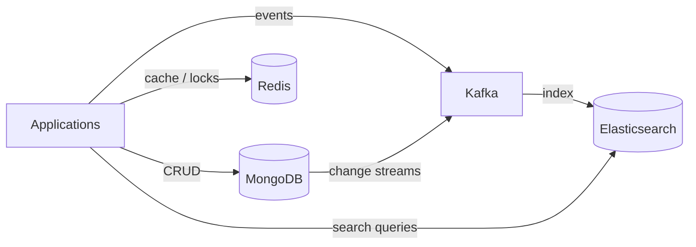

> **Interview insight:** Senior answers tie each tool to **access patterns** and **failure modes**, not feature lists.

---

## MongoDB

### What MongoDB is really optimizing for

MongoDB stores **documents** (BSON) in **collections**. A single document update is **atomic**. That is the default unit of consistency — design your model so one business operation touches one document when possible.

**Choose MongoDB when:**

- Data is naturally nested (orders with line items, CMS content).
- Schema changes often (new optional fields per product type).
- You need shardable write throughput with a document access pattern.

**Think twice when:**

- You need multi-table joins and DB-enforced foreign keys.
- Every write must be strictly consistent across many aggregates (consider PostgreSQL or redesign documents).

### Embedding vs referencing

| Pattern | When to use | Risk |
|---------|-------------|------|
| **Embed** | 1:1 or 1:few, always read together, bounded array size | 16MB doc limit, rewrite whole doc on array update |
| **Reference** | Many-to-many, large/unbounded children, independent queries | Extra round trips or `$lookup` cost |
| **Subset pattern** | Hot path needs recent N items only | Stale embedded subset |
| **Extended reference** | Need denormalized fields + link to full record | Duplication on update |

```javascript
// Embedded order (good when you always load the full order)
{
  _id: ObjectId("..."),
  customerId: "cust-12",
  status: "PAID",
  items: [
    { sku: "ABC", qty: 2, priceCents: 2999 }
  ],
  totals: { subtotal: 5998, tax: 480 }
}

// Reference pattern (good when line items are huge or queried alone)
// orders: { _id, customerId, status }
// order_lines: { orderId, sku, qty, priceCents }
```

### Sharding architecture

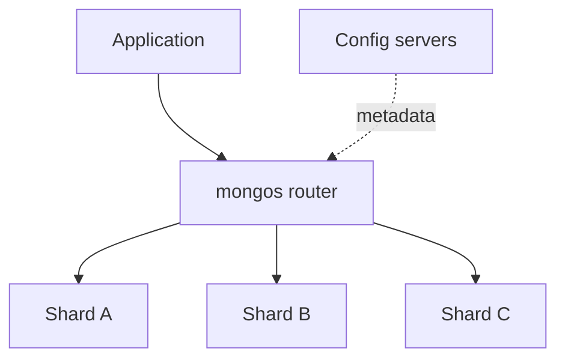

**Shard key checklist:**

1. **Cardinality** — enough distinct values (avoid boolean-only keys).
2. **Write distribution** — avoid monotonic keys alone (`timestamp`, auto-increment) → hotspot on last chunk.
3. **Query isolation** — most queries include the shard key → **targeted** query, not scatter-gather.

Common SaaS pattern: `{ tenantId: 1, _id: 1 }` — tenant-scoped queries hit one shard; writes spread across tenants.

> **Warning:** Changing a shard key is painful. Start on a replica set; shard when metrics prove you need it.

### Replication and failover

- **Primary** takes writes; **secondaries** tail the **oplog**.
- **`w: "majority"`** — durable across single-node loss.
- **Read preference** — `primary` (strong), `secondary` / `nearest` (scale reads, eventual).
- Failover uses **Raft-style elections** (~seconds); writes pause during election.

### Indexes and the ESR rule

For compound index `{ a: 1, b: 1, c: 1 }`:

| Query clause type | Index position |
|-------------------|----------------|
| **Equality** (`status: "active"`) | First |
| **Sort** (`sort({ createdAt: -1 })`) | Middle |
| **Range** (`amount: { $gte: 100 }`) | Last |

```javascript
// Query: status + sort + range
db.orders.createIndex({ status: 1, createdAt: -1, amount: 1 });

db.orders.find({ status: "active", amount: { $gte: 100 } })
  .sort({ createdAt: -1 })
  .explain("executionStats");
```

**Covered queries** — index contains all projected fields → no document fetch.

### Aggregation pipeline performance

1. **`$match` early** — uses index if first stage.
2. Avoid **`$unwind`** on huge arrays — use `$filter` / `$map` first.
3. Default **100MB** per stage — `allowDiskUse: true` if needed (slower).
4. Use **`$facet`** for multiple metrics in one pass.

### Consistency knobs

| Setting | Effect |
|---------|--------|
| `writeConcern: { w: "majority" }` | Durability |
| `readConcern: "majority"` | No rolled-back reads |
| `readConcern: "linearizable"` | Strongest read; more latency |
| **Causal consistency session** | Read your own writes across members |

### Multi-document transactions

Use when business rules span documents (transfer, inventory). **Prefer document redesign first.**

```javascript
const session = client.startSession();
try {
  session.startTransaction({
    readConcern: { level: "snapshot" },
    writeConcern: { w: "majority" },
  });
  await accounts.updateOne({ _id: from }, { $inc: { balance: -amount } }, { session });
  await accounts.updateOne({ _id: to }, { $inc: { balance: amount } }, { session });
  await session.commitTransaction();
} catch (e) {
  await session.abortTransaction();
  throw e;
} finally {
  session.endSession();
}
```

Limits: **60s** timeout, cross-shard = 2PC overhead, oplog entry **16MB** cap per transaction.

### Change streams

Built on oplog; **ordered per shard**; **resume tokens** for at-least-once delivery. Pattern: Change Stream → **Kafka** for durable fan-out.

### Time-series (5.0+)

```javascript
db.createCollection("metrics", {
  timeseries: {
    timeField: "timestamp",
    metaField: "sensorId",
    granularity: "seconds",
  },
});
```

### Production operations checklist

| Area | What to watch |
|------|----------------|
| Queries | `keysExamined` vs `docsExamined` ≈ 1:1 |
| Replication | Lag, oplog window vs maintenance |
| Memory | WiredTiger cache ~50% RAM; page faults |
| Security | Auth, TLS, no public `0.0.0.0`, RBAC |

---

### MongoDB — interview Q&A

#### 1. MongoDB vs relational DB?

**Answer:** MongoDB wins on flexible hierarchical models and horizontal scale for document-shaped workloads. Relational wins on joins, constraints, and complex reporting. Hybrid stacks are common (Postgres for payments, Mongo for catalogs). Acknowledge multi-doc transactions exist but are expensive — frequent transactions often mean modeling issue.

#### 2. Shard key design for 5TB production collection?

Pre-split chunks, choose key with cardinality + query patterns, avoid hot monotonic keys, test with `sh.status()`. Resharding is online but costly — plan upfront.

#### 3. When is embedding wrong?

Unbounded arrays (thousands of elements), many-to-many, independent child queries, need referential integrity at DB layer.

#### 4. Explain rollback in replication

Secondary that advanced past a failed primary may **roll back** divergent oplog entries after failover.

---

## Redis

### Single-threaded but fast

Redis uses **one main thread** for commands → no lock contention; every command atomic. Throughput comes from **RAM**, **epoll/kqueue**, and simple **RESP** protocol. **Redis 6+** can use I/O threads for read/write; execution stays single-threaded.

> **Never in production:** `KEYS *`, unbounded `LRANGE`, long Lua scripts — they block everyone.

### Persistence

| Mode | Durability | Restart | Notes |
|------|------------|---------|-------|
| **RDB** | Snapshot interval | Fast load | Lose data since last snapshot |
| **AOF** | Log every write | Slower replay | `everysec` common balance |
| **Hybrid (7+)** | RDB preamble + AOF tail | Fast + durable | Recommended default |

Pure cache → often **no persistence** or RDB only.

### Redis Cluster

- **16,384 hash slots** — `CRC16(key) mod 16384`
- **MOVED** / **ASK** redirects
- Multi-key ops only if same slot → use **hash tags** `{userId}:profile` and `{userId}:settings`

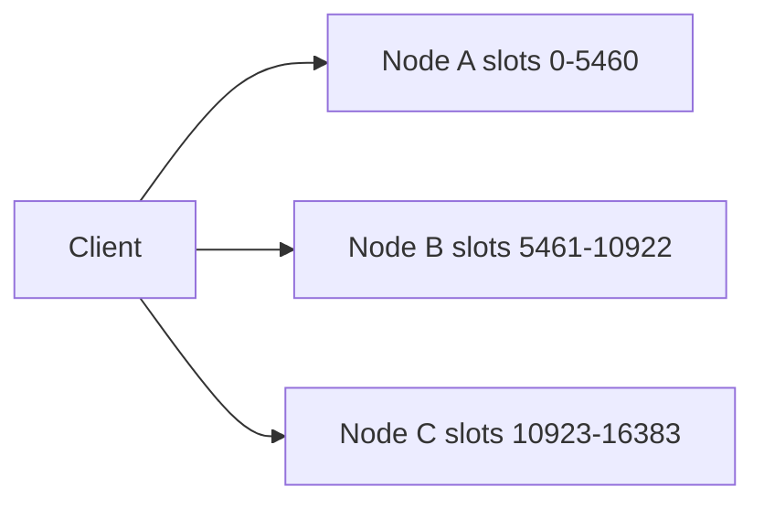

### Caching patterns

| Pattern | Behavior | Use when |
|---------|----------|----------|
| **Cache-aside** | App loads on miss | Read-heavy, tolerant staleness |
| **Write-through** | Write cache + DB together | Need fresh cache |
| **Write-behind** | Cache first, async DB | Write-heavy; accept loss risk |
| **Read-through** | Cache loads on miss | Encapsulate loading logic |

**Cache stampede fixes:** single-flight lock, probabilistic early refresh, background refresh before TTL.

### Distributed locking

```redis
SET lock:order:123 <unique-token> NX EX 30
```

Release with Lua — compare token then `DEL`. Single-instance lock fails on **failover before replicate**. **Redlock** debated (GC pauses). For critical invariants use **etcd/ZooKeeper** + **fencing tokens**.

### Data structures (beyond strings)

| Type | Example use |
|------|-------------|
| **Sorted set** | Leaderboards, sliding-window rate limits |
| **Stream** | Lightweight queue with consumer groups |
| **HyperLogLog** | Approximate unique counts |
| **Hash** | Object fields, memory-efficient at small size |

**Sliding window rate limit (sketch):**

```lua
-- ZADD key now now, ZREMRANGEBYSCORE key 0 (now-window), ZCARD key
```

### Memory and eviction

Set `maxmemory` + policy:

- **`allkeys-lru` / `allkeys-lfu`** — pure cache
- **`volatile-lru`** — only keys with TTL evicted; watch for write errors if no TTL keys left

Monitor `mem_fragmentation_ratio`, `evicted_keys`, swap (ratio < 1 = emergency).

### Pub/Sub vs Streams

| | Pub/Sub | Streams |
|---|---------|---------|
| Persistence | No | Yes |
| Consumer groups | No | Yes |
| Missed if offline | Yes | Can catch up |

High volume + retention → **Kafka**; simple broadcast → Pub/Sub.

---

### Redis — interview Q&A

#### 1. Why is Redis still fast single-threaded?

Memory speed, event loop, no lock contention; I/O threads help payload-heavy workloads.

#### 2. RDB vs AOF?

RDB = point-in-time, compact; AOF = finer durability, larger files. Hybrid balances both.

#### 3. When not to use Redis?

Primary financial store, huge datasets, complex queries, large values (>1MB), replacement for Kafka at high volume.

---

## Elasticsearch

### Distributed model

- Index → **primary shards** + **replica shards**
- Routing: `shard = hash(routing) % num_primary_shards` (routing defaults to `_id`)
- **Primary shard count is fixed** at index creation
- Coordinating node: scatter-gather search

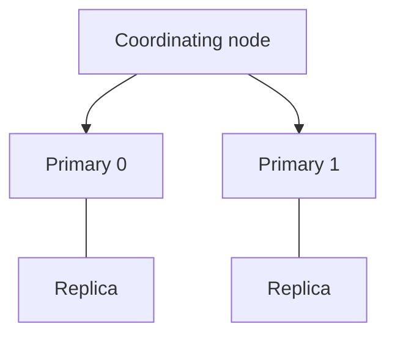

**Node roles:** master-eligible, data, ingest, coordinating (dedicated masters in prod).

### Mapping design

| Decision | Guidance |
|----------|----------|
| **dynamic: strict** in prod | Reject unknown fields |
| **text + keyword multi-field** | Search + sort/facet |
| **nested** | Correlated objects in arrays |
| **doc_values** | Sort/agg; disable on huge text-only fields |

```json
{
  "mappings": {
    "properties": {
      "title": {
        "type": "text",
        "fields": { "keyword": { "type": "keyword" } }
      },
      "status": { "type": "keyword" },
      "createdAt": { "type": "date" }
    }
  }
}
```

### Query vs filter

- **Filter context** — yes/no, cached bitset, no scoring
- **Query context** — relevance score (BM25)

Put exact matches in **`filter`** clause of `bool` query.

### Relevance tuning

- Field boosts (`title^3`)
- `function_score` — freshness, popularity
- Synonyms via analyzers
- **Rescore** top N for expensive signals
- **LTR** plugin for click-trained models

### ILM and time-series

Phases: **hot → warm → cold → delete**. **Data streams** + rollover for logs/metrics. Target **20–50 GB** per shard; avoid hundreds of thousands of shards on cluster.

### Performance triage

1. `_cluster/health` — yellow/red
2. `_nodes/hot_threads`
3. Slow logs — wildcards, deep aggs
4. Disk watermarks (85/90/95%)
5. Heap ≤ **31GB** (compressed oops); avoid fielddata on text

### Multi-tenant search

| Model | Pros | Cons |
|-------|------|------|
| Index per tenant | Isolation | Cluster state explosion |
| Shared index + `tenant_id` filter + routing | Efficient | Noisy neighbor |
| Tiered (pool + dedicated for whales) | Practical SaaS | Routing complexity |

Use **document-level security** — never rely on app filter alone.

---

### Elasticsearch — interview Q&A

#### 1. Why can't you change primary shard count?

Routing formula changes → documents would land on wrong shards.

#### 2. Deep pagination?

Avoid large `from` — use **`search_after`** or **PIT**.

#### 3. Autocomplete approaches?

`search_as_you_type`, edge n-grams, or completion suggester (prefix, memory-heavy).

---

## Apache Kafka

### Log, not queue

Kafka retains by **policy/time**, not by consumption. Multiple **consumer groups** read independently. Ordering is **per partition**.

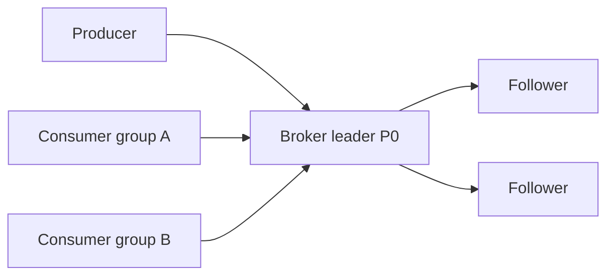

### Partitions and keys

```
max_partitions >= max(throughput / per_partition_throughput, consumer_count)
```

More partitions → more parallelism but higher rebalance cost and file handle overhead.

**Hot keys** — one partition becomes bottleneck; consider salting or sub-partition strategies.

### Consumer groups and rebalance

- One consumer per partition max (in group)
- **Cooperative sticky** rebalancing — less stop-the-world
- **`group.instance.id`** — static membership for deploys

### Delivery semantics

| Guarantee | Producer/consumer pattern |
|-----------|---------------------------|
| At-most-once | No retry / commit before process |
| At-least-once | Retry + commit after process |
| Exactly-once (Kafka) | Idempotent producer + transactions + `read_committed` |

EOS does **not** extend to external DB without **idempotent writes** or **outbox**.

### ISR and `acks`

- **`acks=all`** + **`min.insync.replicas=2`** on 3 replicas → strong durability
- **Unclean leader election** — availability vs data loss (`unclean.leader.election.enable=false` in prod)

**KRaft** — metadata consensus without ZooKeeper (3.3+ GA path).

### Topic design

- Domain topics with `event_type` field vs explosion of micro-topics
- **Compaction** — latest value per key (config, CDC state)
- **Schema Registry** — Avro/Protobuf + BACKWARD compatibility

### Offset management

- Auto-commit — simple, can lose or duplicate on crash
- **Manual commit after process** — at-least-once
- **Store offsets in DB** with business write — external EOS

### Kafka Connect & CDC

Debezium reads **WAL/binlog** → Kafka → sinks (Elasticsearch, warehouse). Watch snapshot duration and **DLQ** for poison pills.

### Kafka Streams vs Flink

| | Kafka Streams | Flink |
|---|---------------|-------|
| Deploy | Library in your app | Cluster |
| Event time | Good | Best-in-class |
| State | RocksDB + changelog | Checkpoints, savepoints |

### Monitoring essentials

| Metric | Meaning |
|--------|---------|
| Under-replicated partitions | Replication problem |
| Consumer lag | Processing falling behind |
| Request handler idle % | Broker CPU saturation |
| Offline partitions | Critical |

---

### Kafka — interview Q&A

#### 1. Kafka vs RabbitMQ?

Kafka: log, replay, high throughput, ordering per partition. RabbitMQ: routing, per-message ack, lower latency task queues — different jobs.

#### 2. How to achieve cross-partition ordering?

Usually fix the **partition key**. Else sequence numbers + buffer, or single partition (limits throughput).

#### 3. Transactional outbox?

Write outbox row in same DB transaction as business row; relay to Kafka in order.

---

## Cross-stack patterns

### Cache → search pipeline

1. Write to MongoDB (source of truth for documents)
2. Change stream or CDC → Kafka topic
3. Consumer indexes into Elasticsearch
4. Redis caches hot search results or entity snapshots

### Failure modes to mention in interviews

| Component | Failure | Mitigation |
|-----------|---------|------------|
| MongoDB | Primary down | Replica set failover, `w: majority` |
| Redis | Node loss | Cluster failover; cache miss storm → DB |
| Elasticsearch | Red shard | Replica promotion, allocation explain |
| Kafka | Broker down | ISR election, producer retries |

---

## Common interview mistakes

1. Calling MongoDB "schemaless" — use **schema versioning** and validation.
2. Picking `_id` or timestamp as shard key without analysis.
3. Using Redis as the only copy of critical data.
4. Too many Elasticsearch shards (cluster state pain).
5. Treating Kafka EOS as end-to-end without idempotent sinks.

---

## Extended MongoDB interview topics

### Change streams vs oplog tailing

Change streams are the supported API: resume tokens, filtering in pipeline, `fullDocument: "updateLookup"`. Direct oplog access is internal and brittle. Size oplog for max consumer downtime.

### Schema migration at 500M documents

Batch updates by `_id` range with throttling; dual-write fields during rename; `validator: warn` then `error`; background index builds on secondaries.

### WiredTiger tuning

`cacheSizeGB` ~50% RAM; monitor dirty eviction; compression `zstd` for cold tiers; checkpoints vs RPO.

### Security production checklist

SCRAM-SHA-256, TLS, RBAC least privilege, CSFLE for PII fields, bind to private interfaces, audit DDL/DML.

---

## Extended Redis interview topics

### Replication and `WAIT`

Async replication → acknowledged writes can be lost on failover. `WAIT numreplicas timeout` strengthens durability but does not fix Sentinel race alone. Use `min-replicas-to-write` to block writes when replicas lag.

### Microservices Redis topology

Domain-scoped instances, key naming `{service}:{entity}:{id}`, connection pooling, circuit breakers when Redis unavailable (degrade to DB with care).

### Lua vs Redis Functions (7+)

Functions persist and replicate; prefer for versioned server-side logic. Keep scripts <5ms.

### Leaderboard at 10M players

`ZADD`/`ZREVRANK` O(log N); tie-break via encoded score; partition by season key; `UNLINK` large zsets async.

---

## Extended Elasticsearch interview topics

### Cluster upgrade (rolling)

Disable allocation → synced flush → upgrade node → wait green → repeat. Major versions: reindex or dual-cluster cutover.

### Cross-cluster search (CCS) and CCR

CCS for federated search across regions; CCR for DR and geo read copies. Handle partial cluster failure in merged results.

### Ingest pipelines

Enrich, grok logs, drop fields before index — reduces mapping bloat.

### Snapshot and restore

S3 repository; snapshot SLAs; test restore quarterly.

---

## Extended Kafka interview topics (Questions 8–15)

### Kafka Streams

Library deployment; state in RocksDB + changelog topics; exactly-once with transactions; choose over Flink when logic is Kafka-native and moderate complexity.

### Kafka Connect CDC

Debezium → topics → Elasticsearch sink; SMTs for routing; DLQ for bad records; snapshot time for large tables.

### Log compaction

`cleanup.policy=compact` for config and KTables; tombstones delete keys; tail still has duplicates until compacted.

### Producer tuning

`linger.ms`, `batch.size`, compression (`lz4`/`zstd`), `acks=all`, idempotence enabled.

### Consumer lag operations

Scale consumers ≤ partitions; fix slow handler; increase partitions only with key strategy review; Burrow/Prometheus alerts.

### Security

SASL/SSL, ACLs per topic, separate principals for producers/consumers, no plaintext in prod.

---

## How to prepare (4-week plan)

| Week | Focus |
|------|--------|
| 1 | Local MongoDB replica set: indexes, `explain`, aggregation |
| 2 | Redis: persistence, cluster, rate limiter + lock with Lua |
| 3 | Elasticsearch: mappings, bool query, ILM on sample logs |
| 4 | Kafka: multi-partition topic, consumer groups, lag monitoring |

> Build one mini pipeline: API → Mongo → Kafka → Elasticsearch, with Redis cache on reads. Explain trade-offs at each hop — that story wins senior rounds.

---

## Full Interview Q&A — MongoDB

> **Note:** Q1 (MongoDB vs relational) is covered above under `### MongoDB — interview Q&A`. The following pairs expand the Algoroq (2026) bank with full frameworks.

### Q2. Explain the trade-offs between embedding documents and using references in MongoDB.

**What they're really asking:** Can you make the core modeling decision that drives read latency, write amplification, and schema evolution?

**Answer:**

**Embedding (denormalization)** keeps related data in one BSON document — e.g. an `orders` document with an `items[]` array.

| Advantage | Disadvantage |
|-----------|--------------|
| Single read for the aggregate | 16 MB document limit |
| Atomic updates on the whole entity | Whole document rewritten on array changes |
| No `$lookup` on hot path | Duplication if the same child appears in many parents |

**Referencing (normalization)** stores `ObjectId` pointers in separate collections.

| Advantage | Disadvantage |
|-----------|--------------|
| No unbounded growth in one doc | Multiple round trips or `$lookup` cost |
| Independent queries on children | No DB-enforced referential integrity |
| Smaller documents | Join-like operations scale poorly without care |

**Decision checklist:**

- **Embed** when data is **1:1 or 1:few**, always read together, and arrays are **bounded**.
- **Reference** when **many-to-many**, children are **large/unbounded**, or queried **independently**.

**Middle-ground patterns:**

1. **Subset pattern** — embed recent N reviews; full history in `reviews` collection.
2. **Extended reference** — store `authorId` + denormalized `authorName` for list views.

```javascript
// Subset: hot path reads one document
{
  _id: ObjectId("..."),
  productId: "sku-9",
  recentReviews: [{ rating: 5, text: "..." }],  // last 3 only
  reviewCount: 1240
}
```

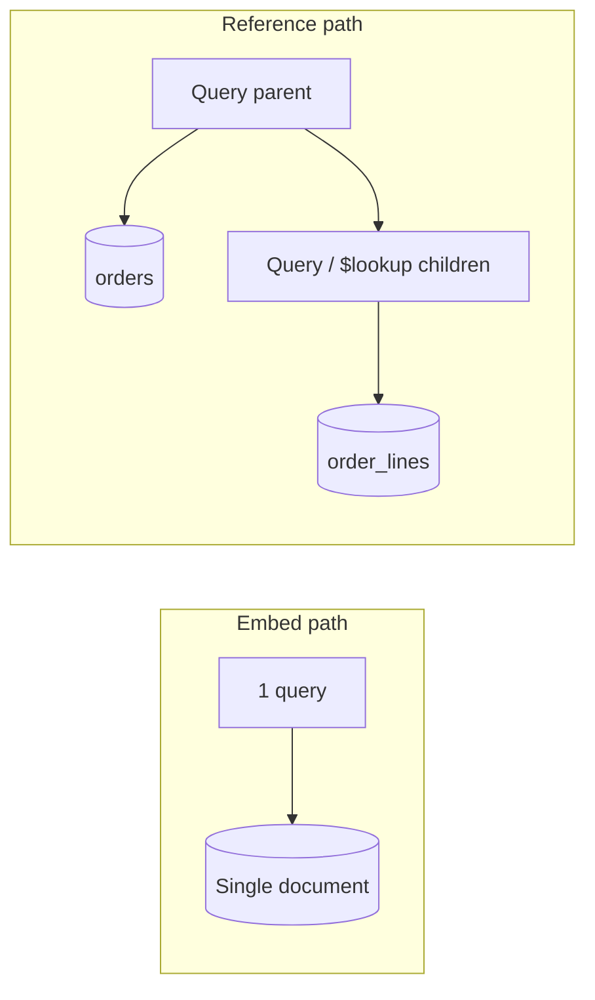

**Follow-ups:**

- How do you keep subset-embedded data fresh when the source changes?
- What breaks when an embedded array grows to thousands of elements?
- Zero-downtime migration from embed → reference?

---

### Q3. How does MongoDB sharding work, and how do you choose a shard key?

**What they're really asking:** Can you design for even writes, targeted queries, and avoid irreversible mistakes?

**Answer:**

**Components:** `mongos` routes queries; **config servers** hold chunk metadata; **shards** store data in **chunks** (ranges of shard key values).

**Sharding strategies:**

| Strategy | Writes | Range queries on key |
|----------|--------|----------------------|
| **Range** | Hotspot on monotonic keys (`timestamp`, auto-inc) | Efficient |
| **Hashed** | Even distribution | Poor for range scans on raw key |

**Shard key — optimize three properties:**

1. **Cardinality** — enough distinct values (boolean alone is terrible; `{tenantId, _id}` is strong).
2. **Write distribution** — avoid lone monotonic prefix; compound keys like `{userId: 1, createdAt: 1}` spread writes while allowing per-user ranges.
3. **Query isolation** — if most queries include the shard key → **targeted**; else **scatter-gather**.

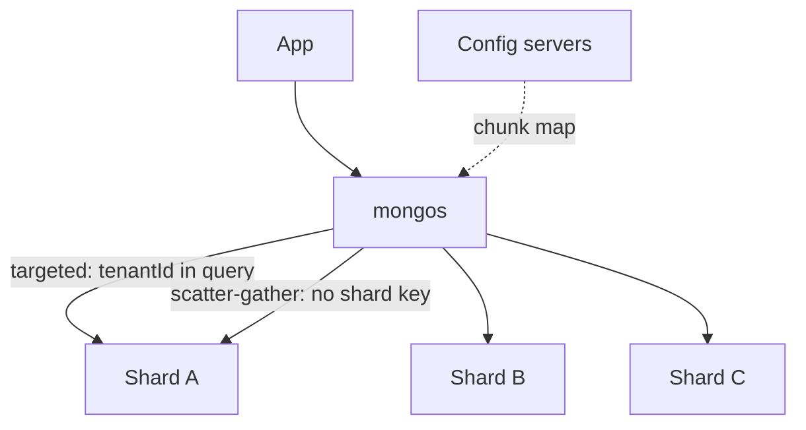

**Production on 5 TB already unsharded:** pre-split chunks, choose key from **measured** query + write patterns, enable sharding in maintenance window, validate with `sh.status()` and `moveChunk` plans. **Resharding** exists but is costly — treat shard key as long-lived.

**Follow-ups:**

- What is a **jumbo chunk** and how do you split it?
- How do cross-shard queries and multi-document transactions behave?

---

### Q4. Walk through MongoDB's replication architecture and how failover works.

**What they're really asking:** Do you understand HA, write durability, and what happens during elections?

**Answer:**

A **replica set**: one **primary** (writes) + **secondaries** tailing the **oplog** (capped collection in `local`).

**Write path:** application → primary → oplog entry → async replication to secondaries. **`w: "majority"`** waits until a majority of data-bearing nodes have the op before ack — survives single-node loss without committed write loss.

**Failover (Raft-inspired elections, ~2–10s):** if primary is unreachable, eligible secondary with freshest oplog wins majority votes. **Writes pause** during election.

| Knob | Trade-off |
|------|-----------|
| `readPreference: primary` | Strongest read consistency |
| `readPreference: secondary` / `nearest` | Scale reads; eventual consistency |
| `w: 1` | Fast; loss risk if primary dies before replicate |
| `w: "majority"` | Durable; slightly higher latency |

**Sizing:** odd voting members (3, 5, 7); arbiters don't hold data — use sparingly.

**Rollback:** after failover, a former primary that accepted writes unknown to the new primary may **roll back** divergent oplog entries on rejoin.

**Follow-ups:**

- In-flight writes during failover?
- `readConcern: "majority"` vs `writeConcern: "majority"`?
- When does rollback occur?

---

### Q5. How do you optimize MongoDB aggregation pipelines for large datasets?

**What they're really asking:** Do you know stage order, index eligibility, and memory limits?

**Answer:**

**Golden rules:**

1. **`$match` first** — uses indexes when first stage; never filter after `$unwind` on huge arrays if avoidable.
2. **Index-eligible stages early** — `$match`, `$sort`; after `$group` / `$unwind` / `$project`, indexes are gone.
3. **Avoid massive `$unwind`** — prefer `$filter` / `$map` / `$reduce` before unwinding.
4. **100 MB per stage** — use `allowDiskUse: true` only when needed (slower).
5. **`$facet`** — multiple metrics in one pass.

```javascript
// Bad: unwind all line items, then filter dates
// Good: $match date (index) → $project filter items → $unwind → $group

db.orders.aggregate([
  { $match: { createdAt: { $gte: ISODate("2026-01-01") }, status: "PAID" } },
  { $project: {
      items: { $filter: { input: "$items", as: "i", cond: { $gte: ["$$i.qty", 1] } } }
  }},
  { $unwind: "$items" },
  { $group: { _id: "$items.sku", revenue: { $sum: { $multiply: ["$items.qty", "$items.price"] } } } }
], { allowDiskUse: true });
```

Use `explain("executionStats")` on the aggregation to find stages scanning whole collections.

**Follow-ups:**

- `$merge` / `$out` for materialized views?
- Pipeline behavior on **sharded** collections?

---

### Q6. What indexing strategies do you use in MongoDB, and how do you handle compound indexes?

**What they're really asking:** Do you know **ESR (Equality, Sort, Range)** and index prefix rules?

**Answer:**

Compound index `{ status: 1, createdAt: -1, amount: 1 }` for:

```javascript
db.orders.find({ status: "active", amount: { $gte: 100 } }).sort({ createdAt: -1 });
```

**ESR:** Equality fields → Sort fields → Range fields.

**Prefix rule:** `{a,b,c}` supports queries on `a`, `a+b`, `a+b+c` — not `b` alone.

**Index types (when to mention):** single-field, compound, multikey (arrays; max one array field per compound index), text, wildcard (dynamic schema — less efficient), `2dsphere`.

**Ops:** `explain("executionStats")` — `totalKeysExamined` ≈ `totalDocsExamined`; **partial indexes** for hot subsets; drop unused indexes (write + RAM cost).

**Covered query:** projection fields all in index → no document fetch.

**Follow-ups:**

- Finding unused indexes in production?
- Write amplification from too many indexes?
- `$in` vs `$or` index usage?

---

### Q7. How do you handle schema evolution in MongoDB?

**What they're really asking:** “Schemaless” still needs discipline — how do you migrate safely at scale?

**Answer:**

**Patterns:**

| Pattern | How it works |
|---------|----------------|
| **schemaVersion** field | App handles v1/v2; migrate on read or batch |
| **Lazy migration** | Upgrade doc when read; background job for cold data |
| **JSON Schema validator** | `validationAction: "warn"` → `"error"` after backfill |

**Safe changes:**

- **Add field** — default in app; no migration.
- **Rename** — dual-write both names during transition.
- **Type change** — new field + backfill + cutover.

**At 500M documents:** batch by `_id` range with throttling; monitor replication lag; build indexes in background on secondaries.

```javascript
db.createCollection("orders", {
  validator: {
    $jsonSchema: {
      bsonType: "object",
      required: ["schemaVersion", "status"],
      properties: { schemaVersion: { enum: [2] }, status: { enum: ["OPEN", "PAID"] } }
    }
  },
  validationAction: "error"
});
```

**Follow-ups:**

- String → embedded document migration at huge scale?
- Validation failures during bulk import?
- Evolution on **sharded** clusters?

---

### Q8. Explain MongoDB's consistency model and how read/write concerns affect it.

**What they're really asking:** Can you tune consistency per use case (analytics vs payments)?

**Answer:**

**Write concern:** `w: 1` (primary only), `w: "majority"` (durable), `w: 0` (fire-and-forget), `j: true` (journal flush).

**Read concern:**

| Level | Behavior |
|-------|----------|
| `local` | Latest on node; may see rolled-back data |
| `majority` | Won't read data rolled back after failover |
| `linearizable` | Strongest; confirms still primary — higher latency |
| `snapshot` | Multi-document transactions |

**Causal consistency sessions** — read your writes across members in the same session.

**Practical defaults:** `w: "majority"` + `readConcern: "majority"` for correctness-sensitive paths; `secondaryPreferred` for dashboards; `linearizable` for critical financial reads.

**Follow-ups:**

- Performance: `linearizable` vs `majority`?
- Write conflicts in multi-doc transactions?
- `w: "majority"` during network partition?

---

### Q9. How do you implement multi-document transactions in MongoDB, and what are their limitations?

**What they're really asking:** When is a transaction justified vs a modeling fix?

**Answer:**

Supported since 4.0 (replica set) / 4.2 (sharded). **Prefer single-document atomicity** when possible — frequent cross-doc transactions often mean schema issue.

```javascript
const session = client.startSession();
try {
  await session.withTransaction(async () => {
    await inventory.updateOne({ sku }, { $inc: { qty: -1 } }, { session });
    await orders.insertOne({ sku, status: "CONFIRMED" }, { session });
  }, {
    readConcern: { level: "snapshot" },
    writeConcern: { w: "majority" },
  });
} finally {
  await session.endSession();
}
```

**Limits:**

| Limit | Impact |
|-------|--------|
| **60s timeout** | Long work must be split |
| WiredTiger cache pressure | Many concurrent txns hurt performance |
| Cross-shard **2PC** | Extra latency |
| **16 MB** oplog entry per transaction | Caps batch size |
| No DDL in transaction | Can't create index inside txn |

**Use for:** transfers, inventory reserve+commit. **Avoid for:** routine CRUD that could be one document.

**Follow-ups:**

- Retryable writes vs transactions?
- Primary failure mid-commit?
- Monitoring transaction duration?

---

### Q10. How do you monitor and operate MongoDB in production?

**What they're really asking:** Real ops experience — metrics, incidents, capacity.

**Answer:**

**Five areas:**

1. **Query performance** — `keysExamined` / `docsReturned` ≈ 1:1; profiler `slowms`; `scanAndOrder` (in-memory sort).
2. **Replication** — lag &lt; SLA (alert &gt;10s); **oplog window** &gt; maintenance duration.
3. **WiredTiger** — cache ~50% RAM; dirty eviction; page faults.
4. **Connections** — pool sizing; `db.serverStatus().connections`.
5. **Storage** — compression (`zstd`); TTL/archival.

**Common fixes:**

| Symptom | Action |
|---------|--------|
| Slow queries | Index from profiler; avoid COLLSCAN |
| High repl lag | Network, missing secondary indexes, write load |
| Memory pressure | Right-size cache; shrink working set |
| Connection storm | `maxPoolSize`, app-side pooling |

**Tooling:** Atlas, `mongostat`/`mongotop`, Prometheus MongoDB exporter, Grafana.

**Follow-ups:**

- Sudden latency spike diagnosis?
- Profiler overhead?
- 10× traffic capacity plan?

---

### Q11. How does MongoDB Change Streams work, and what are its use cases?

**What they're really asking:** Event-driven design — ordering, resume, delivery guarantees.

**Answer:**

Change streams are a **supported API on the oplog** (replica set required). Each event includes a **resume token** → **at-least-once** after reconnect. Ordering is per shard; cluster-wide ordering has nuances on sharded deployments.

```javascript
const pipeline = [{ $match: { operationType: { $in: ["insert", "update"] } } }];
const cs = db.collection("orders").watch(pipeline, { fullDocument: "updateLookup" });
for await (const change of cs) {
  await kafkaProducer.send({ topic: "cdc.orders", messages: [{ value: JSON.stringify(change) }] });
}
```

**Use cases:** cache invalidation, CDC to Kafka/ES, real-time dashboards, cross-service sync.

**Limits:** resume tokens invalid if consumer falls off **oplog**; `updateLookup` costs extra read; pre-images need 6.0+ config.

**Pattern:** Change Stream → **Kafka** for durability, fan-out, replay (decouple from oplog retention).

**Follow-ups:**

- Consumer behind oplog window?
- Change streams vs raw oplog tailing?
- Scaling consumers on hot collections?

---

### Q12. How would you migrate from MongoDB to PostgreSQL (or vice versa)?

**What they're really asking:** Risk-managed migration — dual-write, validation, rollback.

**Answer:**


| Phase | Details |
|-------|---------|
| **Mapping** | Embed → tables/JSONB; arrays → child tables; polymorphism → typed tables |
| **Dual write** | Source of truth + best-effort target; monitor drift |
| **Backfill** | Batched by `_id` with checkpoints |
| **Validation** | Shadow reads until 48h zero discrepancy |
| **Cutover** | Flip reads; keep dual-write rollback window |

**Risks:** `ObjectId` vs UUID, inconsistent docs, nested depth, **10k RPS** requires throttled backfill + queue-based sync.

**Follow-ups:**

- Zero-downtime at 10k req/s?
- Consistency checking tools?
- Deep nesting → relational model?

---

### Q13. Explain MongoDB's storage engine (WiredTiger) and its impact on performance.

**What they're really asking:** Storage-layer tuning — cache, compression, checkpoints.

**Answer:**

**WiredTiger (default since 3.2):**

- **Document-level locking** — optimistic concurrency; conflicting same-doc writes retry.
- **Compression** — snappy (default), **zstd** (better ratio on cold tier).
- **Cache** — default ~50% RAM − 1GB; uncompressed pages in cache for speed.
- **Checkpoints** ~60s + **journal (WAL)** for crash recovery — tighter checkpoint = lower RPO, more I/O.

**Working set &gt; cache** → disk reads, latency spikes. Monitor dirty cache ratio; eviction stalls writes when dirty ratio high.

**Follow-ups:**

- Read/write conflicts at storage layer?
- Working set exceeds cache?
- Diagnose high cache pressure?

---

### Q14. How do you design MongoDB collections for time-series data?

**What they're really asking:** Native time-series (5.0+) vs bucket pattern; when not to use Mongo.

**Answer:**

**Native time-series (5.0+):**

```javascript
db.createCollection("metrics", {
  timeseries: {
    timeField: "timestamp",
    metaField: "sensorId",
    granularity: "seconds",  // match ingest frequency
  },
});
```

Mongo buckets internally (columnar), optimizes time-range queries.

**Pre-5.0 bucket pattern** — one doc per sensor per hour with `measurements[]` + rollup fields (`min`, `max`, `sum`, `count`).

**When to use something else:** pure TS at massive scale → InfluxDB, TimescaleDB, ClickHouse for compression/query economics.

**Follow-ups:**

- Native vs regular collection query perf?
- Downsampling old data?
- Time-series + sharding?

---

### Q15. How would you secure a MongoDB deployment for production?

**What they're really asking:** Avoid the “open MongoDB on the internet” breach pattern.

**Answer:**

| Layer | Practice |
|-------|----------|
| **Auth** | SCRAM-SHA-256; LDAP/Kerberos enterprise; x.509 between members |
| **RBAC** | Least privilege per app; never `root` in apps |
| **TLS** | `requireTLS` on all connections |
| **At rest** | WiredTiger encryption (Enterprise) or volume encryption; **CSFLE** for PII |
| **Network** | Private subnets; `bindIp` not `0.0.0.0` without firewall |
| **Audit** | DDL/DML/auth events (Enterprise) |

**CSFLE:** driver encrypts fields — server never sees plaintext keys (KMS integration).

**Follow-ups:**

- CSFLE limitations?
- Key rotation without downtime?
- Auditing performance impact?

---

## Full Interview Q&A — Redis

> **Note:** Q1 (single-threaded speed), Q2 (RDB vs AOF), and Q15 (when not to use) appear above under `### Redis — interview Q&A`.

### Q3. How does Redis Cluster work, and what are its limitations?

**What they're really asking:** Hash slots, redirects, and constraints on multi-key ops.

**Answer:**

**16,384 hash slots:** `slot = CRC16(key) mod 16384`. Each master owns a slot range.

- **MOVED** — permanent redirect; client updates slot map.
- **ASK** — temporary during slot migration.

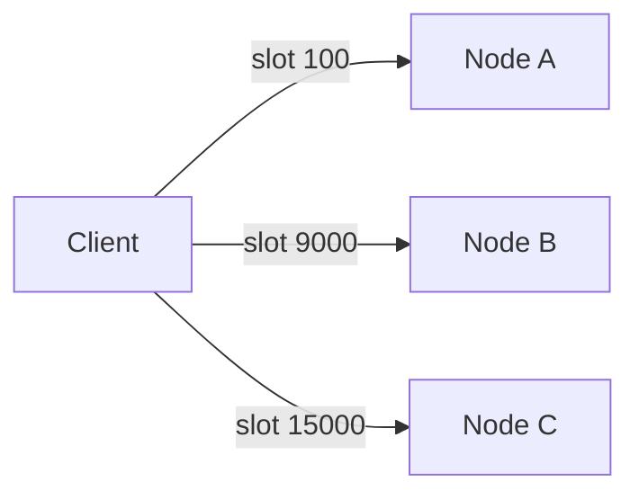

**HA:** async replication; gossip + majority masters detect failure; replica promoted (~15s `cluster-node-timeout`).

**Limitations:**

| Limitation | Mitigation |
|------------|------------|
| Multi-key ops need same slot | **Hash tags:** `{userId}:profile` + `{userId}:settings` |
| No `SELECT` / multi-DB in cluster | Namespace in key names |
| `MULTI`/Lua only same slot | Design keys accordingly |
| Pub/sub fanout to all nodes | Redis 7 **sharded pub/sub** (`SPUBLISH`) |

**Resharding:** online but per-key `MIGRATE` — large slots take time.

**Follow-ups:**

- Transactions across slots?
- Network partition split-brain behavior?
- Monitoring slot coverage?

---

### Q4. What are the common caching patterns, and when would you use each with Redis?

**What they're really asking:** Consistency vs complexity — not just “use Redis as cache.”

**Answer:**

| Pattern | Write path | Read path | Best for |
|---------|------------|-----------|----------|
| **Cache-aside** | App writes DB; cache on miss | App reads cache → DB on miss | Read-heavy, tolerable staleness |
| **Write-through** | Sync write cache + DB | Cache always warm | Read-after-write consistency |
| **Write-behind** | Cache first; async DB | Fast writes | Analytics counters; loss risk |
| **Read-through** | N/A | Cache loads on miss (wrapper) | Encapsulated loading |

**Invalidation:** TTL safety net + **event-driven** (CDC, change streams) for freshness.

**Cache stampede:** single-flight lock, probabilistic early refresh, background refresh before TTL.

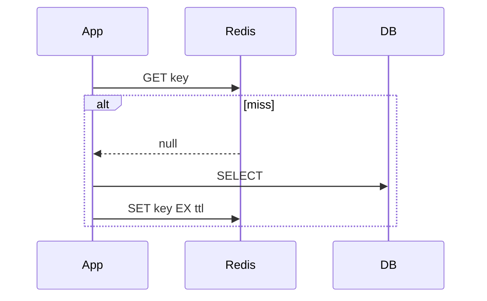

**Follow-ups:**

- Optimal TTL per entity?
- Metrics for hit ratio / effectiveness?
- Cache warming after restart?

---

### Q5. How would you implement distributed locking with Redis, and what are the pitfalls?

**What they're really asking:** Know single-instance limits, Redlock debate, fencing tokens.

**Answer:**

**Acquire (atomic):**

```redis
SET lock:order:123 <unique-token> NX EX 30
```

**Release (Lua — compare token then DEL):**

```lua
if redis.call("get", KEYS[1]) == ARGV[1] then
  return redis.call("del", KEYS[1])
else
  return 0
end
```

**Single-instance weakness:** master fails before replicate → two holders after failover.

**Redlock (N independent nodes, majority):** debated — GC pauses can exceed TTL → **dual holders**. Kleppmann recommends **fencing tokens** (monotonic) checked by the resource (DB).

**Practical guidance:**

- Redis lock OK for **idempotent** duplicate-work prevention.
- **Money / invariants** → etcd/ZooKeeper + fencing.

**Pitfalls:** TTL too short (work outlives lock), too long (blocks others), wrong release token.

**Follow-ups:**

- Read-write lock in Redis?
- Eviction under `maxmemory`?
- Testing locks under failure?

---

### Q6. Explain Redis data structures beyond strings and when you would use each.

**What they're really asking:** Use server-side structures, not stringly-typed JSON blobs.

**Answer:**

| Type | Complexity | Use case |
|------|------------|----------|
| **List** | O(1) push/pop ends | Queues (`LPUSH`/`BRPOP`), feeds (`LTRIM`) |
| **Set** | O(1) add/member | Tags, unique visitors (`SCARD`), `SINTER` friends |
| **Sorted set** | O(log N) | Leaderboards, sliding-window rate limits, priority queues |
| **Hash** | O(1) field | Objects; ziplist/listpack for small hashes |
| **Stream** | log + consumer groups | Lightweight Kafka-like processing |
| **HyperLogLog** | ~12KB fixed | Approx unique counts (~0.81% error) |
| **Bitmap** | bit ops | DAU flags, feature flags |

**Sliding window rate limit (sketch):**

```lua
-- KEYS[1]=key, ARGV[1]=now, ARGV[2]=window_ms, ARGV[3]=limit
redis.call('ZADD', KEYS[1], ARGV[1], ARGV[1])
redis.call('ZREMRANGEBYSCORE', KEYS[1], 0, ARGV[1]-ARGV[2])
local c = redis.call('ZCARD', KEYS[1])
redis.call('PEXPIRE', KEYS[1], ARGV[2])
return c <= tonumber(ARGV[3])
```

**Follow-ups:**

- Stream vs list for queues?
- ZSET encoding changes at scale?
- Full sliding-window Lua implementation?

---

### Q7. How do you handle Redis memory management and eviction in production?

**What they're really asking:** `maxmemory`, policies, fragmentation, sizing.

**Answer:**

Set **`maxmemory`** + **`maxmemory-policy`:**

| Policy | Behavior |
|--------|----------|
| `noeviction` | Errors on write when full |
| `allkeys-lru` / `allkeys-lfu` | Pure cache |
| `volatile-lru` / `volatile-lfu` | Only keys with TTL — **must** TTL cache keys |

**Approximate LRU:** samples `maxmemory-samples` keys per eviction.

**Fragmentation:** `mem_fragmentation_ratio` >> 1 → `activedefrag yes` (CPU cost). Ratio &lt; 1 → **swap** emergency.

**Sizing:** reserve **25–30%** RAM for fork (RDB), buffers, overhead.

**Follow-ups:**

- Eviction → stampede on DB?
- Per-key memory overhead?
- Leaks from keys without TTL?

---

### Q8. How would you use Redis for rate limiting in a distributed system?

**What they're really asking:** Correctness under concurrency and failure.

**Answer:**

| Algorithm | Pros | Cons |
|-----------|------|------|
| **Fixed window** | Simple `INCR` + `EXPIRE` | Boundary burst (2× at edges) |
| **Sliding window log** | Accurate | Memory per request |
| **Sliding window counter** | 2 keys, approximate | Good balance |
| **Token bucket** | Allows bursts | Lua state: tokens + last_refill |

**Failure modes:** Redis down → fail-open with local limiter + alert vs fail-closed (outage).

**Headers:** `X-RateLimit-Remaining`, `X-RateLimit-Reset`.

**Follow-ups:**

- Tiered limits per API plan?
- Failover 15s window?
- Rate limit by IP behind LB?

---

### Q9. Explain Redis replication and the consistency guarantees it provides.

**What they're really asking:** Async replication = possible acknowledged write loss.

**Answer:**

**Full sync:** fork RDB → replica loads; master buffers writes in **replication backlog**.

**Partial resync:** if offset still in backlog → stream delta; else full sync again. Size `repl-backlog-size` for expected outage.

**`WAIT numreplicas timeout`:** blocks until N replicas ack — stronger but not full sync; Sentinel failover races remain.

**`min-replicas-to-write` / `min-replicas-max-lag`:** block writes when replicas too few/laggy — reduces loss window.

**Cluster:** per-shard replication; gossip-based failover.

**Follow-ups:**

- Monitor replication lag?
- Multiple replicas with uneven lag?
- Replication + persistence on promote?

---

### Q10. How would you design a leaderboard system using Redis?

**What they're really asking:** ZSET at scale — ties, partitions, resets.

**Answer:**

```redis
ZADD leaderboard:season-12 9850.5 "player:42"
ZREVRANK leaderboard:season-12 "player:42"
ZREVRANGE leaderboard:season-12 0 9 WITHSCORES
```

**Tie-break:** encode time in score — `score * 1e6 + (MAX_TS - achievedAt)` or secondary ZSET.

**Scale:** partition by season/region; `UNLINK` large keys async; cluster hash tags for related keys.

**Neighbors:** `ZREVRANK` then `ZREVRANGE rank-5 rank+5`.

**Follow-ups:**

- Percentile rank?
- Reset millions of entries without blocking?
- Multi-mode score aggregation?

---

### Q11. What is Redis Pub/Sub, and when would you use it versus Redis Streams?

**What they're really asking:** Fire-and-forget vs durable log.

**Answer:**

| | Pub/Sub | Streams |
|---|---------|---------|
| Persistence | No | Yes |
| Missed if offline | Yes | Catch up |
| Consumer groups | No | Yes (`XREADGROUP`, `XACK`, `XCLAIM`) |
| Volume | Millions/sec broadcast | &lt;~100k/s, hours–days retention |

**Pub/Sub:** cache invalidation broadcast, live scores, config push.

**Streams:** task queues with acks, activity logs, inter-service events without Kafka ops.

**Kafka vs Streams:** Kafka for high volume, long retention, strong ops tooling.

**Follow-ups:**

- Stream grows faster than consumers?
- Pub/sub during failover?
- Stream consumer lag monitoring?

---

### Q12. How do you handle Redis in a microservices architecture?

**What they're really asking:** Isolation, naming, connections, failure modes.

**Answer:**

**Topology:** dedicated Redis per **domain** (not necessarily per microservice); avoid `SELECT` DB index in prod.

**Key convention:** `{service}:{entity}:{id}:{field}` — e.g. `order-svc:order:1234:status`.

**Connections:** pool per instance; watch `maxclients`; proxy (Twemproxy/Envoy) for multiplexing.

**Degradation:** circuit breaker; optional DB fallback (careful with load).

**Coordination Redis** (locks, rate limits): treat like a database — persistence + alerting.

**Follow-ups:**

- Shared Redis SPOF for many services?
- Migrate shared → dedicated instance?
- Config drift across instances?

---

### Q13. What are Lua scripts in Redis, and when should you use them?

**What they're really asking:** Atomic multi-step logic; blocking risk.

**Answer:**

Lua runs **atomically** on the main thread — no interleaved commands. Use for rate limits, lock release, conditional updates.

**Rules:**

- Keep &lt; **5 ms** — long scripts block everyone.
- Cluster: all `KEYS[]` in same slot.
- Deterministic — replicas replay by re-execution.

**Workflow:** `SCRIPT LOAD` → `EVALSHA`; on `NOSCRIPT`, `EVAL` full script.

**Redis 7+ Functions:** persisted, versioned — prefer for new server-side logic.

**Follow-ups:**

- Debug Lua in production?
- Write halfway then error?
- Script versioning on deploy?

---

### Q14. How do you monitor Redis in production, and what metrics matter most?

**What they're really asking:** Predict outages before users notice.

**Answer:**

**`INFO` highlights:**

| Metric | Alert if |
|--------|----------|
| `used_memory` / `maxmemory` | &gt;80% |
| `mem_fragmentation_ratio` | &gt;1.5 or &lt;1.0 |
| `evicted_keys` | Non-zero on session store |
| `instantaneous_ops_per_sec` | Anomaly vs baseline |
| `keyspace_hits` / `misses` | Hit ratio &lt;80% (cache) |
| Replication offset lag | Growing |
| `connected_clients` | Near `maxclients` |
| CPU on Redis process | &gt;70% sustained |

**Tools:** `SLOWLOG`, `LATENCY DOCTOR`, Redis Exporter → Prometheus/Grafana.

**Follow-ups:**

- Latency spike without traffic change?
- Capacity planning horizon?
- Monitoring large clusters?

---

## Full Interview Q&A — Elasticsearch

> **Note:** Q7 (autocomplete) is covered above under `### Elasticsearch — interview Q&A` §3. Shard-count immutability and deep pagination appear in brief form above; full frameworks below.

### Q1. Explain Elasticsearch's distributed architecture and how data is stored across nodes.

**What they're really asking:** Shards, roles, routing, scatter-gather search.

**Answer:**

Index → **primary shards** + **replica shards** (each shard = Lucene index).

```
shard_id = hash(routing) % num_primary_shards   // routing defaults to _id
```

**Roles:** dedicated **master-eligible** (3), **data**, **ingest**, **coordinating** (heavy merges).

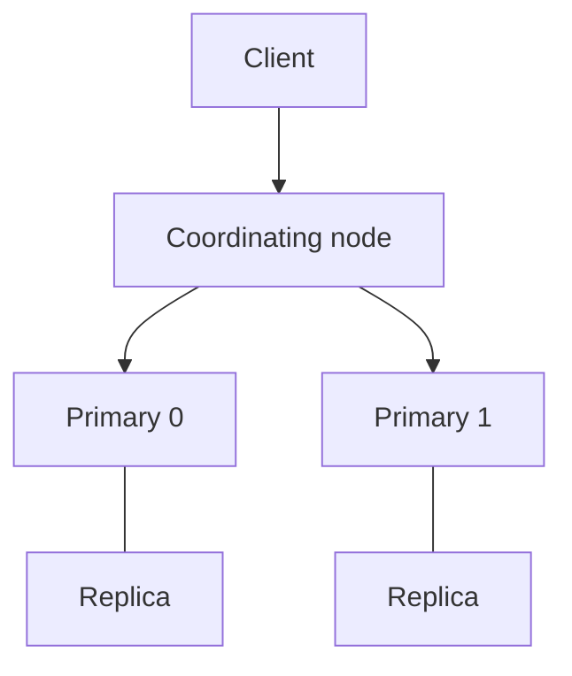

**Search:** query phase (per-shard top hits) → fetch phase (load `_source` for global top N).

**Node failure:** replicas promote; unassigned shards until reallocated.

**Follow-ups:**

- Split-brain prevention (`discovery.seed_hosts`, master quorum)?
- More primaries vs more replicas?

---

### Q2. How do you design Elasticsearch mappings for optimal search and storage?

**What they're really asking:** Explicit mappings, text/keyword, nested, doc_values.

**Answer:**

**Production:** `dynamic: strict` + explicit properties.

```json
{
  "mappings": {
    "dynamic": "strict",
    "properties": {
      "title": {
        "type": "text",
        "fields": { "keyword": { "type": "keyword", "ignore_above": 256 } }
      },
      "status": { "type": "keyword" },
      "createdAt": { "type": "date" },
      "comments": {
        "type": "nested",
        "properties": {
          "author": { "type": "keyword" },
          "body": { "type": "text" }
        }
      }
    }
  }
}
```

| Choice | Guidance |
|--------|----------|
| `text` vs `keyword` | Full-text vs sort/agg/filter |
| `nested` | Correlated objects in arrays |
| `flattened` | High-cardinality dynamic keys without mapping explosion |
| `doc_values` | Default on metrics; disable on huge text-only fields |
| `_source` | Keep enabled unless log-only cold tier with trade-offs |

**Follow-ups:**

- Mapping conflicts on index merge?
- `nested` vs `flattened` performance?
- Evolve mappings without reindex?

---

### Q3. How do you tune search relevance in Elasticsearch?

**What they're really asking:** Beyond default BM25 — business signals.

**Answer:**

**BM25** balances term frequency, inverse document frequency, field length.

**Techniques:**

```json
{
  "query": {
    "function_score": {
      "query": { "multi_match": { "query": "kubernetes", "fields": ["title^3", "body"] } },
      "functions": [
        { "gauss": { "createdAt": { "origin": "now", "scale": "30d", "decay": 0.5 } } },
        { "field_value_factor": { "field": "popularity", "modifier": "log1p" } }
      ],
      "score_mode": "sum",
      "boost_mode": "multiply"
    }
  }
}
```

- **Synonyms** in analyzer (`synonym_graph`)
- **`match_phrase`** + slop for phrase intent
- **Rescore** top 100 with expensive signals
- **LTR plugin** for click-trained models

**Follow-ups:**

- A/B test relevance in production?
- `should` vs `boost`?
- Multi-language relevance?

---

### Q4. How do you handle index lifecycle management and time-series data in Elasticsearch?

**What they're really asking:** ILM, data streams, shard sizing.

**Answer:**

**ILM phases:** hot → warm → cold → delete.

| Phase | Actions |
|-------|---------|
| Hot | Writes, fast SSD, rollover at 50GB or 1d |
| Warm | Shrink, forcemerge, fewer replicas |
| Cold | Searchable snapshots |
| Delete | Drop per retention |

**Data streams (7.9+):** write alias → current backing index; search spans all backing indices.

**Sizing:** **20–50 GB/shard**; avoid 100k+ shards (cluster state pain). Tune `refresh_interval` for bulk ingest.

**Follow-ups:**

- Migrate index-per-day → data streams?
- Searchable snapshots trade-offs?
- Per-tenant retention?

---

### Q5. How do you diagnose and fix performance problems in an Elasticsearch cluster?

**What they're really asking:** Production triage workflow.

**Answer:**

1. `_cluster/health` — yellow/red; `_cluster/allocation/explain`
2. `_nodes/hot_threads` — search vs bulk vs merge CPU
3. Slow logs — wildcards, high-cardinality aggs
4. Disk watermarks (85/90/95%)
5. Heap ≤ **31GB**; avoid `fielddata` on `text`

| Issue | Fix |
|-------|-----|
| Search latency | Add replicas; fix expensive queries; reduce aggs |
| Indexing slow | Larger bulks (5–15MB); `refresh_interval` 30s |
| Yellow hours | Add data nodes; fix disk |
| Master overload | Dedicated masters; reduce shard count |

**Follow-ups:**

- Yellow cluster for hours?
- Too many shards impact?
- Capacity for 10× growth?

---

### Q6. Explain the Elasticsearch query execution model and the difference between queries and filters.

**What they're really asking:** Scoring vs cached bitsets; bool structure.

**Answer:**

```json
{
  "bool": {
    "must": [{ "match": { "title": "kubernetes deployment" } }],
    "filter": [
      { "term": { "status": "published" } },
      { "range": { "date": { "gte": "2025-01-01" } } }
    ],
    "should": [{ "match": { "tags": "cloud-native" } }],
    "must_not": [{ "term": { "archived": true } }]
  }
}
```

**Filter context:** no score, cacheable bitset. **Query context:** BM25 score.

**Deep pagination:** avoid large `from` — use **`search_after`** + **PIT** (point in time).

**Follow-ups:**

- Filter cache invalidation?
- `term` in filter vs query perf?
- `minimum_should_match`?

---

### Q8. How do you handle Elasticsearch cluster upgrades with zero downtime?

**What they're really asking:** Rolling upgrades vs reindex migration.

**Answer:**

**Rolling (same major):**

1. `cluster.routing.allocation.enable: none`
2. `_flush/synced`
3. Upgrade one node; restart; wait green
4. Repeat; re-enable allocation

**Major version:** Deprecation API; indices must be ≤1 major behind; often **new cluster + reindex** for safest rollback.

**Validate:** relevance benchmarks, integration tests, plugin compatibility.

**Follow-ups:**

- Node fails mid-upgrade?
- Relevance regression tests?
- Upgrade requiring mapping change?

---

### Q9. How would you design a multi-tenant search system using Elasticsearch?

**What they're really asking:** Isolation vs shard explosion.

**Answer:**

| Model | When |
|-------|------|
| **Index per tenant** | Few large tenants |
| **Shared index + `tenant_id` filter + routing** | Many small tenants |
| **Tiered** | Pools + dedicated “whale” indices |

**Security:** **Document-level security (DLS)** in roles — never app-filter only.

**Noisy neighbor:** route heavy tenants to dedicated indices; per-tenant latency SLOs.

**Follow-ups:**

- Tenant 100× average volume?
- Thousands of indices cluster state?
- Per-tenant analytics?

---

### Q10. Explain cross-cluster search and cross-cluster replication in Elasticsearch.

**What they're really asking:** Multi-region search and DR.

**Answer:**

**CCS:** local coordinator forwards to remote clusters; merges results; partial results if remote down.

**CCR:** leader → follower index replication; followers read-only; near real-time.

| Need | Choose |
|------|--------|
| Federated query across regions | CCS |
| DR / geo read copy | CCR |
| Central reporting | CCR into analytics cluster |

**Follow-ups:**

- CCS latency overhead?
- CCR lag stale reads?
- CCS vs central replication?

---

### Q11. How do you implement geospatial search in Elasticsearch?

**What they're really asking:** `geo_point`, queries, relevance + distance.

**Answer:**

**Types:** `geo_point`, `geo_shape` (polygons).

**Queries:** `geo_distance`, `geo_bounding_box` (map viewport), `geo_shape` (districts).

**Hybrid ranking:**

```json
{
  "function_score": {
    "query": { "match": { "name": "pizza" } },
    "functions": [{
      "gauss": {
        "location": { "origin": { "lat": 40.7, "lon": -74.0 }, "scale": "2km", "decay": 0.5 }
      }
    }]
  }
}
```

**Perf:** bounding box filter first; `geohash_grid` aggs for heatmaps.

**Follow-ups:**

- Map pan/zoom streaming results?
- Geohash precision trade-offs?
- Delivery zone polygons?

---

### Q12. How do you secure an Elasticsearch cluster in production?

**What they're really asking:** AuthN/Z, TLS, no public clusters.

**Answer:**

**8.x:** security on by default. Layers:

- **Auth:** native, LDAP, SAML/OIDC, API keys for services
- **RBAC:** index privileges + **DLS/FLS**
- **TLS:** transport + HTTP
- **Network:** private VPC; reverse proxy
- **Audit** logs to tamper-resistant store

**Follow-ups:**

- API key rotation?
- DLS query overhead?
- GDPR erasure (`delete_by_query` + legal hold)?

---

### Q13. How would you use Elasticsearch for log aggregation and observability?

**What they're really asking:** Elastic Stack at log scale.

**Answer:**


- **Ingest:** grok, GeoIP, drop noisy fields
- **ILM:** 7d hot SSD → 30d warm → frozen/delete
- **Mapping:** keyword for filter fields; disable dynamic explosions
- **Alternatives at scale:** Loki (label-only), ClickHouse (columnar cost)

**Follow-ups:**

- Mapping explosion from JSON logs?
- Cost vs Loki?
- Logs + metrics + traces correlation?

---

### Q14. How does Elasticsearch handle text analysis, and how would you build a custom analyzer?

**What they're really asking:** Index-time vs search-time analysis.

**Answer:**

Pipeline: **char filters** → **tokenizer** → **token filters**.

```json
{
  "settings": {
    "analysis": {
      "analyzer": {
        "product_analyzer": {
          "type": "custom",
          "char_filter": ["html_strip"],
          "tokenizer": "standard",
          "filter": ["lowercase", "product_synonyms", "english_stemmer"]
        }
      },
      "filter": {
        "product_synonyms": {
          "type": "synonym_graph",
          "synonyms": ["laptop, notebook", "phone, mobile"]
        }
      }
    }
  }
}
```

Debug: `POST _analyze` with analyzer + sample text.

**Autocomplete pattern:** index with `edge_ngram`; search with `standard` analyzer on query.

**Follow-ups:**

- `synonym` vs `synonym_graph`?
- Synonym impact on index size?
- Language detection routing?

---

### Q15. How do you handle data consistency between Elasticsearch and a primary database?

**What they're really asking:** ES is secondary — sync patterns and lag.

**Answer:**

| Pattern | Consistency | Notes |
|---------|-------------|-------|
| Dual write | Risky | Partial failure → drift |
| **CDC** (Debezium → Kafka → sink) | Eventual | Gold standard |
| App events | Eventual | Ordering care |
| Batch `updated_at` sync | Minutes–hours | Simple |

**Read-your-writes:** merge recent DB reads with search; or `refresh=true` (expensive).

**Follow-ups:**

- Reconcile drift?
- Latency per pattern?
- DB schema change → mapping update?

---

## Full Interview Q&A — Apache Kafka

> **Note:** Cross-partition ordering (Q10) and transactional outbox (part of Q10) appear briefly under `### Kafka — interview Q&A`. Kafka vs RabbitMQ overlaps Q15 — full migration framework below.

### Q1. Explain Kafka's architecture from the ground up. What makes it different from traditional message queues?

**What they're really asking:** Kafka is a **distributed commit log**, not a queue.

**Answer:**

**Core concepts:** **brokers**, **topics**, **partitions**, **consumer groups**.

```
Topic: user-events (3 partitions)
P0: [0][1][2][3]...
P1: [0][1][2]...
P2: [0][1][2][3][4]...
```

**vs traditional MQ:**

| Property | Kafka | Classic queue |
|----------|-------|----------------|
| Retention | Time/size policy; replay | Delete on ack |
| Consumption | Pull; consumer tracks offset | Push to consumer |
| Fan-out | Multiple consumer groups | Usually one consumer per message |
| Ordering | Per **partition** | Often per queue |
| Durability | Replicated partition log | Broker-dependent |

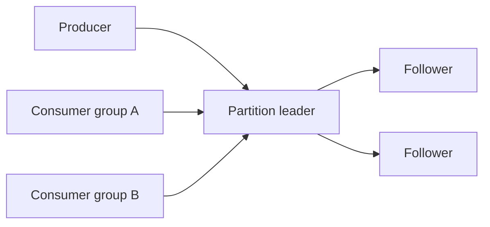

**ISR + `acks=all`:** committed when all in-sync replicas ack.

**Follow-ups:**

- Log compaction vs delete retention?
- KRaft vs ZooKeeper metadata?

---

### Q2. How do you choose the right number of partitions for a Kafka topic?

**What they're really asking:** Parallelism vs ordering, rebalance, and file-handle cost.

**Answer:**

```
partitions >= max(throughput_target / per_partition_throughput, consumer_instances)
```

**More partitions ↑:** throughput, consumer parallelism.

**More partitions ↓:** end-to-end latency, rebalance time, broker memory/file handles, leader election duration.

**Guidelines:**

- Default starting point: **6–12**
- High-volume logs: **50–100+**
- Admin/config topics: **1–3**

**One-way door:** decreasing partitions requires new topic + migration; increasing breaks key ordering for existing keys.

**Follow-ups:**

- Hot partition from skewed keys?
- Benchmark methodology?

---

### Q3. Explain consumer groups and partition assignment. What happens during a rebalance?

**What they're really asking:** Coordination, stop-the-world, cooperative sticky.

**Answer:**

Each partition → **exactly one** consumer in the group. Max active consumers = partition count.

**Eager rebalance:** all consumers stop → revoke all → reassign → resume (pause during rebalance).

**Cooperative (incremental) sticky:** only move partitions that must change.

```java
props.put(ConsumerConfig.PARTITION_ASSIGNMENT_STRATEGY_CONFIG,
    CooperativeStickyAssignor.class.getName());
props.put(ConsumerConfig.GROUP_INSTANCE_ID_CONFIG, "order-processor-1"); // static membership
```

**Assignors:** Range, RoundRobin, Sticky, CooperativeSticky.

**Follow-ups:**

- `session.timeout.ms` vs `max.poll.interval.ms`?
- Rebalance storm during deploy?

---

### Q4. What are the different delivery guarantees in Kafka, and how do you achieve exactly-once semantics?

**What they're really asking:** At-most / at-least / EOS mechanisms and limits.

**Answer:**

| Guarantee | Producer | Consumer |
|-----------|----------|----------|
| **At-most-once** | No retry | Commit before process |
| **At-least-once** | Retry | Commit after process |
| **Exactly-once (Kafka)** | Idempotent + transactions | `read_committed` |

```java
props.put(ProducerConfig.ENABLE_IDEMPOTENCE_CONFIG, true); // PID + sequence dedup

producer.initTransactions();
producer.beginTransaction();
// consume → transform → produce
producer.sendOffsetsToTransaction(offsets, consumer.groupMetadata());
producer.commitTransaction();
```

**Limits:** EOS **inside Kafka** only; external DB needs idempotent writes/outbox. Transactions add latency (~50–100ms) and coordinator throughput limits.

**Follow-ups:**

- `isolation.level=read_committed` behavior?
- EOS with external sink?

---

### Q5. How do you design Kafka topics for a microservices architecture?

**What they're really asking:** Topic granularity, keys, schema, retention.

**Answer:**

**Granularity:** prefer **domain topics** (`user-events`) with `eventType` field vs hundreds of micro-topics — preserves cross-event ordering.

**Keys:** hash to partition — `userId` for per-user order; watch **hot keys**.

**Schema Registry:** Avro/Protobuf + **BACKWARD** or **FULL** compatibility.

**Retention:**

- `retention.ms` — event log
- `cleanup.policy=compact` — latest state per key (config, KTable changelog)

**Follow-ups:**

- Event envelope standards (CloudEvents)?
- Compacted vs delete topics per use case?

---

### Q6. Explain Kafka's offset management. How do you handle offset commits in failure scenarios?

**What they're really asking:** Auto-commit pitfalls; external offset store.

**Answer:**

Offsets live in **`__consumer_offsets`**.

| Mode | Risk |
|------|------|
| **Auto-commit** | Crash after process → duplicate; crash before process → skip |
| **commitSync after batch** | At-least-once; blocking |
| **commitAsync** | Faster; failed commit may be skipped — sync on shutdown |
| **Per-partition commit** | Finer progress |
| **External store in DB txn** | Atomic with side effect — true app-level EOS |

```java
// External offset pattern (pseudocode)
db.transaction(() -> {
  db.upsert(businessRow);
  db.upsert("offsets", partition, offset);
});
consumer.seek(partition, db.loadOffset(partition));
```

**Follow-ups:**

- Duplicate handling idempotency keys?
- Offset commit with transactions?

---

### Q7. How does Kafka handle broker failures and leader election? What is the role of the ISR?

**What they're really asking:** `acks`, `min.insync.replicas`, unclean election.

**Answer:**

**Leader** serves reads/writes; **followers** replicate.

**ISR:** replicas caught up within `replica.lag.time.max.ms`.

```
acks=0   → fire and forget
acks=1   → leader only (loss if leader dies before replicate)
acks=all + min.insync.replicas=2 (RF=3) → durable commit
```

**Unclean election:** `unclean.leader.election.enable=false` in prod — prefer unavailability over data loss.

**KRaft:** Raft quorum for metadata; no ZooKeeper (3.3+ GA path).

**Follow-ups:**

- Controller failover?
- Rack-aware replica placement?

---

### Q8. What is Kafka Streams and how does it differ from other stream processing frameworks?

**What they're really asking:** Library vs cluster (Flink/Spark).

**Answer:**

**Kafka Streams** = JVM library; scales with partition count; state in **RocksDB** + changelog topics; EOS with transactions.

```java
KStream<String, Order> orders = builder.stream("orders");
orders.groupByKey()
  .windowedBy(TimeWindows.ofSizeWithNoGrace(Duration.ofHours(1)))
  .aggregate(() -> 0.0, (k, o, tot) -> tot + o.getAmount(),
    Materialized.as("revenue-store"))
  .toStream().to("hourly-revenue");
```

| Choose Kafka Streams | Choose Flink |
|---------------------|--------------|
| Kafka-only I/O | Multi-source/sink |
| Deploy with app | Independent scale |
| Moderate complexity | CEP, advanced watermarks |

**Follow-ups:**

- DSL vs Processor API?
- State store recovery time?

---

### Q9. Explain Kafka Connect and how you would use it to build a CDC pipeline.

**What they're really asking:** Connect workers, Debezium, SMTs, DLQ.

**Answer:**

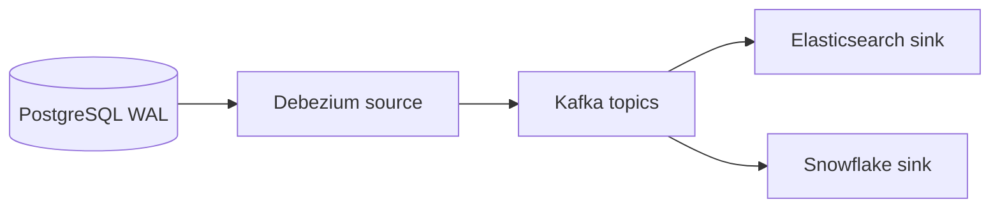

**Debezium:** snapshot then stream; topics like `cdc.public.orders`.

**Ops:** schema registry for DDL; snapshot duration on large tables; `errors.tolerance=all` + DLQ; SMTs for routing.

**Follow-ups:**

- Initial snapshot without overloading DB?
- Exactly-once Connect (3.3+)?

---

### Q10. How would you handle message ordering guarantees across multiple partitions?

**What they're really asking:** Partition key first; reorder buffers; outbox.

**Answer:**

**Strategy 1 — partition key (preferred):**

```java
new ProducerRecord<>("order-events", orderId, event); // same key → same partition
```

**Strategy 2 — sequence numbers + consumer buffer** (PriorityQueue by sequence).

**Strategy 3 — single partition** (global order, limited throughput).

**Strategy 4 — event-time + window grace** in Kafka Streams.

**Strategy 5 — transactional outbox** + single-threaded relay / Debezium on outbox table.

**Follow-ups:**

- Salting hot keys while preserving order?
- Outbox vs CDC trade-offs?

---

### Q11. What is log compaction and when would you use it?

**What they're really asking:** Key-value retention model on the log.

**Answer:**

`cleanup.policy=compact` keeps **latest value per key**; tombstone (`null` value) deletes key after `delete.retention.ms`.

**Use cases:**

- Kafka Streams state changelog
- Config distribution (`serviceName` → config JSON)
- Materialized `user_id` → profile
- Debezium compacted topics for bootstrap state

**Pitfall:** tail is not compacted immediately — consumers may see duplicate keys until compaction runs.

```bash
kafka-topics.sh --create --topic user-profiles \
  --config cleanup.policy=compact \
  --config min.cleanable.dirty.ratio=0.5
```

**Follow-ups:**

- Tombstone visibility for slow consumers?
- Compaction + transactions?

---

### Q12. How would you monitor a Kafka cluster in production? What are the key metrics?

**What they're really asking:** Lag, URP, offline partitions — cause vs symptom.

**Answer:**

| Category | Metric | Meaning |
|----------|--------|---------|
| Broker | `UnderReplicatedPartitions` | ISR &lt; RF — **critical** |
| Broker | `OfflinePartitionsCount` | No leader — **critical** |
| Broker | `ActiveControllerCount` | Must be 1 |
| Broker | Request handler idle % | &lt;20% = saturated |
| Producer | `record-error-rate`, p99 latency | Delivery issues |
| Consumer | **lag** (`records-lag-max`) | Processing behind |
| Consumer | rebalance rate/duration | Unstable members |

**Alerting starters:** URP &gt;0 for 5m; offline partitions &gt;0; lag growth 15m.

**Tools:** JMX → Prometheus, Grafana, **Burrow** for lag analysis.

**Follow-ups:**

- Lag vs processing time vs fetch rate?
- Multi-cluster monitoring?

---

### Q13. How do you handle schema evolution in Kafka?

**What they're really asking:** Registry, compatibility modes, safe deploy order.

**Answer:**

| Mode | Rule | Deploy order |
|------|------|--------------|
| BACKWARD | New schema reads old data | Consumers first |
| FORWARD | Old reads new | Producers first |
| FULL | Both | Independent |
| NONE | Dev only | — |

**Safe:** add optional field with default. **Unsafe:** remove required field, type change, rename (Avro = remove+add).

```bash
curl -X POST .../compatibility/subjects/orders-value/versions/latest \
  -d '{"schema": "..."}'
```

**Follow-ups:**

- Protobuf vs Avro in gRPC shops?
- Breaking change emergency rollback?

---

### Q14. Describe a scenario where Kafka can lose messages. How do you prevent it?

**What they're really asking:** Durability is configuration-dependent.

**Answer:**

| Scenario | Prevention |
|----------|------------|
| `acks=1` + leader crash | `acks=all`, `min.insync.replicas=2`, RF=3 |
| Unclean leader election | `unclean.leader.election.enable=false` |
| Fire-and-forget producer | Handle `send()` callback / failures |
| Auto-commit consumer | Manual commit after process |
| All replicas disk loss | Rack awareness, tiered storage to object store |
| Retention &lt; consumer downtime | Monitor lag; extend retention / tiered storage |

**Production bundle:**

```properties
acks=all
enable.idempotence=true
min.insync.replicas=2
replication.factor=3
unclean.leader.election.enable=false
enable.auto.commit=false
```

**Follow-ups:**

- Correlated rack failure?
- Message size limits?

---

### Q15. You need to migrate a high-throughput system from RabbitMQ to Kafka. What is your approach?

**What they're really asking:** Paradigm shift with zero reckless cutover.

**Answer:**

| Phase | Work |
|-------|------|
| **1. Assessment** | Map exchanges/queues → topics/groups; note priority queues (no 1:1) |
| **2. Dual-write** | Bridge RabbitMQ → Kafka; count/compare |
| **3. Shadow consumers** | Kafka consumers without side effects; diff outputs |
| **4. Incremental cutover** | One consumer at a time; feature flags |
| **5. Producer migration** | Write Kafka only; decommission Rabbit |

**Semantic gaps:** push vs pull, routing keys → headers/keys, fanout → multiple consumer groups.

**Follow-ups:**

- Rollback per service?
- Latency SLO during bridge?
- Ordering differences in shadow phase?

---

## Senior Pitfalls

| Mistake | Impact | Fix |
|---------|--------|-----|
| Missing indexes on hot query paths | p99 latency and full table scans | EXPLAIN in CI, index advisors, query review for new APIs |
| Long transactions holding row locks | Cascading timeouts and deadlocks | Short transactions, optimistic locking, queue heavy work |
| Replication lag treated as “async only” | Stale reads break UX and fraud checks | Read-your-writes routing, lag metrics, fall back to primary |
| Sharding without rebalancing story | Hot shards and manual firefighting | Consistent hashing + virtual nodes, automated resharding plan |
| Using Redis as primary database | Data loss on eviction/failover | Persistence tier + TTL discipline; Redis for cache/session only |
| Message broker as source of truth without outbox | Lost events on DB commit failure | Transactional outbox + relay, idempotent consumers |

---

## Production-grade Practice

1. Take one production-shaped query and optimize it: capture **before/after** EXPLAIN, index choice, and p99 under load test.
2. Design **read replica** routing for a read-heavy service; simulate replica lag and verify monotonic read or sticky-session behavior.
3. Prototype **transactional outbox** from Postgres to a queue; measure end-to-end latency and duplicate delivery rate.
4. Write a **migration runbook** for zero-downtime column add (expand/contract) including backfill job and validation queries.
